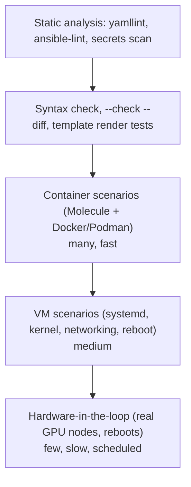

# 4.13 Testing Ansible: ansible-lint, Molecule and CI

| | |
|---|---|
| Level | Intermediate |
| Priority tier | 1 |
| Lab venue | Docker/Podman; `pip install molecule molecule-plugins[docker] ansible-lint yamllint pytest-testinfra` |
| Part | Part 4: Automation and infrastructure as code |
| Status | Drafted, labs **untested** |

## Why this matters for AI infrastructure

Ansible code runs as root on production machines. The cost of an untested role is measured in drained nodes, broken drivers, and unplanned reboots across a cluster. Unlike application code, you cannot unit-test a role against a mock: its behaviour is the effect on an operating system. You can, however, test it cheaply and repeatedly in disposable containers and VMs, check that a second run changes nothing, and verify the resulting state. This chapter builds a test pyramid for automation: lint, syntax, dry-run, converge-and-verify, idempotence, upgrade paths, and the small tier that needs real GPUs.

## Prerequisites and outcomes

Needs 4.6, 4.8, 4.11, and the testing mindset from 3.9. After this chapter you can:

- Configure `yamllint` and `ansible-lint` (profiles, rules, skips, custom rules) and wire them into pre-commit and CI.
- Run syntax and `--check --diff` tests and know their limits.
- Create Molecule scenarios (driver, platforms, provisioner, converge, idempotence, verify, side effects, destroy), including multi-platform matrices and multi-host scenarios.
- Write verification with `ansible.builtin.assert`/`uri`/`command` or `testinfra`; test handlers, templates and error paths.
- Test what containers cannot (systemd, kernel modules, drivers, reboots) using VMs or labelled hardware runners and decide what to cover where.
- Integrate tests in CI with caching, matrices, scheduled runs and release gates; test upgrades from old versions.

## 1. Test pyramid for Ansible



Each layer catches different bugs: lint finds style, deprecated syntax and risky constructs; syntax/check finds structural errors; container Molecule finds logic and idempotency bugs for user-space configuration; VMs cover kernel/systemd/network behaviour; hardware tests cover drivers, firmware, fabrics. Put most tests low in the pyramid and reserve expensive tiers for risks only they can reveal.

## 2. Static analysis

### yamllint

```yaml
# .yamllint
extends: default
rules:
  line-length: { max: 160, level: warning }
  truthy: { allowed-values: ["true", "false"], check-keys: false }
  comments: { min-spaces-from-content: 1 }
  comments-indentation: disable
  braces: { max-spaces-inside: 1 }
  document-start: disable
ignore: |
  .git/
  collections/
  molecule/*/__pycache__/
```

### ansible-lint

`ansible-lint` checks playbooks, roles, collections and task files for rule violations (naming, FQCN, `command` instead of module, missing `changed_when`, risky file permissions, deprecated syntax, `no-handler`, `package-latest`, jinja spacing, YAML formatting) and can auto-fix some (`--fix`).

```yaml
# .ansible-lint
profile: production            # null, min, basic, moderate, safety, shared, production (strictest)
exclude_paths: [.cache/, collections/, molecule/default/collections/]
enable_list: [args, empty-string-compare, no-log-password, no-same-owner]
skip_list: []                  # prefer targeted inline skips with justification
warn_list: [experimental, role-name]
offline: true                  # don't download collections during lint in CI (install them first)
```

```bash
ansible-lint                              # lint the repo per config
ansible-lint --profile production roles/gpu_driver
ansible-lint --fix=all                    # apply safe automatic fixes
ansible-lint -L                           # list rules
ansible-lint --format sarif -q > lint.sarif   # for code-scanning dashboards
```

Inline skips with justification: `# noqa: command-instead-of-module` (task line) or `tags: [skip_ansible_lint]` (legacy). Treat skips as debt and review them. Profiles progress from basic correctness to full production hygiene: adopt `production` for new repositories and ratchet legacy code up one profile at a time.

Other static tools: `yamllint`, `shellcheck` for embedded scripts, `gitleaks` (4.12), `jinja2` linters (`j2lint`), `ansible-playbook --syntax-check`, `ansible-inventory --graph` against test inventories, `check-jsonschema` for variable files with a JSON Schema describing your inventory conventions, `pre-commit` to run all of these locally (4.1).

## 3. Syntax, check mode and render tests

- **Syntax**: `ansible-playbook playbooks/site.yml --syntax-check -i inventories/lab` for each playbook in CI (include variants for each environment so conditional imports are exercised).
- **Check mode**: `--check --diff` against a test inventory (containers or a lab) catches module argument errors and shows intended changes; limitations from 4.6 apply. On a freshly created host check mode may fail legitimately because prerequisites are not yet installed; use it for *drift* tests on already-converged hosts.
- **Render tests for templates**: render each template with representative variable sets (including optional values unset) using the `template` module against `localhost` or Python Jinja2 in unit tests (3.9), compare with golden files, and validate with the target tool (`nginx -t`, `sshd -t`, `visudo -cf`, `promtool check config`). Many bugs live in templates; a golden-file test makes diffs visible in code review.
- **Variable schema**: a JSON Schema or argument spec for role inputs, tested with valid and invalid fixtures.

## 4. Molecule

Molecule is the standard framework for testing roles and collections: it creates instances, runs your role, checks idempotence, verifies results, and destroys instances. Scenarios live in `molecule/<name>/` (the default scenario is `default`).

### Install and initialise

```bash
python3 -m venv .venv && source .venv/bin/activate
pip install "molecule>=6" "molecule-plugins[docker]" ansible-core ansible-lint yamllint pytest-testinfra
cd roles/kernel_tuning
molecule init scenario default --driver-name docker      # or run `molecule init role` for a new role
```

### Scenario files

```yaml
# molecule/default/molecule.yml
driver:
  name: docker
platforms:
  - name: ubuntu2204
    image: geerlingguy/docker-ubuntu2204-ansible:latest      # pin by digest in real use
    pre_build_image: true
    privileged: false
    command: ""
    volumes: ["/sys/fs/cgroup:/sys/fs/cgroup:rw"]
    cgroupns_mode: host
    tmpfs: ["/run", "/tmp"]
  - name: rocky9
    image: geerlingguy/docker-rockylinux9-ansible:latest
    pre_build_image: true
    privileged: false
    volumes: ["/sys/fs/cgroup:/sys/fs/cgroup:rw"]
    cgroupns_mode: host
provisioner:
  name: ansible
  config_options:
    defaults:
      callbacks_enabled: profile_tasks
      interpreter_python: auto_silent
  inventory:
    group_vars:
      all:
        kernel_tuning_sysctl_extra: { vm.dirty_ratio: 10 }
verifier:
  name: ansible
```

```yaml
# molecule/default/converge.yml
- name: Converge
  hosts: all
  become: true
  gather_facts: true
  roles:
    - role: kernel_tuning
```

```yaml
# molecule/default/verify.yml (Ansible-native verifier)
- name: Verify
  hosts: all
  gather_facts: false
  tasks:
    - name: Read sysctl value
      ansible.builtin.command: sysctl -n vm.swappiness
      register: swp
      changed_when: false
    - name: Assert desired value
      ansible.builtin.assert:
        that: swp.stdout | int == 1
        fail_msg: "swappiness is {{ swp.stdout }}"
    - name: Persisted in sysctl.d
      ansible.builtin.slurp: { src: /etc/sysctl.d/90-kernel-tuning.conf }
      register: persisted
    - ansible.builtin.assert:
        that: "'vm.swappiness' in (persisted.content | b64decode)"
```

### The test sequence

```bash
molecule test               # full: dependency, lint(optional), cleanup, destroy, syntax, create, prepare, converge, idempotence, side_effect, verify, cleanup, destroy
molecule create             # create instances
molecule converge           # apply the role (iterate quickly during development)
molecule idempotence        # run again; fails if any task reports changed
molecule verify             # run verifier
molecule login -h ubuntu2204   # shell into an instance to debug
molecule destroy
molecule test --all         # all scenarios
molecule test -s upgrade
```

Key stages:

- **`prepare.yml`** (optional): set up prerequisites that are not under test (install Python, create a fake `/dev` file, start a mock service).
- **`converge.yml`**: apply the role/playbook under test with test variables.
- **`idempotence`**: reruns converge and fails if any task reports `changed`. This one check finds the majority of subtle bugs (`command` without `changed_when`, templates with timestamps, `lineinfile` regex mismatch).
- **`side_effect.yml`** (optional): perform an action between runs, such as deleting a managed file or killing a service, then converge again and verify the role **repairs** it (drift correction test).
- **`verify`**: assert on final state; keep verifications independent of how the role did the work.
- Run `molecule test` locally and in CI; use `molecule converge` + `verify` loops during development; keep instances after failure with `molecule test --destroy never`.

### Verification options

- **Ansible-native** (`verifier: ansible`): assertions with modules (`assert`, `stat`, `slurp`, `uri`, `command`, `service_facts`, `package_facts`). No extra dependency; good for most roles.
- **testinfra** (Python, pytest): expressive host assertions.

```python
# molecule/default/tests/test_default.py
def test_sysctl_persisted(host):
    f = host.file("/etc/sysctl.d/90-kernel-tuning.conf")
    assert f.exists and f.contains("vm.swappiness")

def test_chrony_running(host):
    s = host.service("chrony") if host.system_info.distribution == "ubuntu" else host.service("chronyd")
    assert s.is_running and s.is_enabled

def test_port_listening(host):
    assert host.socket("tcp://127.0.0.1:9400").is_listening
```

Use `verifier: name: testinfra` with the plugin; run with `molecule verify`. Other options: `goss`/`serverspec`, `inspec`. In *Ansible: Up and Running* Chapter 14 (`Examples 14-6` & `14-7`, modeled in `code/part04/ansible_testing_molecule.py`), the authors also demonstrate **Goss** (`molecule init scenario -r ssh --driver-name docker --verifier-name goss goss`), which verifies host state declaratively in YAML (`molecule/goss/tests/test_sshd.yml` asserting `file: /etc/ssh/ssh_host_ed25519_key.pub: { exists: true, mode: '0644', owner: root, group: root, contains: ['ssh-ed25519 '] }`, `port: tcp:22: { listening: true }`, `service: sshd: { enabled: true, running: true }`, and `user: sshd: { exists: true }` via `/usr/local/bin/goss -g test_sshd.yml v -f tap`), as well as **`ansible-later`** (`.later.yml`) alongside `yamllint` and `ansible-lint`.

### Multi-platform and multi-host scenarios (`docker_networks` and `desired_state`, `AUR` Chapter 14)

Test on each supported OS (Ubuntu 22.04/24.04, Rocky/RHEL 8/9, or even Windows Server VMs via the `vagrant` + `virtualbox` driver as in `AUR` Chapter 14 `Example 14-2`) via the `platforms` list or a CI matrix passing `MOLECULE_DISTRO`. For roles requiring multiple hosts (Slurm controller + compute nodes, PostgreSQL primary + replica, nginx + app, or a 3-node Redis + Sentinel cluster `redis1..3_centos7` in `AUR` Chapter 14 `Example 14-3`), define several platforms with **`groups:`** (`redis_server`, `redis_sentinel`) and a custom **`docker_networks:`** bridge subnet (`subnet: '10.16.0.0/24'` with static IPs `10.16.0.10`, `10.16.0.11`, `10.16.0.12`) in `molecule.yml` so `converge.yml` can test multi-node discovery and failover. And when a role supports both installation and clean removal via a `desired_state` variable (`include_tasks: "{{ desired_state }}.yml"` dispatching to `present.yml` or `absent.yml`, `AUR` Chapter 14 `Examples 14-4` & `14-5`), test both `desired_state: present` and `desired_state: absent` in Molecule.

### Drivers and what containers cannot do

| Driver | Use | Limits |
|---|---|---|
| Docker/Podman | Fast, cheap, CI-friendly | Shared kernel: no kernel module loading, no sysctl on non-namespaced keys, limited systemd (use systemd-enabled images with cgroup mounts), no reboot, no real NICs, no GPUs (unless the host provides them) |
| Vagrant (libvirt/VirtualBox) | Full VM: own kernel, systemd, reboot, bridges | Slower; local or self-hosted runner |
| Cloud (EC2/GCE/Azure via molecule-plugins) | Realistic networks and instance types | Cost and cleanup; GPU instances expensive |
| Delegated | Your own provisioning | Maximum flexibility |
| Lima/Multipass, KVM, Proxmox | Local/lab VMs | Setup effort |

Design guidance for GPU roles: split logic so most of the role is testable in containers (package repository configuration, templates, unit files, configuration validation with a **stub `nvidia-smi`** script), and add a small **hardware tier** that runs on labelled self-hosted runners with real GPUs for driver install, `nvidia-smi`, `dcgmi diag -r 1`, Fabric Manager, MIG, container toolkit and a short NCCL test. Mark them (`molecule test -s gpu_hw`) and schedule them nightly or on release branches rather than on every push; ensure the GPU runner cleans up (reboots into a known image) after each run. NVIDIA data-centre drivers will not install in an unprivileged container, so do not pretend to test them there: test everything around them.

### Testing handlers, errors and upgrades

- **Handlers**: converge twice with a change between (side effect or changed variable) and verify the service restarted (compare `ActiveEnterTimestamp` or a unit invocation id) or that a marker file was created by the handler in test mode.
- **Failure paths**: a scenario with invalid inputs verifies that argument specs fail with the expected message (`ansible-playbook` expecting failure: use `failed_when` inversion with `block/rescue`, or a CI step that asserts non-zero exit).
- **Upgrade tests**: converge with version N-1 of the role/variables, then with the new version, then verify state and idempotence; essential for drivers and databases. Keep a `prepare.yml` that installs the old state.
- **Drift tests** (`side_effect.yml`): corrupt state (edit a config file, stop a service, change a sysctl) then converge and verify repair.

## 5. Testing playbooks and collections

- Playbooks (not just roles) can be a Molecule scenario using a `converge.yml` that imports the playbook with a test inventory. For monorepos, a `molecule/` directory at the repository root with multi-host scenarios mirrors the full topology on a smaller scale (3 nodes representing login, controller, compute).
- **Collections**: `ansible-test sanity` (style, docs, import checks, validate-modules for module docs), `ansible-test units` (pytest for module code), `ansible-test integration` (targets in `tests/integration/targets/*`) in Docker, matrices over ansible-core versions and Python versions per the collection's support policy.
- **Module unit tests**: custom modules (4.15) should have pytest unit tests with `AnsibleModule` mocked (`set_module_args`, `exit_json` patched) plus integration tests.
- **Inventory plugin tests**: unit test with canned API responses (`responses`/`respx`, 3.9) for dynamic inventory logic.

## 6. CI integration

```yaml
# .github/workflows/ansible-ci.yml
name: ansible-ci
on:
  pull_request:
  push: { branches: [main] }
  schedule: [ { cron: "0 4 * * *" } ]                 # nightly: catch upstream/distro drift
permissions: { contents: read }
jobs:
  lint:
    runs-on: ubuntu-latest
    steps:
    - uses: actions/checkout@v4
    - uses: actions/setup-python@v5
      with: { python-version: "3.12", cache: pip }
    - run: pip install -r requirements-dev.txt && ansible-galaxy collection install -r requirements.yml
    - run: yamllint . && ansible-lint

  molecule:
    needs: lint
    runs-on: ubuntu-latest
    strategy:
      fail-fast: false
      matrix:
        role: [kernel_tuning, chrony_client, dcgm_exporter]
        distro: [ubuntu2204, rockylinux9]
    steps:
    - uses: actions/checkout@v4
    - uses: actions/setup-python@v5
      with: { python-version: "3.12", cache: pip }
    - run: pip install -r requirements-dev.txt
    - name: Molecule
      run: cd roles/${{ matrix.role }} && molecule test
      env:
        MOLECULE_DISTRO: ${{ matrix.distro }}
        PY_COLORS: "1"
        ANSIBLE_FORCE_COLOR: "1"

  gpu-hw:
    if: github.event_name == 'schedule' || contains(github.event.pull_request.labels.*.name, 'test-gpu')
    runs-on: [self-hosted, gpu]
    steps:
    - uses: actions/checkout@v4
    - run: cd roles/gpu_driver && molecule test -s gpu_hw
```

(Action versions and runner labels are examples.) CI practices:

- **Cache** pip and collections; pin `ansible-core` and Molecule versions; use pinned container images (by digest) for platforms so tests are reproducible; refresh them on a schedule to detect upstream breakage.
- **Matrix** across supported OSes and ansible-core versions (current and previous LTS-ish lines); allow experimental versions to fail without blocking.
- **Path filters** so role tests run only when that role changes; run all nightly.
- **Required checks** on protected branches (4.2); publish JUnit/SARIF and Molecule logs as artefacts.
- **Release gates**: tag releases only if lint and the full matrix pass; collection builds happen after tests; sign artefacts.
- **Speed**: use prebuilt Molecule images with Python and systemd already configured; run scenarios in parallel; reuse instances during local development (`molecule converge`, not `test`).
- **Security**: tests run arbitrary code; keep untrusted PRs on runners without credentials; no secrets in Molecule inventories.

## 7. What to test: a checklist per role

1. Converges on every supported platform without errors.
2. Second run reports zero changes (idempotence).
3. Desired state verified (files, services, ports, kernel parameters, users, permissions).
4. Variable overrides take effect; defaults are sane; invalid inputs fail clearly.
5. Handlers fire when config changes and do not when it doesn't.
6. Drift is repaired (delete a file, stop a service, converge again).
7. Upgrades from the previous version work.
8. Uninstall/`state: absent` paths work if offered.
9. Check mode does not error (where applicable).
10. No secrets in logs (`no_log` honoured) and file modes correct.
11. Documentation examples are the tested scenarios.

## 8. Troubleshooting Molecule

| Symptom | Likely cause | Fix |
|---|---|---|
| Container starts but systemd services fail | Image without systemd, wrong cgroup mounts | Use a systemd-ready image; mount cgroups; `cgroupns_mode: host`; or use VMs |
| `Failed to connect` / Python missing | Image lacks Python | Use an Ansible-ready image or run `prepare.yml` to install it via `raw` |
| Idempotence fails | A task reports changed on rerun | Run `molecule converge` twice with `-vv`; inspect the task; add `changed_when`, fix template/regex |
| Role not found | Molecule runs from the wrong directory or roles path | Run from the role directory, set `ANSIBLE_ROLES_PATH`, install dependencies via `requirements.yml` in `molecule/default/` |
| Collections missing in CI | Not installed in the Molecule environment | `dependency: name: galaxy options: requirements-file: requirements.yml` |
| Slow tests | Image pulls, fact gathering, serial scenarios | Pre-pull images, cache, run matrix in parallel, `gather_subset` |
| Tests pass in Docker, fail on real hosts | Kernel/systemd/network differences | Add VM tier; avoid container-specific assumptions |
| Leftover instances | Aborted run | `molecule destroy`; `docker ps -a \| grep molecule` cleanup |

## 9. Lab

First, run the self-checking Python lab (`code/part04/ansible_testing_molecule_lab.py`) locally. It verifies `ansible-lint` production rule checks (`check_ansible_lint_rules`: `name[missing]`, `fqcn[action-core]`, `command-instead-of-module`, `no-changed-when`, `risky-shell-pipe`, `risky-file-permissions`, `package-latest`), the complete Molecule scenario lifecycle (`run_molecule_lifecycle`: `create -> converge -> idempotence -> side_effect -> repair -> verify -> destroy`), and Goss `test_sshd.yml` host verification (`evaluate_goss_sshd_spec`, `AUR` Ch. 14).

```bash
python3 code/part04/ansible_testing_molecule_lab.py
```

Next, on any machine with Docker/Podman and `molecule` / `ansible-lint` / `pytest-testinfra` (all interactive shell steps below are `untested here`), work through these exercises:

1. **Static gate**: add `.yamllint`, `.ansible-lint` (profile `production`), pre-commit hooks; run on the 4.9/4.11 content; fix findings; add a deliberate violation and watch CI fail.
2. **Molecule scenario**: initialise a Docker scenario for `kernel_tuning` (or another role) on two distros; write converge and Ansible-native verify; run `molecule test`.
3. **Idempotence bug hunt**: add a task with `command: echo >> file`; watch idempotence fail; fix with a module.
4. **Side effect**: add `side_effect.yml` that deletes the managed file and stops a service; confirm the role repairs both.
5. **testinfra**: rewrite verification with testinfra tests; compare readability and speed.
6. **Template tests**: golden-file render tests for a Slurm/NCCL template with several variable sets; run through `nginx -t`/`promtool` analogues where possible.
7. **Argument spec failure**: add a scenario passing an invalid value; assert the expected failure message.
8. **Upgrade test**: converge with the old role version (from Git tag) then the new one; verify state; document any non-idempotent migrations.
9. **Multi-host**: build a three-container scenario (controller, two nodes) for a Slurm-like role with a stub scheduler; verify cross-host config rendering from `hostvars`.
10. **GPU stub**: create a fake `nvidia-smi` script used by the driver role's validate tasks in containers; then describe the extra hardware scenario that would run on a real GPU runner.
11. **CI**: implement the workflow with a matrix and path filters; add the nightly schedule; make lint and Molecule required checks.
12. **Collection tests**: run `ansible-test sanity` and a small unit test for a custom filter/module.
13. **Clean up** containers/VMs.

## 10. Common mistakes

- Treating lint passing as correctness; skipping rules wholesale.
- Testing only the happy path on one OS; no idempotence or drift tests.
- Containers pretending to be hosts: testing kernel- or driver-dependent behaviour where it cannot work.
- Unpinned images and tool versions causing random CI breakage (or, conversely, never refreshing and missing upstream changes).
- Verification that re-implements the role logic instead of checking outcomes.
- Molecule tests that depend on the Internet (package mirrors) without caching or retries; flaky tests tolerated.
- Giving CI credentials to untrusted PR runs; Molecule inventories containing secrets.
- Running expensive GPU or VM tiers on every commit, then disabling them when they annoy people.
- No upgrade tests, so the first upgrade happens on production.

## 11. Interview angles

- "How do you test Ansible roles?" (lint, syntax, Molecule converge/idempotence/verify, matrix.)
- "What does Molecule's idempotence test catch?"
- "How do you test a role that installs GPU drivers?" (stub in containers, hardware runner tier, VM tier for kernel.)
- "What can't containers test?" (kernel, reboot, real network/GPU, full systemd).
- "How do you structure CI for many roles?" (path filters, matrix, nightly full run, required checks.)
- "How do you test upgrades and drift correction?"
- "How do you keep tests deterministic?" (pin images/versions, avoid time and network dependencies.)

## Exercises

1. **The 5-Layer Ansible Test Pyramid and Static Analysis (`yamllint`, `ansible-lint`, `ansible-later`, `AUR` Chapter 14):** Using `check_ansible_lint_rules()` in `code/part04/ansible_testing_molecule.py`, explain what each tier of the Ansible test pyramid catches, how `.yamllint` and `.ansible-lint` (`profile: production`, `offline: true`) are configured, and what `fqcn[action-core]`, `command-instead-of-module`, `no-changed-when`, `risky-shell-pipe`, `risky-file-permissions`, and `package-latest` detect.
2. **Molecule Architecture, `molecule.yml`, and the Full `molecule test` Lifecycle (`AUR` Chapters 14 & 22):** Using `run_molecule_lifecycle()` in `code/part04/ansible_testing_molecule.py`, trace all stages of `molecule test` (`dependency`, `cleanup`, `destroy`, `syntax`, `create`, `prepare`, `converge`, `idempotence`, `side_effect`, `verify`, `cleanup`, `destroy`), and explain why `molecule converge` + `molecule verify` (or `--destroy never` + `molecule login`) is used during interactive development.
3. **Comparing Molecule Verifiers: Ansible-Native (`verify.yml`), `Testinfra` (`pytest`), and `Goss` (`test_sshd.yml`, `AUR` Chapter 14):** Using `evaluate_goss_sshd_spec()` in `code/part04/ansible_testing_molecule.py`, compare writing verification assertions in `verify.yml` (`assert`, `slurp`, `command`), `Testinfra` (`host.file`, `host.service`, `host.socket`), and `Goss` (`test_sshd.yml` TAP output).
4. **Multi-Host / Multi-Network Scenarios (`docker_networks`), `desired_state` (`present` vs. `absent`), Drift (`side_effect.yml`), and Upgrade Testing (`AUR` Chapter 14):** Show how `molecule.yml` defines a 3-node cluster with `groups:` and `docker_networks:` (`10.16.0.0/24`, `10.16.0.10..12`), how `side_effect.yml` tests drift self-healing, how `prepare.yml` tests `N-1 -> N` version upgrades, and how `desired_state: absent` tests clean uninstallation.
5. **Container Limits vs. VMs vs. Hardware-in-the-Loop GPU Runners (`molecule test -s gpu_hw`):** Contrast what can be tested inside unprivileged systemd Docker/Podman containers (with a stub `nvidia-smi` script) versus Vagrant/KVM VMs (kernel modules, non-namespaced sysctls, reboots) versus self-hosted GPU runners (`gpu_hw` scenario testing real NVIDIA drivers, `dcgmi diag -r 1`, Fabric Manager, and MIG).
6. **CI Pipeline Design for Multi-Role Repositories and Collections (`GitHub Actions`, `Jenkinsfile`, and `ansible-test`, `AUR` Chapter 22):** Compare the Section 6 GitHub Actions workflow (`lint -> molecule matrix -> scheduled/labeled gpu-hw`) with `AUR` Chapter 22's declarative `Jenkinsfile` stages (`Syntax -> Linting -> Playbook/converge -> Verification -> Idempotency`) and `ansible-test sanity/units/integration` for collections.

## Checkpoint questions (20)

<details>
<summary>1. What are the five tiers of the Ansible Testing Pyramid from fastest/cheapest to slowest/most realistic?</summary>

1. **Static analysis (seconds, every commit):** `yamllint`, `ansible-lint`, `gitleaks`, `shellcheck`.
2. **Syntax, render, and `--check --diff` (seconds, every commit/PR):** `ansible-playbook --syntax-check`, offline Jinja2 golden-file template rendering, argument-spec checks.
3. **Container Molecule scenarios (1–3 minutes, every PR):** Ephemeral Docker/Podman systemd containers running `converge`, `idempotence`, `side_effect`, and `verify` across OS families.
4. **VM Molecule scenarios (5–15 minutes, PR or merge):** Ephemeral Vagrant/KVM/cloud VMs testing custom kernels, `modprobe`, non-namespaced `sysctl`s, and `reboot`.
5. **Hardware-in-the-Loop GPU runners (scheduled nightly / release tags):** Labelled self-hosted GPU nodes (`[self-hosted, gpu]`) testing real NVIDIA driver installs, `nvidia-smi`, `dcgmi diag`, NVSwitch Fabric Manager, and NCCL.
</details>

<details>
<summary>2. How do `.yamllint` and `.ansible-lint` complement each other, and what does `profile: production` enforce?</summary>

- **`yamllint`** checks pure YAML syntax and formatting (indentation, line length, duplicate keys, and `truthy: { allowed-values: ["true", "false"] }` blocking `yes`/`no`/`on`/`off`).
- **`ansible-lint`** parses the YAML as Ansible playbooks/roles/collections and enforces escalating rule profiles (`min` -> `basic` -> `moderate` -> `safety` -> `shared` -> **`production`**), catching missing task names, short module names (non-FQCN), `command-instead-of-module`, missing `changed_when`, missing file `mode:`, `state: latest`, and unquoted pipelines without `set -o pipefail`. Setting `offline: true` in `.ansible-lint` prevents CI from reaching out to Galaxy during linting.
</details>

<details>
<summary>3. What is the complete stage sequence executed by `molecule test`, and which two commands do you loop on while developing a role interactively?</summary>

`molecule test` runs the full end-to-end lifecycle:
`dependency -> cleanup -> destroy -> syntax -> create -> prepare -> converge -> idempotence -> side_effect -> verify -> cleanup -> destroy`.
During interactive development, running `molecule test` from scratch on every edit is slow because it destroys and recreates the container every time. Instead, run **`molecule converge`** (which creates the instance once and re-applies the role in seconds) and **`molecule verify`**, use **`molecule login`** to inspect the live container, and run the full **`molecule test`** once finished.
</details>

<details>
<summary>4. How does Molecule's `idempotence` stage work, and what common bugs does it catch?</summary>

After `molecule converge` applies the role to the fresh test instance, `molecule idempotence` immediately runs `converge.yml` a **second time** and parses the `PLAY RECAP`: if **any task reports `changed > 0`**, the `idempotence` stage fails the build. It automatically catches:
1. `command` / `shell` tasks missing `creates:` or `changed_when: false`.
2. Templates containing volatile timestamps (`ansible_date_time`) or unsorted sets/dicts.
3. `lineinfile` tasks whose `regexp:` does not match the `line:` they just inserted.
4. Tasks that toggle state or re-download files on every run.
</details>

<details>
<summary>5. What are `prepare.yml` and `side_effect.yml` used for in a Molecule scenario?</summary>

- **`prepare.yml`:** Runs **once after `create` and before the first `converge`** to set up host prerequisites that are outside the scope of the role under test (for example, bootstrapping Python, seeding a mock `/usr/bin/nvidia-smi` script, or installing version $N-1$ of a package to test an upgrade path).
- **`side_effect.yml`:** Runs **between `converge`/`idempotence` and `verify`** to intentionally inject drift or faults (such as deleting `/etc/sysctl.d/90-kernel-tuning.conf` or stopping `chronyd`), followed by another `converge` and `verify` to prove that the role detects and repairs real-world drift.
</details>

<details>
<summary>6. Compare the three Molecule Verifiers: Ansible-Native (`verify.yml`), `Testinfra` (`test_default.py`), and `Goss` (`test_sshd.yml`, `AUR` Chapter 14).</summary>

- **Ansible-native (`verifier: { name: ansible }`, default):** Runs an Ansible playbook **`verify.yml`** using `assert`, `stat`, `slurp`, `command`, `uri`, and `service_facts`. Requires zero external test frameworks or DSLs.
- **Testinfra (`verifier: { name: testinfra }`):** Runs Python `pytest` functions using the `host` fixture (`host.package("openssh-server").is_installed`, `host.service("sshd").is_running`, `host.file("/etc/ssh/ssh_host_ed25519_key.pub").mode == 0o644`, `host.socket("tcp://127.0.0.1:9400").is_listening`).
- **Goss (`verifier: { name: goss }`, `AUR` Chapter 14 `Example 14-7`):** Evaluates a fast declarative YAML specification (`test_sshd.yml` checking `file:`, `port:`, `service:`, `user:`, `group:`, `process:`) on the target host and emits TAP (`1..18 ok`) results.
</details>

<details>
<summary>7. Why should `verify.yml` / `test_default.py` check independent outcomes rather than copying the role's implementation tasks?</summary>

If a role uses `lineinfile` with a buggy regex to write `/etc/sysctl.d/90-ai.conf` and neglects to reload sysctl, a verifier that simply runs the same `lineinfile` check will pass even though the live kernel parameter was never applied. A good verifier checks the **independent observable outcome**: it runs `sysctl -n vm.swappiness` to assert the live kernel value is `1` *and* reads `/etc/sysctl.d/90-ai.conf` (`slurp` / `host.file`) to assert it will persist across reboots.
</details>

<details>
<summary>8. How do you run `systemd` services inside a Docker/Podman Molecule container (`molecule.yml`)?</summary>

Standard minimal OS containers (`/bin/bash` as PID 1) do not run `systemd`, so `service:` / `systemd_service:` tasks fail with `System has not been booted with systemd as init system (PID 1)`. In `molecule.yml`, use a systemd-enabled base image (`geerlingguy/docker-ubuntu2204-ansible` or `docker-rockylinux9-ansible` where PID 1 is `/lib/systemd/systemd`), mount `/sys/fs/cgroup:/sys/fs/cgroup:rw`, set `cgroupns_mode: host`, and mount `tmpfs: ["/run", "/tmp"]`.
</details>

<details>
<summary>9. What four categories of infrastructure behavior CANNOT be tested reliably inside Docker containers, requiring VMs or physical hardware?</summary>

Because containers share the host's Linux kernel and lack physical PCIe devices:
1. **Kernel modules and boot parameters:** `modprobe nvidia`, `dkms`, initramfs rebuilds, GRUB kernel command-line args (`iommu=pt`), and non-namespaced `/proc/sys` kernel parameters.
2. **Full-node reboots:** `ansible.builtin.reboot` and post-reboot service recovery.
3. **Physical / kernel networking:** `netplan` / NetworkManager bonding, VLAN tagging, InfiniBand IPoIB / RoCEv2 ECN/PFC hardware counters, and eBPF XDP attachment on physical NICs.
4. **Physical GPU / BMC hardware:** Installing the NVIDIA kernel driver against real GPUs, NVSwitch Fabric Manager, MIG partitioning, and DCGM hardware diagnostics.
</details>

<details>
<summary>10. How should you design and test a `gpu_driver` role so 90% of its logic is tested on every PR in cheap containers while the remaining 10% is tested on GPU hardware?</summary>

Split the role's concerns cleanly:
1. **Container Molecule scenario (`default`, runs on every PR):** Tests `meta/argument_specs.yml` validation, OS-family variable loading (`Ubuntu` vs `Rocky`), repository keyring installation, `/etc/modprobe.d/blacklist-nouveau.conf` rendering, `nvidia-persistenced` systemd override templating, and validation task logic against a **mock `/usr/local/bin/nvidia-smi` script** seeded by `prepare.yml`.
2. **Hardware Molecule scenario (`molecule test -s gpu_hw`, runs nightly or when PR is labeled `test-gpu` on `runs-on: [self-hosted, gpu]`):** Runs the full driver package install, module load, `nvidia-smi -L`, `dcgmi diag -r 1`, and MIG configuration on a real GPU node.
</details>

<details>
<summary>11. How do you configure a Multi-Host Molecule Scenario with static IPs and inventory groups (`AUR` Chapter 14 `Example 14-3`)?</summary>

In `molecule.yml`, define a custom Docker bridge network under `docker_networks:` (`name: redis`, `ipam_config: [{subnet: '10.16.0.0/24'}]`) and list multiple entries under `platforms:` (`redis1_centos7` at `10.16.0.10`, `redis2_centos7` at `10.16.0.11`, `redis3_centos7` at `10.16.0.12`, or `slurmctl01` and `gpu01..02`) with **`groups: [redis_server, redis_sentinel]`**. Molecule automatically populates its dynamic inventory with all containers and groups so `converge.yml` can test cross-host `hostvars` templates and cluster quorum formation.
</details>

<details>
<summary>12. How do you test both installation (`desired_state: present`) and clean uninstallation (`desired_state: absent`) of a role (`AUR` Chapter 14)?</summary>

Structure `tasks/main.yml` to dispatch via `include_tasks: "{{ desired_state }}.yml"` (`present.yml` vs `absent.yml`, with `desired_state: present` in `defaults/main.yml`). In Molecule, either add a second play in `converge.yml` (or a dedicated `uninstall` scenario) that runs the role with `desired_state: absent` after verifying `present`, and assert in `verify.yml` that the service is stopped, packages are removed, and config files are absent.
</details>

<details>
<summary>13. How do you test that a role upgrades cleanly from version `v1.3.0` to the current branch in Molecule?</summary>

Create a dedicated scenario `molecule/upgrade/`:
1. In **`prepare.yml`**, install and run the previous released version `v1.3.0` of the role (fetched via `ansible-galaxy` from Git tag `v1.3.0`, or seed the exact file/package layout of `v1.3.0`).
2. In **`converge.yml`**, run the current working-tree version of the role.
3. Run **`idempotence`** and **`verify.yml`** to prove the upgrade migrated old config files, restarted services cleanly, and converged with zero errors.
</details>

<details>
<summary>14. How do you test that a role's `meta/argument_specs.yml` or `assert` task rejects invalid inputs?</summary>

In `converge.yml` (or a dedicated `negative` test task inside `verify.yml`), wrap an `include_role` call passing invalid variables (`gpu_driver_branch: "invalid_999"`) inside a **`block` / `rescue`** structure:
- At the end of `block:`, put `ansible.builtin.fail: { msg: "Role should have rejected invalid input" }` with `when: false` (or set a flag `did_not_fail: true`).
- In `rescue:`, assert that `ansible_failed_result.msg` contains the expected validation error message.
</details>

<details>
<summary>15. How do you test that a role's Handler actually restarted a service when a config file changed, and did NOT restart it when nothing changed?</summary>

In `verify.yml`:
1. Query the service's start timestamp (`systemctl show -p ActiveEnterTimestampMonotonic chronyd`) and register `t1`.
2. Modify a variable or trigger a config change, re-run the role, query `ActiveEnterTimestampMonotonic` into `t2`, and `assert: { that: t2.stdout != t1.stdout }`.
3. Re-run the role a third time without changes, query `t3`, and `assert: { that: t3.stdout == t2.stdout }`.
</details>

<details>
<summary>16. How do `MOLECULE_DISTRO` and a GitHub Actions `matrix` allow one `molecule.yml` file to test multiple Linux distributions in parallel?</summary>

In `molecule/default/molecule.yml`, parameterize the platform image with an environment variable default:
`image: "geerlingguy/docker-${MOLECULE_DISTRO:-ubuntu2204}-ansible:latest"`.
In `.github/workflows/ansible-ci.yml`, define `strategy: { fail-fast: false, matrix: { role: [kernel_tuning, chrony_client], distro: [ubuntu2204, rockylinux9] } }` and pass `env: { MOLECULE_DISTRO: ${{ matrix.distro }} }`—running every `(role, distro)` pair in parallel on separate CI runners.
</details>

<details>
<summary>17. Why should an Ansible CI workflow include a nightly `schedule: [{ cron: "0 4 * * *" }]` trigger in addition to `pull_request` and `push`?</summary>

Even when zero lines of code change in your Ansible repository, **the outside world changes**: upstream apt/dnf repositories rotate GPG keys, Ubuntu or Rocky Linux base images publish new minor packages, or Python transitive dependencies update. A nightly scheduled CI run catches external distro/mirror breakage at 4 a.m. in a test container rather than during an urgent production node scale-up.
</details>

<details>
<summary>18. What do `ansible-test sanity`, `ansible-test units`, and `ansible-test integration` each test inside an Ansible Collection?</summary>

Run from `ansible_collections/<namespace>/<name>/`:
- **`ansible-test sanity --docker default`**: runs static code analysis, PEP 8, Python version compatibility, `DOCUMENTATION`/`EXAMPLES`/`RETURN` schema validation (`validate-modules`), and import checks across all plugins and modules.
- **`ansible-test units`**: runs `pytest` unit tests in `tests/unit/` against custom modules and `module_utils` using mocked `AnsibleModule` objects.
- **`ansible-test integration`**: executes integration test roles in `tests/integration/targets/` inside target containers or VMs.
</details>

<details>
<summary>19. How does `AUR` Chapter 22 map Molecule stages into a declarative `Jenkinsfile` pipeline?</summary>

In `AUR` Chapter 22 (`Figure 22-1`), the role repository's `Jenkinsfile` sets `options { disableConcurrentBuilds(); ansiColor('vga') }` and defines six sequential stages so any failure is immediately visible in the Jenkins Stage View:
1. `stage("Build Environment")` (`python -V`, `ansible --version`, `molecule --version`)
2. `stage("Syntax")` (`molecule syntax`)
3. `stage("Linting")` (`molecule lint`)
4. `stage("Playbook")` (`molecule converge`)
5. `stage("Verification")` (`molecule verify`)
6. `stage("Idempotency")` (`molecule idempotence`)
</details>

<details>
<summary>20. How do you debug a Molecule container when `converge` or `verify` fails locally?</summary>

Run **`molecule test --destroy never`** (or `molecule converge`). Because the container is left running on failure, run **`molecule login`** (or `molecule login -h ubuntu2204` in a multi-host scenario) to drop directly into an interactive root shell inside the container, inspect `/var/log/syslog`, `journalctl -xe`, and rendered files in `/etc/`, iterate with `molecule converge` and `molecule verify`, and finally clean up with **`molecule destroy`**.
</details>

## Sources and review notes

- **Sources read in full:**
  - `ansible-up-and-running-3rd-edition` — Bas Meijer, Lorin Hochstein & René Moser, *Ansible: Up and Running*, 3rd ed., **Chapter 14: Quality Assurance with Molecule** (read in full: `yamllint`, `ansible-lint`, `ansible-later` `.later.yml`, Molecule history created by `@retr0h` in 2015, Molecule drivers `delegated`/`docker`/`podman`/`vagrant`/`azure`/`ec2`/`gce`/`hetznercloud`/`linode`, Windows Vagrant VirtualBox example, multi-container Redis + Sentinel cluster with `docker_networks` `10.16.0.0/24` and `groups`, `desired_state` `present.yml`/`absent.yml`, Goss verifier `test_sshd.yml` with TAP `1..18` output, and Testinfra `testinfra.utils.ansible_runner`) and **Chapter 22: CI/CD and Ansible** (read in full: declarative `Jenkinsfile` mapping Molecule stages `syntax`, `lint`, `converge`, `verify`, and `idempotence`).
- **Run here:** `python3 code/part04/ansible_testing_molecule_lab.py` (3 passed, 0 failed).
- **Explicitly labelled inferences:** The `check_ansible_lint_rules`, `run_molecule_lifecycle`, and `evaluate_goss_sshd_spec` models in `code/part04/ansible_testing_molecule.py`, the `kernel_tuning` `molecule.yml`/`converge.yml`/`verify.yml`/`test_default.py` files, and the GitHub Actions `ansible-ci.yml` workflow are the author's constructions applying *Ansible: Up and Running* Chapters 14 & 22 to GPU infrastructure roles (plus original study items 21, 22, 23, 24, 25, 26, 27, 28, 29, and 30).
- **Not verified on live hardware:** Live `molecule`, `docker`, `ansible-lint`, `pytest-testinfra`, `goss`, and `ansible-test` executions (`molecule>=6`, `160` line-length, `vm.dirty_ratio: 10`, `9400`, `10.16.0.0/24`, `10.16.0.10..12`, `cron: "0 4 * * *"`, `3.12`) are marked (`untested here`) where not executed by `ansible_testing_molecule_lab.py`.
