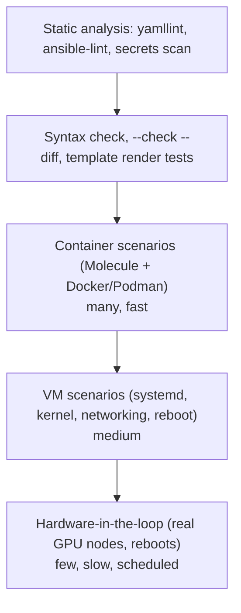

# 4.13 Testing Ansible: ansible-lint, Molecule and CI

| | |
|---|---|
| Level | Intermediate |
| Priority tier | 1 |
| Lab venue | Docker/Podman; `pip install molecule molecule-plugins[docker] ansible-lint yamllint pytest-testinfra` |
| Part | Part 4: Automation and infrastructure as code |
| Status | Drafted, labs **untested** |

## Why this matters for AI infrastructure

Picture a role that you merge on a Friday and that runs against a whole cluster on Monday. Drained nodes, broken drivers and unplanned reboots are the cost when nobody has tested it. You cannot unit-test a role against a mock, because its behaviour is the effect it has on an operating system. You can, however, test it cheaply and repeatedly in disposable containers and VMs. You can check that a second run changes nothing, and you can verify the state it leaves behind. This chapter builds a test pyramid for automation: lint, syntax, dry-run, converge-and-verify, idempotence, upgrade paths, and the small tier that needs real GPUs.

## Prerequisites and outcomes

This chapter assumes 4.6, 4.8, 4.11 and the testing mindset from 3.9. When you finish, you should be able to do the following:

- Configure `yamllint` and `ansible-lint` (profiles, rules, skips, custom rules), then wire them into pre-commit and CI.
- Run syntax and `--check --diff` tests, and know where those tests stop being useful.
- Create Molecule scenarios (driver, platforms, provisioner, converge, idempotence, verify, side effects, destroy), including multi-platform matrices and multi-host scenarios.
- Write verification with `ansible.builtin.assert`/`uri`/`command` or `testinfra`, and test handlers, templates and error paths.
- Test what containers cannot (systemd, kernel modules, drivers, reboots) using VMs or labelled hardware runners, and decide what to cover where.
- Integrate tests in CI with caching, matrices, scheduled runs and release gates, and test upgrades from old versions.

## 1. Test pyramid for Ansible

Suppose a role passes lint and syntax checks, then fails on the first real host. The question is which layer should have caught the bug.



Each layer catches different bugs. Lint finds style problems, deprecated syntax and risky constructs. Syntax and check tests find structural errors. Container Molecule scenarios find logic and idempotency bugs in user-space configuration. VMs cover kernel, systemd and network behaviour, and hardware tests cover drivers, firmware and fabrics. Keep most of your tests low in the pyramid, and save the expensive tiers for risks that only they can reveal.

## 2. Static analysis

Static analysis is the cheapest gate you have. It reads your files without running anything, so a mistake shows up in seconds rather than on a host.

### yamllint

`yamllint` checks the YAML files themselves, including indentation, line length and the spacing inside braces. The configuration below sets the rules for this repository. It also ignores `.git/`, `collections/` and the `__pycache__` folders under `molecule/`.

```yaml
# .yamllint
extends: default
rules:
  line-length: { max: 160, level: warning }
  truthy: { allowed-values: ["true", "false"], check-keys: false }
  comments: { min-spaces-from-content: 1 }
  comments-indentation: disable
  braces: { max-spaces-inside: 1 }
  document-start: disable
ignore: |
  .git/
  collections/
  molecule/*/__pycache__/
```

The `truthy` rule allows only `true` and `false`, so values such as `yes`, `no`, `on` and `off` are flagged.

### ansible-lint

`ansible-lint` reads playbooks, roles, collections and task files, then checks them against its rules. Those rules cover naming, FQCN, `command` used where a module exists, missing `changed_when`, risky file permissions, deprecated syntax, `no-handler`, `package-latest`, jinja spacing and YAML formatting. It can fix some of these problems on its own with `--fix`.

```yaml
# .ansible-lint
profile: production            # null, min, basic, moderate, safety, shared, production (strictest)
exclude_paths: [.cache/, collections/, molecule/default/collections/]
enable_list: [args, empty-string-compare, no-log-password, no-same-owner]
skip_list: []                  # prefer targeted inline skips with justification
warn_list: [experimental, role-name]
offline: true                  # don't download collections during lint in CI (install them first)
```

```bash
ansible-lint                              # lint the repo per config
ansible-lint --profile production roles/gpu_driver
ansible-lint --fix=all                    # apply safe automatic fixes
ansible-lint -L                           # list rules
ansible-lint --format sarif -q > lint.sarif   # for code-scanning dashboards
```

Sometimes a rule must be broken on purpose. In that case, add an inline skip with a reason, such as `# noqa: command-instead-of-module` on the task line. The older `tags: [skip_ansible_lint]` form is legacy. Every skip is debt, so review them regularly. The profiles climb from basic correctness to full production hygiene. Start new repositories at `production`, and raise legacy code one profile at a time.

`shellcheck` checks the scripts embedded in your tasks, and `gitleaks` (4.12) scans for leaked secrets. `j2lint` lints the Jinja2 templates. `ansible-playbook --syntax-check` and `ansible-inventory --graph` check playbooks and inventories against your test inventories. `check-jsonschema` validates variable files against a JSON Schema that describes your inventory conventions. Finally, `pre-commit` runs all of these on your own machine, as covered in 4.1.

## 3. Syntax, check mode and render tests

Suppose a template renders fine for one environment and breaks in another, because an optional variable is unset there. Render tests catch that before a host does.

A syntax check reads each playbook without running it, so structural errors show up early. Run `ansible-playbook playbooks/site.yml --syntax-check -i inventories/lab` for each playbook in CI. Include a variant for each environment, so that conditional imports get exercised too.

Check mode shows what would change without changing anything. Running `--check --diff` against a test inventory, whether containers or a lab, catches module argument errors and shows the intended changes. The limits from 4.6 still apply. On a freshly created host, check mode can fail legitimately because prerequisites are not yet installed, so use it for drift tests on hosts that have already converged.

Many bugs live in templates. You can render each template with the `template` module against `localhost`, or with Python Jinja2 in unit tests, as covered in 3.9. Use representative variable sets, including optional values left unset, and compare the output with golden files. Golden-file tests make the diffs visible in code review. Then validate the rendered file with the target tool, such as `nginx -t`, `sshd -t`, `visudo -cf` or `promtool check config`.

Role inputs need checking too. Describe them with a JSON Schema or an argument spec, and test that schema with valid and invalid fixtures.

## 4. Molecule

Suppose you have changed a role and want to know, before you merge, whether it still works on both Ubuntu and Rocky Linux. Molecule automates that check. It is the standard framework for testing roles and collections. It creates instances, runs your role on them, checks idempotence, verifies the results and destroys the instances afterwards. Each test setup lives in a scenario folder, `molecule/<name>/`, and the default scenario is called `default`.

### Install and initialise

Start with a clean virtual environment. The commands below install Molecule, its Docker plugin, Ansible and the test tools. Then they create a `default` scenario for the `kernel_tuning` role.

```bash
python3 -m venv .venv && source .venv/bin/activate
pip install "molecule>=6" "molecule-plugins[docker]" ansible-core ansible-lint yamllint pytest-testinfra
cd roles/kernel_tuning
molecule init scenario default --driver-name docker      # or run `molecule init role` for a new role
```

### Scenario files

A scenario is defined by a few YAML files. `molecule.yml` describes the platforms and the provisioner. `converge.yml` applies the role, and `verify.yml` checks the result.

```yaml
# molecule/default/molecule.yml
driver:
  name: docker
platforms:
  - name: ubuntu2204
    image: geerlingguy/docker-ubuntu2204-ansible:latest      # pin by digest in real use
    pre_build_image: true
    privileged: false
    command: ""
    volumes: ["/sys/fs/cgroup:/sys/fs/cgroup:rw"]
    cgroupns_mode: host
    tmpfs: ["/run", "/tmp"]
  - name: rocky9
    image: geerlingguy/docker-rockylinux9-ansible:latest
    pre_build_image: true
    privileged: false
    volumes: ["/sys/fs/cgroup:/sys/fs/cgroup:rw"]
    cgroupns_mode: host
provisioner:
  name: ansible
  config_options:
    defaults:
      callbacks_enabled: profile_tasks
      interpreter_python: auto_silent
  inventory:
    group_vars:
      all:
        kernel_tuning_sysctl_extra: { vm.dirty_ratio: 10 }
verifier:
  name: ansible
```

The `platforms` list starts one instance per entry, so this scenario tests `ubuntu2204` and `rocky9`. The image comment says to pin by digest in real use.

```yaml
# molecule/default/converge.yml
- name: Converge
  hosts: all
  become: true
  gather_facts: true
  roles:
    - role: kernel_tuning
```

`converge.yml` applies the role to every host in the scenario.

```yaml
# molecule/default/verify.yml (Ansible-native verifier)
- name: Verify
  hosts: all
  gather_facts: false
  tasks:
    - name: Read sysctl value
      ansible.builtin.command: sysctl -n vm.swappiness
      register: swp
      changed_when: false
    - name: Assert desired value
      ansible.builtin.assert:
        that: swp.stdout | int == 1
        fail_msg: "swappiness is {{ swp.stdout }}"
    - name: Persisted in sysctl.d
      ansible.builtin.slurp: { src: /etc/sysctl.d/90-kernel-tuning.conf }
      register: persisted
    - ansible.builtin.assert:
        that: "'vm.swappiness' in (persisted.content | b64decode)"
```

This verify playbook uses only Ansible modules, so it needs no extra library. It reads the live `vm.swappiness` value and asserts that it is `1`. It then checks that the `sysctl.d` file holds the same setting, so the change persists.

### The test sequence

`molecule test` runs the whole sequence in one go. While you develop, run the individual steps instead, because a full run rebuilds the instance every time.

```bash
molecule test               # full: dependency, lint(optional), cleanup, destroy, syntax, create, prepare, converge, idempotence, side_effect, verify, cleanup, destroy
molecule create             # create instances
molecule converge           # apply the role (iterate quickly during development)
molecule idempotence        # run again; fails if any task reports changed
molecule verify             # run verifier
molecule login -h ubuntu2204   # shell into an instance to debug
molecule destroy
molecule test --all         # all scenarios
molecule test -s upgrade
```

The stages do different jobs. The optional `prepare.yml` sets up prerequisites that are not under test, such as installing Python, creating a fake `/dev` file or starting a mock service. `converge.yml` applies the role or playbook under test, using test variables.

The `idempotence` stage runs converge again, and it fails if any task reports `changed`. This one check finds the majority of subtle bugs. Typical examples are a `command` task without `changed_when`, a template that contains timestamps, and a `lineinfile` regex that does not match the line it writes.

The optional `side_effect.yml` damages the system between runs, for example by deleting a managed file or killing a service. The role then converges again, and `verify` confirms that the role repaired the damage. This is the drift correction test. The `verify` stage asserts on the final state, so keep its checks independent of how the role did its work.

Run `molecule test` locally and in CI. While you develop, loop on `molecule converge` and `molecule verify` instead. To keep instances alive after a failure, use `molecule test --destroy never`.

### Verification options

The Ansible-native verifier (`verifier: ansible`) uses assertions built from modules such as `assert`, `stat`, `slurp`, `uri`, `command`, `service_facts` and `package_facts`. It needs no extra dependency, so it suits most roles. The testinfra verifier, which runs on Python and pytest, gives you expressive host assertions.

```python
# molecule/default/tests/test_default.py
def test_sysctl_persisted(host):
    f = host.file("/etc/sysctl.d/90-kernel-tuning.conf")
    assert f.exists and f.contains("vm.swappiness")

def test_chrony_running(host):
    s = host.service("chrony") if host.system_info.distribution == "ubuntu" else host.service("chronyd")
    assert s.is_running and s.is_enabled

def test_port_listening(host):
    assert host.socket("tcp://127.0.0.1:9400").is_listening
```

To use testinfra, set `verifier: name: testinfra` with the plugin, then run `molecule verify`. Other options include `goss`, `serverspec` and `inspec`.

A few more tools cover the same ideas, and `code/part04/ansible_testing_molecule.py` models them. One is Goss, which checks host state declaratively in YAML. You create a Goss scenario with `molecule init scenario -r ssh --driver-name docker --verifier-name goss goss`. The Goss spec in `molecule/goss/tests/test_sshd.yml` asserts `file: /etc/ssh/ssh_host_ed25519_key.pub: { exists: true, mode: '0644', owner: root, group: root, contains: ['ssh-ed25519 '] }`, `port: tcp:22: { listening: true }`, `service: sshd: { enabled: true, running: true }` and `user: sshd: { exists: true }`. Run it with `/usr/local/bin/goss -g test_sshd.yml v -f tap`, and the results come back as TAP, ending at `1..18`. Another is `ansible-later` (`.later.yml`), which runs alongside `yamllint` and `ansible-lint`.

### Multi-platform and multi-host scenarios (`docker_networks` and `desired_state`, *Ansible: Up and Running* Chapter 14)

Roles often run on more than one operating system, so test each supported OS. For example, Ubuntu 22.04 and 24.04, Rocky or RHEL 8 and 9, and even Windows Server VMs through the `vagrant` and `virtualbox` driver are all valid targets. List each OS in the `platforms` list, or pass `MOLECULE_DISTRO` through a CI matrix.

Some roles need several hosts at once, such as a Slurm controller with compute nodes, a PostgreSQL primary with a replica, or nginx with an app. A three-node Redis and Sentinel cluster (`redis1..3_centos7`) is a typical case. For this kind of role, define several platforms and give them `groups:`, such as `redis_server` and `redis_sentinel`. Then add a custom `docker_networks:` bridge subnet in `molecule.yml`. Use `10.16.0.0/24`, with the static IPs `10.16.0.10`, `10.16.0.11` and `10.16.0.12`. With that network in place, `converge.yml` can test multi-node discovery and failover.

Some roles install and remove themselves with one `desired_state` variable. The dispatch in `tasks/main.yml` runs `include_tasks: "{{ desired_state }}.yml"`, which picks `present.yml` or `absent.yml` (Examples 14-4 and 14-5). Test both `desired_state: present` and `desired_state: absent` in Molecule, so you know the role can also clean up after itself.

### Drivers and what containers cannot do

Each driver trades speed against realism. Containers are fast and cheap, but they share the host's kernel, so some behaviour cannot be tested there. The table shows what each driver can and cannot do.

| Driver | Use | Limits |
|---|---|---|
| Docker/Podman | Fast, cheap, CI-friendly | Shared kernel: no kernel module loading, no sysctl on non-namespaced keys, limited systemd (use systemd-enabled images with cgroup mounts), no reboot, no real NICs, no GPUs (unless the host provides them) |
| Vagrant (libvirt/VirtualBox) | Full VM: own kernel, systemd, reboot, bridges | Slower; local or self-hosted runner |
| Cloud (EC2/GCE/Azure via molecule-plugins) | Realistic networks and instance types | Cost and cleanup; GPU instances expensive |
| Delegated | Your own provisioning | Maximum flexibility |
| Lima/Multipass, KVM, Proxmox | Local/lab VMs | Setup effort |

GPU roles need a split. Most of the role can run in containers: the package repository configuration, the templates, the unit files, and the configuration validation against a stub `nvidia-smi` script. Keep a small hardware tier on labelled self-hosted runners with real GPUs for the driver install, `nvidia-smi`, `dcgmi diag -r 1`, Fabric Manager, MIG, the container toolkit and a short NCCL test. Mark that tier with `molecule test -s gpu_hw`, and schedule it nightly or on release branches instead of every push. Each run should leave the GPU runner clean, for example by rebooting it into a known image. NVIDIA data-centre drivers will not install in an unprivileged container, so do not pretend to test them there. Test everything around them instead.

### Testing handlers, errors and upgrades

A handler should run when a config changes and stay quiet when nothing changes. To test that, converge twice with a change in between, such as a side effect or a changed variable. Then verify that the service restarted. You can compare `ActiveEnterTimestamp` or a unit invocation ID, or check that a marker file was created by the handler in test mode.

Invalid inputs should fail, and they should fail with the right message. Use a scenario that passes invalid inputs, and verify that the argument specs fail as expected. In `ansible-playbook`, you can invert `failed_when` inside a `block/rescue`. Alternatively, use a CI step that asserts a non-zero exit.

Upgrade tests are essential for drivers and databases, so test them on purpose. Converge with version N-1 of the role and its variables, then converge with the new version, then verify the state and the idempotence. Keep a `prepare.yml` that installs the old state. Drift tests work the other way round. You corrupt the state on purpose, by editing a config file, stopping a service or changing a sysctl. Then you converge and verify the repair, using `side_effect.yml`. Add a handler test and an upgrade test to any role that owns a service or a driver.

## 5. Testing playbooks and collections

Roles are not the only thing that needs tests. Playbooks and collections need checks too, and each one uses different tools.

A playbook can also be a Molecule scenario. Its `converge.yml` imports the playbook with a test inventory. In a monorepo, put a `molecule/` directory at the repository root. Multi-host scenarios there mirror the full topology on a smaller scale. For example, 3 nodes can stand in for login, controller and compute.

Collections are tested with `ansible-test`. `ansible-test sanity` checks style, docs, import checks and module docs through validate-modules. `ansible-test units` runs pytest against the module code, and `ansible-test integration` runs the targets in `tests/integration/targets/*`. Run them in Docker, with matrices over ansible-core and Python versions that match the collection's support policy.

Custom modules (4.15) need pytest unit tests. Those tests mock `AnsibleModule` with `set_module_args` and patch `exit_json`, and you should add integration tests alongside them. Dynamic inventory logic needs its own unit tests, with canned API responses through `responses` or `respx`, as covered in 3.9. Test a collection with `ansible-test` before you release it, and mock the API for every inventory plugin.

## 6. CI integration

A CI pipeline turns these checks into a gate for every change. The workflow below runs lint first. Then it runs a Molecule matrix over roles and distributions, and it runs the GPU tier only on a nightly schedule or when a pull request carries the `test-gpu` label.

```yaml
# .github/workflows/ansible-ci.yml
name: ansible-ci
on:
  pull_request:
  push: { branches: [main] }
  schedule: [ { cron: "0 4 * * *" } ]                 # nightly: catch upstream/distro drift
permissions: { contents: read }
jobs:
  lint:
    runs-on: ubuntu-latest
    steps:
    - uses: actions/checkout@v4
    - uses: actions/setup-python@v5
      with: { python-version: "3.12", cache: pip }
    - run: pip install -r requirements-dev.txt && ansible-galaxy collection install -r requirements.yml
    - run: yamllint . && ansible-lint

  molecule:
    needs: lint
    runs-on: ubuntu-latest
    strategy:
      fail-fast: false
      matrix:
        role: [kernel_tuning, chrony_client, dcgm_exporter]
        distro: [ubuntu2204, rockylinux9]
    steps:
    - uses: actions/checkout@v4
    - uses: actions/setup-python@v5
      with: { python-version: "3.12", cache: pip }
    - run: pip install -r requirements-dev.txt
    - name: Molecule
      run: cd roles/${{ matrix.role }} && molecule test
      env:
        MOLECULE_DISTRO: ${{ matrix.distro }}
        PY_COLORS: "1"
        ANSIBLE_FORCE_COLOR: "1"

  gpu-hw:
    if: github.event_name == 'schedule' || contains(github.event.pull_request.labels.*.name, 'test-gpu')
    runs-on: [self-hosted, gpu]
    steps:
    - uses: actions/checkout@v4
    - run: cd roles/gpu_driver && molecule test -s gpu_hw
```

When you wire this into a repository, replace the action versions and runner labels, since they are only examples. The habits behind it matter more.

Cache pip and collections, and pin the `ansible-core` and Molecule versions. Pin the platform images by digest so the tests are reproducible, and refresh them on a schedule to catch upstream breakage. Matrix the run across the supported OSes and ansible-core versions, covering the current line and the previous LTS-ish line. Let the experimental versions fail without blocking the build. Path filters let a role's tests run only when that role changes, and you run everything nightly.

Publish JUnit or SARIF output and the Molecule logs as artefacts. Make lint and the tests required checks on protected branches (4.2). Tag a release only when lint and the full matrix pass. Build the collections after the tests, and sign the artefacts.

For speed, use prebuilt Molecule images that already have Python and systemd configured. Run scenarios in parallel, and reuse instances during local development with `molecule converge` rather than `test`. Security matters too. Tests run arbitrary code, so keep untrusted PRs on runners without credentials, and keep secrets out of your Molecule inventories. Make lint and the Molecule matrix required checks, and keep the GPU tier on its own schedule.

## 7. What to test: a checklist per role

Before you call a role finished, run it through this checklist. Each item is one thing a good test suite should prove.

1. The role converges on every supported platform without errors.
2. A second run reports zero changes, which is the idempotence check.
3. The desired state is verified, including files, services, ports, kernel parameters, users and permissions.
4. Variable overrides take effect, the defaults are sane, and invalid inputs fail clearly.
5. Handlers fire when config changes, and they stay quiet when it does not.
6. Drift is repaired: delete a file or stop a service, then converge again.
7. Upgrades from the previous version work.
8. Uninstall and `state: absent` paths work, if the role offers them.
9. Check mode does not error, where it applies.
10. No secrets appear in logs (`no_log` is honoured), and the file modes are correct.
11. The documentation examples are the tested scenarios.

Use the list as your review checklist for every change to a role.

## 8. Troubleshooting Molecule

When a Molecule run goes wrong, the symptom usually points to a short list of causes. The table pairs each symptom with its likely cause and the fix you should try first.

| Symptom | Likely cause | Fix |
|---|---|---|
| Container starts but systemd services fail | Image without systemd, wrong cgroup mounts | Use a systemd-ready image; mount cgroups; `cgroupns_mode: host`; or use VMs |
| `Failed to connect` / Python missing | Image lacks Python | Use an Ansible-ready image or run `prepare.yml` to install it via `raw` |
| Idempotence fails | A task reports changed on rerun | Run `molecule converge` twice with `-vv`; inspect the task; add `changed_when`, fix template/regex |
| Role not found | Molecule runs from the wrong directory or roles path | Run from the role directory, set `ANSIBLE_ROLES_PATH`, install dependencies via `requirements.yml` in `molecule/default/` |
| Collections missing in CI | Not installed in the Molecule environment | `dependency: name: galaxy options: requirements-file: requirements.yml` |
| Slow tests | Image pulls, fact gathering, serial scenarios | Pre-pull images, cache, run matrix in parallel, `gather_subset` |
| Tests pass in Docker, fail on real hosts | Kernel/systemd/network differences | Add VM tier; avoid container-specific assumptions |
| Leftover instances | Aborted run | `molecule destroy`; `docker ps -a \| grep molecule` cleanup |

When you see a symptom, find its row in the table, and check the cause before you apply the fix. If the instance is still running, use `molecule login` to look inside it before you change anything. Clean up leftover instances with `molecule destroy` before you start the next run.

## 9. Lab

Start on your own machine with the self-checking Python lab. It runs the `ansible-lint` rule checks through `check_ansible_lint_rules`, which cover `name[missing]`, `fqcn[action-core]`, `command-instead-of-module`, `no-changed-when`, `risky-shell-pipe`, `risky-file-permissions` and `package-latest`. It also walks the complete Molecule lifecycle in `run_molecule_lifecycle`, from `create -> converge -> idempotence -> side_effect -> repair -> verify -> destroy`. Finally, it checks the Goss `test_sshd.yml` spec in `evaluate_goss_sshd_spec`, which comes from *Ansible: Up and Running*, Chapter 14.

```bash
python3 code/part04/ansible_testing_molecule_lab.py
```

The steps after that need Docker or Podman, plus `molecule`, `ansible-lint` and `pytest-testinfra`. The interactive shell steps below were not run on live hardware. Work through these exercises in order.

1. Add `.yamllint` and `.ansible-lint` with profile `production`, plus pre-commit hooks. Run them on the 4.9 and 4.11 content, fix what they report, then add a deliberate violation and watch CI fail.
2. Initialise a Docker scenario for `kernel_tuning`, or another role, on two distros. Write a converge playbook and an Ansible-native verify, then run `molecule test`.
3. Hunt an idempotence bug. Add a task with `command: echo >> file`, watch idempotence fail, and fix it with a module.
4. Add a `side_effect.yml` that deletes the managed file and stops a service. Then confirm that the role repairs both.
5. Rewrite the verification with testinfra tests, and compare readability and speed against the Ansible-native version.
6. Write golden-file render tests for a Slurm or NCCL template, using several variable sets. Where you can, run the output through `nginx -t` or `promtool` analogues.
7. Add a scenario that passes an invalid value, and assert the failure message you expect.
8. Converge with the old role version from a Git tag, then converge with the new one. Verify the state, and document any non-idempotent migrations.
9. Build a three-container scenario for a Slurm-like role, with a controller and two nodes and a stub scheduler. Verify that the cross-host config renders correctly from `hostvars`.
10. Create a fake `nvidia-smi` script that the driver role's validate tasks use inside containers. Then describe the extra hardware scenario that would run on a real GPU runner.
11. Implement the CI workflow with a matrix and path filters. Add the nightly schedule, and make lint and Molecule required checks.
12. Run `ansible-test sanity`, plus a small unit test for a custom filter or module.
13. Clean up the containers and VMs you created, so nothing lingers.

## 10. Common mistakes

The mistakes below are worth recognising early, because each one makes your test suite look better than it is.

Some mistakes come from treating the tests as proof. Treating lint passing as correctness is one of them, and skipping rules wholesale is another. Testing only the happy path on one OS, with no idempotence or drift tests, is a third. Verification that repeats the role's logic instead of checking outcomes belongs to the same group.

Other mistakes come from the environment. Containers pretending to be hosts means testing kernel- or driver-dependent behaviour where it cannot work. Unpinned images and tool versions cause random CI breakage, but never refreshing them means you miss upstream changes. Molecule tests that depend on the Internet, such as package mirrors, fail without caching or retries, and flaky tests then get tolerated.

The last group concerns security and cost. Giving CI credentials to untrusted PR runs is risky, and so are Molecule inventories that contain secrets. Running expensive GPU or VM tiers on every commit leads to them being disabled later, when they annoy people. With no upgrade tests, you learn about upgrade problems on production.

## 11. Interview angles

These questions come up when interviewers ask about testing automation.

- "How do you test Ansible roles?" Answer with lint, syntax checks, the Molecule converge, idempotence and verify steps, and a matrix.
- "What does Molecule's idempotence test catch?"
- "How do you test a role that installs GPU drivers?" Answer with a stub in containers, a hardware runner tier, and a VM tier for the kernel.
- "What can't containers test?" Answer with the kernel, reboots, real network and GPU hardware, and full systemd.
- "How do you structure CI for many roles?" Answer with path filters, a matrix, a nightly full run and required checks.
- "How do you test upgrades and drift correction?"
- "How do you keep tests deterministic?" Answer by pinning images and versions, and by avoiding time and network dependencies.

## Exercises

Each exercise asks you to explain or compare something from the chapter, using the code in the lab. Read the referenced functions before you start, so you know what each one checks.

1. Work through the 5-Layer Ansible Test Pyramid and static analysis, using `yamllint`, `ansible-lint` and `ansible-later` from *Ansible: Up and Running*, Chapter 14. Using `check_ansible_lint_rules()` in `code/part04/ansible_testing_molecule.py`, explain what each tier of the Ansible test pyramid catches. Then describe how `.yamllint` and `.ansible-lint` (`profile: production`, `offline: true`) are configured, and what `fqcn[action-core]`, `command-instead-of-module`, `no-changed-when`, `risky-shell-pipe`, `risky-file-permissions` and `package-latest` detect.
2. Trace the full `molecule test` lifecycle, which is covered in *Ansible: Up and Running*, Chapters 14 and 22. Using `run_molecule_lifecycle()` in `code/part04/ansible_testing_molecule.py`, go through all the stages: `dependency`, `cleanup`, `destroy`, `syntax`, `create`, `prepare`, `converge`, `idempotence`, `side_effect`, `verify`, `cleanup` and `destroy`. Then explain why `molecule converge` and `molecule verify` (or `--destroy never` with `molecule login`) are used during interactive development.
3. Compare the three Molecule verifiers: the Ansible-native one (`verify.yml`), testinfra (`pytest`) and Goss (`test_sshd.yml`, from *Ansible: Up and Running*, Chapter 14). Using `evaluate_goss_sshd_spec()` in `code/part04/ansible_testing_molecule.py`, compare writing assertions in `verify.yml` (`assert`, `slurp`, `command`), in testinfra (`host.file`, `host.service`, `host.socket`), and in Goss (`test_sshd.yml`, with TAP output).
4. Multi-host and multi-network scenarios, drift and upgrade testing are covered in *Ansible: Up and Running*, Chapter 14. Show how `molecule.yml` defines a 3-node cluster with `groups:` and `docker_networks:` (`10.16.0.0/24`, `10.16.0.10..12`). Then explain how `side_effect.yml` tests drift self-healing, how `prepare.yml` tests `N-1 -> N` version upgrades, and how `desired_state: absent` tests clean uninstallation.
5. This exercise compares three test environments, and `molecule test -s gpu_hw` belongs to the last one. Contrast what can be tested inside unprivileged systemd Docker or Podman containers, with a stub `nvidia-smi` script. Then contrast Vagrant or KVM VMs, which cover kernel modules, non-namespaced sysctls and reboots. Finally, contrast self-hosted GPU runners, where the `gpu_hw` scenario tests real NVIDIA drivers, `dcgmi diag -r 1`, Fabric Manager and MIG.
6. Compare the GitHub Actions workflow in Section 6 with the Jenkins pipeline in *Ansible: Up and Running*, Chapter 22. The workflow runs `lint -> molecule matrix -> scheduled/labeled gpu-hw`. The `Jenkinsfile` stages run `Syntax -> Linting -> Playbook/converge -> Verification -> Idempotency`. Then compare both with `ansible-test sanity/units/integration` for collections.

## Checkpoint questions (20)

<details>
<summary>1. What are the five tiers of the Ansible Testing Pyramid from fastest/cheapest to slowest/most realistic?</summary>

1. Static analysis takes seconds and runs on every commit. It uses `yamllint`, `ansible-lint`, `gitleaks` and `shellcheck`.
2. Syntax, render and `--check --diff` tests also take seconds, and they run on every commit or PR. They use `ansible-playbook --syntax-check`, offline Jinja2 golden-file template rendering and argument-spec checks.
3. Container Molecule scenarios take 1–3 minutes and run on every PR. They use ephemeral Docker or Podman systemd containers, and run `converge`, `idempotence`, `side_effect` and `verify` across OS families.
4. VM Molecule scenarios take 5–15 minutes and run on PRs or merges. They use ephemeral Vagrant, KVM or cloud VMs to test custom kernels, `modprobe`, non-namespaced `sysctl` values and `reboot`.
5. Hardware-in-the-Loop GPU runners run on a nightly schedule or on release tags. They use labelled self-hosted GPU nodes (`[self-hosted, gpu]`) to test real NVIDIA driver installs, `nvidia-smi`, `dcgmi diag`, NVSwitch Fabric Manager and NCCL.
</details>

<details>
<summary>2. How do `.yamllint` and `.ansible-lint` complement each other, and what does `profile: production` enforce?</summary>

`yamllint` checks plain YAML syntax and formatting. That covers indentation, line length, duplicate keys, and `truthy: { allowed-values: ["true", "false"] }`, which blocks `yes`, `no`, `on` and `off`.

`ansible-lint` parses the same files as Ansible playbooks, roles and collections. It moves through the rule profiles from `min` and `basic` up through `moderate`, `safety` and `shared`, and ends at `production`. With `profile: production`, it catches missing task names, short module names that are not FQCN, `command-instead-of-module`, missing `changed_when`, missing file `mode:`, `state: latest`, and unquoted pipelines without `set -o pipefail`. Setting `offline: true` in `.ansible-lint` stops CI from reaching out to Galaxy during linting.
</details>

<details>
<summary>3. What is the complete stage sequence executed by `molecule test`, and which two commands do you loop on while developing a role interactively?</summary>

`molecule test` runs the full end-to-end lifecycle: `dependency -> cleanup -> destroy -> syntax -> create -> prepare -> converge -> idempotence -> side_effect -> verify -> cleanup -> destroy`.

Running `molecule test` on every edit is slow, because it destroys and recreates the container each time. Instead, loop on **`molecule converge`**, which creates the instance once and re-applies the role in seconds, and on **`molecule verify`**. Use **`molecule login`** to inspect the live container, and run the full **`molecule test`** once you are finished.
</details>

<details>
<summary>4. How does Molecule's `idempotence` stage work, and what common bugs does it catch?</summary>

After `molecule converge` applies the role to the fresh test instance, `molecule idempotence` runs `converge.yml` a second time and reads the `PLAY RECAP`. If any task reports `changed > 0`, the `idempotence` stage fails the build.

It catches four kinds of bugs. The first is a `command` or `shell` task that lacks `creates:` or `changed_when: false`. The second is a template with volatile timestamps (`ansible_date_time`) or unsorted sets and dicts. The third is a `lineinfile` task whose `regexp:` does not match the `line:` it inserted. The fourth is a task that toggles state or re-downloads files on every run.
</details>

<details>
<summary>5. What are `prepare.yml` and `side_effect.yml` used for in a Molecule scenario?</summary>

`prepare.yml` runs once, after `create` and before the first `converge`. It sets up prerequisites outside the role under test, such as bootstrapping Python, seeding a mock `/usr/bin/nvidia-smi` script, or installing version $N-1$ of a package to test an upgrade path.

`side_effect.yml` runs between `converge`/`idempotence` and `verify`. It injects drift or faults, such as deleting `/etc/sysctl.d/90-kernel-tuning.conf` or stopping `chronyd`. A further `converge` and `verify` then prove that the role detects and repairs the drift.
</details>

<details>
<summary>6. Compare the three Molecule Verifiers: Ansible-Native (`verify.yml`), `Testinfra` (`test_default.py`), and `Goss` (`test_sshd.yml`, *Ansible: Up and Running* Chapter 14).</summary>

The Ansible-native verifier (`verifier: { name: ansible }`) is the default. It runs the `verify.yml` playbook with `assert`, `stat`, `slurp`, `command`, `uri` and `service_facts`, and it needs no extra test framework.

Testinfra (`verifier: { name: testinfra }`) runs Python `pytest` functions with the `host` fixture. For example, `host.package("openssh-server").is_installed`, `host.service("sshd").is_running`, `host.file("/etc/ssh/ssh_host_ed25519_key.pub").mode == 0o644` and `host.socket("tcp://127.0.0.1:9400").is_listening`.

Goss (`verifier: { name: goss }`) evaluates a fast declarative YAML spec on the target host. The spec in `test_sshd.yml` checks `file:`, `port:`, `service:`, `user:`, `group:` and `process:`. It emits TAP results such as `1..18 ok`.
</details>

<details>
<summary>7. Why should `verify.yml` / `test_default.py` check independent outcomes rather than copying the role's implementation tasks?</summary>

A verifier that reruns the role's own `lineinfile` check can pass even when the live kernel parameter was never applied. Suppose a role writes `/etc/sysctl.d/90-ai.conf` with a buggy regex and forgets to reload sysctl.

A good verifier checks what you can observe. It runs `sysctl -n vm.swappiness` to confirm that the live value is `1`. It also reads `/etc/sysctl.d/90-ai.conf` with `slurp` or `host.file`, to confirm that the setting will persist across reboots.
</details>

<details>
<summary>8. How do you run `systemd` services inside a Docker/Podman Molecule container (`molecule.yml`)?</summary>

Standard minimal OS containers, which run `/bin/bash` as PID 1, do not run `systemd`. Their `service:` and `systemd_service:` tasks fail with `System has not been booted with systemd as init system (PID 1)`.

In `molecule.yml`, use a systemd-enabled base image, such as `geerlingguy/docker-ubuntu2204-ansible` or `docker-rockylinux9-ansible`, where PID 1 is `/lib/systemd/systemd`. Mount `/sys/fs/cgroup:/sys/fs/cgroup:rw`, set `cgroupns_mode: host`, and mount `tmpfs: ["/run", "/tmp"]`.
</details>

<details>
<summary>9. What four categories of infrastructure behavior CANNOT be tested reliably inside Docker containers, requiring VMs or physical hardware?</summary>

Containers share the host's Linux kernel and lack physical PCIe devices, so four kinds of behaviour need a VM or real hardware.

1. Kernel modules and boot parameters, such as `modprobe nvidia`, `dkms`, initramfs rebuilds, GRUB kernel command-line arguments (`iommu=pt`) and non-namespaced `/proc/sys` kernel parameters.
2. Full-node reboots (`ansible.builtin.reboot`) and service recovery after them.
3. Physical and kernel networking, such as netplan or NetworkManager bonding, VLAN tagging, InfiniBand IPoIB or RoCEv2 ECN/PFC hardware counters, and eBPF XDP on physical NICs.
4. Physical GPU and BMC hardware, such as the NVIDIA kernel driver on real GPUs, NVSwitch Fabric Manager, MIG partitioning and DCGM hardware diagnostics.
</details>

<details>
<summary>10. How should you design and test a `gpu_driver` role so 90% of its logic is tested on every PR in cheap containers while the remaining 10% is tested on GPU hardware?</summary>

Split the role's concerns, so that most of the logic runs in containers on every PR and the rest runs on GPU hardware.

The container scenario (`default`) runs on every PR. It tests `meta/argument_specs.yml` validation, OS-family variable loading for Ubuntu and Rocky, repository keyring installation, `/etc/modprobe.d/blacklist-nouveau.conf` rendering, `nvidia-persistenced` systemd override templating, and the validation tasks. It checks those tasks against a mock `/usr/local/bin/nvidia-smi` script that `prepare.yml` seeds.

The hardware scenario (`molecule test -s gpu_hw`) runs nightly, or when a PR is labelled `test-gpu` on `runs-on: [self-hosted, gpu]`. It covers the full driver package install, module load, `nvidia-smi -L`, `dcgmi diag -r 1` and MIG configuration on a real GPU node.
</details>

<details>
<summary>11. How do you configure a Multi-Host Molecule Scenario with static IPs and inventory groups?</summary>

In `molecule.yml`, define a custom Docker bridge network under `docker_networks:` (`name: redis`, `ipam_config: [{subnet: '10.16.0.0/24'}]`). Then list several entries under `platforms:`, such as `redis1_centos7` at `10.16.0.10`, `redis2_centos7` at `10.16.0.11` and `redis3_centos7` at `10.16.0.12`. Alternatively, use `slurmctl01` and `gpu01..02`.

Give the platforms `groups: [redis_server, redis_sentinel]`. Molecule automatically populates its dynamic inventory with all the containers and groups. That lets `converge.yml` test cross-host `hostvars` templates and cluster quorum formation.
</details>

<details>
<summary>12. How do you test both installation (`desired_state: present`) and clean uninstallation (`desired_state: absent`) of a role (*Ansible: Up and Running* Chapter 14)?</summary>

Structure `tasks/main.yml` to dispatch with `include_tasks: "{{ desired_state }}.yml"`, which picks `present.yml` or `absent.yml`. `defaults/main.yml` sets `desired_state: present`.

In Molecule, add a second play to `converge.yml`, or a dedicated `uninstall` scenario. It runs the role with `desired_state: absent` after `present` has been verified. Then assert in `verify.yml` that the service is stopped, the packages are removed and the config files are absent.
</details>

<details>
<summary>13. How do you test that a role upgrades cleanly from version `v1.3.0` to the current branch in Molecule?</summary>

Create a dedicated scenario at `molecule/upgrade/`.

1. In **`prepare.yml`**, install and run the previous released version, `v1.3.0`. Fetch it with `ansible-galaxy` from the Git tag `v1.3.0`, or seed the exact file and package layout of `v1.3.0`.
2. In **`converge.yml`**, run the current working-tree version of the role.
3. Run **`idempotence`** and **`verify.yml`** to prove that the upgrade migrated the old config files, restarted services cleanly and converged with zero errors.
</details>

<details>
<summary>14. How do you test that a role's `meta/argument_specs.yml` or `assert` task rejects invalid inputs?</summary>

Wrap an `include_role` call that passes invalid variables (`gpu_driver_branch: "invalid_999"`) in a **`block` / `rescue`** structure. You can put it in `converge.yml`, or in a negative test task inside `verify.yml`.

At the end of `block:`, put `ansible.builtin.fail: { msg: "Role should have rejected invalid input" }`, with `when: false` (or a flag, `did_not_fail: true`). In `rescue:`, assert that `ansible_failed_result.msg` contains the expected validation error message.
</details>

<details>
<summary>15. How do you test that a role's Handler actually restarted a service when a config file changed, and did NOT restart it when nothing changed?</summary>

In `verify.yml`, first read the service's start timestamp with `systemctl show -p ActiveEnterTimestampMonotonic chronyd`, and register it as `t1`.

Then change a variable or config, rerun the role, and read the timestamp again as `t2`. Assert `{ that: t2.stdout != t1.stdout }`. Run the role a third time with no changes, read `t3`, and assert `{ that: t3.stdout == t2.stdout }`.
</details>

<details>
<summary>16. How do `MOLECULE_DISTRO` and a GitHub Actions `matrix` allow one `molecule.yml` file to test multiple Linux distributions in parallel?</summary>

In `molecule/default/molecule.yml`, parameterize the platform image with an environment variable default: `image: "geerlingguy/docker-${MOLECULE_DISTRO:-ubuntu2204}-ansible:latest"`.

In `.github/workflows/ansible-ci.yml`, define `strategy: { fail-fast: false, matrix: { role: [kernel_tuning, chrony_client], distro: [ubuntu2204, rockylinux9] } }`, and pass `env: { MOLECULE_DISTRO: ${{ matrix.distro }} }`. This runs every `(role, distro)` pair in parallel on separate CI runners.
</details>

<details>
<summary>17. Why should an Ansible CI workflow include a nightly `schedule: [{ cron: "0 4 * * *" }]` trigger in addition to `pull_request` and `push`?</summary>

Even when zero lines of code change in your Ansible repository, the outside world changes. Upstream apt and dnf repositories rotate GPG keys, Ubuntu and Rocky Linux base images publish new minor packages, and Python transitive dependencies update.

A nightly scheduled run catches that external distro or mirror breakage at 4 a.m., in a test container. It does not wait for an urgent production node scale-up.
</details>

<details>
<summary>18. What do `ansible-test sanity`, `ansible-test units`, and `ansible-test integration` each test inside an Ansible Collection?</summary>

Run these from `ansible_collections/<namespace>/<name>/`.

- `ansible-test sanity --docker default` runs static code analysis, PEP 8, Python version compatibility, `DOCUMENTATION`/`EXAMPLES`/`RETURN` schema validation (`validate-modules`) and import checks across all plugins and modules.
- `ansible-test units` runs pytest unit tests in `tests/unit/` against custom modules and `module_utils`, using mocked `AnsibleModule` objects.
- `ansible-test integration` runs the integration test roles in `tests/integration/targets/` inside target containers or VMs.
</details>

<details>
<summary>19. How does *Ansible: Up and Running* Chapter 22 map Molecule stages into a declarative `Jenkinsfile` pipeline?</summary>

A typical role repository's `Jenkinsfile` sets `options { disableConcurrentBuilds(); ansiColor('vga') }`. It defines six sequential stages, so any failure shows up at once in the Jenkins Stage View. The stages are `stage("Build Environment")` (`python -V`, `ansible --version`, `molecule --version`), `stage("Syntax")` (`molecule syntax`), `stage("Linting")` (`molecule lint`), `stage("Playbook")` (`molecule converge`), `stage("Verification")` (`molecule verify`) and `stage("Idempotency")` (`molecule idempotence`).
</details>

<details>
<summary>20. How do you debug a Molecule container when `converge` or `verify` fails locally?</summary>

Run **`molecule test --destroy never`**, or `molecule converge`. The container stays running after a failure, so run **`molecule login`** (or `molecule login -h ubuntu2204` in a multi-host scenario) to get an interactive root shell.

From there, inspect `/var/log/syslog`, `journalctl -xe` and the rendered files in `/etc/`. Iterate with `molecule converge` and `molecule verify`, and finish by running **`molecule destroy`** to clean up.
</details>

## Sources and review notes

- **Sources read in full:**
  - `ansible-up-and-running-3rd-edition` — Bas Meijer, Lorin Hochstein & René Moser, *Ansible: Up and Running*, 3rd ed., **Chapter 14: Quality Assurance with Molecule** (read in full: `yamllint`, `ansible-lint`, `ansible-later` `.later.yml`, Molecule history created by `@retr0h` in 2015, Molecule drivers `delegated`/`docker`/`podman`/`vagrant`/`azure`/`ec2`/`gce`/`hetznercloud`/`linode`, Windows Vagrant VirtualBox example, multi-container Redis + Sentinel cluster with `docker_networks` `10.16.0.0/24` and `groups`, `desired_state` `present.yml`/`absent.yml`, Goss verifier `test_sshd.yml` with TAP `1..18` output, and Testinfra `testinfra.utils.ansible_runner`) and **Chapter 22: CI/CD and Ansible** (read in full: declarative `Jenkinsfile` mapping Molecule stages `syntax`, `lint`, `converge`, `verify`, and `idempotence`).
- **Run here:** `python3 code/part04/ansible_testing_molecule_lab.py` (3 passed, 0 failed).
- **Explicitly labelled inferences:** The `check_ansible_lint_rules`, `run_molecule_lifecycle`, and `evaluate_goss_sshd_spec` models in `code/part04/ansible_testing_molecule.py`, the `kernel_tuning` `molecule.yml`/`converge.yml`/`verify.yml`/`test_default.py` files, and the GitHub Actions `ansible-ci.yml` workflow are the author's constructions applying *Ansible: Up and Running* Chapters 14 & 22 to GPU infrastructure roles (plus original study items 21, 22, 23, 24, 25, 26, 27, 28, 29, and 30).
- **Not verified on live hardware:** Live `molecule`, `docker`, `ansible-lint`, `pytest-testinfra`, `goss`, and `ansible-test` executions (`molecule>=6`, `160` line-length, `vm.dirty_ratio: 10`, `9400`, `10.16.0.0/24`, `10.16.0.10..12`, `cron: "0 4 * * *"`, `3.12`) are marked (`untested here`) where not executed by `ansible_testing_molecule_lab.py`.
