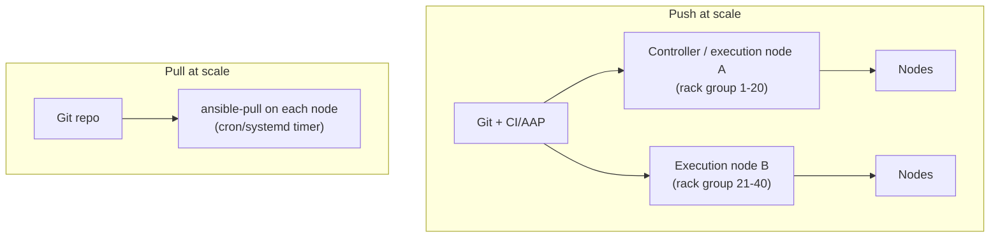

# 4.14 Ansible at scale: performance, strategies and callbacks

| | |
|---|---|
| Level | Advanced |
| Priority tier | 1 |
| Lab venue | ansible-core; many lightweight targets (Docker with sshd) or `ansible_connection=local` simulations |
| Part | Part 4: Automation and infrastructure as code |
| Status | Drafted, labs **untested** |

## Why this matters for AI infrastructure

A modern GPU cluster has hundreds to tens of thousands of nodes. A default Ansible run (five forks, fact gathering everywhere, one SSH connection per task) takes hours on that size and is fragile: one slow node holds back a batch, one network blip fails a task, one bad change reaches every node at once. Scaling Ansible is therefore two separate problems: **speed** (do the work faster) and **safety** (contain failures and know what happened). This chapter covers both: the tuning knobs, execution strategies, batching and canary patterns, asynchronous operations, pull-based and controller-fleet architectures, and callbacks/reporting for observability and audit.

## Prerequisites and outcomes

Needs 4.3 to 4.8. After this chapter you can:

- Measure and profile runs, then tune forks, SSH (ControlPersist, pipelining), fact gathering/caching, module choice and loops.
- Choose between `linear`, `free`, and `host_pinned` strategies; combine `serial`, `throttle`, `run_once`, `max_fail_percentage` and `any_errors_fatal` to control blast radius.
- Use `async`/`poll` for long tasks and avoid SSH timeouts and control-node bottlenecks.
- Design architectures for very large fleets: partitioned inventories, parallel jobs, AWX/AAP execution nodes, `ansible-pull`, bastions and mesh connections.
- Use callbacks to measure, log, notify and audit; capture structured results for dashboards.
- Reason about the control node's own capacity (CPU, memory, file descriptors, network) and failure modes at scale.

## 1. Measure before tuning

```ini
# ansible.cfg
[defaults]
callbacks_enabled = timer, profile_tasks, profile_roles
```

`profile_tasks` prints a sorted list of the slowest tasks and cumulative time; `timer` prints total duration. Time a baseline on a representative 10% slice (`--limit`), record numbers, change one setting at a time, and re-measure. Useful instrumentation: `ANSIBLE_LOG_PATH`, `ansible-playbook -vv` for timing of connections, `time` for whole-run wall clock, `strace -c -f -p` or `py-spy dump` on the controller if CPU-bound, `ss -s` and `ulimit -n` for socket and file descriptor limits.

Typical wall-clock model: `time ≈ (setup per host / forks) + Σ over tasks of ceil(hosts / forks) × max(task duration)` under the linear strategy. The slowest host in each batch dominates every task, so stragglers matter more than the average.

## 2. Execution tuning

### Forks and the control node

`forks` (default 5) is the number of parallel host connections (worker processes on the controller). Raise to 50 to 200 on a well-provisioned controller; each fork is a Python process consuming roughly 50 to 150 MiB and CPU while templating/parsing results. Watch memory, CPU saturation (templating is CPU-bound), file descriptors (`ulimit -n`), and the ephemeral port range/SSH rate limits on targets (`MaxStartups`, fail2ban, bastion limits). Too many forks produces slower runs, not faster.

### SSH tuning

```ini
[ssh_connection]
pipelining = True                     # one SSH exec per module instead of copy + exec + cleanup (needs no requiretty)
ssh_args = -o ControlMaster=auto -o ControlPersist=300s -o PreferredAuthentications=publickey -o ServerAliveInterval=30 -o ServerAliveCountMax=4
control_path = %(directory)s/%%C      # keep paths short; long paths exceed socket limits
retries = 3                           # retry connection failures
transfer_method = smart               # sftp/scp/piped
```

ControlPersist multiplexes tasks over one TCP/SSH session per host (the biggest win); pipelining reduces round trips per task (second biggest). In *Ansible: Up and Running* Chapter 20 (*Making Ansible Go Faster*), the authors benchmark SSH multiplexing directly with `time ssh vagrant@192.168.56.10.nip.io /usr/bin/true`: the first connection takes **`0.319s`** (`real 0m0.319s`) to establish the TCP + SSH handshake and create the Unix domain control socket (`~/.ssh/sockets/vagrant@192.168.56.10.nip.io:22`), whereas every subsequent connection reuses that master socket (`ssh -O check` prints `Master running (pid=5099)`, stopped via `ssh -O exit`) in just **`0.010s`**—saving `~0.3s` on every single SSH session. Moreover, without `pipelining = True`, Ansible opens **at least two to three SSH sessions per task** (creating the remote temp dir, copying the `AnsiballZ` module, and executing/cleaning it); enabling `pipelining = True` reduces this to a **single SSH session per task** (provided `Defaults:{{ ansible_user }} !requiretty` is deployed to `/etc/sudoers.d/disable-requiretty` with `mode: '0440'` and validated via `validate: 'bash -c "cat /etc/sudoers /etc/sudoers.d/* %s | visudo -cf-"'`—note how concatenating `/etc/sudoers` with the drop-in `%s` allows `visudo -cf-` to validate a sudoers fragment cleanly). Also watch out for the **Unix domain socket path length limit** (`104` bytes on macOS/BSD, `108` bytes on Linux): long cloud hostnames like `ec2-203-0-113-25.compute-1.amazonaws.com` fail with `ControlPath "... too long for Unix domain socket"` unless you use the `%C` SHA-1 hash token (`control_path = %(directory)s/%%C`). On targets: `UseDNS no`, adequate `MaxSessions`/`MaxStartups`, and keep sudo fast (slow PAM modules or DNS lookups in sudo add seconds per task). Prefer SSH keys, ed25519 (and fast ciphers like `chacha20-poly1305@openssh.com` and `curve25519-sha256` key exchange in `sshd_config`). If a bastion is mandatory, multiplex through it with `ProxyJump` and ControlPersist on both hops, and size it for the fan-out.

### Facts

Fact gathering runs the `setup` module on every host at the start of each play: often the single largest cost.

```ini
[defaults]
gathering = smart                 # gather once, reuse cached facts
fact_caching = jsonfile           # or redis, memcached; sqlite via plugins
fact_caching_connection = /var/cache/ansible/facts
fact_caching_timeout = 7200
```

Options: `gather_facts: false` in plays that do not use facts; `gather_subset: [min]` or `!all,!min,network` to collect only what is needed; run one early play to gather and cache facts, then later plays rely on the cache (`gather_facts: false`); `ansible_facts` access patterns keep working with cached facts. Remember caches can be stale and may contain sensitive data (protect the directory).

### Tasks, modules and loops

- **One transaction beats many**: `package: name: [a,b,c]`, `user`/`file` with lists when supported; use `template` or `copy` of a whole file rather than multiple `lineinfile` calls; use `assemble`/`blockinfile` thoughtfully.
- **Avoid per-item loops across many hosts** when the module can accept lists; every loop iteration is a separate module execution.
- **Avoid `command`/`shell` for work Ansible can batch**; avoid `shell: ls | wc -l` style probes in loops.
- **Reduce `gather` calls** by using already-known inventory data.
- **Use `async` with `poll: 0`** to start slow operations in parallel then check (`async_status`) rather than serialising long waits.
- **Package manager locks and mirrors**: use a local mirror/proxy cache; `apt update` with `cache_valid_time`; avoid every host hitting the Internet.
- **Delegation costs**: tasks with `delegate_to: localhost` run per host on the controller; 5,000 hosts × a local API call is 5,000 controller operations. Batch with `run_once` plus loops, or use a bulk API.
- **Inventory cost**: parsing a huge inventory and variables takes time; keep dynamic inventory cached (4.5), avoid enormous per-host dictionaries, avoid `hostvars` loops over thousands of hosts inside a per-host template (quadratic).
- **Templating cost**: heavy Jinja in loops over `groups['all']` for each host is O(n²); precompute once with `run_once` + `set_fact` + `delegate_facts`, or render a shared file once and copy it.
- **Python on the controller**: use a recent Python; install `ujson`/`libyaml` bindings (PyYAML with C `libyaml` loader is substantially faster); keep collections installed locally.

### Mitogen and alternatives

The Mitogen strategy plugin historically sped up Ansible dramatically by keeping a persistent Python interpreter on targets but has lagged behind recent ansible-core versions; treat it as unsupported-by-default unless verified. Modern alternatives for speed: `ansible-pull`, `ansible-runner` parallel jobs, AAP automation mesh, or restructuring work (images, immutable infrastructure).

## 3. Strategies and batching

| Strategy | Behaviour | Use |
|---|---|---|
| `linear` (default) | Each task runs on all hosts in the batch before the next task starts | Predictable ordering; tasks depending on cluster-wide state; straggler-sensitive |
| `free` | Each host runs through the play at its own pace | Independent work (package installs, per-host config); fastest; harder to reason about output; avoid when later tasks rely on other hosts finishing |
| `host_pinned` | Like free but a host gets a worker until its play completes | Reduces connection churn; useful with limited forks |
| `debug` | Interactive debugger on failure | Troubleshooting (4.10) |

```yaml
- name: Per-node tuning (independent work)
  hosts: gpu
  strategy: free
  tasks: [ ... ]

- name: Cluster-wide step needing all nodes (ordering matters)
  hosts: gpu
  strategy: linear
  serial: [1, "5%", "20%", "100%"]
  max_fail_percentage: 2
```

### Failure containment

Speed without containment turns mistakes into outages. Layers:

1. **Canary first** (`serial: [1, ...]`, or a `canary` group run before `all`), with a validation step after the batch.
2. **`serial` batches** sized to failure domains (a rack, a switch, a Slurm partition), so a bad batch never removes more capacity than SLOs allow.
3. **`max_fail_percentage` / `any_errors_fatal`** to stop the rollout when failures exceed tolerance.
4. **`throttle`** for tasks that hit shared dependencies (a package mirror, license server, secret manager, storage metadata server).
5. **Order and spread**: `order: shuffle` spreads load and avoids always hitting the same racks first; `order: inventory` for deterministic ordering.
6. **Stop-the-line automation**: callbacks or CI that parse failures and halt remaining jobs; pause between batches (`pause` or approval gates in CI).
7. **Idempotent resume**: after a partial failure rerun with `--limit @failed.retry`-style lists so already-converged hosts are skipped quickly.
8. **Maintenance windows and capacity checks** before draining (do not drain more than N nodes per partition).

### Long-running tasks

```yaml
- name: Flash firmware (30 minutes) in the background on a rack
  ansible.builtin.command: /opt/fw/update.sh --yes
  async: 3600           # allowed runtime
  poll: 0               # fire and forget
  register: fw_job
- name: Wait for completion
  ansible.builtin.async_status:
    jid: "{{ fw_job.ansible_job_id }}"
  register: fw_result
  until: fw_result.finished
  retries: 120
  delay: 30
```

`async` avoids SSH session timeouts and lets many hosts proceed in parallel; handle reboots (use `reboot` or `wait_for_connection`) separately because `async` jobs die when the host reboots. Idle SSH connections may be dropped by firewalls or NAT; use `ServerAliveInterval`.

## 4. Architectures for large fleets



- **Partition and parallelise controllers**: split inventory by site/pod/rack and run N controller processes or AAP jobs in parallel, each with its own forks; use **AAP automation mesh** execution nodes close to the targets (in the same network zone), reducing latency and bastion fan-in.
- **Job slicing** (AWX/AAP "job slice"): one job template split into N slices running in parallel across inventory partitions.
- **Pull mode** (`ansible-pull -U <git-url> -C main site.yml -i localhost,`): each node fetches the repo and applies its own configuration on a schedule. Pros: scales linearly with fleet, no inbound SSH, works with unreliable networks and auto-scaling nodes. Cons: harder central visibility, rollout control and canarying (use branches/tags per ring or version pins in node-local facts), secrets distribution, the repo becomes a high-value target (sign commits, restrict deploy keys). It suits large homogeneous node fleets with strong image baselines; push suits orchestrated, ordered operations (drains, upgrades).
- **Immutable images** reduce runtime Ansible: bake drivers and OS config into golden images (4.2), use Ansible at build time and for small post-boot parameterisation. Day-2 changes become image rollouts.
- **Bastions and jump hosts**: ensure capacity (SSH `MaxStartups`, CPU), use multiplexing, and keep them hardened and audited.
- **Proxy/relay patterns**: for networks where nodes cannot be reached from the controller, run a runner inside each pod/site.
- **Idempotent "converge" jobs on a schedule** (nightly `--check` for drift and weekly converge) with results into a dashboard.
- **Controller sizing**: CPU cores ≈ forks/2 for template-heavy plays; RAM ≈ forks × 100 MiB plus inventory; fast local SSD for fact cache and temp; high `ulimit -n`; synchronised time; dedicated service account; logs shipped off-box; disaster recovery for the controller (it holds access to everything): treat as pets with automated rebuild.

## 5. Callbacks: observing and reporting

Callback plugins hook into playbook events (`v2_playbook_on_start`, `v2_runner_on_ok`, `...failed`, `...unreachable`, `v2_playbook_on_stats`). As *Ansible: Up and Running* Chapter 18 explains, Ansible divides callbacks into two categories: (1) **Stdout plugins** (`stdout_callback` in `ansible.cfg`, of which **only one** can be active at a time to control terminal rendering: `default`, `yaml`, `debug`, `dense`, `minimal`, `json`, `oneline`, `unixy`, `selective`, `actionable`) and (2) **Notification / other plugins** (`callbacks_enabled`—formerly `callback_whitelist`—where **multiple** plugins can run simultaneously). For rich web-based playbook reporting without setting up AWX/AAP, `AUR` Chapter 18 also highlights **ARA (*ARA Records Ansible*)** (`pip3 install "ara[server]"`, `export ANSIBLE_CALLBACK_PLUGINS="$(python3 -m ara.setup.callback_plugins)"`, and `ara-manage runserver`), which records every playbook, task, host, and result into a searchable database and web UI.

| Callback | Purpose |
|---|---|
| `ansible.posix.timer`, `profile_tasks`, `profile_roles` | Timing |
| `ansible.posix.json`, `jsonl` | Machine-readable output / event stream |
| `community.general.yaml` / `result_format=yaml` | Readable multi-line output |
| `community.general.log_plays`, `ansible.builtin.log_plays` | Per-host log files |
| `community.general.slack`, `mail`, `logstash`, `splunk`, `syslog_json`, `opentelemetry`, `loganalyzer` | Notifications and observability |
| `ansible.posix.junit` | JUnit XML for CI test views |
| `community.general.selective`, `actionable`, `dense`, `minimal` | Compact output for large runs |

Custom callback example that emits one JSON line per task result to a file (feed to Loki/Elasticsearch; mask secrets):

```python
# plugins/callback/jsonl_audit.py
from __future__ import annotations
DOCUMENTATION = """
name: jsonl_audit
type: notification
short_description: Write task results as JSON lines
options:
  path:
    description: Output file
    default: /var/log/ansible/audit.jsonl
    env: [{name: ANSIBLE_JSONL_AUDIT_PATH}]
    ini: [{section: callback_jsonl_audit, key: path}]
"""
import json, time
from ansible.plugins.callback import CallbackBase

class CallbackModule(CallbackBase):
    CALLBACK_VERSION = 2.0
    CALLBACK_TYPE = "notification"
    CALLBACK_NAME = "jsonl_audit"
    CALLBACK_NEEDS_ENABLED = True

    def set_options(self, task_keys=None, var_options=None, direct=None):
        super().set_options(task_keys=task_keys, var_options=var_options, direct=direct)
        self.path = self.get_option("path")
        self.fh = open(self.path, "a", buffering=1)

    def _emit(self, event, result, **extra):
        r = result._result
        rec = {"ts": time.time(), "event": event, "host": result._host.get_name(), "task": result._task.get_name(),
               "changed": r.get("changed"), "rc": r.get("rc"), "msg": str(r.get("msg", ""))[:500], **extra}
        if result._task.no_log:
            rec.pop("msg", None)                    # never log output of no_log tasks
        self.fh.write(json.dumps(rec) + "\n")

    def v2_runner_on_ok(self, result):        self._emit("ok", result)
    def v2_runner_on_failed(self, result, ignore_errors=False):   self._emit("failed", result, ignored=ignore_errors)
    def v2_runner_on_unreachable(self, result):                  self._emit("unreachable", result)
```

Enable with `callbacks_enabled = jsonl_audit` and `callback_plugins = plugins/callback` in `ansible.cfg`. In AAP/AWX the platform records job events natively (API/stream to external logging). Add run metadata (git SHA, ticket, operator, inventory) via `-e` extra vars or environment so every record is attributable. Ship logs to a central system with retention (audit) and never include secrets.

Dashboards that pay for themselves: changes per environment per day, failure rate per play/role, mean run duration, hosts not converged in N days (drift), tasks that always change (idempotency regressions), and top slowest tasks.

## 6. Pull mode in detail

```bash
# On a node (systemd timer every 30 minutes with jitter)
ansible-pull -U git@git.example.com:platform/node-config.git -C main --purge \
  -d /var/lib/ansible-pull -i localhost, --only-if-changed -o node.yml
```

- `--only-if-changed` skips the run when the repository did not change; `-o` runs only if the repo updated; add random sleep (`--sleep 120`) to spread load.
- Per-node variation uses facts and `ansible_local` (custom facts), node name patterns, or a node-class variable file.
- **Rings for safe rollout**: nodes of ring 0 track branch `canary`, ring 1 `stable-1`, ring 2 `stable`; promote by fast-forwarding branches (or signed tags) after validation.
- **Security**: use read-only deploy keys, verify signed commits (`--verify-commit`), keep secrets out of the repo (fetch from a secret manager using node identity), and monitor for tampering. Unreviewed changes to the pulled repo apply fleet-wide within the timer interval, so protect branches strictly (4.1).

## 7. Putting it together: a large GPU cluster playbook skeleton

```yaml
- name: Gather cluster facts once and cache
  hosts: cluster
  gather_facts: true
  gather_subset: [network, hardware]
  tasks: []

- name: Rack-aware rolling change
  hosts: gpu
  gather_facts: false
  strategy: linear
  order: shuffle
  serial: "{{ rollout_serial | default(['1', '2%', '10%', '100%']) }}"
  max_fail_percentage: 2
  tasks:
    - name: Skip nodes with running jobs unless forced
      ansible.builtin.command: "squeue -h -w {{ inventory_hostname }} -o %i"
      delegate_to: "{{ groups['slurm_controller'][0] }}"
      register: jobs
      changed_when: false
      failed_when: jobs.stdout != "" and not (force | default(false) | bool)
      throttle: 10                                   # protect slurmctld from thousands of queries
    - ansible.builtin.import_role: { name: kernel_tuning }
    - ansible.builtin.import_role: { name: gpu_node, tasks_from: validate }
```

Design points: facts cached once; batch sizes grow after the canary; `throttle` protects shared services; the plan is idempotent and can be re-run to resume.

## 8. Failure modes of the controller itself

| Symptom | Cause | Mitigation |
|---|---|---|
| Runs get slower with more forks | CPU/RAM saturation, SSH rate limits | Lower forks; scale out controllers; tune SSH; partition inventory |
| `OSError: Too many open files` | `ulimit -n` too low | Raise limits; reduce forks |
| `ControlPath too long` | Path length > 104 bytes | `control_path_dir` short; `%C` hash |
| Intermittent `UNREACHABLE` at scale | `MaxStartups` throttling, fail2ban, bastion limits, conntrack exhaustion | Tune sshd; stagger; fewer forks |
| Controller OOM | Large inventory/vars, many forks, huge registered results | Reduce forks, trim registered data (`no_log`, `loop_control`), avoid dumping big facts |
| Stuck runs | Hung SSH sessions, tasks without timeouts | `timeout`, `ServerAliveInterval`, task `timeout:`, `async` |
| Output unreadable | Thousands of hosts | `stdout_callback = actionable`/`selective`, JSON logs, summaries |

## 9. Lab

First, run the self-checking Python lab (`code/part04/ansible_scale_performance_lab.py`) locally. It verifies the wall-clock runtime model (`estimate_play_wall_clock_seconds`: demonstrating the `>40x` speedup of `forks=50` + `ControlPersist` `0.319s -> 0.010s` + `pipelining` `3 -> 1` SSH trips, and comparing `linear` vs `free` strategy under a 5x straggler host, `AUR` Ch. 20) and the `jsonl_audit` notification callback plugin (`format_jsonl_audit_event`, masking `no_log: true` task output, `AUR` Ch. 18).

```bash
python3 code/part04/ansible_scale_performance_lab.py
```

Next, on a control node with lightweight targets (all interactive shell steps below are `untested here`), work through these exercises:

1. **Baseline and profile**: create 30 to 50 lightweight targets (Docker with sshd) or use `ansible_connection=local` loopback hosts; run a 10-task playbook with defaults and `profile_tasks`; record totals.
2. **Tune and compare**: change one setting at a time: `forks`, ControlPersist, pipelining, fact gathering off, `gather_subset`, fact cache; chart improvements; find the point where more forks stops helping.
3. **Strategies**: run the same play with `linear` and `free` while injecting a slow host (`sleep 30`); compare wall time and output; identify when `free` is unsafe.
4. **Batching and containment**: implement `serial: [1, 10%, 100%]`, `max_fail_percentage`, `any_errors_fatal` with an injected failure at the third batch; write a resume procedure with a failed-hosts list.
5. **Async**: run a 5-minute fake firmware job with `async/poll: 0` across all hosts then collect with `async_status`; compare with a synchronous run and with a short SSH `ServerAliveInterval` misconfiguration.
6. **Quadratic template**: render a hosts file per host that loops over all hosts; measure time at 100, 500, 2,000 simulated hosts; fix by rendering once with `run_once` and distributing.
7. **Callbacks**: enable `timer`, `profile_tasks`, `json`; write and enable the `jsonl_audit` callback; verify `no_log` tasks are masked; load the JSONL into a small dashboard (Grafana Loki or a notebook).
8. **Pull mode**: set up `ansible-pull` on three nodes with a systemd timer, jitter and rings (canary/stable branches); promote a change through rings; compare with push for the same change.
9. **Partitioned controllers**: split the inventory into four shards and run four parallel `ansible-playbook` processes with `--limit` shards; compare with one run at four times the forks.
10. **Controller failure drill**: kill the controller mid-run; resume; confirm idempotent completion; document what state may be partial.
11. **Capacity plan**: estimate time to run a baseline play on 10,000 nodes given measured per-task cost and chosen forks and shards; state the assumptions.
12. **Clean up.**

## 10. Common mistakes

- Raising forks without checking controller CPU, file descriptor limits or target SSH limits.
- Fact gathering on every play of every run; no cache.
- Using `free` strategy for steps with cluster-wide ordering requirements.
- Large batches with no canary; no stop-the-line threshold.
- Looping package installs; per-host loops calling an API from localhost thousands of times.
- Quadratic `hostvars` templating; giant registered variables.
- Treating pull mode as a replacement for orchestration (drains, ordered upgrades).
- Controller as a single unmonitored pet with broad credentials and no backups.
- Logging full task output (including secrets) to central systems.
- Optimising speed before correctness and idempotency.

## 11. Interview angles

- "How do you make Ansible fast on 5,000 nodes?" (forks, SSH multiplexing/pipelining, fact caching, fewer tasks, async, sharding controllers.)
- "Explain `serial`, `free` strategy, `max_fail_percentage` and how you roll out safely."
- "Push versus pull configuration management at scale: trade-offs?"
- "How do you monitor and audit Ansible runs?" (callbacks, AAP job events, JSON logs, drift dashboards.)
- "How do you handle a task that takes an hour per host?" (async, parallel, polling, reboot handling.)
- "What limits the controller? How do you scale it?"
- "Why might more forks make a run slower?"

## Exercises

1. **Wall-Clock Performance Model, `forks`, SSH Multiplexing (`ControlPersist`), and `pipelining` (`AUR` Chapter 20):** Using `estimate_play_wall_clock_seconds()` in `code/part04/ansible_scale_performance.py`, explain: (a) how `ControlPersist` drops SSH connection overhead from `0.319s` to `0.010s` (`ssh -O check` / `ssh -O exit`), why long EC2 hostnames exceed the 104-byte Unix socket limit without `%C`, and how `pipelining = True` reduces SSH sessions per task from 3 to 1; and (b) how `bash -c "cat /etc/sudoers /etc/sudoers.d/* %s | visudo -cf-"` validates `/etc/sudoers.d/disable-requiretty`.
2. **Fact Caching (`gathering = smart`, `jsonfile`/`redis`), Quadratic $O(N^2)$ Templating, and `delegate_to: localhost` Bottlenecks:** (a) Explain why running a per-host template that loops over `groups['all']` / `hostvars` across 2,000 nodes is $O(N^2)$ on the controller CPU and how `run_once: true` + `copy` makes it $O(N)$; (b) compare file-based (`jsonfile`, `yaml`, `pickle`) and memory-based (`redis`, `memcached`) fact caches (`AUR` Chapter 20).
3. **Execution Strategies (`linear` vs. `free` vs. `host_pinned`) and Failure-Containment Batching (`serial`, `max_fail_percentage`, `throttle`):** Using `estimate_play_wall_clock_seconds()`, explain why a single slow straggler host stalls every task wave under `strategy: linear` whereas `strategy: free` lets healthy hosts finish ahead, and state when `free` is unsafe.
4. **Overlapping Long-Running Tasks with `async` and `poll: 0` + `async_status` (`AUR` Chapter 20):** Trace how `async: 3600` + `poll: 0` starts a 30-minute firmware flash or large `git clone` in the background while subsequent tasks (`apt` package installs) execute in parallel, and how `async_status` polls `fw_job.ansible_job_id` to completion.
5. **Large-Fleet Architectures: Sharded Push Controllers, AWX/AAP Job Slicing & Automation Mesh, and `ansible-pull` Rings:** Contrast scaling push mode (partitioned inventories, AWX/AAP job slicing, and Automation Mesh execution nodes) with `ansible-pull` (`--only-if-changed`, `--sleep 120` jitter, `--verify-commit`, and canary/stable branch rings).
6. **Callback Plugins (`stdout` vs. `notification`, `profile_tasks`, `junit`, `ARA`, and Custom `jsonl_audit.py`, `AUR` Chapter 18):** Using `format_jsonl_audit_event()` in `code/part04/ansible_scale_performance.py`, explain the difference between stdout and notification callback plugins, how `CallbackModule` hooks `v2_runner_on_ok`/`failed`/`unreachable` while masking `result._task.no_log`, and how ARA (`ara[server]`) records playbook runs.

## Checkpoint questions (20)

<details>
<summary>1. What is the wall-clock runtime formula for an Ansible play under the default `linear` strategy, and why do stragglers dominate runtime?</summary>

Under `strategy: linear`, every host in the active batch must finish Task $i$ before any host starts Task $i+1$. For $H$ hosts and $F$ forks (`waves = ceil(H / F)`), total play time is approximately:
$$T \approx \left\lceil\frac{H}{F}\right\rceil \times T_{\text{setup}} + \sum_{i} \left\lceil\frac{H}{F}\right\rceil \times \max_{h}(T_{\text{task } i, h})$$
Because each wave waits for $\max_{h}(T_{\text{task } i, h})$, **a single slow straggler host (slow disk, DNS timeout, or high latency) stretches every task across the entire batch**.
</details>

<details>
<summary>2. How much time does SSH Multiplexing (`ControlMaster=auto`, `ControlPersist`) save per connection, and how do you inspect or stop a master socket (`AUR` Chapter 20)?</summary>

In `AUR` Chapter 20's benchmark (`time ssh ... /usr/bin/true`), opening a fresh SSH connection takes **`0.319s`**, whereas reusing an open `ControlPersist` master socket takes **`0.010s`**—a **30x reduction** (`~0.3s` saved per SSH execution). You can verify an active master socket with **`ssh -O check user@host`** (`Master running (pid=5099)`) and close it manually with **`ssh -O exit user@host`**.
</details>

<details>
<summary>3. What causes `ControlPath "... too long for Unix domain socket"` on cloud instances, and how do you fix it in `ansible.cfg` (`AUR` Chapter 20)?</summary>

The operating system kernel limits Unix domain socket file paths (`sun_path`) to **104 bytes on macOS/BSD** and **108 bytes on Linux**. When connecting to cloud VMs with long FQDNs (`ec2-203-0-113-25.compute-1.amazonaws.com`), a control path embedding `%r@%h:%p` exceeds 104 bytes and fails. Fix it by setting **`control_path = %(directory)s/%%C`** in `[ssh_connection]` in `ansible.cfg`, where `%C` is a compact fixed-length SHA-1 hash of `%l%h%p%r`.
</details>

<details>
<summary>4. How does `pipelining = True` speed up task execution, and how did `AUR` Chapter 20 safely validate `/etc/sudoers.d/disable-requiretty` before enabling pipelining?</summary>

Without pipelining, Ansible opens **2 to 3 SSH sessions per task** (`mkdir` temp dir -> `sftp`/`scp` `AnsiballZ` zip -> `ssh` execute & rm). With **`pipelining = True`**, Ansible streams the Python payload directly over **`stdin`** in **1 single SSH session**. Because `stdin` streaming has no TTY, `requiretty` must be disabled first. To validate a drop-in file `/etc/sudoers.d/disable-requiretty` (`Defaults:{{ ansible_user }} !requiretty`, `mode: '0440'`) that references settings defined in `/etc/sudoers`, `AUR` Chapter 20 uses:
`validate: 'bash -c "cat /etc/sudoers /etc/sudoers.d/* %s | visudo -cf-"'`
(running that play once with `pipelining = False` before turning `pipelining = True` on).
</details>

<details>
<summary>5. Why does raising `forks` from 5 to 500 on a small control node sometimes make playbooks run SLOWER or crash?</summary>

Each Ansible worker fork is a separate Python process consuming **50–150 MiB of RAM**, CPU cycles (for Jinja2 templating and JSON parsing), and open file descriptors/sockets. Setting `forks = 500` on an undersized controller causes CPU context-switch thrashing, OOM kills, **`OSError: Too many open files`** (if `ulimit -n` is low), and **`kex_exchange_identification` / `MaxStartups` connection drops** on bastions and target `sshd` daemons. Size controller CPU cores to roughly `forks / 2` and RAM to `forks * 100 MiB`.
</details>

<details>
<summary>6. Compare the three categories of Fact Caching plugins in Ansible (`AUR` Chapter 20).</summary>

When `gathering = smart` and `fact_caching_timeout = 86400` (24 hours) are set in `ansible.cfg`, Ansible supports three fact-cache storage categories (`ansible-doc -t cache -l`):
1. **File-based on the controller (`jsonfile`, `yaml`, `pickle`):** Zero external services required; stores one file per host in `fact_caching_connection = /var/cache/ansible/facts`.
2. **In-memory (`memory`):** Default when no cache plugin is configured; persists only for the duration of the single `ansible-playbook` process.
3. **Networked RAM store (`redis`, `memcached`, `mongodb`):** Shared across multiple controllers / CI runners.
</details>

<details>
<summary>7. Why is rendering a cluster-wide `/etc/hosts` or `slurm.conf` template on 2,000 nodes an $O(N^2)$ bottleneck on the controller, and how do you make it $O(N)$?</summary>

When a `template:` task runs across 2,000 hosts and the `.j2` template contains `{{ hostvars[h]['ansible_host'] }}`, the control node evaluates that 2,000-iteration Jinja2 loop **2,000 separate times** ($2,000 \times 2,000 = 4,000,000$ `hostvars` lookups). Fix it by rendering the file **once** on the controller (`delegate_to: localhost`, `run_once: true` writing `/tmp/cluster_hosts`), and then using `ansible.builtin.copy` to push that pre-rendered static file to all 2,000 nodes ($O(N)$).
</details>

<details>
<summary>8. Why is `delegate_to: localhost` without `run_once: true` dangerous on a 5,000-node play?</summary>

When a play targets 5,000 hosts and includes a task with `delegate_to: localhost` (for example, calling an external CMDB, Slack webhook, or Slurm controller API), Ansible executes that local command **5,000 times in parallel (up to `forks`) on the control node**—fork-bombing the controller and DDoS-ing the API. Either aggregate the call into a single request with **`run_once: true`** looping over `ansible_play_batch`, or cap concurrency with **`throttle: 10`**.
</details>

<details>
<summary>9. Compare `strategy: linear`, `strategy: free`, and `strategy: host_pinned` at scale.</summary>

- **`linear` (default):** Lockstep task-by-task barrier across all hosts in the batch; required when Task $i+1$ depends on Task $i$ having finished on all nodes, but slowed down by the slowest host on every task.
- **`free`:** Workers advance each host through its task list independently without waiting at task barriers; fastest for independent per-host configuration, but unsuitable when cross-host ordering matters.
- **`host_pinned`:** Like `free`, except a worker fork stays assigned to a single host until that host finishes all tasks in the play (maximizing SSH connection cache locality when `num_hosts > forks`).
</details>

<details>
<summary>10. How did `AUR` Chapter 20 (`Example 20-13`) use `async` and `poll: 0` to overlap slow I/O tasks with package installation?</summary>

In `Example 20-13`, cloning the Linux kernel Git repository (`git: repo=... async: 3600, poll: 0, register: clone`) is started in the background with **`poll: 0`** so Ansible immediately moves on to installing several `apt` packages while `git clone` downloads in parallel; once the package tasks finish, an `async_status: { jid: "{{ clone.ansible_job_id }}" }` task (`until: result.finished, retries: 3600`) waits for the background clone to finish.
</details>

<details>
<summary>11. Why does an `async` task fail if the target host reboots during the task?</summary>

`async` spawns a background wrapper process on the target host that writes its status JSON into `~/.ansible_async/<jid>`. If the command reboots the target host, the OS kills the background wrapper before it can write the completion status file (and if `/tmp` is `tmpfs`, the status file is wiped). Always use **`ansible.builtin.reboot`** (or trigger the reboot and wait from the controller with **`wait_for_connection`**) instead of `async` for reboots.
</details>

<details>
<summary>12. How do AWX / Ansible Automation Platform (`AAP`) "Job Slicing" and "Automation Mesh Execution Nodes" scale push-mode Ansible?</summary>

- **Job Slicing (`job_slice_count: 8`):** Automatically partitions a 4,000-host inventory into 8 slices of 500 hosts each and schedules 8 independent `ansible-playbook` jobs across the cluster of execution nodes in parallel.
- **Automation Mesh Execution Nodes:** Dedicated worker nodes deployed inside remote data centers or private rack zones that maintain persistent mTLS mesh connections to the central control plane and execute SSH tasks locally against adjacent racks—eliminating WAN latency and central bastion bottlenecks.
</details>

<details>
<summary>13. How does `ansible-pull` work, what do `--only-if-changed` and `--sleep` do, and how do you stage rollouts in pull mode?</summary>

Instead of a central controller pushing over SSH to 10,000 nodes, each node runs a `systemd` timer or cron job invoking **`ansible-pull -U <git_repo_url> -C <branch_or_tag> -i localhost, node.yml`**:
- **`-o` / `--only-if-changed`**: runs the playbook only if the remote Git repository has new commits since the last pull.
- **`-s 120` / `--sleep 120`**: sleeps a random delay between 0 and 120 seconds before pulling so 10,000 nodes do not hammer the Git server at the exact same second.
- **Staged rollout rings:** Assign nodes to rings (`ring0` tracking branch/tag `canary`, `ring1` tracking `stable-1`, `ring2` tracking `stable`) and promote tested commits across rings by fast-forwarding the signed branch/tag.
</details>

<details>
<summary>14. When should you choose Push Mode vs. Pull Mode (`ansible-pull`) vs. Golden Images for a GPU cluster?</summary>

- **Golden Images (Packer + Ansible at build time):** Best for the heavy, static base layer (OS, kernel, NVIDIA drivers, CUDA, containerd) so nodes boot ready to work in 2 minutes.
- **Pull Mode (`ansible-pull`):** Best for continuous baseline convergence of node-local configuration files (`/etc/chrony.conf`, monitoring exporters, SSH certificates) across thousands of independent hosts.
- **Push Mode (AAP / controller with `serial`):** Best for **multi-node orchestrated operations** where cross-host ordering and scheduler coordination matter (draining a rack in Slurm, upgrading switches, rolling database/controller upgrades).
</details>

<details>
<summary>15. What is the difference between a `stdout` Callback Plugin and a `notification` Callback Plugin (`AUR` Chapter 18)?</summary>

- **Stdout callback (`stdout_callback = yaml | json | dense | minimal | debug | selective`):** Controls how Ansible formats primary terminal output on `stdout`. **Only one** stdout callback can be active at a time.
- **Notification / aggregate callback (`callbacks_enabled = timer, profile_tasks, profile_roles, junit, slack, logstash, jsonl_audit`):** Observes playbook lifecycle events in the background (writing timing summaries, JUnit XML reports, JSONL audit logs, or Slack messages). **Multiple** notification callbacks can be enabled simultaneously.
</details>

<details>
<summary>16. How does the `junit` Callback Plugin (`AUR` Chapter 18 Table 18-5) integrate Ansible playbook runs into CI test dashboards?</summary>

Enabling `callbacks_enabled = junit` causes Ansible to write a JUnit XML report into `JUNIT_OUTPUT_DIR` (`~/.ansible.log` by default) after every playbook run, where each task is recorded as a test case. Setting `JUNIT_FAIL_ON_CHANGE=true` during a scheduled drift check or idempotence test marks any task that reported `changed` as a JUnit test failure in Jenkins/GitLab/GitHub Actions.
</details>

<details>
<summary>17. What is ARA (*ARA Records Ansible*, `AUR` Chapter 18), and how does it work?</summary>

**ARA** is an open-source callback plugin and lightweight web/API server (`pip install "ara[server]"`, `export ANSIBLE_CALLBACK_PLUGINS="$(python3 -m ara.setup.callback_plugins)"`) that intercepts every `ansible` and `ansible-playbook` run and records playbooks, tasks, host facts, execution durations, and per-host results into an SQLite/PostgreSQL/MySQL database inspectable via the `ara` CLI or `ara-manage runserver` web UI.
</details>

<details>
<summary>18. When writing a custom Callback Plugin (`CallbackModule`), how do you ensure `no_log: true` secrets are never written to the audit log?</summary>

Inside your `v2_runner_on_ok` and `v2_runner_on_failed` hooks, inspect **`if result._task.no_log:`** (or check `result._result.get('_ansible_no_log')`) and **strip `msg`, `stdout`, `stderr`, `invocation`, and `diff` fields** from the emitted JSON record before writing to disk or shipping to Loki/Elasticsearch/Logstash.
</details>

<details>
<summary>19. How does `order: shuffle` on a play improve safety during a large fleet rollout?</summary>

By default (`order: inventory`), Ansible processes hosts in the exact order they appear in the inventory—which usually means `gpu001, gpu002, gpu003...` (all sitting in Rack 1). If a batch fails or drains capacity, Rack 1 loses 100% of its nodes at once. Setting **`order: shuffle`** (after the initial canary) randomizes host order across racks and pods, spreading both network/storage load and failure blast radius evenly across failure domains.
</details>

<details>
<summary>20. How do you resume a playbook run across 2,000 hosts after 15 hosts failed due to a transient network blip?</summary>

Because every task in a well-written playbook is idempotent, you can either re-run the playbook against the failed subset using a retry list (`ansible-playbook site.yml --limit @site.retry` when `retry_files_enabled = True`, or extract failed hostnames from `jsonl_audit` / `ANSIBLE_STDOUT_CALLBACK=json` into `@failed_hosts.txt` and pass `--limit @failed_hosts.txt`).
</details>

## Sources and review notes

- **Sources read in full:**
  - `ansible-up-and-running-3rd-edition` — Bas Meijer, Lorin Hochstein & René Moser, *Ansible: Up and Running*, 3rd ed., **Chapter 18: Callback Plug-ins** (read in full: stdout plugins `default`, `yaml`, `debug`, `dense`, `minimal`, `json`, `oneline`, `selective`, `actionable`, `unixy`, `ara` `ara[server]` / `ara-manage runserver`; and notification/other plugins `timer`, `profile_tasks`, `profile_roles`, `junit` `JUNIT_OUTPUT_DIR`/`JUNIT_FAIL_ON_CHANGE`, `slack`, `mail`, `foreman`, `logstash`, `logentries`, `say`) and **Chapter 20: Making Ansible Go Faster** (read in full: SSH multiplexing `ControlMaster`/`ControlPersist`, `ssh -O check` / `ssh -O exit`, `0.319s -> 0.010s` timing benchmark, EC2 long-hostname Unix socket limit and `%C` `ControlPath`, `pipelining = True` and `/etc/sudoers.d/disable-requiretty` validated with `cat /etc/sudoers /etc/sudoers.d/* %s | visudo -cf-`, Mitogen, Fact Caching `jsonfile`/`yaml`/`pickle`/`redis`/`memcached` with `86400`s timeout, parallelism `forks`, `async` + `poll: 0` overlapping tasks, and Ed25519 / `chacha20-poly1305` SSH algorithm selection).
- **Run here:** `python3 code/part04/ansible_scale_performance_lab.py` (3 passed, 0 failed).
- **Explicitly labelled inferences:** The `estimate_play_wall_clock_seconds` and `format_jsonl_audit_event` models in `code/part04/ansible_scale_performance.py`, the `jsonl_audit.py` custom callback plugin, and the Section 7 large GPU cluster playbook skeleton are the author's constructions applying *Ansible: Up and Running* Chapters 18 & 20 to thousand-node GPU fleets (plus original study items 21, 22, 23, 24, 25, 26, 27, 28, 29, and 30).
- **Not verified on live hardware:** Live 5,000–10,000 node benchmarks, AWX/AAP automation mesh and job slicing, `ansible-pull`, and `ara-manage runserver` commands (`50 to 200` forks, `50 to 150 MiB`, `300s` ControlPersist, `7200`s / `86400`s fact cache, `104` / `108` byte socket limit, `0.319s`, `0.010s`, `5000` Logstash port) are marked (`untested here`) where not executed by `ansible_scale_performance_lab.py`.
