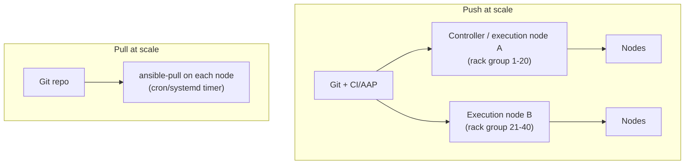

# 4.14 Ansible at scale: performance, strategies and callbacks

| | |
|---|---|
| Level | Advanced |
| Priority tier | 1 |
| Lab venue | ansible-core; many lightweight targets (Docker with sshd) or `ansible_connection=local` simulations |
| Part | Part 4: Automation and infrastructure as code |
| Status | Drafted, labs **untested** |

## Why this matters for AI infrastructure

A modern GPU cluster has hundreds to tens of thousands of nodes. A default Ansible run (five forks, fact gathering everywhere, one SSH connection per task) takes hours on that size and is fragile: one slow node holds back a batch, one network blip fails a task, one bad change reaches every node at once. Scaling Ansible is therefore two separate problems: **speed** (do the work faster) and **safety** (contain failures and know what happened). This chapter covers both: the tuning knobs, execution strategies, batching and canary patterns, asynchronous operations, pull-based and controller-fleet architectures, and callbacks/reporting for observability and audit.

## Prerequisites and outcomes

Needs 4.3 to 4.8. After this chapter you can:

- Measure and profile runs, then tune forks, SSH (ControlPersist, pipelining), fact gathering/caching, module choice and loops.
- Choose between `linear`, `free`, and `host_pinned` strategies; combine `serial`, `throttle`, `run_once`, `max_fail_percentage` and `any_errors_fatal` to control blast radius.
- Use `async`/`poll` for long tasks and avoid SSH timeouts and control-node bottlenecks.
- Design architectures for very large fleets: partitioned inventories, parallel jobs, AWX/AAP execution nodes, `ansible-pull`, bastions and mesh connections.
- Use callbacks to measure, log, notify and audit; capture structured results for dashboards.
- Reason about the control node's own capacity (CPU, memory, file descriptors, network) and failure modes at scale.

## 1. Measure before tuning

```ini
# ansible.cfg
[defaults]
callbacks_enabled = timer, profile_tasks, profile_roles
```

`profile_tasks` prints a sorted list of the slowest tasks and cumulative time; `timer` prints total duration. Time a baseline on a representative 10% slice (`--limit`), record numbers, change one setting at a time, and re-measure. Useful instrumentation: `ANSIBLE_LOG_PATH`, `ansible-playbook -vv` for timing of connections, `time` for whole-run wall clock, `strace -c -f -p` or `py-spy dump` on the controller if CPU-bound, `ss -s` and `ulimit -n` for socket and file descriptor limits.

Typical wall-clock model: `time ≈ (setup per host / forks) + Σ over tasks of ceil(hosts / forks) × max(task duration)` under the linear strategy. The slowest host in each batch dominates every task, so stragglers matter more than the average.

## 2. Execution tuning

### Forks and the control node

`forks` (default 5) is the number of parallel host connections (worker processes on the controller). Raise to 50 to 200 on a well-provisioned controller; each fork is a Python process consuming roughly 50 to 150 MiB and CPU while templating/parsing results. Watch memory, CPU saturation (templating is CPU-bound), file descriptors (`ulimit -n`), and the ephemeral port range/SSH rate limits on targets (`MaxStartups`, fail2ban, bastion limits). Too many forks produces slower runs, not faster.

### SSH tuning

```ini
[ssh_connection]
pipelining = True                     # one SSH exec per module instead of copy + exec + cleanup (needs no requiretty)
ssh_args = -o ControlMaster=auto -o ControlPersist=300s -o PreferredAuthentications=publickey -o ServerAliveInterval=30 -o ServerAliveCountMax=4
control_path = %(directory)s/%%C      # keep paths short; long paths exceed socket limits
retries = 3                           # retry connection failures
transfer_method = smart               # sftp/scp/piped
```

ControlPersist multiplexes tasks over one TCP/SSH session per host (the biggest win); pipelining reduces round trips per task (second biggest). On targets: `UseDNS no`, adequate `MaxSessions`/`MaxStartups`, and keep sudo fast (slow PAM modules or DNS lookups in sudo add seconds per task). Prefer SSH keys, ed25519. If a bastion is mandatory, multiplex through it with `ProxyJump` and ControlPersist on both hops, and size it for the fan-out.

### Facts

Fact gathering runs the `setup` module on every host at the start of each play: often the single largest cost.

```ini
[defaults]
gathering = smart                 # gather once, reuse cached facts
fact_caching = jsonfile           # or redis, memcached; sqlite via plugins
fact_caching_connection = /var/cache/ansible/facts
fact_caching_timeout = 7200
```

Options: `gather_facts: false` in plays that do not use facts; `gather_subset: [min]` or `!all,!min,network` to collect only what is needed; run one early play to gather and cache facts, then later plays rely on the cache (`gather_facts: false`); `ansible_facts` access patterns keep working with cached facts. Remember caches can be stale and may contain sensitive data (protect the directory).

### Tasks, modules and loops

- **One transaction beats many**: `package: name: [a,b,c]`, `user`/`file` with lists when supported; use `template` or `copy` of a whole file rather than multiple `lineinfile` calls; use `assemble`/`blockinfile` thoughtfully.
- **Avoid per-item loops across many hosts** when the module can accept lists; every loop iteration is a separate module execution.
- **Avoid `command`/`shell` for work Ansible can batch**; avoid `shell: ls | wc -l` style probes in loops.
- **Reduce `gather` calls** by using already-known inventory data.
- **Use `async` with `poll: 0`** to start slow operations in parallel then check (`async_status`) rather than serialising long waits.
- **Package manager locks and mirrors**: use a local mirror/proxy cache; `apt update` with `cache_valid_time`; avoid every host hitting the Internet.
- **Delegation costs**: tasks with `delegate_to: localhost` run per host on the controller; 5,000 hosts × a local API call is 5,000 controller operations. Batch with `run_once` plus loops, or use a bulk API.
- **Inventory cost**: parsing a huge inventory and variables takes time; keep dynamic inventory cached (4.5), avoid enormous per-host dictionaries, avoid `hostvars` loops over thousands of hosts inside a per-host template (quadratic).
- **Templating cost**: heavy Jinja in loops over `groups['all']` for each host is O(n²); precompute once with `run_once` + `set_fact` + `delegate_facts`, or render a shared file once and copy it.
- **Python on the controller**: use a recent Python; install `ujson`/`libyaml` bindings (PyYAML with C `libyaml` loader is substantially faster); keep collections installed locally.

### Mitogen and alternatives

The Mitogen strategy plugin historically sped up Ansible dramatically by keeping a persistent Python interpreter on targets but has lagged behind recent ansible-core versions; treat it as unsupported-by-default unless verified. Modern alternatives for speed: `ansible-pull`, `ansible-runner` parallel jobs, AAP automation mesh, or restructuring work (images, immutable infrastructure).

## 3. Strategies and batching

| Strategy | Behaviour | Use |
|---|---|---|
| `linear` (default) | Each task runs on all hosts in the batch before the next task starts | Predictable ordering; tasks depending on cluster-wide state; straggler-sensitive |
| `free` | Each host runs through the play at its own pace | Independent work (package installs, per-host config); fastest; harder to reason about output; avoid when later tasks rely on other hosts finishing |
| `host_pinned` | Like free but a host gets a worker until its play completes | Reduces connection churn; useful with limited forks |
| `debug` | Interactive debugger on failure | Troubleshooting (4.10) |

```yaml
- name: Per-node tuning (independent work)
  hosts: gpu
  strategy: free
  tasks: [ ... ]

- name: Cluster-wide step needing all nodes (ordering matters)
  hosts: gpu
  strategy: linear
  serial: [1, "5%", "20%", "100%"]
  max_fail_percentage: 2
```

### Failure containment

Speed without containment turns mistakes into outages. Layers:

1. **Canary first** (`serial: [1, ...]`, or a `canary` group run before `all`), with a validation step after the batch.
2. **`serial` batches** sized to failure domains (a rack, a switch, a Slurm partition), so a bad batch never removes more capacity than SLOs allow.
3. **`max_fail_percentage` / `any_errors_fatal`** to stop the rollout when failures exceed tolerance.
4. **`throttle`** for tasks that hit shared dependencies (a package mirror, license server, secret manager, storage metadata server).
5. **Order and spread**: `order: shuffle` spreads load and avoids always hitting the same racks first; `order: inventory` for deterministic ordering.
6. **Stop-the-line automation**: callbacks or CI that parse failures and halt remaining jobs; pause between batches (`pause` or approval gates in CI).
7. **Idempotent resume**: after a partial failure rerun with `--limit @failed.retry`-style lists so already-converged hosts are skipped quickly.
8. **Maintenance windows and capacity checks** before draining (do not drain more than N nodes per partition).

### Long-running tasks

```yaml
- name: Flash firmware (30 minutes) in the background on a rack
  ansible.builtin.command: /opt/fw/update.sh --yes
  async: 3600           # allowed runtime
  poll: 0               # fire and forget
  register: fw_job
- name: Wait for completion
  ansible.builtin.async_status:
    jid: "{{ fw_job.ansible_job_id }}"
  register: fw_result
  until: fw_result.finished
  retries: 120
  delay: 30
```

`async` avoids SSH session timeouts and lets many hosts proceed in parallel; handle reboots (use `reboot` or `wait_for_connection`) separately because `async` jobs die when the host reboots. Idle SSH connections may be dropped by firewalls or NAT; use `ServerAliveInterval`.

## 4. Architectures for large fleets



- **Partition and parallelise controllers**: split inventory by site/pod/rack and run N controller processes or AAP jobs in parallel, each with its own forks; use **AAP automation mesh** execution nodes close to the targets (in the same network zone), reducing latency and bastion fan-in.
- **Job slicing** (AWX/AAP "job slice"): one job template split into N slices running in parallel across inventory partitions.
- **Pull mode** (`ansible-pull -U <git-url> -C main site.yml -i localhost,`): each node fetches the repo and applies its own configuration on a schedule. Pros: scales linearly with fleet, no inbound SSH, works with unreliable networks and auto-scaling nodes. Cons: harder central visibility, rollout control and canarying (use branches/tags per ring or version pins in node-local facts), secrets distribution, the repo becomes a high-value target (sign commits, restrict deploy keys). It suits large homogeneous node fleets with strong image baselines; push suits orchestrated, ordered operations (drains, upgrades).
- **Immutable images** reduce runtime Ansible: bake drivers and OS config into golden images (4.2), use Ansible at build time and for small post-boot parameterisation. Day-2 changes become image rollouts.
- **Bastions and jump hosts**: ensure capacity (SSH `MaxStartups`, CPU), use multiplexing, and keep them hardened and audited.
- **Proxy/relay patterns**: for networks where nodes cannot be reached from the controller, run a runner inside each pod/site.
- **Idempotent "converge" jobs on a schedule** (nightly `--check` for drift and weekly converge) with results into a dashboard.
- **Controller sizing**: CPU cores ≈ forks/2 for template-heavy plays; RAM ≈ forks × 100 MiB plus inventory; fast local SSD for fact cache and temp; high `ulimit -n`; synchronised time; dedicated service account; logs shipped off-box; disaster recovery for the controller (it holds access to everything): treat as pets with automated rebuild.

## 5. Callbacks: observing and reporting

Callback plugins hook into playbook events (`v2_playbook_on_start`, `v2_runner_on_ok`, `...failed`, `...unreachable`, `v2_playbook_on_stats`). Enable with `callbacks_enabled` (notification-type plugins) or select a stdout callback with `stdout_callback` (the main display).

| Callback | Purpose |
|---|---|
| `ansible.posix.timer`, `profile_tasks`, `profile_roles` | Timing |
| `ansible.posix.json`, `jsonl` | Machine-readable output / event stream |
| `community.general.yaml` / `result_format=yaml` | Readable multi-line output |
| `community.general.log_plays`, `ansible.builtin.log_plays` | Per-host log files |
| `community.general.slack`, `mail`, `logstash`, `splunk`, `syslog_json`, `opentelemetry`, `loganalyzer` | Notifications and observability |
| `ansible.posix.junit` | JUnit XML for CI test views |
| `community.general.selective`, `actionable`, `dense`, `minimal` | Compact output for large runs |

Custom callback example that emits one JSON line per task result to a file (feed to Loki/Elasticsearch; mask secrets):

```python
# plugins/callback/jsonl_audit.py
from __future__ import annotations
DOCUMENTATION = """
name: jsonl_audit
type: notification
short_description: Write task results as JSON lines
options:
  path:
    description: Output file
    default: /var/log/ansible/audit.jsonl
    env: [{name: ANSIBLE_JSONL_AUDIT_PATH}]
    ini: [{section: callback_jsonl_audit, key: path}]
"""
import json, time
from ansible.plugins.callback import CallbackBase

class CallbackModule(CallbackBase):
    CALLBACK_VERSION = 2.0
    CALLBACK_TYPE = "notification"
    CALLBACK_NAME = "jsonl_audit"
    CALLBACK_NEEDS_ENABLED = True

    def set_options(self, task_keys=None, var_options=None, direct=None):
        super().set_options(task_keys=task_keys, var_options=var_options, direct=direct)
        self.path = self.get_option("path")
        self.fh = open(self.path, "a", buffering=1)

    def _emit(self, event, result, **extra):
        r = result._result
        rec = {"ts": time.time(), "event": event, "host": result._host.get_name(), "task": result._task.get_name(),
               "changed": r.get("changed"), "rc": r.get("rc"), "msg": str(r.get("msg", ""))[:500], **extra}
        if result._task.no_log:
            rec.pop("msg", None)                    # never log output of no_log tasks
        self.fh.write(json.dumps(rec) + "\n")

    def v2_runner_on_ok(self, result):        self._emit("ok", result)
    def v2_runner_on_failed(self, result, ignore_errors=False):   self._emit("failed", result, ignored=ignore_errors)
    def v2_runner_on_unreachable(self, result):                  self._emit("unreachable", result)
```

Enable with `callbacks_enabled = jsonl_audit` and `callback_plugins = plugins/callback` in `ansible.cfg`. In AAP/AWX the platform records job events natively (API/stream to external logging). Add run metadata (git SHA, ticket, operator, inventory) via `-e` extra vars or environment so every record is attributable. Ship logs to a central system with retention (audit) and never include secrets.

Dashboards that pay for themselves: changes per environment per day, failure rate per play/role, mean run duration, hosts not converged in N days (drift), tasks that always change (idempotency regressions), and top slowest tasks.

## 6. Pull mode in detail

```bash
# On a node (systemd timer every 30 minutes with jitter)
ansible-pull -U git@git.example.com:platform/node-config.git -C main --purge \
  -d /var/lib/ansible-pull -i localhost, --only-if-changed -o node.yml
```

- `--only-if-changed` skips the run when the repository did not change; `-o` runs only if the repo updated; add random sleep (`--sleep 120`) to spread load.
- Per-node variation uses facts and `ansible_local` (custom facts), node name patterns, or a node-class variable file.
- **Rings for safe rollout**: nodes of ring 0 track branch `canary`, ring 1 `stable-1`, ring 2 `stable`; promote by fast-forwarding branches (or signed tags) after validation.
- **Security**: use read-only deploy keys, verify signed commits (`--verify-commit`), keep secrets out of the repo (fetch from a secret manager using node identity), and monitor for tampering. Unreviewed changes to the pulled repo apply fleet-wide within the timer interval, so protect branches strictly (4.1).

## 7. Putting it together: a large GPU cluster playbook skeleton

```yaml
- name: Gather cluster facts once and cache
  hosts: cluster
  gather_facts: true
  gather_subset: [network, hardware]
  tasks: []

- name: Rack-aware rolling change
  hosts: gpu
  gather_facts: false
  strategy: linear
  order: shuffle
  serial: "{{ rollout_serial | default(['1', '2%', '10%', '100%']) }}"
  max_fail_percentage: 2
  tasks:
    - name: Skip nodes with running jobs unless forced
      ansible.builtin.command: "squeue -h -w {{ inventory_hostname }} -o %i"
      delegate_to: "{{ groups['slurm_controller'][0] }}"
      register: jobs
      changed_when: false
      failed_when: jobs.stdout != "" and not (force | default(false) | bool)
      throttle: 10                                   # protect slurmctld from thousands of queries
    - ansible.builtin.import_role: { name: kernel_tuning }
    - ansible.builtin.import_role: { name: gpu_node, tasks_from: validate }
```

Design points: facts cached once; batch sizes grow after the canary; `throttle` protects shared services; the plan is idempotent and can be re-run to resume.

## 8. Failure modes of the controller itself

| Symptom | Cause | Mitigation |
|---|---|---|
| Runs get slower with more forks | CPU/RAM saturation, SSH rate limits | Lower forks; scale out controllers; tune SSH; partition inventory |
| `OSError: Too many open files` | `ulimit -n` too low | Raise limits; reduce forks |
| `ControlPath too long` | Path length > 104 bytes | `control_path_dir` short; `%C` hash |
| Intermittent `UNREACHABLE` at scale | `MaxStartups` throttling, fail2ban, bastion limits, conntrack exhaustion | Tune sshd; stagger; fewer forks |
| Controller OOM | Large inventory/vars, many forks, huge registered results | Reduce forks, trim registered data (`no_log`, `loop_control`), avoid dumping big facts |
| Stuck runs | Hung SSH sessions, tasks without timeouts | `timeout`, `ServerAliveInterval`, task `timeout:`, `async` |
| Output unreadable | Thousands of hosts | `stdout_callback = actionable`/`selective`, JSON logs, summaries |

## 9. Lab (untested)

1. **Baseline and profile**: create 30 to 50 lightweight targets (Docker with sshd) or use `ansible_connection=local` loopback hosts; run a 10-task playbook with defaults and `profile_tasks`; record totals.
2. **Tune and compare**: change one setting at a time: `forks`, ControlPersist, pipelining, fact gathering off, `gather_subset`, fact cache; chart improvements; find the point where more forks stops helping.
3. **Strategies**: run the same play with `linear` and `free` while injecting a slow host (`sleep 30`); compare wall time and output; identify when `free` is unsafe.
4. **Batching and containment**: implement `serial: [1, 10%, 100%]`, `max_fail_percentage`, `any_errors_fatal` with an injected failure at the third batch; write a resume procedure with a failed-hosts list.
5. **Async**: run a 5-minute fake firmware job with `async/poll: 0` across all hosts then collect with `async_status`; compare with a synchronous run and with a short SSH `ServerAliveInterval` misconfiguration.
6. **Quadratic template**: render a hosts file per host that loops over all hosts; measure time at 100, 500, 2,000 simulated hosts; fix by rendering once with `run_once` and distributing.
7. **Callbacks**: enable `timer`, `profile_tasks`, `json`; write and enable the `jsonl_audit` callback; verify `no_log` tasks are masked; load the JSONL into a small dashboard (Grafana Loki or a notebook).
8. **Pull mode**: set up `ansible-pull` on three nodes with a systemd timer, jitter and rings (canary/stable branches); promote a change through rings; compare with push for the same change.
9. **Partitioned controllers**: split the inventory into four shards and run four parallel `ansible-playbook` processes with `--limit` shards; compare with one run at four times the forks.
10. **Controller failure drill**: kill the controller mid-run; resume; confirm idempotent completion; document what state may be partial.
11. **Capacity plan**: estimate time to run a baseline play on 10,000 nodes given measured per-task cost and chosen forks and shards; state the assumptions.
12. **Clean up.**

Mark tested only after execution.

## 10. Common mistakes

- Raising forks without checking controller CPU, file descriptor limits or target SSH limits.
- Fact gathering on every play of every run; no cache.
- Using `free` strategy for steps with cluster-wide ordering requirements.
- Large batches with no canary; no stop-the-line threshold.
- Looping package installs; per-host loops calling an API from localhost thousands of times.
- Quadratic `hostvars` templating; giant registered variables.
- Treating pull mode as a replacement for orchestration (drains, ordered upgrades).
- Controller as a single unmonitored pet with broad credentials and no backups.
- Logging full task output (including secrets) to central systems.
- Optimising speed before correctness and idempotency.

## 11. Interview angles

- "How do you make Ansible fast on 5,000 nodes?" (forks, SSH multiplexing/pipelining, fact caching, fewer tasks, async, sharding controllers.)
- "Explain `serial`, `free` strategy, `max_fail_percentage` and how you roll out safely."
- "Push versus pull configuration management at scale: trade-offs?" 
- "How do you monitor and audit Ansible runs?" (callbacks, AAP job events, JSON logs, drift dashboards.)
- "How do you handle a task that takes an hour per host?" (async, parallel, polling, reboot handling.)
- "What limits the controller? How do you scale it?" 
- "Why might more forks make a run slower?" 

## 12. Checkpoint questions (30)

1. Default forks? **A:** 5.
2. What do forks control? **A:** Parallel host connections.
3. Two biggest SSH speed-ups? **A:** ControlPersist and pipelining.
4. What does `gathering = smart` do? **A:** Reuses cached facts.
5. Cache backends for facts? **A:** jsonfile, redis, memcached, etc.
6. How reduce fact cost? **A:** `gather_subset`, `gather_facts: false`, caching.
7. Why list args to `package`? **A:** One transaction.
8. What is `linear` strategy? **A:** All hosts finish a task before the next begins.
9. What is `free`? **A:** Each host proceeds independently.
10. When avoid `free`? **A:** When later tasks need cluster-wide ordering.
11. What does `throttle` do? **A:** Limits concurrent hosts for a task.
12. What does `serial` do? **A:** Batches hosts per play iteration.
13. Why canary first? **A:** Limits blast radius.
14. `order: shuffle` benefit? **A:** Spreads risk/load.
15. `async` with `poll: 0`? **A:** Background task, check later.
16. What kills async jobs? **A:** Host reboot.
17. What is `ansible-pull`? **A:** Nodes fetch repo and apply locally.
18. Pull-mode pros? **A:** Scales linearly, no inbound SSH.
19. Pull-mode cons? **A:** Harder rollout control and visibility.
20. What are rings? **A:** Staged branch/version groups for rollout.
21. What does AAP job slicing do? **A:** Splits a job across inventory partitions in parallel.
22. What are execution nodes? **A:** Distributed runners near targets (automation mesh).
23. What is a callback plugin? **A:** Hook into playbook events for output/notification.
24. Callback for timing? **A:** `profile_tasks`/`timer`.
25. Callback for machine-readable? **A:** `json`/`jsonl`.
26. Why mask `no_log` in custom callbacks? **A:** Avoid leaking secrets.
27. Quadratic template cause? **A:** Looping all hosts inside per-host rendering.
28. How avoid it? **A:** Render once with `run_once`/delegate.
29. What limits controller scale? **A:** CPU, RAM, file descriptors, SSH limits.
30. Why shard inventory? **A:** Parallelism and failure isolation.

## 13. Sources and review notes

**Written in original words.** Principal sources:

- Rene Moser and Lorin Hochstein, *Ansible: Up and Running*, 3rd edition (chapter 18 on making Ansible go faster, chapter 20 on callback plugins, and supporting material on strategies and async).
- Ansible documentation: playbook strategies, `async`, fact caching, callback plugins, `ansible-pull`, and AAP/AWX automation mesh.
- Examples are the author's constructions.

**Flagged for verification before publishing:** Mitogen compatibility status with current ansible-core, callback plugin names and result-format options across versions, AAP/AWX feature names (job slicing, mesh), `ansible-pull` flags, resource-sizing figures (fork memory), and every code listing; all labs are **untested**.
