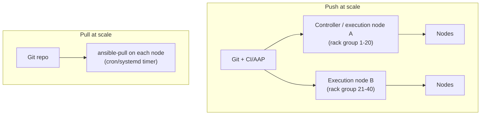

# 4.14 Ansible at scale: performance, strategies and callbacks

| | |
|---|---|
| Level | Advanced |
| Priority tier | 1 |
| Lab venue | ansible-core; many lightweight targets (Docker with sshd) or `ansible_connection=local` simulations |
| Part | Part 4: Automation and infrastructure as code |
| Status | Drafted, labs **untested** |

## Why this matters for AI infrastructure

Imagine you are asked to push a new kernel setting to a GPU cluster on a Friday evening. The cluster has 2,000 nodes. You type the playbook command, go and make coffee, and come back an hour later to find the run is still on the first task. That is the normal experience of a default Ansible run at this size. A default run uses 5 forks, which means 5 hosts are worked on at a time. It gathers facts on every host before it does anything else. It opens SSH connections again and again, one set for each task.

The slowness is only half the problem. The same default run is fragile. One slow node holds back its whole batch. One network blip fails a task on one host. One bad change, if it is written without limits, reaches every node within minutes.

So scaling Ansible is really two separate problems, and it helps to name them early. **Speed** means doing the same work in less time. **Safety** means containing failures when they happen and knowing afterwards what happened. A fast run that breaks 2,000 nodes at once is a worse outcome than a slow run that stops after the first batch.

This chapter takes both problems in turn. It starts with the tuning knobs, then the execution strategies, then batching and canary patterns. After that it covers asynchronous work for long jobs, pull-based and controller-fleet architectures, and callbacks for observability and audit.

## Prerequisites and outcomes

You need 4.3 to 4.8 first, because this chapter assumes you already know inventories, playbooks, handlers, variables and roles. Terms such as fork, ControlPersist and serial are explained where they first appear.

Use the questions below as a self-check when you finish. If you can answer each one with a reason, you have the main idea.

- Why does a slow SSH setup cost you time on every task, and which settings remove that cost?
- Which strategy should a step use when its hosts must reach a point together, and which one lets healthy hosts finish early?
- How would you run a 30-minute firmware job on a rack without holding an SSH session open for 30 minutes?
- What would you change in a fleet design if the controller, not the hosts, were the bottleneck?
- Which callback would you enable to see slow tasks, and which would you write yourself to keep an audit trail?

## 1. Measure before tuning

Picture a run that feels slow. The natural reaction is to change a setting, run again, and hope. That often wastes an afternoon, because the slow part may not be the part you changed. A better habit is to measure first, so that you know where the time actually goes.

Ansible has built-in timing callbacks for this. You turn them on in `ansible.cfg`.

```ini
# ansible.cfg
[defaults]
callbacks_enabled = timer, profile_tasks, profile_roles
```

The `profile_tasks` callback prints a sorted list of the slowest tasks and their cumulative time, so the top of that list tells you where to look first. The `timer` callback prints the total duration of the run. The `profile_roles` callback adds the same idea at role level, which helps when a role has many small tasks that add up.

Time a baseline on a representative slice of your hosts. Use `--limit` to pick about 10 percent of the fleet, and keep that slice the same for every test. Record the numbers, change one setting at a time, and measure again. If you change three things at once, you will not know which one helped.

Other tools help too. Set `ANSIBLE_LOG_PATH` to keep a log file of the run. Run `ansible-playbook -vv` to see connection timing for each host. Use the shell's `time` command for the whole-run wall clock. If the controller itself is CPU-bound, a profiler such as `strace -c -f -p` or `py-spy dump` shows where its time goes. For socket and file descriptor limits, `ss -s` and `ulimit -n` tell you whether the controller is running out of room.

The arithmetic explains why stragglers matter so much. Under the default `linear` strategy, a rough model of run time is:

`time ≈ (setup per host / forks) + Σ over tasks of ceil(hosts / forks) × max(task duration)`

Read the second part slowly. For each task, the hosts are split into batches of size `forks`. Each batch waits for its slowest host before the next batch starts, and every batch repeats that wait. So the slowest host, not the average host, sets the pace. Take 2,000 hosts with 50 forks as an example. That is 40 batches for every task. If one host in each batch takes 30 seconds for a task that usually takes 2 seconds, each of those 40 batches takes 30 seconds for that task, and the task costs 40 times 30 seconds in total.

Measure, change one setting, and measure again. That single habit prevents most wasted tuning.

## 2. Execution tuning

Raising forks helps, but only up to a point. Past that point, the controller runs short of CPU, memory or file descriptors, and the run gets slower instead of faster. This section covers the controller first, then the SSH connection, then facts and the work each task does.

### Forks and the control node

`forks` (default 5) sets how many host connections the controller works on in parallel. Think of forks as the number of checkout lanes at a supermarket. Five lanes are fine for a small shop, but a busy store needs more lanes, and each lane needs staff. Each fork is a worker process, so more lanes means more staff on the controller. On a well-provisioned controller, you can raise it to 50 to 200.

Each fork is a Python process. It uses roughly 50 to 150 MiB of memory, and some CPU while it fills in templates and parses results. Templating is CPU-bound, so too many forks can saturate the processor. Watch four things as you raise the number: memory, CPU saturation, file descriptors (`ulimit -n`), and the ephemeral port range. On the target hosts, watch SSH rate limits such as `MaxStartups`, along with fail2ban and any bastion limits, because those can start refusing connections when too many arrive at once.

The rule to remember is this. Too many forks produces slower runs, not faster ones. The right number is the highest value that keeps the controller comfortably below its limits.

### SSH tuning

Every task opens SSH sessions, so small SSH costs add up across a large fleet. Think of a delivery route. If each stop needs a fresh drive from the depot, most of the day goes to driving. If the van stays loaded and the driver keeps the engine running between stops, the same deliveries take far less time. SSH settings do the same job for Ansible.

```ini
[ssh_connection]
pipelining = True                     # one SSH exec per module instead of copy + exec + cleanup (needs no requiretty)
ssh_args = -o ControlMaster=auto -o ControlPersist=300s -o PreferredAuthentications=publickey -o ServerAliveInterval=30 -o ServerAliveCountMax=4
control_path = %(directory)s/%%C      # keep paths short; long paths exceed socket limits
retries = 3                           # retry connection failures
transfer_method = smart               # sftp/scp/piped
```

`ControlPersist` keeps one SSH connection open per host, so many tasks can share it. That is the biggest single win. `pipelining` cuts the number of round trips each task needs, and it is the second biggest win.

You can see the effect of multiplexing with a simple timing test. Run `time ssh vagrant@192.168.56.10.nip.io /usr/bin/true`. The first connection takes **`0.319s`** (`real 0m0.319s`), which covers the TCP and SSH handshake and the creation of a Unix domain control socket at `~/.ssh/sockets/vagrant@192.168.56.10.nip.io:22`. Run it again while that master is still open. The later connection reuses the master socket and takes just **`0.010s`**. You can check the master with `ssh -O check`, which prints `Master running (pid=5099)`, and close it with `ssh -O exit`. Each reused session saves about 0.3 seconds. Across 40 tasks on one host, that is about 12 seconds that never gets spent.

Without `pipelining = True`, Ansible opens two to three SSH sessions for every task. It creates a remote temporary directory, copies the `AnsiballZ` module package, then runs the module and cleans up. With `pipelining = True`, the same task needs just one SSH session, because the module is streamed straight into the remote Python. This works only when the target does not require a TTY for sudo. The usual fix is a sudoers drop-in that sets `Defaults:{{ ansible_user }} !requiretty` and is saved to `/etc/sudoers.d/disable-requiretty` with `mode: '0440'`. Validate that drop-in before you rely on it, with `validate: 'bash -c "cat /etc/sudoers /etc/sudoers.d/* %s | visudo -cf-"'`. That command joins the main sudoers file, the drop-in directory and the new file, then asks `visudo -cf-` to check that combined text from standard input. Checking the combined text catches a clash that checking the fragment alone would miss.

Watch the Unix domain socket path limit too. A socket path can be at most `104` bytes on macOS and BSD, and `108` bytes on Linux. Long cloud hostnames such as `ec2-203-0-113-25.compute-1.amazonaws.com` make the path too long, and you see `ControlPath "... too long for Unix domain socket"`. The fix is the `%C` token, which Ansible replaces with a short SHA-1 hash, as in `control_path = %(directory)s/%%C`. The path length then no longer depends on the hostname.

On the targets, set `UseDNS no`, size `MaxSessions` and `MaxStartups` for your fan-out, and keep sudo fast. A slow PAM module or a DNS lookup inside sudo adds seconds to every task. Prefer SSH keys, and use ed25519 keys. Fast ciphers such as `chacha20-poly1305@openssh.com` and the `curve25519-sha256` key exchange can be chosen in `sshd_config`. If a bastion (a jump host that sits between your controller and the nodes) is mandatory, multiplex through it with `ProxyJump`, and turn on `ControlPersist` on both hops. Size the bastion for the fan-out, because every node you reach through it adds load there.

### Facts

Fact gathering runs the `setup` module on every host at the start of each play. A fact is a piece of information Ansible collects about a host, such as its CPU count, its IP addresses and its OS version. Gathering facts is often the single largest cost in a run, because it runs on every host before the first real task.

```ini
[defaults]
gathering = smart                 # gather once, reuse cached facts
fact_caching = jsonfile           # or redis, memcached; sqlite via plugins
fact_caching_connection = /var/cache/ansible/facts
fact_caching_timeout = 7200
```

`gather_facts: false` skips facts in plays that do not use them. A narrower option is `gather_subset: [min]`, or the form `!all,!min,network`, which collects only the groups you name. You can also run one early play that gathers and caches facts, and let later plays rely on that cache with `gather_facts: false`. Cached facts keep the `ansible_facts` access patterns working, so your templates do not need to change.

Caches can go stale, and they may hold sensitive data, such as network layout or hardware serial numbers. Protect the cache directory with the same care you would give any other host secret.

### Tasks, modules and loops

How you write each task matters too. Each loop iteration is a separate module execution, so a loop of 100 items on 2,000 hosts is 200,000 module runs.

Batch the work wherever you can. Pass a list to a module that accepts one, as in `package: name: [a,b,c]`, and use `user` or `file` with lists when they are supported. Copy or template a whole file, rather than running several `lineinfile` calls to edit it line by line. Use `assemble` or `blockinfile` with care, because each one changes the file in its own way.

Avoid per-item loops across many hosts when the module accepts a list. Avoid `command` and `shell` for work Ansible can do with a proper module, and avoid small probes such as `shell: ls | wc -l` inside loops. Reduce `gather` calls by reusing inventory data you already have.

Use `async` with `poll: 0` to start slow operations in parallel, then check them later with `async_status`. Waiting for each slow job in turn is like a kitchen that cooks one dish, plates it, and only then starts the next one. Starting every dish first and checking on them later is much faster.

Package managers can be a bottleneck too. Point hosts at a local mirror or proxy cache, and use `apt update` with `cache_valid_time`, so that every host does not reach out to the Internet for the same files.

Tasks that use `delegate_to: localhost` run on the controller, once for each host in the batch. With 5,000 hosts each making a local API call, that is 5,000 controller operations. Batch them with `run_once` and a loop, or use a bulk API that accepts many items in one request.

Parsing a large inventory and its variables also takes time. Keep dynamic inventory cached, as covered in 4.5. Avoid enormous per-host dictionaries, and avoid `hostvars` loops over thousands of hosts inside a per-host template. That pattern grows quadratically, which means the cost rises with the square of the host count. You will meet the reason in the worked example in section 7 and in checkpoint question 7.

Heavy Jinja in loops over `groups['all']`, run for each host, costs O(n²) on the controller. Precompute the result once with `run_once`, `set_fact` and `delegate_facts`. Or render a shared file once and copy it to every host.

Use a recent Python on the controller. Install the `ujson` or `libyaml` bindings, because PyYAML with the C `libyaml` loader is much faster than the pure Python loader. Keep your collections installed locally, rather than downloading them on every run.

### Mitogen and alternatives

The Mitogen strategy plugin once sped Ansible up a great deal, by keeping a persistent Python interpreter on each target. It has lagged behind recent ansible-core versions, so treat it as unsupported by default unless you verify it against your version. For speed, the modern alternatives are `ansible-pull`, parallel `ansible-runner` jobs, the AAP automation mesh, or restructuring the work itself, with images and immutable infrastructure.

If you remember only two settings, make them `ControlPersist` and `pipelining`, then cache facts, since fact gathering is often the largest cost.

## 3. Strategies and batching

The strategy you pick decides whether your hosts move in step. Think of a group of hikers. In `linear`, the group waits at each checkpoint until the slowest hiker arrives, and then everyone moves on together. In `free`, each hiker walks at their own pace and reaches the end when they reach it. The right choice depends on whether the next step needs the whole group to be ready.

The table below is a lookup of the four options.

| Strategy | Behaviour | Use |
|---|---|---|
| `linear` (default) | Each task runs on all hosts in the batch before the next task starts | Predictable ordering; tasks depending on cluster-wide state; straggler-sensitive |
| `free` | Each host runs through the play at its own pace | Independent work (package installs, per-host config); fastest; harder to reason about output; avoid when later tasks rely on other hosts finishing |
| `host_pinned` | Like free but a host gets a worker until its play completes | Reduces connection churn; useful with limited forks |
| `debug` | Interactive debugger on failure | Troubleshooting (4.10) |

`linear` keeps the ordering predictable, but every task waits for the slowest host. `free` lets healthy hosts finish early, but its output is harder to follow, and it is risky when a later task depends on other hosts being finished. `host_pinned` cuts connection churn, which helps when forks are limited, because a worker keeps the same host until that host finishes its play.

```yaml
- name: Per-node tuning (independent work)
  hosts: gpu
  strategy: free
  tasks: [ ... ]

- name: Cluster-wide step needing all nodes (ordering matters)
  hosts: gpu
  strategy: linear
  serial: [1, "5%", "20%", "100%"]
  max_fail_percentage: 2
```

The first play runs per-node tuning on independent work, so `strategy: free` fits there. Each node can tune itself without waiting for its neighbours. The second play needs every node to reach a step together, so it keeps `linear`. It rolls out in batches that grow with `serial`, starting with one host, then 5 percent, then 20 percent, then the rest. It stops when failures pass 2 percent.

### Failure containment

Speed without containment turns a small mistake into an outage. A useful picture is a fire door. The door does not make the building faster. It stops one room's fire from spreading to the whole building. You need several of these doors together.

1. Start with a canary. A canary is a small first group that tests the change before anyone else gets it. Use `serial: [1, ...]`, or run a `canary` group before `all`, and validate the result after that first batch.
2. Size the `serial` batches to failure domains, such as a rack, a switch or a Slurm partition. A failure domain is a group of hosts that break together when one shared part fails. Then a bad batch never removes more capacity than your service-level objectives (SLOs, the targets you promise for uptime or throughput) allow.
3. Set `max_fail_percentage` or `any_errors_fatal` to stop the rollout when failures pass your tolerance. The first setting allows a small share of failures, and the second stops everything on the first failure.
4. Use `throttle` for tasks that hit shared dependencies, such as a package mirror, a license server, a secret manager or a storage metadata server. Throttle is like a single cashier at a shared till, so only a set number of hosts ask it at once.
5. Order matters. `order: shuffle` spreads load and avoids hitting the same racks first, while `order: inventory` gives you a deterministic order that is easy to predict.
6. Automate a stop-the-line rule. Callbacks or CI can parse failures and halt the remaining jobs. You can also pause between batches with `pause`, or put an approval gate in CI so that a person must say yes before the next batch.
7. After a partial failure, rerun with `--limit @failed.retry`-style lists, so that hosts which already converged are skipped quickly.
8. Check maintenance windows and capacity before you drain anything. Do not drain more than N nodes per partition, where N is the number your capacity plan allows.

### Long-running tasks

Consider a firmware flash that takes 30 minutes on one rack. A plain SSH session would have to stay open for the full 30 minutes. Any firewall or NAT device between you and the rack can drop an idle or long session, and the task would fail halfway through.

```yaml
- name: Flash firmware (30 minutes) in the background on a rack
  ansible.builtin.command: /opt/fw/update.sh --yes
  async: 3600           # allowed runtime
  poll: 0               # fire and forget
  register: fw_job
- name: Wait for completion
  ansible.builtin.async_status:
    jid: "{{ fw_job.ansible_job_id }}"
  register: fw_result
  until: fw_result.finished
  retries: 120
  delay: 30
```

Here is what happens. With `poll` set to `0`, Ansible starts the command in the background on the host, records a job ID, and moves on at once. The `async: 3600` value is the most the job is allowed to run, which is 3,600 seconds or one hour. The second task then checks the job every 30 seconds, up to 120 times, which covers the 30 minutes of the flash with room to spare. Between those checks, no SSH session needs to stay open.

`async` avoids SSH session timeouts, and it lets many hosts proceed in parallel. There is one catch. Handle reboots separately with `reboot` or `wait_for_connection`, because an `async` job dies when its host reboots. Idle SSH connections may also be dropped by firewalls or NAT, so set `ServerAliveInterval` to keep the connection alive while you wait.

Decide the strategy and the batch sizes for each step before the rollout starts, not during it. A rollout that is planned in advance is much easier to stop safely.

## 4. Architectures for large fleets

Architecture is the next lever after tuning. A tuned controller still has limits. The architecture question is where the controller sits, and whether each node pulls its own configuration or the controller pushes it out.



In push mode, a central controller reaches out to each node. Partition the inventory by site, pod or rack, as the diagram suggests. Then run several controller processes or AAP jobs in parallel, each with its own forks. Each partition becomes a smaller job that finishes sooner, and a failure in one partition does not block the others.

Automation Mesh execution nodes, which belong to Ansible Automation Platform (AAP, Red Hat's commercial product for running Ansible at scale), can sit close to the targets, in the same network zone. The controller then sends work to a nearby node instead of reaching every host across a long network path. That reduces latency and the number of connections that all funnel through one bastion.

In AWX (the open-source upstream of AAP) and AAP, job slicing splits one job template into N slices. Each slice runs as its own job, and the slices run in parallel across the inventory partitions. The result is the same as running several controller processes, but it is managed from one place.

Pull mode works in the opposite direction. Each node runs `ansible-pull -U <git-url> -C main site.yml -i localhost,`. The node fetches the repository and applies its own configuration on a schedule. Think of a newspaper delivered to each house on a set day, rather than a courier who must visit each house in turn. The benefits are that pull scales linearly with the fleet, needs no inbound SSH, and copes with unreliable networks and nodes that come and go with auto-scaling.

Pull mode has costs too, and you should weigh them before you choose it. Central visibility is harder, because no single place sees each run as it happens. Rollout control and canarying need a branch or tag for each ring, or a version pin in node-local facts. Secrets need their own distribution path. The repository becomes a high-value target, so sign commits and restrict deploy keys. In short, pull suits large, homogeneous fleets with strong image baselines. Push suits ordered operations, such as draining a node before an upgrade.

Immutable images reduce how much runtime Ansible you need. Bake drivers and operating system configuration into golden images, which were covered in 4.2, and use Ansible at build time. Keep post-boot work to small parameters, such as a hostname or a rack label. Day-2 changes then become image rollouts, which are easy to roll back.

Bastions and jump hosts need capacity for SSH, which means enough `MaxStartups` and CPU, plus multiplexing. Keep them hardened and audited, because every path into the fleet passes through them.

When the controller cannot reach some nodes, run a runner inside each pod or site, so that the work starts close to the nodes it touches.

Run idempotent converge jobs on a schedule. A nightly `--check` run finds drift, which means a host has moved away from its intended state. A weekly converge then fixes it. Send the results to a dashboard, so that drift is visible before it becomes an incident.

Plan the controller's CPU and memory from the fork count. For template-heavy plays, you need about one CPU core for every two forks, and about 100 MiB of RAM for each fork, plus the memory your inventory needs.

Give the controller a fast local SSD for the fact cache and temporary files, a high `ulimit -n`, synchronized time, a dedicated service account and off-box log shipping. Plan disaster recovery for it, because it holds access to everything. Treat it as a pet, meaning a machine you care for by hand, and automate its rebuild so that you could replace it quickly if you had to.

Choose push or pull for each kind of change, based on whether the order of operations matters. If order matters, push. If each node can act on its own, pull is often simpler.

## 5. Callbacks: observing and reporting

When a run touches many hosts, the terminal output alone does not tell you what happened. Scrolling through 2,000 lines of output is not a plan for an audit. Callbacks let you see each event as it happens, and send it somewhere useful, such as a timing report, a dashboard or a log store.

Every callback plugin hooks into playbook events. The events are named as they happen in a run, such as `v2_playbook_on_start` at the beginning, `v2_runner_on_ok` when a task succeeds on one host, `...failed` when it fails, `...unreachable` when a host cannot be reached, and `v2_playbook_on_stats` at the end, with the totals.

Callbacks come in two categories. Stdout plugins control the terminal output. Only one can be active at a time, and you choose it with `stdout_callback` in `ansible.cfg`. The choices are `default`, `yaml`, `debug`, `dense`, `minimal`, `json`, `oneline`, `unixy`, `selective` and `actionable`. Some of these are easier to read on a big run. For example, `actionable` shows only the tasks that changed something or failed, which cuts the noise down a lot.

The second category is the notification and other plugins. You enable them with `callbacks_enabled`, which was formerly called `callback_whitelist`, and several can run at the same time. This is where timing, logging and notifications live.

For web-based reports without setting up AWX or AAP, the book *Ansible: Up and Running* (3rd edition, chapter 18) also covers ARA, which stands for *ARA Records Ansible*. ARA records every playbook, task, host and result in a searchable database with a web interface. Install it with `pip3 install "ara[server]"`, then run `export ANSIBLE_CALLBACK_PLUGINS="$(python3 -m ara.setup.callback_plugins)"` so that Ansible loads it, and start the interface with `ara-manage runserver`.

The table below is a lookup of the callbacks you are most likely to use.

| Callback | Purpose |
|---|---|
| `ansible.posix.timer`, `profile_tasks`, `profile_roles` | Timing |
| `ansible.posix.json`, `jsonl` | Machine-readable output / event stream |
| `community.general.yaml` / `result_format=yaml` | Readable multi-line output |
| `community.general.log_plays`, `ansible.builtin.log_plays` | Per-host log files |
| `community.general.slack`, `mail`, `logstash`, `splunk`, `syslog_json`, `opentelemetry`, `loganalyzer` | Notifications and observability |
| `ansible.posix.junit` | JUnit XML for CI test views |
| `community.general.selective`, `actionable`, `dense`, `minimal` | Compact output for large runs |

Use the timing rows to find slow tasks, and the JSON rows to feed machine-readable logs into a search system.

If the built-in plugins do not fit your needs, you can write your own. The example below emits one JSON line per task result to a file. Each line is one event, which makes the file easy for a log system such as Loki or Elasticsearch to read. The plugin also drops the message text of `no_log` tasks, which are tasks marked as containing secrets, so that secrets do not leak into the audit log.

```python
# plugins/callback/jsonl_audit.py
from __future__ import annotations
DOCUMENTATION = """
name: jsonl_audit
type: notification
short_description: Write task results as JSON lines
options:
  path:
    description: Output file
    default: /var/log/ansible/audit.jsonl
    env: [{name: ANSIBLE_JSONL_AUDIT_PATH}]
    ini: [{section: callback_jsonl_audit, key: path}]
"""
import json, time
from ansible.plugins.callback import CallbackBase

class CallbackModule(CallbackBase):
    CALLBACK_VERSION = 2.0
    CALLBACK_TYPE = "notification"
    CALLBACK_NAME = "jsonl_audit"
    CALLBACK_NEEDS_ENABLED = True

    def set_options(self, task_keys=None, var_options=None, direct=None):
        super().set_options(task_keys=task_keys, var_options=var_options, direct=direct)
        self.path = self.get_option("path")
        self.fh = open(self.path, "a", buffering=1)

    def _emit(self, event, result, **extra):
        r = result._result
        rec = {"ts": time.time(), "event": event, "host": result._host.get_name(), "task": result._task.get_name(),
               "changed": r.get("changed"), "rc": r.get("rc"), "msg": str(r.get("msg", ""))[:500], **extra}
        if result._task.no_log:
            rec.pop("msg", None)                    # never log output of no_log tasks
        self.fh.write(json.dumps(rec) + "\n")

    def v2_runner_on_ok(self, result):        self._emit("ok", result)
    def v2_runner_on_failed(self, result, ignore_errors=False):   self._emit("failed", result, ignored=ignore_errors)
    def v2_runner_on_unreachable(self, result):                  self._emit("unreachable", result)
```

Enable it with `callbacks_enabled = jsonl_audit` and `callback_plugins = plugins/callback` in `ansible.cfg`. Read the plugin as a short story. When a task finishes on a host, Ansible calls the matching hook, such as `v2_runner_on_ok`. The hook builds a small dictionary with the time, the host, the task name and the result, and it writes that dictionary as one line of JSON. A `no_log` task has its message removed before the line is written.

AAP and AWX record job events natively, and you can stream them to an external logging system. Add run metadata, such as the git commit SHA, the change ticket, the operator and the inventory name, through `-e` extra variables or environment variables. That way every record can be traced back to who ran what, and from which code. Ship logs to a central system with a retention policy, and never include secrets in any record.

Some dashboards pay for themselves quickly. Track the number of changes per environment per day, the failure rate per play or role, and the mean run duration. Also track hosts that have not converged in N days, which shows drift, and tasks that always report a change, which points to a lost idempotency guarantee. Finish with the slowest tasks, because they tell you where the next tuning effort should go.

Ship the JSON records to a central system with retention, and keep secrets out of every record.

## 6. Pull mode in detail

In pull mode, each node fetches its own configuration on a timer, instead of waiting for a controller to push it. A useful comparison is a thermostat. It checks the room on a schedule and adjusts the heating on its own, without someone walking around the house with a remote control.

```bash
# On a node (systemd timer every 30 minutes with jitter)
ansible-pull -U git@git.example.com:platform/node-config.git -C main --purge \
  -d /var/lib/ansible-pull -i localhost, --only-if-changed -o node.yml
```

The `--only-if-changed` flag skips the run when the repository has not changed, and `-o` runs the playbook only if the repository was updated. Add a random sleep, such as `--sleep 120`, to spread the load across nodes. Without it, all 2,000 nodes would ask the Git server for updates at the same moment every 30 minutes.

Node-specific differences come from facts, `ansible_local` custom facts, node name patterns, or a node-class variable file. That way one repository can describe many different kinds of node.

Rings make rollouts safer. A ring is a group of nodes that receive a change at a set point in the rollout. Ring 0 nodes track the `canary` branch, ring 1 tracks `stable-1`, and ring 2 tracks `stable`. You promote a change by fast-forwarding the branches, or by moving signed tags, after the change has passed validation in the earlier ring. A worked example: a change lands on `canary`, the ring 0 nodes apply it, and their checks pass. Only then does the branch move to `stable-1`, and so on, until the whole fleet has it.

Use read-only deploy keys, and verify signed commits with `--verify-commit`. Keep secrets out of the repository, and fetch them from a secret manager using the node's own identity. Monitor for tampering too, so that an unexpected change in the repository raises an alarm.

Protect the branches strictly, because an unreviewed change reaches the whole fleet within one timer interval. The pull schedule and the branch rules, as covered in 4.1, are the real safety net.

## 7. Putting it together: a large GPU cluster playbook skeleton

A cluster playbook combines the patterns from earlier sections in one file. Read it from top to bottom, and you will see the fact cache, the rolling batches and the limit on a shared service, one after another.

The first play gathers and caches the cluster facts once, so later plays can reuse them. The second play runs a rack-aware rolling change. Before it changes a node, it asks Slurm, the scheduler that runs jobs on the cluster, whether any jobs are running on that node. It skips the node when jobs are running, unless you force the change.

```yaml
- name: Gather cluster facts once and cache
  hosts: cluster
  gather_facts: true
  gather_subset: [network, hardware]
  tasks: []

- name: Rack-aware rolling change
  hosts: gpu
  gather_facts: false
  strategy: linear
  order: shuffle
  serial: "{{ rollout_serial | default(['1', '2%', '10%', '100%']) }}"
  max_fail_percentage: 2
  tasks:
    - name: Skip nodes with running jobs unless forced
      ansible.builtin.command: "squeue -h -w {{ inventory_hostname }} -o %i"
      delegate_to: "{{ groups['slurm_controller'][0] }}"
      register: jobs
      changed_when: false
      failed_when: jobs.stdout != "" and not (force | default(false) | bool)
      throttle: 10                                   # protect slurmctld from thousands of queries
    - ansible.builtin.import_role: { name: kernel_tuning }
    - ansible.builtin.import_role: { name: gpu_node, tasks_from: validate }
```

Here is how a rollout reads in practice. The first batch is one node, which is the canary. If that node passes, the next batch is 2 percent of the fleet, then 10 percent, then everything else. The `order: shuffle` line mixes the hosts, so that the batch does not sit in one rack. The `throttle: 10` line means at most 10 hosts ask the Slurm controller at once, which protects it from thousands of simultaneous queries. If more than 2 percent of a batch fails, the rollout stops.

Facts are cached once, batch sizes grow after the canary, and `throttle` protects shared services. Because the plan is idempotent, which means running it again produces the same end state without repeating finished work, you can rerun it to resume after a stop.

## 8. Failure modes of the controller itself

Sometimes the controller is the bottleneck, not the hosts. When the run slows down, it is easy to blame the nodes. Check the controller first. The table maps each symptom to its likely cause and its mitigation.

| Symptom | Cause | Mitigation |
|---|---|---|
| Runs get slower with more forks | CPU/RAM saturation, SSH rate limits | Lower forks; scale out controllers; tune SSH; partition inventory |
| `OSError: Too many open files` | `ulimit -n` too low | Raise limits; reduce forks |
| `ControlPath too long` | Path length > 104 bytes | `control_path_dir` short; `%C` hash |
| Intermittent `UNREACHABLE` at scale | `MaxStartups` throttling, fail2ban, bastion limits, conntrack exhaustion | Tune sshd; stagger; fewer forks |
| Controller OOM | Large inventory/vars, many forks, huge registered results | Reduce forks, trim registered data (`no_log`, `loop_control`), avoid dumping big facts |
| Stuck runs | Hung SSH sessions, tasks without timeouts | `timeout`, `ServerAliveInterval`, task `timeout:`, `async` |
| Output unreadable | Thousands of hosts | `stdout_callback = actionable`/`selective`, JSON logs, summaries |

When a run misbehaves, check forks, file limits and SSH limits before you blame the hosts. A quick check of `ulimit -n` and the forks setting takes a minute, and it rules out the most common controller problems.

## 9. Lab

Start with the self-checking Python lab, `ansible_scale_performance_lab.py`, and run it locally before you touch any hosts. It verifies the wall-clock runtime model in `estimate_play_wall_clock_seconds`. That model shows a speedup of `>40x`. The gain comes from `forks=50`, `ControlPersist` and `pipelining` working together. `ControlPersist` cuts connection time from `0.319s` to `0.010s`, and `pipelining` cuts SSH trips per task from `3` to `1`.

The lab also compares the `linear` and `free` strategies under a 5x straggler host, which means one host that is five times slower than the rest. It checks `format_jsonl_audit_event`, which masks the output of `no_log` tasks. The lab draws on *Ansible: Up and Running*, chapters 18 and 20.

```bash
python3 code/part04/ansible_scale_performance_lab.py
```

Run the lab first, because it proves the model on your own machine. Then move to a real control node. The interactive shell steps below were not run on live hardware, so treat each one as a plan to confirm, not a result you can quote.

1. Create 30 to 50 lightweight targets, using Docker with sshd, or use `ansible_connection=local` loopback hosts. Run a 10-task playbook with the defaults and `profile_tasks`, and record the totals.
2. Change one setting at a time, such as `forks`, `ControlPersist`, `pipelining`, fact gathering off, `gather_subset`, or the fact cache. Chart the improvements, and find the point where more forks stop helping.
3. Run the same play with `linear` and then with `free`, while you inject a slow host with `sleep 30`. Compare the wall time and the output, and identify when `free` is unsafe.
4. Implement `serial: [1, 10%, 100%]`, `max_fail_percentage` and `any_errors_fatal`. Inject a failure at the third batch. Then write a resume procedure that uses a failed-hosts list.
5. Run a 5-minute fake firmware job across all hosts, using `async` with `poll: 0`, and collect the results with `async_status`. Compare it with a synchronous run, and with a short SSH `ServerAliveInterval` misconfiguration.
6. Render a hosts file per host that loops over all hosts. Measure the time at 100, 500 and 2,000 simulated hosts. Then fix it by rendering once with `run_once` and distributing the result.
7. Enable `timer`, `profile_tasks` and `json`. Write and enable the `jsonl_audit` callback, and verify that `no_log` tasks are masked. Then load the JSONL into a small dashboard, such as Grafana Loki or a notebook.
8. Set up `ansible-pull` on three nodes with a systemd timer, jitter and rings, using canary and stable branches. Promote a change through the rings, and compare the process with push for the same change.
9. Split the inventory into four shards. Run four parallel `ansible-playbook` processes, each with `--limit` set to one shard. Compare that with one run that has four times the forks.
10. Kill the controller in the middle of a run, then resume it. Confirm the run completes idempotently, and document what state may be partial.
11. Estimate how long a baseline play takes on 10,000 nodes, using your measured per-task cost and your chosen forks and shards. State the assumptions.
12. Clean up when you are done.

## 10. Common mistakes

Each item below is a habit that hurts a large Ansible run. Most of them look harmless on a small test fleet, which is why they survive until the first big rollout.

- Raising forks without checking controller CPU, file descriptor limits or target SSH limits.
- Gathering facts on every play of every run, with no cache.
- Using the `free` strategy for steps that need cluster-wide ordering.
- Running large batches with no canary and no stop-the-line threshold.
- Looping package installs, or calling an API from localhost thousands of times in per-host loops.
- Writing quadratic templating with `hostvars`, or registering giant variables.
- Treating pull mode as a replacement for orchestration, such as drains and ordered upgrades.
- Running the controller as a single unmonitored pet, with broad credentials and no backups.
- Logging full task output, including secrets, to central systems.
- Optimizing speed before correctness and idempotency.

If you must choose, fix correctness and idempotency first, then tune speed. A fast run that makes a wrong change on every node is still a wrong change.

## 11. Interview angles

These questions test how you reason about large fleets. Each one lists the points to cover in its answer, so you can check your own answer against them.

- "How do you make Ansible fast on 5,000 nodes?" Cover forks, SSH multiplexing and pipelining, fact caching, fewer tasks, async, and sharding controllers.
- "Explain `serial`, `free` strategy, `max_fail_percentage` and how you roll out safely."
- "Push versus pull configuration management at scale: what are the trade-offs?"
- "How do you monitor and audit Ansible runs?" Cover callbacks, AAP job events, JSON logs, and drift dashboards.
- "How do you handle a task that takes an hour per host?" Cover async, parallel work, polling, and reboot handling.
- "What limits the controller? How do you scale it?"
- "Why might more forks make a run slower?"

Start with what limits the controller, since forks, SSH and fact caching all depend on it. A strong answer names the limit first, then the setting that moves it.

## Exercises

1. Use `estimate_play_wall_clock_seconds()` in `code/part04/ansible_scale_performance.py` to work through the SSH settings. First, explain how `ControlPersist` cuts SSH overhead from `0.319s` to `0.010s`, which you can check with `ssh -O check` and `ssh -O exit`. Explain why long EC2 hostnames exceed the 104-byte Unix socket limit without `%C`, and how `pipelining = True` cuts SSH sessions per task from 3 to 1. The benchmark comes from *Ansible: Up and Running*, chapter 20. Second, explain how `bash -c "cat /etc/sudoers /etc/sudoers.d/* %s | visudo -cf-"` validates `/etc/sudoers.d/disable-requiretty`.
2. Explain why a per-host template that loops over `groups['all']` or `hostvars` across 2,000 nodes is $O(N^2)$ on the controller CPU. Then explain how `run_once: true` with `copy` makes it $O(N)$. Second, compare file-based fact caches (`jsonfile`, `yaml`, `pickle`) with memory-based ones (`redis`, `memcached`), using *Ansible: Up and Running*, chapter 20.
3. Using `estimate_play_wall_clock_seconds()`, explain why one slow straggler host stalls every task wave under `strategy: linear`. Then explain why `strategy: free` lets healthy hosts finish ahead. Place `host_pinned` in that comparison, and state when `free` is unsafe. Last, explain how `serial`, `max_fail_percentage` and `throttle` contain the blast radius, so you can see which control does what.
4. Trace how `async: 3600` with `poll: 0` starts a 30-minute firmware flash, or a large `git clone`, in the background. Follow the `apt` package installs that run in parallel while it works. Then trace how `async_status` polls `fw_job.ansible_job_id` until the job finishes. Use *Ansible: Up and Running*, chapter 20, as the reference.
5. Contrast scaling push mode with `ansible-pull`. For push, cover partitioned inventories, AWX or AAP job slicing, and Automation Mesh execution nodes. For pull, cover `--only-if-changed`, `--sleep 120` jitter, `--verify-commit`, and canary and stable branch rings.
6. Using `format_jsonl_audit_event()` in `code/part04/ansible_scale_performance.py`, explain the difference between stdout and notification callback plugins. Cover `profile_tasks` and `junit` among the notification plugins, and the custom `jsonl_audit.py` plugin you can write yourself. Then explain how `CallbackModule` hooks `v2_runner_on_ok`, `failed` and `unreachable`, while it masks `result._task.no_log`. Finally, explain how ARA (`ara[server]`) records playbook runs, using *Ansible: Up and Running*, chapter 18.

## Checkpoint questions (20)

<details>
<summary>1. What is the wall-clock runtime formula for an Ansible play under the default `linear` strategy, and why do stragglers dominate runtime?</summary>

Under `strategy: linear`, every host in the active batch must finish Task $i$ before any host starts Task $i+1$. For $H$ hosts and $F$ forks, the number of waves is `waves = ceil(H / F)`. The total play time is approximately:
`T ≈ ceil(H / F) * T_setup + sum_i(ceil(H / F) * max_h(T_task_i,h))`
Each wave waits for `max_h(T_task_i,h)`. So a single slow straggler host, from a slow disk, a DNS timeout or high latency, stretches every task across the entire batch.
</details>

<details>
<summary>2. How much time does SSH multiplexing save per connection, with `ControlMaster=auto` and `ControlPersist`, and how do you inspect or stop a master socket, according to *Ansible: Up and Running*, chapter 20?</summary>

In the chapter 20 benchmark, opening a fresh SSH connection with `time ssh ... /usr/bin/true` takes **`0.319s`**. Reusing an open `ControlPersist` master socket takes **`0.010s`**, a 30x reduction that saves about `0.3s` per SSH execution. You can verify an active master socket with **`ssh -O check user@host`**, which prints `Master running (pid=5099)`. Close it with **`ssh -O exit user@host`**.
</details>

<details>
<summary>3. What causes `ControlPath "... too long for Unix domain socket"` on cloud instances, and how do you fix it in `ansible.cfg`, according to *Ansible: Up and Running*, chapter 20?</summary>

The kernel limits Unix domain socket paths (`sun_path`) to 104 bytes on macOS and BSD, and 108 bytes on Linux. Cloud VMs with long hostnames, such as `ec2-203-0-113-25.compute-1.amazonaws.com`, produce a control path that embeds `%r@%h:%p`. That path exceeds the limit and fails. Set `control_path = %(directory)s/%%C` in `[ssh_connection]` in `ansible.cfg`. The `%C` token is a compact, fixed-length SHA-1 hash of `%l%h%p%r`.
</details>

<details>
<summary>4. How does `pipelining = True` speed up task execution, and how did *Ansible: Up and Running*, chapter 20, safely validate `/etc/sudoers.d/disable-requiretty` before enabling pipelining?</summary>

Without pipelining, Ansible opens **2 to 3 SSH sessions per task**. It creates a temp directory, copies the `AnsiballZ` zip with `sftp` or `scp`, then runs and removes it over `ssh`. With **`pipelining = True`**, Ansible streams the Python payload over **`stdin`** in **1 single SSH session**. Streaming over stdin has no TTY, so `requiretty` must be disabled first. Validate the drop-in file, which holds `Defaults:{{ ansible_user }} !requiretty` with `mode: '0440'` and references settings in `/etc/sudoers`, with `validate: 'bash -c "cat /etc/sudoers /etc/sudoers.d/* %s | visudo -cf-"'`. Run the play once with `pipelining = False` before turning `pipelining = True` on.
</details>

<details>
<summary>5. Why does raising `forks` from 5 to 500 on a small control node sometimes make playbooks run SLOWER or crash?</summary>

Each fork is a separate Python process. It uses **50–150 MiB of RAM**, CPU for Jinja2 templating and JSON parsing, and open file descriptors and sockets. For example, at `forks = 500` on an undersized controller, context-switch thrashing and OOM kills can follow. A low `ulimit -n` causes **`OSError: Too many open files`**. Bastions and target `sshd` daemons can drop connections, with **`kex_exchange_identification`** or **`MaxStartups`** errors. Size the controller at about `forks / 2` CPU cores and `forks * 100 MiB` of RAM.
</details>

<details>
<summary>6. Compare the three categories of fact caching plugins in Ansible, according to *Ansible: Up and Running*, chapter 20.</summary>

With `gathering = smart` and `fact_caching_timeout = 86400`, which is 24 hours, set in `ansible.cfg`, Ansible supports three categories of cache storage. You can list them with `ansible-doc -t cache -l`.

1. File-based on the controller (`jsonfile`, `yaml`, `pickle`) needs no external service. It stores one file per host under `fact_caching_connection = /var/cache/ansible/facts`.
2. In-memory (`memory`) is the default when no cache plugin is configured. It lasts only as long as a single `ansible-playbook` process.
3. A networked RAM store (`redis`, `memcached`, `mongodb`) is shared across multiple controllers or CI runners.
</details>

<details>
<summary>7. Why is rendering a cluster-wide `/etc/hosts` or `slurm.conf` template on 2,000 nodes an $O(N^2)$ bottleneck on the controller, and how do you make it $O(N)$?</summary>

A `template:` task across 2,000 hosts can contain `{{ hostvars[h]['ansible_host'] }}` in the `.j2` file. The control node then runs that 2,000-iteration loop once for each host. That is $2,000 \times 2,000 = 4,000,000$ `hostvars` lookups. Render the file once on the controller instead, with `delegate_to: localhost` and `run_once: true`, writing `/tmp/cluster_hosts`. Then use `ansible.builtin.copy` to push that static file to all 2,000 nodes, which is $O(N)$.
</details>

<details>
<summary>8. Why is `delegate_to: localhost` without `run_once: true` dangerous on a 5,000-node play?</summary>

On a play that targets 5,000 hosts, a task with `delegate_to: localhost` runs its local command once per host. For example, it might call an external CMDB, a Slack webhook or a Slurm controller API. Those 5,000 runs execute in parallel on the control node, up to `forks` at a time. That can fork-bomb the controller and effectively DDoS the API. Either aggregate the call into a single request with **`run_once: true`** that loops over `ansible_play_batch`, or cap the concurrency with **`throttle: 10`**.
</details>

<details>
<summary>9. Compare `strategy: linear`, `strategy: free`, and `strategy: host_pinned` at scale.</summary>

- `linear` (default) is a lockstep, task-by-task barrier across all hosts in the batch. It is required when Task $i+1$ depends on Task $i$ finishing on every node, but the slowest host slows every task.
- `free` lets each host advance through its task list without waiting at barriers. It is the fastest choice for independent per-host configuration, but it does not suit steps where cross-host ordering matters.
- `host_pinned` works like `free`, except that a fork stays assigned to one host until that host finishes all its tasks. That maximizes SSH connection cache locality when there are more hosts than forks, written `num_hosts > forks`.
</details>

<details>
<summary>10. How can you use `async` and `poll: 0` to overlap slow I/O tasks with package installation?</summary>

In one worked example, a `git` task clones the Linux kernel Git repository with `async: 3600`, `poll: 0` and `register: clone`. Because of `poll: 0`, Ansible moves straight on to installing several `apt` packages while the clone downloads in parallel. After the package tasks, an `async_status: { jid: "{{ clone.ansible_job_id }}" }` task waits for the background clone to finish, with `until: result.finished, retries: 3600`.
</details>

<details>
<summary>11. Why does an `async` task fail if the target host reboots during the task?</summary>

`async` starts a background wrapper process on the target host. The wrapper writes its status JSON to `~/.ansible_async/<jid>`. If the command reboots the host, the OS kills the wrapper before it can write the completion status file. If `/tmp` is `tmpfs`, the status file is wiped as well. Always use **`ansible.builtin.reboot`** for reboots instead of `async`. Or trigger the reboot and wait from the controller with **`wait_for_connection`**.
</details>

<details>
<summary>12. How do AWX and Ansible Automation Platform (`AAP`) "Job Slicing" and "Automation Mesh Execution Nodes" scale push-mode Ansible?</summary>

- **Job Slicing:** Set `job_slice_count: 8`, and the job splits a 4,000-host inventory into 8 slices of 500 hosts each. It schedules 8 independent `ansible-playbook` jobs across the execution nodes in parallel.
- **Automation Mesh Execution Nodes:** These are worker nodes in remote data centers or private rack zones. They keep persistent mTLS mesh connections to the central control plane, and they run SSH tasks locally against nearby racks. That removes WAN latency and central bastion bottlenecks.
</details>

<details>
<summary>13. How does `ansible-pull` work, what do `--only-if-changed` and `--sleep` do, and how do you stage rollouts in pull mode?</summary>

Instead of a central controller pushing over SSH to 10,000 nodes, each node runs a systemd timer or cron job. That job invokes `ansible-pull -U <git_repo_url> -C <branch_or_tag> -i localhost, node.yml`. `-o` or `--only-if-changed` runs the playbook only when the remote Git repository has new commits since the last pull. `-s 120` or `--sleep 120` waits a random delay between 0 and 120 seconds, so 10,000 nodes do not hit the Git server at the same moment. To stage rollouts, assign nodes to rings. `ring0` tracks the `canary` branch or tag, `ring1` tracks `stable-1`, and `ring2` tracks `stable`. Promote tested commits across the rings by fast-forwarding the signed branch or tag.
</details>

<details>
<summary>14. When should you choose push mode, pull mode with `ansible-pull`, or golden images for a GPU cluster?</summary>

- **Golden images:** Build them with Packer and Ansible at build time. They suit the heavy, static base layer, which covers the OS, kernel, NVIDIA drivers, CUDA and containerd, so nodes boot ready to work in 2 minutes.
- **Pull mode** (`ansible-pull`) suits continuous baseline convergence of node-local files, such as `/etc/chrony.conf`, monitoring exporters and SSH certificates, across thousands of independent hosts.
- **Push mode**, through AAP or the controller with `serial`, suits multi-node operations where cross-host ordering and scheduler coordination matter. Examples are draining a rack in Slurm, upgrading switches, and rolling database or controller upgrades.
</details>

<details>
<summary>15. What is the difference between a `stdout` callback plugin and a `notification` callback plugin, according to *Ansible: Up and Running*, chapter 18?</summary>

- **Stdout callback:** Set with `stdout_callback = yaml | json | dense | minimal | debug | selective`, it controls how Ansible formats its primary terminal output. Only one stdout callback can be active at a time.
- **Notification or aggregate callback:** Set with `callbacks_enabled = timer, profile_tasks, profile_roles, junit, slack, logstash, jsonl_audit`, it observes the playbook lifecycle in the background. It can write timing summaries, JUnit XML reports, JSONL audit logs or Slack messages. Several notification callbacks can be enabled at the same time.
</details>

<details>
<summary>16. How does the `junit` callback plugin, from chapter 18, table 18-5 of *Ansible: Up and Running*, integrate playbook runs into CI test dashboards?</summary>

Enabling `callbacks_enabled = junit` makes Ansible write a JUnit XML report into `JUNIT_OUTPUT_DIR` after every playbook run. By default that is `~/.ansible.log`. Each task is recorded as a test case. Setting `JUNIT_FAIL_ON_CHANGE=true` during a scheduled drift check or idempotence test marks any task that reports `changed` as a test failure in Jenkins, GitLab or GitHub Actions.
</details>

<details>
<summary>17. What is ARA (*ARA Records Ansible*, from chapter 18 of *Ansible: Up and Running*), and how does it work?</summary>

ARA is an open-source callback plugin and a lightweight web and API server. Install it with `pip install "ara[server]"`, then run `export ANSIBLE_CALLBACK_PLUGINS="$(python3 -m ara.setup.callback_plugins)"`. It intercepts every `ansible` and `ansible-playbook` run. It records playbooks, tasks, host facts, execution durations and per-host results in an SQLite, PostgreSQL or MySQL database. You can inspect that data with the `ara` CLI or the `ara-manage runserver` web UI.
</details>

<details>
<summary>18. When writing a custom callback plugin (`CallbackModule`), how do you ensure `no_log: true` secrets are never written to the audit log?</summary>

Inside your `v2_runner_on_ok` and `v2_runner_on_failed` hooks, check `if result._task.no_log:`. You can also check `result._result.get('_ansible_no_log')`. When either check shows a secret, strip the `msg`, `stdout`, `stderr`, `invocation` and `diff` fields from the JSON record. Do that before you write to disk or ship the record to Loki, Elasticsearch or Logstash.
</details>

<details>
<summary>19. How does `order: shuffle` on a play improve safety during a large fleet rollout?</summary>

By default, `order: inventory` processes hosts in inventory order. That often means `gpu001`, `gpu002`, `gpu003` and so on, all in Rack 1. If a batch fails or drains capacity, Rack 1 loses 100% of its nodes at once. With **`order: shuffle`**, applied after the initial canary, hosts are randomized across racks and pods. Load and failure blast radius then spread across failure domains.
</details>

<details>
<summary>20. How do you resume a playbook run across 2,000 hosts after 15 hosts failed due to a transient network blip?</summary>

Every task in a well-written playbook is idempotent, so you can rerun the playbook against only the failed hosts. Use a retry file with `ansible-playbook site.yml --limit @site.retry`, which works when `retry_files_enabled = True`. Or pull the failed hostnames from the `jsonl_audit` output, or from `ANSIBLE_STDOUT_CALLBACK=json`, write them to `@failed_hosts.txt`, and pass `--limit @failed_hosts.txt`.
</details>

## Sources and review notes

- **Sources read in full:**
  - `ansible-up-and-running-3rd-edition` — Bas Meijer, Lorin Hochstein & René Moser, *Ansible: Up and Running*, 3rd ed., **Chapter 18: Callback Plug-ins** (read in full: stdout plugins `default`, `yaml`, `debug`, `dense`, `minimal`, `json`, `oneline`, `selective`, `actionable`, `unixy`, `ara` `ara[server]` / `ara-manage runserver`; and notification/other plugins `timer`, `profile_tasks`, `profile_roles`, `junit` `JUNIT_OUTPUT_DIR`/`JUNIT_FAIL_ON_CHANGE`, `slack`, `mail`, `foreman`, `logstash`, `logentries`, `say`) and **Chapter 20: Making Ansible Go Faster** (read in full: SSH multiplexing `ControlMaster`/`ControlPersist`, `ssh -O check` / `ssh -O exit`, `0.319s -> 0.010s` timing benchmark, EC2 long-hostname Unix socket limit and `%C` `ControlPath`, `pipelining = True` and `/etc/sudoers.d/disable-requiretty` validated with `cat /etc/sudoers /etc/sudoers.d/* %s | visudo -cf-`, Mitogen, Fact Caching `jsonfile`/`yaml`/`pickle`/`redis`/`memcached` with `86400`s timeout, parallelism `forks`, `async` + `poll: 0` overlapping tasks, and Ed25519 / `chacha20-poly1305` SSH algorithm selection).
- **Run here:** `python3 code/part04/ansible_scale_performance_lab.py` (3 passed, 0 failed).
- **Explicitly labelled inferences:** The `estimate_play_wall_clock_seconds` and `format_jsonl_audit_event` models in `code/part04/ansible_scale_performance.py`, the `jsonl_audit.py` custom callback plugin, and the Section 7 large GPU cluster playbook skeleton are the author's constructions applying *Ansible: Up and Running* Chapters 18 & 20 to thousand-node GPU fleets (plus original study items 21, 22, 23, 24, 25, 26, 27, 28, 29, and 30).
- **Not verified on live hardware:** Live 5,000–10,000 node benchmarks, AWX/AAP automation mesh and job slicing, `ansible-pull`, and `ara-manage runserver` commands (`50 to 200` forks, `50 to 150 MiB`, `300s` ControlPersist, `7200`s / `86400`s fact cache, `104` / `108` byte socket limit, `0.319s`, `0.010s`, `5000` Logstash port) are marked as not run where the lab does not execute them.
