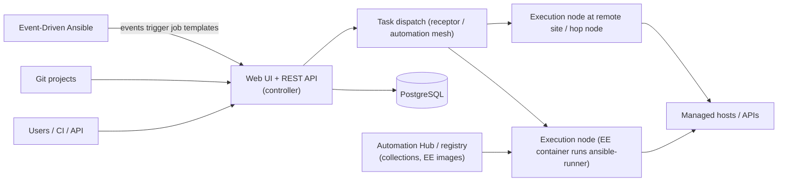

# 4.15 Custom modules, plug-ins and Ansible Automation Platform

| | |
|---|---|
| Level | Advanced |
| Priority tier | 1 |
| Lab venue | Python 3.10+, ansible-core, ansible-builder/navigator, Docker; kind or minikube for an AWX lab |
| Part | Part 4: Automation and infrastructure as code |
| Status | Drafted, labs **untested** |

## Why this matters for AI infrastructure

Eventually the modules on the shelf do not match your hardware or process: a vendor tool with a CLI but no module, a site-specific scheduler operation ("drain nodes in this rack if no jobs"), a Redfish OEM extension, a custom inventory source, a filter that compresses node lists into Slurm hostlist syntax. A custom module or plugin turns a fragile shell snippet into an idempotent, testable, documented task. And once more than a handful of people run automation, you need a **platform**: central credentials, role-based access, audit trails, scheduling, approvals and an API. Ansible Automation Platform (AAP, and its upstream AWX) is that layer. This chapter shows how to extend Ansible and how to operate it as a shared service.

## Prerequisites and outcomes

Needs 4.6 to 4.14 and Python skills from Part 3. After this chapter you can:

- Decide when to write a module, a plugin, or just a role.
- Write a Python module with `AnsibleModule` (arguments, check mode, idempotency, return values, documentation), test it, and ship it in a collection.
- Write filter, test, lookup, inventory, callback and action plugins; know connection/become/vars/cache plugin types.
- Explain AAP/AWX architecture (controller, execution environments, automation mesh, hub, EDA), its objects (organisations, projects, inventories, credentials, job templates, workflows, surveys, schedules, notifications), and RBAC.
- Build and use execution environments; call the platform through its API; connect it to CI and Git; secure and operate it.
- Choose between running Ansible from CI, from a shared bastion, and from AAP.

## 1. Choosing the extension point

| Need | Use |
|---|---|
| Combine existing modules into a procedure | Role (4.11) |
| Wrap a CLI in a reliable idempotent interface | Module (Python, or any language emitting JSON) |
| Transform data inside Jinja | Filter / test plugin |
| Fetch external data at template time on the controller | Lookup plugin |
| Build inventory from an external source | Inventory plugin |
| Change how output/notifications work | Callback plugin |
| Run logic on the controller around a module (pre/post-processing, templating arguments) | Action plugin |
| Connect to something that is not SSH | Connection plugin |
| Cache facts/inventory somewhere custom | Cache plugin |
| Add variables from an external system | Vars plugin |

Modules execute **on the target** (or on the controller with `delegate_to: localhost`/`connection: local` for API-based modules); plugins execute **on the controller**. Package both in a collection so they are versioned and distributed together (4.11). If a core or community module exists, use it; if a module does not exist, check Galaxy first; write your own when you have a stable, repeated need.

## 2. Writing a module

A module is a program that receives JSON arguments and prints one JSON result. Python modules use `AnsibleModule` to handle arguments, check mode, errors and results. Idempotency is your responsibility: **read current state, compute the difference, change only if needed, report `changed` accurately**.

### Example: manage a GPU power cap

```python
#!/usr/bin/python
# plugins/modules/gpu_power_limit.py
from __future__ import annotations

DOCUMENTATION = r"""
---
module: gpu_power_limit
short_description: Ensure NVIDIA GPU power limits
description:
  - Reads GPU power limits with C(nvidia-smi) and sets them to the requested value if different.
version_added: "1.0.0"
options:
  watts:
    description: Desired power limit in watts.
    type: int
    required: true
  index:
    description: GPU index, or C(all).
    type: str
    default: all
  persist:
    description: Enable persistence mode first (recommended).
    type: bool
    default: true
requirements:
  - nvidia-smi
author:
  - Platform team (@platform)
notes:
  - Supports check mode.
"""

EXAMPLES = r"""
- name: Cap all GPUs at 600 W
  acme.gpu.gpu_power_limit:
    watts: 600

- name: Cap GPU 3 only
  acme.gpu.gpu_power_limit:
    watts: 550
    index: "3"
"""

RETURN = r"""
before:
  description: Power limits (W) before the change, by GPU index.
  type: dict
  returned: always
after:
  description: Power limits (W) after the change.
  type: dict
  returned: success
"""

from ansible.module_utils.basic import AnsibleModule


def query(module, smi, index):
    args = [smi, "--query-gpu=index,power.limit", "--format=csv,noheader,nounits"]
    if index != "all":
        args += ["-i", index]
    rc, out, err = module.run_command(args, check_rc=False)
    if rc != 0:
        module.fail_json(msg=f"nvidia-smi query failed: {err.strip() or out.strip()}", rc=rc)
    state = {}
    for line in out.strip().splitlines():
        idx, limit = [p.strip() for p in line.split(",")]
        state[idx] = int(float(limit))                       # '[N/A]' would raise: handle in real code
    return state


def main():
    module = AnsibleModule(
        argument_spec=dict(
            watts=dict(type="int", required=True),
            index=dict(type="str", default="all"),
            persist=dict(type="bool", default=True),
        ),
        supports_check_mode=True,
    )
    p = module.params
    if not 50 <= p["watts"] <= 1000:
        module.fail_json(msg="watts must be between 50 and 1000")
    smi = module.get_bin_path("nvidia-smi", required=True)

    before = query(module, smi, p["index"])
    todo = [i for i, w in before.items() if w != p["watts"]]
    result = dict(changed=bool(todo), before=before, after=before)

    if todo and not module.check_mode:
        if p["persist"]:
            module.run_command([smi, "-pm", "1"], check_rc=True)
        for i in todo:
            module.run_command([smi, "-i", i, "-pl", str(p["watts"])], check_rc=True)
        result["after"] = query(module, smi, p["index"])
        if any(w != p["watts"] for w in result["after"].values()):
            module.fail_json(msg="power limit did not apply (clamped by driver/firmware?)", **result)

    if module._diff:                                         # --diff support
        result["diff"] = dict(before=str(before), after=str({i: p["watts"] for i in before}))
    module.exit_json(**result)


if __name__ == "__main__":
    main()
```

Module checklist:

- **Documentation blocks** (`DOCUMENTATION`, `EXAMPLES`, `RETURN`, YAML in raw strings) are mandatory in collections: they power `ansible-doc` and `ansible-test sanity` validates them.
- **Argument spec**: types, `choices`, `required`, `default`, `no_log=True` for secrets, `mutually_exclusive`, `required_if`, `required_together`, `required_one_of`; `AnsibleModule` rejects unknown args.
- **Idempotency and `changed`**: compute from state, not from "I ran a command". In **check mode** (`supports_check_mode=True`) make no changes and report what would change. Support `--diff` by returning a `diff` dict (`before`/`after`).
- **Errors**: `module.fail_json(msg=..., **info)`; never raise raw exceptions; avoid `sys.exit`; clean up temp files.
- **Subprocesses**: `module.run_command([...])` with a list (no shell), `check_rc`, `environ_update`, `data` for stdin; locate binaries with `get_bin_path`.
- **Return values**: simple JSON types; document them; never return secrets (and set `no_log` on sensitive args so they are masked in output).
- **Portability**: run on the target's Python; keep dependencies to the standard library or declare them (`requirements`) and fail clearly if missing (`missing_required_lib`). Python 2 is dead, but check the oldest target Python you support.
- **Module utilities**: shared code goes in `plugins/module_utils/` (imported as `ansible_collections.acme.gpu.plugins.module_utils.nvml`); a doc fragment (`plugins/doc_fragments/`) shares option documentation across modules.
- **API-style modules** that talk to a service from the controller (e.g. NetBox, a scheduler REST API) are run with `delegate_to: localhost` or `connection: local`; they should accept `url`, `token` (`no_log`), `validate_certs`, `timeout`.
- **Action plugins** can pre-process on the controller before running the module on the target (the `template` and `copy` modules are action plugins plus a target module).
- **Non-Python modules (`# WANT_JSON` in Bash and Perl) and Shebang Interpreter Selection (`AUR` Chapter 19):** Any executable that reads the args file and prints JSON works (`AUR` Chapter 19 `Examples 19-1` to `19-5` build a `can_reach` TCP port connectivity module in Bash, Perl, and Python):
  - *`# WANT_JSON` for Bash/Perl/Go/Rust modules:* By default, if a module does **not** use `AnsibleModule`, Ansible writes arguments as `key=value` strings to the arguments file (`$1`). Adding the magic comment **`# WANT_JSON`** anywhere in a Bash (`can_reach.sh` using `jq -r .host < "$1"` and `nc -z -w "$timeout" "$host" "$port"`) or Perl (`can_reach.pl` using `JSON::PP::decode_json`) script tells Ansible to pass the arguments file as a **JSON document** instead.
  - *Shebang interpreter discovery (`ansible_<lang>_interpreter` vs `#!/usr/bin/env`):* Ansible inspects line 1 of the module (`#!/usr/bin/python3`, `#!/bin/bash`, `#!/usr/bin/perl`), extracts the interpreter basename (`python3`, `bash`, `perl`), and checks whether `ansible_python_interpreter`, **`ansible_bash_interpreter`** (e.g., `/usr/local/bin/bash` on FreeBSD), or `ansible_perl_interpreter` is defined for that host. As `AUR` Chapter 19 warns, **do not use `#!/usr/bin/env bash` or `#!/usr/bin/env python` in custom modules**, because Ansible will look for `ansible_env_interpreter` instead of `ansible_bash_interpreter` / `ansible_python_interpreter`.
  - *`add_file_common_args=True` and `./hacking/test-module`:* Setting `add_file_common_args=True` on `AnsibleModule` automatically adds `mode`, `owner`, `group`, and SELinux file parameters (`module.load_file_common_params(module.params)` + `module.set_fs_attributes_if_different(file_args, changed)`). During development, you can test any module locally without running a full playbook using `./hacking/test-module -m library/can_reach.py -a "host=example.com port=81 timeout=1"` (or `python3 module.py args.json`).

### Testing a module

1. **Run it directly**: write an args file (`args.json` containing `{"ANSIBLE_MODULE_ARGS": {"watts": 600}}`) and run `python plugins/modules/gpu_power_limit.py args.json` (use a fake `nvidia-smi` earlier in `PATH`).
2. **Ad-hoc**: `ansible -m acme.gpu.gpu_power_limit -a "watts=600" gpu001 --check --diff -vvv`; remember `ANSIBLE_LIBRARY` or install the collection.
3. **Unit tests** (pytest) with `ansible_collections` test helpers: patch `AnsibleModule.exit_json`/`fail_json` and `run_command`, and assert on results (3.9 patterns).
4. **`ansible-test sanity`** for documentation and style; **integration targets** (`tests/integration/targets/gpu_power_limit/tasks/main.yml`) run the module in a container with stub binaries or on real hardware tier.
5. **Idempotency test**: run twice and assert the second `changed` is false (Molecule, 4.13).

### When not to write a module

If you can express the behaviour in a few tasks with `command` + `changed_when`, a role is simpler. Write a module when the logic needs to parse structured output, handle many states, support check/diff, or be reused widely.

## 3. Plugins

All plugin types live under `plugins/<type>/` in a collection (or `filter_plugins/`, `lookup_plugins/` etc. next to a playbook or in a role).

### Filter plugins

```python
# plugins/filter/slurm_hostlist.py
from __future__ import annotations
import re
from ansible.errors import AnsibleFilterError

def _compress(names):
    groups = {}
    for n in sorted(names):
        m = re.match(r"^(.*?)(\d+)$", n)
        if not m:
            groups.setdefault((n, 0), []).append(None)
            continue
        prefix, num = m.group(1), m.group(2)
        groups.setdefault((prefix, len(num)), []).append(int(num))
    parts = []
    for (prefix, width), nums in groups.items():
        if nums == [None]:
            parts.append(prefix); continue
        nums = sorted(nums); ranges = []; start = prev = nums[0]
        for x in nums[1:]:
            if x == prev + 1: prev = x; continue
            ranges.append((start, prev)); start = prev = x
        ranges.append((start, prev))
        body = ",".join(f"{a:0{width}d}" if a == b else f"{a:0{width}d}-{b:0{width}d}" for a, b in ranges)
        parts.append(f"{prefix}[{body}]" if ("," in body or "-" in body) else f"{prefix}{body}")
    return ",".join(parts)

def slurm_hostlist(value):
    if not isinstance(value, (list, tuple)):
        raise AnsibleFilterError("slurm_hostlist expects a list of host names")
    return _compress([str(v) for v in value])

class FilterModule:
    def filters(self):
        return {"slurm_hostlist": slurm_hostlist}
```

Usage: `{{ groups['gpu'] | acme.gpu.slurm_hostlist }}` → `gpu[001-032]`. Filters must be pure functions with no side effects; test with pytest like ordinary Python (see the property-based testing ideas in 3.9). **Test plugins** (`is something`) are the same with a `TestModule` class returning a dict of tests.

### Lookup plugins

A lookup runs on the controller and returns a list. Example skeleton:

```python
# plugins/lookup/node_inventory_api.py
from __future__ import annotations
DOCUMENTATION = r"""
name: node_inventory_api
short_description: Fetch node data from an internal API
options:
  _terms: {description: Node names, required: true}
  url: {description: Base URL, env: [{name: NODE_API_URL}], required: true}
  token: {description: API token, env: [{name: NODE_API_TOKEN}], required: true}
"""
from ansible.plugins.lookup import LookupBase
from ansible.errors import AnsibleLookupError
from ansible.module_utils.urls import open_url
import json

class LookupModule(LookupBase):
    def run(self, terms, variables=None, **kwargs):
        self.set_options(var_options=variables, direct=kwargs)
        url, token = self.get_option("url"), self.get_option("token")
        out = []
        for name in terms:
            try:
                r = open_url(f"{url}/nodes/{name}", headers={"Authorization": f"Bearer {token}"}, timeout=10)
                out.append(json.load(r))
            except Exception as e:                       # noqa: BLE001
                raise AnsibleLookupError(f"lookup of {name} failed: {e}") from e
        return out
```

Lookups run once per evaluation, so cache inside the plugin if called in loops; never log tokens.

### Inventory plugins

Subclass `BaseInventoryPlugin` (and `Constructable`, `Cacheable`), implement `verify_file` (filename suffix) and `parse`, and call `self.inventory.add_host/add_group/add_child/set_variable`; support `compose`, `groups`, `keyed_groups` via `Constructable` and caching via `Cacheable` (4.5). Prefer inventory plugins over scripts for new work.

### Callback, action, connection, vars, cache, strategy, become plugins

- **Callback**: see 4.14 (events, display, notifications).
- **Action**: runs on the controller in place of (or wrapping) a module; used to transform args, copy files first, or short-circuit. Subclass `ActionBase`; `run()` calls `self._execute_module(...)`.
- **Connection**: implement how to reach a target (SSH, WinRM, docker, kubectl, network_cli, httpapi, `aws_ssm`, `community.general.lxd`); write one to reach nodes through a bespoke console server or API.
- **Vars**: inject variables from external systems per host/group (`host_group_vars` is built in).
- **Cache**: fact/inventory caches (redis, memcached, jsonfile, custom).
- **Strategy**: custom execution orders (rare).
- **Become**: custom privilege escalation (`sudo`, `su`, `doas`, `runas`, `machinectl`, `pbrun`).

Document plugin options with `DOCUMENTATION`; configuration comes from `ansible.cfg`, env vars, or play variables through the options system (`env`, `ini`, `vars`, `keyword`).

## 4. Execution environments (EEs)

An EE is a container image with ansible-core, ansible-runner, collections, Python and system dependencies, giving every run (laptop, CI, AAP) the same runtime.

```yaml
# execution-environment.yml (ansible-builder v3)
version: 3
images:
  base_image:
    name: quay.io/ansible/ansible-runner:latest        # pin by digest in real use
dependencies:
  ansible_core: { package_pip: ansible-core==2.17.* }
  ansible_runner: { package_pip: ansible-runner }
  galaxy: requirements.yml
  python: requirements.txt            # e.g. netaddr, jmespath, kubernetes, psycopg2-binary, hvac
  system: bindep.txt                  # e.g. gcc, libpq-dev, openssh-clients [platform:rpm]
additional_build_steps:
  append_final:
    - RUN pip3 list && ansible --version
```

```bash
ansible-builder build -t registry.example.com/platform/ee-gpu:1.2.0 -f execution-environment.yml
ansible-navigator run site.yml -i inventories/lab --eei registry.example.com/platform/ee-gpu:1.2.0 --pp missing -m stdout
ansible-navigator images                              # inspect an EE interactively
```

Practices: one EE per toolchain family (base, network, cloud, GPU), semantic versions, scan images, sign them, rebuild nightly for CVEs, and pin them in AAP job templates and CI. EEs end dependency drift between "my laptop" and "the platform".

## 5. Ansible Automation Platform and AWX

**AWX** is the open-source upstream (Kubernetes-deployed via the AWX operator); **AAP** is Red Hat's supported product built from it, adding Automation Hub (certified/private collections), Event-Driven Ansible, Insights, analytics and support. Concepts transfer directly.



### Core objects

| Object | Meaning |
|---|---|
| **Organization** | Tenant boundary for teams and resources |
| **Project** | A Git repository (branch/tag) of playbooks; synced on demand or on launch |
| **Inventory** | Static, dynamic (sourced from clouds/NetBox/scripts/plugins), or smart inventories; groups, hosts, variables |
| **Credential** | Encrypted secret store: machine (SSH), vault, cloud, source control, registry, custom types injecting env vars/extra vars/files; **users never see the secret** |
| **Execution Environment** | The container image used |
| **Job template** | Playbook + inventory + credentials + EE + options (limit, tags, verbosity, extra vars, `prompt on launch`, concurrency, timeout, job slicing, instance groups) |
| **Workflow template** | A DAG of job templates, inventory syncs, project syncs, approvals, with success/failure/always edges |
| **Survey** | A form asking for typed inputs at launch (rack name, driver version) |
| **Schedule** | Cron-like recurrence for templates (nightly drift checks) |
| **Notification template** | Slack, email, PagerDuty, webhooks on start/success/failure |
| **Instance groups / containers groups** | Where jobs run (VM execution nodes, Kubernetes pods) |
| **Teams, roles (RBAC)** | Who may use, execute, update, admin which objects |

### Why teams adopt it

- **Credential isolation**: operators can run a job against production without ever holding the SSH key or vault password; the platform injects them into the EE at run time.
- **RBAC and approvals**: a developer may run the lab template; production needs a workflow approval; auditors read job history.
- **Audit and logging**: every job stores who launched it, from which Git revision, with which inventory and variables, plus full stdout and per-task events; stream to external logging (Splunk/ELK/Loki).
- **Central scheduling and API**: nightly check-mode jobs, webhook-triggered runs from Git, API-driven launches from CI/ChatOps/ITSM.
- **Scale**: job slicing, execution nodes, mesh, instance groups, concurrency limits.
- **Consistency**: EEs plus a single place where automation executes.

### Operating considerations

- **Architecture and HA**: controller on Kubernetes/OpenShift (operator), external PostgreSQL with backups and HA, redundant controller pods, execution nodes close to target networks; plan upgrades (database migrations, EE compatibility) and DR (restore the DB + secret key; **the SECRET_KEY encrypts credentials: back it up securely**).
- **Security**: SSO (SAML/OIDC/LDAP), MFA at the IdP, least-privilege roles, credential types with minimal scope, network policy for the platform, restricted outbound access, signed EEs, project sources pinned to protected branches/tags, "prompt on launch" restrictions to avoid arbitrary playbook injection (`ask_variables_on_launch`, `allow_simultaneous`, `extra_vars` risks), isolate job execution (containers with limited privileges), and hardened Git credentials. The platform holds your fleet's keys: treat it as tier-0.
- **Job design**: small, single-purpose templates; check-mode and apply variants; surveys with validation; timeouts; concurrency controls; `limit` prompt for canaries; workflows with approval nodes and rollback paths.
- **Git flow**: playbooks merged through PRs (4.1) with lint/Molecule (4.13) before the project syncs from `main`; a CI job can call the AAP API to launch a workflow after merge, closing the loop with 4.2.
- **Dynamic inventory and sync**: schedule inventory sources (cloud, NetBox), use `overwrite` and `update_on_launch` carefully, filter to manageable sets.
- **Capacity**: forks per job × concurrent jobs vs execution node resources; job slicing for large inventories; instance group assignments per environment.

### API-driven automation

The controller exposes a REST API (`/api/controller/v2/` in AAP; `/api/v2/` in AWX) and an official `awx`/`controller` CLI and `ansible.platform`/`awx.awx` collections for managing the platform as code (configuration-as-code for templates, credentials, projects).

```bash
# Launch a job template with a limit and extra vars (token from a service account)
curl -sS -X POST -H "Authorization: Bearer $AAP_TOKEN" -H 'Content-Type: application/json' \
  https://aap.example.com/api/controller/v2/job_templates/42/launch/ \
  -d '{"limit": "gpu001,gpu002", "extra_vars": {"app_version": "v1.4.3"}, "job_tags": "config"}'
# Poll the job
curl -sS -H "Authorization: Bearer $AAP_TOKEN" https://aap.example.com/api/controller/v2/jobs/1234/ | jq '.status,.failed'
```

```yaml
# Manage the platform declaratively
- name: Job template for GPU baseline
  awx.awx.job_template:
    name: gpu-baseline-prod
    organization: Platform
    project: platform-automation
    playbook: playbooks/gpu_nodes.yml
    inventory: prod
    credentials: [prod-ssh, prod-vault]
    execution_environment: ee-gpu-1.2.0
    ask_limit_on_launch: true
    ask_variables_on_launch: false
    survey_enabled: false
    state: present
```

In *Ansible: Up and Running* Chapter 23 (*Ansible Automation Platform*), the authors trace the evolution from **Ansible Tower** to **AAP 2**—where the monolithic Tower execution engine was split into **Automation Controller** (control plane: Web UI, REST API, RBAC, scheduler) and containerized **Execution Environments** dispatched over **Automation Mesh**—and demonstrate configuring the entire controller as code using the **`awx.awx`** collection (`tower_organization`, `tower_inventory`, `tower_host`, `tower_credential`, `tower_project`, `tower_job_template`, and `tower_job_launch` + `tower_job_wait` authenticating via `TOWER_HOST`, `TOWER_USERNAME`, `TOWER_PASSWORD`).

### Architectural Best Practices and the CALMS Framework (`AUR` Chapter 24)

In the closing chapter of *Ansible: Up and Running* (Chapter 24, *Best Practices*), the authors distill the architectural principles that keep an automation platform maintainable across teams and years:
- **High modularity (loose coupling) and high option value (composability):** Co-founders Michael DeHaan and Greg DeKoenigsberg observed that open-source automation succeeds when components have *high modularity* (loose coupling, so you can add custom modules/roles cleanly) and *high option value* (composability—like the *Tao of HashiCorp*, picking Terraform for cloud/hardware provisioning and Ansible for OS/cluster configuration management, and composing focused roles that each \"do one thing well\").
- **Don't solve complexity in YAML—push complexity into Python modules and plugins:** Keep playbooks declarative and readable for non-specialists (`#!/usr/bin/env ansible-playbook`), decouple **inventories from projects** (separate Git repositories or directories so infrastructure owners control inventory access while projects remain reusable across staging and production), and decouple **roles from collections** (`roles_path` separating project roles, shared roles, and Galaxy roles).
- **\"Releasing software is a one-bit decision, not a transfer of bytes\":** Store pre-built packages, wheels, and container images in an artifact repository (`Nexus`, `Artifactory`, `Automation Hub`), test every role with `yamllint`, `ansible-lint`, `ansible-later`, `ShellCheck`, and `Molecule` (plus `ssh-audit` for SSH crypto hardening), and roll out changes continuously in stages (`serial`) with smoke tests.
- **Benchmarking DevOps teams with Jez Humble's `CALMS` framework (`AUR` Chapter 24):** Measure platform maturity across **C**ulture (striving for common principles and blameless improvement), **A**utomation (automating provisioning, testing, and promotion), **L**ean / Collaboration (short cycle times and cross-team sharing), **M**easurement (automatically verifying functional and non-functional requirements before production promotion), and **S**haring (transparent feedback loops, audit trails answering *what changed, who made it, and when*, and onboarding new engineers smoothly).

### Event-Driven Ansible (EDA)

EDA runs **rulebooks**: event sources (Alertmanager webhooks, Kafka, Prometheus, cloud events, Git webhooks, `ansible.eda.range` for tests) feed rules (conditions) that trigger actions (run a playbook or job template, post events, set facts). Typical AI-infrastructure uses: on a GPU XID error alert, cordon the node and open a ticket; on repeated NIC flaps, drain and run diagnostics; on a Git webhook, run a validation workflow. Keep actions safe (idempotent, rate-limited, human approval for destructive steps, dedupe events) to avoid automation storms.

```yaml
# rulebook sketch
- name: GPU health remediation
  hosts: all
  sources:
    - ansible.eda.alertmanager: { host: 0.0.0.0, port: 5000 }
  rules:
    - name: Cordon on Xid 79
      condition: event.alert.labels.alertname == "GPUXid79" and event.alert.status == "firing"
      action:
        run_job_template:
          name: drain-and-diagnose-node
          organization: Platform
          job_args:
            extra_vars:
              target_node: "{{ event.alert.labels.node }}"
```

(Syntax and available sources vary by EDA version; verify.)

## 6. Choosing where to run Ansible

| Option | Fits | Watch out |
|---|---|---|
| Laptop | Development, one-off lab work | Not reproducible, credentials on laptops |
| Shared bastion/controller | Small teams | Pet server, shared accounts, weak audit |
| CI runners (GitHub/GitLab) | Deploy-on-merge, linting, tests | Credentials in CI (use OIDC/secret manager), long jobs, limited approval UX (4.2) |
| AWX/AAP | Many operators, RBAC, audit, schedules, approvals, large inventories | Platform to run and secure; upgrade/DR discipline |
| `ansible-pull` | Huge homogeneous fleets | Rollout control and visibility |
| Cloud-native (Terraform + user-data, immutable images) | Elastic fleets | Day-2 flexibility |

Many mature setups combine: CI for testing and building EEs/images, AAP for operator-run and scheduled production jobs, `ansible-pull` or images for node baselines.

## 7. Lab

First, run the self-checking Python lab (`code/part04/ansible_custom_modules_aap_lab.py`) locally. It verifies the idempotent, check-mode- and diff-aware `gpu_power_limit` custom module (`execute_gpu_power_limit_module`: rejecting out-of-range watts, previewing diffs in `--check` mode without mutating state, applying changes on Run 1, and returning `changed=False` on Run 2) and the `slurm_hostlist` / `slurm_expand_hostlist` filter plugin round-trip (`gpu[001-003,005]`).

```bash
python3 code/part04/ansible_custom_modules_aap_lab.py
```

Next, on a control node with `ansible-core`, `ansible-builder`, `ansible-navigator`, and Docker/kind (all interactive shell steps below are `untested here`), work through these exercises:

1. **First module**: implement `gpu_power_limit` (or a simpler module around `sysctl`/a CLI) with a fake `nvidia-smi`; run directly from an args file, then via `ansible -m` with `--check --diff`; confirm idempotency.
2. **Module quality**: add argument validation, check-mode, diff, unit tests with mocked `run_command`, and run `ansible-test sanity` in a collection.
3. **Filter plugin**: implement `slurm_hostlist` and its inverse; write pytest tests (including property-based round-trip tests); use in a Slurm template.
4. **Lookup plugin**: write a lookup that reads from a local JSON "API"; call it in a loop and add a cache.
5. **Inventory plugin**: write a minimal plugin that builds hosts/groups from a YAML or REST source with `compose` and `keyed_groups`; compare with the constructed plugin.
6. **Callback and action plugin**: reuse the 4.14 callback; write an action plugin that normalises an argument before invoking a stock module.
7. **Execution environment**: build an EE with your collection and Python deps; run the same playbook with `ansible-navigator` locally and compare with the host install.
8. **AWX lab**: deploy AWX on kind via the operator; create organization, project (from your Git repo), inventory, machine credential and a job template; run it; inspect job events.
9. **RBAC and credentials**: create a team and a role granting execute-only on the template; log in as that user and prove they can run but cannot read the credential or edit the template.
10. **Workflow with approval**: build canary → approval → rollout → verify; add failure notification; use a survey for `limit` and `app_version`.
11. **API/CI loop**: from a CI job, call the launch endpoint after a merge and poll status; fail CI if the job fails; then manage the templates with `awx.awx` modules (configuration as code).
12. **EDA (optional)**: run an Alertmanager source rulebook that triggers a harmless job template when a test alert fires; add rate limiting and dedupe.
13. **Clean up.**

## 8. Common mistakes

- Writing a module when a role would do, or a role of `shell` tasks when a module is needed.
- Modules that always report `changed`, ignore check mode, hide errors, or print secrets.
- Missing documentation blocks (breaks `ansible-doc` and sanity tests); unvalidated arguments.
- Plugins with side effects or network calls on every evaluation; secrets in plugin logs.
- Custom plugins living outside versioned collections, so copies diverge.
- Unpinned execution environment images, EEs without scanning, EEs diverging per team.
- AAP credentials with broad scope; arbitrary `extra_vars` on launch allowing injection; projects tracking unprotected branches.
- No backup of the controller database and secret key; no upgrade plan.
- EDA rulebooks triggering destructive actions without rate limits or approvals.
- Treating AAP as a replacement for testing and review rather than a controlled executor of tested code.

## 9. Interview angles

- "How do you write an Ansible module? How do you make it idempotent and check-mode safe?"
- "When would you write a plugin versus a module versus a role? Give examples of each type."
- "What is an execution environment and why use one?"
- "What does AAP/AWX give you over running playbooks from CI?" (credential isolation, RBAC, audit, scheduling, approvals, API.)
- "How would you secure an automation platform that holds all your SSH keys?"
- "Design a workflow for rolling a driver update with approvals and rollback."
- "What is Event-Driven Ansible; give a remediation use case and its safeguards."

## Exercises

1. **Choosing Extension Points and Writing an Idempotent Python Module (`AnsibleModule`, `gpu_power_limit`, `can_reach`, `AUR` Chapter 19):** Using `execute_gpu_power_limit_module()` in `code/part04/ansible_custom_modules_aap.py`, explain: (a) when to write a Role vs a Module vs a Filter/Lookup/Inventory/Callback/Action plugin; (b) how `AnsibleModule` handles `argument_spec`, `supports_check_mode=True`, `module._diff`, `module.run_command([...])`, `add_file_common_args=True`, `exit_json`, and `fail_json`; and (c) how non-Python modules use `# WANT_JSON` and why `#!/usr/bin/env bash` breaks `ansible_bash_interpreter`.
2. **Writing Filter, Test, Lookup, Inventory, and Action Plugins (`slurm_hostlist`, `node_inventory_api`):** Using `slurm_hostlist()` and `slurm_expand_hostlist()` in `code/part04/ansible_custom_modules_aap.py`, trace how `FilterModule` folds `['gpu001', 'gpu002', 'gpu003', 'gpu005']` into `'gpu[001-003,005]'`, how `LookupBase` reads options from `DOCUMENTATION` (`self.set_options`, `self.get_option`), and how `BaseInventoryPlugin` (`Constructable`, `Cacheable`) and `ActionBase` work.
3. **Building and Running Execution Environments (`execution-environment.yml`, `ansible-builder`, `ansible-navigator`, `AUR` Chapter 23):** Write an `execution-environment.yml` (v3) combining `ansible-core`, `requirements.yml` collections, `requirements.txt` Python libraries, and `bindep.txt` system packages, and show the `ansible-builder build` and `ansible-navigator run --eei ... -m stdout` commands.
4. **AWX / Ansible Automation Platform (`AAP 2`) Architecture, Core Objects, RBAC, and DR (`SECRET_KEY`, `AUR` Chapter 23):** Trace the architecture of AWX/AAP (Web/API controller, PostgreSQL, Receptor / Automation Mesh, Execution Nodes, Automation Hub, EDA), explain how Credentials, Job Templates, Workflow Templates (with approval nodes), and Surveys provide least-privilege self-service without exposing SSH/Vault secrets, and explain why backing up `SECRET_KEY` alongside PostgreSQL is mandatory for disaster recovery.
5. **Managing AWX/AAP as Code (`awx.awx` / `ansible.platform`) and Event-Driven Ansible (`EDA`) Rulebooks (`AUR` Chapter 23):** Show how `awx.awx` modules (`organization`, `inventory`, `credential`, `project`, `job_template`, `job_launch`) configure the controller declaratively and how CI triggers a job template via `/api/controller/v2/job_templates/<id>/launch/`; then trace the Section 5 EDA rulebook that cordons and diagnoses a node on a `GPUXid79` Alertmanager webhook.
6. **Ansible Architectural Best Practices and the `CALMS` Framework (`AUR` Chapter 24):** Summarize the core lessons of *Ansible: Up and Running* Chapter 24: high modularity and high option value (composability), pushing complexity from YAML into Python modules, decoupling inventories from projects and roles from collections, *"releasing software is a one-bit decision, not a transfer of bytes"*, and benchmarking DevOps adoption with Jez Humble's `CALMS` framework.

## Checkpoint questions (20)

<details>
<summary>1. Where do Ansible Modules execute versus where Plugins execute, and when should you write a Role vs. a Module vs. a Plugin?</summary>

- **Modules** execute **on the target host** (or on the control node when `delegate_to: localhost` / `connection: local` is used for REST API modules) to inspect and mutate system state.
- **Plugins** (filter, test, lookup, inventory, callback, action, connection, vars, cache) execute **on the control node** inside the main Ansible controller process.
- **Decision rule:** Use a **Role** to compose existing modules into a multi-step procedure; write a **Module** when wrapping a CLI or API (`nvidia-smi -pl`, `can_reach`) that requires structured output parsing, idempotency, `--check`, and `--diff`; write a **Filter/Lookup/Inventory Plugin** to transform data or fetch inventory on the controller.
</details>

<details>
<summary>2. What are the three mandatory YAML documentation blocks in a collection module, and what tool validates them?</summary>

Every collection module (`plugins/modules/*.py`) must include three top-level raw-string YAML docstrings before imports:
1. **`DOCUMENTATION`**: module name, `short_description`, `description`, `version_added`, `options` (matching `argument_spec` types, defaults, `required`, `choices`), `requirements`, `author`, and `notes`.
2. **`EXAMPLES`**: realistic playbook task snippets showing how to call the module.
3. **`RETURN`**: schema and description of every key returned in `exit_json` (`before`, `after`, etc.).
They power `ansible-doc acme.gpu.gpu_power_limit` and are strictly validated by **`ansible-test sanity --test validate-modules`**.
</details>

<details>
<summary>3. How does a Python module using `AnsibleModule` implement idempotency, `--check` mode, and `--diff` mode (`gpu_power_limit.py`)?</summary>

1. Instantiate `AnsibleModule(argument_spec=..., supports_check_mode=True)`.
2. **Read current state first** (`before = query(module, smi, p["index"])`) and compute which items differ from desired state (`todo = [i for i, w in before.items() if w != p["watts"]]`).
3. Set `changed = bool(todo)`.
4. **Gate mutations on `if todo and not module.check_mode:`**—so in `--check` mode, zero `nvidia-smi -pl` commands are executed while `changed=True` is still accurately reported.
5. **Support `--diff`:** When `module._diff` is truthy, include `result["diff"] = {"before": ..., "after": ...}` before calling `module.exit_json(**result)`.
</details>

<details>
<summary>4. Why must a custom module use `module.run_command([...])` and `module.fail_json(...)` instead of `subprocess.Popen(shell=True)` and `sys.exit(1)`?</summary>

- **`module.run_command([smi, "-i", i, "-pl", str(watts)], check_rc=True)`:** Executes the binary directly as an argument list **without a shell** (preventing shell injection), sanitizes environment variables, captures `(rc, out, err)` cleanly, and automatically calls `fail_json` if `check_rc=True` and `rc != 0`. (Find the binary path first with `module.get_bin_path("nvidia-smi", required=True)`.)
- **`module.fail_json(msg=..., rc=rc)`:** Formats a structured JSON failure object (`{"failed": true, "msg": "..."}`) to `stdout` so Ansible can parse the error cleanly, whereas raising an unhandled Python exception or calling `sys.exit(1)` produces an unformatted `MODULE FAILURE` traceback.
</details>

<details>
<summary>5. In `AUR` Chapter 19, how does `# WANT_JSON` work for Bash/Perl modules, and why must a module shebang NOT use `#!/usr/bin/env`?</summary>

- **`# WANT_JSON`:** When you write a non-Python module (`can_reach.sh` in Bash or `can_reach.pl` in Perl), placing the comment **`# WANT_JSON`** anywhere in the file tells Ansible to write the module arguments as a **JSON object** inside the temporary arguments file (`$1`), which Bash can parse with `host=$(jq -r .host < "$1")`.
- **Why `#!/usr/bin/env bash` breaks interpreter discovery (`AUR` Chapter 19 Warning):** Ansible reads the base name of the binary in the shebang line (`#!/bin/bash` -> `bash`, `#!/usr/bin/python3` -> `python3`) to look up `ansible_bash_interpreter` or `ansible_python_interpreter` (e.g., `/usr/local/bin/bash` on FreeBSD). If the shebang is `#!/usr/bin/env bash`, Ansible sees the basename **`env`** and looks for `ansible_env_interpreter` instead, ignoring `ansible_bash_interpreter`.
</details>

<details>
<summary>6. What does `add_file_common_args=True` on `AnsibleModule` do, and where do you put shared helper code used by multiple custom modules (`AUR` Chapter 19)?</summary>

- **`add_file_common_args=True`:** Automatically extends your module's `argument_spec` with standard file parameters (`mode`, `owner`, `group`, `seuser`, `serole`, `setype`, `selevel`, `attributes`). After creating/updating the file, calling `file_args = module.load_file_common_params(module.params)` and `changed = module.set_fs_attributes_if_different(file_args, changed)` enforces ownership, permissions, and SELinux contexts idempotently.
- **Shared module code:** Place shared Python libraries in **`plugins/module_utils/`** (imported via `from ansible_collections.acme.gpu.plugins.module_utils.nvml import ...`), and shared documentation options in **`plugins/doc_fragments/`** (`extends_documentation_fragment:`).
</details>

<details>
<summary>7. How do you test a custom module locally from the command line before running it in a playbook (`args.json` and `test-module`, `AUR` Chapter 19)?</summary>

1. **Direct Python execution with `args.json`:** Create `args.json` containing `{"ANSIBLE_MODULE_ARGS": {"watts": 600, "_ansible_check_mode": true}}` and run `python3 plugins/modules/gpu_power_limit.py args.json`.
2. **Ansible's `test-module` harness (`AUR` Chapter 19):** Run `./hacking/test-module -m library/can_reach.py -a "host=example.com port=81 timeout=1"`, which packages the module with `AnsiballZ` exactly as `ansible-playbook` does and prints the parsed JSON output.
3. **Unit & sanity tests:** Run `ansible-test sanity` and `ansible-test units` (`pytest` mocking `module.run_command`).
</details>

<details>
<summary>8. How do Filter Plugins (`FilterModule`), Test Plugins (`TestModule`), and Lookup Plugins (`LookupBase`) differ in structure and return values?</summary>

- **Filter plugin (`plugins/filter/*.py`):** Defines `class FilterModule:` with `def filters(self): return {"slurm_hostlist": slurm_hostlist}`. Must be a pure function transforming the piped input value (`{{ groups['gpu'] | acme.gpu.slurm_hostlist }}` -> `'gpu[001-032]'`).
- **Test plugin (`plugins/test/*.py`):** Defines `class TestModule:` with `def tests(self): return {"valid_rack": is_valid_rack}` returning a **`bool`** for `if`/`when`/`select` (`when: host is acme.gpu.valid_rack`).
- **Lookup plugin (`plugins/lookup/*.py`):** Subclasses **`LookupBase`** and implements `def run(self, terms, variables=None, **kwargs) -> list`, calling `self.set_options(var_options=variables, direct=kwargs)` and `self.get_option(...)` to read options from `DOCUMENTATION`, env vars, or `ansible.cfg`, and **always returns a `list`** (raising `AnsibleLookupError` on failure).
</details>

<details>
<summary>9. What is an Action Plugin (`ActionBase`), and why do built-in modules like `template` and `copy` use one?</summary>

An **Action Plugin (`plugins/action/*.py`, subclassing `ActionBase`)** runs **on the control node** before (or instead of) uploading and executing a module on the target host. For example, when a playbook calls `ansible.builtin.template`, its **action plugin** renders the `.j2` template into a string on the control node, computes its checksum, compares it against the remote file's checksum, transfers the rendered file if different, and then calls `self._execute_module(module_name='ansible.builtin.file', ...)` on the target to set ownership and permissions.
</details>

<details>
<summary>10. What is an Execution Environment (`EE`), what are the four input files to `ansible-builder`, and how do you run a playbook inside an EE (`AUR` Chapter 23)?</summary>

An **Execution Environment (`EE`)** is an immutable OCI container image packaging `ansible-core`, `ansible-runner`, Ansible collections, Python packages, and OS system libraries so every developer laptop, CI runner, and AAP execution node runs the exact same runtime. **`ansible-builder build`** reads `execution-environment.yml` (v3) which references:
1. `ansible_core` & `ansible_runner` pip versions.
2. **`requirements.yml`** (Ansible Galaxy/Hub collections).
3. **`requirements.txt`** (Python pip packages such as `netaddr`, `jmespath`, `kubernetes`, `psycopg2-binary`, `hvac`).
4. **`bindep.txt`** (OS RPM/deb packages such as `gcc`, `libpq-dev`, `openssh-clients`).
Run playbooks locally inside the EE using **`ansible-navigator run site.yml -i inventories/lab --eei registry.example.com/platform/ee-gpu:1.2.0 --pp missing -m stdout`**.
</details>

<details>
<summary>11. How do AWX and Red Hat Ansible Automation Platform (`AAP 2`) relate, and what are the main components of the AAP 2 architecture (`AUR` Chapter 23)?</summary>

**AWX** is the open-source upstream project (deployed on Kubernetes via the AWX Operator); **Ansible Automation Platform (`AAP`)** is Red Hat's enterprise product built from AWX. In AAP 2 (`AUR` Chapter 23), the architecture consists of:
1. **Automation Controller** (formerly Ansible Tower): Web UI, REST API (`/api/controller/v2/`), RBAC, scheduler, and job dispatcher backed by **PostgreSQL**.
2. **Automation Mesh (`Receptor`):** Overlay network dispatching jobs across distributed **Execution Nodes** (which run playbooks inside **Execution Environment** containers via `ansible-runner`) and hop nodes in remote data centers.
3. **Automation Hub / Private Automation Hub:** Enterprise registry for certified and private Collections and Execution Environment container images.
4. **Event-Driven Ansible (`EDA`):** Rulebook engine reacting to webhooks/alerts by launching Controller job templates.
</details>

<details>
<summary>12. Trace the relationships between the core AWX/AAP objects: Organization, Project, Inventory, Credential, Execution Environment, Job Template, Workflow Template, and Survey.</summary>

- **Organization:** Top-level multi-tenant boundary owning teams, inventories, projects, and templates.
- **Project:** Syncs playbooks and roles from a Git repository (`main` branch or signed release tag).
- **Inventory:** Static, dynamic (NetBox, cloud plugins), or Smart Inventory filter.
- **Credential:** Encrypted secret (SSH private key, Vault password, cloud/API token) injected into the EE at runtime—**operators granted `Execute` permission can use the credential in a job without ever seeing or extracting the secret**.
- **Job Template:** Binds a Playbook (from a Project) + Inventory + Credentials + Execution Environment + runtime settings (`limit`, `forks`, `job_slice_count`).
- **Survey:** Attaches a validated input form (dropdowns, regex/integer bounds for `target_rack` or `app_version`) to a Job or Workflow Template.
- **Workflow Template:** Connects multiple Job Templates, Project/Inventory syncs, and **Approval Nodes** into a DAG with `on_success`, `on_failure`, and `always` edges.
</details>

<details>
<summary>13. Why is `ask_variables_on_launch: true` (`Prompt on Launch` for Extra Variables) risky on a privileged production Job Template, and what should you use instead?</summary>

Remember that **extra variables (`-e`) have the highest precedence in Ansible** and can override almost any variable—including role paths, command strings, `ansible_connection`, or host lists. Allowing unprivileged operators to pass arbitrary free-form `extra_vars` JSON/YAML on launch can let them hijack what a root-privileged Job Template executes. Instead, set **`ask_variables_on_launch: false`** and expose only specific, type-checked, choice-restricted variables via a **Survey** (plus `ask_limit_on_launch: true` if host scoping is needed).
</details>

<details>
<summary>14. What two items are mandatory to back up for AWX / Automation Controller Disaster Recovery (`DR`)?</summary>

1. **The PostgreSQL database** (containing all inventories, projects, templates, RBAC roles, job history, and encrypted credential ciphertexts).
2. **The Controller `SECRET_KEY`** (`/etc/tower/SECRET_KEY` or the Kubernetes `awx-secret-key` Secret).
Because every SSH key, Vault password, and cloud token in the PostgreSQL database is ** symmetrically encrypted with `SECRET_KEY`**, restoring a PostgreSQL backup without the matching `SECRET_KEY` renders every stored credential permanently undecryptable.
</details>

<details>
<summary>15. How do you manage AWX / Automation Controller as Code (`Configuration as Code`) and trigger jobs from CI (`AUR` Chapter 23)?</summary>

- **Configuration as Code (`awx.awx` / `ansible.platform` collection):** Instead of clicking in the Controller Web UI, a playbook targeting `localhost` uses `awx.awx.organization`, `awx.awx.inventory`, `awx.awx.credential`, `awx.awx.project`, `awx.awx.job_template`, and `awx.awx.workflow_job_template` (or legacy `tower_*` aliases in `AUR` Chapter 23 `Examples 23-6` to `23-12`) to reconcile all controller objects from Git.
- **Triggering from CI:** After a PR merges to `main`, CI either calls `POST /api/controller/v2/job_templates/<id>/launch/` (passing a scoped service-account `Bearer $AAP_TOKEN`) and polls `/api/controller/v2/jobs/<job_id>/` until `.status == "successful"`, or runs `awx.awx.job_launch` + `awx.awx.job_wait`.
</details>

<details>
<summary>16. How does Event-Driven Ansible (`EDA`) work for automated GPU cluster remediation, and what four safeguards prevent an \"automation storm\"?</summary>

An **EDA Rulebook** listens to an event source plugin (such as `ansible.eda.alertmanager` on port `5000`, Kafka, or Prometheus), evaluates `rules:` (`condition: event.alert.labels.alertname == "GPUXid79" and event.alert.status == "firing"`), and executes an `action:` (`run_job_template: { name: drain-and-diagnose-node }`).
**Four mandatory safeguards against automation storms:**
1. **Event deduplication and throttling / cooldown windows** so 50 firing alerts on the same node do not launch 50 concurrent jobs.
2. **Cluster-wide concurrency / capacity circuit breakers** (never auto-cordon or auto-drain more than $X\%$ of the cluster without human approval; if a power/cooling event triggers alerts across 100 nodes at once, halt auto-drain).
3. **Strictly idempotent remediation playbooks** (cordoning an already-cordoned node is a no-op).
4. **Human approval workflow nodes** before destructive hardware actions (such as BMC power-cycling or firmware reflashing).
</details>

<details>
<summary>17. When should a team run Ansible from a Laptop vs. CI Runners vs. AWX/AAP vs. `ansible-pull`?</summary>

- **Laptop:** Local development and disposable Vagrant/Molecule test VMs only—never production.
- **CI Runners (GitHub Actions / GitLab CI):** Running `yamllint`, `ansible-lint`, `Molecule` tests, building Execution Environments and golden images, and triggering post-merge deploys.
- **AWX / AAP:** Shared enterprise control plane for multi-team RBAC, credential isolation, scheduled nightly `--check` drift audits, interactive self-service Surveys, approval workflows, and distributed Automation Mesh execution.
- **`ansible-pull`:** Continuous node-local baseline convergence across thousands of homogeneous compute nodes.
</details>

<details>
<summary>18. In `AUR` Chapter 24, what do Michael DeHaan and Greg DeKoenigsberg mean by \"high modularity\" and \"high option value\" (composability)?</summary>

- **High modularity (loose coupling):** Ansible's architecture separates the core engine from modules, plugins, roles, and collections so anyone can write a 50-line custom module (`gpu_power_limit.py`) or plugin without modifying `ansible-core`.
- **High option value (composability):** Like the *Tao of HashiCorp*, you are not locked into a monolithic framework—you can compose Terraform for cloud/bare-metal provisioning, Packer for golden images, Ansible roles from Galaxy/Hub for OS configuration, and Kubernetes/Slurm for workload scheduling, picking the best tool for each layer.
</details>

<details>
<summary>19. What does \"Releasing software is a one-bit decision, not a transfer of bytes\" mean in `AUR` Chapter 24?</summary>

During a production release window, target servers should **not** be compiling code from source, resolving unpinned dependency graphs, or downloading gigabytes over slow WAN links. Building, scanning, and staging the artifact (container image, RPM/deb package in Nexus/Artifactory, or staged release directory) happens **ahead of time**, so the actual production release is a fast, deterministic \"one-bit\" switch (repointing a symlink, updating an image digest tag, or flipping a load balancer / ring pointer) that can be rolled back just as fast.
</details>

<details>
<summary>20. What is Jez Humble's `CALMS` framework (`AUR` Chapter 24), and what six benchmark questions prove your infrastructure automation is production-ready?</summary>

**`CALMS`** evaluates DevOps maturity across **C**ulture, **A**utomation, **L**ean, **M**easurement, and **S**haring. In `AUR` Chapter 24 (*Benchmark Evidence*), mature infrastructure automation can answer **\"Yes\"** with verifiable evidence to six questions:
1. Can we **reproduce any environment** (OS version, patch level, network config, software stack, app, and config) exactly from code?
2. Can we easily make an **incremental change** to any item and deploy it cleanly across all environments?
3. Can we **trace every change** to an environment (exact diff, who approved/ran it, and when)?
4. Can we satisfy all **compliance and security regulations** automatically?
5. Can every engineer get the information they need and ship safe changes **without long cycle-time bottlenecks**?
6. When we **onboard a new team member**, can they understand and run the automation smoothly on day one?
</details>

## Sources and review notes

- **Sources read in full:**
  - `ansible-up-and-running-3rd-edition` — Bas Meijer, Lorin Hochstein & René Moser, *Ansible: Up and Running*, 3rd ed., **Chapter 19: Creating Custom Modules** (read in full: when to write a custom module vs role vs `command`/`script`, implementing `can_reach` in Bash with `# WANT_JSON` and `jq`, in Perl with `JSON::PP`, and in Python with `AnsibleModule`, `module.run_command`, `supports_check_mode=True`, `add_file_common_args=True`, `exit_json`, `fail_json`; shebang interpreter lookup `ansible_python_interpreter` / `ansible_bash_interpreter` and why `#!/usr/bin/env` breaks it; and testing modules with `./hacking/test-module`), **Chapter 23: Ansible Automation Platform** (read in full: evolution from Ansible Tower to AAP 2 Automation Controller + Execution Environments + Automation Hub, building EEs with `ansible-builder` from `execution-environment.yml` + `requirements.yml` + `requirements.txt` + `bindep.txt`, running with `ansible-navigator`, and configuring Controller as code via `awx.awx` `tower_organization`, `tower_inventory`, `tower_host`, `tower_credential`, `tower_project`, `tower_job_template`, and `tower_job_launch` + `tower_job_wait`), and **Chapter 24: Best Practices** (read in full: high modularity and high option value / composability, pushing complexity into Python modules, decoupling inventories from projects and roles from collections, *"releasing software is a one-bit decision, not a transfer of bytes"*, `ssh-audit`, and Jez Humble's `CALMS` framework and 6 benchmark evidence questions).
- **Run here:** `python3 code/part04/ansible_custom_modules_aap_lab.py` (2 passed, 0 failed).
- **Explicitly labelled inferences:** The `execute_gpu_power_limit_module`, `slurm_hostlist`, and `slurm_expand_hostlist` models in `code/part04/ansible_custom_modules_aap.py`, `plugins/modules/gpu_power_limit.py`, `plugins/lookup/node_inventory_api.py`, `execution-environment.yml`, and the `GPUXid79` EDA rulebook are the author's constructions applying *Ansible: Up and Running* Chapters 19, 23, and 24 to AI infrastructure platforms (plus original study items 21, 22, 23, 24, 25, 26, 27, 28, 29, and 30).
- **Not verified on live hardware:** Live `nvidia-smi -pl`, `ansible-builder`, `ansible-navigator`, AWX Operator / AAP REST API (`/api/controller/v2/job_templates/42/launch/`, job `1234`), and Event-Driven Ansible rulebook executions (`50..1000` W, `600` W, `550` W, `ansible-core==2.17.*`, `ee-gpu:1.2.0`, port `5000`, `Xid 79`) are marked (`untested here`) where not executed by `ansible_custom_modules_aap_lab.py`.
