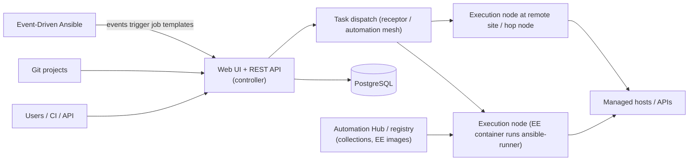

# 4.15 Custom modules, plug-ins and Ansible Automation Platform

| | |
|---|---|
| Level | Advanced |
| Priority tier | 1 |
| Lab venue | Python 3.10+, ansible-core, ansible-builder/navigator, Docker; kind or minikube for an AWX lab |
| Part | Part 4: Automation and infrastructure as code |
| Status | Drafted, labs **untested** |

## Why this matters for AI infrastructure

Sooner or later the modules on the shelf will not match your hardware or your process. You may have a vendor tool with a CLI but no module. You may need a site-specific scheduler operation, such as "drain nodes in this rack if no jobs", a Redfish OEM extension, a custom inventory source, or a filter that compresses node lists into Slurm hostlist syntax.

A custom module or plugin turns a fragile shell snippet into an idempotent, testable, documented task. Once more than a handful of people run automation, you also need a **platform**. A platform gives you central credentials, role-based access, audit trails, scheduling, approvals and an API. Ansible Automation Platform (AAP, and its upstream AWX) is that layer. This chapter shows how to extend Ansible and how to operate it as a shared service.

## Prerequisites and outcomes

Before you start, work through 4.6 to 4.14 and be comfortable with the Python from Part 3. When you finish this chapter, you will be able to:

- Decide when to write a module, a plugin, or just a role.
- Write a Python module with `AnsibleModule` (arguments, check mode, idempotency, return values, documentation), test it, and ship it in a collection.
- Write filter, test, lookup, inventory, callback and action plugins, and know the connection, become, vars and cache plugin types.
- Explain the AAP and AWX architecture (controller, execution environments, automation mesh, hub, Event-Driven Ansible), its objects (organisations, projects, inventories, credentials, job templates, workflows, surveys, schedules, notifications), and RBAC.
- Build and use execution environments, call the platform through its API, connect it to CI and Git, and secure and operate it. You will also choose between running Ansible from CI, from a shared bastion, and from AAP.

## 1. Choosing the extension point

Before you write any code, pick the extension point. The table maps each kind of need to the tool built for it, so check it first.

| Need | Use |
|---|---|
| Combine existing modules into a procedure | Role (4.11) |
| Wrap a CLI in a reliable idempotent interface | Module (Python, or any language emitting JSON) |
| Transform data inside Jinja | Filter / test plugin |
| Fetch external data at template time on the controller | Lookup plugin |
| Build inventory from an external source | Inventory plugin |
| Change how output/notifications work | Callback plugin |
| Run logic on the controller around a module (pre/post-processing, templating arguments) | Action plugin |
| Connect to something that is not SSH | Connection plugin |
| Cache facts/inventory somewhere custom | Cache plugin |
| Add variables from an external system | Vars plugin |

Modules run on the target. For API-based modules you can run them on the controller instead, with `delegate_to: localhost` or `connection: local`. Plugins always run on the controller. Package both in a collection, so they are versioned and distributed together (4.11).

If a core or community module already exists, use it. If not, check Galaxy first. Write your own module only when you have a stable, repeated need for it.

## 2. Writing a module

A shell snippet that sets a GPU power limit works the first time. Run it again, or ask it to preview what it would change, and its limits show. A module is a program that receives JSON arguments and prints one JSON result. Python modules use `AnsibleModule` to handle arguments, check mode, errors and results.

Idempotency is still your job, and `AnsibleModule` does not do it for you. **Read the current state, compute the difference, change only if needed, and report `changed` accurately.**

### Example: manage a GPU power cap

```python
#!/usr/bin/python
# plugins/modules/gpu_power_limit.py
from __future__ import annotations

DOCUMENTATION = r"""
---
module: gpu_power_limit
short_description: Ensure NVIDIA GPU power limits
description:
  - Reads GPU power limits with C(nvidia-smi) and sets them to the requested value if different.
version_added: "1.0.0"
options:
  watts:
    description: Desired power limit in watts.
    type: int
    required: true
  index:
    description: GPU index, or C(all).
    type: str
    default: all
  persist:
    description: Enable persistence mode first (recommended).
    type: bool
    default: true
requirements:
  - nvidia-smi
author:
  - Platform team (@platform)
notes:
  - Supports check mode.
"""

EXAMPLES = r"""
- name: Cap all GPUs at 600 W
  acme.gpu.gpu_power_limit:
    watts: 600

- name: Cap GPU 3 only
  acme.gpu.gpu_power_limit:
    watts: 550
    index: "3"
"""

RETURN = r"""
before:
  description: Power limits (W) before the change, by GPU index.
  type: dict
  returned: always
after:
  description: Power limits (W) after the change.
  type: dict
  returned: success
"""

from ansible.module_utils.basic import AnsibleModule


def query(module, smi, index):
    args = [smi, "--query-gpu=index,power.limit", "--format=csv,noheader,nounits"]
    if index != "all":
        args += ["-i", index]
    rc, out, err = module.run_command(args, check_rc=False)
    if rc != 0:
        module.fail_json(msg=f"nvidia-smi query failed: {err.strip() or out.strip()}", rc=rc)
    state = {}
    for line in out.strip().splitlines():
        idx, limit = [p.strip() for p in line.split(",")]
        state[idx] = int(float(limit))                       # '[N/A]' would raise: handle in real code
    return state


def main():
    module = AnsibleModule(
        argument_spec=dict(
            watts=dict(type="int", required=True),
            index=dict(type="str", default="all"),
            persist=dict(type="bool", default=True),
        ),
        supports_check_mode=True,
    )
    p = module.params
    if not 50 <= p["watts"] <= 1000:
        module.fail_json(msg="watts must be between 50 and 1000")
    smi = module.get_bin_path("nvidia-smi", required=True)

    before = query(module, smi, p["index"])
    todo = [i for i, w in before.items() if w != p["watts"]]
    result = dict(changed=bool(todo), before=before, after=before)

    if todo and not module.check_mode:
        if p["persist"]:
            module.run_command([smi, "-pm", "1"], check_rc=True)
        for i in todo:
            module.run_command([smi, "-i", i, "-pl", str(p["watts"])], check_rc=True)
        result["after"] = query(module, smi, p["index"])
        if any(w != p["watts"] for w in result["after"].values()):
            module.fail_json(msg="power limit did not apply (clamped by driver/firmware?)", **result)

    if module._diff:                                         # --diff support
        result["diff"] = dict(before=str(before), after=str({i: p["watts"] for i in before}))
    module.exit_json(**result)


if __name__ == "__main__":
    main()
```

Read the module from the top. It checks the watts, reads the current limits, and changes only the GPUs that differ from the request.

The rules below apply to every module you write. Start with the documentation. The `DOCUMENTATION`, `EXAMPLES` and `RETURN` blocks are mandatory in collections, and each one is YAML inside a raw string. They power `ansible-doc`, and `ansible-test sanity` validates them.

Declare every argument in the argument spec, with its type, `choices`, `required` and `default` values. Set `no_log=True` on any secret, so it is masked in output. You can also use `mutually_exclusive`, `required_if`, `required_together` and `required_one_of`. `AnsibleModule` rejects unknown arguments for you.

Compute `changed` from the state you read, not from the fact that you ran a command. In check mode, which you enable with `supports_check_mode=True`, make no changes and report what would change. To support `--diff`, return a `diff` dict with `before` and `after` keys.

Report failures with `module.fail_json(msg=..., **info)`. Never raise a raw exception, avoid `sys.exit`, and clean up any temporary files you created.

Run subprocesses with `module.run_command([...])`, passing a list rather than a shell string. Use `check_rc`, `environ_update` and `data` for stdin when you need them, and find binaries with `get_bin_path`.

Keep return values to simple JSON types, and document each one. Never return secrets.

The module runs on the target's Python, so keep its dependencies to the standard library. If you need more, declare them with `requirements` and fail clearly when one is missing (`missing_required_lib`). Python 2 is dead, but check the oldest target Python you support.

Put shared Python code in `plugins/module_utils/`, and import it as `ansible_collections.acme.gpu.plugins.module_utils.nvml`. Put shared option documentation in `plugins/doc_fragments/`, so several modules can reuse it.

API-style modules talk to a service such as NetBox or a scheduler REST API from the controller. Run them with `delegate_to: localhost` or `connection: local`, and give them `url`, `token` (marked `no_log`), `validate_certs` and `timeout` options.

Action plugins can pre-process on the controller before a module runs on the target. The `template` and `copy` modules work this way: each is an action plugin plus a target module.

Non-Python modules are the exception. Any executable that reads the arguments file and prints JSON will work. *Ansible: Up and Running* chapter 19 (Examples 19-1 to 19-5) builds a `can_reach` TCP port connectivity module in Bash, Perl and Python.

Bash and Perl modules need the `# WANT_JSON` comment. By default, a module that does not use `AnsibleModule` receives its arguments as `key=value` strings in the arguments file (`$1`). Put `# WANT_JSON` anywhere in the script, and Ansible passes a JSON document instead. The Bash script `can_reach.sh` reads it with `jq -r .host < "$1"` and runs `nc -z -w "$timeout" "$host" "$port"`. The Perl script `can_reach.pl` uses `JSON::PP::decode_json`.

Ansible also reads line 1 of the module, such as `#!/usr/bin/python3`, `#!/bin/bash` or `#!/usr/bin/perl`. It takes the interpreter name (`python3`, `bash`, `perl`) and checks whether `ansible_python_interpreter`, `ansible_bash_interpreter` (for example `/usr/local/bin/bash` on FreeBSD) or `ansible_perl_interpreter` is set for that host. Do not use `#!/usr/bin/env bash` or `#!/usr/bin/env python` in custom modules. Ansible then looks for `ansible_env_interpreter` instead, as *Ansible: Up and Running* chapter 19 warns.

Setting `add_file_common_args=True` adds the `mode`, `owner`, `group` and SELinux file parameters to your module. You then apply them with `module.load_file_common_params(module.params)` and `module.set_fs_attributes_if_different(file_args, changed)`. While you develop, `./hacking/test-module -m library/can_reach.py -a "host=example.com port=81 timeout=1"` runs a module without a full playbook. You can also run `python3 module.py args.json`.

### Testing a module

Test in five steps, from the simplest to the most complete.

1. Run the module directly. Write an args file that contains `{"ANSIBLE_MODULE_ARGS": {"watts": 600}}`, then run `python plugins/modules/gpu_power_limit.py args.json`, using a fake `nvidia-smi` earlier in your `PATH`.
2. Run it ad hoc with `ansible -m acme.gpu.gpu_power_limit -a "watts=600" gpu001 --check --diff -vvv`. `ANSIBLE_LIBRARY` must point at the module, or the collection must be installed.
3. Write unit tests with pytest, using the `ansible_collections` test helpers. Patch `AnsibleModule.exit_json`, `fail_json` and `run_command`, then assert on the results (3.9 patterns).
4. Run `ansible-test sanity` for documentation and style. Integration targets in `tests/integration/targets/gpu_power_limit/tasks/main.yml` run the module in a container with stub binaries, or on real hardware.
5. Run the module twice, and check that the second run reports `changed` as false (Molecule, 4.13).

### When not to write a module

If you can express the behaviour in a few tasks with `command` and `changed_when`, a role is simpler. Write a module when the logic has to parse structured output, handle many states, support check and diff, or get reused widely.

## 3. Plugins

Plugins live in a collection, under `plugins/<type>/`. You can also keep them next to a playbook or inside a role, in folders such as `filter_plugins/` and `lookup_plugins/`.

### Filter plugins

A filter is the simplest plugin to start with, because it is a pure function. This one turns a list of host names into a compact Slurm hostlist.

```python
# plugins/filter/slurm_hostlist.py
from __future__ import annotations
import re
from ansible.errors import AnsibleFilterError

def _compress(names):
    groups = {}
    for n in sorted(names):
        m = re.match(r"^(.*?)(\d+)$", n)
        if not m:
            groups.setdefault((n, 0), []).append(None)
            continue
        prefix, num = m.group(1), m.group(2)
        groups.setdefault((prefix, len(num)), []).append(int(num))
    parts = []
    for (prefix, width), nums in groups.items():
        if nums == [None]:
            parts.append(prefix); continue
        nums = sorted(nums); ranges = []; start = prev = nums[0]
        for x in nums[1:]:
            if x == prev + 1: prev = x; continue
            ranges.append((start, prev)); start = prev = x
        ranges.append((start, prev))
        body = ",".join(f"{a:0{width}d}" if a == b else f"{a:0{width}d}-{b:0{width}d}" for a, b in ranges)
        parts.append(f"{prefix}[{body}]" if ("," in body or "-" in body) else f"{prefix}{body}")
    return ",".join(parts)

def slurm_hostlist(value):
    if not isinstance(value, (list, tuple)):
        raise AnsibleFilterError("slurm_hostlist expects a list of host names")
    return _compress([str(v) for v in value])

class FilterModule:
    def filters(self):
        return {"slurm_hostlist": slurm_hostlist}
```

You call it in a template like this: `{{ groups['gpu'] | acme.gpu.slurm_hostlist }}` gives `gpu[001-032]`. Because a filter is a pure function, it must have no side effects. That also makes it easy to test with pytest, like any other Python code (see the property-based testing ideas in 3.9). Test plugins, which answer `is something` questions, follow the same pattern. The difference is the class, `TestModule`, which returns a dict of tests.

### Lookup plugins

A lookup runs on the controller and returns a list. The skeleton below fetches node data from an internal API.

```python
# plugins/lookup/node_inventory_api.py
from __future__ import annotations
DOCUMENTATION = r"""
name: node_inventory_api
short_description: Fetch node data from an internal API
options:
  _terms: {description: Node names, required: true}
  url: {description: Base URL, env: [{name: NODE_API_URL}], required: true}
  token: {description: API token, env: [{name: NODE_API_TOKEN}], required: true}
"""
from ansible.plugins.lookup import LookupBase
from ansible.errors import AnsibleLookupError
from ansible.module_utils.urls import open_url
import json

class LookupModule(LookupBase):
    def run(self, terms, variables=None, **kwargs):
        self.set_options(var_options=variables, direct=kwargs)
        url, token = self.get_option("url"), self.get_option("token")
        out = []
        for name in terms:
            try:
                r = open_url(f"{url}/nodes/{name}", headers={"Authorization": f"Bearer {token}"}, timeout=10)
                out.append(json.load(r))
            except Exception as e:                       # noqa: BLE001
                raise AnsibleLookupError(f"lookup of {name} failed: {e}") from e
        return out
```

A lookup runs every time Ansible evaluates it. If you call it inside a loop, cache the results inside the plugin. Never log the token.

### Inventory plugins

Build an inventory plugin by subclassing `BaseInventoryPlugin`, and add `Constructable` and `Cacheable` when you need them. Implement `verify_file`, which checks the filename suffix, and `parse`, which calls `self.inventory.add_host/add_group/add_child/set_variable`. `Constructable` gives you `compose`, `groups` and `keyed_groups`. `Cacheable` gives you caching (4.5). For new work, prefer an inventory plugin over a script.

### Callback, action, connection, vars, cache, strategy and become plugins

Callback plugins control how output and notifications look. See 4.14 for events, display and notifications.

Action plugins run on the controller in place of a module, or wrapped around one. Use them to transform arguments, copy files first, or short-circuit a task. Subclass `ActionBase`, and have `run()` call `self._execute_module(...)`.

Connection plugins define how Ansible reaches a target. Built-in examples include `ssh`, `winrm`, `docker`, `kubectl`, `network_cli`, `httpapi`, `aws_ssm` and `community.general.lxd`. Write your own when you need to reach nodes through a bespoke console server or API.

Vars plugins inject variables from external systems, per host or per group. The `host_group_vars` plugin is built in. Cache plugins store facts and inventory, in backends such as `redis`, `memcached`, `jsonfile`, or a custom store. Strategy plugins set custom execution orders, which is rare.

Become plugins add custom privilege escalation, such as `sudo`, `su`, `doas`, `runas`, `machinectl` or `pbrun`.

Document each plugin option in `DOCUMENTATION`. Then decide where users will set it: in `ansible.cfg`, in an environment variable, or in a play variable, through the options system (`env`, `ini`, `vars`, `keyword`).

## 4. Execution environments (EEs)

When a playbook works on your laptop but fails on the platform, the packages underneath are a likely cause. An execution environment (EE) removes that gap. An EE is a container image with ansible-core, ansible-runner, collections, Python and system dependencies. Every run, whether from a laptop, CI or AAP, gets the same runtime.

You describe the image in one file. The `dependencies` section names the pip packages, the Galaxy collections, the Python libraries and the system packages that go into it.

```yaml
# execution-environment.yml (ansible-builder v3)
version: 3
images:
  base_image:
    name: quay.io/ansible/ansible-runner:latest        # pin by digest in real use
dependencies:
  ansible_core: { package_pip: ansible-core==2.17.* }
  ansible_runner: { package_pip: ansible-runner }
  galaxy: requirements.yml
  python: requirements.txt            # e.g. netaddr, jmespath, kubernetes, psycopg2-binary, hvac
  system: bindep.txt                  # e.g. gcc, libpq-dev, openssh-clients [platform:rpm]
additional_build_steps:
  append_final:
    - RUN pip3 list && ansible --version
```

Build the image with `ansible-builder`, then run a playbook inside it with `ansible-navigator`. Use `ansible-navigator images` when you want to inspect an EE interactively.

```bash
ansible-builder build -t registry.example.com/platform/ee-gpu:1.2.0 -f execution-environment.yml
ansible-navigator run site.yml -i inventories/lab --eei registry.example.com/platform/ee-gpu:1.2.0 --pp missing -m stdout
ansible-navigator images                              # inspect an EE interactively
```

Keep one EE per toolchain family: base, network, cloud or GPU. Use semantic versions, scan the images and sign them. Rebuild them nightly for CVEs. Pin each image in your AAP job templates and CI, so every run uses the same version of the runtime.

## 5. Ansible Automation Platform and AWX

Picture a production job that needs the SSH key and the Vault password. If every operator keeps those secrets on a laptop, the platform is only as safe as the weakest laptop. AWX is the open-source upstream project, deployed on Kubernetes through the AWX operator. AAP is Red Hat's supported product built from it. AAP adds Automation Hub for certified and private collections, Event-Driven Ansible, Insights, analytics and support. The concepts transfer directly between the two.



### Core objects

The table lists the objects you will work with in the platform. A job template ties several of them together, and the credential row is the one that protects your secrets.

| Object | Meaning |
|---|---|
| **Organization** | Tenant boundary for teams and resources |
| **Project** | A Git repository (branch/tag) of playbooks; synced on demand or on launch |
| **Inventory** | Static, dynamic (sourced from clouds/NetBox/scripts/plugins), or smart inventories; groups, hosts, variables |
| **Credential** | Encrypted secret store: machine (SSH), vault, cloud, source control, registry, custom types injecting env vars/extra vars/files; **users never see the secret** |
| **Execution Environment** | The container image used |
| **Job template** | Playbook + inventory + credentials + EE + options (limit, tags, verbosity, extra vars, `prompt on launch`, concurrency, timeout, job slicing, instance groups) |
| **Workflow template** | A DAG of job templates, inventory syncs, project syncs, approvals, with success/failure/always edges |
| **Survey** | A form asking for typed inputs at launch (rack name, driver version) |
| **Schedule** | Cron-like recurrence for templates (nightly drift checks) |
| **Notification template** | Slack, email, PagerDuty, webhooks on start/success/failure |
| **Instance groups / containers groups** | Where jobs run (VM execution nodes, Kubernetes pods) |
| **Teams, roles (RBAC)** | Who may use, execute, update, admin which objects |

### Why teams adopt it

Credential isolation is the first reason. An operator can run a job against production without ever holding the SSH key or the Vault password. The platform injects those secrets into the EE at run time. For example, the `gpu-baseline-prod` template later in this section attaches the `prod-ssh` and `prod-vault` credentials.

RBAC and approvals come next. A developer may run the lab template, while production needs a workflow approval, and auditors read the job history.

Audit and logging come from the job record. Every job stores who launched it, from which Git revision, and with which inventory and variables. It also keeps full stdout and per-task events, and you can stream those to external logging such as Splunk, ELK or Loki.

Central scheduling and the API let you run nightly check-mode jobs, trigger runs from Git webhooks, and launch jobs from CI, ChatOps or ITSM.

Scale comes from job slicing, execution nodes, the mesh, instance groups and concurrency limits. Consistency comes from EEs, plus one place where automation runs.

### Operating considerations

Architecture and high availability depend on a few choices. Run the controller on Kubernetes or OpenShift with the operator, use an external PostgreSQL database with backups and HA, and keep redundant controller pods. Place execution nodes close to the networks they manage. Plan upgrades carefully, because database migrations and EE compatibility both change. For disaster recovery, restore the database and the secret key together. The `SECRET_KEY` encrypts your credentials, so back it up securely.

Security starts with SSO (SAML, OIDC or LDAP) and MFA at the identity provider. Give people least-privilege roles, and use credential types with minimal scope. Apply network policy to the platform and restrict its outbound access. Sign your EEs, and pin project sources to protected branches or tags. Restrict "prompt on launch", because it can let someone inject arbitrary playbook content. Review the `ask_variables_on_launch` and `allow_simultaneous` settings, and the risks of `extra_vars`. Isolate job execution in containers with limited privileges, and harden your Git credentials. The platform holds your fleet's keys, so treat it as tier-0.

Job design comes down to small, single-purpose templates. Give each one a check-mode variant and an apply variant. Add surveys with validation, timeouts and concurrency controls. Offer a `limit` prompt for canary runs, and build workflows with approval nodes and rollback paths.

The Git flow follows the same discipline as the rest of your code. Merge playbooks through PRs (4.1), run lint and Molecule (4.13), and let the project sync from `main` only after that. A CI job can then call the AAP API to launch a workflow after the merge, which closes the loop with 4.2.

For dynamic inventory, schedule the inventory sources (cloud, NetBox). Use `overwrite` and `update_on_launch` carefully, and filter the results down to the sets you can manage.

Capacity is forks per job multiplied by concurrent jobs, measured against execution node resources. Use job slicing for large inventories, and assign instance groups per environment.

### API-driven automation

The controller exposes a REST API. In AAP the base path is `/api/controller/v2/`, and in AWX it is `/api/v2/`. There is also an official `awx` and `controller` CLI, along with the `ansible.platform` and `awx.awx` collections. Use those collections to manage the platform as code, including templates, credentials and projects.

```bash
# Launch a job template with a limit and extra vars (token from a service account)
curl -sS -X POST -H "Authorization: Bearer $AAP_TOKEN" -H 'Content-Type: application/json' \
  https://aap.example.com/api/controller/v2/job_templates/42/launch/ \
  -d '{"limit": "gpu001,gpu002", "extra_vars": {"app_version": "v1.4.3"}, "job_tags": "config"}'
# Poll the job
curl -sS -H "Authorization: Bearer $AAP_TOKEN" https://aap.example.com/api/controller/v2/jobs/1234/ | jq '.status,.failed'
```

The first command launches job template 42 with a limit and extra variables, using a service-account token. The second polls job 1234 and prints its status and `failed` fields.

You can also declare the same template in YAML instead of clicking through the web UI.

```yaml
# Manage the platform declaratively
- name: Job template for GPU baseline
  awx.awx.job_template:
    name: gpu-baseline-prod
    organization: Platform
    project: platform-automation
    playbook: playbooks/gpu_nodes.yml
    inventory: prod
    credentials: [prod-ssh, prod-vault]
    execution_environment: ee-gpu-1.2.0
    ask_limit_on_launch: true
    ask_variables_on_launch: false
    survey_enabled: false
    state: present
```

*Ansible: Up and Running* chapter 23 (*Ansible Automation Platform*) traces the move from Ansible Tower to AAP 2. In AAP 2, the monolithic Tower execution engine was split apart. The Automation Controller is the control plane, with the web UI, REST API, RBAC and scheduler. Containerised Execution Environments run the jobs, and Automation Mesh dispatches them. The book also shows how to configure the entire controller as code with the `awx.awx` collection. It uses `tower_organization`, `tower_inventory`, `tower_host`, `tower_credential`, `tower_project`, `tower_job_template`, and `tower_job_launch` with `tower_job_wait`, which authenticate through `TOWER_HOST`, `TOWER_USERNAME` and `TOWER_PASSWORD`.

### Architectural Best Practices and the CALMS Framework (`AUR` Chapter 24)

The closing chapter of *Ansible: Up and Running* (chapter 24, *Best Practices*) distills the principles that keep an automation platform maintainable across teams and years. Its first point is that open-source automation succeeds when components have high modularity and high option value. Co-founders Michael DeHaan and Greg DeKoenigsberg observed this. High modularity means loose coupling, so you can add custom modules and roles cleanly. High option value means composability. It works like the *Tao of HashiCorp*: you pick Terraform for cloud and hardware provisioning, and Ansible for OS and cluster configuration, then compose focused roles that each "do one thing well".

The second point is to push complexity out of YAML and into Python modules and plugins. Keep playbooks declarative and readable for non-specialists, starting them with `#!/usr/bin/env ansible-playbook`. Decouple inventories from projects, using separate Git repositories or directories. Infrastructure owners then control inventory access, while projects stay reusable across staging and production. Decouple roles from collections with `roles_path`, which separates project roles, shared roles and Galaxy roles.

The third point is "Releasing software is a one-bit decision, not a transfer of bytes." Store pre-built packages, wheels and container images in an artifact repository such as `Nexus`, `Artifactory` or `Automation Hub`. Test every role with `yamllint`, `ansible-lint`, `ansible-later`, `ShellCheck` and `Molecule`, plus `ssh-audit` for SSH crypto hardening. Then roll changes out continuously, in stages with `serial`, and run smoke tests after each stage.

Jez Humble's `CALMS` framework measures platform maturity across five areas. Culture means striving for common principles and blameless improvement. Automation means automating provisioning, testing and promotion. Lean and collaboration mean short cycle times and cross-team sharing. Measurement means verifying functional and non-functional requirements automatically before production promotion. Sharing means transparent feedback loops and audit trails that answer what changed, who made it, and when, along with smooth onboarding for new engineers.

### Event-Driven Ansible (EDA)

Event-Driven Ansible (EDA) runs rulebooks. Event sources such as Alertmanager webhooks, Kafka, Prometheus, cloud events, Git webhooks, and `ansible.eda.range` for tests feed the rules. Each rule has conditions. When they match, the rule runs an action, such as a playbook or job template, posts events, or sets facts.

AI infrastructure gives you clear cases. On a GPU XID error alert, cordon the node and open a ticket. On repeated NIC flaps, drain the node and run diagnostics. On a Git webhook, run a validation workflow. Keep every action safe: idempotent, rate-limited, with human approval for destructive steps and deduplicated events. Without those guards, one noisy alert can start an automation storm.

```yaml
# rulebook sketch
- name: GPU health remediation
  hosts: all
  sources:
    - ansible.eda.alertmanager: { host: 0.0.0.0, port: 5000 }
  rules:
    - name: Cordon on Xid 79
      condition: event.alert.labels.alertname == "GPUXid79" and event.alert.status == "firing"
      action:
        run_job_template:
          name: drain-and-diagnose-node
          organization: Platform
          job_args:
            extra_vars:
              target_node: "{{ event.alert.labels.node }}"
```

(Syntax and available sources vary by EDA version; verify.)

## 6. Choosing where to run Ansible

The place you run Ansible shapes who can see the secrets and who can audit the change. The table compares the common options and the trade-off each one brings.

| Option | Fits | Watch out |
|---|---|---|
| Laptop | Development, one-off lab work | Not reproducible, credentials on laptops |
| Shared bastion/controller | Small teams | Pet server, shared accounts, weak audit |
| CI runners (GitHub/GitLab) | Deploy-on-merge, linting, tests | Credentials in CI (use OIDC/secret manager), long jobs, limited approval UX (4.2) |
| AWX/AAP | Many operators, RBAC, audit, schedules, approvals, large inventories | Platform to run and secure; upgrade/DR discipline |
| `ansible-pull` | Huge homogeneous fleets | Rollout control and visibility |
| Cloud-native (Terraform + user-data, immutable images) | Elastic fleets | Day-2 flexibility |

Most mature setups combine these options. CI runs the tests and builds the EEs and images. AAP runs the scheduled and operator-driven production jobs. `ansible-pull` or images handle the baseline of each node. Decide which of these jobs belongs to which option, and write that down. Read the watch-out column before you commit, because it names the cost you will pay.

## 7. Lab

Start on your own machine. Run the self-checking Python lab first, so you know the code works before you touch a server. The lab checks the `gpu_power_limit` custom module, run through `execute_gpu_power_limit_module`. The module is idempotent and aware of check mode and diffs. It rejects out-of-range watts. It previews diffs in `--check` mode without changing state, applies the changes on Run 1, and returns `changed=False` on Run 2. It also checks that the `slurm_hostlist` / `slurm_expand_hostlist` filter plugin round-trips `gpu[001-003,005]`.

```bash
python3 code/part04/ansible_custom_modules_aap_lab.py
```

The interactive steps after that need a control node with `ansible-core`, `ansible-builder`, `ansible-navigator`, and Docker or kind. All interactive shell steps below are `untested here`, so check each result yourself. Work through these exercises in order.

1. Build your first module. Implement `gpu_power_limit`, or a simpler module around `sysctl` or a CLI, using a fake `nvidia-smi`. Run it directly from an args file, then through `ansible -m` with `--check --diff`, and confirm that it is idempotent.
2. Raise its quality. Add argument validation, check mode, diff support and unit tests with a mocked `run_command`. Then run `ansible-test sanity` in a collection.
3. Write a filter plugin. Implement `slurm_hostlist` and its inverse, then write pytest tests, including property-based round-trip tests. Use the filter in a Slurm template.
4. Write a lookup plugin. Make it read from a local JSON "API", call it inside a loop, and then add a cache.
5. Write an inventory plugin. Build hosts and groups from a YAML or REST source, using `compose` and `keyed_groups`. Compare your plugin with the constructed plugin.
6. Reuse the 4.14 callback, and write an action plugin that normalises an argument before it calls a stock module.
7. Build an EE with your collection and Python dependencies. Run the same playbook with `ansible-navigator` locally, and compare the result with the host install.
8. Deploy AWX on kind through the operator. Create an organization, a project from your Git repo, an inventory, a machine credential and a job template. Run the template, then inspect the job events.
9. Set up RBAC. Create a team with a role that grants execute-only access to the template. Log in as that user, and prove they can run the job but cannot read the credential or edit the template.
10. Build a workflow with an approval step: canary, then approval, then rollout, then verify. Add a failure notification, and use a survey to collect `limit` and `app_version`.
11. Close the API and CI loop. From a CI job, call the launch endpoint after a merge, then poll the status. Fail the CI job if the AAP job fails. Finally, manage the templates with the `awx.awx` modules, as configuration as code.
12. If you have time, run an Event-Driven Ansible rulebook with an Alertmanager source. Make it trigger a harmless job template when a test alert fires, and add rate limiting and deduplication.
13. Clean up.

## 8. Common mistakes

Most of these mistakes come from picking the wrong tool. If you write a module when a role would do, or a role full of `shell` tasks when you need a module, you pay for it later.

Modules that always report `changed`, ignore check mode, hide errors or print secrets cause trouble in production. Missing documentation blocks break `ansible-doc` and sanity tests. Unvalidated arguments let bad input through.

Plugins with side effects, or with network calls on every evaluation, slow everything down. Secrets in plugin logs leak, and custom plugins kept outside versioned collections drift apart.

Watch the platform too. Unpinned EE images, EEs without scanning and EEs that diverge between teams all weaken it. So do credentials with a broad scope, arbitrary `extra_vars` on launch, and projects that track unprotected branches.

Without a backup of the controller database and secret key, or an upgrade plan, you have no recovery path. EDA rulebooks that trigger destructive actions without rate limits or approvals are a risk too. Treat AAP as a controlled executor of tested code, not as a replacement for testing and review.

## 9. Interview angles

Use these questions to test yourself. Each one asks for a mechanism and a trade-off, not just a definition.

- "How do you write an Ansible module? How do you make it idempotent and check-mode safe?"
- "When would you write a plugin versus a module versus a role? Give examples of each type."
- "What is an execution environment and why use one?"
- "What does AAP/AWX give you over running playbooks from CI?" (credential isolation, RBAC, audit, scheduling, approvals, API.)
- "How would you secure an automation platform that holds all your SSH keys?"
- "Design a workflow for rolling a driver update with approvals and rollback."
- "What is Event-Driven Ansible; give a remediation use case and its safeguards."

## Exercises

Work through these six exercises after you finish the chapter. Each one asks you to trace code from this chapter, and to explain what happens at each step.

1. Start with `execute_gpu_power_limit_module()` in `code/part04/ansible_custom_modules_aap.py`. Explain when to write a role, a module, or a filter, lookup, inventory, callback or action plugin. (a) Give your reasons for each choice. Then explain how `AnsibleModule` handles `argument_spec`, `supports_check_mode=True`, `module._diff`, `module.run_command([...])`, `add_file_common_args=True`, `exit_json` and `fail_json`. (b) Finally, explain how non-Python modules use `# WANT_JSON`, and why `#!/usr/bin/env bash` breaks `ansible_bash_interpreter`. This exercise draws on `gpu_power_limit`, `can_reach` and chapter 19 of *Ansible: Up and Running*.
2. Trace the filter and plugin code in `code/part04/ansible_custom_modules_aap.py`, including the `node_inventory_api` lookup. Start with `slurm_hostlist()` and `slurm_expand_hostlist()`, and follow how `FilterModule` folds `['gpu001', 'gpu002', 'gpu003', 'gpu005']` into `'gpu[001-003,005]'`. Then show how `LookupBase` reads its options from `DOCUMENTATION`, using `self.set_options` and `self.get_option`. Finish with how `BaseInventoryPlugin`, with `Constructable` and `Cacheable`, and `ActionBase` work.
3. Write an `execution-environment.yml` (v3) that combines `ansible-core`, the `requirements.yml` collections, the `requirements.txt` Python libraries and the `bindep.txt` system packages. Then show the `ansible-builder build` command and the `ansible-navigator run --eei ... -m stdout` command. This exercise draws on chapter 23 of *Ansible: Up and Running*.
4. Trace the architecture of AWX and AAP 2: the web and API controller, PostgreSQL, Receptor and the automation mesh, execution nodes, Automation Hub and EDA. Explain how credentials, job templates, workflow templates (with approval nodes) and surveys give least-privilege self-service, without exposing SSH or Vault secrets. Then explain why backing up `SECRET_KEY` alongside PostgreSQL is mandatory for disaster recovery. This exercise also draws on chapter 23.
5. Manage AWX and AAP as code with the `awx.awx` and `ansible.platform` collections. Show how the `awx.awx` modules (`organization`, `inventory`, `credential`, `project`, `job_template`, `job_launch`) configure the controller declaratively. Show how CI triggers a job template through `/api/controller/v2/job_templates/<id>/launch/`. Then trace the rulebook from section 5 that cordons and diagnoses a node on a `GPUXid79` Alertmanager webhook.
6. Summarise the core lessons of chapter 24 of *Ansible: Up and Running*. Cover high modularity and high option value (composability), pushing complexity from YAML into Python modules, decoupling inventories from projects and roles from collections, "releasing software is a one-bit decision, not a transfer of bytes", and benchmarking DevOps adoption with Jez Humble's `CALMS` framework.

## Checkpoint questions (20)

<details>
<summary>1. Where do Ansible Modules execute versus where Plugins execute, and when should you write a Role vs. a Module vs. a Plugin?</summary>

Modules run on the target host, where they inspect and change system state. For REST API modules, you can run them on the control node instead, with `delegate_to: localhost` or `connection: local`.

Plugins (filter, test, lookup, inventory, callback, action, connection, vars and cache) run on the control node, inside the main Ansible controller process.

Here is the rule of thumb. Use a role to compose existing modules into a multi-step procedure. Write a module when you wrap a CLI or API, such as `nvidia-smi -pl` or `can_reach`, and need structured output parsing, idempotency, `--check` and `--diff`. Write a filter, lookup or inventory plugin when you need to transform data or fetch inventory on the controller.
</details>

<details>
<summary>2. What are the three mandatory YAML documentation blocks in a collection module, and what tool validates them?</summary>

Every collection module (`plugins/modules/*.py`) needs three top-level YAML blocks, written as raw strings and placed before the imports:

1. **`DOCUMENTATION`**: the module name, `short_description`, `description`, `version_added`, and `options` (which match the `argument_spec` types, defaults, `required` and `choices`). It also has `requirements`, `author` and `notes`.
2. **`EXAMPLES`**: realistic playbook task snippets that show how to call the module.
3. **`RETURN`**: the schema and description of every key returned by `exit_json`, such as `before` and `after`.

`ansible-doc acme.gpu.gpu_power_limit` reads these blocks. `ansible-test sanity --test validate-modules` checks them strictly.
</details>

<details>
<summary>3. How does a Python module using `AnsibleModule` implement idempotency, `--check` mode, and `--diff` mode (`gpu_power_limit.py`)?</summary>

1. Create the module with `AnsibleModule(argument_spec=..., supports_check_mode=True)`.
2. Read the current state first, with `before = query(module, smi, p["index"])`. Then find the items that differ from the desired state with `todo = [i for i, w in before.items() if w != p["watts"]]`.
3. Set `changed = bool(todo)`.
4. Make changes only under `if todo and not module.check_mode:`. In `--check` mode, no `nvidia-smi -pl` command runs, yet `changed=True` is still reported correctly.
5. For `--diff`, when `module._diff` is set, add `result["diff"] = {"before": ..., "after": ...}` before calling `module.exit_json(**result)`.
</details>

<details>
<summary>4. Why must a custom module use `module.run_command([...])` and `module.fail_json(...)` instead of `subprocess.Popen(shell=True)` and `sys.exit(1)`?</summary>

- **`module.run_command([smi, "-i", i, "-pl", str(watts)], check_rc=True)`:** This runs the binary directly from an argument list, with no shell, which prevents shell injection. It also cleans up the environment variables and returns `(rc, out, err)`. With `check_rc=True`, it calls `fail_json` on its own when `rc != 0`. Find the binary path first with `module.get_bin_path("nvidia-smi", required=True)`.
- **`module.fail_json(msg=..., rc=rc)`:** This returns a structured failure object, `{"failed": true, "msg": "..."}`, on stdout, so Ansible can parse the error. An unhandled Python exception or a `sys.exit(1)` gives you an unformatted `MODULE FAILURE` traceback instead.
</details>

<details>
<summary>5. In *Ansible: Up and Running* chapter 19, how does `# WANT_JSON` work for Bash/Perl modules, and why must a module shebang NOT use `#!/usr/bin/env`?</summary>

- **`# WANT_JSON`:** If you write a non-Python module, such as `can_reach.sh` in Bash or `can_reach.pl` in Perl, add the comment **`# WANT_JSON`** anywhere in the file. Ansible then writes the module arguments as a JSON object in the temporary arguments file (`$1`). Bash can read them with `host=$(jq -r .host < "$1")`.
- **Why `#!/usr/bin/env bash` breaks interpreter discovery (chapter 19 warning):** Ansible reads the base name of the interpreter in the shebang line. `#!/bin/bash` gives `bash`, and `#!/usr/bin/python3` gives `python3`. It then looks up `ansible_bash_interpreter` or `ansible_python_interpreter`, such as `/usr/local/bin/bash` on FreeBSD. With `#!/usr/bin/env bash`, the base name is `env`. Ansible then looks for `ansible_env_interpreter` and ignores `ansible_bash_interpreter`.
</details>

<details>
<summary>6. What does `add_file_common_args=True` on `AnsibleModule` do, and where do you put shared helper code used by multiple custom modules (*Ansible: Up and Running* chapter 19)?</summary>

- **`add_file_common_args=True`:** This adds the standard file parameters to your module's `argument_spec`: `mode`, `owner`, `group`, `seuser`, `serole`, `setype`, `selevel` and `attributes`. After you create or update the file, call `file_args = module.load_file_common_params(module.params)`, then `changed = module.set_fs_attributes_if_different(file_args, changed)`. These enforce the ownership, permissions and SELinux contexts, and they stay idempotent.
- **Shared module code:** Put shared Python libraries in **`plugins/module_utils/`**, and import them with `from ansible_collections.acme.gpu.plugins.module_utils.nvml import ...`. Put shared documentation options in **`plugins/doc_fragments/`**, and reference them with `extends_documentation_fragment:`.
</details>

<details>
<summary>7. How do you test a custom module locally from the command line before running it in a playbook (`args.json` and `test-module`, *Ansible: Up and Running* chapter 19)?</summary>

1. **Direct Python execution with `args.json`:** Create `args.json` containing `{"ANSIBLE_MODULE_ARGS": {"watts": 600, "_ansible_check_mode": true}}`, then run `python3 plugins/modules/gpu_power_limit.py args.json`.
2. **Ansible's `test-module` harness (chapter 19 of *Ansible: Up and Running*):** Run `./hacking/test-module -m library/can_reach.py -a "host=example.com port=81 timeout=1"`. It packages the module with `AnsiballZ`, the same way `ansible-playbook` does, and prints the parsed JSON output.
3. **Unit and sanity tests:** Run `ansible-test sanity` and `ansible-test units`. The units use `pytest`, with `module.run_command` mocked.
</details>

<details>
<summary>8. How do Filter Plugins (`FilterModule`), Test Plugins (`TestModule`), and Lookup Plugins (`LookupBase`) differ in structure and return values?</summary>

- **Filter plugin (`plugins/filter/*.py`):** Define `class FilterModule:` with `def filters(self): return {"slurm_hostlist": slurm_hostlist}`. The filter must be a pure function that transforms the value piped into it. For example, `{{ groups['gpu'] | acme.gpu.slurm_hostlist }}` gives `'gpu[001-032]'`.
- **Test plugin (`plugins/test/*.py`):** Define `class TestModule:` with `def tests(self): return {"valid_rack": is_valid_rack}`. Each test returns a **`bool`**, which `if`, `when` and `select` can use, as in `when: host is acme.gpu.valid_rack`.
- **Lookup plugin (`plugins/lookup/*.py`):** Subclass **`LookupBase`**, and implement `def run(self, terms, variables=None, **kwargs) -> list`. Call `self.set_options(var_options=variables, direct=kwargs)` first. Then use `self.get_option(...)` to read options from `DOCUMENTATION`, environment variables or `ansible.cfg`. A lookup always returns a `list`, and it raises `AnsibleLookupError` on failure.
</details>

<details>
<summary>9. What is an Action Plugin (`ActionBase`), and why do built-in modules like `template` and `copy` use one?</summary>

An **Action Plugin (`plugins/action/*.py`, subclassing `ActionBase`)** runs on the control node, before a module is uploaded and run on the target host, or instead of that. Take the `ansible.builtin.template` module as an example. Its action plugin renders the `.j2` template into a string on the control node, and computes its checksum. It compares that checksum with the remote file's. If they differ, it transfers the rendered file. Then it calls `self._execute_module(module_name='ansible.builtin.file', ...)` on the target, to set ownership and permissions.
</details>

<details>
<summary>10. What is an Execution Environment (`EE`), what are the four input files to `ansible-builder`, and how do you run a playbook inside an EE (*Ansible: Up and Running* chapter 23)?</summary>

An **Execution Environment (`EE`)** is an immutable OCI container image. It packages `ansible-core`, `ansible-runner`, Ansible collections, Python packages and OS system libraries. Because of that, every developer laptop, CI runner and AAP execution node runs the same runtime. **`ansible-builder build`** reads `execution-environment.yml` (v3), which points to four inputs:

1. The `ansible_core` and `ansible_runner` pip versions.
2. **`requirements.yml`**, which lists the Ansible Galaxy or Hub collections.
3. **`requirements.txt`**, which lists the Python packages, such as `netaddr`, `jmespath`, `kubernetes`, `psycopg2-binary` and `hvac`.
4. **`bindep.txt`**, which lists the OS RPM or deb packages, such as `gcc`, `libpq-dev` and `openssh-clients`.

To run a playbook inside the EE, use `ansible-navigator run site.yml -i inventories/lab --eei registry.example.com/platform/ee-gpu:1.2.0 --pp missing -m stdout`.
</details>

<details>
<summary>11. How do AWX and Red Hat Ansible Automation Platform (`AAP 2`) relate, and what are the main components of the AAP 2 architecture (*Ansible: Up and Running* chapter 23)?</summary>

AWX is the open-source upstream project, and you can deploy it on Kubernetes with the AWX Operator. Ansible Automation Platform (`AAP`) is Red Hat's enterprise product, built from AWX. In AAP 2 (chapter 23 of *Ansible: Up and Running*), the architecture has four main parts:

1. **Automation Controller** (formerly Ansible Tower): the web UI, the REST API (`/api/controller/v2/`), RBAC, the scheduler and the job dispatcher. It is backed by **PostgreSQL**.
2. **Automation Mesh (`Receptor`):** an overlay network that dispatches jobs to distributed **Execution Nodes**. Those nodes run playbooks inside **Execution Environment** containers through `ansible-runner`. Hop nodes in remote data centers relay the jobs.
3. **Automation Hub / Private Automation Hub:** an enterprise registry for certified and private Collections, and for Execution Environment container images.
4. **Event-Driven Ansible (`EDA`):** a rulebook engine that reacts to webhooks and alerts by launching Controller job templates.
</details>

<details>
<summary>12. Trace the relationships between the core AWX/AAP objects: Organization, Project, Inventory, Credential, Execution Environment, Job Template, Workflow Template, and Survey.</summary>

- **Organization:** The top-level, multi-tenant boundary. It owns teams, inventories, projects and templates.
- **Project:** Syncs playbooks and roles from a Git repository, from the `main` branch or a signed release tag.
- **Inventory:** Static, dynamic (NetBox or cloud plugins), or a Smart Inventory filter.
- **Credential:** An encrypted secret, such as an SSH private key, a Vault password or a cloud or API token. It is injected into the EE at run time. Operators with `Execute` permission can use the credential in a job, and they never see or extract the secret.
- **Job Template:** Binds a playbook (from a project) to an inventory, credentials and an Execution Environment. It also sets runtime options such as `limit`, `forks` and `job_slice_count`.
- **Survey:** Attaches a validated input form to a job or workflow template. The form can use dropdowns, or regex and integer bounds for inputs such as `target_rack` or `app_version`.
- **Workflow Template:** Connects several job templates, project and inventory syncs, and **Approval Nodes** into a graph. The edges are `on_success`, `on_failure` and `always`.
</details>

<details>
<summary>13. Why is `ask_variables_on_launch: true` (`Prompt on Launch` for Extra Variables) risky on a privileged production Job Template, and what should you use instead?</summary>

Extra variables (`-e`) have the highest precedence in Ansible. They can override almost any variable, including role paths, command strings, `ansible_connection` and host lists. If you let unprivileged operators pass free-form `extra_vars` JSON or YAML on launch, they can change what a root-privileged job template runs. Set **`ask_variables_on_launch: false`** instead. Expose only the variables you need, through a **Survey**, where each one is type-checked and limited to choices. If operators need to scope the hosts, add `ask_limit_on_launch: true`.
</details>

<details>
<summary>14. What two items are mandatory to back up for AWX / Automation Controller Disaster Recovery (`DR`)?</summary>

1. **The PostgreSQL database.** It holds all inventories, projects, templates, RBAC roles, job history and the encrypted credential ciphertexts.
2. **The Controller `SECRET_KEY`** (`/etc/tower/SECRET_KEY`, or the Kubernetes `awx-secret-key` Secret).

Every SSH key, Vault password and cloud token in the database is symmetrically encrypted with `SECRET_KEY`. If you restore a PostgreSQL backup without the matching `SECRET_KEY`, every stored credential stays permanently undecryptable.
</details>

<details>
<summary>15. How do you manage AWX / Automation Controller as Code (`Configuration as Code`) and trigger jobs from CI (*Ansible: Up and Running* chapter 23)?</summary>

- **Configuration as Code (`awx.awx` / `ansible.platform` collection):** Rather than clicking through the Controller web UI, a playbook that targets `localhost` reconciles every controller object from Git. It uses `awx.awx.organization`, `awx.awx.inventory`, `awx.awx.credential`, `awx.awx.project`, `awx.awx.job_template` and `awx.awx.workflow_job_template`. The older `tower_*` aliases work too, as shown in chapter 23 `Examples 23-6` to `23-12`.
- **Triggering from CI:** After a PR merges to `main`, CI can do one of two things. It can call `POST /api/controller/v2/job_templates/<id>/launch/` with a scoped service-account `Bearer $AAP_TOKEN`, then poll `/api/controller/v2/jobs/<job_id>/` until `.status == "successful"`. Or it can run `awx.awx.job_launch` followed by `awx.awx.job_wait`.
</details>

<details>
<summary>16. How does Event-Driven Ansible (`EDA`) work for automated GPU cluster remediation, and what four safeguards prevent an \"automation storm\"?</summary>

An **EDA Rulebook** listens to an event source, such as `ansible.eda.alertmanager` on port `5000`, Kafka or Prometheus. It evaluates its `rules:`, for example `condition: event.alert.labels.alertname == "GPUXid79" and event.alert.status == "firing"`. When the condition matches, it runs an `action:`, such as `run_job_template: { name: drain-and-diagnose-node }`.

**Four mandatory safeguards against automation storms:**
1. **Event deduplication and throttling, with cooldown windows,** so 50 firing alerts on the same node do not launch 50 concurrent jobs.
2. **Cluster-wide concurrency and capacity circuit breakers.** Never auto-cordon or auto-drain more than $X\%$ of the cluster without human approval. If a power or cooling event fires alerts across 100 nodes at once, halt the auto-drain.
3. **Strictly idempotent remediation playbooks.** Cordoning a node that is already cordoned must be a no-op.
4. **Human approval workflow nodes** before destructive hardware actions, such as BMC power-cycling or firmware reflashing.
</details>

<details>
<summary>17. When should a team run Ansible from a Laptop vs. CI Runners vs. AWX/AAP vs. `ansible-pull`?</summary>

- **Laptop:** Use it for local development and for disposable Vagrant or Molecule test VMs only. Never run production from a laptop.
- **CI Runners (GitHub Actions / GitLab CI):** Run `yamllint`, `ansible-lint` and Molecule tests. Build Execution Environments and golden images, and trigger deploys after a merge.
- **AWX / AAP:** This is the shared enterprise control plane. It handles RBAC across teams, credential isolation, scheduled nightly `--check` drift audits, self-service Surveys, approval workflows and distributed Automation Mesh execution.
- **`ansible-pull`:** Use it for continuous, node-local baseline convergence across thousands of identical compute nodes.
</details>

<details>
<summary>18. In *Ansible: Up and Running* chapter 24, what do Michael DeHaan and Greg DeKoenigsberg mean by \"high modularity\" and \"high option value\" (composability)?</summary>

- **High modularity (loose coupling):** Ansible separates the core engine from modules, plugins, roles and collections. Anyone can write a 50-line custom module, such as `gpu_power_limit.py`, or a plugin, without changing `ansible-core`.
- **High option value (composability):** Like the *Tao of HashiCorp*, Ansible does not lock you into one monolithic framework. You can combine Terraform for cloud or bare-metal provisioning, Packer for golden images, Ansible roles from Galaxy or Hub for OS configuration, and Kubernetes or Slurm for workload scheduling. You pick the best tool for each layer.
</details>

<details>
<summary>19. What does \"Releasing software is a one-bit decision, not a transfer of bytes\" mean in *Ansible: Up and Running* chapter 24?</summary>

During a production release window, target servers should not compile code from source, resolve unpinned dependency graphs or download gigabytes over slow WAN links. Build, scan and stage the artifact ahead of time. That might be a container image, an RPM or deb package in Nexus or Artifactory, or a staged release directory. The production release then becomes a fast, deterministic "one-bit" switch. You repoint a symlink, update an image digest tag, or flip a load balancer or ring pointer. Rolling back is just as fast.
</details>

<details>
<summary>20. What is Jez Humble's `CALMS` framework (*Ansible: Up and Running* chapter 24), and what six benchmark questions prove your infrastructure automation is production-ready?</summary>

`CALMS` measures DevOps maturity across five areas: **C**ulture, **A**utomation, **L**ean, **M**easurement and **S**haring. Chapter 24 (*Benchmark Evidence*) of *Ansible: Up and Running* lists six questions. Mature infrastructure automation can answer "Yes" to each one, with verifiable evidence:

1. Can we **reproduce any environment** (OS version, patch level, network config, software stack, app and config) exactly from code?
2. Can we make an **incremental change** to any item and deploy it cleanly across all environments?
3. Can we **trace every change** to an environment (the exact diff, who approved and ran it, and when)?
4. Can we satisfy all **compliance and security regulations** automatically?
5. Can every engineer get the information they need, and ship safe changes, **without long cycle-time bottlenecks**?
6. When we **onboard a new team member**, can they understand and run the automation smoothly on day one?
</details>

## Sources and review notes

- **Sources read in full:**
  - `ansible-up-and-running-3rd-edition` — Bas Meijer, Lorin Hochstein & René Moser, *Ansible: Up and Running*, 3rd ed., **Chapter 19: Creating Custom Modules** (read in full: when to write a custom module vs role vs `command`/`script`, implementing `can_reach` in Bash with `# WANT_JSON` and `jq`, in Perl with `JSON::PP`, and in Python with `AnsibleModule`, `module.run_command`, `supports_check_mode=True`, `add_file_common_args=True`, `exit_json`, `fail_json`; shebang interpreter lookup `ansible_python_interpreter` / `ansible_bash_interpreter` and why `#!/usr/bin/env` breaks it; and testing modules with `./hacking/test-module`), **Chapter 23: Ansible Automation Platform** (read in full: evolution from Ansible Tower to AAP 2 Automation Controller + Execution Environments + Automation Hub, building EEs with `ansible-builder` from `execution-environment.yml` + `requirements.yml` + `requirements.txt` + `bindep.txt`, running with `ansible-navigator`, and configuring Controller as code via `awx.awx` `tower_organization`, `tower_inventory`, `tower_host`, `tower_credential`, `tower_project`, `tower_job_template`, and `tower_job_launch` + `tower_job_wait`), and **Chapter 24: Best Practices** (read in full: high modularity and high option value / composability, pushing complexity into Python modules, decoupling inventories from projects and roles from collections, *"releasing software is a one-bit decision, not a transfer of bytes"*, `ssh-audit`, and Jez Humble's `CALMS` framework and 6 benchmark evidence questions).
- **Run here:** `python3 code/part04/ansible_custom_modules_aap_lab.py` (2 passed, 0 failed).
- **Explicitly labelled inferences:** The `execute_gpu_power_limit_module`, `slurm_hostlist`, and `slurm_expand_hostlist` models in `code/part04/ansible_custom_modules_aap.py`, `plugins/modules/gpu_power_limit.py`, `plugins/lookup/node_inventory_api.py`, `execution-environment.yml`, and the `GPUXid79` EDA rulebook are the author's constructions applying *Ansible: Up and Running* Chapters 19, 23, and 24 to AI infrastructure platforms (plus original study items 21, 22, 23, 24, 25, 26, 27, 28, 29, and 30).
- **Not verified on live hardware:** Live `nvidia-smi -pl`, `ansible-builder`, `ansible-navigator`, AWX Operator / AAP REST API (`/api/controller/v2/job_templates/42/launch/`, job `1234`), and Event-Driven Ansible rulebook executions (`50..1000` W, `600` W, `550` W, `ansible-core==2.17.*`, `ee-gpu:1.2.0`, port `5000`, `Xid 79`) are marked (`untested here`) where not executed by `ansible_custom_modules_aap_lab.py`.
