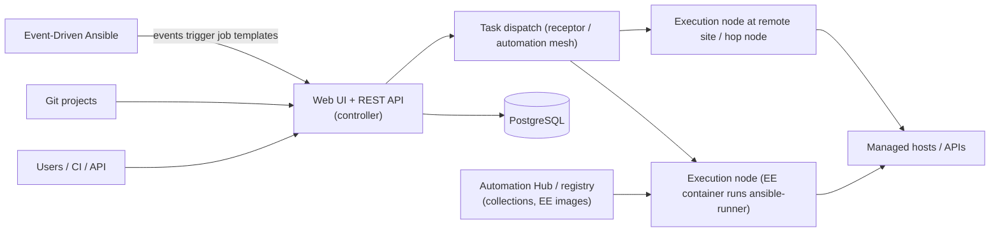

# 4.15 Custom modules, plug-ins and Ansible Automation Platform

| | |
|---|---|
| Level | Advanced |
| Priority tier | 1 |
| Lab venue | Python 3.10+, ansible-core, ansible-builder/navigator, Docker; kind or minikube for an AWX lab |
| Part | Part 4: Automation and infrastructure as code |
| Status | Drafted, labs **untested** |

## Why this matters for AI infrastructure

Eventually the modules on the shelf do not match your hardware or process: a vendor tool with a CLI but no module, a site-specific scheduler operation ("drain nodes in this rack if no jobs"), a Redfish OEM extension, a custom inventory source, a filter that compresses node lists into Slurm hostlist syntax. A custom module or plugin turns a fragile shell snippet into an idempotent, testable, documented task. And once more than a handful of people run automation, you need a **platform**: central credentials, role-based access, audit trails, scheduling, approvals and an API. Ansible Automation Platform (AAP, and its upstream AWX) is that layer. This chapter shows how to extend Ansible and how to operate it as a shared service.

## Prerequisites and outcomes

Needs 4.6 to 4.14 and Python skills from Part 3. After this chapter you can:

- Decide when to write a module, a plugin, or just a role.
- Write a Python module with `AnsibleModule` (arguments, check mode, idempotency, return values, documentation), test it, and ship it in a collection.
- Write filter, test, lookup, inventory, callback and action plugins; know connection/become/vars/cache plugin types.
- Explain AAP/AWX architecture (controller, execution environments, automation mesh, hub, EDA), its objects (organisations, projects, inventories, credentials, job templates, workflows, surveys, schedules, notifications), and RBAC.
- Build and use execution environments; call the platform through its API; connect it to CI and Git; secure and operate it.
- Choose between running Ansible from CI, from a shared bastion, and from AAP.

## 1. Choosing the extension point

| Need | Use |
|---|---|
| Combine existing modules into a procedure | Role (4.11) |
| Wrap a CLI in a reliable idempotent interface | Module (Python, or any language emitting JSON) |
| Transform data inside Jinja | Filter / test plugin |
| Fetch external data at template time on the controller | Lookup plugin |
| Build inventory from an external source | Inventory plugin |
| Change how output/notifications work | Callback plugin |
| Run logic on the controller around a module (pre/post-processing, templating arguments) | Action plugin |
| Connect to something that is not SSH | Connection plugin |
| Cache facts/inventory somewhere custom | Cache plugin |
| Add variables from an external system | Vars plugin |

Modules execute **on the target** (or on the controller with `delegate_to: localhost`/`connection: local` for API-based modules); plugins execute **on the controller**. Package both in a collection so they are versioned and distributed together (4.11). If a core or community module exists, use it; if a module does not exist, check Galaxy first; write your own when you have a stable, repeated need.

## 2. Writing a module

A module is a program that receives JSON arguments and prints one JSON result. Python modules use `AnsibleModule` to handle arguments, check mode, errors and results. Idempotency is your responsibility: **read current state, compute the difference, change only if needed, report `changed` accurately**.

### Example: manage a GPU power cap

```python
#!/usr/bin/python
# plugins/modules/gpu_power_limit.py
from __future__ import annotations

DOCUMENTATION = r"""
---
module: gpu_power_limit
short_description: Ensure NVIDIA GPU power limits
description:
  - Reads GPU power limits with C(nvidia-smi) and sets them to the requested value if different.
version_added: "1.0.0"
options:
  watts:
    description: Desired power limit in watts.
    type: int
    required: true
  index:
    description: GPU index, or C(all).
    type: str
    default: all
  persist:
    description: Enable persistence mode first (recommended).
    type: bool
    default: true
requirements:
  - nvidia-smi
author:
  - Platform team (@platform)
notes:
  - Supports check mode.
"""

EXAMPLES = r"""
- name: Cap all GPUs at 600 W
  acme.gpu.gpu_power_limit:
    watts: 600

- name: Cap GPU 3 only
  acme.gpu.gpu_power_limit:
    watts: 550
    index: "3"
"""

RETURN = r"""
before:
  description: Power limits (W) before the change, by GPU index.
  type: dict
  returned: always
after:
  description: Power limits (W) after the change.
  type: dict
  returned: success
"""

from ansible.module_utils.basic import AnsibleModule


def query(module, smi, index):
    args = [smi, "--query-gpu=index,power.limit", "--format=csv,noheader,nounits"]
    if index != "all":
        args += ["-i", index]
    rc, out, err = module.run_command(args, check_rc=False)
    if rc != 0:
        module.fail_json(msg=f"nvidia-smi query failed: {err.strip() or out.strip()}", rc=rc)
    state = {}
    for line in out.strip().splitlines():
        idx, limit = [p.strip() for p in line.split(",")]
        state[idx] = int(float(limit))                       # '[N/A]' would raise: handle in real code
    return state


def main():
    module = AnsibleModule(
        argument_spec=dict(
            watts=dict(type="int", required=True),
            index=dict(type="str", default="all"),
            persist=dict(type="bool", default=True),
        ),
        supports_check_mode=True,
    )
    p = module.params
    if not 50 <= p["watts"] <= 1000:
        module.fail_json(msg="watts must be between 50 and 1000")
    smi = module.get_bin_path("nvidia-smi", required=True)

    before = query(module, smi, p["index"])
    todo = [i for i, w in before.items() if w != p["watts"]]
    result = dict(changed=bool(todo), before=before, after=before)

    if todo and not module.check_mode:
        if p["persist"]:
            module.run_command([smi, "-pm", "1"], check_rc=True)
        for i in todo:
            module.run_command([smi, "-i", i, "-pl", str(p["watts"])], check_rc=True)
        result["after"] = query(module, smi, p["index"])
        if any(w != p["watts"] for w in result["after"].values()):
            module.fail_json(msg="power limit did not apply (clamped by driver/firmware?)", **result)

    if module._diff:                                         # --diff support
        result["diff"] = dict(before=str(before), after=str({i: p["watts"] for i in before}))
    module.exit_json(**result)


if __name__ == "__main__":
    main()
```

Module checklist:

- **Documentation blocks** (`DOCUMENTATION`, `EXAMPLES`, `RETURN`, YAML in raw strings) are mandatory in collections: they power `ansible-doc` and `ansible-test sanity` validates them.
- **Argument spec**: types, `choices`, `required`, `default`, `no_log=True` for secrets, `mutually_exclusive`, `required_if`, `required_together`, `required_one_of`; `AnsibleModule` rejects unknown args.
- **Idempotency and `changed`**: compute from state, not from "I ran a command". In **check mode** (`supports_check_mode=True`) make no changes and report what would change. Support `--diff` by returning a `diff` dict (`before`/`after`).
- **Errors**: `module.fail_json(msg=..., **info)`; never raise raw exceptions; avoid `sys.exit`; clean up temp files.
- **Subprocesses**: `module.run_command([...])` with a list (no shell), `check_rc`, `environ_update`, `data` for stdin; locate binaries with `get_bin_path`.
- **Return values**: simple JSON types; document them; never return secrets (and set `no_log` on sensitive args so they are masked in output).
- **Portability**: run on the target's Python; keep dependencies to the standard library or declare them (`requirements`) and fail clearly if missing (`missing_required_lib`). Python 2 is dead, but check the oldest target Python you support.
- **Module utilities**: shared code goes in `plugins/module_utils/` (imported as `ansible_collections.acme.gpu.plugins.module_utils.nvml`); a doc fragment (`plugins/doc_fragments/`) shares option documentation across modules.
- **API-style modules** that talk to a service from the controller (e.g. NetBox, a scheduler REST API) are run with `delegate_to: localhost` or `connection: local`; they should accept `url`, `token` (`no_log`), `validate_certs`, `timeout`.
- **Action plugins** can pre-process on the controller before running the module on the target (the `template` and `copy` modules are action plugins plus a target module).
- **Non-Python modules**: any executable that reads the args file and prints JSON works (binary modules in Go/Rust, shell modules via `WANT_JSON` conventions); Python gives the best ecosystem support.

### Testing a module

1. **Run it directly**: write an args file (`args.json` containing `{"ANSIBLE_MODULE_ARGS": {"watts": 600}}`) and run `python plugins/modules/gpu_power_limit.py args.json` (use a fake `nvidia-smi` earlier in `PATH`).
2. **Ad-hoc**: `ansible -m acme.gpu.gpu_power_limit -a "watts=600" gpu001 --check --diff -vvv`; remember `ANSIBLE_LIBRARY` or install the collection.
3. **Unit tests** (pytest) with `ansible_collections` test helpers: patch `AnsibleModule.exit_json`/`fail_json` and `run_command`, and assert on results (3.9 patterns).
4. **`ansible-test sanity`** for documentation and style; **integration targets** (`tests/integration/targets/gpu_power_limit/tasks/main.yml`) run the module in a container with stub binaries or on real hardware tier.
5. **Idempotency test**: run twice and assert the second `changed` is false (Molecule, 4.13).

### When not to write a module

If you can express the behaviour in a few tasks with `command` + `changed_when`, a role is simpler. Write a module when the logic needs to parse structured output, handle many states, support check/diff, or be reused widely.

## 3. Plugins

All plugin types live under `plugins/<type>/` in a collection (or `filter_plugins/`, `lookup_plugins/` etc. next to a playbook or in a role).

### Filter plugins

```python
# plugins/filter/slurm_hostlist.py
from __future__ import annotations
import re
from ansible.errors import AnsibleFilterError

def _compress(names):
    groups = {}
    for n in sorted(names):
        m = re.match(r"^(.*?)(\d+)$", n)
        if not m:
            groups.setdefault((n, 0), []).append(None)
            continue
        prefix, num = m.group(1), m.group(2)
        groups.setdefault((prefix, len(num)), []).append(int(num))
    parts = []
    for (prefix, width), nums in groups.items():
        if nums == [None]:
            parts.append(prefix); continue
        nums = sorted(nums); ranges = []; start = prev = nums[0]
        for x in nums[1:]:
            if x == prev + 1: prev = x; continue
            ranges.append((start, prev)); start = prev = x
        ranges.append((start, prev))
        body = ",".join(f"{a:0{width}d}" if a == b else f"{a:0{width}d}-{b:0{width}d}" for a, b in ranges)
        parts.append(f"{prefix}[{body}]" if ("," in body or "-" in body) else f"{prefix}{body}")
    return ",".join(parts)

def slurm_hostlist(value):
    if not isinstance(value, (list, tuple)):
        raise AnsibleFilterError("slurm_hostlist expects a list of host names")
    return _compress([str(v) for v in value])

class FilterModule:
    def filters(self):
        return {"slurm_hostlist": slurm_hostlist}
```

Usage: `{{ groups['gpu'] | acme.gpu.slurm_hostlist }}` → `gpu[001-032]`. Filters must be pure functions with no side effects; test with pytest like ordinary Python (see the property-based testing ideas in 3.9). **Test plugins** (`is something`) are the same with a `TestModule` class returning a dict of tests.

### Lookup plugins

A lookup runs on the controller and returns a list. Example skeleton:

```python
# plugins/lookup/node_inventory_api.py
from __future__ import annotations
DOCUMENTATION = r"""
name: node_inventory_api
short_description: Fetch node data from an internal API
options:
  _terms: {description: Node names, required: true}
  url: {description: Base URL, env: [{name: NODE_API_URL}], required: true}
  token: {description: API token, env: [{name: NODE_API_TOKEN}], required: true}
"""
from ansible.plugins.lookup import LookupBase
from ansible.errors import AnsibleLookupError
from ansible.module_utils.urls import open_url
import json

class LookupModule(LookupBase):
    def run(self, terms, variables=None, **kwargs):
        self.set_options(var_options=variables, direct=kwargs)
        url, token = self.get_option("url"), self.get_option("token")
        out = []
        for name in terms:
            try:
                r = open_url(f"{url}/nodes/{name}", headers={"Authorization": f"Bearer {token}"}, timeout=10)
                out.append(json.load(r))
            except Exception as e:                       # noqa: BLE001
                raise AnsibleLookupError(f"lookup of {name} failed: {e}") from e
        return out
```

Lookups run once per evaluation, so cache inside the plugin if called in loops; never log tokens.

### Inventory plugins

Subclass `BaseInventoryPlugin` (and `Constructable`, `Cacheable`), implement `verify_file` (filename suffix) and `parse`, and call `self.inventory.add_host/add_group/add_child/set_variable`; support `compose`, `groups`, `keyed_groups` via `Constructable` and caching via `Cacheable` (4.5). Prefer inventory plugins over scripts for new work.

### Callback, action, connection, vars, cache, strategy, become plugins

- **Callback**: see 4.14 (events, display, notifications).
- **Action**: runs on the controller in place of (or wrapping) a module; used to transform args, copy files first, or short-circuit. Subclass `ActionBase`; `run()` calls `self._execute_module(...)`.
- **Connection**: implement how to reach a target (SSH, WinRM, docker, kubectl, network_cli, httpapi, `aws_ssm`, `community.general.lxd`); write one to reach nodes through a bespoke console server or API.
- **Vars**: inject variables from external systems per host/group (`host_group_vars` is built in).
- **Cache**: fact/inventory caches (redis, memcached, jsonfile, custom).
- **Strategy**: custom execution orders (rare).
- **Become**: custom privilege escalation (`sudo`, `su`, `doas`, `runas`, `machinectl`, `pbrun`).

Document plugin options with `DOCUMENTATION`; configuration comes from `ansible.cfg`, env vars, or play variables through the options system (`env`, `ini`, `vars`, `keyword`).

## 4. Execution environments (EEs)

An EE is a container image with ansible-core, ansible-runner, collections, Python and system dependencies, giving every run (laptop, CI, AAP) the same runtime.

```yaml
# execution-environment.yml (ansible-builder v3)
version: 3
images:
  base_image:
    name: quay.io/ansible/ansible-runner:latest        # pin by digest in real use
dependencies:
  ansible_core: { package_pip: ansible-core==2.17.* }
  ansible_runner: { package_pip: ansible-runner }
  galaxy: requirements.yml
  python: requirements.txt            # e.g. netaddr, jmespath, kubernetes, psycopg2-binary, hvac
  system: bindep.txt                  # e.g. gcc, libpq-dev, openssh-clients [platform:rpm]
additional_build_steps:
  append_final:
    - RUN pip3 list && ansible --version
```

```bash
ansible-builder build -t registry.example.com/platform/ee-gpu:1.2.0 -f execution-environment.yml
ansible-navigator run site.yml -i inventories/lab --eei registry.example.com/platform/ee-gpu:1.2.0 --pp missing -m stdout
ansible-navigator images                              # inspect an EE interactively
```

Practices: one EE per toolchain family (base, network, cloud, GPU), semantic versions, scan images, sign them, rebuild nightly for CVEs, and pin them in AAP job templates and CI. EEs end dependency drift between "my laptop" and "the platform".

## 5. Ansible Automation Platform and AWX

**AWX** is the open-source upstream (Kubernetes-deployed via the AWX operator); **AAP** is Red Hat's supported product built from it, adding Automation Hub (certified/private collections), Event-Driven Ansible, Insights, analytics and support. Concepts transfer directly.



### Core objects

| Object | Meaning |
|---|---|
| **Organization** | Tenant boundary for teams and resources |
| **Project** | A Git repository (branch/tag) of playbooks; synced on demand or on launch |
| **Inventory** | Static, dynamic (sourced from clouds/NetBox/scripts/plugins), or smart inventories; groups, hosts, variables |
| **Credential** | Encrypted secret store: machine (SSH), vault, cloud, source control, registry, custom types injecting env vars/extra vars/files; **users never see the secret** |
| **Execution Environment** | The container image used |
| **Job template** | Playbook + inventory + credentials + EE + options (limit, tags, verbosity, extra vars, `prompt on launch`, concurrency, timeout, job slicing, instance groups) |
| **Workflow template** | A DAG of job templates, inventory syncs, project syncs, approvals, with success/failure/always edges |
| **Survey** | A form asking for typed inputs at launch (rack name, driver version) |
| **Schedule** | Cron-like recurrence for templates (nightly drift checks) |
| **Notification template** | Slack, email, PagerDuty, webhooks on start/success/failure |
| **Instance groups / containers groups** | Where jobs run (VM execution nodes, Kubernetes pods) |
| **Teams, roles (RBAC)** | Who may use, execute, update, admin which objects |

### Why teams adopt it

- **Credential isolation**: operators can run a job against production without ever holding the SSH key or vault password; the platform injects them into the EE at run time.
- **RBAC and approvals**: a developer may run the lab template; production needs a workflow approval; auditors read job history.
- **Audit and logging**: every job stores who launched it, from which Git revision, with which inventory and variables, plus full stdout and per-task events; stream to external logging (Splunk/ELK/Loki).
- **Central scheduling and API**: nightly check-mode jobs, webhook-triggered runs from Git, API-driven launches from CI/ChatOps/ITSM.
- **Scale**: job slicing, execution nodes, mesh, instance groups, concurrency limits.
- **Consistency**: EEs plus a single place where automation executes.

### Operating considerations

- **Architecture and HA**: controller on Kubernetes/OpenShift (operator), external PostgreSQL with backups and HA, redundant controller pods, execution nodes close to target networks; plan upgrades (database migrations, EE compatibility) and DR (restore the DB + secret key; **the SECRET_KEY encrypts credentials: back it up securely**).
- **Security**: SSO (SAML/OIDC/LDAP), MFA at the IdP, least-privilege roles, credential types with minimal scope, network policy for the platform, restricted outbound access, signed EEs, project sources pinned to protected branches/tags, "prompt on launch" restrictions to avoid arbitrary playbook injection (`ask_variables_on_launch`, `allow_simultaneous`, `extra_vars` risks), isolate job execution (containers with limited privileges), and hardened Git credentials. The platform holds your fleet's keys: treat it as tier-0.
- **Job design**: small, single-purpose templates; check-mode and apply variants; surveys with validation; timeouts; concurrency controls; `limit` prompt for canaries; workflows with approval nodes and rollback paths.
- **Git flow**: playbooks merged through PRs (4.1) with lint/Molecule (4.13) before the project syncs from `main`; a CI job can call the AAP API to launch a workflow after merge, closing the loop with 4.2.
- **Dynamic inventory and sync**: schedule inventory sources (cloud, NetBox), use `overwrite` and `update_on_launch` carefully, filter to manageable sets.
- **Capacity**: forks per job × concurrent jobs vs execution node resources; job slicing for large inventories; instance group assignments per environment.

### API-driven automation

The controller exposes a REST API (`/api/controller/v2/` in AAP; `/api/v2/` in AWX) and an official `awx`/`controller` CLI and `ansible.platform`/`awx.awx` collections for managing the platform as code (configuration-as-code for templates, credentials, projects).

```bash
# Launch a job template with a limit and extra vars (token from a service account)
curl -sS -X POST -H "Authorization: Bearer $AAP_TOKEN" -H 'Content-Type: application/json' \
  https://aap.example.com/api/controller/v2/job_templates/42/launch/ \
  -d '{"limit": "gpu001,gpu002", "extra_vars": {"app_version": "v1.4.3"}, "job_tags": "config"}'
# Poll the job
curl -sS -H "Authorization: Bearer $AAP_TOKEN" https://aap.example.com/api/controller/v2/jobs/1234/ | jq '.status,.failed'
```

```yaml
# Manage the platform declaratively
- name: Job template for GPU baseline
  awx.awx.job_template:
    name: gpu-baseline-prod
    organization: Platform
    project: platform-automation
    playbook: playbooks/gpu_nodes.yml
    inventory: prod
    credentials: [prod-ssh, prod-vault]
    execution_environment: ee-gpu-1.2.0
    ask_limit_on_launch: true
    ask_variables_on_launch: false
    survey_enabled: false
    state: present
```

### Event-Driven Ansible (EDA)

EDA runs **rulebooks**: event sources (Alertmanager webhooks, Kafka, Prometheus, cloud events, Git webhooks, `ansible.eda.range` for tests) feed rules (conditions) that trigger actions (run a playbook or job template, post events, set facts). Typical AI-infrastructure uses: on a GPU XID error alert, cordon the node and open a ticket; on repeated NIC flaps, drain and run diagnostics; on a Git webhook, run a validation workflow. Keep actions safe (idempotent, rate-limited, human approval for destructive steps, dedupe events) to avoid automation storms.

```yaml
# rulebook sketch
- name: GPU health remediation
  hosts: all
  sources:
    - ansible.eda.alertmanager: { host: 0.0.0.0, port: 5000 }
  rules:
    - name: Cordon on Xid 79
      condition: event.alert.labels.alertname == "GPUXid79" and event.alert.status == "firing"
      action:
        run_job_template:
          name: drain-and-diagnose-node
          organization: Platform
          job_args:
            extra_vars:
              target_node: "{{ event.alert.labels.node }}"
```

(Syntax and available sources vary by EDA version; verify.)

## 6. Choosing where to run Ansible

| Option | Fits | Watch out |
|---|---|---|
| Laptop | Development, one-off lab work | Not reproducible, credentials on laptops |
| Shared bastion/controller | Small teams | Pet server, shared accounts, weak audit |
| CI runners (GitHub/GitLab) | Deploy-on-merge, linting, tests | Credentials in CI (use OIDC/secret manager), long jobs, limited approval UX (4.2) |
| AWX/AAP | Many operators, RBAC, audit, schedules, approvals, large inventories | Platform to run and secure; upgrade/DR discipline |
| `ansible-pull` | Huge homogeneous fleets | Rollout control and visibility |
| Cloud-native (Terraform + user-data, immutable images) | Elastic fleets | Day-2 flexibility |

Many mature setups combine: CI for testing and building EEs/images, AAP for operator-run and scheduled production jobs, `ansible-pull` or images for node baselines.

## 7. Lab (untested)

1. **First module**: implement `gpu_power_limit` (or a simpler module around `sysctl`/a CLI) with a fake `nvidia-smi`; run directly from an args file, then via `ansible -m` with `--check --diff`; confirm idempotency.
2. **Module quality**: add argument validation, check-mode, diff, unit tests with mocked `run_command`, and run `ansible-test sanity` in a collection.
3. **Filter plugin**: implement `slurm_hostlist` and its inverse; write pytest tests (including property-based round-trip tests); use in a Slurm template.
4. **Lookup plugin**: write a lookup that reads from a local JSON "API"; call it in a loop and add a cache.
5. **Inventory plugin**: write a minimal plugin that builds hosts/groups from a YAML or REST source with `compose` and `keyed_groups`; compare with the constructed plugin.
6. **Callback and action plugin**: reuse the 4.14 callback; write an action plugin that normalises an argument before invoking a stock module.
7. **Execution environment**: build an EE with your collection and Python deps; run the same playbook with `ansible-navigator` locally and compare with the host install.
8. **AWX lab**: deploy AWX on kind via the operator; create organization, project (from your Git repo), inventory, machine credential and a job template; run it; inspect job events.
9. **RBAC and credentials**: create a team and a role granting execute-only on the template; log in as that user and prove they can run but cannot read the credential or edit the template.
10. **Workflow with approval**: build canary → approval → rollout → verify; add failure notification; use a survey for `limit` and `app_version`.
11. **API/CI loop**: from a CI job, call the launch endpoint after a merge and poll status; fail CI if the job fails; then manage the templates with `awx.awx` modules (configuration as code).
12. **EDA (optional)**: run an Alertmanager source rulebook that triggers a harmless job template when a test alert fires; add rate limiting and dedupe.
13. **Clean up.**

Mark tested only after execution.

## 8. Common mistakes

- Writing a module when a role would do, or a role of `shell` tasks when a module is needed.
- Modules that always report `changed`, ignore check mode, hide errors, or print secrets.
- Missing documentation blocks (breaks `ansible-doc` and sanity tests); unvalidated arguments.
- Plugins with side effects or network calls on every evaluation; secrets in plugin logs.
- Custom plugins living outside versioned collections, so copies diverge.
- Unpinned execution environment images, EEs without scanning, EEs diverging per team.
- AAP credentials with broad scope; arbitrary `extra_vars` on launch allowing injection; projects tracking unprotected branches.
- No backup of the controller database and secret key; no upgrade plan.
- EDA rulebooks triggering destructive actions without rate limits or approvals.
- Treating AAP as a replacement for testing and review rather than a controlled executor of tested code.

## 9. Interview angles

- "How do you write an Ansible module? How do you make it idempotent and check-mode safe?" 
- "When would you write a plugin versus a module versus a role? Give examples of each type." 
- "What is an execution environment and why use one?" 
- "What does AAP/AWX give you over running playbooks from CI?" (credential isolation, RBAC, audit, scheduling, approvals, API.)
- "How would you secure an automation platform that holds all your SSH keys?" 
- "Design a workflow for rolling a driver update with approvals and rollback." 
- "What is Event-Driven Ansible; give a remediation use case and its safeguards."

## 10. Checkpoint questions (30)

1. Where do modules run? **A:** On the target (or controller for API modules).
2. Where do plugins run? **A:** On the controller.
3. What class do Python modules use? **A:** `AnsibleModule`.
4. What must a module return? **A:** JSON with `changed` etc. via `exit_json`/`fail_json`.
5. How support check mode? **A:** `supports_check_mode=True` and no changes when `module.check_mode`.
6. How support diff? **A:** Return a `diff` dict when `module._diff`.
7. Required doc blocks? **A:** `DOCUMENTATION`, `EXAMPLES`, `RETURN`.
8. How mask secret args? **A:** `no_log=True` in the argument spec.
9. Where does shared module code go? **A:** `plugins/module_utils/`.
10. Tool to validate collection docs/style? **A:** `ansible-test sanity`.
11. What is a filter plugin class? **A:** `FilterModule` with `filters()`.
12. What does a lookup return? **A:** A list.
13. Which plugin builds inventory? **A:** Inventory plugin.
14. Base class for inventory plugins? **A:** `BaseInventoryPlugin`.
15. What is an action plugin? **A:** Controller-side logic around/instead of a module.
16. What is a connection plugin? **A:** How Ansible reaches a target.
17. What is an EE? **A:** Container image with core, collections, deps.
18. Tool to build EEs? **A:** `ansible-builder`.
19. Tool to run with EEs locally? **A:** `ansible-navigator`.
20. AWX vs AAP? **A:** Upstream open source vs supported product.
21. What is a project? **A:** Git repo of playbooks.
22. What is a credential's key property? **A:** Users can use but not see secrets.
23. What is a job template? **A:** Playbook + inventory + credentials + EE + options.
24. What is a workflow template? **A:** DAG of jobs/approvals.
25. What is a survey? **A:** Launch-time input form.
26. What is automation mesh? **A:** Distributed execution via receptor nodes.
27. What must be backed up for DR? **A:** Database and secret key.
28. What does job slicing do? **A:** Splits a job across inventory slices in parallel.
29. What is EDA? **A:** Rulebooks reacting to events with actions.
30. How integrate CI? **A:** Call controller API to launch templates and poll status.

## 11. Sources and review notes

**Written in original words.** Principal sources:

- Rene Moser and Lorin Hochstein, *Ansible: Up and Running*, 3rd edition (chapters 19 on creating custom modules, 23 on Ansible Automation Platform / AWX, 24 on managing and operating the platform, with plugin material).
- Ansible developer documentation (module development, plugin types, collections), ansible-builder/navigator documentation, AWX and AAP documentation, Event-Driven Ansible documentation.
- Examples are the author's constructions; the module and plugin code is illustrative and untested.

**Flagged for verification before publishing:** `ansible-builder` definition schema version, AAP API paths and object names for the version used, `awx.awx`/`ansible.platform` module names, EDA rulebook syntax and sources, `nvidia-smi` option behaviour for power limits (some GPUs clamp or reject), and every code listing; all labs are **untested**.
