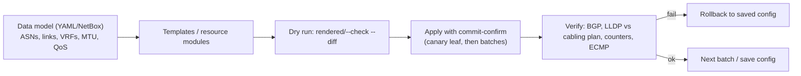

# 4.16 Ansible for containers, cloud and network devices

| | |
|---|---|
| Level | Intermediate |
| Priority tier | 1 |
| Lab venue | ansible-core, Docker/Podman, kind; containerlab with FRR/Cumulus images; optional GCP/AWS/Azure sandbox |
| Part | Part 4: Automation and infrastructure as code |
| Status | Drafted, labs **untested** |

## Why this matters for AI infrastructure

Your AI platform is more than a set of Linux servers. It is container runtimes and Kubernetes clusters, cloud projects with GPU quotas, VPCs and managed storage, and a fabric of Ethernet and InfiniBand switches. Ansible reaches past the host. Modules that call APIs and drive network operating systems let one tool and one review process span all of these layers.

The same reach shows where Ansible stops. For cloud resources that have a lifecycle and state, Terraform is the better tool (4.18). For workloads inside a cluster, Helm and GitOps are the better tools (4.26). Your practical skill is knowing which tool owns each layer, and using Ansible well where it fits.

## Prerequisites and outcomes

This chapter builds on 4.3 to 4.12, networking basics from Part 2, and Kubernetes basics. Part 5 will deepen the Kubernetes material. When you finish, you should be able to do the following.

- Manage Docker and Podman containers, images, networks, volumes and Compose stacks with `community.docker` and `containers.podman`.
- Drive Kubernetes with `kubernetes.core`. Apply manifests, run Helm, use wait conditions and facts, and know when GitOps is the better choice.
- Provision and inventory cloud resources with `amazon.aws`, `google.cloud` and `azure.azcollection`, and decide between Ansible and Terraform.
- Automate network devices through the connection types `network_cli`, `netconf` and `httpapi`, and know how resource modules differ from config modules.
- Use backup, diff, rollback, validation and idempotency checks on network configuration.
- Automate NVIDIA switches with NVUE, and generate leaf-spine configuration from a data model.
- Apply safe-change patterns to network automation: dry run, commit-confirm, canary and verify.

## 1. Containers

### Docker and Podman

A container host needs its runtime installed and running before any container can start. The play below prepares the host, pulls an image, and runs a GPU container from it.

```yaml
- name: Container host prerequisites
  hosts: gpu
  become: true
  tasks:
    - name: Ensure Docker is installed and running
      ansible.builtin.package: { name: docker.io, state: present }
    - ansible.builtin.service: { name: docker, state: started, enabled: true }

    - name: Pull an image by digest
      community.docker.docker_image:
        name: nvcr.io/nvidia/pytorch
        tag: "24.06-py3"
        source: pull
      environment: { DOCKER_CONFIG: /root/.docker }       # credentials for nvcr.io set up separately (docker_login)

    - name: Run a GPU container (requires NVIDIA Container Toolkit)
      community.docker.docker_container:
        name: dcgm-exporter
        image: nvcr.io/nvidia/k8s/dcgm-exporter:3.3.5-3.4.1-ubuntu22.04
        state: started
        restart_policy: unless-stopped
        device_requests:
          - driver: nvidia
            count: -1
            capabilities: [[gpu]]
        published_ports: ["9400:9400"]
        cap_add: [SYS_ADMIN]
        healthcheck:
          test: ["CMD-SHELL", "curl -sf http://localhost:9400/metrics >/dev/null"]
          interval: 30s
```

Read the play from top to bottom, the way you would read a runbook. The first task installs and starts Docker. The second pulls the image, and the third starts the GPU container with the NVIDIA Container Toolkit in place. Watch the `device_requests` block, because it is what hands the GPUs to the container.

Ansible has a module for most Docker work you will need. The `docker_image` module builds, pulls, pushes and archives images. The `docker_container` module declares the state a container should be in, and it stays idempotent on that configuration. Pay attention to its `recreate` and `comparisons` options. Related modules cover networks, volumes, registry login, Compose and host information. The table lists them.

| Module | What it does |
|---|---|
| `docker_container_exec` | Runs a command in a running container |
| `docker_network`, `docker_volume` | Networks and volumes |
| `docker_login` | Registry login |
| `docker_compose_v2` | Compose stacks |
| `docker_prune`, `docker_host_info` | Cleanup and host information |

If you use Podman, `containers.podman` has equivalents. That collection covers rootless containers and Quadlet systemd units.

Two details catch you out. Image tags are mutable, so pin digests (4.2). The container modules also compare the desired configuration with the running container. When they find a difference, they recreate the container, so a changed environment variable restarts the service.

Keep secrets out of your playbooks. Store them in files with restricted modes or in the orchestrator, not in `env:`, as 4.12 describes. Docker Compose or Quadlet-managed systemd units suit single-node services. For a fleet, use Kubernetes.

If you build images, use Ansible only for small tooling. Real image builds belong in CI, using a `Dockerfile` and BuildKit. You can use Ansible as a Packer provisioner when you bake VM images (4.2).

*Ansible: Up and Running* shows two complementary ways Ansible works with containers and machine images. The first is in Chapter 13, and the second is in Chapter 16.

The first way manages Docker images, registries, networks and multi-container stacks through the Docker Remote API (Chapter 13, `Examples 13-1` to `13-11`). Ansible's `docker_*` modules talk to the Docker daemon at `DOCKER_HOST`, which defaults to `unix://var/run/docker.sock`. A remote host uses a TLS socket instead, configured with `DOCKER_CERT_PATH` and `DOCKER_TLS_VERIFY`. The book's example shows `docker_image_info` reading image metadata: `ghost.images[0].Config.ExposedPorts.keys()` returns `2368/tcp`, and `ghost.images[0].Config.Volumes.keys()` returns `/var/lib/ghost`. The `docker_image` module builds the image (`build: { path: ./nginx }, source: build, force_source: true`) or pushes it (`push: true`) after `docker_login`. The `docker_network` module creates a bridge network called `ghostnet`, so the `nginx_ghost` frontend can reverse-proxy to `http://ghost:2368` by container name. Finally, `docker_container` starts the `ghost` application container, wired to an external MySQL database host (`PyMySQL`, `mysql_db`, `mysql_user`).

The second way bakes golden VM images and container images with HashiCorp Packer and the Ansible provisioner (Chapter 16, `Examples 16-1` to `16-7`). A `Dockerfile` is fine for a simple container. Golden VM images are much cleaner with Packer.

The command `packer build` drives the builder for each target. The book has templates for Vagrant with VirtualBox (`rhel8.pkr.hcl` with the Kickstart `ks.cfg`), Google Cloud (`gcp.pkr.hcl`), Azure (`azure.pkr.hcl`) and Amazon EC2 (`aws.pkr.hcl`). It can also build a multi-role Docker image that compiles `GCC 11.2.0` (`gcc.pkr.hcl`). A `provisioner "ansible"` block then applies your existing hardened roles through `playbook_file = "./playbooks/packer-playbook.yml"`. The book's roles include `common`, `sshd` and `rhel8-stig`.

### Kubernetes

The `kubernetes.core` collection calls the Kubernetes API with a kubeconfig file or with in-cluster credentials. The controller, or the execution environment (EE), needs the `kubernetes` Python library. The play below creates a namespace, applies a quota, installs the GPU Operator through Helm, and waits for the GPU nodes to appear.

```yaml
- name: Platform namespaces and quotas
  hosts: localhost
  connection: local
  gather_facts: false
  collections: [kubernetes.core]
  tasks:
    - name: Namespace for training jobs
      kubernetes.core.k8s:
        state: present
        definition:
          apiVersion: v1
          kind: Namespace
          metadata: { name: training, labels: { team: ml-platform } }

    - name: Apply a rendered manifest (Jinja template)
      kubernetes.core.k8s:
        state: present
        template: manifests/resourcequota.yaml.j2
        namespace: training
        wait: true
        wait_timeout: 120

    - name: Install the GPU Operator via Helm
      kubernetes.core.helm:
        name: gpu-operator
        chart_ref: gpu-operator
        chart_repo_url: https://helm.ngc.nvidia.com/nvidia
        chart_version: "v24.6.0"
        release_namespace: gpu-operator
        create_namespace: true
        values:
          driver: { enabled: false }          # driver preinstalled on the host image
        wait: true
        timeout: 15m

    - name: Wait for all GPU nodes to advertise GPUs
      kubernetes.core.k8s_info:
        kind: Node
        label_selectors: ["nvidia.com/gpu.present=true"]
      register: gpu_nodes
      until: gpu_nodes.resources | length >= expected_gpu_nodes
      retries: 30
      delay: 20
```

The `k8s` module applies or deletes any resource. Its options `apply: true`, `validate` and `wait` control how. The first one turns on server-side apply semantics. Companion modules read and act on the cluster: `k8s_info`, `k8s_exec`, `k8s_log`, `k8s_scale`, `k8s_drain` and `k8s_taint`. The Helm modules are `helm`, `helm_info`, `helm_repository` and `helm_template`. The inventory plugin `kubernetes.core.k8s` builds inventory from pods and nodes, and the connection plugin `kubernetes.core.kubectl` runs modules inside pods.

Use the following guidance to choose between Ansible and GitOps.

- Keep declarative state in Git, and let controllers such as Argo CD or Flux reconcile it (4.26). For ongoing workloads, that beats imperative `k8s` applies in playbooks. Use Ansible for the layer around the cluster. That layer covers node preparation, cluster bootstrap with Kubespray or kubeadm, initial platform installs such as CNI, the GPU Operator and Argo CD itself, certificate and kubeconfig distribution, and day-2 node operations such as cordon, drain and upgrade.
- Use `wait` conditions and `k8s_info` polling instead of sleeps, and always set timeouts.
- Template manifests with Jinja only for environment values. Complex logic belongs in Helm or Kustomize.
- Mind kubeconfig credentials. They should be short-lived, specific to each environment, and tied to RBAC-scoped service accounts. Watch `validate_certs` too.
- Kubespray, an Ansible-based Kubernetes installer, and NVIDIA DeepOps provide production-grade playbooks. Pin their versions, and review them (Part 5).

For a playbook that manages Kubernetes, the cluster boundary decides the tool. Ansible owns the layer beneath the cluster, and GitOps owns what runs inside it.

## 2. Cloud

### What Ansible does well in the cloud

Once cloud resources exist, they still need configuring. Ansible is strongest in four areas.

- Dynamic inventory from cloud APIs (4.5) lets you configure instances however they were created.
- Day-2 operations on existing resources include snapshots, tags, resizing, start and stop, rotating secrets, managing IAM bindings, and running SSM or OS Login commands.
- Orchestration glue: call Terraform through `cloud.terraform.terraform`, then configure the resulting hosts in the same pipeline with `add_host`, or run post-provision steps.
- One-off or small-scale provisioning, such as a quick lab setup or the bootstrap of a seed environment.

### What Terraform does better

Terraform manages resource lifecycles in a declarative, stateful way. It builds dependency graphs, shows a plan and diff before it applies, detects drift, and destroys resources cleanly. Sections 4.18 to 4.25 cover these capabilities.

Ansible's cloud modules are idempotent for each call, but they keep no state for the whole environment. That gap has three effects. Removing a task does not delete the resource it created. Ordering and dependencies become your job. You also get no plan of the total change, and cleanup is manual.

Rule of thumb: **Terraform creates the infrastructure; Ansible configures what runs on it and performs operational actions.** Use `cloud.terraform` or CI to compose the two.

### Modules and collections

Each cloud has its own collection. Use this table to find the collection and the modules for yours.

| Cloud | Collection | Highlights |
|---|---|---|
| AWS | `amazon.aws`, `community.aws` | `ec2_instance`, `ec2_vpc_*`, `s3_bucket`, `iam_*`, `ssm_*` (Systems Manager connection), `aws_ssm` lookups, EC2 inventory plugin, `cloudformation` |
| GCP | `google.cloud` | `gcp_compute_instance`, `gcp_compute_network`, `gcp_storage_bucket`, `gcp_secret_manager`, inventory `gcp_compute`, OS Login/IAP tunnelling via SSH args |
| Azure | `azure.azcollection` | `azure_rm_virtualmachine`, `azure_rm_virtualnetwork`, `azure_rm_resourcegroup`, inventory plugin `azure_rm` |
| Others | `openstack.cloud`, `community.vmware`, `oracle.oci`, `hetzner`, `linode`, `digital_ocean`, Nebius via CLI/Terraform provider, `kubevirt.core` | |

Authentication should come from workload identity or instance profiles. In AAP or CI, supply environment-based credentials through OIDC, covered in 4.2 and 4.12. Never put keys in playbooks. The controller or the execution environment also needs the Python SDKs, such as `boto3`, `google-auth` and `azure-mgmt-*`.

The play below creates a lab GPU VM on Google Cloud. It then adds the VM to in-memory inventory, so the next play can configure it.

```yaml
- name: Ensure a labelled GPU VM exists (GCP, lab-scale)
  hosts: localhost
  connection: local
  gather_facts: false
  vars:
    project: my-ai-lab
    zone: us-central1-a
  tasks:
    - name: Instance
      google.cloud.gcp_compute_instance:
        name: gpu-lab-01
        machine_type: a2-highgpu-1g
        zone: "{{ zone }}"
        project: "{{ project }}"
        auth_kind: application
        disks:
          - auto_delete: true
            boot: true
            initialize_params:
              source_image: projects/ubuntu-os-cloud/global/images/family/ubuntu-2204-lts
              disk_size_gb: 200
        guest_accelerators:
          - accelerator_type: "projects/{{ project }}/zones/{{ zone }}/acceleratorTypes/nvidia-tesla-a100"
            accelerator_count: 1
        scheduling: { on_host_maintenance: TERMINATE }
        labels: { env: lab, role: gpu }
        network_interfaces:
          - network: { selfLink: "projects/{{ project }}/global/networks/default" }
        state: present
      register: vm
    - name: Add to in-memory inventory for the next play
      ansible.builtin.add_host:
        name: gpu-lab-01
        ansible_host: "{{ vm.networkInterfaces[0].networkIP }}"
        groups: [gpu]
```

Parameters and machine type and accelerator combinations vary, so check the module documentation and your quotas before you run it. GPU shapes such as A3/A4 use different machine families, and they can constrain images and drivers.

### Cost and quota safety

Cloud automation can spend money quickly. Attach budgets and alerts, and require tags such as `owner` and `ttl`. Implement reapers for lab resources, restrict who can run provisioning, and add policy checks to the pipeline, such as a maximum GPU count, covered in 4.2.

GPU capacity is often constrained. Make provisioning idempotent and failure-aware, because a run can leave a partial fleet behind. Prefer Terraform plans for review.

Decide who may run provisioning, and what it may spend, before you automate GPU fleets.

### AWS EC2 provisioning, AMI lookup, VPCs, and Windows hosts (*Ansible: Up and Running*, Chapters 12 and 17)

Two practical patterns from *Ansible: Up and Running*, Chapters 12 and 17, round out host and cloud management.

1. Dynamic AMI discovery, VPC and security group idempotence, and `aws_ec2` cache gotchas (Chapter 17).
   - *Finding the latest Ubuntu AMI (`ec2_ami_info`):* Rather than hardcoding a stale `ami-...` ID, query `amazon.aws.ec2_ami_info`. Set `owners: 099720109477` for Canonical. Set `filters` to the name pattern `ubuntu/images/hvm-ssd/ubuntu-focal-20.04-amd64-server-*`, with `state: available` and `architecture: x86_64`. Then select the newest image with **`{{ ec2_ami_info.images | sort(attribute='creation_date') | last }}`**. This selection is tested in `code/part04/ansible_cloud_network_lab.py`.
   - *Idempotence keys across AWS VPC modules (Table 17-3):* Each `amazon.aws` VPC module checks for an existing resource in its own way. `ec2_vpc_net` checks `(name, cidr_block)`. `ec2_vpc_subnet` checks `(vpc_id, cidr)`, with `10.0.0.0/24` for web and `10.0.1.0/24` for db. `ec2_vpc_igw` checks `vpc_id`, so each VPC gets at most one Internet Gateway. `ec2_vpc_route_table` checks `(vpc_id, tags)` when you set `lookup: tag`. `ec2_group` checks `(name, description, rules)`, such as `from_port: 22, to_port: 22, cidr_ip: 203.0.113.0/24` using `TEST-NET-3`.
   - *Dynamic inventory cache warning:* Enable `cache: true` on `aws_ec2.yml` with `cache_plugin: jsonfile` and `cache_connection: /tmp/ansible_fact_cache`, and the inventory can go stale. Newly launched or terminated EC2 instances do not appear in `ansible-inventory` until the cache expires (`cache_timeout: 300`). You can also delete the cache file, or run `meta: refresh_inventory`. If you have tag groups such as `tag_type_web`, alias them in a static `inventory/hosts` file beside `aws_ec2.yml`, using `[web:children]` followed by `tag_type_web`, so they map to `web`.
2. Managing Windows hosts over WinRM (*Ansible: Up and Running* Chapter 12). Windows jump hosts, Active Directory controllers and workstation nodes such as `windows2022` need no agent. Ansible connects over WinRM with `ansible_connection: winrm`, using port `5986` for HTTPS or `5985` for HTTP. Install `pywinrm` with `pip3 install pywinrm`. Use Kerberos for Active Directory, or `ansible_winrm_server_cert_validation: ignore` in local labs.

    The play then runs PowerShell-backed modules from `ansible.windows` and `community.windows`. The book uses `win_ping`, `win_chocolatey` to install `chocolatey`, `vscode` and `jdk8`, and `win_feature` with `name: Web-Server` and `include_sub_features: true`. It also uses `win_reboot` with `when: win_iis_feature.reboot_required`, and `win_updates` with `category_names: [SecurityUpdates, CriticalUpdates, UpdateRollups]` and `reboot: true`.

Give Terraform the lifecycle of cloud resources, and let Ansible configure and operate them.

## 3. Network devices

### How network automation differs

Many network operating systems cannot run Python or arbitrary modules. Ansible therefore runs the network modules on the controller. It connects to the device over a CLI session (`network_cli`), NETCONF (`netconf`), a REST or JSON API (`httpapi`), or a vendor library. It then turns the desired state into commands or RPCs. The differences from server automation come down to four points.

- `ansible_connection` is not `ssh` here. Set `ansible_network_os` to the platform, such as `arista.eos.eos`, `cisco.nxos.nxos`, `cisco.ios.ios`, `junipernetworks.junos.junos`, `nvidia.nvue.nvue`, `dellemc.os10.os10`, `vyos.vyos.vyos` or `community.network.*`. Then set `ansible_connection` to `ansible.netcommon.network_cli`, `ansible.netcommon.netconf` or `ansible.netcommon.httpapi`.
- The modules run locally, so the device needs no Python. Forks control how many sessions run at once. Many devices, though, limit the number of simultaneous VTY sessions.
- The device holds the truth. Some platforms keep a candidate configuration apart from the running one. Examples include Junos, IOS-XR, NX-OS checkpoints, EOS sessions, and NVUE pending and apply.
- Idempotency depends on the module type. **Resource modules** (`*_interfaces`, `*_vlans`, `*_bgp_global`, `*_acls`) work from structured data and compare it with the device. **Config modules** (`*_config`) diff text lines. **Command modules** (`*_command`) just run commands, so they are not idempotent.

Set the connection variables once, at the group level, and each host then needs only an address. The inventory below shows the pattern.

```yaml
# inventory
all:
  children:
    leaf:
      hosts:
        leaf01: { ansible_host: 10.0.0.11 }
        leaf02: { ansible_host: 10.0.0.12 }
    spine:
      hosts:
        spine01: { ansible_host: 10.0.0.1 }
  vars:
    ansible_connection: ansible.netcommon.network_cli
    ansible_network_os: arista.eos.eos
    ansible_user: automation
    ansible_password: "{{ vault_net_password }}"
    ansible_become: true
    ansible_become_method: enable
```

### Patterns

The five patterns below follow the order you would use on a live change. Back up first, declare state, template the config, change it safely, and then parse the result.

**1. Collect facts and backup first**

```yaml
- name: Gather facts and back up configuration
  hosts: leaf:spine
  gather_facts: false
  tasks:
    - arista.eos.eos_facts: { gather_subset: [min], gather_network_resources: [interfaces, bgp_global] }
    - arista.eos.eos_config:
        backup: true
        backup_options: { dir: "backups/{{ inventory_hostname }}", filename: "{{ inventory_hostname }}-{{ lookup('pipe','date +%F-%H%M') }}.cfg" }
```

The timestamp in the file name keeps each backup separate from the last one.

**2. Declare state with resource modules**

```yaml
- name: Interfaces and VLANs from data
  hosts: leaf
  gather_facts: false
  tasks:
    - arista.eos.eos_vlans:
        config: "{{ vlans }}"             # list of {vlan_id, name, state}
        state: merged                     # merged, replaced, overridden, deleted, gathered, rendered, parsed
      register: r
    - arista.eos.eos_bgp_global:
        config:
          as_number: "{{ bgp_asn }}"
          router_id: "{{ router_id }}"
          neighbor: "{{ bgp_neighbors }}"
        state: replaced
```

The VLAN task merges its data into the device. The BGP task uses `state: replaced`, which replaces the resources it names. The seven resource-module states are `merged` (add or update), `replaced` (replace the given resources), `overridden` (replace everything of this type), `deleted`, `gathered` (read the device into structured data), `rendered` (produce commands offline) and `parsed` (turn config text into data). The `rendered` and `parsed` states let you test without a device. Compare the `before`, `after` and `commands` return keys of the vendor module with `--diff` or `--check` to see what would change.

**3. Template full or partial config with Jinja2**

Next, render the whole switch config from a template. The Jinja2 template below loops over the uplinks and the BGP neighbours.

```jinja
{# leaf.cfg.j2 #}
hostname {{ inventory_hostname }}

interface {{ ifc.name }}
   description to-{{ ifc.peer }}
   no switchport
   ip address {{ ifc.ip }}
   mtu 9214

router bgp {{ bgp_asn }}
   router-id {{ router_id }}
   maximum-paths 64 ecmp 64

   neighbor {{ n.ip }} remote-as {{ n.asn }}
   neighbor {{ n.ip }} send-community extended

```

```yaml
- arista.eos.eos_config:
    src: leaf.cfg.j2
    replace: config                 # or line/block; check semantics for your platform
    diff_against: running
  check_mode: false
  diff: true
```

The `replace` option sets the scope of the change. The comment lists `config`, `line` and `block`. Check what each one means on your platform before you use it.

**4. Safe change**

A dry run comes first. `--check --diff` with config modules shows the lines that would change. For resource modules, `rendered` shows the commands instead.

Commit-confirm and rollback depend on platform features. Junos has `commit confirmed`. IOS-XR has commit labels and rollback. EOS uses configuration sessions with `commit timer`. NVUE uses `nv config apply --confirm`, and NX-OS uses checkpoints with `checkpoint` and `rollback running-config`. Wrap the change in a block with a post-change verification, and revert on failure.

Roll out in canaries and batches. For example, set `serial: 1` for the first leaf, verify BGP, ECMP and link state, and then roll out to the rest. Never touch both ends of a redundant pair at once. That applies to MLAG or vPC peers and to spine pairs.

Verification checks the protocol state. Run `*_command` tasks, and parse the output with `ansible.utils.cli_parse`, using TextFSM, ntc-templates, pyATS or Genie. Then use `*_facts` and `assert` tasks to check neighbour counts, route counts, interface speeds, error counters and LLDP neighbours against the cabling plan. For example, the check below waits until the established peers match `expected_peers`, retrying 12 times with a 10-second delay.

```yaml
- name: Verify BGP sessions are established after change
  arista.eos.eos_command: { commands: ["show ip bgp summary | json"] }
  register: bgp
  until: (bgp.stdout[0].vrfs.default.peers.values() | selectattr('peerState','equalto','Established') | list | length) == expected_peers
  retries: 12
  delay: 10
```

Generate variables from NetBox or Nautobot, or from a YAML data model. Do not hand-edit per-device vars.

**5. Parse and compare.** `ansible.utils.cli_parse` converts CLI text into structured data, using a parser such as TextFSM, ttp, pyATS, xmltodict or json. `ansible.utils.validate` checks data against JSON Schema. `ansible.utils.fact_diff` compares before and after. `ansible.utils.update_fact` and the `ipaddr` utilities help with addressing plans.

### NETCONF and RESTCONF/gNMI

Platforms that support NETCONF, such as Junos, IOS-XE, IOS-XR and NX-OS, can be driven with `ansible.netcommon.netconf_config`, `netconf_get` and `netconf_rpc`. Those modules take XML payloads from templates. YANG-modelled configuration is covered in 2.28. Ansible has no native gNMI module, so use Python libraries or telemetry tooling for streaming. gNMI and OpenConfig are better driven from Python, with pygnmi, or with dedicated tools. The `httpapi` connection calls JSON APIs, including EOS eAPI, NX-API, Fortinet, F5 and Palo Alto. The plugin handles authentication and sessions for you.

### NVIDIA networking

Cumulus Linux is a Linux distribution, so you have two ways to automate it. You can treat it as a Linux host with standard modules and files such as `/etc/frr/frr.conf` and `/etc/network/interfaces` through ifupdown2. You can also use NVUE, with `nv set ...` and `nv config apply`. The `nvidia.nvue` collection provides the modules `nvidia.nvue.config` and `nvidia.nvue.command`. They apply declarative NVUE configuration, given as YAML or JSON dictionaries or as `set` commands. They also support `nv config diff`, `apply`, `save`, rollback and confirm timers.

The play below configures a leaf with NVUE. It sets the MTU on `swp1-32` to 9216, and it configures BGP unnumbered neighbours. Chapter 2.16 explains the eBGP design that RFC 7938 describes for data centres, and it explains that BGP unnumbered relies on RFC 5549, which RFC 8950 has since replaced.

```yaml
- hosts: leaf
  gather_facts: false
  tasks:
    - name: Apply fabric config with NVUE
      nvidia.nvue.config:
        set:
          system: { hostname: "{{ inventory_hostname }}" }
          interface:
            swp1-32: { type: swp, link: { mtu: 9216 } }
          router:
            bgp:
              enable: on
              autonomous-system: "{{ bgp_asn }}"
              router-id: "{{ router_id }}"
          vrf:
            default:
              router:
                bgp:
                  address-family: { ipv4-unicast: { enable: on } }
                  neighbor: "{{ bgp_unnumbered_neighbors }}"      # BGP unnumbered, uses RFC 5549 (2.16)
        apply: true
      # module options vary by version; check ansible-doc nvidia.nvue.config
```

The module options change between versions, so check `ansible-doc nvidia.nvue.config` before you reuse this play.

Spectrum-X and Spectrum switches run Cumulus or SONiC, and their automation surfaces are NVUE and REST. Quantum InfiniBand switches run MLNX-OS / ONYX. The `community.network` collection has historic `onyx_*` modules for them, so verify their support status before you rely on them. The UFM REST API covers fabric management, partition keys, topology and telemetry, and you call it with `ansible.builtin.uri`. SONiC exposes its config_db through `sonic-cfggen`, gNMI or REST, and community collections have modules for it.

BlueField DPUs and ConnectX NICs are Linux hosts. Configure them with standard modules and commands, such as `mlxconfig`, `mlxfwmanager`, `mst`, `rshim`, DOCA services and OVS. Parts 9 and 12 cover these.

Design the fabric as data. Leaf-spine addressing, BGP unnumbered, ECMP, MTU 9216, PFC, ECN, RoCE QoS and adaptive routing settings become variables in a `fabric.yml` data model. Those variables render into per-switch config. Validation tasks then compare LLDP neighbours with the intended cabling. They also check link speeds (400G/800G), error counters and ECMP path counts. Sections 2.16 to 2.19 and Part 12 cover the settings.

The flow below shows the whole loop, from the data model through verification and rollback.



If verification fails, the flow rolls back to the saved config. If it passes, the flow moves to the next batch and saves the config.

### Network-specific pitfalls

Slow devices and large configs expose timeouts. Raise `ansible_command_timeout`, `ansible_connect_timeout` and `persistent_command_timeout` when a device needs longer. A `network_cli` connection keeps a persistent process open, and that process can go stale. `meta: reset_connection` closes it and opens a fresh one.

Idempotency of `*_config` with `lines:` depends on exact string matching. It also depends on how the device normalises commands, for example abbreviations and ordering. Prefer resource modules, or `src` templates with `diff_against`.

Privilege levels and prompts need care. Set `ansible_become: yes` and `ansible_become_method: enable`. Handle terminal settings such as `terminal_length 0`, and handle banners.

Credentials are either local to each device, or they come from TACACS+ or RADIUS. Manage them with Vault or a secret manager, as 4.12 describes. Use per-user accounts for auditability, and rotate the credentials.

Always keep an out-of-band path, such as a console. A network change can cut the very branch you sit on. Use commit-confirm, or a scheduled `reload in` as a safety net.

Test with virtual devices such as containerlab, vendor virtual images, Cumulus VX or FRR, and run those tests in CI. Keep golden configs to diff against (4.13).

### Comparing Ansible with Python Nornir + NAPALM (*Network Programmability and Automation*, Chapter 12) and Security Automation (*Ansible: Up and Running*, Chapter 21)

1. Multi-vendor network automation: Ansible compared with Python `Nornir` and `NAPALM` (*Network Programmability and Automation*, Chapter 12).
   - In *Network Programmability and Automation* Chapter 12, *Automation Tools*, the authors automate one multi-vendor topology twice. The devices are `csr1..2` on `cisco.ios.ios`, `nxos-spine1..2` on `cisco.nxos.nxos` using `ansible.netcommon.httpapi` NX-API, `eos-spine1..2` and `eos-leaf1..2` on `arista.eos.eos`, and `vmx1..2` on `junipernetworks.junos.junos` using `ansible.netcommon.netconf`. They first use Ansible, with vendor-specific VLAN and SNMP modules, and with multi-vendor NAPALM and NTC modules such as `napalm_install_config` and `ntc_show_command`. Then they use Nornir.
   - Nornir is a 100% pure-Python automation framework, not a YAML language. You import it with `from nornir import InitNornir`. It manages inventory and concurrent task execution directly in Python code. Inventory comes from `SimpleInventory`, which reads `hosts.yaml`, `groups.yaml` and `defaults.yaml`, or from NetBox inventory plugins. Concurrency comes from a threaded runner: `runner: { plugin: threaded, options: { num_workers: 20 } }`. You start it with `nr = InitNornir(config_file="config.yaml")`.
   - Combining Nornir with NAPALM and Jinja2, through `nornir_napalm` and `nornir_jinja2`, takes only a few lines of Python. You filter hosts, run vendor-neutral getters or config replacements, and step through the code with `pdb`.

     ```python
     from nornir import InitNornir
     from nornir_napalm.plugins.tasks import napalm_get, napalm_configure
     from nornir_utils.plugins.functions import print_result

     nr = InitNornir(config_file="config.yaml")
     lldp = nr.filter(platform="eos").run(task=napalm_get, getters=["facts", "lldp_neighbors"])
     print_result(lldp)
     ```
   - Choose Ansible when you want a declarative YAML workflow shared by Linux administrators, network engineers, and AWX or AAP RBAC. Choose Nornir when your automation needs complex Python data processing, custom algorithms, fast multi-threaded Python execution without YAML and Jinja indirection, or native Python debugging.
2. Security and compliance automation (*Ansible: Up and Running* Chapter 21).
   - In *Ansible: Up and Running* Chapter 21, *Network and Security Automation*, the authors contrast two IT styles. Shadow IT means ungoverned servers and cloud accounts. Sunshine IT means self-service platforms built on APIs and Zero Trust. John Kindervag coined Zero Trust, the idea that nothing inside the corporate perimeter is implicitly trusted.
   - The chapter's key principle comes from control theory: separate the tool that applies hardening from the tool that audits compliance.
     - Use `ansible-lockdown` roles to harden hosts and switches. These CIS and DISA-STIG baselines are maintained with MindPointGroup, and you can also write custom roles. The settings include `crypto_policy: FIPS:OSPP` and `/etc/audit/auditd.conf`.
     - Verify compliance independently with OpenSCAP, using `oscap xccdf eval --profile ospp --report /tmp/report.html`, and with `ssh-audit`. The book gives a useful example. A host passed 198 of 200 OpenSCAP OSPP tests under `FIPS:OSPP`. Yet `ssh-audit` showed that `FIPS:OSPP` still enabled legacy `ssh-rsa` (SHA-1) host keys and `aes*-cbc` ciphers, and it disabled `ssh-ed25519` and `chacha20-poly1305`. Always check regulatory compliance with `oscap` and cryptographic strength with `ssh-audit`.

Before you change a switch, confirm that you have a backup, a dry run and an out-of-band path.

## 4. Choosing the right tool at each layer

Each layer of an AI platform has a preferred tool, and Ansible plays a different role in each one. Use this table to see where you should use Ansible, and where another tool should own the work.

| Layer | Preferred | Ansible's role |
|---|---|---|
| Cloud accounts, VPCs, GPU VMs, managed services | Terraform/OpenTofu (4.18+) | Post-provision config, operational actions, dynamic inventory |
| OS, drivers, runtimes, agents on nodes | Ansible (and images) | Primary tool |
| Kubernetes cluster install | Kubespray/kubeadm/managed service via Terraform | Bootstrap and node ops |
| Kubernetes workloads | Helm + GitOps (4.26) | Initial platform install only |
| Network fabric | Source of truth + Ansible/NVUE or vendor controller; Terraform providers where mature | Config rendering, verification |
| BMCs and hardware | Redfish modules (Part 7), vendor tools | Provisioning/firmware workflows |
| Secrets | Vault/secret manager | Retrieval |

Ansible is the primary tool only for the node layer, where it manages the OS, drivers, runtimes and agents. Elsewhere you use it alongside Terraform, Helm, GitOps and Redfish tooling.

## 5. Lab

Start with the self-checking Python lab, which runs on your own machine: `code/part04/ansible_cloud_network_lab.py`. It checks three things. The first is the resource-module state engine, `apply_vlan_resource_module`. It compares `merged`, `overridden`, `deleted` and `gathered`, and it generates offline `rendered` CLI (*Network Programmability and Automation*, Chapter 12). The second is the LLDP verifier, `verify_lldp_against_cabling_plan`, which checks the topology against the cabling plan. The third is `select_latest_ami`, which picks the latest AMI dynamically (*Ansible: Up and Running*, Chapter 17).

```bash
python3 code/part04/ansible_cloud_network_lab.py
```

Next, use a control node with `ansible-core`, Docker or Podman, `kind` and `containerlab`. The interactive steps below have not been run, so check them on your own setup. Work through these exercises in order.

1. Start with Docker. Run a container with `docker_container`, then change an environment variable and watch the container get recreated. Build a Compose-style stack with `docker_compose_v2`, pin an image by digest, and remove the container with `state: absent`.
2. Create a kind cluster. Apply a namespace, a quota and a deployment with `kubernetes.core.k8s`, and use `wait`. Install a small Helm chart with `kubernetes.core.helm`, and query the cluster with `k8s_info`. Then compare the result with applying the same manifests through Argo CD (4.26).
3. Write a play that cordons and drains a kind node with `k8s_drain`. Run a command on the node container, uncordon the node, and verify that it is Ready.
4. Configure the GCP or AWS inventory plugin with keyed groups. Run `ansible -m ping` through IAP or SSM, and compare the inventory with a Terraform-created fleet.
5. Create a VM with a module, or with Terraform. Add it with `add_host`, run a baseline play in the same playbook, and then destroy the VM. Note what Ansible does not clean up.
6. Build a containerlab topology with two spines and four leaves, using FRR or Cumulus VX. Define the data model in YAML, render configs with Jinja2, and apply them with the platform module or NVUE. Then verify BGP and LLDP.
7. Use `rendered`, `gathered`, `merged` and `replaced` on VLANs and interfaces against a virtual device. Inspect the `before/after/commands` return values.
8. Implement commit-confirm, or a timed reload, around a deliberately wrong MTU change. Then show the automatic rollback when verification fails.
9. Run `show` commands, parse them with `cli_parse`, and assert the neighbour state and counts. Then write a failure case.
10. Back up configs nightly, compare them with the intended render, and report drift.
11. Compare LLDP-learned neighbours with a cabling plan YAML, and fail on any mismatch.
12. Clean up the clusters, VMs and labs. Item 5 is your reminder of what Ansible leaves behind, so check for it here.

## 6. Common mistakes

Each of these looks small in a playbook, and each one hurts later.

- Managing cloud lifecycles with imperative Ansible tasks and no state leaves orphaned resources behind.
- Using Ansible `k8s` applies for application workloads that GitOps should own means no waits and no verification.
- Mutable image tags, and secrets in container env definitions, are the next pair to avoid.
- Network automation without backups, dry runs, commit-confirm or out-of-band access is fragile, and so is pushing changes to both members of a redundant pair at once.
- Using `*_command` or `*_config` with fragile line matching, where resource modules exist, makes the change brittle.
- Hand-maintained per-device variables should give way to a source of truth.
- Command timeouts that are too low, and stale persistent connections, cause trouble too.
- Shared device accounts and plaintext passwords in inventory mix up credentials.
- Ignoring cost controls when you automate GPU provisioning can run up a bill quickly.

Use this list as a checklist before you ship any network or cloud change.

## 7. Interview angles

Interviewers like to ask about trade-offs. Use these questions to practise saying your reasoning out loud.

- When do you use Ansible vs Terraform for cloud? Think about stateless operations and configuration versus stateful lifecycle.
- How do you automate a leaf-spine fabric safely? Cover the data model, templates or resource modules, dry run, commit-confirm, canary, verification and rollback.
- How does Ansible manage network devices that cannot run Python? Mention controller-side modules and `network_cli`, `netconf` and `httpapi`.
- What are resource module states?
- How do you manage Kubernetes with Ansible, and when should you not?
- How would you validate that the physical cabling matches the design? Compare LLDP with the plan.
- How do you automate NVIDIA Spectrum and Cumulus switches? Mention NVUE, FRR and BGP unnumbered.

## Exercises

1. A GPU container must start on a Docker host. Explain how `docker_container` with `device_requests` gives it the GPUs. Then explain what `comparisons` controls.
2. Explain how `docker_image` and `docker_image_info` fit into the same play. The source is *Ansible: Up and Running*, Chapter 13.
3. A team bakes golden images. Explain when you would reach for Packer with the `ansible` provisioner instead of a Dockerfile. The source is *Ansible: Up and Running*, Chapter 16.
4. Explain where you draw the line between `kubernetes.core` and a GitOps controller such as Argo CD or Flux. Say which one handles cluster bootstrap and node maintenance, and which one handles ongoing workloads.
5. Use `select_latest_ami()` in `code/part04/ansible_cloud_network.py`. Explain why Terraform owns cloud resource lifecycles, and how dynamic AMI discovery helps Ansible after provisioning.
6. Explain how Ansible manages a Windows host over WinRM. Name one module that checks connectivity and one that installs a package. The source is *Ansible: Up and Running*, Chapter 12.
7. Use `apply_vlan_resource_module()` in `code/part04/ansible_cloud_network.py`. Explain why network modules run on the control node rather than on the switch, as *Network Programmability and Automation*, Chapter 12, describes.
8. Contrast `network_cli`, `httpapi` and `netconf`. Say which connection fits Arista eAPI, and which one fits Junos.
9. Trace the seven resource-module states: `merged`, `replaced`, `overridden`, `deleted`, `gathered`, `rendered` and `parsed`. Say which two work offline.
10. Trace the `nvidia.nvue.config` play in Section 3. It sets `mtu: 9216` on `swp1-32` and configures BGP unnumbered on a leaf. Say how RFC 7938 and RFC 5549 each relate to that play.
11. Explain how Ansible works with Quantum InfiniBand switches and UFM through the `uri` REST API. Then explain how it works with BlueField DPUs.
12. Use `verify_lldp_against_cabling_plan()` in `code/part04/ansible_cloud_network.py`. Trace the safe rollout pipeline step by step: backup, dry run, commit-confirm on one canary leaf, verification, batch rollout and save.
13. Compare Ansible with the Python tools Nornir and NAPALM for one multi-vendor task. The source is *Network Programmability and Automation*, Chapter 12.
14. Explain why *Ansible: Up and Running*, Chapter 21, pairs `ansible-lockdown` hardening with independent scanners. Name the two scanners it uses.

## Checkpoint questions (20)

<details>
<summary>1. How does `community.docker.docker_container` achieve idempotency, and how do you grant a container access to NVIDIA GPUs?</summary>

`docker_container` reads the running container through the Docker Engine API at `unix://var/run/docker.sock`. It compares the image, environment variables, ports, volumes, capabilities and `device_requests` with the task. If everything matches, the task reports `ok` with `changed=false`. If any setting differs, the module stops the container and recreates it with the new configuration. With `nvidia-container-toolkit` installed, expose all host GPUs by passing:
`device_requests: [{ driver: nvidia, count: -1, capabilities: [[gpu]] }]`.
</details>

<details>
<summary>2. In *Ansible: Up and Running* Chapter 16, why use HashiCorp Packer with the `ansible` provisioner (`rhel8.pkr.hcl`, `aws.pkr.hcl`, `gcc.pkr.hcl`) instead of raw Kickstart scripts or giant Dockerfiles?</summary>

Packer gives you one declarative `.pkr.hcl` workflow. It builds images for Vagrant/VirtualBox, VMware, QEMU, AWS EC2 AMIs, GCP images, Azure images and Docker containers. All OS package installation, kernel tuning, STIG and CIS hardening, and multi-role compilation of `GCC 11.2.0` go to `provisioner "ansible"`. You can reuse the same tested Ansible roles at image-bake time and at day-2 runtime.
</details>

<details>
<summary>3. Where does `kubernetes.core` fit in a production Kubernetes platform versus Helm and GitOps (Argo CD / Flux)?</summary>

- Use Ansible (`kubernetes.core.k8s`, `helm`, `k8s_info`, `k8s_drain`) for the layer around and beneath Kubernetes. That covers preparing bare-metal GPU nodes, bootstrapping the cluster with Kubespray or `kubeadm`, and installing the initial components: CNI, the NVIDIA GPU Operator Helm chart, and Argo CD itself. It also covers day-2 node maintenance, which runs `k8s_drain`, then an OS or driver upgrade, a reboot, and uncordon.
- Use GitOps (Argo CD / Flux) to keep application and platform workloads reconciled continuously, once the cluster is up.
</details>

<details>
<summary>4. Why is Terraform better than Ansible for provisioning cloud infrastructure (VPCs, subnets, IAM, GPU VM fleets), and what is Ansible's role in the cloud?</summary>

Terraform keeps a persistent state graph in `terraform.tfstate`. It computes the full dependency graph and shows the exact additions, changes and deletions with `terraform plan`. It also tears down or replaces resources that you remove from the code. Ansible has no state file. If you remove an `ec2_instance` task from a playbook, the cloud VM keeps running as an orphan. So Terraform provisions the cloud infrastructure, while Ansible handles dynamic inventory (`aws_ec2`, `gcp_compute`), post-provisioning OS and driver configuration, and day-2 operational workflows.
</details>

<details>
<summary>5. In *Ansible: Up and Running* Chapter 17 (`Example 17-9`), how do you dynamically query the latest Ubuntu AMI in Ansible, and how do AWS VPC modules check idempotency (`Table 17-3`)?</summary>

- Latest AMI lookup: run `amazon.aws.ec2_ami_info` with Canonical's account ID (`owners: 099720109477`) and the name filter `ubuntu/images/hvm-ssd/ubuntu-focal-20.04-amd64-server-*`. Then sort by creation timestamp:
  `latest_ami: "{{ ec2_ami_info.images | sort(attribute='creation_date') | last }}"`.
- VPC module idempotency keys (`Table 17-3`):
  - `ec2_vpc_net` matches on **`(name, cidr_block)`**.
  - `ec2_vpc_subnet` matches on **`(vpc_id, cidr)`**.
  - `ec2_vpc_igw` matches on **`vpc_id`**, which means one IGW per VPC.
  - `ec2_vpc_route_table` matches on **`(vpc_id, tags)`** when `lookup: tag` is set.
  - `ec2_group` matches on **`(name, description, rules)`**.
</details>

<details>
<summary>6. What happens to `amazon.aws.aws_ec2` dynamic inventory results when you launch or terminate instances while inventory caching is enabled (*Ansible: Up and Running* Chapter 17)?</summary>

With `cache: true` set on `aws_ec2.yml`, the cache holds the host list for `cache_timeout: 3600`, in `/tmp/ansible_fact_cache/`. Ansible serves that cached list. It will not see newly launched VMs, and it may still try to SSH into terminated ones, until the cache expires. Deleting the cache files (`rm -rf /tmp/ansible_fact_cache/*`) or running `meta: refresh_inventory` in the playbook also clears the stale view.
</details>

<details>
<summary>7. How does Ansible manage Windows hosts agentlessly (*Ansible: Up and Running* Chapter 12)?</summary>

Ansible connects over WinRM, with `ansible_connection: winrm`, on port `5986` for HTTPS or `5985` for HTTP. The controller needs `pip3 install pywinrm`. OpenSSH for Windows is also an option. The play then runs PowerShell modules from `ansible.windows` and `community.windows`: `win_ping`, `win_feature` (for example `Web-Server`), `win_chocolatey` for packages, `win_updates` for Windows Update categories with automatic reboot, `win_reboot`, `win_stat`, `win_environment` and `win_path`.
</details>

<details>
<summary>8. How does Ansible execute network modules when switches and routers cannot run Python on the device (*Network Programmability and Automation* Chapter 12 and *Ansible: Up and Running* Chapter 21)?</summary>

Linux host modules are uploaded over SFTP and run by the remote host's `/usr/bin/python3`. Network modules work differently. They **run locally on the Ansible control node**. A background helper, `ansible-connection`, keeps one persistent session open from the control node to the switch. The connection plugin comes from `ansible_connection`, and `ansible_network_os` names the platform. There are three plugins.
1. `ansible.netcommon.network_cli`: a persistent SSH CLI session with privilege escalation (`ansible_become: true`, `ansible_become_method: enable`).
2. `ansible.netcommon.httpapi`: structured JSON-RPC or REST over HTTPS, used by Arista EOS eAPI, Cisco NX-API and Cumulus NVUE REST.
3. `ansible.netcommon.netconf`: RFC 6241 XML RPC over SSH port `830`, used by Juniper Junos and Cisco IOS-XE and IOS-XR.
</details>

<details>
<summary>9. Compare the three generations of Ansible network modules: `*_command`, `*_config`, and Resource Modules (`*_interfaces`, `*_vlans`, `*_bgp_global`).</summary>

1. `*_command` (`eos_command`, `ios_command`) runs read-only `show` commands, such as `show ip bgp summary | json`, and returns `stdout` and `stdout_lines`. It is not for configuration changes.
2. `*_config` (`eos_config`, `ios_config`) pushes raw CLI `lines:` or a Jinja2 `src:` template. It compares text lines with `running-config`, so it is sensitive to the device's quirks with command abbreviation and indentation.
3. Resource modules (`eos_vlans`, `eos_interfaces`, `eos_bgp_global`, `nxos_lag_interfaces`) model one network subsystem as a vendor-neutral structured YAML dictionary. They read the current config, compute the exact delta, and support 7 declarative states.
</details>

<details>
<summary>10. Explain all seven `state:` values supported by Ansible Network Resource Modules (`merged`, `replaced`, `overridden`, `deleted`, `gathered`, `rendered`, `parsed`).</summary>

- `merged` (the default) adds or updates the attributes you specify. It leaves unmentioned attributes and other instances alone.
- `replaced` replaces the whole configuration of the specified resource instances, such as `Ethernet1`. It removes extra stanzas on `Ethernet1` and leaves `Ethernet2` untouched.
- `overridden` enforces the exact state across all instances of that resource type on the switch. It adds or updates the listed VLANs and interfaces, and it deletes any VLAN or interface not in your YAML list (`WISB == WIRI`).
- `deleted` removes the specified resources.
- `gathered` reads the live device config and returns it as structured YAML or JSON facts, under the `gathered` key. It makes no changes.
- `rendered` works offline. It turns your structured `config:` into vendor CLI commands, under the `rendered` key, without connecting to a switch.
- `parsed` also works offline. It parses raw CLI config text, given as `running_config:`, into structured YAML or JSON data, without connecting to a switch.
</details>

<details>
<summary>11. How do you automate NVIDIA Cumulus Linux / Spectrum-X Ethernet switches with `nvidia.nvue`, and how does it differ from editing `/etc/frr/frr.conf`?</summary>

Cumulus Linux is a full Debian-based Linux OS that runs on Spectrum ASIC switches. You can automate it in two ways.
1. Declaratively, through NVUE (`nvidia.nvue.config` or `nv set ...`). NVUE gives you one unified object model. It covers `system`, `interface.swp1-32.link.mtu: 9216`, `router.bgp`, `vrf.default.router.bgp.neighbor` for BGP unnumbered (RFC 5549 neighbour addressing in the RFC 7938 eBGP design), and RoCEv2 PFC and ECN QoS. It uses atomic candidate revisions, `nv config diff`, `nv config apply --confirm` with auto-rollback timers, and `nv config save`.
2. As a Linux host, by templating `/etc/network/interfaces` and running `ifreload -a`, or by templating `/etc/frr/frr.conf` and running `systemctl reload frr`. NVUE is the recommended choice for new deployments, because it validates the whole switch model atomically.
</details>

<details>
<summary>12. How do you automate NVIDIA Quantum InfiniBand switches, UFM (`Unified Fabric Manager`), and BlueField-3 DPUs?</summary>

- **NVIDIA UFM (Unified Fabric Manager):** It exposes a REST API for InfiniBand fabric management. That covers P_Key partitions, QoS, GUID membership, congestion telemetry, and isolation of sharp and unhealthy ports. Ansible drives it with `ansible.builtin.uri`, using `delegate_to: localhost`.
- **Quantum InfiniBand switches (MLNX-OS / ONYX):** You manage them through UFM, or through controller-side CLI or JSON-RPC modules.
- **BlueField-3 DPUs and ConnectX-7 SuperNICs:** BlueField DPUs run Ubuntu Linux on Arm cores. You reach them over SSH, or through an `rshim` USB or PCIe net device. Standard Linux roles such as `apt`, `systemd` and `template` handle OVS and DOCA services. Firmware and PCIe or RoCE link settings on the host are managed idempotently with `mst`, `mlxconfig` and `mlxfwmanager`.
</details>

<details>
<summary>13. What is "Commit-Confirm" (or timed rollback) in network automation, and why is it essential when changing switch MTUs, VLANs, or BGP?</summary>

Unlike a server, where a broken application container still leaves `sshd` reachable, a bad switch change can cut the exact in-band path Ansible uses to reach the switch. You then lock yourself out. Platform commit-confirm features solve this. Examples include Junos `commit confirmed 5`, Cumulus NVUE `nv config apply --confirm 5m`, Arista EOS configuration sessions with `commit timer`, Cisco IOS `reload in 5`, and NX-OS checkpoints (`rollback running-config`). The switch reverts automatically to the previous working configuration if the controller does not send a confirmation within $N$ minutes after post-change verification passes.
</details>

<details>
<summary>14. Why must a network playbook never update both switches in an MLAG / vPC pair or all Spine switches simultaneously?</summary>

In a dual-homed leaf-spine fabric, servers and storage nodes rely on MLAG or vPC leaf pairs for active-active link redundancy. Leaves rely on several spine switches for ECMP fabric bandwidth. Updating or reloading both MLAG peers at once islands the whole rack. Updating all spines at once drops the whole cluster fabric. So always split redundant peers into separate rollout batches. Use `serial: 1` on one canary leaf first, then go spine by spine, or odd leaves before even leaves. Verify BGP `Established` state and ECMP path counts between every batch.
</details>

<details>
<summary>15. How do you automatically verify that physical leaf-spine fiber cabling matches your architecture design (`LLDP` vs. Cabling Plan)?</summary>

Define the intended port-to-port wiring in your source of truth, either in `fabric.yml` or in NetBox cables, for example `leaf01:swp49 -> spine01:swp1`. Before you configure BGP or RoCE, run a playbook that collects live LLDP neighbours. Use `eos_facts`, `nvue` or `cli_parse` on `show lldp neighbors | json`. Then run an `assert` task that compares every `(local_switch, local_port) -> (remote_switch, remote_port)` pair with the plan. It catches a cable in the wrong port, or a dead transceiver, in seconds.
</details>

<details>
<summary>16. How does `ansible.utils.cli_parse` convert unstructured CLI `show` output into structured JSON for `assert` tasks?</summary>

When a network OS has no native `| json` or `| display xml` output, `ansible.utils.cli_parse` runs the command, or takes the text, and parses it with a structured parser. The parsers are `ntc_templates` (TextFSM), Cisco `pyATS` or `Genie`, `ttp`, the Template Text Parser, and `xmltodict`. The result is a normalized Python dictionary or list, and `assert` can validate it directly.
</details>

<details>
<summary>17. What causes stale `network_cli` connection errors or command timeouts on switches, and how do you fix them?</summary>

`ansible.netcommon.network_cli` keeps a background `ansible-connection` socket open across tasks. The default idle timeout, `persistent_connect_timeout = 30`, and the command timeout, `ansible_command_timeout = 30`, both start at 30. Suppose a switch takes 90 seconds to commit a large ACL or QoS table, or a VTY session times out between plays. Then raise `ansible_command_timeout` to `120`, or set `vars: { ansible_command_timeout: 180 }` on one task. Run `- ansible.builtin.meta: reset_connection` to close the session and open a fresh SSH or CLI session. Do this especially after you change users, privilege levels or reboot the switch.
</details>

<details>
<summary>18. In *Network Programmability and Automation* Chapter 12, how does Python `Nornir` + `NAPALM` compare to Ansible for multi-vendor network automation?</summary>

- Ansible uses declarative YAML playbooks, Jinja2 templates and collection resource modules. It suits teams that share one automation language and one AWX or AAP control plane across Linux, cloud and network work.
- Nornir, with `InitNornir`, and NAPALM, through `nornir_napalm`, form a pure-Python framework with multi-threaded worker pools (`num_workers: 20`). Its tasks are ordinary Python functions, such as `def check_config(task: Task) -> Result:`. Those functions call vendor-neutral NAPALM getters, such as `get_facts`, `get_interfaces`, `get_lldp_neighbors` and `get_bgp_neighbors`, or they call `napalm_configure`. Nornir is faster for heavy data processing, it avoids complex algorithms in YAML and Jinja, and you can debug it with Python's `pdb` and `pytest`.
</details>

<details>
<summary>19. In *Ansible: Up and Running* Chapter 21, why must you pair an Ansible hardening playbook (`ansible-lockdown`) with independent scanners like `OpenSCAP` and `ssh-audit`?</summary>

Control theory separates the actuator from the sensor. The actuator is the Ansible role that changes config files. The sensor is the scanner that verifies compliance.
1. OpenSCAP (`oscap xccdf eval --profile ospp --report report.html`) audits the host against more than 200 formal CIS, DISA-STIG, OSPP, NIST and FedRAMP rules.
2. `ssh-audit` audits live SSH cryptographic algorithms. In Chapter 21, a RHEL 8 system hardened with the government `FIPS:OSPP` profile passed 198 of 200 OpenSCAP checks. Yet `ssh-audit` showed that `FIPS:OSPP` allowed deprecated SHA-1 `ssh-rsa` keys and `cbc` ciphers, while it blocked `ssh-ed25519` and `chacha20-poly1305`. Running both scanners catches compliance gaps and cryptographic weaknesses.
</details>

<details>
<summary>20. Summarize which automation tool should own each layer of an AI factory stack (Cloud/VMs, Node OS/Drivers, K8s Bootstrap, K8s Workloads, Network Fabric, BMCs).</summary>

1. Cloud VPCs, IAM, managed storage and GPU VM lifecycles belong to **Terraform / OpenTofu**, which keep a stateful resource graph and a plan.
2. Host OS, kernel, NVIDIA drivers, container runtime and Slurm belong to **Packer + Ansible**, for golden images and day-2 configuration.
3. Kubernetes cluster bootstrap and node drain or upgrades belong to **Terraform** for managed GKE or EKS, or to **Ansible** (`Kubespray` / `kubeadm` / `k8s_drain`) on bare metal.
4. In-cluster workloads and operators belong to **Helm or Kustomize with GitOps** (`Argo CD` / `Flux`).
5. The leaf-spine Ethernet and InfiniBand fabric belongs to a NetBox source of truth with Ansible (`nvidia.nvue`, resource modules), or to Nornir or the UFM API.
6. Out-of-band BMCs (`Redfish`) belong to **Ansible** (`community.general.redfish_*`) or BCM.
</details>

## Sources and review notes

- **Sources read in full:**
  - `ansible-up-and-running-3rd-edition` — Bas Meijer, Lorin Hochstein & René Moser, *Ansible: Up and Running*, 3rd ed., **Chapter 12: Managing Windows Hosts** (read in full: WinRM + `pywinrm`, `win_ping`, `win_chocolatey`, `win_feature`, `win_reboot`, `win_updates`, `win_stat`, `win_environment`, `win_path`), **Chapter 13: Ansible and Containers** (read in full: Docker remote API, `docker_image`, `docker_image_info`, `docker_login`, `docker_network`, `docker_container` deploying Ghost + NGINX TLS + MySQL), **Chapter 16: Creating Images** (read in full: HashiCorp Packer `.pkr.hcl` templates with the `ansible` provisioner for Vagrant/VirtualBox `rhel8.pkr.hcl`, GCP `gcp.pkr.hcl`, Azure `azure.pkr.hcl`, AWS EC2 `aws.pkr.hcl`, and Docker `gcc.pkr.hcl`), **Chapter 17: Cloud Computing** (read in full: `boto3`, `amazon.aws.aws_ec2` dynamic inventory and cache behavior, `ec2_tag`, `ec2_ami_info` sorting by `creation_date | last`, `ec2_key`, `ec2_group` with `TEST-NET-3` `203.0.113.0/24`, `ec2_vpc_net`, `ec2_vpc_subnet`, `ec2_vpc_igw`, `ec2_vpc_route_table`, `ec2_instance` + `add_host` + `wait_for`), and **Chapter 21: Network and Security Automation** (read in full: `ansible.netcommon.network_cli`, `ansible_network_os`, Shadow IT vs Sunshine IT, John Kindervag's Zero Trust, `ansible-lockdown` CIS/STIG roles, OpenSCAP `oscap xccdf eval --profile ospp`, and `ssh-audit`).
  - `network-programmability-and-automation-2nd-edition` — Christian Adell, Scott Lowe, Matt Oswalt & Jason Edelman, *Network Programmability and Automation*, 2nd ed., **Chapter 12: Automation Tools** (read in full: multi-vendor Ansible network automation across Cisco IOS/NX-OS, Arista EOS, and Juniper Junos using `network_cli`, `httpapi`, and `netconf`; VLAN and SNMP compliance playbooks; NAPALM and NTC Ansible modules; **Nornir + NAPALM** in Python with `InitNornir`, `SimpleInventory`, `threaded` runner, `napalm_get`, `napalm_configure`, and `nornir_jinja2`; and **Terraform** AWS VPC/subnet provisioning with `cidrsubnet()`).
  - `nvidia-devops` (`volume-10/04-ansible-for-infrastructure-automation.md`): Ansible for infrastructure automation in AI factories.
- **Run here:** `python3 code/part04/ansible_cloud_network_lab.py` (3 passed, 0 failed).
- **Explicitly labelled inferences:** The `apply_vlan_resource_module`, `verify_lldp_against_cabling_plan`, and `select_latest_ami` models in `code/part04/ansible_cloud_network.py` and the `dcgm-exporter`, `gpu-operator`, `gcp_compute_instance`, Arista EOS, and `nvidia.nvue.config` playbook examples are the author's constructions synthesizing *Ansible: Up and Running* Chapters 12, 13, 16, 17, 21, *Network Programmability and Automation* Chapter 12, and `volume-10/04` (plus original study items 21, 22, 23, 24, 25, 26, 27, 28, 29, and 30).
- **Not verified on live hardware:** Live `docker_container`, `kubernetes.core`, `gcp_compute_instance`, `aws_ec2`, `arista.eos`, `nvidia.nvue`, and `nornir` executions (`24.06-py3`, `3.3.5-3.4.1`, `9400`, `v24.6.0`, `a2-highgpu-1g`, `200` GB, `10.0.0.1..12`, `9214`, `9216`, `64` ECMP, `swp1-32`, `400G/800G`, `099720109477`, `203.0.113.0/24`) are marked (`untested here`) where not executed by `ansible_cloud_network_lab.py`.
