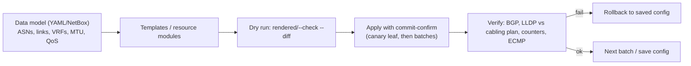

# 4.16 Ansible for containers, cloud and network devices

| | |
|---|---|
| Level | Intermediate |
| Priority tier | 1 |
| Lab venue | ansible-core, Docker/Podman, kind; containerlab with FRR/Cumulus images; optional GCP/AWS/Azure sandbox |
| Part | Part 4: Automation and infrastructure as code |
| Status | Drafted, labs **untested** |

## Why this matters for AI infrastructure

An AI platform is not just Linux servers. It is container runtimes and Kubernetes clusters, cloud projects with GPU quotas, VPCs and managed storage, and a fabric of Ethernet and InfiniBand switches. Ansible's reach beyond hosts, through modules that call APIs and drive network operating systems, lets one tool and one review process span all of them. It is also where Ansible's limits show: for cloud resources with lifecycle and state, Terraform is the better tool (4.18); for in-cluster workloads, Helm and GitOps are (4.26). Knowing which tool to use at each layer, and how to use Ansible well where it fits, is the practical skill.

## Prerequisites and outcomes

Needs 4.3 to 4.12; networking basics from Part 2 and Kubernetes basics (Part 5 will deepen them). After this chapter you can:

- Manage Docker/Podman containers, images, networks, volumes and Compose stacks with `community.docker`/`containers.podman`.
- Drive Kubernetes with `kubernetes.core` (apply manifests, Helm, wait conditions, facts) and know when to prefer GitOps.
- Provision and inventory cloud resources with `amazon.aws`, `google.cloud`, `azure.azcollection`, and decide between Ansible and Terraform.
- Automate network devices: connection types (`network_cli`, `netconf`, `httpapi`, `ansible.netcommon`), platform collections, resource modules, templates, `config` modules with backup/diff/rollback, validation and idempotency.
- Automate NVIDIA switches (Cumulus Linux/NVUE, Spectrum, Quantum/UFM touchpoints) and generate leaf-spine configuration from a data model.
- Apply safe-change patterns to network automation (dry run, candidate/commit-confirm, canary, verify).

## 1. Containers

### Docker and Podman

```yaml
- name: Container host prerequisites
  hosts: gpu
  become: true
  tasks:
    - name: Ensure Docker is installed and running
      ansible.builtin.package: { name: docker.io, state: present }
    - ansible.builtin.service: { name: docker, state: started, enabled: true }

    - name: Pull an image by digest
      community.docker.docker_image:
        name: nvcr.io/nvidia/pytorch
        tag: "24.06-py3"
        source: pull
      environment: { DOCKER_CONFIG: /root/.docker }       # credentials for nvcr.io set up separately (docker_login)

    - name: Run a GPU container (requires NVIDIA Container Toolkit)
      community.docker.docker_container:
        name: dcgm-exporter
        image: nvcr.io/nvidia/k8s/dcgm-exporter:3.3.5-3.4.1-ubuntu22.04
        state: started
        restart_policy: unless-stopped
        device_requests:
          - driver: nvidia
            count: -1
            capabilities: [[gpu]]
        published_ports: ["9400:9400"]
        cap_add: [SYS_ADMIN]
        healthcheck:
          test: ["CMD-SHELL", "curl -sf http://localhost:9400/metrics >/dev/null"]
          interval: 30s
```

Key modules: `docker_image` (build/pull/push/archive), `docker_container` (declarative container state; idempotent on its configuration, `recreate`, `comparisons`), `docker_container_exec`, `docker_network`, `docker_volume`, `docker_login`, `docker_compose_v2` (apply Compose files), `docker_prune`, `docker_host_info`. Podman equivalents live in `containers.podman` (rootless, Quadlet systemd units). Notes: image tags are mutable (pin digests, 4.2); container modules compare the desired configuration to the running container and recreate on difference, so a changed environment variable restarts the service; secrets belong in files with restricted modes or the orchestrator, not `env:` in playbooks (4.12). Docker Compose or Quadlet-managed systemd units are reasonable for single-node services; for fleets use Kubernetes.

Build images with Ansible only for small tooling; real image builds belong in CI with Dockerfiles/BuildKit (and Ansible used as a Packer/provisioner when baking VM images, 4.2).

### Kubernetes

The `kubernetes.core` collection talks to the Kubernetes API using a kubeconfig or in-cluster credentials (requires the `kubernetes` Python library on the controller or EE).

```yaml
- name: Platform namespaces and quotas
  hosts: localhost
  connection: local
  gather_facts: false
  collections: [kubernetes.core]
  tasks:
    - name: Namespace for training jobs
      kubernetes.core.k8s:
        state: present
        definition:
          apiVersion: v1
          kind: Namespace
          metadata: { name: training, labels: { team: ml-platform } }

    - name: Apply a rendered manifest (Jinja template)
      kubernetes.core.k8s:
        state: present
        template: manifests/resourcequota.yaml.j2
        namespace: training
        wait: true
        wait_timeout: 120

    - name: Install the GPU Operator via Helm
      kubernetes.core.helm:
        name: gpu-operator
        chart_ref: gpu-operator
        chart_repo_url: https://helm.ngc.nvidia.com/nvidia
        chart_version: "v24.6.0"
        release_namespace: gpu-operator
        create_namespace: true
        values:
          driver: { enabled: false }          # driver preinstalled on the host image
        wait: true
        timeout: 15m

    - name: Wait for all GPU nodes to advertise GPUs
      kubernetes.core.k8s_info:
        kind: Node
        label_selectors: ["nvidia.com/gpu.present=true"]
      register: gpu_nodes
      until: gpu_nodes.resources | length >= expected_gpu_nodes
      retries: 30
      delay: 20
```

Modules: `k8s` (apply/delete any resource; `apply: true` for server-side apply semantics, `validate`, `wait`), `k8s_info`, `k8s_exec`, `k8s_log`, `k8s_scale`, `k8s_drain`, `k8s_taint`, `helm`, `helm_info`, `helm_repository`, `helm_template`, `k8s_cluster_info`. Inventory plugin `kubernetes.core.k8s` builds inventory from pods/nodes; connection plugin `kubernetes.core.kubectl` runs modules inside pods.

Guidance:

- **Declarative state in Git, reconciled by controllers** (Argo CD/Flux, 4.26) beats imperative `k8s` applies in playbooks for ongoing workloads. Use Ansible for the layer *around* the cluster: node preparation, cluster bootstrap (Kubespray, kubeadm), initial platform installs (CNI, GPU Operator, Argo CD itself), certificate and kubeconfig distribution, and day-2 node operations (cordon/drain/upgrade).
- Use `wait` conditions and `k8s_info` polling rather than sleeps; set timeouts.
- Template manifests with Jinja only for environment values; complex logic belongs in Helm/Kustomize.
- Mind kubeconfig credentials (short-lived, per-environment, RBAC-scoped service accounts), and `validate_certs`.
- Kubespray (Ansible-based Kubernetes installer) and NVIDIA DeepOps provide production-grade playbooks; pin versions and review them (Part 5).

## 2. Cloud

### What Ansible does well in the cloud

- **Dynamic inventory** from cloud APIs (4.5) to configure instances regardless of how they were created.
- **Day-2 operations** on existing resources: snapshot, tag, resize, start/stop, rotate secrets, manage IAM bindings, run SSM/OS Login commands.
- **Orchestration glue**: call Terraform (`cloud.terraform.terraform`), then configure the resulting hosts in the same pipeline (`add_host`), or run post-provision steps.
- **One-off or small-scale provisioning**: quick lab setups, bootstrap of a seed environment.

### What Terraform does better

Declarative, **stateful** lifecycle management of resources with dependency graphs, plan/diff before apply, drift detection and clean destroy (4.18 to 4.25). Ansible cloud modules are idempotent per call but keep **no state of the whole environment**: removing a task does not delete the resource, ordering and dependencies are your responsibility, there is no plan of the total diff, and cleanup is manual. Rule of thumb: **Terraform creates the infrastructure; Ansible configures what runs on it and performs operational actions.** Use `cloud.terraform` or CI to compose them.

### Modules and collections

| Cloud | Collection | Highlights |
|---|---|---|
| AWS | `amazon.aws`, `community.aws` | `ec2_instance`, `ec2_vpc_*`, `s3_bucket`, `iam_*`, `ssm_*` (Systems Manager connection), `aws_ssm` lookups, EC2 inventory plugin, `cloudformation` |
| GCP | `google.cloud` | `gcp_compute_instance`, `gcp_compute_network`, `gcp_storage_bucket`, `gcp_secret_manager`, inventory `gcp_compute`, OS Login/IAP tunnelling via SSH args |
| Azure | `azure.azcollection` | `azure_rm_virtualmachine`, `azure_rm_virtualnetwork`, `azure_rm_resourcegroup`, inventory plugin `azure_rm` |
| Others | `openstack.cloud`, `community.vmware`, `oracle.oci`, `hetzner`, `linode`, `digital_ocean`, Nebius via CLI/Terraform provider, `kubevirt.core` | |

Authentication: workload identity or instance profiles, environment-based credentials in AAP/CI via OIDC (4.2, 4.12), never keys in playbooks. Python SDKs (`boto3`, `google-auth`, `azure-mgmt-*`) must be present in the controller or EE.

```yaml
- name: Ensure a labelled GPU VM exists (GCP, lab-scale)
  hosts: localhost
  connection: local
  gather_facts: false
  vars:
    project: my-ai-lab
    zone: us-central1-a
  tasks:
    - name: Instance
      google.cloud.gcp_compute_instance:
        name: gpu-lab-01
        machine_type: a2-highgpu-1g
        zone: "{{ zone }}"
        project: "{{ project }}"
        auth_kind: application
        disks:
          - auto_delete: true
            boot: true
            initialize_params:
              source_image: projects/ubuntu-os-cloud/global/images/family/ubuntu-2204-lts
              disk_size_gb: 200
        guest_accelerators:
          - accelerator_type: "projects/{{ project }}/zones/{{ zone }}/acceleratorTypes/nvidia-tesla-a100"
            accelerator_count: 1
        scheduling: { on_host_maintenance: TERMINATE }
        labels: { env: lab, role: gpu }
        network_interfaces:
          - network: { selfLink: "projects/{{ project }}/global/networks/default" }
        state: present
      register: vm
    - name: Add to in-memory inventory for the next play
      ansible.builtin.add_host:
        name: gpu-lab-01
        ansible_host: "{{ vm.networkInterfaces[0].networkIP }}"
        groups: [gpu]
```

(Parameters and machine type/accelerator combinations vary; verify with the module documentation and your quotas. GPU shapes such as A3/A4 use different machine families and may have constraints on images and drivers.)

### Cost and quota safety

Cloud automation can spend money quickly: attach budgets and alerts, require tags (`owner`, `ttl`), implement reapers for lab resources, restrict who can run provisioning, and use policy checks in the pipeline (4.2, e.g. maximum GPU count). Capacity for GPUs is often constrained; make provisioning idempotent and failure-aware (partial fleets), and prefer Terraform plans for review.

## 3. Network devices

### How network automation differs

Network operating systems often cannot run Python or arbitrary modules. Ansible therefore runs network modules **on the controller**, connecting to the device over a CLI session (`network_cli`), NETCONF (`netconf`), a REST/JSON API (`httpapi`), or a vendor library, and translating state into commands or RPCs. Differences from server automation:

- `ansible_connection` is not `ssh`: set `ansible_network_os` (`arista.eos.eos`, `cisco.nxos.nxos`, `cisco.ios.ios`, `junipernetworks.junos.junos`, `nvidia.nvue.nvue`, `dellemc.os10.os10`, `vyos.vyos.vyos`, `community.network.*`), and `ansible_connection` (`ansible.netcommon.network_cli`, `ansible.netcommon.netconf`, `ansible.netcommon.httpapi`).
- Modules run locally, so there is no per-device Python requirement; **forks** apply to concurrent sessions; many devices limit simultaneous VTY sessions.
- The device holds the truth; there is a **candidate vs running** distinction on some platforms (Junos, IOS-XR, NX-OS checkpoints, EOS sessions, NVUE pending/apply).
- Idempotency is per module: **resource modules** (`*_interfaces`, `*_vlans`, `*_bgp_global`, `*_acls`) work from structured data and compare it with the device; **config modules** (`*_config`) diff text lines; **command modules** (`*_command`) just run commands (not idempotent).

```yaml
# inventory
all:
  children:
    leaf:
      hosts:
        leaf01: { ansible_host: 10.0.0.11 }
        leaf02: { ansible_host: 10.0.0.12 }
    spine:
      hosts:
        spine01: { ansible_host: 10.0.0.1 }
  vars:
    ansible_connection: ansible.netcommon.network_cli
    ansible_network_os: arista.eos.eos
    ansible_user: automation
    ansible_password: "{{ vault_net_password }}"
    ansible_become: true
    ansible_become_method: enable
```

### Patterns

**1. Collect facts and backup first**

```yaml
- name: Gather facts and back up configuration
  hosts: leaf:spine
  gather_facts: false
  tasks:
    - arista.eos.eos_facts: { gather_subset: [min], gather_network_resources: [interfaces, bgp_global] }
    - arista.eos.eos_config:
        backup: true
        backup_options: { dir: "backups/{{ inventory_hostname }}", filename: "{{ inventory_hostname }}-{{ lookup('pipe','date +%F-%H%M') }}.cfg" }
```

**2. Declare state with resource modules**

```yaml
- name: Interfaces and VLANs from data
  hosts: leaf
  gather_facts: false
  tasks:
    - arista.eos.eos_vlans:
        config: "{{ vlans }}"             # list of {vlan_id, name, state}
        state: merged                     # merged, replaced, overridden, deleted, gathered, rendered, parsed
      register: r
    - arista.eos.eos_bgp_global:
        config:
          as_number: "{{ bgp_asn }}"
          router_id: "{{ router_id }}"
          neighbor: "{{ bgp_neighbors }}"
        state: replaced
```

Resource-module states: `merged` (add/update), `replaced` (replace given resources), `overridden` (replace everything of this type), `deleted`, `gathered` (read device into structured data), `rendered` (produce commands offline), `parsed` (parse a config text into data). `rendered` and `parsed` allow testing without a device. Compare the vendor module's `before`, `after` and `commands` return keys with `--diff`/`--check` to see intended changes.

**3. Template full or partial config with Jinja2**

```jinja
{# leaf.cfg.j2 #}
hostname {{ inventory_hostname }}

interface {{ ifc.name }}
   description to-{{ ifc.peer }}
   no switchport
   ip address {{ ifc.ip }}
   mtu 9214

router bgp {{ bgp_asn }}
   router-id {{ router_id }}
   maximum-paths 64 ecmp 64

   neighbor {{ n.ip }} remote-as {{ n.asn }}
   neighbor {{ n.ip }} send-community extended

```

```yaml
- arista.eos.eos_config:
    src: leaf.cfg.j2
    replace: config                 # or line/block; check semantics for your platform
    diff_against: running
  check_mode: false
  diff: true
```

**4. Safe change**

- **Dry-run**: `--check --diff` with config modules shows the lines that would change; `rendered` for resource modules.
- **Commit-confirm / rollback**: use platform features: Junos `commit confirmed`, IOS-XR commit label/rollback, EOS configuration sessions with `commit timer`, NVUE `nv config apply --confirm`, NX-OS checkpoints (`checkpoint`/`rollback running-config`). Wrap the change in a block with a post-change verification and revert on failure.
- **Canary and batches**: `serial: 1` for the first leaf, verify BGP/ECMP and link state, then roll to the rest; never touch both ends of a redundant pair simultaneously (MLAG/vPC peers, spine pairs).
- **Verification**: assert protocol state with `*_command` + `parse` filters (`ansible.utils.cli_parse` with TextFSM/ntc-templates/pyATS/genie), `*_facts`, `assert` on neighbour counts, route counts, interface speeds, error counters, LLDP neighbours versus the cabling plan.
- **Source of truth**: generate variables from NetBox/Nautobot or a YAML data model; do not hand-edit per-device vars.

```yaml
- name: Verify BGP sessions are established after change
  arista.eos.eos_command: { commands: ["show ip bgp summary | json"] }
  register: bgp
  until: (bgp.stdout[0].vrfs.default.peers.values() | selectattr('peerState','equalto','Established') | list | length) == expected_peers
  retries: 12
  delay: 10
```

**5. Parse and compare**: `ansible.utils.cli_parse` converts CLI text to structured data using a parser (TextFSM, ttp, pyATS, xmltodict, json); `ansible.utils.validate` checks data against JSON Schema; `ansible.utils.fact_diff` compares before/after; `ansible.utils.update_fact` and `ipaddr` utilities help with addressing plans.

### NETCONF and RESTCONF/gNMI

Platforms with NETCONF support (Junos, IOS-XE, IOS-XR, NX-OS) can be driven by `ansible.netcommon.netconf_config`, `netconf_get`, `netconf_rpc` with XML payloads from templates; YANG-modelled configuration is covered in 2.28. Ansible has no native gNMI module (use Python libraries or telemetry tooling for streaming); gNMI/OpenConfig are better driven from Python (pygnmi) or dedicated tools. `httpapi` connections (EOS eAPI, NX-API, Fortinet, F5, Palo Alto) call JSON APIs through plugin-handled auth/sessions.

### NVIDIA networking

- **Cumulus Linux** is a Linux distribution: both Ansible-as-a-Linux-host (standard modules, files like `/etc/frr/frr.conf`, `/etc/network/interfaces` via ifupdown2) and **NVUE** (`nv set ...; nv config apply`) work. The `nvidia.nvue` collection provides modules (`nvidia.nvue.config`, `nvidia.nvue.command`) that apply declarative NVUE configuration (YAML/JSON dictionaries or `set` commands) with `nv config diff`, `apply`, `save`, rollback and confirm timers.

```yaml
- hosts: leaf
  gather_facts: false
  tasks:
    - name: Apply fabric config with NVUE
      nvidia.nvue.config:
        set:
          system: { hostname: "{{ inventory_hostname }}" }
          interface:
            swp1-32: { type: swp, link: { mtu: 9216 } }
          router:
            bgp:
              enable: on
              autonomous-system: "{{ bgp_asn }}"
              router-id: "{{ router_id }}"
          vrf:
            default:
              router:
                bgp:
                  address-family: { ipv4-unicast: { enable: on } }
                  neighbor: "{{ bgp_unnumbered_neighbors }}"      # BGP unnumbered, RFC 7938 style (2.16)
        apply: true
      # module options vary by version; check ansible-doc nvidia.nvue.config
```

- **Spectrum-X / Spectrum switches (Cumulus/SONiC)**, **Quantum InfiniBand switches (MLNX-OS / ONYX)**, and **UFM**: automation surfaces include NVUE/REST for Ethernet, MLNX-OS CLI/JSON-RPC for InfiniBand switches (`community.network` historic `onyx_*` modules; verify support status), and **UFM REST API** for fabric management, partition keys, topology and telemetry (call via `ansible.builtin.uri`). SONiC exposes config_db via `sonic-cfggen`/gNMI/REST; modules exist in community collections.
- **BlueField DPUs / ConnectX NICs** are Linux hosts: configure `mlxconfig`/`mlxfwmanager`/`mst`, `rshim`, DOCA services and OVS via standard modules and commands (Part 9 and 12).
- **Design for the fabric**: leaf-spine addressing, BGP unnumbered, ECMP, MTU 9216, PFC/ECN/RoCE QoS and adaptive routing settings (2.16 to 2.19, Part 12) become **variables** (`fabric.yml` data model) rendered into per-switch config, with validation tasks comparing LLDP neighbours to the intended cabling and checking link speeds (400G/800G), error counters and ECMP path counts.



### Network-specific pitfalls

- Sessions and timeouts: `ansible_command_timeout`, `ansible_connect_timeout`, `persistent_command_timeout`; large configs and slow devices need higher values; `network_cli` uses a persistent connection process that can go stale (`meta: reset_connection`).
- Idempotency of `*_config` with `lines:` depends on exact string match and device normalisation (abbreviated commands, ordering); prefer resource modules or `src` templates with `diff_against`.
- Privilege levels and prompts: `ansible_become: yes`, `ansible_become_method: enable`, terminal settings (`terminal_length 0`), banners.
- Credentials are device-local or via TACACS+/RADIUS: manage with Vault/secret managers (4.12), per-user accounts for auditability, and rotate.
- Out-of-band access: always keep a console/OOB path; network changes can cut the branch you sit on. Use commit-confirm or a scheduled `reload in` safety net.
- Test with virtual devices (containerlab, vendor virtual images, Cumulus VX, FRR) in CI, and keep golden configs for diffing (4.13).

## 4. Choosing the right tool at each layer

| Layer | Preferred | Ansible's role |
|---|---|---|
| Cloud accounts, VPCs, GPU VMs, managed services | Terraform/OpenTofu (4.18+) | Post-provision config, operational actions, dynamic inventory |
| OS, drivers, runtimes, agents on nodes | Ansible (and images) | Primary tool |
| Kubernetes cluster install | Kubespray/kubeadm/managed service via Terraform | Bootstrap and node ops |
| Kubernetes workloads | Helm + GitOps (4.26) | Initial platform install only |
| Network fabric | Source of truth + Ansible/NVUE or vendor controller; Terraform providers where mature | Config rendering, verification |
| BMCs and hardware | Redfish modules (Part 7), vendor tools | Provisioning/firmware workflows |
| Secrets | Vault/secret manager | Retrieval |

## 5. Lab (untested)

1. **Docker**: run a container with `docker_container`, change an env var and observe recreation; build a Compose-style stack with `docker_compose_v2`; pin an image by digest; remove with `state: absent`.
2. **kind + Kubernetes modules**: create a kind cluster; apply a namespace, quota and deployment with `kubernetes.core.k8s`; use `wait`; install a small Helm chart with `kubernetes.core.helm`; query with `k8s_info`; compare with applying the same manifests via Argo CD (4.26).
3. **Node drain**: write a play that cordons/drains a kind node with `k8s_drain`, runs a command on the node container, uncordons, and verifies Ready.
4. **Cloud inventory**: configure the GCP or AWS inventory plugin with keyed groups; run `ansible -m ping` through IAP/SSM; compare to a Terraform-created fleet.
5. **Provision then configure**: create a VM with a module (or Terraform), `add_host`, and run a baseline play in the same playbook; destroy it; note what Ansible does not clean up.
6. **Network lab**: build a containerlab topology (two spines, four leaves with FRR or Cumulus VX); define the data model in YAML; render configs with Jinja2 and apply with the platform module or NVUE; verify BGP and LLDP.
7. **Resource modules**: use `rendered`, `gathered`, `merged`, `replaced` on VLANs/interfaces against a virtual device; inspect `before/after/commands`.
8. **Safe change**: implement commit-confirm (or a timed reload) around a deliberately wrong MTU change; show automatic rollback when verification fails.
9. **Parse and assert**: run `show` commands, parse with `cli_parse`, assert neighbour state and counts; write a failure case.
10. **Backup and drift**: back up configs nightly; compare to the intended render; report drift.
11. **Fabric validation**: compare LLDP-learned neighbours to a cabling plan YAML and fail on mismatches.
12. **Clean up** clusters, VMs and labs.

Mark tested only after execution.

## 6. Common mistakes

- Managing cloud lifecycles with imperative Ansible tasks and no state; leaving orphaned resources.
- Using Ansible `k8s` applies for application workloads that GitOps should own; no waits or verification.
- Mutable image tags; secrets in container env definitions.
- Network automation without backups, dry-run, commit-confirm or out-of-band access.
- Pushing changes to both members of a redundant pair at once; no canary.
- Using `*_command`/`*_config` with fragile line matching where resource modules exist.
- Hand-maintained per-device variables instead of a source of truth.
- Not raising command timeouts; stale persistent connections.
- Mixing credentials: shared device accounts, passwords in plaintext inventory.
- Ignoring cost controls when automating GPU provisioning.

## 7. Interview angles

- "When do you use Ansible vs Terraform for cloud?" (stateless operations/config vs stateful lifecycle.)
- "How do you automate a leaf-spine fabric safely?" (data model, templates/resource modules, dry-run, commit-confirm, canary, verification, rollback.)
- "How does Ansible manage network devices that cannot run Python?" (controller-side modules, network_cli/netconf/httpapi.)
- "What are resource module states?" 
- "How do you manage Kubernetes with Ansible, and when not to?" 
- "How would you validate that the physical cabling matches the design?" (LLDP vs plan.)
- "How do you automate NVIDIA Spectrum/Cumulus switches?" (NVUE, FRR, BGP unnumbered.)

## 8. Checkpoint questions (30)

1. Which collection manages Docker? **A:** `community.docker`.
2. What does `docker_container` do when config changes? **A:** Recreates the container.
3. Why pin images by digest? **A:** Mutable tags.
4. Collection for Kubernetes? **A:** `kubernetes.core`.
5. Module for Helm? **A:** `kubernetes.core.helm`.
6. Module to wait/inspect resources? **A:** `k8s_info` with retries/`wait`.
7. When prefer GitOps over `k8s` apply? **A:** Ongoing workloads.
8. Main reason for Terraform in cloud? **A:** Stateful lifecycle and plan.
9. Ansible's cloud strengths? **A:** Inventory, day-2 ops, glue.
10. How authenticate CI to cloud? **A:** OIDC/workload identity.
11. How do network modules run? **A:** On the controller via network_cli/netconf/httpapi.
12. Which variable selects NOS? **A:** `ansible_network_os`.
13. What are resource modules? **A:** Structured-state modules (merged/replaced/etc.).
14. Meaning of `replaced` vs `overridden`? **A:** Replace given resources vs replace all of the type.
15. What does `rendered` do? **A:** Produces commands offline.
16. What does `parsed` do? **A:** Converts config text to structured data.
17. What does `gathered` do? **A:** Reads device state into data.
18. Config module idempotency basis? **A:** Line/diff matching.
19. How back up configs? **A:** `backup: true` on config modules.
20. What is commit-confirm? **A:** Auto-rollback unless confirmed.
21. Why canary one leaf? **A:** Limit blast radius.
22. Why not change both MLAG peers at once? **A:** Outage risk.
23. Tool to parse CLI output? **A:** `ansible.utils.cli_parse` (TextFSM/ttp/pyATS).
24. NVIDIA collection for NVUE? **A:** `nvidia.nvue`.
25. What is NVUE? **A:** Cumulus's declarative CLI/API (`nv set/apply`).
26. What replaces cabling verification manually? **A:** LLDP vs plan validation.
27. Where is UFM API called from? **A:** `uri` module/REST.
28. What stale-connection fix exists? **A:** `meta: reset_connection`.
29. Why keep OOB access? **A:** Recover from lockouts.
30. What belongs in a data model? **A:** ASNs, links, VRFs, MTU, QoS, VLANs.

## 9. Sources and review notes

**Written in original words.** Principal sources:

- Rene Moser and Lorin Hochstein, *Ansible: Up and Running*, 3rd edition (chapters on Docker, Amazon EC2 and cloud provisioning, Ansible with Kubernetes-like tooling, network device automation and related integrations).
- Jason Edelman, Scott Lowe and Matt Oswalt, *Network Programmability and Automation* (chapter 12 on Ansible for network automation).
- The author's `nvidia-devops` repository, volume 10 chapter 4 (Ansible for infrastructure automation in AI factories).
- Collection documentation: `community.docker`, `kubernetes.core`, `amazon.aws`, `google.cloud`, `azure.azcollection`, `ansible.netcommon`, `ansible.utils`, vendor network collections and `nvidia.nvue`.
- Examples are the author's constructions.

**Flagged for verification before publishing:** GPU machine type and accelerator combinations in the cloud example, NVUE module option names and structure for the collection version used, status of `community.network` ONYX modules, dcgm-exporter image tag, Helm chart versions, resource-module availability per platform, and every code listing; all labs are **untested**.
