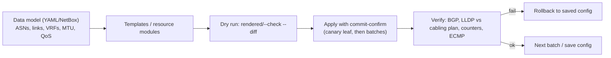

# 4.16 Ansible for containers, cloud and network devices

| | |
|---|---|
| Level | Intermediate |
| Priority tier | 1 |
| Lab venue | ansible-core, Docker/Podman, kind; containerlab with FRR/Cumulus images; optional GCP/AWS/Azure sandbox |
| Part | Part 4: Automation and infrastructure as code |
| Status | Drafted, labs **untested** |

## Why this matters for AI infrastructure

An AI platform is not just Linux servers. It is container runtimes and Kubernetes clusters, cloud projects with GPU quotas, VPCs and managed storage, and a fabric of Ethernet and InfiniBand switches. Ansible's reach beyond hosts, through modules that call APIs and drive network operating systems, lets one tool and one review process span all of them. It is also where Ansible's limits show: for cloud resources with lifecycle and state, Terraform is the better tool (4.18); for in-cluster workloads, Helm and GitOps are (4.26). Knowing which tool to use at each layer, and how to use Ansible well where it fits, is the practical skill.

## Prerequisites and outcomes

Needs 4.3 to 4.12; networking basics from Part 2 and Kubernetes basics (Part 5 will deepen them). After this chapter you can:

- Manage Docker/Podman containers, images, networks, volumes and Compose stacks with `community.docker`/`containers.podman`.
- Drive Kubernetes with `kubernetes.core` (apply manifests, Helm, wait conditions, facts) and know when to prefer GitOps.
- Provision and inventory cloud resources with `amazon.aws`, `google.cloud`, `azure.azcollection`, and decide between Ansible and Terraform.
- Automate network devices: connection types (`network_cli`, `netconf`, `httpapi`, `ansible.netcommon`), platform collections, resource modules, templates, `config` modules with backup/diff/rollback, validation and idempotency.
- Automate NVIDIA switches (Cumulus Linux/NVUE, Spectrum, Quantum/UFM touchpoints) and generate leaf-spine configuration from a data model.
- Apply safe-change patterns to network automation (dry run, candidate/commit-confirm, canary, verify).

## 1. Containers

### Docker and Podman

```yaml
- name: Container host prerequisites
  hosts: gpu
  become: true
  tasks:
    - name: Ensure Docker is installed and running
      ansible.builtin.package: { name: docker.io, state: present }
    - ansible.builtin.service: { name: docker, state: started, enabled: true }

    - name: Pull an image by digest
      community.docker.docker_image:
        name: nvcr.io/nvidia/pytorch
        tag: "24.06-py3"
        source: pull
      environment: { DOCKER_CONFIG: /root/.docker }       # credentials for nvcr.io set up separately (docker_login)

    - name: Run a GPU container (requires NVIDIA Container Toolkit)
      community.docker.docker_container:
        name: dcgm-exporter
        image: nvcr.io/nvidia/k8s/dcgm-exporter:3.3.5-3.4.1-ubuntu22.04
        state: started
        restart_policy: unless-stopped
        device_requests:
          - driver: nvidia
            count: -1
            capabilities: [[gpu]]
        published_ports: ["9400:9400"]
        cap_add: [SYS_ADMIN]
        healthcheck:
          test: ["CMD-SHELL", "curl -sf http://localhost:9400/metrics >/dev/null"]
          interval: 30s
```

Key modules: `docker_image` (build/pull/push/archive), `docker_container` (declarative container state; idempotent on its configuration, `recreate`, `comparisons`), `docker_container_exec`, `docker_network`, `docker_volume`, `docker_login`, `docker_compose_v2` (apply Compose files), `docker_prune`, `docker_host_info`. Podman equivalents live in `containers.podman` (rootless, Quadlet systemd units). Notes: image tags are mutable (pin digests, 4.2); container modules compare the desired configuration to the running container and recreate on difference, so a changed environment variable restarts the service; secrets belong in files with restricted modes or the orchestrator, not `env:` in playbooks (4.12). Docker Compose or Quadlet-managed systemd units are reasonable for single-node services; for fleets use Kubernetes.

Build images with Ansible only for small tooling; real image builds belong in CI with Dockerfiles/BuildKit (and Ansible used as a Packer/provisioner when baking VM images, 4.2).

In *Ansible: Up and Running* Chapters 13 and 16, the authors show two complementary ways Ansible interacts with containers and machine images:
- **Managing Docker images, registries, networks, and multi-container stacks via the Docker Remote API (`AUR` Chapter 13 `Examples 13-1` to `13-11`):** Ansible's `docker_*` modules talk to the Docker daemon (`DOCKER_HOST`, default `unix://var/run/docker.sock`, or remote TLS socket with `DOCKER_CERT_PATH` and `DOCKER_TLS_VERIFY`). `docker_image_info` inspects an image's metadata (`ghost.images[0].Config.ExposedPorts.keys()` -> `2368/tcp`, `ghost.images[0].Config.Volumes.keys()` -> `/var/lib/ghost`); `docker_image` builds (`build: { path: ./nginx }, source: build, force_source: true`) or pushes (`push: true`) after `docker_login`; `docker_network` creates a bridge network (`ghostnet`) so the `nginx_ghost` frontend container can reverse-proxy to `http://ghost:2368` by container name; and `docker_container` starts the `ghost` application container wired to an external MySQL database host (`PyMySQL`, `mysql_db`, `mysql_user`).
- **Baking VM and Container Images with HashiCorp Packer + Ansible Provisioner (`AUR` Chapter 16 `Examples 16-1` to `16-7`):** While a `Dockerfile` is fine for simple containers, building golden VM images across **Vagrant/VirtualBox (`rhel8.pkr.hcl` with Kickstart `ks.cfg`), Google Cloud (`gcp.pkr.hcl`), Azure (`azure.pkr.hcl`), and Amazon EC2 (`aws.pkr.hcl`)**—or complex multi-role Docker images such as compiling `GCC 11.2.0` (`gcc.pkr.hcl` running `dockpack.base_gcc`, `compile_gcc`, `base_cmake`, `base_boost`)—is much cleaner when **Packer (`packer build`)** handles the hypervisor/cloud builder and invokes **`provisioner "ansible"`** (`playbook_file = "./playbooks/packer-playbook.yml"`) to apply your existing hardened Ansible roles (`common`, `epel`, `ansible-auditd`, `nettime`, `sshd`, `rhel8-stig`).

### Kubernetes

The `kubernetes.core` collection talks to the Kubernetes API using a kubeconfig or in-cluster credentials (requires the `kubernetes` Python library on the controller or EE).

```yaml
- name: Platform namespaces and quotas
  hosts: localhost
  connection: local
  gather_facts: false
  collections: [kubernetes.core]
  tasks:
    - name: Namespace for training jobs
      kubernetes.core.k8s:
        state: present
        definition:
          apiVersion: v1
          kind: Namespace
          metadata: { name: training, labels: { team: ml-platform } }

    - name: Apply a rendered manifest (Jinja template)
      kubernetes.core.k8s:
        state: present
        template: manifests/resourcequota.yaml.j2
        namespace: training
        wait: true
        wait_timeout: 120

    - name: Install the GPU Operator via Helm
      kubernetes.core.helm:
        name: gpu-operator
        chart_ref: gpu-operator
        chart_repo_url: https://helm.ngc.nvidia.com/nvidia
        chart_version: "v24.6.0"
        release_namespace: gpu-operator
        create_namespace: true
        values:
          driver: { enabled: false }          # driver preinstalled on the host image
        wait: true
        timeout: 15m

    - name: Wait for all GPU nodes to advertise GPUs
      kubernetes.core.k8s_info:
        kind: Node
        label_selectors: ["nvidia.com/gpu.present=true"]
      register: gpu_nodes
      until: gpu_nodes.resources | length >= expected_gpu_nodes
      retries: 30
      delay: 20
```

Modules: `k8s` (apply/delete any resource; `apply: true` for server-side apply semantics, `validate`, `wait`), `k8s_info`, `k8s_exec`, `k8s_log`, `k8s_scale`, `k8s_drain`, `k8s_taint`, `helm`, `helm_info`, `helm_repository`, `helm_template`, `k8s_cluster_info`. Inventory plugin `kubernetes.core.k8s` builds inventory from pods/nodes; connection plugin `kubernetes.core.kubectl` runs modules inside pods.

Guidance:

- **Declarative state in Git, reconciled by controllers** (Argo CD/Flux, 4.26) beats imperative `k8s` applies in playbooks for ongoing workloads. Use Ansible for the layer *around* the cluster: node preparation, cluster bootstrap (Kubespray, kubeadm), initial platform installs (CNI, GPU Operator, Argo CD itself), certificate and kubeconfig distribution, and day-2 node operations (cordon/drain/upgrade).
- Use `wait` conditions and `k8s_info` polling rather than sleeps; set timeouts.
- Template manifests with Jinja only for environment values; complex logic belongs in Helm/Kustomize.
- Mind kubeconfig credentials (short-lived, per-environment, RBAC-scoped service accounts), and `validate_certs`.
- Kubespray (Ansible-based Kubernetes installer) and NVIDIA DeepOps provide production-grade playbooks; pin versions and review them (Part 5).

## 2. Cloud

### What Ansible does well in the cloud

- **Dynamic inventory** from cloud APIs (4.5) to configure instances regardless of how they were created.
- **Day-2 operations** on existing resources: snapshot, tag, resize, start/stop, rotate secrets, manage IAM bindings, run SSM/OS Login commands.
- **Orchestration glue**: call Terraform (`cloud.terraform.terraform`), then configure the resulting hosts in the same pipeline (`add_host`), or run post-provision steps.
- **One-off or small-scale provisioning**: quick lab setups, bootstrap of a seed environment.

### What Terraform does better

Declarative, **stateful** lifecycle management of resources with dependency graphs, plan/diff before apply, drift detection and clean destroy (4.18 to 4.25). Ansible cloud modules are idempotent per call but keep **no state of the whole environment**: removing a task does not delete the resource, ordering and dependencies are your responsibility, there is no plan of the total diff, and cleanup is manual. Rule of thumb: **Terraform creates the infrastructure; Ansible configures what runs on it and performs operational actions.** Use `cloud.terraform` or CI to compose them.

### Modules and collections

| Cloud | Collection | Highlights |
|---|---|---|
| AWS | `amazon.aws`, `community.aws` | `ec2_instance`, `ec2_vpc_*`, `s3_bucket`, `iam_*`, `ssm_*` (Systems Manager connection), `aws_ssm` lookups, EC2 inventory plugin, `cloudformation` |
| GCP | `google.cloud` | `gcp_compute_instance`, `gcp_compute_network`, `gcp_storage_bucket`, `gcp_secret_manager`, inventory `gcp_compute`, OS Login/IAP tunnelling via SSH args |
| Azure | `azure.azcollection` | `azure_rm_virtualmachine`, `azure_rm_virtualnetwork`, `azure_rm_resourcegroup`, inventory plugin `azure_rm` |
| Others | `openstack.cloud`, `community.vmware`, `oracle.oci`, `hetzner`, `linode`, `digital_ocean`, Nebius via CLI/Terraform provider, `kubevirt.core` | |

Authentication: workload identity or instance profiles, environment-based credentials in AAP/CI via OIDC (4.2, 4.12), never keys in playbooks. Python SDKs (`boto3`, `google-auth`, `azure-mgmt-*`) must be present in the controller or EE.

```yaml
- name: Ensure a labelled GPU VM exists (GCP, lab-scale)
  hosts: localhost
  connection: local
  gather_facts: false
  vars:
    project: my-ai-lab
    zone: us-central1-a
  tasks:
    - name: Instance
      google.cloud.gcp_compute_instance:
        name: gpu-lab-01
        machine_type: a2-highgpu-1g
        zone: "{{ zone }}"
        project: "{{ project }}"
        auth_kind: application
        disks:
          - auto_delete: true
            boot: true
            initialize_params:
              source_image: projects/ubuntu-os-cloud/global/images/family/ubuntu-2204-lts
              disk_size_gb: 200
        guest_accelerators:
          - accelerator_type: "projects/{{ project }}/zones/{{ zone }}/acceleratorTypes/nvidia-tesla-a100"
            accelerator_count: 1
        scheduling: { on_host_maintenance: TERMINATE }
        labels: { env: lab, role: gpu }
        network_interfaces:
          - network: { selfLink: "projects/{{ project }}/global/networks/default" }
        state: present
      register: vm
    - name: Add to in-memory inventory for the next play
      ansible.builtin.add_host:
        name: gpu-lab-01
        ansible_host: "{{ vm.networkInterfaces[0].networkIP }}"
        groups: [gpu]
```

(Parameters and machine type/accelerator combinations vary; verify with the module documentation and your quotas. GPU shapes such as A3/A4 use different machine families and may have constraints on images and drivers.)

### Cost and quota safety

Cloud automation can spend money quickly: attach budgets and alerts, require tags (`owner`, `ttl`), implement reapers for lab resources, restrict who can run provisioning, and use policy checks in the pipeline (4.2, e.g. maximum GPU count). Capacity for GPUs is often constrained; make provisioning idempotent and failure-aware (partial fleets), and prefer Terraform plans for review.

### AWS EC2 provisioning, AMI lookup, VPCs, and Windows hosts (`AUR` Chapters 12 & 17)

Two practical reference patterns from *Ansible: Up and Running* Chapters 12 and 17 round out host and cloud management:
1. **Dynamic AMI discovery, VPC/Security Group idempotence, and `aws_ec2` cache gotchas (`AUR` Chapter 17):**
   - *Finding the latest Ubuntu AMI (`ec2_ami_info`):* Rather than hardcoding a stale `ami-...` ID, query `amazon.aws.ec2_ami_info` (`owners: 099720109477` for Canonical, `filters: { name: "ubuntu/images/hvm-ssd/ubuntu-focal-20.04-amd64-server-*", state: available, architecture: x86_64 }`) and select the newest image via **`{{ ec2_ami_info.images | sort(attribute='creation_date') | last }}`** (tested in `code/part04/ansible_cloud_network_lab.py`).
   - *Idempotence keys across AWS VPC modules (`AUR` Chapter 17 Table 17-3):* Every `amazon.aws` VPC module determines idempotency differently: `ec2_vpc_net` checks `(name, cidr_block)`, `ec2_vpc_subnet` checks `(vpc_id, cidr)` (`10.0.0.0/24` web, `10.0.1.0/24` db), `ec2_vpc_igw` checks `vpc_id` (at most one Internet Gateway per VPC), `ec2_vpc_route_table` checks `(vpc_id, tags)` (with `lookup: tag`), and `ec2_group` checks `(name, description, rules)` (`from_port: 22, to_port: 22, cidr_ip: 203.0.113.0/24` using `TEST-NET-3`).
   - *Dynamic inventory cache warning:* When `cache: true` (`cache_plugin: jsonfile`, `cache_connection: /tmp/ansible_fact_cache`) is enabled on `aws_ec2.yml`, newly launched or terminated EC2 instances will **not** appear in `ansible-inventory` until the cache expires (`cache_timeout: 300`) or you delete the cache file / run `meta: refresh_inventory` (and you can alias ugly tag groups like `tag_type_web` to `web` using `[web:children]\ntag_type_web` in a static `inventory/hosts` file alongside `aws_ec2.yml`).
2. **Managing Windows hosts over WinRM (`AUR` Chapter 12):** When an enterprise environment includes Windows jump hosts, Active Directory controllers, or workstation nodes (`windows2022`), Ansible connects agentlessly over **WinRM (`ansible_connection: winrm`, port `5986` HTTPS / `5985` HTTP, `pip3 install pywinrm`, with Kerberos for AD or `ansible_winrm_server_cert_validation: ignore` in local labs)** and executes PowerShell-backed **`ansible.windows.*` / `community.windows.*`** modules: `win_ping`, `win_chocolatey` (installing `chocolatey`, `vscode`, `jdk8`), `win_stat`, `win_environment`, `win_path`, `win_feature` (`name: Web-Server, include_sub_features: true`), `win_reboot` (`when: win_iis_feature.reboot_required`), and `win_updates` (`category_names: [SecurityUpdates, CriticalUpdates, UpdateRollups], reboot: true`).

## 3. Network devices

### How network automation differs

Network operating systems often cannot run Python or arbitrary modules. Ansible therefore runs network modules **on the controller**, connecting to the device over a CLI session (`network_cli`), NETCONF (`netconf`), a REST/JSON API (`httpapi`), or a vendor library, and translating state into commands or RPCs. Differences from server automation:

- `ansible_connection` is not `ssh`: set `ansible_network_os` (`arista.eos.eos`, `cisco.nxos.nxos`, `cisco.ios.ios`, `junipernetworks.junos.junos`, `nvidia.nvue.nvue`, `dellemc.os10.os10`, `vyos.vyos.vyos`, `community.network.*`), and `ansible_connection` (`ansible.netcommon.network_cli`, `ansible.netcommon.netconf`, `ansible.netcommon.httpapi`).
- Modules run locally, so there is no per-device Python requirement; **forks** apply to concurrent sessions; many devices limit simultaneous VTY sessions.
- The device holds the truth; there is a **candidate vs running** distinction on some platforms (Junos, IOS-XR, NX-OS checkpoints, EOS sessions, NVUE pending/apply).
- Idempotency is per module: **resource modules** (`*_interfaces`, `*_vlans`, `*_bgp_global`, `*_acls`) work from structured data and compare it with the device; **config modules** (`*_config`) diff text lines; **command modules** (`*_command`) just run commands (not idempotent).

```yaml
# inventory
all:
  children:
    leaf:
      hosts:
        leaf01: { ansible_host: 10.0.0.11 }
        leaf02: { ansible_host: 10.0.0.12 }
    spine:
      hosts:
        spine01: { ansible_host: 10.0.0.1 }
  vars:
    ansible_connection: ansible.netcommon.network_cli
    ansible_network_os: arista.eos.eos
    ansible_user: automation
    ansible_password: "{{ vault_net_password }}"
    ansible_become: true
    ansible_become_method: enable
```

### Patterns

**1. Collect facts and backup first**

```yaml
- name: Gather facts and back up configuration
  hosts: leaf:spine
  gather_facts: false
  tasks:
    - arista.eos.eos_facts: { gather_subset: [min], gather_network_resources: [interfaces, bgp_global] }
    - arista.eos.eos_config:
        backup: true
        backup_options: { dir: "backups/{{ inventory_hostname }}", filename: "{{ inventory_hostname }}-{{ lookup('pipe','date +%F-%H%M') }}.cfg" }
```

**2. Declare state with resource modules**

```yaml
- name: Interfaces and VLANs from data
  hosts: leaf
  gather_facts: false
  tasks:
    - arista.eos.eos_vlans:
        config: "{{ vlans }}"             # list of {vlan_id, name, state}
        state: merged                     # merged, replaced, overridden, deleted, gathered, rendered, parsed
      register: r
    - arista.eos.eos_bgp_global:
        config:
          as_number: "{{ bgp_asn }}"
          router_id: "{{ router_id }}"
          neighbor: "{{ bgp_neighbors }}"
        state: replaced
```

Resource-module states: `merged` (add/update), `replaced` (replace given resources), `overridden` (replace everything of this type), `deleted`, `gathered` (read device into structured data), `rendered` (produce commands offline), `parsed` (parse a config text into data). `rendered` and `parsed` allow testing without a device. Compare the vendor module's `before`, `after` and `commands` return keys with `--diff`/`--check` to see intended changes.

**3. Template full or partial config with Jinja2**

```jinja
{# leaf.cfg.j2 #}
hostname {{ inventory_hostname }}

interface {{ ifc.name }}
   description to-{{ ifc.peer }}
   no switchport
   ip address {{ ifc.ip }}
   mtu 9214

router bgp {{ bgp_asn }}
   router-id {{ router_id }}
   maximum-paths 64 ecmp 64

   neighbor {{ n.ip }} remote-as {{ n.asn }}
   neighbor {{ n.ip }} send-community extended

```

```yaml
- arista.eos.eos_config:
    src: leaf.cfg.j2
    replace: config                 # or line/block; check semantics for your platform
    diff_against: running
  check_mode: false
  diff: true
```

**4. Safe change**

- **Dry-run**: `--check --diff` with config modules shows the lines that would change; `rendered` for resource modules.
- **Commit-confirm / rollback**: use platform features: Junos `commit confirmed`, IOS-XR commit label/rollback, EOS configuration sessions with `commit timer`, NVUE `nv config apply --confirm`, NX-OS checkpoints (`checkpoint`/`rollback running-config`). Wrap the change in a block with a post-change verification and revert on failure.
- **Canary and batches**: `serial: 1` for the first leaf, verify BGP/ECMP and link state, then roll to the rest; never touch both ends of a redundant pair simultaneously (MLAG/vPC peers, spine pairs).
- **Verification**: assert protocol state with `*_command` + `parse` filters (`ansible.utils.cli_parse` with TextFSM/ntc-templates/pyATS/genie), `*_facts`, `assert` on neighbour counts, route counts, interface speeds, error counters, LLDP neighbours versus the cabling plan.
- **Source of truth**: generate variables from NetBox/Nautobot or a YAML data model; do not hand-edit per-device vars.

```yaml
- name: Verify BGP sessions are established after change
  arista.eos.eos_command: { commands: ["show ip bgp summary | json"] }
  register: bgp
  until: (bgp.stdout[0].vrfs.default.peers.values() | selectattr('peerState','equalto','Established') | list | length) == expected_peers
  retries: 12
  delay: 10
```

**5. Parse and compare**: `ansible.utils.cli_parse` converts CLI text to structured data using a parser (TextFSM, ttp, pyATS, xmltodict, json); `ansible.utils.validate` checks data against JSON Schema; `ansible.utils.fact_diff` compares before/after; `ansible.utils.update_fact` and `ipaddr` utilities help with addressing plans.

### NETCONF and RESTCONF/gNMI

Platforms with NETCONF support (Junos, IOS-XE, IOS-XR, NX-OS) can be driven by `ansible.netcommon.netconf_config`, `netconf_get`, `netconf_rpc` with XML payloads from templates; YANG-modelled configuration is covered in 2.28. Ansible has no native gNMI module (use Python libraries or telemetry tooling for streaming); gNMI/OpenConfig are better driven from Python (pygnmi) or dedicated tools. `httpapi` connections (EOS eAPI, NX-API, Fortinet, F5, Palo Alto) call JSON APIs through plugin-handled auth/sessions.

### NVIDIA networking

- **Cumulus Linux** is a Linux distribution: both Ansible-as-a-Linux-host (standard modules, files like `/etc/frr/frr.conf`, `/etc/network/interfaces` via ifupdown2) and **NVUE** (`nv set ...; nv config apply`) work. The `nvidia.nvue` collection provides modules (`nvidia.nvue.config`, `nvidia.nvue.command`) that apply declarative NVUE configuration (YAML/JSON dictionaries or `set` commands) with `nv config diff`, `apply`, `save`, rollback and confirm timers.

```yaml
- hosts: leaf
  gather_facts: false
  tasks:
    - name: Apply fabric config with NVUE
      nvidia.nvue.config:
        set:
          system: { hostname: "{{ inventory_hostname }}" }
          interface:
            swp1-32: { type: swp, link: { mtu: 9216 } }
          router:
            bgp:
              enable: on
              autonomous-system: "{{ bgp_asn }}"
              router-id: "{{ router_id }}"
          vrf:
            default:
              router:
                bgp:
                  address-family: { ipv4-unicast: { enable: on } }
                  neighbor: "{{ bgp_unnumbered_neighbors }}"      # BGP unnumbered, RFC 7938 style (2.16)
        apply: true
      # module options vary by version; check ansible-doc nvidia.nvue.config
```

- **Spectrum-X / Spectrum switches (Cumulus/SONiC)**, **Quantum InfiniBand switches (MLNX-OS / ONYX)**, and **UFM**: automation surfaces include NVUE/REST for Ethernet, MLNX-OS CLI/JSON-RPC for InfiniBand switches (`community.network` historic `onyx_*` modules; verify support status), and **UFM REST API** for fabric management, partition keys, topology and telemetry (call via `ansible.builtin.uri`). SONiC exposes config_db via `sonic-cfggen`/gNMI/REST; modules exist in community collections.
- **BlueField DPUs / ConnectX NICs** are Linux hosts: configure `mlxconfig`/`mlxfwmanager`/`mst`, `rshim`, DOCA services and OVS via standard modules and commands (Part 9 and 12).
- **Design for the fabric**: leaf-spine addressing, BGP unnumbered, ECMP, MTU 9216, PFC/ECN/RoCE QoS and adaptive routing settings (2.16 to 2.19, Part 12) become **variables** (`fabric.yml` data model) rendered into per-switch config, with validation tasks comparing LLDP neighbours to the intended cabling and checking link speeds (400G/800G), error counters and ECMP path counts.



### Network-specific pitfalls

- Sessions and timeouts: `ansible_command_timeout`, `ansible_connect_timeout`, `persistent_command_timeout`; large configs and slow devices need higher values; `network_cli` uses a persistent connection process that can go stale (`meta: reset_connection`).
- Idempotency of `*_config` with `lines:` depends on exact string match and device normalisation (abbreviated commands, ordering); prefer resource modules or `src` templates with `diff_against`.
- Privilege levels and prompts: `ansible_become: yes`, `ansible_become_method: enable`, terminal settings (`terminal_length 0`), banners.
- Credentials are device-local or via TACACS+/RADIUS: manage with Vault/secret managers (4.12), per-user accounts for auditability, and rotate.
- Out-of-band access: always keep a console/OOB path; network changes can cut the branch you sit on. Use commit-confirm or a scheduled `reload in` safety net.
- Test with virtual devices (containerlab, vendor virtual images, Cumulus VX, FRR) in CI, and keep golden configs for diffing (4.13).

### Comparing Ansible with Python Nornir + NAPALM (`NPA` Chapter 12) and Security Automation (`AUR` Chapter 21)

1. **Multi-vendor network automation: Ansible vs. Python `Nornir` + `NAPALM` (`NPA` Chapter 12):**
   - In *Network Programmability and Automation* Chapter 12 (*Automation Tools*), the authors automate the exact same multi-vendor topology (`csr1..2` on `cisco.ios.ios`, `nxos-spine1..2` on `cisco.nxos.nxos` using `ansible.netcommon.httpapi` NX-API, `eos-spine1..2`/`eos-leaf1..2` on `arista.eos.eos`, and `vmx1..2` on `junipernetworks.junos.junos` using `ansible.netcommon.netconf`) first with **Ansible** (using both vendor-specific VLAN/SNMP modules and multi-vendor **NAPALM** `napalm_install_config` / **NTC** `ntc_show_command` modules) and then with **Nornir**:
   - **What is Nornir?** **Nornir** (`from nornir import InitNornir`) is a **100% pure-Python automation framework** (not a YAML DSL). It manages inventory (`SimpleInventory` reading `hosts.yaml`, `groups.yaml`, `defaults.yaml`, or NetBox inventory plugins) and concurrent task execution (`runner: { plugin: threaded, options: { num_workers: 20 } }`) directly in Python code (`nr = InitNornir(config_file="config.yaml")`).
   - **Combining Nornir with NAPALM and Jinja2 (`nornir_napalm`, `nornir_jinja2`):** Filtering hosts and running vendor-neutral getters or config replacements takes just a few lines of Python that you can step through with `pdb`:
     ```python
     from nornir import InitNornir
     from nornir_napalm.plugins.tasks import napalm_get, napalm_configure
     from nornir_utils.plugins.functions import print_result

     nr = InitNornir(config_file="config.yaml")
     lldp = nr.filter(platform="eos").run(task=napalm_get, getters=["facts", "lldp_neighbors"])
     print_result(lldp)
     ```
   - **When to choose Ansible vs. Nornir:** Choose **Ansible** when you want a declarative YAML workflow shared across Linux sysadmins, network engineers, and AWX/AAP RBAC; choose **Nornir** when your network automation requires complex Python data processing, custom algorithms, fast multi-threaded Python execution without YAML/Jinja indirection, or native Python debugging.
2. **Security and Compliance Automation (`AUR` Chapter 21):** In *Ansible: Up and Running* Chapter 21 (*Network and Security Automation*), the authors contrast **Shadow IT** (ungoverned servers/cloud accounts) with **Sunshine IT** (self-service platforms built on APIs and **Zero Trust**, coined by John Kindervag, where nothing inside the corporate perimeter is implicitly trusted) and highlight a critical control-theory principle: **separate the tool that applies hardening from the tool that audits compliance**:
   - Use **`ansible-lockdown`** roles (CIS and DISA-STIG baselines maintained with MindPointGroup) or custom roles to harden hosts and switches (`crypto_policy: FIPS:OSPP`, `/etc/audit/auditd.conf`).
   - Independently verify compliance using **OpenSCAP (`oscap xccdf eval --profile ospp --report /tmp/report.html`)** and **`ssh-audit`**—noting `AUR` Chapter 21's eye-opening example where a host passed **198 out of 200 OpenSCAP OSPP tests** (`FIPS:OSPP`), yet running `ssh-audit` revealed that `FIPS:OSPP` still enabled legacy `ssh-rsa` (SHA-1) host keys and `aes*-cbc` ciphers while disabling `ssh-ed25519` and `chacha20-poly1305`. Always verify both regulatory compliance (`oscap`) and modern cryptographic strength (`ssh-audit`).

## 4. Choosing the right tool at each layer

| Layer | Preferred | Ansible's role |
|---|---|---|
| Cloud accounts, VPCs, GPU VMs, managed services | Terraform/OpenTofu (4.18+) | Post-provision config, operational actions, dynamic inventory |
| OS, drivers, runtimes, agents on nodes | Ansible (and images) | Primary tool |
| Kubernetes cluster install | Kubespray/kubeadm/managed service via Terraform | Bootstrap and node ops |
| Kubernetes workloads | Helm + GitOps (4.26) | Initial platform install only |
| Network fabric | Source of truth + Ansible/NVUE or vendor controller; Terraform providers where mature | Config rendering, verification |
| BMCs and hardware | Redfish modules (Part 7), vendor tools | Provisioning/firmware workflows |
| Secrets | Vault/secret manager | Retrieval |

## 5. Lab

First, run the self-checking Python lab (`code/part04/ansible_cloud_network_lab.py`) locally. It verifies the network resource-module state engine (`apply_vlan_resource_module`: comparing `merged`, `overridden`, `deleted`, `gathered`, and offline `rendered` CLI generation, `NPA` Ch. 12), the LLDP topology vs cabling-plan verifier (`verify_lldp_against_cabling_plan`), and dynamic latest-AMI selection (`select_latest_ami`, `AUR` Ch. 17).

```bash
python3 code/part04/ansible_cloud_network_lab.py
```

Next, on a control node with `ansible-core`, Docker/Podman, `kind`, and `containerlab` (all interactive shell steps below are `untested here`), work through these exercises:

1. **Docker**: run a container with `docker_container`, change an env var and observe recreation; build a Compose-style stack with `docker_compose_v2`; pin an image by digest; remove with `state: absent`.
2. **kind + Kubernetes modules**: create a kind cluster; apply a namespace, quota and deployment with `kubernetes.core.k8s`; use `wait`; install a small Helm chart with `kubernetes.core.helm`; query with `k8s_info`; compare with applying the same manifests via Argo CD (4.26).
3. **Node drain**: write a play that cordons/drains a kind node with `k8s_drain`, runs a command on the node container, uncordons, and verifies Ready.
4. **Cloud inventory**: configure the GCP or AWS inventory plugin with keyed groups; run `ansible -m ping` through IAP/SSM; compare to a Terraform-created fleet.
5. **Provision then configure**: create a VM with a module (or Terraform), `add_host`, and run a baseline play in the same playbook; destroy it; note what Ansible does not clean up.
6. **Network lab**: build a containerlab topology (two spines, four leaves with FRR or Cumulus VX); define the data model in YAML; render configs with Jinja2 and apply with the platform module or NVUE; verify BGP and LLDP.
7. **Resource modules**: use `rendered`, `gathered`, `merged`, `replaced` on VLANs/interfaces against a virtual device; inspect `before/after/commands`.
8. **Safe change**: implement commit-confirm (or a timed reload) around a deliberately wrong MTU change; show automatic rollback when verification fails.
9. **Parse and assert**: run `show` commands, parse with `cli_parse`, assert neighbour state and counts; write a failure case.
10. **Backup and drift**: back up configs nightly; compare to the intended render; report drift.
11. **Fabric validation**: compare LLDP-learned neighbours to a cabling plan YAML and fail on mismatches.
12. **Clean up** clusters, VMs and labs.

## 6. Common mistakes

- Managing cloud lifecycles with imperative Ansible tasks and no state; leaving orphaned resources.
- Using Ansible `k8s` applies for application workloads that GitOps should own; no waits or verification.
- Mutable image tags; secrets in container env definitions.
- Network automation without backups, dry-run, commit-confirm or out-of-band access.
- Pushing changes to both members of a redundant pair at once; no canary.
- Using `*_command`/`*_config` with fragile line matching where resource modules exist.
- Hand-maintained per-device variables instead of a source of truth.
- Not raising command timeouts; stale persistent connections.
- Mixing credentials: shared device accounts, passwords in plaintext inventory.
- Ignoring cost controls when automating GPU provisioning.

## 7. Interview angles

- "When do you use Ansible vs Terraform for cloud?" (stateless operations/config vs stateful lifecycle.)
- "How do you automate a leaf-spine fabric safely?" (data model, templates/resource modules, dry-run, commit-confirm, canary, verification, rollback.)
- "How does Ansible manage network devices that cannot run Python?" (controller-side modules, network_cli/netconf/httpapi.)
- "What are resource module states?"
- "How do you manage Kubernetes with Ansible, and when not to?"
- "How would you validate that the physical cabling matches the design?" (LLDP vs plan.)
- "How do you automate NVIDIA Spectrum/Cumulus switches?" (NVUE, FRR, BGP unnumbered.)

## Exercises

1. **Containers (`community.docker` / `containers.podman`), Golden Image Baking (`Packer` + Ansible), and Kubernetes (`kubernetes.core`) (`AUR` Chapters 13 & 16):** (a) Explain how `docker_container` (`device_requests` for GPUs, `comparisons`) and `docker_image` / `docker_image_info` work, and when to use Packer (`rhel8.pkr.hcl`, `gcp.pkr.hcl`, `aws.pkr.hcl`, `gcc.pkr.hcl`) with the `ansible` provisioner; (b) explain the boundary between `kubernetes.core` (`k8s`, `helm`, `k8s_info`, `k8s_drain` for cluster bootstrap and day-2 node maintenance) and GitOps controllers (Argo CD / Flux for ongoing workloads).
2. **Cloud Provisioning & Day-2 Operations (`amazon.aws`, `google.cloud`, `azure.azcollection`), Windows (`winrm`), and Ansible vs. Terraform (`AUR` Chapters 12 & 17):** Using `select_latest_ami()` in `code/part04/ansible_cloud_network.py`, explain: (a) why Terraform is preferred for stateful cloud resource lifecycles while Ansible excels at dynamic inventory (`aws_ec2`, `gcp_compute`), `ec2_ami_info` discovery, `add_host` post-provisioning, and day-2 actions; and (b) how Ansible manages Windows hosts over WinRM (`win_ping`, `win_chocolatey`, `win_feature`, `win_reboot`, `win_updates`).
3. **Network Device Connection Plugins (`network_cli`, `httpapi`, `netconf`) and Resource Module States (`merged` vs. `replaced` vs. `overridden` vs. `rendered`, `NPA` Chapter 12):** Using `apply_vlan_resource_module()` in `code/part04/ansible_cloud_network.py`, explain why network modules execute on the control node rather than on the switch, contrast `network_cli`, `httpapi` (NX-API / eAPI), and `netconf`, and trace all seven resource-module states (`merged`, `replaced`, `overridden`, `deleted`, `gathered`, `rendered`, `parsed`).
4. **Automating NVIDIA AI Fabrics (`nvidia.nvue` on Cumulus/Spectrum-X, Quantum InfiniBand / UFM REST API, and BlueField DPUs):** Trace the Section 3 `nvidia.nvue.config` play configuring `mtu: 9216` on `swp1-32` and RFC 7938 BGP unnumbered on a leaf switch, and explain how Ansible interacts with Quantum InfiniBand switches / UFM (`uri` REST API) and BlueField DPUs (standard Linux SSH + `mlxconfig`/DOCA).
5. **Safe Fabric Change Workflow (Backups, Dry-Run, Commit-Confirm, Canary Leaf, CLI Parsing, and LLDP Cabling Verification):** Using `verify_lldp_against_cabling_plan()` in `code/part04/ansible_cloud_network.py`, trace the 6-step safe network rollout pipeline (backup -> `--check --diff` / `rendered` -> commit-confirm on 1 canary leaf -> verify BGP `Established` count and LLDP vs cabling plan -> batch rollout -> save config).
6. **Comparing Ansible with Python `Nornir` + `NAPALM` (`NPA` Chapter 12) and Security/Compliance Auditing (`OpenSCAP` vs. `ssh-audit`, `AUR` Chapter 21):** (a) Compare multi-vendor network automation in Ansible vs pure-Python **Nornir + NAPALM** (`InitNornir`, `SimpleInventory`, `napalm_get`, `napalm_configure`); (b) explain why `AUR` Chapter 21 pairs `ansible-lockdown` hardening playbooks with independent scanners (`oscap xccdf eval --profile ospp` and `ssh-audit`).

## Checkpoint questions (20)

<details>
<summary>1. How does `community.docker.docker_container` achieve idempotency, and how do you grant a container access to NVIDIA GPUs?</summary>

`docker_container` inspects the running container via the Docker Engine API (`unix://var/run/docker.sock`) and compares its image, environment variables, ports, volumes, capabilities, and `device_requests` against the task definition: if they match, it reports `ok` (`changed=false`); if any setting differs, it **stops and recreates the container** with the new configuration. To expose all host GPUs (with `nvidia-container-toolkit` installed), pass:
`device_requests: [{ driver: nvidia, count: -1, capabilities: [[gpu]] }]`.
</details>

<details>
<summary>2. In `AUR` Chapter 16, why use HashiCorp Packer with the `ansible` provisioner (`rhel8.pkr.hcl`, `aws.pkr.hcl`, `gcc.pkr.hcl`) instead of raw Kickstart scripts or giant Dockerfiles?</summary>

Packer provides a single declarative `.pkr.hcl` workflow that builds images across **Vagrant/VirtualBox, VMware, QEMU, AWS EC2 AMIs, GCP images, Azure images, and Docker containers**, while delegating all OS package installation, kernel tuning, STIG/CIS security hardening, and multi-role compilation (`GCC 11.2.0`) to **`provisioner "ansible"`**—letting you reuse the exact same tested Ansible roles at image-bake time and day-2 runtime.
</details>

<details>
<summary>3. Where does `kubernetes.core` fit in a production Kubernetes platform versus Helm and GitOps (Argo CD / Flux)?</summary>

- **Use Ansible (`kubernetes.core.k8s`, `helm`, `k8s_info`, `k8s_drain`):** For the infrastructure layer *around* and *beneath* Kubernetes—preparing bare-metal GPU nodes, bootstrapping the cluster (Kubespray / `kubeadm`), installing initial bootstrap components (CNI, NVIDIA GPU Operator Helm chart, and Argo CD itself), and coordinating day-2 node maintenance (`k8s_drain` -> OS/driver upgrade -> reboot -> uncordon).
- **Use GitOps (Argo CD / Flux):** For continuous reconciliation of in-cluster application and platform workloads after the cluster is up.
</details>

<details>
<summary>4. Why is Terraform better than Ansible for provisioning cloud infrastructure (VPCs, subnets, IAM, GPU VM fleets), and what is Ansible's role in the cloud?</summary>

Terraform maintains a **persistent state graph (`terraform.tfstate`)**, computes a full dependency DAG, previews exact additions/modifications/deletions via `terraform plan`, and knows how to tear down or replace resources when they are removed from code. Ansible has **no state file**: removing an `ec2_instance` task from a playbook leaves the cloud VM running forever as an orphan. Therefore, **Terraform provisions the cloud infrastructure**, while **Ansible** handles **dynamic inventory (`aws_ec2`, `gcp_compute`), post-provisioning OS/driver configuration, and day-2 operational workflows**.
</details>

<details>
<summary>5. In `AUR` Chapter 17 (`Example 17-9`), how do you dynamically query the latest Ubuntu AMI in Ansible, and how do AWS VPC modules check idempotency (`Table 17-3`)?</summary>

- **Latest AMI lookup:** Run `amazon.aws.ec2_ami_info` with Canonical's account ID (`owners: 099720109477`) and name filter (`ubuntu/images/hvm-ssd/ubuntu-focal-20.04-amd64-server-*`), then sort by creation timestamp:
  `latest_ami: "{{ ec2_ami_info.images | sort(attribute='creation_date') | last }}"`.
- **VPC module idempotency keys (`Table 17-3`):**
  - `ec2_vpc_net`: matches on **`(name, cidr_block)`**.
  - `ec2_vpc_subnet`: matches on **`(vpc_id, cidr)`**.
  - `ec2_vpc_igw`: matches on **`vpc_id`** (one IGW per VPC).
  - `ec2_vpc_route_table`: matches on **`(vpc_id, tags)`** (when `lookup: tag`).
  - `ec2_group`: matches on **`(name, description, rules)`**.
</details>

<details>
<summary>6. What happens to `amazon.aws.aws_ec2` dynamic inventory results when you launch or terminate instances while inventory caching is enabled (`AUR` Chapter 17)?</summary>

When `cache: true` (`cache_timeout: 3600`, stored in `/tmp/ansible_fact_cache/`) is configured on `aws_ec2.yml`, Ansible serves the cached host list and **will not see newly launched VMs (or will still try to SSH into terminated VMs)** until the cache expires, you delete the cache file (`rm -rf /tmp/ansible_fact_cache/*`), or the playbook executes **`meta: refresh_inventory`**.
</details>

<details>
<summary>7. How does Ansible manage Windows hosts agentlessly (`AUR` Chapter 12)?</summary>

Ansible connects to Windows hosts over **WinRM** (`ansible_connection: winrm`, port `5986` HTTPS / `5985` HTTP, requiring `pip3 install pywinrm` on the controller) or OpenSSH for Windows, and executes PowerShell modules from `ansible.windows` and `community.windows`: **`win_ping`**, **`win_feature`** (e.g., `Web-Server`), **`win_chocolatey`** (package management), **`win_updates`** (Windows Update categories with automatic reboot), **`win_reboot`**, **`win_stat`**, **`win_environment`**, and **`win_path`**.
</details>

<details>
<summary>8. How does Ansible execute network modules when switches and routers cannot run Python on the device (`NPA` Chapter 12 & `AUR` Chapter 21)?</summary>

Unlike Linux host modules (which are uploaded over SFTP and executed by the remote host's `/usr/bin/python3`), **network modules execute locally on the Ansible control node**. A persistent background connection helper (`ansible-connection`) opens a single persistent session from the control node to the switch using one of three connection plugins (`ansible_connection`) paired with `ansible_network_os`:
1. **`ansible.netcommon.network_cli`**: persistent SSH CLI session with privilege escalation (`ansible_become: true`, `ansible_become_method: enable`).
2. **`ansible.netcommon.httpapi`**: structured JSON-RPC / REST over HTTPS (Arista EOS eAPI, Cisco NX-API, Cumulus NVUE REST).
3. **`ansible.netcommon.netconf`**: RFC 6241 XML RPC over SSH port `830` (Juniper Junos, Cisco IOS-XE/XR).
</details>

<details>
<summary>9. Compare the three generations of Ansible network modules: `*_command`, `*_config`, and Resource Modules (`*_interfaces`, `*_vlans`, `*_bgp_global`).</summary>

1. **`*_command` (`eos_command`, `ios_command`):** Runs read-only `show` commands (`show ip bgp summary | json`) and returns `stdout` / `stdout_lines`. Not for configuration changes.
2. **`*_config` (`eos_config`, `ios_config`):** Pushes raw CLI `lines:` or a Jinja2 `src:` template by comparing text lines against `running-config`. Sensitive to device command abbreviation/indentation quirks.
3. **Resource Modules (`eos_vlans`, `eos_interfaces`, `eos_bgp_global`, `nxos_lag_interfaces`):** Model a specific network subsystem as a **vendor-neutral structured YAML dictionary**, automatically reading current device config, computing the exact delta, and supporting 7 declarative states.
</details>

<details>
<summary>10. Explain all seven `state:` values supported by Ansible Network Resource Modules (`merged`, `replaced`, `overridden`, `deleted`, `gathered`, `rendered`, `parsed`).</summary>

- **`merged` (default):** Adds/updates the specified resource attributes on the device while leaving unmentioned attributes and other instances untouched.
- **`replaced`:** Replaces the entire configuration of the **specified resource instances** (e.g., `Ethernet1`), removing extra stanzas on `Ethernet1` while leaving `Ethernet2` untouched.
- **`overridden`:** Enforces exact state across **all instances of that resource type on the switch**—adding/updating listed VLANs/interfaces and **deleting any existing VLAN/interface not in your YAML list** (`WISB == WIRI`).
- **`deleted`:** Removes the specified resources.
- **`gathered`:** Reads live device config and returns it as structured YAML/JSON facts (`gathered` key) without making changes.
- **`rendered`:** Offline mode—translates your structured YAML `config:` into vendor CLI commands (`rendered` key) without connecting to a switch.
- **`parsed`:** Offline mode—parses raw CLI config text (`running_config:`) into structured YAML/JSON data without connecting to a switch.
</details>

<details>
<summary>11. How do you automate NVIDIA Cumulus Linux / Spectrum-X Ethernet switches with `nvidia.nvue`, and how does it differ from editing `/etc/frr/frr.conf`?</summary>

Cumulus Linux is a full Debian-based Linux OS running on Spectrum ASIC switches. You can automate it either:
1. **Declaratively via NVUE (`nvidia.nvue.config` / `nv set ...`):** NVUE provides a single unified object model (`system`, `interface.swp1-32.link.mtu: 9216`, `router.bgp`, `vrf.default.router.bgp.neighbor` for RFC 7938 BGP unnumbered, RoCEv2 PFC/ECN QoS) with atomic candidate revisions, `nv config diff`, `nv config apply --confirm` auto-rollback timers, and `nv config save`.
2. **As a Linux host:** Templating `/etc/network/interfaces` (`ifreload -a`) and `/etc/frr/frr.conf` (`systemctl reload frr`). NVUE is recommended for new deployments because it validates the entire switch model atomically.
</details>

<details>
<summary>12. How do you automate NVIDIA Quantum InfiniBand switches, UFM (`Unified Fabric Manager`), and BlueField-3 DPUs?</summary>

- **NVIDIA UFM (Unified Fabric Manager):** Exposes a comprehensive **REST API** for InfiniBand fabric management (P_Key partitions, QoS, GUID membership, congestion telemetry, and sharp/unhealthy port isolation), driven from Ansible via **`ansible.builtin.uri`** (`delegate_to: localhost`).
- **Quantum InfiniBand switches (MLNX-OS / ONYX):** Managed via UFM or controller-side CLI/JSON-RPC modules.
- **BlueField-3 DPUs & ConnectX-7 SuperNICs:** BlueField DPUs run Ubuntu Linux on Arm cores (reachable over SSH or `rshim` USB/PCIe net device) and are automated with standard Linux roles (`apt`, `systemd`, `template` for OVS/DOCA services) while firmware and PCIe/RoCE link parameters on the host are managed idempotently via `mst`, `mlxconfig`, and `mlxfwmanager`.
</details>

<details>
<summary>13. What is \"Commit-Confirm\" (or timed rollback) in network automation, and why is it essential when changing switch MTUs, VLANs, or BGP?</summary>

Unlike a server (where a broken app container still leaves `sshd` reachable), a bad switch configuration change can **sever the exact in-band network path Ansible uses to reach the switch**, locking you out. Using platform **commit-confirm** features—Junos `commit confirmed 5`, Cumulus NVUE `nv config apply --confirm 5m`, Arista EOS configuration sessions with `commit timer`, Cisco IOS `reload in 5`, or NX-OS checkpoints (`rollback running-config`)—tells the switch to **automatically revert to the previous working configuration if the controller does not send a confirmation command within $N$ minutes** after post-change verification passes.
</details>

<details>
<summary>14. Why must a network playbook never update both switches in an MLAG / vPC pair or all Spine switches simultaneously?</summary>

In a dual-homed leaf-spine fabric, servers or storage nodes rely on **MLAG / vPC leaf pairs** for active-active link redundancy, and leaves rely on **multiple Spine switches** for ECMP fabric bandwidth. Updating or reloading both MLAG peers at once islands the entire rack; updating all spines at once drops the entire cluster fabric. Always split redundant peers into separate rollout batches (`serial: 1` on a single canary leaf first, then spine-by-spine or odd-leaves then even-leaves) and verify BGP `Established` state and ECMP path counts between every batch.
</details>

<details>
<summary>15. How do you automatically verify that physical leaf-spine fiber cabling matches your architecture design (`LLDP` vs. Cabling Plan)?</summary>

Define the intended port-to-port wiring topology in your Source of Truth (`fabric.yml` or NetBox cables: `leaf01:swp49 -> spine01:swp1`). Before configuring BGP/RoCE, run a playbook that collects live **LLDP neighbors** (`eos_facts` / `nvue` / `cli_parse` on `show lldp neighbors | json`) and runs an `assert` task comparing every `(local_switch, local_port) -> (remote_switch, remote_port)` against the plan—catching plugged-into-wrong-port or dead-transceiver errors in seconds.
</details>

<details>
<summary>16. How does `ansible.utils.cli_parse` convert unstructured CLI `show` output into structured JSON for `assert` tasks?</summary>

When a network OS command does not support native `| json` or `| display xml` output, **`ansible.utils.cli_parse`** runs the command (or takes text) and parses it through a structured parser engine—**`ntc_templates` (TextFSM)**, **Cisco `pyATS` / `Genie`**, **`ttp` (Template Text Parser)**, or **`xmltodict`**—returning a normalized Python dictionary/list that `assert` can validate directly.
</details>

<details>
<summary>17. What causes stale `network_cli` connection errors or command timeouts on switches, and how do you fix them?</summary>

`ansible.netcommon.network_cli` keeps a background `ansible-connection` socket open across tasks (default idle timeout `persistent_connect_timeout = 30`, command timeout `ansible_command_timeout = 30`). If a switch takes 90 seconds to commit a large ACL/QoS table or if a VTY session times out between plays:
- Raise **`ansible_command_timeout: 120`** (or per-task `vars: { ansible_command_timeout: 180 }`).
- Run **`- ansible.builtin.meta: reset_connection`** to close and re-establish a fresh persistent SSH/CLI session (especially after changing users, privilege levels, or rebooting).
</details>

<details>
<summary>18. In `NPA` Chapter 12, how does Python `Nornir` + `NAPALM` compare to Ansible for multi-vendor network automation?</summary>

- **Ansible:** Uses declarative YAML playbooks, Jinja2 templates, and collection resource modules; ideal when sharing one automation language and AWX/AAP control plane across Linux, cloud, and network teams.
- **Nornir (`InitNornir`) + NAPALM (`nornir_napalm`):** A pure-Python framework with multi-threaded worker pools (`num_workers: 20`). Because tasks are ordinary Python functions (`def check_config(task: Task) -> Result:`) calling vendor-neutral NAPALM getters (`get_facts`, `get_interfaces`, `get_lldp_neighbors`, `get_bgp_neighbors`) or `napalm_configure`, Nornir is faster for heavy data processing, avoids encoding complex algorithms in YAML/Jinja, and can be debugged directly with Python's `pdb` and `pytest`.
</details>

<details>
<summary>19. In `AUR` Chapter 21, why must you pair an Ansible hardening playbook (`ansible-lockdown`) with independent scanners like `OpenSCAP` and `ssh-audit`?</summary>

Control theory requires separating the **actuator** (the Ansible role that modifies config files) from the **sensor/auditor** (the scanner that verifies compliance):
1. **OpenSCAP (`oscap xccdf eval --profile ospp --report report.html`):** Audits the host against 200+ formal CIS / DISA-STIG / OSPP / NIST / FedRAMP rules.
2. **`ssh-audit`:** Audits live SSH cryptographic algorithms. As `AUR` Chapter 21 showed, a RHEL 8 system hardened with the government `FIPS:OSPP` profile passed 198/200 OpenSCAP checks, yet `ssh-audit` revealed that `FIPS:OSPP` allowed deprecated SHA-1 `ssh-rsa` keys and `cbc` ciphers while blocking `ssh-ed25519` and `chacha20-poly1305`. Running both scanners catches both compliance gaps and cryptographic weaknesses.
</details>

<details>
<summary>20. Summarize which automation tool should own each layer of an AI factory stack (Cloud/VMs, Node OS/Drivers, K8s Bootstrap, K8s Workloads, Network Fabric, BMCs).</summary>

1. **Cloud VPCs, IAM, Managed Storage & GPU VM lifecycles:** **Terraform / OpenTofu** (stateful resource graph & plan).
2. **Host OS, Kernel, NVIDIA Drivers, Container Runtime & Slurm:** **Packer + Ansible** (golden images + day-2 configuration).
3. **Kubernetes Cluster Bootstrap & Node Drain/Upgrades:** **Terraform** (managed GKE/EKS) or **Ansible** (`Kubespray` / `kubeadm` / `k8s_drain` on bare metal).
4. **Kubernetes In-Cluster Workloads & Operators:** **Helm / Kustomize + GitOps (`Argo CD` / `Flux`)**.
5. **Leaf-Spine Ethernet & InfiniBand Fabric:** **NetBox SoT + Ansible (`nvidia.nvue`, resource modules) or Nornir/UFM API**.
6. **Out-of-Band BMCs (`Redfish`):** **Ansible (`community.general.redfish_*`)** / BCM.
</details>

## Sources and review notes

- **Sources read in full:**
  - `ansible-up-and-running-3rd-edition` — Bas Meijer, Lorin Hochstein & René Moser, *Ansible: Up and Running*, 3rd ed., **Chapter 12: Managing Windows Hosts** (read in full: WinRM + `pywinrm`, `win_ping`, `win_chocolatey`, `win_feature`, `win_reboot`, `win_updates`, `win_stat`, `win_environment`, `win_path`), **Chapter 13: Ansible and Containers** (read in full: Docker remote API, `docker_image`, `docker_image_info`, `docker_login`, `docker_network`, `docker_container` deploying Ghost + NGINX TLS + MySQL), **Chapter 16: Creating Images** (read in full: HashiCorp Packer `.pkr.hcl` templates with the `ansible` provisioner for Vagrant/VirtualBox `rhel8.pkr.hcl`, GCP `gcp.pkr.hcl`, Azure `azure.pkr.hcl`, AWS EC2 `aws.pkr.hcl`, and Docker `gcc.pkr.hcl`), **Chapter 17: Cloud Computing** (read in full: `boto3`, `amazon.aws.aws_ec2` dynamic inventory and cache behavior, `ec2_tag`, `ec2_ami_info` sorting by `creation_date | last`, `ec2_key`, `ec2_group` with `TEST-NET-3` `203.0.113.0/24`, `ec2_vpc_net`, `ec2_vpc_subnet`, `ec2_vpc_igw`, `ec2_vpc_route_table`, `ec2_instance` + `add_host` + `wait_for`), and **Chapter 21: Network and Security Automation** (read in full: `ansible.netcommon.network_cli`, `ansible_network_os`, Shadow IT vs Sunshine IT, John Kindervag's Zero Trust, `ansible-lockdown` CIS/STIG roles, OpenSCAP `oscap xccdf eval --profile ospp`, and `ssh-audit`).
  - `network-programmability-and-automation-2nd-edition` — Christian Adell, Scott Lowe, Matt Oswalt & Jason Edelman, *Network Programmability and Automation*, 2nd ed., **Chapter 12: Automation Tools** (read in full: multi-vendor Ansible network automation across Cisco IOS/NX-OS, Arista EOS, and Juniper Junos using `network_cli`, `httpapi`, and `netconf`; VLAN and SNMP compliance playbooks; NAPALM and NTC Ansible modules; **Nornir + NAPALM** in Python with `InitNornir`, `SimpleInventory`, `threaded` runner, `napalm_get`, `napalm_configure`, and `nornir_jinja2`; and **Terraform** AWS VPC/subnet provisioning with `cidrsubnet()`).
  - `nvidia-devops` (`volume-10/04-ansible-for-infrastructure-automation.md`): Ansible for infrastructure automation in AI factories.
- **Run here:** `python3 code/part04/ansible_cloud_network_lab.py` (3 passed, 0 failed).
- **Explicitly labelled inferences:** The `apply_vlan_resource_module`, `verify_lldp_against_cabling_plan`, and `select_latest_ami` models in `code/part04/ansible_cloud_network.py` and the `dcgm-exporter`, `gpu-operator`, `gcp_compute_instance`, Arista EOS, and `nvidia.nvue.config` playbook examples are the author's constructions synthesizing `AUR` Chapters 12, 13, 16, 17, 21, `NPA` Chapter 12, and `volume-10/04` (plus original study items 21, 22, 23, 24, 25, 26, 27, 28, 29, and 30).
- **Not verified on live hardware:** Live `docker_container`, `kubernetes.core`, `gcp_compute_instance`, `aws_ec2`, `arista.eos`, `nvidia.nvue`, and `nornir` executions (`24.06-py3`, `3.3.5-3.4.1`, `9400`, `v24.6.0`, `a2-highgpu-1g`, `200` GB, `10.0.0.1..12`, `9214`, `9216`, `64` ECMP, `swp1-32`, `400G/800G`, `099720109477`, `203.0.113.0/24`) are marked (`untested here`) where not executed by `ansible_cloud_network_lab.py`.
