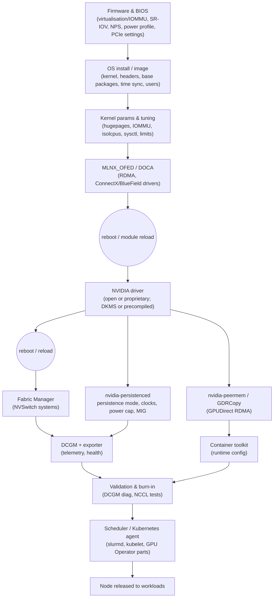

# 4.17 Ansible for GPU nodes and clusters

| | |
|---|---|
| Level | Advanced |
| Priority tier | 0 |
| Lab venue | Ubuntu 22.04/24.04 or RHEL 9 nodes with NVIDIA GPUs (A100/H100 class for NVSwitch topics); ConnectX NICs optional; stub scripts for rehearsal on plain VMs |
| Part | Part 4: Automation and infrastructure as code |
| Status | Drafted, labs **untested** |

## Why this matters for AI infrastructure

Picture a GPU node that has just arrived. The GPUs are in place, but nothing on the machine works yet. Someone has to bring up a long stack of software in the right order. It starts with BIOS and firmware settings, and a kernel with matching headers. Next come the RDMA networking drivers (MLNX_OFED or DOCA), the NVIDIA driver, `nvidia-persistenced`, and Fabric Manager on NVSwitch systems. After those come the GPUDirect module `nvidia-peermem`, DCGM and its exporters for telemetry, and the container toolkit. Kernel tuning, filesystem mounts, and the scheduler or Kubernetes agent finish the stack.

Each link in that chain has to be correct, and the links have to work together. Get the order wrong and you spend your time debugging `modprobe` failures. Get the versions wrong and a fleet can silently run at half speed. Skip validation and the first sign of a bad node may be a failed 64-node training job. Ansible's job is to bring nodes up, upgrade them and repair them in the same order every time, with a check after each step, across hundreds or thousands of machines.

## Prerequisites and outcomes

Before you start, you need chapters 4.3 to 4.16, plus the Linux and GPU basics from Parts 1, 9 and 10. Drivers, CUDA and NVLink are explained in those parts, so this chapter builds on them rather than repeating them. When you finish, you should be able to do the following:

- Describe the dependency order of a GPU node stack, and encode it in roles and playbooks with the right reboot points.
- Write roles for the OS and kernel, MLNX_OFED or DOCA, and the NVIDIA driver in its package and runfile forms.
- Write roles for Fabric Manager, DCGM, the container toolkit, MIG, GPU tuning, and the monitoring agents.
- Handle reboots, long installs (`async`), package pinning and holds, DKMS versus precompiled modules, and roll back safely.
- Validate nodes: check the GPU count, NVLink/NVSwitch state, ECC, PCIe link width and speed, IB link state, DCGM diagnostics, burn-in and NCCL tests. Then gate scheduling on the result.
- Run drain, patch, validate and resume workflows for Slurm and Kubernetes, with canary rollouts and fleet-wide diagnostics.
- Recognise and avoid the known incidents: interactive `dpkg` prompts, "green but dead" services, secrets leaking into logs, precedence surprises, and kernel and driver mismatches.

## 1. The node bring-up dependency graph

When a freshly built node has a driver that will not load, you need to know which step went wrong. The graph below shows the order. Read each arrow as a dependency, so the box at the end of an arrow needs the box at its start. The round markers show where a reboot or module reload has to happen.



The graph gives you five rules. Install the RDMA stack before the GPU driver, because the driver's peer-memory module binds to it. Reboot or reload modules at every boundary where kernel modules change. Start Fabric Manager only after a matching driver is loaded, and before CUDA workloads run. Validate the node before the scheduler sees it. Register the node with the scheduler last.

If you use the GPU Operator on Kubernetes, it can manage the driver container, toolkit and DCGM itself (Part 11). Ansible's role then narrows to OS, kernel, OFED, and kubelet.

When you write a bring-up playbook, follow the arrows rather than the order in which you remember the packages.

## 2. Project structure

A bring-up playbook is easier to trust when its folders and task order mirror the graph. The layout below keeps inventory, playbooks and roles apart.

```text
gpu-platform/
├── inventories/prod/{hosts.yml,group_vars/}
│   └── group_vars/
│       ├── gpu_h100.yml        # driver branch, clocks, nccl env, mig profile
│       ├── gpu_a100.yml
│       └── all/{vars.yml,vault.yml}
├── playbooks/
│   ├── gpu_bringup.yml         # new node: full ordered stack
│   ├── gpu_update_driver.yml   # driver/OFED upgrade with drain
│   ├── gpu_validate.yml        # diagnostics and burn-in
│   ├── gpu_patch_os.yml        # kernel/security patching
│   └── fleet_diag.yml          # read-only fleet checks
└── roles/
    ├── gpu_facts/ base_os/ kernel_tuning/ mofed/ nvidia_driver/ fabric_manager/ dcgm/ container_toolkit/
    ├── gpu_tuning/ gpu_validate/ slurm_client/ k8s_node_prereqs/ node_exporter/
```

The bring-up playbook should read like the graph, so here is the first one.

```yaml
# playbooks/gpu_bringup.yml
- name: Bring up GPU nodes
  hosts: "{{ target | default('gpu_new') }}"
  become: true
  serial: "{{ bringup_serial | default(10) }}"
  max_fail_percentage: 10
  roles:
    - { role: gpu_facts, tags: [facts] }
    - { role: base_os, tags: [base] }
    - { role: kernel_tuning, tags: [kernel] }
    - { role: mofed, tags: [mofed], when: "gpu_nic_family | default('') == 'connectx'" }
    - { role: nvidia_driver, tags: [driver] }
    - { role: fabric_manager, tags: [fm], when: ansible_local.gpu.nvswitch | default(false) }
    - { role: gpu_tuning, tags: [tuning] }
    - { role: dcgm, tags: [telemetry] }
    - { role: container_toolkit, tags: [containers], when: container_runtime is defined }
    - { role: gpu_validate, tags: [validate] }
    - { role: slurm_client, tags: [scheduler], when: "scheduler | default('') == 'slurm'" }
```

Notice the `serial` line. The playbook brings nodes up in batches of 10 by default, and `max_fail_percentage: 10` sets how many failures the run tolerates. Each role carries a tag, so you can run a single stage on its own. When you add a role, place it in the playbook at the point the graph says it belongs.

## 3. Roles in detail

Each role does one job, and that job is easier to get right once you know the hardware. Read the roles in the order they run.

### 3.1 gpu_facts: know the hardware before changing it

Consider a node where one GPU has dropped off the PCIe bus after a failed power cycle. If the playbook keeps going, it installs software on a machine that is missing a GPU. The `gpu_facts` role prevents that by looking first.

```yaml
- name: Detect NVIDIA devices
  ansible.builtin.shell: "lspci -d 10de: -nn | grep -Ei '3d controller|vga' | wc -l"
  args: { executable: /bin/bash }
  register: gpu_pci
  changed_when: false
  failed_when: false

- name: Detect NVSwitch (NVLink fabric)
  ansible.builtin.shell: "lspci -d 10de: | grep -ci nvswitch || true"
  args: { executable: /bin/bash }
  register: nvswitch
  changed_when: false

- name: Detect ConnectX / BlueField
  ansible.builtin.shell: "lspci -d 15b3: | grep -Eci 'infiniband|ethernet|mellanox' || true"
  args: { executable: /bin/bash }
  register: nic
  changed_when: false

- name: Publish local facts for later roles
  ansible.builtin.copy:
    dest: /etc/ansible/facts.d/gpu.fact
    mode: "0644"
    content: |
      {"count": {{ gpu_pci.stdout | int }}, "nvswitch": {{ (nvswitch.stdout | int > 0) | lower }}, "rdma_nics": {{ nic.stdout | int }}}
- ansible.builtin.setup: { filter: ansible_local }
```

The role runs three discovery commands before it changes anything. It counts NVIDIA devices, checks for NVSwitch, and counts ConnectX and BlueField NICs. It then publishes the results as local facts that later roles can read.

Compare the discovered count with the inventory's intended `expected_gpus`. A mismatch must stop the bring-up and raise a hardware ticket instead of continuing. Treat that comparison as a gate you never skip.

### 3.2 base_os and kernel_tuning

Start with the basics. The base OS role sets time sync with `chrony`, consistent users and UIDs (SSSD/LDAP or static), SSH hardening, and package repositories from internal mirrors. It also deals with `unattended-upgrades`, which you disable or control, because a competing apt process caused the incident in section 7. Pin the kernel version with `dpkg_selections hold` or `versionlock`. Install matching headers for DKMS with `linux-headers-$(uname -r)`.

Kernel parameters go into GRUB drop-ins through `GRUB_CMDLINE_LINUX_DEFAULT`. The parameters include `intel_iommu=on iommu=pt` or `amd_iommu=on`, `default_hugepagesz=1G hugepagesz=1G hugepages=N` where you use hugepages, and `transparent_hugepage=madvise`. Add `isolcpus` or `nohz_full` only when you have a reason, and set `pci=realloc` where the situation calls for it. Also set `processor.max_cstate`, and set `numa_balancing=disable` as a sysctl. Apply the changes with `update-grub` or `grub2-mkconfig`, followed by a controlled reboot.

For networking and memory, the role sets sysctls such as `net.core.rmem_max`, `vm.max_map_count` and `vm.swappiness=1`. It writes `limits.d` entries, with memlock unlimited for RDMA and a high nofile. It also sets tuned or `cpupower` governors, and IRQ affinity through an `irqbalance` policy or explicit pinning for NICs. It sets `ulimit` values in systemd units, disables services you do not need, and keeps `/dev/shm` sizes consistent for NCCL and PyTorch. The details are in Parts 1, 9 and 12.

The book *AI Systems Performance Engineering*, Chapter 3, gives four tuning insights that belong in this role. The first concerns GPU bubbles. The GPU does the matrix math, but the host CPU must keep launching CUDA kernels and preparing data batches. When a CPU core falls into a deep sleep state (`C-state`), waking it adds microseconds of jitter. That jitter piles up as GPU bubbles, which are idle gaps between kernels. Set the BIOS profile to High Performance, lock the Linux CPU frequency governor to `performance` with `cpupower frequency-set -g performance`, and disable deep C-states. Kernel launch latency then stays predictable.

The second insight is NUMA affinity. On a dual-socket server, a data-loader process on NUMA node 0 may feed a GPU attached to the PCIe root complex on NUMA node 1. Host-to-device pinned-memory transfers (`H2D`) then cross the inter-socket UPI or Infinity Fabric link. That nearly doubles memory access latency. Capture `nvidia-smi topo -m` in the playbook. Configure the Kubernetes kubelet with `--topology-manager-policy=single-numa-node` (or `restricted`) and `--cpu-manager-policy=static`, and verify `pin_memory=True` and `non_blocking=True` readiness.

On integrated Grace Blackwell superchips, the Grace CPU and the Blackwell GPU share coherent memory over NVLink-C2C at up to 900 GB/s. An NVL72 rack domain provides 130 TB/s of aggregate bidirectional NVLink bandwidth, or 1.8 TB/s per GPU.

The third insight is page-cache write-back. Large training runs write multi-gigabyte checkpoints in bursts. Tuning `vm.dirty_background_ratio` and `vm.dirty_ratio`, along with asynchronous or distributed checkpointing, keeps Linux page-cache write-back from freezing training steps. Preloading `jemalloc` (`narenas`, `background_thread:true`) or `tcmalloc` reduces host RAM fragmentation in multi-worker Python data loaders.

The fourth insight covers ECC, clocks and MIG. Keep ECC enabled on production AI fleets. A single undetected cosmic-ray bit flip during a multi-week training run can silently corrupt gradients into `NaN`. Changing ECC requires a GPU reset or a reboot. For acceptance benchmarks, use locked clocks (`nvidia-smi -lgc`), so thermal throttling on later runs does not skew the comparison. Use MIG for multi-tenant small-model inference. The book's Table 3-1 lists the Blackwell B200 profiles, for example `MIG 1g.23gb` x7, `1g.45gb` x4, `2g.45gb` x3, `3g.90gb` x2, `4g.90gb` x1, or `7g.180gb` x1. Large multi-GPU training jobs turn MIG off so they can use full GPUs.

### 3.3 mofed (MLNX_OFED / DOCA-Host)

Suppose someone bumps the OFED version for one rack. The installer replaces the in-box kernel networking drivers on every node in that rack, and a reboot follows. Several steps here can break a node quietly, so each one needs care.

```yaml
- name: Download and verify the OFED bundle
  ansible.builtin.get_url:
    url: "{{ mofed_base_url }}/MLNX_OFED-{{ mofed_version }}/MLNX_OFED_LINUX-{{ mofed_version }}-{{ ansible_facts['distribution'] | lower }}{{ ansible_facts['distribution_version'] }}-x86_64.tgz"
    dest: "/var/cache/mofed/{{ mofed_version }}.tgz"
    checksum: "sha256:{{ mofed_sha256 }}"
    mode: "0644"

- name: Unpack
  ansible.builtin.unarchive: { src: "/var/cache/mofed/{{ mofed_version }}.tgz", dest: /opt/mofed, remote_src: true, creates: "/opt/mofed/MLNX_OFED_LINUX-{{ mofed_version }}-{{ ansible_facts['distribution'] | lower }}{{ ansible_facts['distribution_version'] }}-x86_64" }

- name: Install (long-running; async protects the SSH session)
  ansible.builtin.command:
    cmd: "./mlnxofedinstall --force --without-fw-update --add-kernel-support"
    chdir: "/opt/mofed/MLNX_OFED_LINUX-{{ mofed_version }}-{{ ansible_facts['distribution'] | lower }}{{ ansible_facts['distribution_version'] }}-x86_64"
    creates: /etc/infiniband/openib.conf         # idempotency guard; better: compare `ofed_info -s` with the target version
  async: 3600
  poll: 60
  register: ofed_install
  notify: reboot node

- name: Rebuild initramfs so the new modules load early
  ansible.builtin.command: update-initramfs -u -k all
  when: ofed_install is changed and ansible_facts['os_family'] == 'Debian'

- ansible.builtin.meta: flush_handlers       # reboot now, before the NVIDIA driver build
```

The install task uses `async: 3600`, so a long build does not hold the SSH session. Considerations come next. The installer replaces in-box kernel networking drivers, so version pinning, kernel matching (`--add-kernel-support` rebuilds for a running kernel) and a rollback path all matter. Firmware updates (`mlxfwmanager`, `--without-fw-update`) are a separate, carefully staged workflow, covered in Part 9. The idempotency guard should compare installed and requested versions (`ofed_info -s`), so that version bumps re-run the installer. DOCA-Host is the successor bundle for ConnectX and BlueField. It uses repository packages (`doca-ofed`), which are easier to automate than the ISO or tarball installer.

The reboot handler looks like this.

```yaml
- name: reboot node
  ansible.builtin.reboot:
    msg: "Ansible: loading new kernel/RDMA modules"
    pre_reboot_delay: 10
    reboot_timeout: 1800            # GPU servers can take 10+ minutes to POST
    post_reboot_delay: 60
    test_command: "uptime"
```

GPU servers with many GPUs and NICs POST slowly and take time to train memory. Give them generous timeouts, and check the BMC for stuck boots, as Part 7 describes. Decide the OFED version and the rollback path before the installer runs anywhere.

### 3.4 nvidia_driver

The driver is where many bring-ups stall, so the role makes its decisions explicit. It keeps five decisions in variables. The first is the branch: production or LTS, or a newer feature branch. The second is the flavour. Open kernel modules are required on Blackwell and recommended for recent data-centre GPUs, while proprietary modules are the alternative. The third is the install method. Distribution or NVIDIA repository packages, using DKMS or precompiled kernel modules, are the usual choice, and the `.run` file is for special cases only. The last two are the version pin and the holds.

```yaml
- name: Add the NVIDIA CUDA repository key and source (keyring-based)
  ansible.builtin.get_url:
    url: "https://developer.download.nvidia.com/compute/cuda/repos/ubuntu2204/x86_64/3bf863cc.pub"
    dest: /etc/apt/keyrings/nvidia-cuda.asc
    mode: "0644"
- ansible.builtin.apt_repository:
    repo: "deb [signed-by=/etc/apt/keyrings/nvidia-cuda.asc] https://developer.download.nvidia.com/compute/cuda/repos/ubuntu2204/x86_64/ /"
    filename: nvidia-cuda
    state: present

- name: Blacklist nouveau
  ansible.builtin.copy:
    dest: /etc/modprobe.d/blacklist-nouveau.conf
    content: "blacklist nouveau\noptions nouveau modeset=0\n"
    mode: "0644"
  notify: rebuild initramfs

- name: Install the pinned driver (non-interactive)
  ansible.builtin.apt:
    name:
      - "nvidia-driver-{{ nv_driver_branch }}-server-open"       # naming varies by distro/repo: verify
      - "nvidia-utils-{{ nv_driver_branch }}-server"
    state: present
    dpkg_options: "force-confold,force-confdef"
    lock_timeout: 300
    update_cache: true
    cache_valid_time: 3600
  environment: { DEBIAN_FRONTEND: noninteractive }
  register: driver_pkg
  notify: reboot node

- name: Hold packages to prevent drift
  ansible.builtin.dpkg_selections:
    name: "{{ item }}"
    selection: hold
  loop: ["nvidia-driver-{{ nv_driver_branch }}-server-open", "nvidia-utils-{{ nv_driver_branch }}-server"]
  when: nv_hold_packages | default(true)

- ansible.builtin.meta: flush_handlers

- name: Confirm driver and expected GPU count
  ansible.builtin.command: nvidia-smi --query-gpu=driver_version,index --format=csv,noheader
  register: smi
  changed_when: false
  failed_when: (smi.stdout_lines | length) != expected_gpus or (smi.stdout_lines[0].split(',')[0] | trim) is not match('^' ~ nv_driver_branch)
```

The code comment already warns you that package names vary by distribution, so verify them. DKMS builds need headers and can fail after a kernel update, which is why the kernel pin and hold matter. Upgrades must unload dependent modules (`nvidia_uvm`, `nvidia_peermem`, `nvidia_drm`) and stop the services that use the GPUs, such as DCGM, persistenced, exporters and containers. Then install, and reload or reboot. Downgrades need explicit permission variables. RHEL families use `dnf` modules, such as `dnf module enable nvidia-driver:550-open`, plus `versionlock` and the same cautions. Mixing the driver from the OS repository with the one from NVIDIA's repository is a classic break. Pin the branch and the holds in the same change, so the driver cannot drift on its own.

### 3.5 fabric_manager, GPU tuning, MIG

On HGX and DGX systems, GPUs talk to each other through NVSwitch chips, and Fabric Manager programs those switches. Until Fabric Manager is running, CUDA applications cannot initialize. The role installs Fabric Manager to match the driver branch, starts it, and then checks the fabric.

```yaml
- name: Fabric Manager matching the driver branch (NVSwitch systems: HGX/DGX)
  ansible.builtin.apt:
    name: "nvidia-fabricmanager-{{ nv_driver_branch }}"
    state: present
    dpkg_options: "force-confold,force-confdef"
- ansible.builtin.systemd_service: { name: nvidia-fabricmanager, state: started, enabled: true }
- name: Verify NVSwitch fabric is up
  ansible.builtin.command: nvidia-smi nvlink --status -i 0
  register: nvl
  changed_when: false
  failed_when: "'inactive' in nvl.stdout | lower"
```

Fabric Manager's version must exactly match the driver. On NVLink-switch fabrics such as GB200 NVL72, the multi-node NVLink domain uses extra components: IMEX and NVLink management software. Part 9 covers those.

The GPU tuning role handles the persistence daemon, clocks, power, ECC, compute mode and MIG. The table lists each setting with its command and the situation that calls for it.

| Setting | Command | When you need it |
|---|---|---|
| Persistence | `nvidia-persistenced`, or `nvidia-smi -pm 1` | When you want the GPU initialised ahead of workloads |
| Clocks | `nvidia-smi -lgc` | When policy requires locked or application clocks |
| Power limit | `nvidia-smi -pl`, or the `gpu_power_limit` module from 4.15 | When policy caps power |
| ECC and compute mode | `nvidia-smi` settings, such as `EXCLUSIVE_PROCESS` | When policy sets them away from the default |
| MIG | `nvidia-smi -mig 1`, then `nvidia-smi mig -cgi ... -C` | For multi-tenant small workloads |

Changing MIG mode may need a GPU reset or a reboot, and no processes can be running on the GPU. The role also takes an `nvidia-smi topo -m` snapshot for inventory, installs the GDRCopy kernel module, and loads `nvidia-peermem` at boot through `modules-load.d`. If non-root runtimes need device nodes, it can set udev rules under `/etc/udev`.

```yaml
- name: Enable persistence daemon
  ansible.builtin.systemd_service: { name: nvidia-persistenced, state: started, enabled: true }

- name: Load GPUDirect RDMA module at boot and now
  community.general.modprobe: { name: nvidia_peermem, state: present, persistent: present }
  when: ansible_local.gpu.rdma_nics | default(0) | int > 0

- name: Configure MIG when requested
  ansible.builtin.include_tasks: mig.yml
  when: mig_profile is defined
```

Settle the MIG decision for each workload before you write the tuning role.

### 3.6 dcgm and telemetry

A node can look fine from the outside and still have a failing GPU. DCGM and its exporter give you the view from inside.

```yaml
- ansible.builtin.apt: { name: datacenter-gpu-manager, state: present }
- ansible.builtin.systemd_service: { name: nvidia-dcgm, state: started, enabled: true }
- name: Deploy the metrics selection for the exporter
  ansible.builtin.copy: { src: dcp-metrics-custom.csv, dest: /etc/dcgm-exporter/dcp-metrics-custom.csv, mode: "0644" }
  notify: restart dcgm-exporter
- name: Run the exporter (container or package)
  community.docker.docker_container: { ... }          # see 4.16; or systemd unit for the binary
- name: Quick health check
  ansible.builtin.command: dcgmi diag -r 1
  register: diag1
  changed_when: false
  failed_when: diag1.rc != 0 or "Fail" in diag1.stdout
```

The health check fails the task on a non-zero return code, or when the output contains `Fail`. Expose node health to Prometheus through the DCGM exporter on port 9400, along with node_exporter. Set labels for `cluster`, `rack` and `gpu_model`. Then make sure alerts exist for XID errors, ECC errors, thermal throttling, NVLink errors, PCIe replay counters and missing GPUs, as Part 17 covers.

The `dcgmi diag -r 1|2|3` levels trade time for coverage. Level 1 takes seconds, level 2 takes minutes, and level 3 runs about 15 to 30 minutes of stress. Match the level to the moment: quick checks on every run, and the long level for bring-up.

### 3.7 container_toolkit and runtimes

Once the host driver works, the container runtime needs to know how to pass GPUs into containers. Install `nvidia-container-toolkit`, then configure the runtime with `nvidia-ctk runtime configure --runtime=containerd|docker|crio` and restart it. If you use CDI, generate the specs with `nvidia-ctk cdi generate`. Test with a short container that runs `nvidia-smi`. Keep the toolkit versions aligned with the driver and with the Kubernetes device plugin, which Part 11 covers. Treat that container test as your proof that the runtime can reach the GPUs.

### 3.8 Scheduler and Kubernetes agents

Scheduler agents come last. For Slurm, the `slurm_client` role sets up the munge key, `slurm.conf`, and `gres.conf`, which auto-detects GPUs through NVML. It also sets up cgroups and `slurmd`. For Kubernetes, the node needs a container runtime, the kubelet, and the `nvidia.com/gpu` device plugin through the GPU Operator. It also needs node labels and taints for GPU pools, plus hugepages and topology manager settings. A node joins the scheduler only after validation succeeds, as section 5 explains. Register the node with the scheduler last, and only after the checks in section 5 pass.

## 4. Reboots, long tasks and idempotent upgrades

A driver upgrade on a busy node raises one question first: does this node need a full reboot, or only a module reload? The answer shapes the rest of the upgrade.

Put reboots where they belong, which is after kernel, OFED or driver changes that need new modules. Use handlers with `meta: flush_handlers`, so the play continues on a clean boot. Do not reboot blindly. Detect the need first, by checking `/var/run/reboot-required` or `needs-restarting -r`, or by comparing running and installed module versions with `modinfo` and `cat /proc/driver/nvidia/version`.

OFED installs, DKMS builds and large package sets can take a long time. Run them with `async` and `poll`, or set a `timeout`. Keep `forks` and `throttle` in mind as well, because many parallel installs put load on the package mirror.

A reload can replace a reboot when it is safe. Stop the dependent services, unload `nvidia_uvm nvidia_drm nvidia_modeset nvidia` in that order, and load the new modules with `modprobe`. If unloading fails with `rmmod: in use`, find the holders with `lsof /dev/nvidia*` or `fuser -v /dev/nvidia*`. If the unload still fails, fall back to a reboot.

Compare installed and desired versions explicitly. If your role only checks whether any driver is present, it will never upgrade one.

Keep the previous package versions in the mirror, so you have something to roll back to. Use the `block/rescue` pattern from 4.8 to reinstall the previous version, and leave the node drained when validation fails.

Stop or hold `unattended-upgrades` and the `apt-daily` timers on GPU nodes, and apply security patches in controlled windows. Otherwise, dpkg locks and surprise kernel updates will break DKMS.

Decide the reload-or-reboot path before the upgrade starts, and write the rollback steps down alongside it.

## 5. Validation and burn-in

A node can pass every install step and still be wrong under load. Validation is how you find that out before the node takes work.

Gate a node's entry to production with progressively heavier tests. Each test runs as a task in `gpu_validate`. The table lists the stages from cheapest to most expensive.

| Stage | Checks | Tools | Time |
|---|---|---|---|
| Inventory sanity | GPU count/model, PCIe link width and speed (x16 Gen5), NUMA mapping, NIC count/speed/state, no AER errors in `dmesg` | `nvidia-smi -q`, `lspci -vv`, `nvidia-smi topo -m`, `ibstat`, `ibdev2netdev`, `ethtool`, `dmesg` | seconds |
| Driver/health | No XID errors, ECC clean, retired pages within limits, clocks and temperatures sane, NVLink all active, Fabric Manager healthy | `nvidia-smi -q -d ECC,PAGE_RETIREMENT`, `nvidia-smi nvlink -s`, `journalctl -k \| grep -i xid`, `dcgmi health -c` | seconds |
| DCGM diagnostics | Level 1 to 3 | `dcgmi diag -r 1/2/3` | seconds to 30 min |
| Single-node stress | Thermal/power stability, ECC under load | `gpu-burn`, DCGM level 3, `nvbandwidth`, `dcgmproftester` | 10 to 30 min |
| GPUDirect/P2P | P2P and NVLink bandwidth | `nvbandwidth`, `p2pBandwidthLatencyTest`, `nvidia-smi nvlink` | minutes |
| Network | Link state, RDMA perftest (`ib_write_bw`, `ib_send_lat`) to a peer, GID/RoCE config, MTU | `perftest`, `ibv_devinfo`, `rdma link` | minutes |
| Multi-node collectives | NCCL all-reduce within tolerance of the expected bus bandwidth | `nccl-tests` (`all_reduce_perf`), `mpirun`/`srun` | minutes |

Read the table from the top. The first rows take seconds, while the stress rows take 10 to 30 minutes.

The burn test runs for 30 minutes in the background. Afterward, the play checks the kernel log as well.

```yaml
- name: Single-node GPU stress (30 min) in the background
  ansible.builtin.command: ./gpu_burn 1800
  args: { chdir: "{{ burn_dir }}" }
  register: burn
  async: 2100
  poll: 60
  changed_when: false

- name: No hardware errors during burn
  ansible.builtin.shell: "journalctl -k --since '-40min' | grep -Ei 'xid|nvrm.*error|fallen off the bus' || true"
  args: { executable: /bin/bash }
  register: kerr
  changed_when: false
  failed_when: kerr.stdout | length > 0 or ('faulty' in burn.stdout | lower)
```

Use your standard burn tool, pinned by commit SHA and built into your image. Do not compile it from a moving branch at test time. Xid errors appear in the kernel log, not in the burn tool's output, so the kernel log check is not optional.

The multi-node collectives test runs from a controller or login node, as a normal user rather than root.

```yaml
# Multi-node NCCL test from a controller/login node (run as a normal user, not root)
- name: NCCL all_reduce across a rack
  hosts: login[0]
  become: false
  vars: { nodes_per_rack: 8, gpus_per_node: 8 }
  tasks:
    - ansible.builtin.template: { src: hostfile.j2, dest: "/tmp/hosts.{{ rack }}" }
    - name: Run nccl-tests
      ansible.builtin.command: >
        mpirun --hostfile /tmp/hosts.{{ rack }} -np {{ nodes_per_rack * gpus_per_node }} --map-by ppr:{{ gpus_per_node }}:node
        -x LD_LIBRARY_PATH -x NCCL_DEBUG=WARN -x NCCL_IB_HCA={{ nccl_ib_hca }}
        /opt/nccl-tests/build/all_reduce_perf -b 8 -e 8G -f 2 -g 1
      register: nccl
      changed_when: false
    - name: Check bus bandwidth against the expected floor
      ansible.builtin.assert:
        that: (nccl.stdout | regex_search('Avg bus bandwidth\s*:\s*([0-9.]+)', '\1') | first | float) >= expected_busbw_gbps
        fail_msg: "NCCL busbw below {{ expected_busbw_gbps }} GB/s on rack {{ rack }}"
```

Bus bandwidth expectations depend on topology, NIC speeds and message sizes. Derive the baselines from known-good runs, and record them. Store the results as JSON artefacts with node serials, so trends and repeat offenders show up. Tag failing nodes `quarantine` and keep them out of the scheduler.

Set the expected bus bandwidth from your own known-good runs before you enforce it in an assert.

## 6. Day-2: drain, patch, validate, resume

Suppose a driver update must reach a fleet that is busy running training jobs. Each node has to leave the scheduler, get patched and validated, and then rejoin. The pattern comes from 4.8, with GPU-aware checks added.

```yaml
- name: Patch GPU nodes safely
  hosts: gpu
  become: true
  serial: [1, "5%", "10%"]
  max_fail_percentage: 3
  vars: { scheduler_host: "{{ groups['slurm_controller'][0] }}" }
  tasks:
    - name: Drain from Slurm and wait for jobs to finish
      block:
        - ansible.builtin.command: scontrol update NodeName={{ inventory_hostname }} State=DRAIN Reason="maintenance {{ change_id }}"
          delegate_to: "{{ scheduler_host }}"
          changed_when: true
        - ansible.builtin.command: squeue -h -w {{ inventory_hostname }} -o %i
          delegate_to: "{{ scheduler_host }}"
          register: jobs
          until: jobs.stdout == ""
          retries: "{{ drain_wait_retries | default(240) }}"
          delay: 30
          changed_when: false

    - name: Apply updates
      block:
        - ansible.builtin.import_role: { name: nvidia_driver }
        - ansible.builtin.import_role: { name: gpu_validate, tasks_from: quick }
      rescue:
        - ansible.builtin.debug: { msg: "Maintenance failed on {{ inventory_hostname }}; leaving node DRAINED" }
        - ansible.builtin.fail: { msg: "Node {{ inventory_hostname }} requires investigation" }

    - name: Return to service
      ansible.builtin.command: scontrol update NodeName={{ inventory_hostname }} State=RESUME
      delegate_to: "{{ scheduler_host }}"
      changed_when: true
```

The `serial` list moves in stages: one node first, then 5 percent, then 10 percent of the fleet. `max_fail_percentage: 3` stops the rollout once failures pass 3 percent. The play drains the node and waits for its jobs to finish. It then applies the driver and runs a quick validation. If anything fails, the `rescue` block leaves the node drained and stops for investigation. Only a clean run returns the node to service.

On Kubernetes, the equivalent is `kubernetes.core.k8s_drain`, which respects PodDisruptionBudgets. Taint the node with `nvidia.com/gpu=maintenance:NoSchedule`, patch it, validate it with DCGM or NVML, and then uncordon it. Under the GPU Operator, let its upgrade controller handle driver upgrades rather than changing hosts by hand, as Part 11 explains.

Fleet-wide diagnostics are read-only, so you can run them at any time.

```yaml
- name: Fleet GPU health sweep
  hosts: gpu
  gather_facts: false
  become: true
  tasks:
    - name: Collect a compact health record
      ansible.builtin.shell: |
        set -o pipefail
        nvidia-smi --query-gpu=index,name,driver_version,temperature.gpu,power.draw,clocks_throttle_reasons.active,ecc.errors.uncorrected.volatile.total,pcie.link.gen.current,pcie.link.width.current --format=csv,noheader,nounits
      args: { executable: /bin/bash }
      register: health
      changed_when: false
      failed_when: false
    - ansible.builtin.copy:
        content: "{{ {'host': inventory_hostname, 'rc': health.rc, 'rows': health.stdout_lines} | to_nice_json }}"
        dest: "reports/{{ inventory_hostname }}.json"
      delegate_to: localhost
      become: false
```

The sweep writes one JSON file per host. Aggregate those files into a report that counts nodes with fewer than 8 GPUs, PCIe links degraded below x16, nonzero uncorrected ECC, and active throttle reasons. That report is a typical first step when many jobs slow down during an incident. Run this sweep first when throughput drops, before you change any node.

## 7. Incidents that shaped the design

Each incident below shaped one part of the design, and you can trace each fix back to a rule you have already seen.

1. A package upgrade across 256 GPU nodes stalled forever on a `dpkg` configuration-file prompt, because no terminal was attached. The cause was apt running non-interactively without a conffile policy, or competing with `unattended-upgrades`. The fix uses the `apt` module with `dpkg_options: force-confold,force-confdef`, `lock_timeout`, `DEBIAN_FRONTEND=noninteractive`, disabled unattended upgrades on nodes, and a task `timeout`.
2. A green but dead service: systemd reported a successful start, while `slurmctld` crashed seconds later on a bad `slurm.conf`. The fix verifies behaviour after every critical start (`sinfo`, `curl /health`) with `until/retries`, and validates configs before they are installed (4.7).
3. A `command` task with a database password on the command line printed that password into job logs. The fix is `no_log: true`, passing secrets through files or stdin, and scanning logs (4.12).
4. A forgotten `host_vars` file pinned one DGX to an old driver version, while `group_vars` said otherwise. The fix is to inspect with `ansible-inventory --host`, treat `host_vars` as exceptional, and add an assert or report that lists driver versions per node after each run (4.5).
5. A kernel update, applied unattended or by a different team, invalidated the DKMS module build, and nodes lost their GPUs after reboot. The fix pins kernel and driver together, holds the packages, tests updates on a canary, and uses precompiled or signed modules where Secure Boot is required, with module signing keys managed deliberately.
6. A node's ConnectX port came up at a lower speed, or one rail was down, and training ran at half speed. The fix compares link speed and state per rail with the design. Fleet sweeps record `ibstat` and `rdma link` output and flag any deviation.
7. 1,000 nodes downloading the same driver and OFED at once saturated the mirror. The fix uses `throttle`, `serial`, local caches or proxies, and preseeded images.
8. A bad GRUB parameter or module config prevented boot, and automation kept retrying reboots. The fix is a canary first, `max_fail_percentage`, and BMC out-of-band access to recover (Part 7). It also follows one rule: automation never retries a reboot without human review when a node fails to return.

Use the canary and `max_fail_percentage` settings from incident 8 on every fleet-wide change, because you want one bad change to stay small.

## 8. Lab

You can work through much of this chapter without a GPU. Start with the self-checking Python lab, which runs locally. It checks three things. The first is the bring-up order validator, `validate_bringup_role_order`, which confirms that `mofed` runs before `nvidia_driver`, `nvidia_driver` before `fabric_manager`, and `gpu_validate` before `slurm_client`. The second is the health sweep classifier, `evaluate_gpu_health_sweep`, which catches GPUs that fell off the bus, uncorrected ECC errors, and PCIe `Gen4x8` degradation. The third is the parser and gate for `nccl-tests`, `parse_and_gate_nccl_busbw`, which reads the `all_reduce_perf` bus bandwidth and checks it against a floor.

```bash
python3 code/part04/ansible_gpu_cluster_lab.py
```

If you have no physical GPU, rehearse the interactive steps below with stub `nvidia-smi`, `dcgmi` and `ibstat` scripts on a plain VM. Those steps have not been run on hardware. Roles, ordering, handlers, reboots and validation logic still get exercised that way. Save the hardware steps for a real node.

1. Implement `gpu_facts`, and compare the discovered counts with what you expect. Publish `ansible_local.gpu`. Test with stubs first, then on a GPU host.
2. Write the playbook from the graph, with its reboot points. Run it on a fresh VM or node. Check that `--list-tasks` shows the right order, and that a rerun reports `changed=0`, apart from validation probes.
3. Pin a branch, hold the packages, and run non-interactively with `dpkg_options`. Simulate a conffile prompt to prove the fix. Try an upgrade, then a blocked downgrade, and test the `rescue` rollback.
4. Add the async install, the checksum, version-aware idempotency, the initramfs rebuild and the reboot flush to the OFED role. Document the rollback.
5. Trigger a reboot through the handler. Check `post_reboot_delay` and `test_command`. Then test what happens when the node fails to return, using the timeout and the failure policy.
6. Set up the persistence daemon, a power limit (use the 4.15 module), a MIG profile on a MIG-capable GPU, and peermem. Verify with `nvidia-smi` and `lsmod`.
7. Deploy DCGM and the exporter, and scrape them from Prometheus. Create an alert test for a missing GPU, using a metric from a stub.
8. Implement the quick (seconds), standard (DCGM level 2) and burn (30 min) task files. Gate scheduler registration on success, and store JSON reports.
9. Run nccl-tests on two or more nodes, and record a baseline bus bandwidth for each message size. Assert against the floor. Then compare with a deliberately degraded NIC, using an MTU change or `NCCL_IB_DISABLE=1`.
10. Run the drain and resume workflow on a lab Slurm cluster, and inject a validation failure to confirm the node stays drained. Then do the Kubernetes variant with `k8s_drain` and a PDB.
11. Run the health sweep across many simulated nodes, aggregate the results into a table, and flag the outliers.
12. Reproduce the interactive `dpkg` hang, the green-but-dead service and the stale `host_vars` precedence problem. Fix each one with the patterns above.
13. Clean up the nodes, VMs and cloud GPUs when you finish.

Work through the steps in order, because each one builds on the one before it.

## 9. Common mistakes

Most of these mistakes are shortcuts that seem reasonable at the time, so it helps to see them together.

Most of these mistakes are shortcuts, and they fall into a few groups.

- Ordering: installing the NVIDIA driver before the RDMA stack, or skipping the reboot or module reload between them.
- Versions: letting packages float with `state: latest`, letting `unattended-upgrades` change kernels and drivers, or mixing kernel, headers, driver branch, Fabric Manager and DCGM versions.
- Health: treating "service started" as "node healthy", skipping burn-in and collectives tests, or retrying reboots on nodes that do not return.
- Rollout: going fleet-wide without a canary or `max_fail_percentage`, or leaving a half-configured node visible to the scheduler after a role fails halfway.
- Reproducibility: hard-coded package names across distributions, benchmark tools built from moving branches, and no record of results, so repeat-offender nodes go unnoticed.
- Safety: secrets in command lines and verbose logs, and Ansible driver changes underneath the GPU Operator, which gives the same component two managers.

Review your roles against the ordering and version mistakes first, since the rest of the chapter depends on those rules.

## 10. Interview angles

Use these questions to test whether you can explain the chapter out loud.

- "Walk through bringing up a new DGX/HGX node with Ansible from bare OS to schedulable." Cover the order, the reboots, the validation, and the scheduler last.
- "How do you upgrade GPU drivers across a running cluster?" Cover the drain, the canary, DKMS and headers, the holds, validation and rollback.
- "Why install MOFED before the NVIDIA driver? What is nvidia-peermem?"
- "How do you validate a node before releasing it to users?" Cover the DCGM diag levels, burn-in, the NVLink, PCIe and IB checks, and an NCCL test.
- "A playbook upgrading packages hangs on 200 nodes. Diagnose." Cover the dpkg prompt, locks, unattended upgrades, non-interactive mode, and timeouts.
- "How do you keep GPU nodes consistent over time?" Cover golden images, pins, drift checks, scheduled `--check` runs, and fleet sweeps.
- "How do you coordinate with Slurm or Kubernetes during maintenance?" Cover drain and cordon, PDBs, and resuming only after validation.
- "How do you detect a degraded node whose job is merely slow?" Cover link speeds, throttle reasons, ECC, and an NCCL baseline.

## Exercises

Work through these exercises after you have read the chapter and run the lab. Compare your answers with the lab output, and check the code you read against the lines it names.

1. Use `validate_bringup_role_order()` in `code/part04/ansible_gpu_cluster.py` to follow the chain `mofed`, `nvidia_driver`, `fabric_manager`, `gpu_validate` and `slurm_client`. Explain why the MOFED or DOCA stack and its reboot must finish before the NVIDIA driver and `nvidia_peermem` are loaded.
2. Explain why `nvidia-fabricmanager` must match the exact driver version on NVSwitch systems.
3. Explain why `gpu_validate` must gate the start of `slurm_client` or `kubelet`.
4. Show how `gpu_facts` uses `lspci -d 10de:` to count GPUs and publish `/etc/ansible/facts.d/gpu.fact`. Then say what the role does when a GPU has fallen off the PCIe bus.
5. *AI Systems Performance Engineering*, Chapter 3, sets the `performance` CPU governor and disables deep C-states. Explain how that reduces GPU bubbles.
6. Explain why the same chapter sets `--topology-manager-policy=single-numa-node` on the kubelet.
7. Explain how `dpkg_options: "force-confold,force-confdef"` and `DEBIAN_FRONTEND: noninteractive` prevent a fleet-wide hang. Then explain why `dpkg_selections: hold` prevents a DKMS kernel mismatch.
8. Explain why the `reboot` task sets `reboot_timeout: 1800`, and why `meta: flush_handlers` comes before the next role.
9. Explain what `nvidia-persistenced` and `nvidia_peermem` each do.
10. Use Table 3-1 in *AI Systems Performance Engineering*, Chapter 3. Name two Blackwell B200 MIG profiles, and say when a large training job turns MIG off.
11. Contrast `dcgmi diag -r 1`, `-r 2` and `-r 3` by time and coverage.
12. Trace the validation stages in Section 5 from PCIe and NVLink checks up to `gpu-burn`. Say where `journalctl -k` fits.
13. Use `parse_and_gate_nccl_busbw()` to follow the last stage, the multi-node bus-bandwidth assertion.
14. Use `evaluate_gpu_health_sweep()` to show how a read-only fleet sweep finds degraded nodes. Look for 7 of 8 GPUs, a PCIe `Gen4x8` downgrade, uncorrected ECC and throttling.
15. Trace the Slurm and Kubernetes maintenance workflow, including `k8s_drain`.

## Checkpoint questions (20)

<details>
<summary>1. Why must the RDMA stack (`MLNX_OFED` / `DOCA-Host`) be installed and booted BEFORE the NVIDIA GPU driver and `nvidia-peermem`?</summary>

GPUDirect RDMA depends on the `nvidia_peermem` kernel module. That module registers GPU HBM memory pages directly with the Mellanox/NVIDIA InfiniBand/RoCE kernel IB core (`ib_core` / `mlx5_core`), using peer-memory client symbols. If the NVIDIA driver is built or loaded before the matching OFED or DOCA modules are installed and loaded, `modprobe nvidia_peermem` fails with `Invalid argument` or unresolved symbol errors. All inter-node NCCL traffic then falls back through host system RAM.
</details>

<details>
<summary>2. What does `gpu_facts` check via `lspci` before installing any drivers, and why is `/etc/ansible/facts.d/gpu.fact` useful?</summary>

Before any driver goes in, `lspci -d 10de:` lists the physical GPU functions (shown as `3D controller` or `VGA`) and the NVSwitch functions. The vendor ID `0x10de` is NVIDIA. `lspci -d 15b3:` lists the ConnectX and BlueField RDMA NICs, where `0x15b3` is Mellanox's vendor ID. Comparing the PCIe count with `expected_gpus` (`8`) catches a dead riser or a GPU that fell off the bus. That check comes before you waste 30 minutes installing software. Writing `/etc/ansible/facts.d/gpu.fact` then gives later roles the values `ansible_local.gpu.nvswitch` and `ansible_local.gpu.rdma_nics`, so they can enable Fabric Manager and `nvidia_peermem` only where they apply.
</details>

<details>
<summary>3. When is `nvidia-fabricmanager` required, and what happens if its version does not exactly match the NVIDIA driver?</summary>

You need `nvidia-fabricmanager` on systems with NVSwitch chips. Examples are 8-GPU HGX and DGX A100, H100, H200 and B200 nodes, where all-to-all NVLink traffic routes through baseboard NVSwitches. Fabric Manager programs the NVSwitch routing tables. Until `nvidia-fabricmanager` runs, CUDA applications cannot initialize and report `cudaErrorSystemNotReady`. Its package version must match the exact driver version string, for example both `550.90.07`. If the versions differ, the daemon refuses to start.
</details>

<details>
<summary>4. In *AI Systems Performance Engineering* Chapter 3, how do CPU sleep states (`C-states`) and CPU frequency governors cause \"GPU bubbles\", and how does Ansible prevent them?</summary>

The GPU does the heavy matrix multiplications, but the host CPU must wake up at the end of every kernel or step. It queues the next CUDA stream operations and fills pinned memory buffers. If CPU cores drop into deep power-saving C-states, or run at low frequencies under `powersave` or `ondemand`, the wake-up delay opens GPU bubbles. A GPU worth $30,000+ then sits at 0% utilization, waiting on a sleeping CPU core. Ansible prevents this by setting the `performance` governor (`cpupower frequency-set -g performance`) and capping `processor.max_cstate` and `intel_idle.max_cstate` in GRUB.
</details>

<details>
<summary>5. Why does crossing NUMA nodes between a CPU data-loader worker and its target GPU hurt performance (*AI Systems Performance Engineering* Chapter 3), and how do you configure NUMA alignment?</summary>

On a dual-socket server, half the PCIe root complexes (GPUs 0–3 and NICs 0–3) attach to socket 0, NUMA node 0. The other half (GPUs 4–7 and NICs 4–7) attach to socket 1, NUMA node 1. If a CPU worker on NUMA node 0 copies pinned host memory (`H2D`) to GPU 4 on NUMA node 1, every byte crosses the inter-socket UPI or Infinity Fabric link. That nearly doubles latency and cuts PCIe bandwidth. Use `nvidia-smi topo -m` to inspect the topology, and disable automatic kernel NUMA page migration with `kernel.numa_balancing = 0`. Then set the kubelet to `--topology-manager-policy=single-numa-node` and `--cpu-manager-policy=static`.
</details>

<details>
<summary>6. How does Grace Blackwell (`GB200 NVL72`) change the CPU-to-GPU and multi-node interconnect architecture (*AI Systems Performance Engineering* Chapter 3)?</summary>

Grace Blackwell changes two links. The first is the CPU-to-GPU link. Instead of PCIe Gen5 at 64 GB/s unidirectional, the Grace Arm CPU and the Blackwell GPU connect over NVLink-C2C at up to 900 GB/s. They share one hardware-coherent virtual address space, which the hardware Address Translation Service (ATS) supports. The second is the rack-scale GPU-to-GPU link. 72 Blackwell GPUs across 18 compute trays connect through 9 NVLink Switch trays into one NVLink-5 domain. That domain delivers 1.8 TB/s per GPU, or 130 TB/s of aggregate bidirectional bandwidth, and multi-node NVLink fabric software and IMEX (Internode Memory Exchange) channels manage it.
</details>

<details>
<summary>7. Why did a package upgrade playbook hang indefinitely across 256 GPU nodes in Section 7, and what five settings prevent it?</summary>

The playbook hung because `apt` or `dpkg` hit a modified configuration file on the target nodes. It then prompted on stdin with `What would you like to do about modified configuration file...`, but no terminal was attached. It could also wait forever on an `apt` lock held by `unattended-upgrades`. Five controls prevent this:
1. `environment: { DEBIAN_FRONTEND: noninteractive }`
2. `dpkg_options: "force-confold,force-confdef"` on the `apt` module.
3. `lock_timeout: 300` on the `apt` module, so lock contention fails cleanly after 5 minutes.
4. Disable `unattended-upgrades` (`apt-daily.timer`) on production GPU nodes, and hold kernel and driver packages with `dpkg_selections: { selection: hold }`.
5. Set a task-level `timeout:` (`timeout: 1800`).
</details>

<details>
<summary>8. How do you prevent automatic kernel updates from breaking DKMS NVIDIA and OFED kernel modules after a reboot?</summary>

If `apt upgrade` installs a new Linux kernel image (`linux-image-generic`) without matching `linux-headers-$(uname -r)`, or DKMS fails to compile the driver against the new kernel ABI, the node boots into the new kernel with no `nvidia.ko` or `mlx5_core.ko` modules. Three steps prevent this.
1. Install `linux-headers-{{ target_kernel_version }}` alongside the kernel image.
2. Pin and hold the kernel, headers, OFED or DOCA, the NVIDIA driver and `nvidia-fabricmanager` together, as one tested set. The mechanisms are `dpkg_selections: hold` and `yum versionlock`.
3. Prefer precompiled, signed driver packages when UEFI Secure Boot is enabled.
</details>

<details>
<summary>9. Why do bare-metal GPU servers need `reboot_timeout: 1800` and `post_reboot_delay: 60` on `ansible.builtin.reboot`?</summary>

An 8-GPU HGX or DGX server carries 1.5–2 TiB of DDR5 ECC RAM, 8 H100 or B200 GPUs, 6 NVSwitches, and 8 to 10 ConnectX-7 or BlueField NICs. Such a server routinely takes 8 to 15 minutes for UEFI POST, memory training, PCIe bus enumeration and BMC handshakes. The default, `reboot_timeout: 600`, gives only 10 minutes, so it times out and marks healthy servers `FAILED` mid-POST. Setting `reboot_timeout: 1800` gives 30 minutes, and `post_reboot_delay: 60` handles enterprise POST times reliably.
</details>

<details>
<summary>10. What does `nvidia-persistenced` do, and why should it always be enabled on Linux GPU servers?</summary>

When no user process has `/dev/nvidia*` open on Linux, the NVIDIA kernel driver tears down the GPU hardware state. The next `nvidia-smi` or CUDA start then pays a multi-second initialization delay across 8 GPUs, and any applied power or clock settings reset. The `nvidia-persistenced` systemd service keeps the GPU device state initialized in the kernel with minimal power overhead. That is why you should enable it on every Linux GPU server.
</details>

<details>
<summary>11. Should ECC (`Error-Correcting Code`) memory be enabled or disabled on AI training and inference clusters (*AI Systems Performance Engineering* Chapter 3)?</summary>

Keep ECC enabled in production with `nvidia-smi -e 1`. Disabling ECC frees a small fraction of HBM capacity. At thousand-GPU scale, though, bit flips in HBM happen regularly. Without ECC, a silent single-bit or double-bit corruption can inject `NaN` values into model weights during a multi-day run, or crash the job hours later. Watch the volatile and aggregate corrected and uncorrected ECC counters, along with retired pages, using `nvidia-smi -q -d ECC,PAGE_RETIREMENT`.
</details>

<details>
<summary>12. When should you use Multi-Instance GPU (`MIG`) versus full GPUs (*AI Systems Performance Engineering* Chapter 3 Table 3-1), and what is required to change MIG mode in Ansible?</summary>

- Use MIG for multi-tenant small-model inference, development notebooks and CI jobs that do not saturate a full H100 or B200 GPU. MIG partitions SMs, HBM bandwidth, L2 cache and copy engines into isolated instances. Examples are `1g.23gb`, `2g.45gb` and `3g.90gb` on B200, or `1g.10gb` and `3g.40gb` on A100 and H100. Each instance gets hard fault and QoS isolation.
- For large distributed training or large LLM tensor-parallel inference, keep MIG disabled, so the workload uses the whole GPU and the NVLink fabric.
- To change MIG mode in Ansible, run `nvidia-smi -i 0 -mig 1`. That needs zero active processes on the GPU. You often also need a GPU reset with `nvidia-smi -r`, or a node reboot, before you create GPU Instances (`-cgi`) and Compute Instances (`-C`).
</details>

<details>
<summary>13. How do `dcgmi diag -r 1`, `-r 2`, and `-r 3` differ, and when do you run each level?</summary>

- `dcgmi diag -r 1` takes seconds. It checks software, the driver, the NVML library, persistence mode and basic device presence. Run it on every playbook execution and in the pre-job prologue.
- `dcgmi diag -r 2` takes about 2 minutes. It checks hardware, PCIe and NVLink bandwidth, and memory. Run it after driver or OS maintenance, in `post_tasks`, before you resume the node.
- `dcgmi diag -r 3` takes 15 to 30 minutes. It runs extended thermal, power, SM stress, memory and EUD hardware burn-in. Run it during initial bring-up with `gpu_bringup.yml`, and for post-RMA hardware qualification.
</details>

<details>
<summary>14. Why must you check `journalctl -k` (or `dmesg`) after running `gpu-burn`, rather than relying only on `gpu-burn`'s exit code?</summary>

Hardware faults that appear under heavy thermal and power load go to the kernel log, not the burn tool's output. Examples include NVIDIA XID errors, such as `Xid 79: GPU has fallen off the bus`, `Xid 48: Double Bit ECC Error`, `Xid 74: NVLink Error` and `Xid 63: Row Remapping`. PCIe AER errors and thermal throttling also land there. The `nvidia` kernel module writes them to the Linux kernel ring buffer, which you read with `dmesg` or `journalctl -k`. A short stress tool can still exit `0` after a non-fatal XID or a PCIe replay storm during the run, so the exit code alone does not tell you the node is healthy.
</details>

<details>
<summary>15. How does the Multi-Node `nccl-tests` (`all_reduce_perf`) validation play work, and why is it run as a non-root user?</summary>

The play fills in an MPI hostfile for the rack or batch, and then runs `mpirun --hostfile /tmp/hosts.r01 -np 64 --map-by ppr:8:node -x NCCL_DEBUG=WARN -x NCCL_IB_HCA=... /opt/nccl-tests/build/all_reduce_perf -b 8 -e 8G -f 2 -g 1`. It parses `# Avg bus bandwidth : <GB/s>` and asserts that the value exceeds `expected_busbw_gbps`. The play runs with `become: false`, as a standard user. OpenMPI refuses to run as root by default without `--allow-run-as-root`. Running user-space collective benchmarks as root across the cluster is also an unnecessary security risk.
</details>

<details>
<summary>16. What is the \"Silent Half-Fabric\" failure mode on a GPU node, and how does Ansible validation catch it?</summary>

Take an 8-rail GPU node, with 8 GPUs paired with 8 ConnectX-7 400G NICs. Suppose one PCIe slot drops from `Gen5 x16` to `Gen4 x8`, or one InfiniBand or RoCE port links up at `100G` instead of `400G`, or that port is `Down`. `nvidia-smi` still reports 8 healthy GPUs. Every multi-node all-reduce scheduled onto that node, though, waits on the slowest rail. The job then runs at half speed across all 64+ nodes in the job. Validation catches this. It asserts `pcie.link.gen.current == 5` and `pcie.link.width.current == 16`. It also checks that every `ibstat` or `rdma link` port is `Active` at `400` Gbps, and that `all_reduce_perf` bus bandwidth is above the threshold.
</details>

<details>
<summary>17. How do you unload and reload the NVIDIA kernel modules without rebooting the server, and how do you find processes blocking `rmmod`?</summary>

1. Stop all user jobs, containers, `dcgm-exporter`, `nvidia-dcgm`, `nvidia-fabricmanager` and `nvidia-persistenced`.
2. Unload the kernel modules in reverse dependency order with `modprobe -r nvidia_peermem nvidia_uvm nvidia_drm nvidia_modeset nvidia`.
3. If `rmmod` fails with `Module nvidia is in use`, find the process holding a device file open with `fuser -v /dev/nvidia*` or `lsof /dev/nvidia*`, and stop it. If a kernel reference stays held, fall back to the full `ansible.builtin.reboot` handler.
</details>

<details>
<summary>18. If your Kubernetes cluster runs the NVIDIA GPU Operator, which roles in `gpu_bringup.yml` should Ansible skip?</summary>

When the NVIDIA GPU Operator runs on Kubernetes with `driver.enabled=true` and `toolkit.enabled=true`, it manages the driver, `nvidia-container-toolkit`, the Kubernetes device plugin, DCGM, DCGM Exporter and MIG Manager. It runs them as DaemonSet pods inside the cluster. If Ansible also installs `nvidia-driver-*` and `datacenter-gpu-manager` on the host, the host packages and the Operator containers fight over the kernel modules and `/dev/nvidia*`. You have two options. Let the GPU Operator own the driver, toolkit and DCGM, and limit Ansible to the base OS, kernel tuning, MOFED and kubelet. Or pre-install the driver on the host with Ansible, and set `driver: { enabled: false }` in the GPU Operator Helm values.
</details>

<details>
<summary>19. What does the read-only `fleet_diag.yml` health sweep collect, and why is it the first tool to run when training throughput drops?</summary>

`fleet_diag.yml` runs one fast, non-disruptive `nvidia-smi --query-gpu=index,name,driver_version,temperature.gpu,power.draw,clocks_throttle_reasons.active,ecc.errors.uncorrected.volatile.total,pcie.link.gen.current,pcie.link.width.current --format=csv,noheader,nounits` command on all GPU nodes in parallel. It sets `gather_facts: false` and `changed_when: false`, and writes `reports/<host>.json` on the controller. In under 15 seconds across 500 nodes, it reveals nodes with missing GPUs (fewer than 8), mismatched driver versions, thermal or power clock throttling, uncorrected volatile ECC errors, or degraded PCIe lanes. That is why it is the first tool to run when training throughput drops.
</details>

<details>
<summary>20. Why must automation NEVER automatically retry rebooting a bare-metal GPU node in a loop when `ansible.builtin.reboot` times out?</summary>

If a GPU server does not return within `reboot_timeout: 1800` after a kernel, GRUB or firmware update, it is likely stuck. It may be in UEFI POST, in an initramfs emergency shell, or hung on a PCIe fatal error. Repeated IPMI or Redfish hard power cycles can corrupt filesystems, or brick a BMC or NIC firmware staging step in progress. The playbook should instead leave the node `DRAIN`ed in Slurm or cordoned in Kubernetes, and halt that host. `max_fail_percentage` then guards the rest of the fleet. An engineer should inspect the Redfish Serial-over-LAN (`SoL`) or the virtual console.
</details>

## Sources and review notes

- **Sources read in full:**
  - `ai-systems-performance-engineering` — Chris Fregly, *AI Systems Performance Engineering*, **Chapter 3: OS, Docker, and Kubernetes Tuning for GPU-Based Environments** (read in full: Linux OS kernel and driver interaction, avoiding CPU-induced GPU bubbles via BIOS High Performance profile, `performance` CPU frequency governor, and disabling deep C-states; NUMA node locality via `nvidia-smi topo -m`, `numactl`, `psutil.Process().cpu_affinity`, `_libnuma`, and Grace Blackwell NVLink-C2C `900 GB/s` coherent memory + NVL72 `130 TB/s` aggregate / `1.8 TB/s` per GPU; `transparent_hugepage=madvise`, `vm.swappiness=1`, checkpoint write-back tuning `vm.dirty_background_ratio`/`vm.dirty_ratio`, `jemalloc`/`tcmalloc`; `nvidia-persistenced`, ECC `-e 1`, clock locking `-lgc` for reproducible benchmarks, and Blackwell B200 MIG profiles `Table 3-1` `1g.23gb`..`7g.180gb`; `/dev/shm` sizing for NCCL; and Kubernetes `--topology-manager-policy=single-numa-node` and `--cpu-manager-policy=static`).
  - `ansible-up-and-running-3rd-edition` — Bas Meijer, Lorin Hochstein & René Moser, *Ansible: Up and Running*, 3rd ed. (Ansible role architecture, handlers, `async`/`poll`, `block`/`rescue`, and `dpkg_options` mechanics).
  - `nvidia-devops` (`volume-10/04-ansible-for-infrastructure-automation.md`): MOFED role and reboot flow, Fabric Manager and DCGM roles, non-interactive `apt` troubleshooting, green-but-dead service verification, `gpu-burn` and `nccl-tests` diagnostic playbooks.
- **Run here:** `python3 code/part04/ansible_gpu_cluster_lab.py` (3 passed, 0 failed).
- **Explicitly labelled inferences:** The `validate_bringup_role_order`, `evaluate_gpu_health_sweep`, and `parse_and_gate_nccl_busbw` models in `code/part04/ansible_gpu_cluster.py`, the 11-role `gpu_bringup.yml` dependency DAG, and the `fleet_diag.yml` sweep are the author's constructions synthesizing *AI Systems Performance Engineering*, Chapter 3, *Ansible: Up and Running*, and `volume-10/04` (plus original study items 21, 22, 23, 24, 25, 26, 27, 28, 29, 30, 31, 32, 33, 34, and 35).
- **Not verified on live hardware:** Live `mlnxofedinstall`, `nvidia-smi`, `nvidia-fabricmanager`, `dcgmi diag`, `gpu_burn`, `mpirun ... all_reduce_perf`, and `scontrol` executions (`10de:`, `15b3:`, `3600`s async, `1800`s reboot timeout, `550`, `9400`, `2100`s burn, `-b 8 -e 8G`, `256` / `1,000` nodes) are marked (`untested here`) where not executed by `ansible_gpu_cluster_lab.py`.
