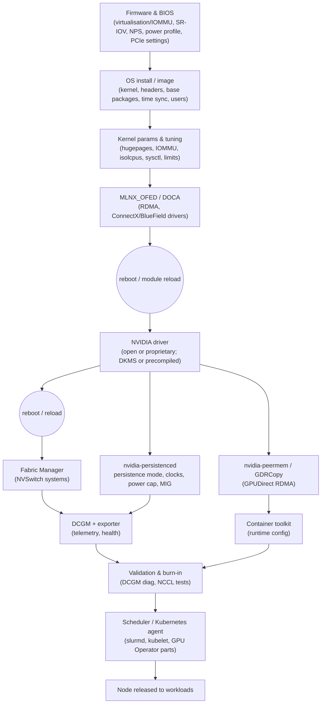

# 4.17 Ansible for GPU nodes and clusters

| | |
|---|---|
| Level | Advanced |
| Priority tier | 0 |
| Lab venue | Ubuntu 22.04/24.04 or RHEL 9 nodes with NVIDIA GPUs (A100/H100 class for NVSwitch topics); ConnectX NICs optional; stub scripts for rehearsal on plain VMs |
| Part | Part 4: Automation and infrastructure as code |
| Status | Drafted, labs **untested** |

## Why this matters for AI infrastructure

This is where the previous chapters meet the hardware. A GPU node is only useful when a long chain of dependent components is correct and mutually compatible: BIOS and firmware settings, a kernel with matching headers, RDMA networking drivers (MLNX_OFED/DOCA), the NVIDIA driver, `nvidia-persistenced`, Fabric Manager on NVSwitch systems, GPUDirect modules (`nvidia-peermem`), DCGM and exporters for telemetry, the container toolkit, kernel tuning, filesystem mounts and the scheduler or Kubernetes agent. Get the order wrong and you debug `modprobe` failures; get versions wrong and a fleet silently runs at half speed; skip validation and the first sign of a bad node is a failed 64-node training job. Ansible's job here is to make node bring-up, upgrade and repair **deterministic, ordered, verified and repeatable** across hundreds or thousands of machines.

## Prerequisites and outcomes

Needs 4.3 to 4.16 and Linux/GPU basics from Parts 1, 9 and 10 (details of drivers, CUDA and NVLink appear there). After this chapter you can:

- Describe the dependency order of a GPU node stack and encode it in roles and playbooks with correct reboot points.
- Write roles for kernel/OS prerequisites, MLNX_OFED/DOCA, NVIDIA driver (package and runfile paths), Fabric Manager, DCGM, container toolkit, MIG, persistence mode, clocks/power, hugepages/NUMA/IRQ tuning, and monitoring agents.
- Handle reboots, long installs (`async`), package pinning/holds, DKMS vs precompiled modules, and rollback safely.
- Validate nodes (GPU count, NVLink/NVSwitch state, ECC, PCIe link width/speed, IB link state, DCGM diagnostics, burn-in, NCCL tests) and gate scheduling on the result.
- Implement drain → patch → validate → resume workflows for Slurm and Kubernetes, canary rollouts, and fleet-wide diagnostics.
- Recognise and avoid the classic incidents: interactive `dpkg` prompts, "green but dead" services, secrets leaking to logs, precedence surprises, kernel/driver mismatches.

## 1. The node bring-up dependency graph



Rules distilled from the graph: install RDMA stack **before** the GPU driver whose peer-memory module binds to it; reboot or reload modules at each boundary where kernel modules change; start Fabric Manager only after a matching driver is loaded and before CUDA workloads run; validate **before** the scheduler sees the node; register with the scheduler last. If you use the GPU Operator on Kubernetes, it can manage the driver container, toolkit and DCGM itself (Part 11), and Ansible's role narrows to OS, kernel, OFED, and kubelet.

## 2. Project structure

```text
gpu-platform/
├── inventories/prod/{hosts.yml,group_vars/}
│   └── group_vars/
│       ├── gpu_h100.yml        # driver branch, clocks, nccl env, mig profile
│       ├── gpu_a100.yml
│       └── all/{vars.yml,vault.yml}
├── playbooks/
│   ├── gpu_bringup.yml         # new node: full ordered stack
│   ├── gpu_update_driver.yml   # driver/OFED upgrade with drain
│   ├── gpu_validate.yml        # diagnostics and burn-in
│   ├── gpu_patch_os.yml        # kernel/security patching
│   └── fleet_diag.yml          # read-only fleet checks
└── roles/
    ├── gpu_facts/ base_os/ kernel_tuning/ mofed/ nvidia_driver/ fabric_manager/ dcgm/ container_toolkit/
    ├── gpu_tuning/ gpu_validate/ slurm_client/ k8s_node_prereqs/ node_exporter/
```

A single bring-up playbook should read like the graph:

```yaml
# playbooks/gpu_bringup.yml
- name: Bring up GPU nodes
  hosts: "{{ target | default('gpu_new') }}"
  become: true
  serial: "{{ bringup_serial | default(10) }}"
  max_fail_percentage: 10
  roles:
    - { role: gpu_facts, tags: [facts] }
    - { role: base_os, tags: [base] }
    - { role: kernel_tuning, tags: [kernel] }
    - { role: mofed, tags: [mofed], when: "gpu_nic_family | default('') == 'connectx'" }
    - { role: nvidia_driver, tags: [driver] }
    - { role: fabric_manager, tags: [fm], when: ansible_local.gpu.nvswitch | default(false) }
    - { role: gpu_tuning, tags: [tuning] }
    - { role: dcgm, tags: [telemetry] }
    - { role: container_toolkit, tags: [containers], when: container_runtime is defined }
    - { role: gpu_validate, tags: [validate] }
    - { role: slurm_client, tags: [scheduler], when: "scheduler | default('') == 'slurm'" }
```

## 3. Roles in detail

### 3.1 gpu_facts: know the hardware before changing it

```yaml
- name: Detect NVIDIA devices
  ansible.builtin.shell: "lspci -d 10de: -nn | grep -Ei '3d controller|vga' | wc -l"
  args: { executable: /bin/bash }
  register: gpu_pci
  changed_when: false
  failed_when: false

- name: Detect NVSwitch (NVLink fabric)
  ansible.builtin.shell: "lspci -d 10de: | grep -ci nvswitch || true"
  args: { executable: /bin/bash }
  register: nvswitch
  changed_when: false

- name: Detect ConnectX / BlueField
  ansible.builtin.shell: "lspci -d 15b3: | grep -Eci 'infiniband|ethernet|mellanox' || true"
  args: { executable: /bin/bash }
  register: nic
  changed_when: false

- name: Publish local facts for later roles
  ansible.builtin.copy:
    dest: /etc/ansible/facts.d/gpu.fact
    mode: "0644"
    content: |
      {"count": {{ gpu_pci.stdout | int }}, "nvswitch": {{ (nvswitch.stdout | int > 0) | lower }}, "rdma_nics": {{ nic.stdout | int }}}
- ansible.builtin.setup: { filter: ansible_local }
```

Compare the discovered count with the inventory's intended `expected_gpus`: a mismatch (a GPU fallen off the bus after a failed power cycle) must stop the bring-up and raise a hardware ticket rather than continue.

### 3.2 base_os and kernel_tuning

- Time sync (`chrony`), consistent users/UIDs (SSSD/LDAP or static), SSH hardening, package repos (internal mirrors), `unattended-upgrades` disabled or controlled (a competing apt process caused the incident in section 7), kernel version pinned (`dpkg_selections hold` or `versionlock`) and **matching headers** installed for DKMS (`linux-headers-$(uname -r)`).
- Kernel parameters via GRUB drop-ins (`GRUB_CMDLINE_LINUX_DEFAULT`): `intel_iommu=on iommu=pt`/`amd_iommu=on`, `default_hugepagesz=1G hugepagesz=1G hugepages=N` where used, `isolcpus`/`nohz_full` only if justified, `numa_balancing=disable` (sysctl), `transparent_hugepage=madvise`, `pci=realloc` situations, `processor.max_cstate`; apply with `update-grub`/`grub2-mkconfig` and a controlled reboot. Sysctls for networking and memory (`net.core.rmem_max`, `vm.max_map_count`, `vm.swappiness=1`), `limits.d` (memlock unlimited for RDMA, nofile high), tuned/`cpupower` governors, IRQ affinity (`irqbalance` policy or explicit pinning for NICs), `ulimit` in systemd units, disable unneeded services, and consistent `/dev/shm` sizes for NCCL/PyTorch. (Details in Parts 1, 9, 12.)
- **Host OS, NUMA, Memory, and GPU Tuning insights from *AI Systems Performance Engineering* (`ASP` Chapter 3):**
  - *Eliminating CPU-induced GPU "bubbles" (`performance` governor & deep C-states):* Even though GPUs execute the matrix math, the host CPU must continuously launch CUDA kernels and prepare/tokenize data batches. If a CPU core enters a deep sleep state (`C-state`), waking it up adds microseconds of jitter that accumulate into **GPU bubbles** (idle gaps between kernels). Setting the BIOS profile to High Performance, locking the Linux CPU frequency governor to **`performance`** (`cpupower frequency-set -g performance`), and disabling deep C-states keeps kernel-launch latency deterministic.
  - *NUMA affinity (`nvidia-smi topo -m`, `numactl`, and Grace Blackwell NVLink-C2C):* On dual-socket x86 servers, if a data-loader process on NUMA node 0 feeds a GPU attached to PCIe root complex on NUMA node 1, host-to-device (`H2D` pinned-memory DMA) transfers must cross the inter-socket UPI/Infinity Fabric interconnect, **nearly doubling memory access latency**. Playbooks should capture `nvidia-smi topo -m`, configure Kubernetes kubelet with **`--topology-manager-policy=single-numa-node`** (or `restricted`) and **`--cpu-manager-policy=static`**, and verify `pin_memory=True` + `non_blocking=True` readiness. (On integrated Grace Blackwell superchips, the Grace CPU and Blackwell GPU share coherent memory over **NVLink-C2C at up to 900 GB/s**, and an **NVL72 rack domain** provides **130 TB/s aggregate bidirectional NVLink bandwidth, or 1.8 TB/s per GPU**.)
  - *Page-cache write-back tuning (`vm.dirty_ratio`) and host allocators (`jemalloc` / `tcmalloc`):* Large training runs write multi-gigabyte checkpoints in bursts; tuning `vm.dirty_background_ratio` and `vm.dirty_ratio` (alongside asynchronous/distributed checkpointing) prevents Linux page-cache write-back stalls from freezing training steps, while preloading **`jemalloc`** (`narenas`, `background_thread:true`) or **`tcmalloc`** reduces host-RAM fragmentation in multi-worker Python data loaders.
  - *ECC (`-e 1`), clock locking (`-lgc`), and Blackwell B200 MIG profiles (`ASP` Chapter 3 Table 3-1):* Always keep **ECC enabled** on production AI fleets (a single undetected cosmic-ray bit flip during a multi-week training run can silently corrupt gradients into `NaN`; changing ECC requires a GPU reset/reboot). Use **locked clocks (`nvidia-smi -lgc`)** during acceptance benchmarks so thermal throttling on later runs does not skew comparisons, and use **MIG (`Multi-Instance GPU`)** for multi-tenant small-model inference (for example, on Blackwell B200: `MIG 1g.23gb` x7, `1g.45gb` x4, `2g.45gb` x3, `3g.90gb` x2, `4g.90gb` x1, or `7g.180gb` x1; whereas large multi-GPU training jobs disable MIG to use full GPUs).

### 3.3 mofed (MLNX_OFED / DOCA-Host)

```yaml
- name: Download and verify the OFED bundle
  ansible.builtin.get_url:
    url: "{{ mofed_base_url }}/MLNX_OFED-{{ mofed_version }}/MLNX_OFED_LINUX-{{ mofed_version }}-{{ ansible_facts['distribution'] | lower }}{{ ansible_facts['distribution_version'] }}-x86_64.tgz"
    dest: "/var/cache/mofed/{{ mofed_version }}.tgz"
    checksum: "sha256:{{ mofed_sha256 }}"
    mode: "0644"

- name: Unpack
  ansible.builtin.unarchive: { src: "/var/cache/mofed/{{ mofed_version }}.tgz", dest: /opt/mofed, remote_src: true, creates: "/opt/mofed/MLNX_OFED_LINUX-{{ mofed_version }}-{{ ansible_facts['distribution'] | lower }}{{ ansible_facts['distribution_version'] }}-x86_64" }

- name: Install (long-running; async protects the SSH session)
  ansible.builtin.command:
    cmd: "./mlnxofedinstall --force --without-fw-update --add-kernel-support"
    chdir: "/opt/mofed/MLNX_OFED_LINUX-{{ mofed_version }}-{{ ansible_facts['distribution'] | lower }}{{ ansible_facts['distribution_version'] }}-x86_64"
    creates: /etc/infiniband/openib.conf         # idempotency guard; better: compare `ofed_info -s` with the target version
  async: 3600
  poll: 60
  register: ofed_install
  notify: reboot node

- name: Rebuild initramfs so the new modules load early
  ansible.builtin.command: update-initramfs -u -k all
  when: ofed_install is changed and ansible_facts['os_family'] == 'Debian'

- ansible.builtin.meta: flush_handlers       # reboot now, before the NVIDIA driver build
```

Considerations: the installer replaces in-box kernel networking drivers, so version pinning, kernel matching (`--add-kernel-support` rebuilds for a running kernel), and a rollback path matter; firmware updates (`mlxfwmanager`, `--without-fw-update`) are a separate, carefully staged workflow (Part 9); the idempotency guard should compare installed versus requested (`ofed_info -s`) so version bumps re-run the installer; DOCA-Host (the successor bundle for ConnectX/BlueField) uses repository packages (`doca-ofed`) which are easier to automate than the ISO/tarball installer.

The reboot handler:

```yaml
- name: reboot node
  ansible.builtin.reboot:
    msg: "Ansible: loading new kernel/RDMA modules"
    pre_reboot_delay: 10
    reboot_timeout: 1800            # GPU servers can take 10+ minutes to POST
    post_reboot_delay: 60
    test_command: "uptime"
```

Servers with many GPUs and NICs have slow POST and memory training; set generous timeouts and verify the BMC for stuck boots (Part 7).

### 3.4 nvidia_driver

Decisions encoded as variables: **branch** (production/LTS vs new feature), **flavour** (open kernel modules, required on Blackwell and recommended for recent data-centre GPUs, vs proprietary), **install method** (distribution/NVIDIA repo packages with DKMS or precompiled kernel modules; `.run` file only for special cases), **version pin**, and **holds**.

```yaml
- name: Add the NVIDIA CUDA repository key and source (keyring-based)
  ansible.builtin.get_url:
    url: "https://developer.download.nvidia.com/compute/cuda/repos/ubuntu2204/x86_64/3bf863cc.pub"
    dest: /etc/apt/keyrings/nvidia-cuda.asc
    mode: "0644"
- ansible.builtin.apt_repository:
    repo: "deb [signed-by=/etc/apt/keyrings/nvidia-cuda.asc] https://developer.download.nvidia.com/compute/cuda/repos/ubuntu2204/x86_64/ /"
    filename: nvidia-cuda
    state: present

- name: Blacklist nouveau
  ansible.builtin.copy:
    dest: /etc/modprobe.d/blacklist-nouveau.conf
    content: "blacklist nouveau\noptions nouveau modeset=0\n"
    mode: "0644"
  notify: rebuild initramfs

- name: Install the pinned driver (non-interactive)
  ansible.builtin.apt:
    name:
      - "nvidia-driver-{{ nv_driver_branch }}-server-open"       # naming varies by distro/repo: verify
      - "nvidia-utils-{{ nv_driver_branch }}-server"
    state: present
    dpkg_options: "force-confold,force-confdef"
    lock_timeout: 300
    update_cache: true
    cache_valid_time: 3600
  environment: { DEBIAN_FRONTEND: noninteractive }
  register: driver_pkg
  notify: reboot node

- name: Hold packages to prevent drift
  ansible.builtin.dpkg_selections:
    name: "{{ item }}"
    selection: hold
  loop: ["nvidia-driver-{{ nv_driver_branch }}-server-open", "nvidia-utils-{{ nv_driver_branch }}-server"]
  when: nv_hold_packages | default(true)

- ansible.builtin.meta: flush_handlers

- name: Confirm driver and expected GPU count
  ansible.builtin.command: nvidia-smi --query-gpu=driver_version,index --format=csv,noheader
  register: smi
  changed_when: false
  failed_when: (smi.stdout_lines | length) != expected_gpus or (smi.stdout_lines[0].split(',')[0] | trim) is not match('^' ~ nv_driver_branch)
```

Real-world details: package names differ across distributions and NVIDIA repository layouts; DKMS builds need headers and can fail after kernel updates (hence the kernel pin and hold); upgrades must unload dependent modules (`nvidia_uvm`, `nvidia_peermem`, `nvidia_drm`), stop services using the GPUs (DCGM, persistenced, exporters, containers), install, and reload or reboot; **downgrades** need explicit permission variables. RHEL families use `dnf` modules (`dnf module enable nvidia-driver:550-open`), `versionlock`, and the same cautions. Mixing the driver from the OS and from NVIDIA repos is a classic break.

### 3.5 fabric_manager, GPU tuning, MIG

```yaml
- name: Fabric Manager matching the driver branch (NVSwitch systems: HGX/DGX)
  ansible.builtin.apt:
    name: "nvidia-fabricmanager-{{ nv_driver_branch }}"
    state: present
    dpkg_options: "force-confold,force-confdef"
- ansible.builtin.systemd_service: { name: nvidia-fabricmanager, state: started, enabled: true }
- name: Verify NVSwitch fabric is up
  ansible.builtin.command: nvidia-smi nvlink --status -i 0
  register: nvl
  changed_when: false
  failed_when: "'inactive' in nvl.stdout | lower"
```

(Fabric Manager's version must exactly match the driver; on NVLink-switch fabrics such as GB200 NVL72 the multi-node NVLink domain uses additional components (IMEX, NVLink management software); see Part 9.)

GPU tuning role tasks: `nvidia-persistenced` enabled (or persistence mode via `nvidia-smi -pm 1`), application clocks / locked clocks if policy dictates (`nvidia-smi -lgc`), power limits (`-pl`; the `gpu_power_limit` module from 4.15), ECC mode, compute mode (`EXCLUSIVE_PROCESS` vs default), **MIG** (`nvidia-smi -mig 1`, create GPU/compute instances with `nvidia-smi mig -cgi ... -C`; changing MIG mode may need GPU reset or reboot and no processes on the GPU), `nvidia-smi topo -m` snapshot for inventory, GDRCopy kernel module, `nvidia-peermem` loaded at boot (`modules-load.d`), and `/etc/udev` rules/permissions for device nodes if non-root runtimes require them.

```yaml
- name: Enable persistence daemon
  ansible.builtin.systemd_service: { name: nvidia-persistenced, state: started, enabled: true }

- name: Load GPUDirect RDMA module at boot and now
  community.general.modprobe: { name: nvidia_peermem, state: present, persistent: present }
  when: ansible_local.gpu.rdma_nics | default(0) | int > 0

- name: Configure MIG when requested
  ansible.builtin.include_tasks: mig.yml
  when: mig_profile is defined
```

### 3.6 dcgm and telemetry

```yaml
- ansible.builtin.apt: { name: datacenter-gpu-manager, state: present }
- ansible.builtin.systemd_service: { name: nvidia-dcgm, state: started, enabled: true }
- name: Deploy the metrics selection for the exporter
  ansible.builtin.copy: { src: dcp-metrics-custom.csv, dest: /etc/dcgm-exporter/dcp-metrics-custom.csv, mode: "0644" }
  notify: restart dcgm-exporter
- name: Run the exporter (container or package)
  community.docker.docker_container: { ... }          # see 4.16; or systemd unit for the binary
- name: Quick health check
  ansible.builtin.command: dcgmi diag -r 1
  register: diag1
  changed_when: false
  failed_when: diag1.rc != 0 or "Fail" in diag1.stdout
```

Expose node health to Prometheus (DCGM exporter on 9400, node_exporter), set labels (`cluster`, `rack`, `gpu_model`), and make sure alerts exist for XID errors, ECC, thermal throttling, NVLink errors, PCIe replay counters and missing GPUs (Part 17). `dcgmi diag -r 1|2|3` levels trade time for coverage: level 1 seconds, level 2 minutes, level 3 about 15 to 30 minutes of stress.

### 3.7 container_toolkit and runtimes

Install `nvidia-container-toolkit`, configure the runtime (`nvidia-ctk runtime configure --runtime=containerd|docker|crio`, then restart the runtime), generate CDI specs if used (`nvidia-ctk cdi generate`), and test with a short container running `nvidia-smi`. Keep versions aligned with the driver and with the Kubernetes device plugin (Part 11).

### 3.8 Scheduler and Kubernetes agents

Last: `slurm_client` (munge key, `slurm.conf`, `gres.conf` auto-detect via NVML, cgroups, `slurmd`), or Kubernetes node prerequisites (container runtime, kubelet, `nvidia.com/gpu` device plugin through the GPU Operator, node labels/taints for GPU pools, hugepages and topology manager settings). A node joins the scheduler only after validation succeeds (section 5).

## 4. Reboots, long tasks and idempotent upgrades

- **Where reboots belong**: after kernel/OFED/driver changes that need new modules; use handlers plus `meta: flush_handlers` so the play continues on a clean boot. Detect need instead of rebooting blindly (`/var/run/reboot-required`, `needs-restarting -r`, comparing running vs installed module versions with `modinfo` and `cat /proc/driver/nvidia/version`).
- **Long installs** (OFED, driver DKMS builds, large package sets): `async`/`poll` or `timeout`, and plenty of `forks`/`throttle` awareness for mirror load.
- **Reload instead of reboot** when safe: stop dependent services, unload `nvidia_uvm nvidia_drm nvidia_modeset nvidia` in order, `modprobe` new ones; fall back to reboot if module unload fails (`rmmod: in use`) — find holders with `lsof /dev/nvidia*`, `fuser -v /dev/nvidia*`.
- **Version-aware idempotency**: compare installed and desired versions explicitly; a role that only checks "is any driver present" will never upgrade.
- **Rollback**: keep the previous package versions available in the mirror; use the `block/rescue` pattern from 4.8 to reinstall the previous version, and leave the node drained when validation fails.
- **Package locks and unattended upgrades**: stop or hold `unattended-upgrades` and `apt-daily` timers on GPU nodes (security patches via controlled windows), otherwise dpkg locks and surprise kernel updates will break DKMS.

## 5. Validation and burn-in

Gate a node's entry to production with progressively heavier tests, each as tasks in `gpu_validate`:

| Stage | Checks | Tools | Time |
|---|---|---|---|
| Inventory sanity | GPU count/model, PCIe link width and speed (x16 Gen5), NUMA mapping, NIC count/speed/state, no AER errors in `dmesg` | `nvidia-smi -q`, `lspci -vv`, `nvidia-smi topo -m`, `ibstat`, `ibdev2netdev`, `ethtool`, `dmesg` | seconds |
| Driver/health | No XID errors, ECC clean, retired pages within limits, clocks and temperatures sane, NVLink all active, Fabric Manager healthy | `nvidia-smi -q -d ECC,PAGE_RETIREMENT`, `nvidia-smi nvlink -s`, `journalctl -k \| grep -i xid`, `dcgmi health -c` | seconds |
| DCGM diagnostics | Level 1 to 3 | `dcgmi diag -r 1/2/3` | seconds to 30 min |
| Single-node stress | Thermal/power stability, ECC under load | `gpu-burn`, DCGM level 3, `nvbandwidth`, `dcgmproftester` | 10 to 30 min |
| GPUDirect/P2P | P2P and NVLink bandwidth | `nvbandwidth`, `p2pBandwidthLatencyTest`, `nvidia-smi nvlink` | minutes |
| Network | Link state, RDMA perftest (`ib_write_bw`, `ib_send_lat`) to a peer, GID/RoCE config, MTU | `perftest`, `ibv_devinfo`, `rdma link` | minutes |
| Multi-node collectives | NCCL all-reduce within tolerance of the expected bus bandwidth | `nccl-tests` (`all_reduce_perf`), `mpirun`/`srun` | minutes |

```yaml
- name: Single-node GPU stress (30 min) in the background
  ansible.builtin.command: ./gpu_burn 1800
  args: { chdir: "{{ burn_dir }}" }
  register: burn
  async: 2100
  poll: 60
  changed_when: false

- name: No hardware errors during burn
  ansible.builtin.shell: "journalctl -k --since '-40min' | grep -Ei 'xid|nvrm.*error|fallen off the bus' || true"
  args: { executable: /bin/bash }
  register: kerr
  changed_when: false
  failed_when: kerr.stdout | length > 0 or ('faulty' in burn.stdout | lower)
```

(Use your standard burn tool pinned by commit SHA and built into your image; don't compile from a moving branch at test time. Xid errors appear in the kernel log, not in the burn tool's output.)

```yaml
# Multi-node NCCL test from a controller/login node (run as a normal user, not root)
- name: NCCL all_reduce across a rack
  hosts: login[0]
  become: false
  vars: { nodes_per_rack: 8, gpus_per_node: 8 }
  tasks:
    - ansible.builtin.template: { src: hostfile.j2, dest: "/tmp/hosts.{{ rack }}" }
    - name: Run nccl-tests
      ansible.builtin.command: >
        mpirun --hostfile /tmp/hosts.{{ rack }} -np {{ nodes_per_rack * gpus_per_node }} --map-by ppr:{{ gpus_per_node }}:node
        -x LD_LIBRARY_PATH -x NCCL_DEBUG=WARN -x NCCL_IB_HCA={{ nccl_ib_hca }}
        /opt/nccl-tests/build/all_reduce_perf -b 8 -e 8G -f 2 -g 1
      register: nccl
      changed_when: false
    - name: Check bus bandwidth against the expected floor
      ansible.builtin.assert:
        that: (nccl.stdout | regex_search('Avg bus bandwidth\s*:\s*([0-9.]+)', '\1') | first | float) >= expected_busbw_gbps
        fail_msg: "NCCL busbw below {{ expected_busbw_gbps }} GB/s on rack {{ rack }}"
```

(Bus bandwidth expectations depend on topology, NIC speeds and message sizes; derive baselines from known-good runs and record them.) Store results as artefacts (JSON) with node serials so trends and repeat offenders are visible; failing nodes are tagged `quarantine` and kept out of the scheduler.

## 6. Day-2: drain, patch, validate, resume

Reuse the pattern from 4.8 with GPU-aware checks:

```yaml
- name: Patch GPU nodes safely
  hosts: gpu
  become: true
  serial: [1, "5%", "10%"]
  max_fail_percentage: 3
  vars: { scheduler_host: "{{ groups['slurm_controller'][0] }}" }
  tasks:
    - name: Drain from Slurm and wait for jobs to finish
      block:
        - ansible.builtin.command: scontrol update NodeName={{ inventory_hostname }} State=DRAIN Reason="maintenance {{ change_id }}"
          delegate_to: "{{ scheduler_host }}"
          changed_when: true
        - ansible.builtin.command: squeue -h -w {{ inventory_hostname }} -o %i
          delegate_to: "{{ scheduler_host }}"
          register: jobs
          until: jobs.stdout == ""
          retries: "{{ drain_wait_retries | default(240) }}"
          delay: 30
          changed_when: false

    - name: Apply updates
      block:
        - ansible.builtin.import_role: { name: nvidia_driver }
        - ansible.builtin.import_role: { name: gpu_validate, tasks_from: quick }
      rescue:
        - ansible.builtin.debug: { msg: "Maintenance failed on {{ inventory_hostname }}; leaving node DRAINED" }
        - ansible.builtin.fail: { msg: "Node {{ inventory_hostname }} requires investigation" }

    - name: Return to service
      ansible.builtin.command: scontrol update NodeName={{ inventory_hostname }} State=RESUME
      delegate_to: "{{ scheduler_host }}"
      changed_when: true
```

Kubernetes equivalent: `kubernetes.core.k8s_drain` (respecting PodDisruptionBudgets), taint with `nvidia.com/gpu=maintenance:NoSchedule`, patch, validate (DCGM/NVML), uncordon. For driver upgrades under the GPU Operator, use its upgrade controller rather than manual host changes (Part 11).

Fleet-wide diagnostics (read-only, safe to run any time):

```yaml
- name: Fleet GPU health sweep
  hosts: gpu
  gather_facts: false
  become: true
  tasks:
    - name: Collect a compact health record
      ansible.builtin.shell: |
        set -o pipefail
        nvidia-smi --query-gpu=index,name,driver_version,temperature.gpu,power.draw,clocks_throttle_reasons.active,ecc.errors.uncorrected.volatile.total,pcie.link.gen.current,pcie.link.width.current --format=csv,noheader,nounits
      args: { executable: /bin/bash }
      register: health
      changed_when: false
      failed_when: false
    - ansible.builtin.copy:
        content: "{{ {'host': inventory_hostname, 'rc': health.rc, 'rows': health.stdout_lines} | to_nice_json }}"
        dest: "reports/{{ inventory_hostname }}.json"
      delegate_to: localhost
      become: false
```

Aggregate the JSON into a report (count nodes with fewer than 8 GPUs, PCIe link degraded below x16, nonzero uncorrected ECC, active throttle reasons); this is a typical first step in an incident when many jobs slow down.

## 7. Incidents that shaped the design

1. **Interactive prompt freezes the fleet.** A package upgrade across 256 GPU nodes stalled forever on a `dpkg` configuration-file prompt (no TTY). Cause: apt run non-interactively without conffile policy, or competing with `unattended-upgrades`. Fix: use the `apt` module with `dpkg_options: force-confold,force-confdef`, `lock_timeout`, `DEBIAN_FRONTEND=noninteractive`, disable unattended upgrades on nodes, and set task `timeout`.
2. **Green but dead.** `systemd` start returned OK while `slurmctld` crashed seconds later on a bad `slurm.conf`. Fix: verify behaviour after every critical start (`sinfo`, `curl /health`) with `until/retries` and validate configs before installing them (4.7).
3. **Secrets in logs.** A `command` task with a database password on the command line printed it into job logs. Fix: `no_log: true`, pass secrets via files/stdin, scan logs (4.12).
4. **Precedence surprise.** A forgotten `host_vars` file pinned one DGX to an old driver version while `group_vars` said otherwise. Fix: inspect with `ansible-inventory --host`, treat `host_vars` as exceptional, and add an assert/report that lists driver versions per node after each run (4.5).
5. **Kernel and driver mismatch.** A kernel update (unattended or by a different team) invalidated the DKMS module build; nodes lost GPUs after reboot. Fix: pin kernel and driver together, hold packages, test updates on a canary, and use precompiled/signed modules where Secure Boot is required (module signing keys managed deliberately).
6. **Silent half-fabric.** A node's ConnectX port came up at a lower speed or one rail was down; training ran at half speed. Fix: validation compares link speed/state per rail with the design; fleet sweeps record `ibstat`/`rdma link` output and flag deviations.
7. **Thundering herd on the mirror.** 1,000 nodes downloading the same driver and OFED at once saturated the mirror. Fix: `throttle`, `serial`, local caches/proxies, preseeded images.
8. **Reboot loops.** A bad GRUB parameter or module config prevented boot; automation retried reboots. Fix: canary first, `max_fail_percentage`, BMC out-of-band access to recover (Part 7), and a rule that automation never retries a reboot without human review when a node fails to return.

## 8. Lab

First, run the self-checking Python lab (`code/part04/ansible_gpu_cluster_lab.py`) locally. It verifies the GPU node bring-up dependency order validator (`validate_bringup_role_order`: checking `mofed` before `nvidia_driver`, `nvidia_driver` before `fabric_manager`, and `gpu_validate` before `slurm_client`), the fleet `nvidia-smi` health-sweep outlier classifier (`evaluate_gpu_health_sweep`: catching missing GPUs fallen off the bus, uncorrected ECC errors, and PCIe `Gen4x8` degradation), and the `nccl-tests` `all_reduce_perf` bus-bandwidth parser and gate (`parse_and_gate_nccl_busbw`).

```bash
python3 code/part04/ansible_gpu_cluster_lab.py
```

If no physical GPU is available, rehearse the interactive steps below (`untested here`) with stub `nvidia-smi`, `dcgmi`, and `ibstat` scripts on a plain VM so roles, ordering, handlers, reboots, and validation logic are exercised; reserve the hardware steps for a real node:

1. **gpu_facts**: implement the role; compare discovered counts with expected; publish `ansible_local.gpu`; test with stubs and on a GPU host.
2. **Ordered bring-up**: write the playbook from the graph with reboot points; run on a fresh VM/node; confirm `--list-tasks` order and that rerun is `changed=0` (apart from validation probes).
3. **Driver role**: pin a branch, hold packages, run non-interactively with `dpkg_options`; simulate a conffile prompt to prove the fix; try an upgrade and a blocked downgrade; test `rescue` rollback.
4. **OFED role**: add async install, checksum, version-aware idempotency, initramfs rebuild and reboot flush; document the rollback.
5. **Reboot handling**: trigger a reboot via handler; verify `post_reboot_delay` and `test_command`; test behaviour when the node fails to return (timeout, failure policy).
6. **Tuning**: persistence daemon, power limit (use the 4.15 module), MIG profile (on a MIG-capable GPU), peermem; verify with `nvidia-smi` and `lsmod`.
7. **Telemetry**: deploy DCGM and the exporter; scrape from Prometheus; create an alert test for a missing GPU (use a metric from a stub).
8. **Validation ladder**: implement quick (seconds), standard (DCGM level 2) and burn (30 min) task files; gate scheduler registration on success; store JSON reports.
9. **NCCL**: run nccl-tests on two or more nodes; record baseline bus bandwidth per message size; assert against the floor; compare with a deliberately degraded NIC (MTU or `NCCL_IB_DISABLE=1`).
10. **Drain/patch/resume**: execute the workflow on a lab Slurm; inject a validation failure and confirm the node stays drained; do the Kubernetes variant with `k8s_drain` and a PDB.
11. **Fleet sweep**: run the health sweep across many (simulated) nodes, aggregate to a table, and flag outliers.
12. **Incident replays**: reproduce the interactive `dpkg` hang, the green-but-dead service and the stale `host_vars` precedence; fix each with the patterns above.
13. **Clean up** nodes/VMs and cloud GPUs.

## 9. Common mistakes

- Installing the NVIDIA driver before the RDMA stack, or skipping the reboot/module reload between them.
- Letting packages float (`state: latest`) or letting `unattended-upgrades` change kernels and drivers.
- Mismatched kernel, headers, driver branch, Fabric Manager and DCGM versions.
- Treating "service started" as "node healthy"; skipping burn-in and collectives tests.
- Hard-coded package names across distributions; roles that fail halfway and leave a node half-configured but visible to the scheduler.
- Rolling to the whole fleet without a canary; no `max_fail_percentage`; reboot retries on non-returning nodes.
- Compiling tools from moving branches at test time; unpinned benchmark versions.
- No record of results, so repeat-offender nodes and slow regressions go unnoticed.
- Secrets in command lines; verbose logs with credentials.
- Applying Ansible driver changes underneath the GPU Operator, creating two managers for the same component.

## 10. Interview angles

- "Walk through bringing up a new DGX/HGX node with Ansible from bare OS to schedulable." (order, reboots, validation, scheduler last.)
- "How do you upgrade GPU drivers across a running cluster?" (drain, canary, DKMS/headers, holds, validation, rollback.)
- "Why install MOFED before the NVIDIA driver? What is nvidia-peermem?"
- "How do you validate a node before releasing it to users?" (DCGM diag levels, burn-in, NVLink/PCIe/IB checks, NCCL test.)
- "A playbook upgrading packages hangs on 200 nodes. Diagnose." (dpkg prompt, locks, unattended upgrades, noninteractive, timeouts.)
- "How do you keep GPU nodes consistent over time?" (golden images, pins, drift checks, scheduled `--check`, fleet sweeps.)
- "How do you coordinate with Slurm/Kubernetes during maintenance?" (drain/cordon, PDBs, resume only after validation.)
- "How do you detect a degraded node whose job is merely slow?" (link speeds, throttle reasons, ECC, NCCL baseline.)

## Exercises

1. **The GPU Node Bring-Up Dependency DAG (`mofed` -> `nvidia_driver` -> `fabric_manager` -> `gpu_validate` -> `slurm_client`):** Using `validate_bringup_role_order()` in `code/part04/ansible_gpu_cluster.py`, explain why `mofed` (or `doca-ofed`) and its reboot must complete *before* building/loading the NVIDIA driver and `nvidia_peermem`, why `nvidia-fabricmanager` must match the exact driver version on NVSwitch systems, and why `gpu_validate` must gate `slurm_client` / `kubelet` startup.
2. **Pre-Flight Hardware Discovery (`gpu_facts` via `lspci`) and Host OS / NUMA / CPU Tuning (`ASP` Chapter 3):** (a) Show how `gpu_facts` uses `lspci -d 10de:` and `lspci -d 15b3:` to publish `/etc/ansible/facts.d/gpu.fact` (`count`, `nvswitch`, `rdma_nics`) and halt immediately if a GPU has fallen off the PCIe bus; (b) explain why `ASP` Chapter 3 configures the `performance` CPU governor, disables deep C-states, sets `vm.swappiness=1` and `transparent_hugepage=madvise`, tunes `vm.dirty_ratio` for checkpoint write-backs, and enables `--topology-manager-policy=single-numa-node`.
3. **Non-Interactive Driver & OFED Installation (`dpkg_options`, `lock_timeout`, `dpkg_selections`, `async`) and Reboot Handling:** Trace the `mofed` and `nvidia_driver` roles: explain how `DEBIAN_FRONTEND: noninteractive`, `dpkg_options: "force-confold,force-confdef"`, `lock_timeout: 300`, `dpkg_selections: hold`, and `unattended-upgrades` removal prevent fleet hangs and DKMS kernel mismatches, and why `reboot` uses `reboot_timeout: 1800` and `meta: flush_handlers`.
4. **GPU Tuning (`nvidia-persistenced`, `nvidia_peermem`, ECC, Locked Clocks, MIG Profiles) and DCGM Telemetry (`ASP` Chapter 3):** Explain the purpose of `nvidia-persistenced`, `nvidia_peermem`, ECC (`-e 1`), locked clocks (`-lgc`), and MIG partitioning (`ASP` Ch. 3 Table 3-1 Blackwell B200 profiles `1g.23gb`..`7g.180gb`), and contrast `dcgmi diag -r 1`, `-r 2`, and `-r 3`.
5. **The 7-Stage Node Validation & Burn-In Ladder (`gpu-burn`, `nvbandwidth`, `perftest`, `nccl-tests`):** Using `parse_and_gate_nccl_busbw()` in `code/part04/ansible_gpu_cluster.py`, trace the 7 validation stages in Section 5 from PCIe/NVLink sanity up to `gpu-burn` (checking `journalctl -k` for XID errors) and multi-node `mpirun ... all_reduce_perf` bus-bandwidth assertions.
6. **Day-2 Drain/Patch/Validate/Resume Workflows and Fleet Health-Sweep Triage (`evaluate_gpu_health_sweep`):** Using `evaluate_gpu_health_sweep()` in `code/part04/ansible_gpu_cluster.py`, show how a read-only fleet sweep across `nvidia-smi --query-gpu=...` pinpoints degraded nodes (7/8 GPUs, PCIe `Gen4x8` downgrade, uncorrected ECC, thermal throttling) when distributed training slows down, and trace the Slurm / Kubernetes (`k8s_drain`) maintenance workflow.

## Checkpoint questions (20)

<details>
<summary>1. Why must the RDMA stack (`MLNX_OFED` / `DOCA-Host`) be installed and booted BEFORE the NVIDIA GPU driver and `nvidia-peermem`?</summary>

**GPUDirect RDMA** relies on the **`nvidia_peermem`** kernel module to register GPU HBM memory pages directly with the Mellanox/NVIDIA InfiniBand/RoCE kernel IB core (`ib_core` / `mlx5_core`) via peer-memory client symbols. If the NVIDIA driver is built or loaded before the matching OFED/DOCA kernel modules are installed and loaded, `modprobe nvidia_peermem` fails with `Invalid argument` or unresolved symbol errors, forcing all inter-node NCCL traffic to fall back through host system RAM.
</details>

<details>
<summary>2. What does `gpu_facts` check via `lspci` before installing any drivers, and why is `/etc/ansible/facts.d/gpu.fact` useful?</summary>

Before any driver is installed, `lspci -d 10de:` (NVIDIA vendor ID `0x10de`) enumerates physical GPU (`3D controller` / `VGA`) and `NVSwitch` PCIe functions, and `lspci -d 15b3:` (Mellanox vendor ID `0x15b3`) enumerates ConnectX/BlueField RDMA NICs. Comparing the PCIe count against `expected_gpus` (`8`) catches a dead riser or GPU \"fallen off the bus\" **before** wasting 30 minutes installing software, and writing `/etc/ansible/facts.d/gpu.fact` (`ansible_local.gpu.nvswitch`, `ansible_local.gpu.rdma_nics`) lets subsequent roles conditionally enable Fabric Manager and `nvidia_peermem`.
</details>

<details>
<summary>3. When is `nvidia-fabricmanager` required, and what happens if its version does not exactly match the NVIDIA driver?</summary>

**`nvidia-fabricmanager`** is required on systems with **NVSwitch chips** (such as 8-GPU HGX/DGX A100, H100, H200, and B200 nodes, where all-to-all NVLink traffic routes through baseboard NVSwitches). Fabric Manager initializes and programs the NVSwitch routing tables; until `nvidia-fabricmanager` is running, **CUDA applications cannot initialize (`cudaErrorSystemNotReady`)**. Its package version **must match the exact NVIDIA driver version string** (e.g., both `550.90.07`), or the daemon refuses to start.
</details>

<details>
<summary>4. In *AI Systems Performance Engineering* (`ASP`) Chapter 3, how do CPU sleep states (`C-states`) and CPU frequency governors cause \"GPU bubbles\", and how does Ansible prevent them?</summary>

Even though the GPU executes the heavy matrix multiplications, the host CPU must wake up at the end of every kernel/step to enqueue the next CUDA stream operations and feed pinned memory buffers. When CPU cores drop into deep power-saving **C-states** or lower P-state frequencies (`powersave`/`ondemand`), the microsecond wakeup latency creates **GPU bubbles**—gaps where a $30,000+ GPU sits at 0% utilization waiting on a sleeping CPU core. Ansible prevents this by setting the **`performance` governor** (`cpupower frequency-set -g performance`) and capping `processor.max_cstate` / `intel_idle.max_cstate` in GRUB.
</details>

<details>
<summary>5. Why does crossing NUMA nodes between a CPU data-loader worker and its target GPU hurt performance (`ASP` Chapter 3), and how do you configure NUMA alignment?</summary>

On a dual-socket server, half of the PCIe root complexes (e.g., GPUs 0–3 and NICs 0–3) attach to Socket 0 (NUMA node 0) and half (GPUs 4–7 and NICs 4–7) attach to Socket 1 (NUMA node 1). If a CPU worker on NUMA 0 copies pinned host memory (`H2D`) to GPU 4 on NUMA 1, every byte traverses the inter-socket UPI/Infinity Fabric link, **nearly doubling latency and cutting PCIe bandwidth**. Use `nvidia-smi topo -m` to inspect the topology, disable automatic kernel NUMA page migration (`kernel.numa_balancing = 0`), and configure Kubernetes kubelet with **`--topology-manager-policy=single-numa-node`** and **`--cpu-manager-policy=static`**.
</details>

<details>
<summary>6. How does Grace Blackwell (`GB200 NVL72`) change the CPU-to-GPU and multi-node interconnect architecture (`ASP` Chapter 3)?</summary>

1. **CPU-to-GPU (`NVLink-C2C`):** Instead of connecting the CPU to the GPU over PCIe Gen5 (`64 GB/s` unidirectional), the Grace Arm CPU and Blackwell GPU are linked via **NVLink-C2C at up to 900 GB/s** with a **single hardware-coherent unified virtual address space** (supported by the hardware Address Translation Service `ATS`).
2. **Rack-scale GPU-to-GPU (`NVL72`):** 72 Blackwell GPUs across 18 compute trays connect through 9 NVLink Switch trays into a single rack-scale NVLink-5 domain delivering **1.8 TB/s per GPU (130 TB/s aggregate bidirectional bandwidth)**, managed by multi-node NVLink fabric software and **IMEX (Internode Memory Exchange)** channels.
</details>

<details>
<summary>7. Why did a package upgrade playbook hang indefinitely across 256 GPU nodes in Section 7, and what five settings prevent it?</summary>

The playbook hung because `apt`/`dpkg` encountered a modified configuration file on the target nodes and **prompted interactively on `stdin` (`What would you like to do about modified configuration file...`)** where no TTY was attached (or waited forever on an `apt` lock held by `unattended-upgrades`). Prevent it with five controls:
1. **`environment: { DEBIAN_FRONTEND: noninteractive }`**
2. **`dpkg_options: "force-confold,force-confdef"`** on the `apt` module.
3. **`lock_timeout: 300`** on the `apt` module so lock contention fails cleanly after 5 minutes.
4. **Disable `unattended-upgrades`** (`apt-daily.timer`) on production GPU nodes and hold kernel/driver packages via **`dpkg_selections: { selection: hold }`**.
5. Set a task-level **`timeout:`** (`timeout: 1800`).
</details>

<details>
<summary>8. How do you prevent automatic kernel updates from breaking DKMS NVIDIA and OFED kernel modules after a reboot?</summary>

If `apt upgrade` installs a new Linux kernel image (`linux-image-generic`) without matching `linux-headers-$(uname -r)` or if DKMS fails to compile the driver against the new kernel ABI, the node reboots into the new kernel with **no `nvidia.ko` or `mlx5_core.ko` modules**. Prevent this by:
1. Explicitly installing `linux-headers-{{ target_kernel_version }}` alongside the kernel image.
2. Pinning and holding (`dpkg_selections: hold` / `yum versionlock`) the kernel, headers, OFED/DOCA, NVIDIA driver, and `nvidia-fabricmanager` packages together as a single tested matrix.
3. Preferring precompiled/signed driver packages when UEFI Secure Boot is enabled.
</details>

<details>
<summary>9. Why do bare-metal GPU servers need `reboot_timeout: 1800` and `post_reboot_delay: 60` on `ansible.builtin.reboot`?</summary>

An 8-GPU HGX/DGX server with 1.5–2 TiB of DDR5 ECC RAM, 8 H100/B200 GPUs, 6 NVSwitches, and 8–10 ConnectX-7/BlueField NICs routinely takes **8 to 15 minutes** to complete UEFI POST, memory training, PCIe bus enumeration, and BMC handshakes. The default `reboot_timeout: 600` (10 minutes) will time out and mark healthy servers `FAILED` mid-POST. Setting `reboot_timeout: 1800` (30 minutes) and `post_reboot_delay: 60` handles enterprise POST times reliably.
</details>

<details>
<summary>10. What does `nvidia-persistenced` do, and why should it always be enabled on Linux GPU servers?</summary>

Whenever no user process has `/dev/nvidia*` open on Linux, the NVIDIA kernel driver tears down the GPU hardware state and de-initializes the device—causing the next `nvidia-smi` or CUDA job startup to pay a **multi-second initialization delay** across 8 GPUs and resetting applied power/clock settings. Running the **`nvidia-persistenced`** systemd service keeps the GPU device state initialized in the kernel continuously with minimal power overhead.
</details>

<details>
<summary>11. Should ECC (`Error-Correcting Code`) memory be enabled or disabled on AI training and inference clusters (`ASP` Chapter 3)?</summary>

**Always keep ECC enabled (`nvidia-smi -e 1`) in production.** While disabling ECC frees a small fraction of HBM capacity, at thousand-GPU scale bit flips in HBM occur regularly: without ECC, a silent single-bit or double-bit corruption during a multi-day training run silently injects `NaN`s into model weights or crashes the job hours later. Monitor both volatile and aggregate corrected/uncorrected ECC counters and retired pages (`nvidia-smi -q -d ECC,PAGE_RETIREMENT`).
</details>

<details>
<summary>12. When should you use Multi-Instance GPU (`MIG`) versus full GPUs (`ASP` Chapter 3 Table 3-1), and what is required to change MIG mode in Ansible?</summary>

- **When to use MIG:** Ideal for **multi-tenant small-model inference, development notebooks, or CI jobs** that do not saturate a full H100/B200 GPU—MIG hardware-partitions SMs, HBM memory bandwidth, L2 cache, and copy engines into isolated instances (`1g.23gb`, `2g.45gb`, `3g.90gb` on B200; `1g.10gb`, `3g.40gb` on A100/H100) with hard fault/QoS isolation. For **large distributed training or large LLM tensor-parallel inference**, keep MIG **disabled** so workloads use the entire GPU and NVLink fabric.
- **Changing MIG mode in Ansible:** Enabling/disabling MIG (`nvidia-smi -i 0 -mig 1`) requires **zero active processes on the GPU** and often a **GPU reset (`nvidia-smi -r`) or node reboot** before creating GPU Instances (`-cgi`) and Compute Instances (`-C`).
</details>

<details>
<summary>13. How do `dcgmi diag -r 1`, `-r 2`, and `-r 3` differ, and when do you run each level?</summary>

- **`dcgmi diag -r 1` (seconds):** Fast software, driver, NVML library, persistence mode, and basic device presence check—run on **every playbook execution and pre-job prologue**.
- **`dcgmi diag -r 2` (~2 minutes):** Medium hardware, PCIe/NVLink bandwidth, and memory check—run **after driver/OS maintenance (`post_tasks`) before resuming a node**.
- **`dcgmi diag -r 3` (15–30 minutes):** Extended thermal, power, SM stress, memory, and EUD hardware burn-in—run during **initial node bring-up (`gpu_bringup.yml`) and post-RMA hardware qualification**.
</details>

<details>
<summary>14. Why must you check `journalctl -k` (or `dmesg`) after running `gpu-burn`, rather than relying only on `gpu-burn`'s exit code?</summary>

Hardware faults triggered under heavy thermal and power load—such as **NVIDIA XID errors** (`Xid 79: GPU has fallen off the bus`, `Xid 48: Double Bit ECC Error`, `Xid 74: NVLink Error`, `Xid 63: Row Remapping`), PCIe AER errors, or thermal throttling—are logged by the `nvidia` kernel module directly to the **Linux kernel ring buffer (`dmesg` / `journalctl -k`)**, and a short stress tool may exit `0` even if a non-fatal XID or PCIe replay storm occurred during the run.
</details>

<details>
<summary>15. How does the Multi-Node `nccl-tests` (`all_reduce_perf`) validation play work, and why is it run as a non-root user?</summary>

The play templates an MPI hostfile for the rack/batch and runs:
`mpirun --hostfile /tmp/hosts.r01 -np 64 --map-by ppr:8:node -x NCCL_DEBUG=WARN -x NCCL_IB_HCA=... /opt/nccl-tests/build/all_reduce_perf -b 8 -e 8G -f 2 -g 1`,
then parses `# Avg bus bandwidth : <GB/s>` and asserts it exceeds `expected_busbw_gbps`. It runs with **`become: false`** (as a standard user) because OpenMPI refuses to run as `root` by default without `--allow-run-as-root` and running user-space collective benchmarks as `root` across the cluster is an unnecessary security risk.
</details>

<details>
<summary>16. What is the \"Silent Half-Fabric\" failure mode on a GPU node, and how does Ansible validation catch it?</summary>

In an 8-rail GPU node (8 GPUs paired with 8 ConnectX-7 400G NICs), if **one PCIe slot downgrades from `Gen5 x16` to `Gen4 x8`** or **one InfiniBand/RoCE port links up at `100G` instead of `400G` (or is `Down`)**, `nvidia-smi` still shows 8 healthy GPUs—but every multi-node all-reduce job scheduled onto that node bottlenecks on the slowest rail and runs at **half speed across all 64+ nodes in the job**. Validation catches this by asserting `pcie.link.gen.current == 5`, `pcie.link.width.current == 16`, all `ibstat` / `rdma link` ports `Active` at `400` Gbps, and `all_reduce_perf` bus bandwidth above threshold.
</details>

<details>
<summary>17. How do you unload and reload the NVIDIA kernel modules without rebooting the server, and how do you find processes blocking `rmmod`?</summary>

1. Stop all user jobs, containers, `dcgm-exporter`, `nvidia-dcgm`, `nvidia-fabricmanager`, and `nvidia-persistenced`.
2. Unload kernel modules in reverse dependency order:
   `modprobe -r nvidia_peermem nvidia_uvm nvidia_drm nvidia_modeset nvidia`.
3. If `rmmod` fails with `Module nvidia is in use`, identify the process holding open a device file descriptor with **`fuser -v /dev/nvidia*`** or **`lsof /dev/nvidia*`**, stop it (or fall back to a full `ansible.builtin.reboot` handler if a kernel reference remains held).
</details>

<details>
<summary>18. If your Kubernetes cluster runs the NVIDIA GPU Operator, which roles in `gpu_bringup.yml` should Ansible skip?</summary>

When the **NVIDIA GPU Operator** is deployed on Kubernetes with `driver.enabled=true` and `toolkit.enabled=true`, the Operator manages the GPU driver, `nvidia-container-toolkit`, Kubernetes device plugin, DCGM, DCGM Exporter, and MIG Manager as **DaemonSet pods** inside the cluster. If Ansible *also* installs `nvidia-driver-*` and `datacenter-gpu-manager` on the host OS, the host packages and Operator containers will fight over kernel modules and `/dev/nvidia*`. Either let the GPU Operator own the driver/toolkit/DCGM (and limit Ansible to base OS, kernel tuning, MOFED, and `kubelet`), or pre-install the driver on the host with Ansible and set **`driver: { enabled: false }`** in the GPU Operator Helm values.
</details>

<details>
<summary>19. What does the read-only `fleet_diag.yml` health sweep collect, and why is it the first tool to run when training throughput drops?</summary>

`fleet_diag.yml` runs a single fast, non-disruptive `nvidia-smi --query-gpu=index,name,driver_version,temperature.gpu,power.draw,clocks_throttle_reasons.active,ecc.errors.uncorrected.volatile.total,pcie.link.gen.current,pcie.link.width.current --format=csv,noheader,nounits` command across all GPU nodes in parallel (`gather_facts: false`, `changed_when: false`) and writes `reports/<host>.json` on the controller. In under 15 seconds across 500 nodes, it reveals any node with missing GPUs (`< 8`), mismatched driver versions, thermal/power clock throttling (`clocks_throttle_reasons.active`), uncorrected volatile ECC errors, or degraded PCIe lanes.
</details>

<details>
<summary>20. Why must automation NEVER automatically retry rebooting a bare-metal GPU node in a loop when `ansible.builtin.reboot` times out?</summary>

If a GPU server fails to return after `reboot_timeout: 1800` following a kernel, GRUB, or firmware update, the machine is likely stuck in UEFI POST, dropped into an initramfs emergency shell, or hung on a PCIe fatal error. Automatically issuing repeated IPMI/Redfish hard power cycles risks corrupting filesystems or bricking an in-progress BMC/NIC firmware staging step. Instead, the playbook must **leave the node `DRAIN`ed in Slurm / cordoned in Kubernetes, halt that host (`max_fail_percentage` guarding the rest of the fleet), and page an engineer to inspect the Redfish Serial-over-LAN (`SoL`) / virtual console**.
</details>

## Sources and review notes

- **Sources read in full:**
  - `ai-systems-performance-engineering` — Chris Fregly, *AI Systems Performance Engineering*, **Chapter 3: OS, Docker, and Kubernetes Tuning for GPU-Based Environments** (read in full: Linux OS kernel and driver interaction, avoiding CPU-induced GPU bubbles via BIOS High Performance profile, `performance` CPU frequency governor, and disabling deep C-states; NUMA node locality via `nvidia-smi topo -m`, `numactl`, `psutil.Process().cpu_affinity`, `_libnuma`, and Grace Blackwell NVLink-C2C `900 GB/s` coherent memory + NVL72 `130 TB/s` aggregate / `1.8 TB/s` per GPU; `transparent_hugepage=madvise`, `vm.swappiness=1`, checkpoint write-back tuning `vm.dirty_background_ratio`/`vm.dirty_ratio`, `jemalloc`/`tcmalloc`; `nvidia-persistenced`, ECC `-e 1`, clock locking `-lgc` for reproducible benchmarks, and Blackwell B200 MIG profiles `Table 3-1` `1g.23gb`..`7g.180gb`; `/dev/shm` sizing for NCCL; and Kubernetes `--topology-manager-policy=single-numa-node` and `--cpu-manager-policy=static`).
  - `ansible-up-and-running-3rd-edition` — Bas Meijer, Lorin Hochstein & René Moser, *Ansible: Up and Running*, 3rd ed. (Ansible role architecture, handlers, `async`/`poll`, `block`/`rescue`, and `dpkg_options` mechanics).
  - `nvidia-devops` (`volume-10/04-ansible-for-infrastructure-automation.md`): MOFED role and reboot flow, Fabric Manager and DCGM roles, non-interactive `apt` troubleshooting, green-but-dead service verification, `gpu-burn` and `nccl-tests` diagnostic playbooks.
- **Run here:** `python3 code/part04/ansible_gpu_cluster_lab.py` (3 passed, 0 failed).
- **Explicitly labelled inferences:** The `validate_bringup_role_order`, `evaluate_gpu_health_sweep`, and `parse_and_gate_nccl_busbw` models in `code/part04/ansible_gpu_cluster.py`, the 11-role `gpu_bringup.yml` dependency DAG, and the `fleet_diag.yml` sweep are the author's constructions synthesizing `ASP` Chapter 3, `AUR`, and `volume-10/04` (plus original study items 21, 22, 23, 24, 25, 26, 27, 28, 29, 30, 31, 32, 33, 34, and 35).
- **Not verified on live hardware:** Live `mlnxofedinstall`, `nvidia-smi`, `nvidia-fabricmanager`, `dcgmi diag`, `gpu_burn`, `mpirun ... all_reduce_perf`, and `scontrol` executions (`10de:`, `15b3:`, `3600`s async, `1800`s reboot timeout, `550`, `9400`, `2100`s burn, `-b 8 -e 8G`, `256` / `1,000` nodes) are marked (`untested here`) where not executed by `ansible_gpu_cluster_lab.py`.
