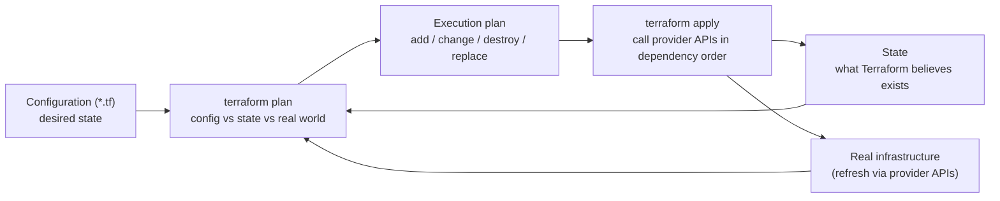
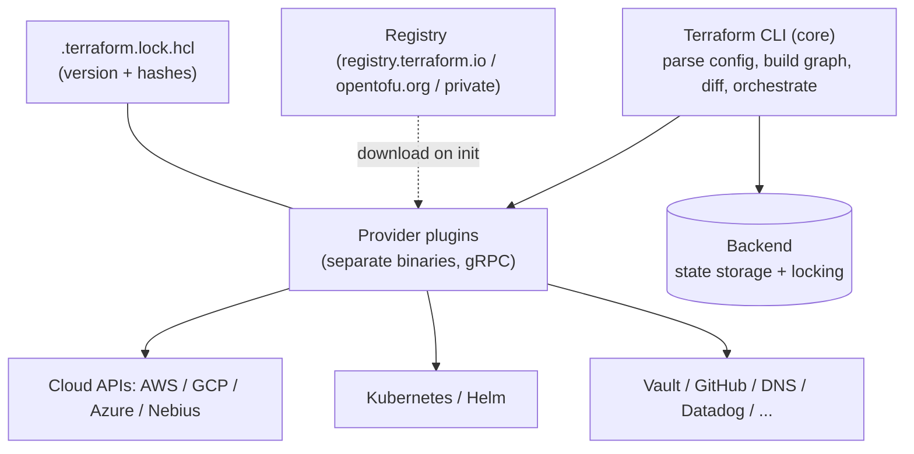
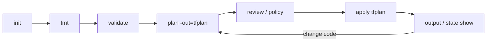

# 4.18 Terraform refresher: why, providers, resources and the workflow

| | |
|---|---|
| Level | Beginner to intermediate |
| Priority tier | 0 |
| Lab venue | Terraform 1.6+ or OpenTofu 1.6+; Docker for the local provider labs; optional GCP/AWS sandbox |
| Part | Part 4: Automation and infrastructure as code |
| Status | Drafted, labs **untested** |

## Why this matters for AI infrastructure

GPU capacity, networks, storage buckets, Kubernetes clusters and IAM are created through cloud and datacentre APIs. Doing that by console or ad-hoc scripts means environments nobody can reproduce, reviews that cannot see the real change, and bills nobody can explain. Terraform (and its open-source fork OpenTofu) turns infrastructure into declarative code with a **plan** step that shows exactly what will change, a **state** that records what exists, and **providers** that speak to hundreds of platforms: all major clouds, Kubernetes, Helm, GitHub, DNS, Vault, Nebius, CoreWeave, and bare-metal tooling. This chapter is a rigorous refresher: the model, the architecture, the language, the workflow, and the commands you reach for under pressure. The next chapters go deep on state (4.19), modules (4.20), loops and lifecycle (4.21), secrets and multiple providers (4.22), team workflows (4.23), GPU clouds (4.24) and Kubernetes (4.25).

## Prerequisites and outcomes

Needs 4.1 and 4.2. After this chapter you can:

- Contrast declarative IaC with imperative scripting and explain idempotence, drift and the plan/apply model.
- Describe Terraform's architecture: CLI core, providers (plugins over gRPC), the resource graph (DAG), state, backends, and how a plan is computed.
- Write HCL: providers, resources, variables (types, validation), locals, outputs, data sources, expressions, functions, dynamic blocks, and meta-arguments.
- Run the full workflow and use the command line fluently (`init`, `fmt`, `validate`, `plan -out`, `apply tfplan`, `destroy`, `state`, `import`, `moved`, `console`, `graph`, `output`, `workspace`).
- Import existing infrastructure and refactor safely.
- Compare Terraform OSS, HCP Terraform and OpenTofu, and make a reasoned choice.

## 1. Declarative versus imperative

An **imperative** script says how: "create a VPC; if it fails, retry; create a subnet; attach..." Run twice it either errors or duplicates. A **declarative** configuration says what: "there is a VPC with this CIDR, a subnet in it, three GPU instances." The tool computes the difference between desired and actual state and performs only the necessary actions.



Key ideas:

- **Idempotence**: apply twice, the second run reports no changes.
- **Drift**: the real world differs from state/config (manual edits, autoscalers, provider-side changes). `plan` detects it by refreshing.
- **Dependency graph**: Terraform infers ordering from references (`aws_subnet.x.id` in another resource) and builds a **DAG**; independent resources are created in parallel (default concurrency 10: `-parallelism`).
- **Plan as review artefact**: a saved plan is the change you approve; applying that exact file guarantees no surprise (4.2).
- **Immutable replacement**: many attribute changes force **replacement** (destroy then create, or create-before-destroy); plans mark these `-/+`. Reading the plan carefully for replacements of stateful resources (disks, databases, clusters) is the core operational skill.
- **Ansible vs Terraform**: Terraform manages the *existence and configuration of infrastructure objects* with state; Ansible configures *what runs on machines* (4.16).

## 2. Architecture



- **Core** parses HCL, resolves variables, builds the resource graph, computes diffs between configuration, state and refreshed reality, and sequences operations. It knows nothing about clouds.
- **Providers** are plugins (Go binaries speaking the plugin protocol) that implement resource types and data sources for one platform. They are versioned independently; `terraform init` downloads them into `.terraform/providers` and records exact versions and checksums in `.terraform.lock.hcl` (**commit this file**).
- **State** (`terraform.tfstate`, JSON) maps each resource address in config to a real object ID and stores attributes, including sensitive values in plaintext. Treat it as a secret; store remotely with locking (4.19).
- **Backends** define where state lives and where operations run: local, S3+DynamoDB/lockfile, GCS, Azure Blob, Terraform Cloud/HCP, Consul, PostgreSQL, Kubernetes secret.
- **Registry and modules**: reusable configuration packaged and versioned (4.20).
- **Workspaces**: multiple state instances from one configuration (section 7).
- **Terraform vs OpenTofu**: OpenTofu is the Linux Foundation fork created after HashiCorp's licence change (BUSL); the CLI and HCL are largely compatible (`tofu` command), with additional features diverging over time (for example state encryption in OpenTofu). Choose by licence, support and feature needs; both read the same configuration for the common subset.

## 3. HCL language essentials

### Files and blocks

A configuration is the set of `*.tf` files in a directory (the **root module**), merged in lexical order; filenames do not matter, but conventions do: `main.tf`, `variables.tf`, `outputs.tf`, `providers.tf`/`versions.tf`, `locals.tf`, `data.tf`.

```hcl
terraform {
  required_version = ">= 1.6.0, < 2.0.0"
  required_providers {
    google = { source = "hashicorp/google", version = "~> 5.30" }
    random = { source = "hashicorp/random", version = "~> 3.6" }
  }
}

provider "google" {
  project = var.project_id
  region  = var.region
}
```

Version constraints: `=`, `!=`, `>`, `>=`, `<`, `<=`, `~>` (pessimistic: `~> 5.30` allows `>= 5.30, < 6.0`; `~> 5.30.1` allows `>= 5.30.1, < 5.31`). Pin providers with a range and rely on the lock file for exactness; upgrade deliberately with `terraform init -upgrade` and review the diff.

### Variables, locals, outputs

```hcl
variable "gpu_node_count" {
  type        = number
  description = "Number of GPU worker nodes"
  default     = 2
  validation {
    condition     = var.gpu_node_count >= 1 && var.gpu_node_count <= 64
    error_message = "gpu_node_count must be between 1 and 64."
  }
}

variable "labels" {
  type    = map(string)
  default = { owner = "ml-platform", env = "lab" }
}

variable "node_pools" {
  type = map(object({
    machine_type = string
    gpu_type     = optional(string)
    gpu_count    = optional(number, 0)
    min_nodes    = number
    max_nodes    = number
  }))
}

variable "db_password" {
  type      = string
  sensitive = true                 # redacted in plan/apply output (still stored in state!)
}

locals {
  name_prefix = "${var.env}-${var.cluster}"
  common_labels = merge(var.labels, { managed_by = "terraform", cluster = var.cluster })
  total_max_gpus = sum([for p in values(var.node_pools) : p.max_nodes * p.gpu_count])
}

output "cluster_endpoint" {
  value       = google_container_cluster.main.endpoint
  description = "API server endpoint"
}
output "kubeconfig_cmd" {
  value = "gcloud container clusters get-credentials ${google_container_cluster.main.name} --region ${var.region}"
}
output "admin_password" {
  value     = random_password.admin.result
  sensitive = true
}
```

Types: primitives `string`, `number`, `bool`; collections `list(T)`, `set(T)`, `map(T)`; structural `object({...})`, `tuple([...])`; `any`. Type constraints with `optional()` defaults make module interfaces self-documenting. Variable precedence (lowest to highest): the variable's `default`, environment `TF_VAR_name`, `terraform.tfvars`, `terraform.tfvars.json`, `*.auto.tfvars` (alphabetical), then `-var` and `-var-file` on the command line in the order given (last wins). `validation`, `precondition`, `postcondition` and `check` blocks add guardrails.

### Resources and data sources

```hcl
data "google_compute_image" "ubuntu" {
  family  = "ubuntu-2204-lts"
  project = "ubuntu-os-cloud"
}

resource "google_compute_network" "fabric" {
  name                    = "${local.name_prefix}-vpc"
  auto_create_subnetworks = false
  mtu                     = 8896                         # jumbo frames within the VPC
}

resource "google_compute_subnetwork" "compute" {
  name          = "${local.name_prefix}-compute"
  ip_cidr_range = "10.10.0.0/20"
  region        = var.region
  network       = google_compute_network.fabric.id       # implicit dependency edge
}

resource "google_compute_instance" "gpu" {
  count        = var.gpu_node_count
  name         = "${local.name_prefix}-gpu-${count.index}"
  machine_type = "a2-highgpu-1g"
  zone         = var.zone
  boot_disk {
    initialize_params {
      image = data.google_compute_image.ubuntu.self_link
      size  = 200
    }
  }
  guest_accelerator {
    type  = "nvidia-tesla-a100"
    count = 1
  }
  scheduling {
    on_host_maintenance = "TERMINATE"                    # required for GPU instances
  }
  network_interface {
    subnetwork = google_compute_subnetwork.compute.id
  }
  labels = local.common_labels
}
```

- A **resource** block `resource "TYPE" "NAME"` creates and manages an object; its address is `TYPE.NAME` (with `[index]` or `["key"]` for repeated ones). Attributes referenced from other resources create **implicit dependencies**; `depends_on` creates explicit ones when there is a hidden dependency.
- A **data source** (`data "TYPE" "NAME"`) reads existing information (latest image, existing VPC, caller identity, available zones) without managing it. Data sources are read during plan; if their arguments depend on unknown values they defer to apply.
- **Expressions**: references, string interpolation `"${...}"`, conditional `cond ? a : b`, `for` expressions (`[for x in list : upper(x)]`, `{for k, v in map : k => v.name}`), splat `aws_instance.web[*].id`, `try()`, `coalesce()`, `lookup()`. **Functions**: string, numeric, collection (`merge`, `flatten`, `zipmap`, `setproduct`, `cidrsubnet`, `cidrhost`), filesystem (`file`, `templatefile`), encoding (`jsonencode`, `yamlencode`, `base64encode`), hash/crypto, date/time. Terraform has no user-defined functions; use locals and modules.
- **Meta-arguments**: `count`, `for_each`, `depends_on`, `provider`, `lifecycle` (4.21).
- **Dynamic blocks** generate repeated nested blocks from collections:

```hcl
resource "google_compute_firewall" "internal" {
  name    = "${local.name_prefix}-allow-internal"
  network = google_compute_network.fabric.name
  dynamic "allow" {
    for_each = { tcp = ["0-65535"], udp = ["0-65535"], icmp = [] }
    content {
      protocol = allow.key
      ports    = allow.value
    }
  }
  source_ranges = ["10.10.0.0/16"]
}
```

- **Provisioners** (`local-exec`, `remote-exec`) are a last resort; prefer user-data/cloud-init, images, or Ansible (4.2, 4.17). `terraform_data` and `null_resource` can trigger external actions on change.
- **Sensitive values**: `sensitive = true` hides output but state still contains them; **ephemeral** values/resources (newer Terraform/OpenTofu) keep some secrets out of state (4.22).

## 4. The workflow and CLI reference



```bash
terraform version                              # CLI + provider versions
terraform init                                 # download providers/modules, configure backend, write .terraform.lock.hcl
terraform init -upgrade                        # move to the newest versions allowed by constraints
terraform init -reconfigure                    # change backend config without migrating state
terraform init -migrate-state                  # move state to a new backend (prompts)
terraform fmt -recursive -check                # CI formatting check (exit 3 if unformatted); drop -check to rewrite
terraform validate                             # syntax, types, references (no API calls)
terraform plan -out=tfplan -var-file=envs/lab.tfvars       # compute the diff and save the plan
terraform plan -refresh-only                   # show drift only (updates state if you then apply)
terraform plan -replace=google_compute_instance.gpu[1]     # force recreation of one resource (replaces `taint`)
terraform plan -target=module.net              # emergency only; leaves partial drift
terraform show tfplan                          # human-readable saved plan
terraform show -json tfplan > plan.json        # machine-readable plan for policy checks (4.2)
terraform apply tfplan                         # apply exactly the reviewed plan (no prompt)
terraform apply -auto-approve                  # CI only, after a saved plan was reviewed
terraform destroy                              # delete everything in this state (plan first: `plan -destroy`)
terraform output -json                         # outputs as JSON (feeds Ansible/CI)
terraform state list                           # resources in state
terraform state show google_compute_instance.gpu[0]
terraform state mv A B                         # rename an address without recreating
terraform state rm ADDR                        # forget a resource without deleting it
terraform import ADDR ID                       # adopt an existing object (or use import blocks, below)
terraform console                              # REPL for expressions
terraform graph | dot -Tsvg > graph.svg        # DAG visualisation
terraform providers                            # providers required, by module
terraform force-unlock LOCK_ID                 # break a stuck lock (confirm nobody is running)
terraform taint / untaint                      # legacy; use -replace
TF_LOG=DEBUG TF_LOG_PATH=tf.log terraform plan # debug logging (may contain secrets)
```

Reading a plan: symbols `+` create, `~` update in place, `-` destroy, `-/+` replace (destroy and create) or `+/-` (create before destroy), `<=` data read; "(known after apply)" marks computed values; "forces replacement" annotates the attribute that triggered a replacement. **Always read the summary line** ("Plan: X to add, Y to change, Z to destroy") and look for unexpected destroys and replacements of stateful objects.

Environment variables: `TF_VAR_*`, `TF_CLI_ARGS_plan`, `TF_IN_AUTOMATION=1`, `TF_INPUT=0` (never prompt in CI), `TF_PLUGIN_CACHE_DIR` (share provider downloads), `TF_DATA_DIR`, `TF_WORKSPACE`. CLI config `~/.terraformrc` (provider mirrors, credentials).

### Targeted and partial runs

`-target` is an escape hatch for recovery and breaking cycles; routine use leaves the configuration and state inconsistent and hides dependencies. For large estates, split state by blast radius (4.23) instead of targeting.

## 5. Drift, import and refactoring

### Detecting and handling drift

`terraform plan` refreshes by default. Use `-refresh-only` to accept real-world changes into state without changing infrastructure; otherwise the plan shows the changes needed to revert to the configuration. Decide per drift: revert it (apply), codify it (edit config to match), or ignore a legitimately external attribute with `lifecycle { ignore_changes = [...] }` (4.21). Schedule a nightly plan (4.2).

### Importing existing infrastructure

Infrastructure created by hand can be brought under management without recreating it.

```hcl
# imports.tf (Terraform 1.5+)
import {
  to = google_storage_bucket.checkpoints
  id = "my-project/ml-checkpoints-prod"
}
```

```bash
terraform plan -generate-config-out=generated.tf     # draft HCL from the real resource; review and edit it
terraform plan                                        # shows "1 to import"
terraform apply                                       # records it in state
```

Always follow the import with a clean `plan` ("No changes") to prove the configuration matches reality; imported resources often need arguments added to avoid planned changes. `terraform import` (CLI) does the same one resource at a time without generating code. Tools like `terraformer` and cloud-specific exporters help bulk discovery but produce messy code that needs refactoring.

### Refactoring safely

Renaming resources or moving them into modules would destroy and recreate them; declare the move instead:

```hcl
moved {
  from = google_compute_network.fabric
  to   = module.network.google_compute_network.this
}
removed {                                 # Terraform 1.7+: stop managing without destroying
  from = google_compute_instance.legacy
  lifecycle { destroy = false }
}
```

`moved` blocks are reviewed code (state surgery with `terraform state mv` is manual and unreviewed); they let a module upgrade or rename flow through CI. Review the plan: the move should show "has moved", not destroy/create.

### State commands (use with care)

`state list/show/mv/rm/pull/push`: `pull` downloads raw state for inspection; `push` overwrites remote state and can destroy someone's work (it refuses on lineage/serial mismatch unless forced). Prefer `moved`/`import`/`removed` blocks to hand-edited state, back up state before surgery, and ensure nobody else is applying (locks).

## 6. Providers and authentication

- **Declare** providers in `required_providers`; configure in `provider` blocks. Multiple configurations use `alias` (4.22).
- **Authenticate without static keys**: environment-provided credentials, workload identity, instance profiles, OIDC from CI (4.2). Never put keys in `.tf` files or `.tfvars` committed to Git.
- **GPU-cloud providers**: major clouds (`hashicorp/google`, `aws`, `azurerm`), Nebius (`nebius/nebius` provider), CoreWeave (Kubernetes-native and API provider), Oracle OCI, Lambda, and bare-metal tooling (MAAS, Ironic via OpenStack, Redfish providers for BMCs); see 4.24 and Part 7.
- **Kubernetes and Helm providers** (4.25) manage in-cluster resources; avoid creating the cluster and deploying into it in one configuration (providers need cluster credentials at plan time); split into layers.
- **Provider mirrors/caches** for air-gapped or rate-limited environments; verify checksums via the lock file.

## 7. Workspaces and environments

A workspace is a named instance of state for the same configuration: `terraform workspace new staging`, `workspace select`, `workspace list`, and `terraform.workspace` inside configuration. Conveniences, not isolation: all workspaces share code, backend config and credentials, so a mistaken `apply` in the wrong workspace hits the wrong environment. Many teams prefer **directory-per-environment** (separate root modules `envs/prod`, `envs/staging` with different backends and credentials, shared modules) for production safety and clearer reviews (4.23). Workspaces suit temporary copies (benchmark clusters, per-branch preview environments).

## 8. Terraform OSS, HCP Terraform and OpenTofu

| Option | Strengths | Considerations |
|---|---|---|
| Terraform OSS CLI (BUSL licence) | Ubiquitous, mature, largest provider ecosystem | Licence terms for building competing products; you operate remote state, locking, CI and policy yourself |
| HCP Terraform / Terraform Enterprise | Managed runs, remote state, RBAC, Sentinel/OPA policy, private registry, cost estimation, drift detection, run triggers | Vendor dependency and cost; credentials live in the platform |
| OpenTofu (MPL, Linux Foundation) | Open governance; state encryption; early evaluation features; registry at opentofu.org | Compatibility drift over time; check provider and module support |
| Alternatives | Pulumi (general-purpose languages), Crossplane (Kubernetes-native control plane), CDK for Terraform, Ansible cloud modules, cloud-native (CloudFormation, Bicep, Config Connector) | Different models: code vs HCL, reconciliation loops vs plan/apply |

Whichever you pick: pin the CLI version in CI (`required_version`, `tfenv`/`tofuenv`/`asdf`), commit `.terraform.lock.hcl`, keep state remote with locking, and test upgrades.

## 9. A small end-to-end example

```hcl
# main.tf: local-only providers, safe to try anywhere
terraform {
  required_providers {
    random = { source = "hashicorp/random", version = "~> 3.6" }
    local  = { source = "hashicorp/local",  version = "~> 2.5" }
  }
}

variable "nodes" {
  type    = map(object({ gpus = number }))
  default = { gpu01 = { gpus = 8 }, gpu02 = { gpus = 8 }, gpu03 = { gpus = 4 } }
}

resource "random_pet" "cluster" { length = 2 }

resource "local_file" "inventory" {
  filename = "${path.module}/inventory.ini"
  content = templatefile("${path.module}/inventory.tftpl", {
    cluster = random_pet.cluster.id
    nodes   = var.nodes
  })
}

output "inventory_path" { value = local_file.inventory.filename }
```

```text
# inventory.tftpl
# cluster: ${cluster}
[gpu]
%{ for name, n in nodes ~}
${name} gpus=${n.gpus}
%{ endfor ~}
```

```bash
terraform init && terraform plan -out=tfplan && terraform apply tfplan
terraform plan                           # "No changes": idempotent
# edit var.nodes to add gpu04, plan: only the file changes, random_pet is untouched
terraform state list; terraform output
terraform destroy
```

This pattern (Terraform output rendered as an Ansible inventory) is the simplest bridge between provisioning and configuration (4.27).

## 10. Lab (untested)

1. **Install and pin**: install Terraform and/or OpenTofu with a version manager; create `required_version` and provider constraints; run `init`; inspect `.terraform/` and `.terraform.lock.hcl`; commit the lock file.
2. **Plan reading**: with local providers, create resources, change an attribute that forces replacement, and read the `-/+` plan; change one that updates in place; use `-replace`.
3. **Variables**: use types with `optional`, validation, sensitive variables, `.tfvars` and `TF_VAR_*`; demonstrate precedence by setting the same variable in each of those places.
4. **Expressions**: write `for` expressions, conditionals, `merge`, `cidrsubnet`, `templatefile`, `try`; explore with `terraform console`.
5. **Graph**: render `terraform graph`; add an implicit and an explicit dependency; show parallelism with `-parallelism=1` vs default.
6. **Drift**: apply, change something out-of-band (edit the generated file or a cloud label), run `plan` and `plan -refresh-only`; handle by revert, codify, and `ignore_changes`.
7. **Import**: create a resource by hand (Docker container/volume via the Docker provider, or a cloud bucket), write an `import` block, generate config, fix it until the plan is clean.
8. **Refactor**: rename a resource and move it into a module with a `moved` block; verify "has moved" in the plan and no recreate; try `state mv` and compare.
9. **Workspaces**: create `dev` and `bench` workspaces with different tfvars; show how the wrong workspace could be applied; implement directory-per-environment as the alternative.
10. **Destroy safely**: `plan -destroy`, `prevent_destroy` lifecycle (4.21), and `terraform destroy`; verify cleanup.
11. **Cloud sandbox (optional)**: apply the VPC, subnet, firewall and one small instance from section 3 in a sandbox project; add a GPU instance only if quota and budget allow; destroy immediately.
12. **OpenTofu vs Terraform**: run the same config with both CLIs; note differences.
13. **Clean up.**

Mark tested only after execution.

## 11. Common mistakes

- Treating `apply` without a reviewed plan as normal; ignoring replacements in the plan.
- Editing state by hand, or using `-target` as a habit.
- Committing `.tfstate`, `.tfvars` with secrets, or crash logs; not committing `.terraform.lock.hcl`.
- Unpinned providers or Terraform versions; surprise upgrades in CI.
- Hard-coded IDs/regions/AMIs instead of variables and data sources.
- One giant root module/state for everything (huge blast radius, slow plans).
- Using workspaces as the primary production isolation boundary.
- Using provisioners to configure machines when images or Ansible would be better.
- Copying resources instead of using `for_each`/modules; using `count` where keys are needed (index shifts destroy resources).
- Not testing `destroy` and `import` paths until an incident.

## 12. Interview angles

- "What is Terraform state and why is it needed? What can go wrong with it?" 
- "Explain `plan` and `apply`; what does `-out` give you?" 
- "How does Terraform decide ordering? What is `depends_on` for?" 
- "A plan shows `-/+` on a database. What do you do?" 
- "How do you bring existing infrastructure under Terraform?" (import blocks, plan clean.)
- "How do you rename or move resources without recreating them?" (`moved`.)
- "Terraform vs OpenTofu vs Pulumi vs Crossplane vs Ansible for provisioning?" 
- "Workspaces vs directories for environments?" 
- "How do you handle drift?" 

## 13. Checkpoint questions (35)

1. Declarative vs imperative? **A:** Desired end state vs step sequence.
2. What is the plan? **A:** The computed diff between config, state and reality.
3. What file records provider versions? **A:** `.terraform.lock.hcl`.
4. Should it be committed? **A:** Yes.
5. What is a provider? **A:** Plugin that implements resources for a platform.
6. What is state? **A:** Mapping of config addresses to real objects and attributes.
7. Why is state sensitive? **A:** Contains secret attribute values.
8. What builds execution order? **A:** The dependency graph from references.
9. Default parallelism? **A:** 10.
10. Plan symbol for replace? **A:** `-/+`.
11. What does `~>` mean? **A:** Pessimistic constraint (compatible updates).
12. Which input source wins for a variable? **A:** Command-line `-var`/`-var-file` (last one wins), above auto tfvars, tfvars and environment variables.
13. What is a local? **A:** Named expression within a module.
14. What does `sensitive = true` do? **A:** Redacts output; state still stores it.
15. Data source vs resource? **A:** Read-only lookup vs managed object.
16. `count` vs `for_each` key difference? **A:** Index-based vs key-based identity.
17. What is a dynamic block? **A:** Generates repeated nested blocks.
18. What is `terraform fmt -check` for? **A:** CI format enforcement.
19. What does `validate` check? **A:** Syntax and internal consistency, no API.
20. How apply exactly the reviewed plan? **A:** `terraform apply tfplan`.
21. What replaced `taint`? **A:** `-replace`.
22. What is `plan -refresh-only`? **A:** Show/accept drift without config changes.
23. How import existing resources? **A:** `import` blocks or `terraform import`.
24. After import, what proves success? **A:** A clean plan.
25. What does `moved` do? **A:** Records a rename/move without recreate.
26. What does `removed` with `destroy=false` do? **A:** Stop managing without deleting.
27. `state rm` effect? **A:** Forget resource, real object remains.
28. Why avoid `-target`? **A:** Partial state, hidden dependencies.
29. What are workspaces? **A:** Multiple states for one config.
30. Workspace isolation strength? **A:** Weak: same code/backend/creds.
31. What is OpenTofu? **A:** Open-source fork of Terraform.
32. HCP Terraform provides? **A:** Managed runs, state, RBAC, policy.
33. Why avoid provisioners? **A:** Brittle, outside the graph/state model.
34. What env var stops prompts in CI? **A:** `TF_INPUT=0` (and `-input=false`).
35. How share provider downloads? **A:** `TF_PLUGIN_CACHE_DIR`.

## 14. Sources and review notes

**Written in original words.** Principal sources:

- Yevgeniy Brikman, *Terraform: Up and Running* (chapters 1 and 2: why Terraform, getting started with deploying infrastructure and understanding the workflow, providers, resources, data sources, variables, outputs).
- The author's `nvidia-devops` repository, volume 10 chapter 5 (Terraform for infrastructure as code in AI factories): paradigm, architecture, HCL masterclass, CLI reference, import and refactoring, workspaces, OSS versus HCP versus OpenTofu.
- Terraform and OpenTofu documentation for language, CLI and provider behaviour.
- Examples are the author's constructions.

**Flagged for verification before publishing:** HCL features by version (`removed` blocks, `optional` defaults, ephemeral values), OpenTofu-specific feature claims, exit codes for `fmt -check`, GPU machine type and accelerator combinations, provider version constraints, and every code listing; all labs are **untested**.
