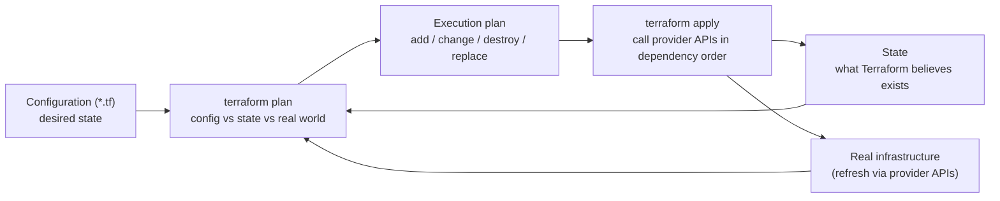
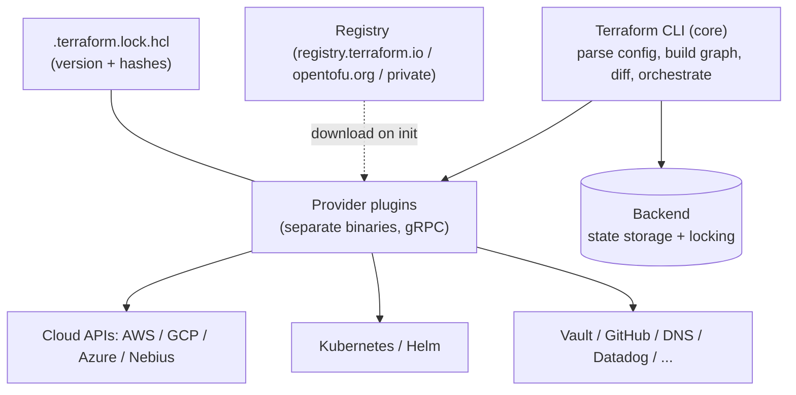
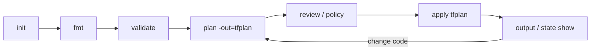

# 4.18 Terraform refresher: why, providers, resources and the workflow

| | |
|---|---|
| Level | Beginner to intermediate |
| Priority tier | 0 |
| Lab venue | Terraform 1.6+ or OpenTofu 1.6+; Docker for the local provider labs; optional GCP/AWS sandbox |
| Part | Part 4: Automation and infrastructure as code |
| Status | Drafted, labs not run on live hardware |

## Why this matters for AI infrastructure

Picture a team that builds a GPU cluster by clicking through a cloud console and running a few one-off scripts. The cluster works, and everyone is pleased. A month later, a new engineer is asked to build a second cluster for a staging environment, and nobody can say which console settings were changed on purpose. The bill has a line item nobody recognizes. Infrastructure built by hand leaves you with environments you cannot reproduce, reviews that cannot see the real change, and costs nobody can trace.

Terraform, and its open-source fork OpenTofu, takes a different approach. You describe the infrastructure as code, a set of text files that say what should exist. Then the tool shows you what it will change before it changes anything. Think of it like an architect's drawing plus a builder's change order. The drawing is the code, and the change order is the plan that you read before anyone picks up a tool. Three pieces make that work. The plan step shows exactly what will change. The state records what exists today. The providers speak to hundreds of platforms, including all major clouds, Kubernetes, Helm, GitHub, DNS, Vault, Nebius, CoreWeave and bare-metal tooling.

Before you go further, it helps to know what this chapter covers. You will see the model, the architecture, the language, the workflow and the commands you reach for under pressure. It is a refresher with the reasons attached, so each command has a situation behind it. Later chapters go deeper into specific parts. State is in 4.19, modules in 4.20, loops and lifecycle in 4.21, secrets and multiple providers in 4.22, team workflows in 4.23, GPU clouds in 4.24 and Kubernetes in 4.25.

## Prerequisites and outcomes

You need 4.1 and 4.2 first. When you finish this chapter, you should be able to do the following.

- Contrast declarative IaC with imperative scripting, and explain idempotence, drift and the plan/apply model.
- Describe Terraform's architecture: the CLI core, providers (plugins over gRPC), the resource graph (DAG), state, backends, and how a plan is computed.
- Write HCL, including providers, resources, variables (types, validation), locals, outputs, data sources, expressions, functions, dynamic blocks and meta-arguments.
- Run the full workflow and use the command line fluently: `init`, `fmt`, `validate`, `plan -out`, `apply tfplan`, `destroy`, `state`, `import`, `moved`, `console`, `graph`, `output` and `workspace`.
- Import existing infrastructure and refactor it safely.
- Compare Terraform OSS, HCP Terraform and OpenTofu, and make a reasoned choice.

The rest of the chapter builds each of these outcomes in order.

## 1. Declarative versus imperative

Suppose you run the same setup script on Monday and again on Friday. Because the script only knows how to perform steps, the second run either fails on the VPC that already exists or creates a duplicate subnet beside the first one. The script never asked what was already there. That gap is what a declarative tool closes.

An imperative script says how to build something, one step at a time: create a VPC, retry if it fails, create a subnet, attach it. Each step assumes the step before it went as planned. A declarative configuration says what should exist instead: a VPC with this CIDR, a subnet inside it, and three GPU instances. The tool compares the desired state with the actual state, then performs only the actions that are needed. Run it twice and the second run finds nothing to do, so it changes nothing. Run it after someone deletes one instance by hand and it creates exactly that one instance back.



The diagram shows the loop. The plan compares three things, the configuration, the state and the real world, and apply then changes the real world and the state. Each arrow in the diagram is a question. Configuration asks what you want. State asks what Terraform last created. The real world, reached through the provider's API, answers what is there now. Apply runs only after you have read the plan, and it updates both the real world and the state file so the next plan starts from the truth.

Idempotence is the first idea to hold onto. Idempotent means that doing the same thing twice gives the same result as doing it once. If you apply the same configuration twice, the second run reports no changes, and that silence is the signal that everything matches.

Drift is the second. Drift is the gap that opens when the real world stops matching the state and the configuration. Someone may have edited a resource by hand in the console during an incident, an autoscaler may have changed a node count, or the provider may have returned a value in a new format. The `plan` command detects drift by refreshing the real state, which asks the provider's API what each object looks like today. Drift that goes unnoticed becomes a surprise on the next apply, when Terraform tries to undo a change that someone made on purpose.

Terraform reads the references between resources to decide the order. If one resource uses `aws_subnet.x.id`, Terraform builds the subnet first, because the subnet's ID does not exist until the subnet does. Resources with no link between them are created in parallel, up to 10 at a time by default, and you can change that limit with `-parallelism`. This is why a large plan finishes faster than the same resources would in a script that runs them one after another.

A saved plan is the change you review and approve. The plan file records the exact actions Terraform computed. Applying that exact file guarantees there is no surprise between the review and the apply, because nothing gets recomputed. That is why 4.2 treats the saved plan as a review artefact, something a second person can read and approve before anything changes.

Many attribute changes force replacement. Replacement means the object is destroyed and created again, which is a real outage for anything that holds data or serves traffic. Terraform either destroys the object and then creates a new one, or creates the new one before destroying the old one, depending on how the resource is set up. The plan marks these with `-/+`. For stateful resources such as disks, databases and clusters, reading the plan closely for replacements is the core operational skill. A plan with one `-/+` on a database deserves a second look before anyone types `apply`.

Ansible and Terraform solve different problems. Terraform manages whether infrastructure objects exist and how they are configured, and it tracks them with state. Ansible configures what runs on the machines, once they exist (4.16). A common pattern is Terraform to create the GPU nodes, and Ansible to install the driver on them.

### The Five IaC Categories and Six Trade-Off Axes from *Terraform: Up and Running* (Chapter 1)

In *Terraform: Up and Running*, chapter 1 (*Why Terraform*), Yevgeniy Brikman sorts the whole infrastructure-as-code landscape into five tool categories. He then compares the tools along six trade-off axes. Start with the categories, because the axes make more sense once you know them, and because most real teams use one tool from each of several categories.

Ad-hoc scripts, such as `setup-webserver.sh`, are imperative Bash or Python. They are fine for one-off tasks, like a quick proof of concept on a single VM. They lack idempotency, state tracking and structure at scale, so the script that worked once becomes fragile the second time it runs.

Configuration management tools, such as Ansible, Chef and Puppet, install and configure software on servers that already exist. They answer the question "what is running on this machine?" and they are the subject of the earlier Ansible chapters.

Server templating tools, such as Packer, Docker and Vagrant, bake self-contained images. A VM image runs on a hypervisor that emulates hardware and carries its own guest OS kernel. A container image isolates user space with Linux namespaces and cgroups while sharing the host kernel. Either way, baked images make immutable infrastructure possible, because you build a finished image once and then replace servers instead of patching them.

Orchestration tools, such as Kubernetes, Nomad and ECS, schedule, heal, scale and route traffic across containers or VMs. They sit above the servers and decide where each workload runs.

Provisioning tools, such as Terraform, OpenTofu, CloudFormation, OpenStack Heat and Pulumi, create the underlying servers, VPC networks, load balancers, databases, storage buckets and IAM roles themselves. This is the category this chapter is about. Terraform's job ends where the object exists and is configured, and the other categories take over from there.

The six axes are where the choices get interesting. The chapter's summary of them is worth reading once in full. Configuration management versus provisioning is the first. Packer with Terraform fits immutable infrastructure naturally, whereas Ansible fits changing machines in place. Mutable versus immutable infrastructure is the second. Instead of logging in to a running server and upgrading packages, which builds up subtle configuration drift, an immutable deployment bakes a new image and replaces the server. Drift here means the server slowly becomes unlike any server you could rebuild from scratch.

Procedural versus declarative is the third axis, and it has the clearest worked example. Suppose you deploy 10 EC2 instances with `count: 10`. Later you change the count to 15. In a naive procedural script, re-running `count: 15` launches 15 more, so you end up with 25 instances, unless you write custom tag-counting logic (`exact_count`). That is the procedural trap, where the script must count what exists before it can act, and the counting logic becomes its own bug source. If you later reduce the count to 5, a stateless procedural tool has no record of which instances it created. Declarative Terraform handles this differently. Its `terraform.tfstate` tracks all 10 instances, so changing `count = 10` to `15` adds 5 instances, and changing `15` to `5` terminates 10. Changing `ami` plans an exact replacement, marked `-/+`, because the instance image cannot change in place.

General-purpose languages (GPL), such as Pulumi in Python, TypeScript or Go, differ from a domain-specific language (DSL) such as Terraform's HCL. A GPL can loop, branch and call any library, which is powerful and also hard to review. HCL deliberately restricts arbitrary loops and side effects, which keeps the infrastructure dependency graph declarative, inspectable and predictable across every repository. A reviewer can read an HCL file and know what it will create, without running it.

The last axes are master server versus masterless, and agent-based versus agentless. Terraform is masterless and agentless by default. The CLI talks straight to cloud provider APIs over HTTPS, with no background agent on target VMs and no dedicated master daemon. Your laptop or a CI runner can run it directly. HCP Terraform, Atlantis or CI runners can still host remote execution when you want a shared, audited place to run plans and applies.

When you read a plan, look at replacements first. A `-/+` on a database or cluster is the change to question before you approve, because it is the one line that can delete data.

## 2. Architecture

Picture a plan that fails at 2 p.m. with a message about a timeout from an API you have never heard of. Terraform failures often come from one of its parts: a provider that cannot reach an API, or a state file that two people changed at once. To work out which part is involved, you need to know what each part does, because the error message names the part that noticed the problem, not always the part that caused it. The diagram shows how the pieces connect.



The core parses HCL, resolves variables, builds the resource graph, computes the differences between configuration, state and refreshed reality, and sequences the operations. It knows nothing about clouds. You can think of the core as the planner, the part that decides what must happen and in what order, while everything cloud-specific is handled elsewhere.

Providers do the cloud-specific work. Each provider is a plugin, a separate program that speaks a defined protocol with the core over gRPC (a remote-call protocol). It implements the resource types and data sources for one platform. Providers are versioned independently, so upgrading the Google provider does not force an upgrade of the Kubernetes provider. When you run `terraform init`, the providers download into `.terraform/providers`, and the exact versions and checksums are recorded in `.terraform.lock.hcl`. A checksum is a fingerprint of the file, so the lock file proves that the provider you tested is the one your teammate downloads. Commit that file to Git.

State lives in `terraform.tfstate`, a JSON file. It maps each resource address in your configuration to a real object ID, such as the ID of a particular GPU VM. It stores attributes, including sensitive values, in plaintext. Treat it as a secret, and store it remotely with locking (4.19). Locking means only one apply can change the state at a time, so two engineers cannot overwrite each other's work.

Backends decide where state lives and where operations run. The options include local storage, S3 with DynamoDB or a lockfile, GCS, Azure Blob, Terraform Cloud or HCP, Consul, PostgreSQL and a Kubernetes secret. A local file is fine for a lab. A team needs a shared backend with locking, because a laptop-only state file is one lost disk away from an orphaned cluster.

Registries and modules package reusable configuration with versions (4.20). A module is a folder of `.tf` files that you call like a function, with inputs and outputs. Workspaces let one configuration hold several state instances, as section 7 explains.

OpenTofu is the Linux Foundation fork, created after HashiCorp changed Terraform's licence to BUSL. A fork is a copy of the project that continues on its own path. The CLI and HCL are largely compatible, and you run OpenTofu with the `tofu` command. The two tools are diverging over time. OpenTofu offers state encryption, for example. Choose by licence, support and feature needs. Both tools read the same configuration for the common subset, so a team can start on one and move later with fewer surprises than you might expect.

## 3. HCL language essentials

### Files and blocks

Terraform reads every `*.tf` file in a directory as one configuration, called the root module. The root module is the entry point, the folder you run commands in. It merges the files in lexical order, which means alphabetical order by filename. The filenames do not change how Terraform reads them, so a resource can sit in any file and still work. Conventions help people find things, though. You will usually see `main.tf` for the main resources, `variables.tf`, `outputs.tf`, `providers.tf` or `versions.tf`, `locals.tf` and `data.tf`. A new engineer who knows the convention can find a variable in seconds instead of searching the whole folder.

The next block pins the Terraform version and the providers, then configures the Google provider. The `terraform` block is where you state what the code needs, and the `provider` block is where you tell that provider which project and region to use.

```hcl
terraform {
  required_version = ">= 1.6.0, < 2.0.0"
  required_providers {
    google = { source = "hashicorp/google", version = "~> 5.30" }
    random = { source = "hashicorp/random", version = "~> 3.6" }
  }
}

provider "google" {
  project = var.project_id
  region  = var.region
}
```

Version constraints use the operators `=`, `!=`, `>`, `>=`, `<`, `<=` and `~>`. The pessimistic operator `~>` needs a closer look, because it is the one you will write most. It reads as "at least this, but do not cross the next significant digit." So `~> 5.30` allows `>= 5.30, < 6.0`, which lets minor updates in and blocks a major jump. `~> 5.30.1` allows `>= 5.30.1, < 5.31`, which is tighter, because the last digit is the one that moves. Pin providers with a range, and let the lock file hold the exact version. The range says what you are willing to accept, and the lock file records what you actually got. When you want a newer version, upgrade deliberately with `terraform init -upgrade`, and review the diff in the lock file before you commit it.

### Variables, locals, outputs

Variables are the inputs to a configuration, locals are named values you reuse inside it, and outputs are the values you hand to other tools. Think of a configuration as a function. Variables are its arguments, locals are its intermediate calculations, and outputs are its return values. The following file shows all three, and it is the kind of file you will write for every GPU cluster.

```hcl
variable "gpu_node_count" {
  type        = number
  description = "Number of GPU worker nodes"
  default     = 2
  validation {
    condition     = var.gpu_node_count >= 1 && var.gpu_node_count <= 64
    error_message = "gpu_node_count must be between 1 and 64."
  }
}

variable "labels" {
  type    = map(string)
  default = { owner = "ml-platform", env = "lab" }
}

variable "node_pools" {
  type = map(object({
    machine_type = string
    gpu_type     = optional(string)
    gpu_count    = optional(number, 0)
    min_nodes    = number
    max_nodes    = number
  }))
}

variable "db_password" {
  type      = string
  sensitive = true                 # redacted in plan/apply output (still stored in state!)
}

locals {
  name_prefix = "${var.env}-${var.cluster}"
  common_labels = merge(var.labels, { managed_by = "terraform", cluster = var.cluster })
  total_max_gpus = sum([for p in values(var.node_pools) : p.max_nodes * p.gpu_count])
}

output "cluster_endpoint" {
  value       = google_container_cluster.main.endpoint
  description = "API server endpoint"
}
output "kubeconfig_cmd" {
  value = "gcloud container clusters get-credentials ${google_container_cluster.main.name} --region ${var.region}"
}
output "admin_password" {
  value     = random_password.admin.result
  sensitive = true
}
```

The validation block rejects a bad `gpu_node_count` before any API call happens. Picture someone typing a count far larger than the quota allows into the variable on a Friday evening. Without the check, Terraform would send create requests for every node, and the quota errors would arrive one by one. With the check, the mistake stops at `plan`, with the message you wrote. The `sensitive` flag hides `db_password` in plan and apply output, so it does not appear in a CI log, but the value is still stored in state. That is the trap to remember. Hiding a value from the screen does not hide it from the state file. The primitive types are `string`, `number` and `bool`. The collection types are `list(T)`, `set(T)` and `map(T)`. The structural types are `object({...})` and `tuple([...])`, and `any` accepts anything. Type constraints with `optional()` defaults make a module's interface readable without a separate document, because the type itself tells a caller which fields are required.

When the same variable is set in more than one place, the last source wins. That sounds simple, and it causes real confusion when someone forgets an old file. From lowest to highest, the order is the variable's `default`, the environment variable `TF_VAR_name`, `terraform.tfvars`, `terraform.tfvars.json`, the `*.auto.tfvars` files in alphabetical order, and finally `-var` and `-var-file` on the command line, in the order you give them. If a plan shows a node count you did not expect, check the sources from the bottom of this list upward. The `validation`, `precondition`, `postcondition` and `check` blocks add guardrails on top of this, so a bad value fails early.

### Resources and data sources

Resources are where the infrastructure actually comes from. The next block builds a small network and a GPU instance. The references between the blocks decide the order in which Terraform creates them, so you rarely need to write the order yourself. Read the blocks as a story. The data source finds the image, the network is created, the subnet lives inside it, and each GPU instance attaches to that subnet.

```hcl
data "google_compute_image" "ubuntu" {
  family  = "ubuntu-2204-lts"
  project = "ubuntu-os-cloud"
}

resource "google_compute_network" "fabric" {
  name                    = "${local.name_prefix}-vpc"
  auto_create_subnetworks = false
  mtu                     = 8896                         # jumbo frames within the VPC
}

resource "google_compute_subnetwork" "compute" {
  name          = "${local.name_prefix}-compute"
  ip_cidr_range = "10.10.0.0/20"
  region        = var.region
  network       = google_compute_network.fabric.id       # implicit dependency edge
}

resource "google_compute_instance" "gpu" {
  count        = var.gpu_node_count
  name         = "${local.name_prefix}-gpu-${count.index}"
  machine_type = "a2-highgpu-1g"
  zone         = var.zone
  boot_disk {
    initialize_params {
      image = data.google_compute_image.ubuntu.self_link
      size  = 200
    }
  }
  guest_accelerator {
    type  = "nvidia-tesla-a100"
    count = 1
  }
  scheduling {
    on_host_maintenance = "TERMINATE"                    # required for GPU instances
  }
  network_interface {
    subnetwork = google_compute_subnetwork.compute.id
  }
  labels = local.common_labels
}
```

A resource block, written `resource "TYPE" "NAME"`, creates and manages one object. The type says what kind of thing it is, and the name is your local label for it. Together they form the address `TYPE.NAME`, with `[index]` or `["key"]` added for repeated resources, so `google_compute_instance.gpu[1]` means the second GPU VM. When one resource refers to an attribute of another, Terraform creates an implicit dependency. That is the reference doing its job, and it is the normal way to order things. Use `depends_on` only when a dependency is hidden from the configuration, for example when a resource needs an IAM role that it never references by name.

A data source, written `data "TYPE" "NAME"`, reads existing information without managing it. Examples include the latest image, an existing VPC, the caller identity and the available zones. A data source is a read-only question to the provider. Terraform reads data sources during the plan. If their arguments depend on values that are not known yet, the read waits until apply, and the plan shows the value as known after apply.

Expressions include references, string interpolation such as `"${...}"`, conditionals such as `cond ? a : b`, `for` expressions such as `[for x in list : upper(x)]` and `{for k, v in map : k => v.name}`, splat expressions such as `aws_instance.web[*].id`, and the functions `try()`, `coalesce()` and `lookup()`. A splat collects one attribute from every element of a list in a single expression. The built-in functions cover strings, numbers, collections (`merge`, `flatten`, `zipmap`, `setproduct`, `cidrsubnet`, `cidrhost`), files (`file`, `templatefile`), encoding (`jsonencode`, `yamlencode`, `base64encode`), hashing and crypto, and dates and times. The `cidrsubnet` function is worth knowing early, because it carves subnets out of a larger range without manual arithmetic. Terraform has no user-defined functions, so you use locals and modules for that job.

Meta-arguments are `count`, `for_each`, `depends_on`, `provider` and `lifecycle`. They change how Terraform treats a resource, rather than what the resource is, and 4.21 covers them in depth.

Dynamic blocks generate repeated nested blocks from a collection. Without them, a firewall with six protocols needs six nearly identical blocks, and a seventh protocol means editing the code in two places. The next block creates an allow rule for each protocol without writing each rule by hand.

```hcl
resource "google_compute_firewall" "internal" {
  name    = "${local.name_prefix}-allow-internal"
  network = google_compute_network.fabric.name
  dynamic "allow" {
    for_each = { tcp = ["0-65535"], udp = ["0-65535"], icmp = [] }
    content {
      protocol = allow.key
      ports    = allow.value
    }
  }
  source_ranges = ["10.10.0.0/16"]
}
```

Provisioners such as `local-exec` and `remote-exec` are a last resort. A provisioner runs a command on a machine or on the local laptop as part of apply, and it sits outside the plan, so Terraform cannot predict its effects. Prefer user-data or cloud-init, which run once at first boot and are part of the instance definition, pre-built images or Ansible (4.2, 4.17). The `terraform_data` and `null_resource` resources can trigger external actions when something changes, and they are the usual way to rerun a command when an input changes.

Sensitive values need care. `sensitive = true` hides an output from display, but the state still holds the value. Ephemeral values and resources, in newer Terraform and OpenTofu versions, can keep some secrets out of state (4.22). Until you use those, assume any secret in your configuration ends up in the state file, and protect the state file accordingly.

The walkthrough in *Terraform: Up and Running*, chapter 2 (*Getting Started with Terraform*), shows how these pieces fit together. Brikman builds the example in three steps, and each step adds one idea. The three steps are useful to follow because they match how a real stack grows, from one server to a scaled group to a front door.

Step one is a single server with a security group. A security group is a cloud firewall attached to an instance. The `aws_instance.example` resource has a `user_data` heredoc, `user_data = <<-EOF ... busybox httpd -f -p ${var.server_port} & EOF`, and it sets `user_data_replace_on_change = true`. A heredoc is a multi-line string, and `user_data` is the script the instance runs on first boot. The setting `user_data_replace_on_change` means that a changed script replaces the server, rather than quietly changing a file on a running machine. The instance also references `vpc_security_group_ids = [aws_security_group.instance.id]`. That reference creates an implicit dependency, which you can see in the output of `terraform graph`: `[root] aws_instance.example -> [root] aws_security_group.instance`. Read the arrow as "needs", so the instance cannot be built until its security group exists.

Step two is an Auto Scaling Group, which keeps a set of identical servers running. An `aws_launch_configuration` is immutable, so any change to its `image_id` or `user_data` forces a replacement, shown as `-/+`. The catch is that `aws_autoscaling_group.example` points at `aws_launch_configuration.example.name`. AWS refuses to delete the old launch configuration while the group still uses it, so a plain replacement fails halfway through. Adding `lifecycle { create_before_destroy = true }` flips the order to `+/-`. Terraform creates the new launch configuration first, points the group at it, and only then deletes the old one. The model of this ordering is in `code/part04/terraform_workflow_dag.py`, which lets you see the same sequence without a cloud account.

Step three adds the load balancer, which is the front door that spreads traffic across the servers. The example reads the existing network with `data "aws_vpc" "default" { default = true }` and `data "aws_subnets" "default"`, so it reuses the default network instead of creating one. Then it defines `aws_lb` with `load_balancer_type = "application"`, an `aws_lb_listener` on port `80` with a default `fixed-response` of `404`, an `aws_lb_target_group` with a `health_check`, and an `aws_lb_listener_rule` with `path_pattern = ["*"]` that forwards to the group's `target_group_arns`. The listener's default answer is a 404, so a request that matches no rule gets a clear "not found" from the load balancer instead of reaching a server that does not know the path. Together they route traffic across the healthy instances and export `output "alb_dns_name"`, so you can read the address from the outputs after apply.

When a dependent resource still points at the object you are replacing, add `lifecycle { create_before_destroy = true }` so the new object exists before the old one goes away. Without it, the destroy step runs first, and the dependent resource is left pointing at nothing for the length of the gap.

## 4. The workflow and CLI reference

Most Terraform work follows one loop: write the code, check it, plan it, review the plan, apply the saved plan, and then read the outputs. Picture a Tuesday change to add two GPU nodes. You edit the count, format the file, validate the syntax, save a plan, read it, and only then apply exactly that plan. The diagram shows that loop, and the command block after it lists the commands you will use most, with a short note on when each one earns its place.



```bash
terraform version                              # CLI + provider versions
terraform init                                 # download providers/modules, configure backend, write .terraform.lock.hcl
terraform init -upgrade                        # move to the newest versions allowed by constraints
terraform init -reconfigure                    # change backend config without migrating state
terraform init -migrate-state                  # move state to a new backend (prompts)
terraform fmt -recursive -check                # CI formatting check (exit 3 if unformatted); drop -check to rewrite
terraform validate                             # syntax, types, references (no API calls)
terraform plan -out=tfplan -var-file=envs/lab.tfvars       # compute the diff and save the plan
terraform plan -refresh-only                   # show drift only (updates state if you then apply)
terraform plan -replace=google_compute_instance.gpu[1]     # force recreation of one resource (replaces `taint`)
terraform plan -target=module.net              # emergency only; leaves partial drift
terraform show tfplan                          # human-readable saved plan
terraform show -json tfplan > plan.json        # machine-readable plan for policy checks (4.2)
terraform apply tfplan                         # apply exactly the reviewed plan (no prompt)
terraform apply -auto-approve                  # CI only, after a saved plan was reviewed
terraform destroy                              # delete everything in this state (plan first: `plan -destroy`)
terraform output -json                         # outputs as JSON (feeds Ansible/CI)
terraform state list                           # resources in state
terraform state show google_compute_instance.gpu[0]
terraform state mv A B                         # rename an address without recreating
terraform state rm ADDR                        # forget a resource without deleting it
terraform import ADDR ID                       # adopt an existing object (or use import blocks, below)
terraform console                              # REPL for expressions
terraform graph | dot -Tsvg > graph.svg        # DAG visualisation
terraform providers                            # providers required, by module
terraform force-unlock LOCK_ID                 # break a stuck lock (confirm nobody is running)
terraform taint / untaint                      # legacy; use -replace
TF_LOG=DEBUG TF_LOG_PATH=tf.log terraform plan # debug logging (may contain secrets)
```

Read the commands in the order of the loop. The plan output is the part to read slowly, because it tells you what will be created, changed or destroyed. Most of the damage Terraform does to a team starts with a plan that someone skimmed.

A few symbols carry most of the meaning. `+` means create, `~` means update in place, and `-` means destroy. `-/+` means destroy and then create, while `+/-` means create before destroy. `<=` marks a data read. The phrase "known after apply" marks a value Terraform cannot know until apply runs, because it depends on something the cloud creates, such as an IP address. "forces replacement" names the attribute that caused a replacement, which tells you what to change if you want to avoid it. Always read the summary line, which reads "Plan: X to add, Y to change, Z to destroy". Then look for unexpected destroys and replacements, especially of stateful objects. A summary with "0 to destroy" that you did not expect is good news, and a summary with a destroy you did not expect is the moment to stop.

A handful of environment variables change how Terraform behaves. `TF_VAR_*` sets variables from the shell, which is handy in CI. `TF_CLI_ARGS_plan` adds flags to every plan. `TF_IN_AUTOMATION=1` and `TF_INPUT=0` keep CI runs from prompting, because a prompt in a pipeline just hangs until a timeout. `TF_PLUGIN_CACHE_DIR` shares provider downloads across projects, so you do not fetch the same provider many times. `TF_DATA_DIR` and `TF_WORKSPACE` set the data directory and the workspace. Your CLI settings live in `~/.terraformrc`, which holds provider mirrors and credentials.

### Targeted and partial runs

`-target` is an escape hatch. Use it for recovery and for breaking cycles, when a single object must be fixed before the rest of the plan can be read. Routine use leaves the configuration and the state out of step, and it hides dependencies, because the resources you did not target keep their old state. On large estates, split state by blast radius (4.23) instead of targeting resources one at a time. Blast radius is how much breaks if one apply goes wrong, and smaller states keep that radius small.

## 5. Drift, import and refactoring

Infrastructure changes when nobody is watching. Sometimes an engineer clicks a setting in the console during an incident, and sometimes an autoscaler changes a count. Those changes are real, and they are invisible to your code until something compares the two. The three tasks in this section are how you find those changes, bring existing objects under Terraform, and reorganise code without destroying anything.

### Detecting and handling drift

`terraform plan` refreshes by default, which means it asks the provider for the current state of each object before it compares. With `-refresh-only`, you accept the real-world changes into state without changing the infrastructure. Without it, the plan shows the changes needed to revert reality to match the configuration. Decide each drift on its merits, because the right answer depends on why the change happened. You can revert it with an apply, if the change was a mistake. You can codify it by editing the configuration to match, if the change was the new intent. Or you can ignore an attribute that changes legitimately outside Terraform with `lifecycle { ignore_changes = [...] }` (4.21), such as a node count that an autoscaler owns. Schedule a nightly plan (4.2), so drift shows up as a report rather than a surprise during the next change.

### Importing existing infrastructure

Infrastructure created by hand can come under management without being recreated. Recreating a production bucket to fix its management is the kind of fix that deletes the data. The import block below tells Terraform which existing bucket to adopt, so the object stays where it is and only the record of it changes.

```hcl
# imports.tf (Terraform 1.5+)
import {
  to = google_storage_bucket.checkpoints
  id = "my-project/ml-checkpoints-prod"
}
```

Then run the generate-and-plan sequence.

```bash
terraform plan -generate-config-out=generated.tf     # draft HCL from the real resource; review and edit it
terraform plan                                        # shows "1 to import"
terraform apply                                       # records it in state
```

Always follow an import with a clean `plan` that reports "No changes". That result proves the configuration matches reality. If the plan still shows changes, the code and the real object disagree, and an apply would push the disagreement onto the real bucket. Imported resources often need extra arguments before the plan is clean, such as a label that the console added or a retention setting you never wrote down. `terraform import` on the CLI does the same job one resource at a time, without generating any code, which is useful for a single object. Tools such as terraformer and cloud-specific exporters help with bulk discovery, but their output is messy and needs refactoring before you rely on it.

### Refactoring safely

Renaming a resource, or moving it into a module, looks to Terraform like one resource being removed and another being added. The state entry for the old name has no matching configuration, and the new name has no state entry, so the plan destroys and recreates the object. For a network or a database, that is a serious outage. Declare the move instead, so Terraform knows the object is the same object under a new name.

```hcl
moved {
  from = google_compute_network.fabric
  to   = module.network.google_compute_network.this
}
removed {                                 # Terraform 1.7+: stop managing without destroying
  from = google_compute_instance.legacy
  lifecycle { destroy = false }
}
```

A `moved` block is reviewed code. Manual `terraform state mv` is state surgery that nobody reviews, whereas a `moved` block travels through CI with the rest of a module upgrade or rename. Anyone reading the pull request can see the rename, and the plan proves it works. In the plan, look for "has moved" rather than a destroy and create pair. If you see the pair instead, the move block does not match the address, and you should stop before applying.

### State commands (use with care)

The commands `state list`, `state show`, `state mv`, `state rm`, `state pull` and `state push` work directly on state. `pull` downloads raw state so you can inspect it. `push` overwrites remote state, and it can destroy someone's work. Think of state as the ledger, and push as writing a new page over it. Terraform refuses on a lineage or serial mismatch unless you force it, and the refusal is a warning that someone else changed the state since you read it. Prefer `moved`, `import` and `removed` blocks over hand-edited state, because the blocks leave a reviewable trail. Back up state before any surgery, and make sure nobody else is applying, which the locks help you confirm.

## 6. Providers and authentication

Before a plan can reach a cloud, a provider has to be declared and given credentials. Without both, the plan fails at its first API call, usually with an authentication error that looks unrelated to the code you changed.

Declare providers in `required_providers`, and configure them in `provider` blocks. If you need more than one configuration of the same provider, for example one per region, use `alias` (4.22).

Authenticate without static keys. A static key is a long-lived secret copied into a file, and it stays valid long after the person who made it has left. You can use credentials provided by the environment, workload identity, instance profiles, or OIDC from CI (4.2). Each of these issues short-lived credentials on demand. Never put keys in `.tf` files, or in `.tfvars` files committed to Git, because Git keeps the history even after you delete the file.

GPU cloud providers cover a wide range. The major clouds are `hashicorp/google`, `aws` and `azurerm`. Nebius comes through the `nebius/nebius` provider, and CoreWeave offers both a Kubernetes-native and an API provider. Oracle OCI and Lambda have providers too, and bare-metal tooling includes MAAS, Ironic through OpenStack, and Redfish providers for BMCs. See 4.24 and Part 7 for the details.

The Kubernetes and Helm providers (4.25) manage objects inside a cluster. Avoid creating the cluster and deploying into it in one configuration. The providers need cluster credentials at plan time, and a cluster that does not exist yet has no credentials to give. Split the work into layers, with the cluster in one state and the workloads in another.

For air-gapped or rate-limited environments, use provider mirrors or caches, and verify checksums through the lock file. A mirror is a local copy of the providers, so a build can finish when the public registry is slow or unreachable.

## 7. Workspaces and environments

Staging and production often share code, so their state has to stay apart. Otherwise a change tested in staging can reach production with the same command, and nobody notices which target was active.

A workspace is a named copy of state for the same configuration. Create one with `terraform workspace new staging`, switch to it with `workspace select`, list them with `workspace list`, and read the current name inside configuration as `terraform.workspace`. Workspaces are a convenience, not isolation. Every workspace shares the same code, backend configuration and credentials. An apply run in the wrong workspace therefore hits the wrong environment, and the only guard is the name in your prompt. That is a weak guard for production.

Many teams prefer a directory for each environment. Each root module, such as `envs/prod` and `envs/staging`, has its own backend and credentials, while the shared modules stay common. The folder name is visible in every path you type, so a wrong target is harder to hit by accident. That layout makes production safer and reviews clearer (4.23). Workspaces suit temporary copies, such as benchmark clusters or per-branch preview environments that you destroy when the work is done.

## 8. Terraform OSS, HCP Terraform and OpenTofu

You have three main ways to run this stack, plus several alternatives. The choice usually depends on who has to operate the system, how much you want a vendor to run, and which licence your company accepts. The table sets out the strengths and the considerations of each, so you can compare them side by side.

| Option | Strengths | Considerations |
|---|---|---|
| Terraform OSS CLI (BUSL licence) | Ubiquitous, mature, largest provider ecosystem | Licence terms for building competing products; you operate remote state, locking, CI and policy yourself |
| HCP Terraform / Terraform Enterprise | Managed runs, remote state, RBAC, Sentinel/OPA policy, private registry, cost estimation, drift detection, run triggers | Vendor dependency and cost; credentials live in the platform |
| OpenTofu (MPL, Linux Foundation) | Open governance; state encryption; early evaluation features; registry at opentofu.org | Compatibility drift over time; check provider and module support |
| Alternatives | Pulumi (general-purpose languages), Crossplane (Kubernetes-native control plane), CDK for Terraform, Ansible cloud modules, cloud-native (CloudFormation, Bicep, Config Connector) | Different models: code vs HCL, reconciliation loops vs plan/apply |

Whichever option you choose, pin the CLI version in CI, using `required_version` or a version manager such as tfenv, tofuenv or asdf. An unpinned CLI means a teammate's laptop and the pipeline can run different versions, and the plans they show will not match. Commit `.terraform.lock.hcl`, keep state remote with locking, and test upgrades before you roll them out.

## 9. A small end-to-end example

The example below uses only local providers, so you can try it on any machine without a cloud account. It creates a random cluster name and renders an inventory file from a list of nodes. Nothing in it costs money, and every idea from the chapter appears in a small form: variables, a resource with a generated value, a template, an output, and the plan-apply loop.

```hcl
# main.tf: local-only providers, safe to try anywhere
terraform {
  required_providers {
    random = { source = "hashicorp/random", version = "~> 3.6" }
    local  = { source = "hashicorp/local",  version = "~> 2.5" }
  }
}

variable "nodes" {
  type    = map(object({ gpus = number }))
  default = { gpu01 = { gpus = 8 }, gpu02 = { gpus = 8 }, gpu03 = { gpus = 4 } }
}

resource "random_pet" "cluster" { length = 2 }

resource "local_file" "inventory" {
  filename = "${path.module}/inventory.ini"
  content = templatefile("${path.module}/inventory.tftpl", {
    cluster = random_pet.cluster.id
    nodes   = var.nodes
  })
}

output "inventory_path" { value = local_file.inventory.filename }
```

The template file fills in the cluster name and one line for each node.

```text
# inventory.tftpl
# cluster: ${cluster}
[gpu]
%{ for name, n in nodes ~}
${name} gpus=${n.gpus}
%{ endfor ~}
```

Run the first three commands, then check the result. The first run creates the files, and it also creates the random cluster name, which is saved in state. The second plan should report "No changes", which shows the configuration is idempotent. Then add `gpu04` to `var.nodes`. The plan changes only the file, because the cluster name is already recorded in state and `random_pet` stays untouched. If the cluster name changed on that run, the random resource would have been recreated, and you would have caught a bug in the code that generates it.

```bash
terraform init && terraform plan -out=tfplan && terraform apply tfplan
terraform plan                           # "No changes": idempotent
# edit var.nodes to add gpu04, plan: only the file changes, random_pet is untouched
terraform state list; terraform output
terraform destroy
```

This pattern, where Terraform output is rendered as an Ansible inventory, is the simplest bridge between provisioning and configuration (4.27). Terraform decides which machines exist and what they are called, and Ansible decides what runs on them. The rendered file is the handoff between the two.

## 10. Lab

Start with the self-checking Python lab, `code/part04/terraform_workflow_dag_lab.py`, which you can run locally on your laptop. It checks the `terraform plan` action classifier (`compute_terraform_plan_actions`). The classifier covers `+ create`, `~ update_in_place`, `-/+ replace_destroy_first`, `+/- replace_create_first` with `create_before_destroy`, `- destroy`, and `moved` address refactoring without recreation, which *Terraform: Up and Running* covers in chapter 2. You can run it locally before you touch any cloud account, and it is a good way to check your own understanding of the symbols before you read a real plan. The lab also checks the resource dependency DAG wave planner (`build_dependency_execution_waves`), which groups resources into waves that can run in parallel, and the pessimistic version constraints (`matches_pessimistic_constraint`, comparing `~> 5.30` with `~> 5.30.1`).

```bash
python3 code/part04/terraform_workflow_dag_lab.py
```

The interactive shell steps below have not been run on live hardware or a live cloud account. Run them on a machine with Terraform 1.6+ or OpenTofu 1.6+, and work through the exercises in order, because each one builds on the state the one before it leaves behind.

1. Install Terraform or OpenTofu with a version manager. Add the `required_version` and provider constraints, then run `init`. Inspect `.terraform/` and `.terraform.lock.hcl`, and commit the lock file.
2. Using local providers, create some resources. Change an attribute that forces a replacement and read the `-/+` plan. Then change an attribute that updates in place, and try `-replace`.
3. Practise variables. Use types with `optional`, validation, sensitive variables, `.tfvars` files and `TF_VAR_*`. Set the same variable in each of those places to see the precedence for yourself.
4. Write `for` expressions, conditionals, `merge`, `cidrsubnet`, `templatefile` and `try`. Explore each one with `terraform console`.
5. Render `terraform graph`. Add one implicit dependency and one explicit dependency. Then show the effect of parallelism by running with `-parallelism=1` and again with the default.
6. Apply a configuration, then change something outside Terraform, such as the generated file or a cloud label. Run `plan` and `plan -refresh-only`, and handle the drift by reverting it, codifying it, or using `ignore_changes`.
7. Create a resource by hand, such as a Docker container or volume through the Docker provider, or a cloud bucket. Write an `import` block and generate the config, then fix it until the plan is clean.
8. Rename a resource and move it into a module with a `moved` block. Confirm that the plan says "has moved" and nothing is recreated. Then try `state mv` and compare the two approaches.
9. Create `dev` and `bench` workspaces with different tfvars. Show how the wrong workspace could be applied, then build a directory-per-environment layout as the alternative.
10. Run `plan -destroy`, check the `prevent_destroy` lifecycle setting (4.21), and then run `terraform destroy`. Verify that everything is cleaned up.
11. Optionally, apply the VPC, subnet, firewall and one small instance from section 3 in a sandbox project. Add a GPU instance only if quota and budget allow, and destroy everything straight away.
12. Run the same configuration with both the Terraform and OpenTofu CLIs, and note the differences.
13. Clean up.

## 11. Common mistakes

The mistakes below look harmless when you make them, and they cost you later. Check your own configurations and reviews against this list.

- Applying without a reviewed plan, or ignoring the replacements in a plan.
- Editing state by hand, or using `-target` as a habit.
- Committing `.tfstate` files, `.tfvars` files that hold secrets, or crash logs, and not committing `.terraform.lock.hcl`.
- Leaving providers or Terraform versions unpinned, which causes surprise upgrades in CI.
- Hard-coding IDs, regions or AMIs instead of using variables and data sources.
- Keeping one giant root module and one state for everything, which means a huge blast radius and slow plans.
- Using workspaces as the main isolation boundary for production.
- Using provisioners to configure machines when images or Ansible would do the job better.
- Copying resources instead of using `for_each` or modules, or using `count` where keys are needed. When an index shifts, the resources it points to are destroyed.
- Leaving the `destroy` and `import` paths unpracticed until an incident forces you to use them.

## 12. Interview angles

These questions test the ideas in this chapter. Try to answer each one in your own words before you read further.

- "What is Terraform state and why is it needed? What can go wrong with it?"
- "Explain `plan` and `apply`; what does `-out` give you?"
- "How does Terraform decide ordering? What is `depends_on` for?"
- "A plan shows `-/+` on a database. What do you do?"
- "How do you bring existing infrastructure under Terraform?" (Import blocks, plan clean.)
- "How do you rename or move resources without recreating them?" (`moved`.)
- "Terraform vs OpenTofu vs Pulumi vs Crossplane vs Ansible for provisioning?"
- "Workspaces vs directories for environments?"
- "How do you handle drift?"

## Exercises

Work through these on your own, and use the repository code to check your answers. Each one starts from a situation you could meet on a real team.

1. A new hire asks why the team stopped using a shell script to build GPU VMs. Compare the ad-hoc script with Terraform for the `count = 10 -> 15 -> 5` change in *Terraform: Up and Running*, chapter 1.
2. A teammate deletes `.terraform.lock.hcl` to fix a merge conflict. Which file does Terraform Core read to find the provider version?
3. Your pipeline suddenly installs a newer provider than your laptop does. Use `matches_pessimistic_constraint()` in `code/part04/terraform_workflow_dag.py` to test whether the new version falls inside `~> 5.30`.
4. A variable gets a different value than the one in `terraform.tfvars`. From the lowest source to the highest, which source wins?
5. A colleague says `sensitive = true` keeps a database password out of state. Explain why that is wrong.
6. A plan shows `-/+` on an `aws_launch_configuration` used by an `aws_autoscaling_group`. Use `compute_terraform_plan_actions()` in `code/part04/terraform_workflow_dag.py` to show why `create_before_destroy` changes the order.
7. You renamed `google_compute_network.fabric` into a module, and the next plan says it will destroy the VPC. Which block tells Terraform this is a move?
8. A nightly plan shows an instance count changed by the autoscaler. Which `lifecycle` setting tells Terraform to ignore that attribute?
9. Your team keeps production and staging in one configuration with two workspaces. Explain why a wrong workspace selection is a serious risk.
10. An Ansible inventory must list the GPU nodes that Terraform just created. Trace how `local_file` and `templatefile()` produce that file.

## Checkpoint questions (20)

<details>
<summary>1. In *Terraform: Up and Running* Chapter 1, what are the five categories of Infrastructure-as-Code tools, and how do they fit together in an AI platform?</summary>

1. Ad-hoc scripts, written in Bash or Python, handle one-off operational glue and custom checks.
2. Server templating tools such as Packer and Docker bake immutable VM golden images, with NVIDIA drivers and OFED pre-installed, and container images.
3. Provisioning tools such as Terraform, OpenTofu, CloudFormation and Pulumi build the cloud or datacenter foundation: VPCs, subnets, firewall rules, storage buckets, IAM, GKE or EKS clusters, and GPU VMs booted from Packer images.
4. Configuration management tools such as Ansible handle day-2 host configuration, Slurm and fabric tuning, and rolling maintenance on running servers.
5. Orchestration tools such as Kubernetes and Slurm schedule, monitor, heal and autoscale distributed training and inference workloads across the fleet.
</details>

<details>
<summary>2. How does Brikman's `count = 10 -> 15 -> 5` example (*Terraform: Up and Running* Chapter 1) illustrate the difference between procedural configuration management and declarative stateful provisioning?</summary>

Suppose you deploy 10 EC2 instances (`count: 10`) and then change the number to `15`.
- Procedural and stateless: re-running a naive `count: 15` task launches 15 instances again, leaving 25 instances running unless you add tag-based `exact_count` filters by hand. If you later reduce `count` to `5`, a stateless tool does not know which 10 to terminate.
- Declarative and stateful, with Terraform: `terraform.tfstate` records the exact IDs of the 10 existing instances. Changing `count = 10` to `15` computes a diff of `+5 to add`, and changing `15` to `5` computes `-10 to destroy` automatically.
</details>

<details>
<summary>3. How do Terraform Core and Provider plugins divide responsibilities, and why must `.terraform.lock.hcl` be committed to Git?</summary>

- Terraform Core, the CLI binary, parses HCL files, evaluates expressions, builds the resource dependency DAG, diffs configuration against state, and runs the graph in parallel (`-parallelism=10`). Core contains zero cloud-specific code.
- Provider plugins, such as `hashicorp/google`, `hashicorp/aws` and `nebius/nebius`, are separate Go binaries. `terraform init` downloads them into `.terraform/providers/`. They talk to Core over local gRPC and translate create, read, update and delete operations into cloud REST API calls.
- `.terraform.lock.hcl` records the exact resolved provider version and the SHA-256 hashes (`h1:`, `zh:`) for each platform. Committing it to Git means every engineer and CI runner installs the same verified provider binary.
</details>

<details>
<summary>4. What is the difference between the pessimistic version constraints `~> 5.30` and `~> 5.30.1`, and how do you upgrade providers intentionally?</summary>

The pessimistic operator `~>` lets only the rightmost component you specify move.
- `~> 5.30` allows any 5.x release from `>= 5.30.0` up to, but not including, `6.0.0`. For example, 5.42.0 is allowed and 6.0.0 is blocked.
- `~> 5.30.1` allows only patch releases from `>= 5.30.1` up to, but not including, `5.31.0`. For example, 5.30.9 is allowed and 5.31.0 is blocked.

A normal `terraform init` obeys `.terraform.lock.hcl`. To upgrade on purpose, run `terraform init -upgrade` within your `~>` bounds, which updates the lock file, and review the `.terraform.lock.hcl` diff in a pull request.
</details>

<details>
<summary>5. What is the exact precedence order for Terraform Input Variables from lowest to highest?</summary>

From lowest to highest precedence, where each later source overrides the earlier ones:
1. The `default` value in the `variable "..." {}` block.
2. `TF_VAR_<name>` environment variables.
3. The `terraform.tfvars` file, if present.
4. The `terraform.tfvars.json` file, if present.
5. Any `*.auto.tfvars` or `*.auto.tfvars.json` files, processed in lexical filename order.
6. Command-line `-var="k=v"` and `-var-file="envs/prod.tfvars"` flags, taken in the order they appear. The last flag wins.
</details>

<details>
<summary>6. What does `sensitive = true` on a variable or output actually protect, and what does it NOT protect?</summary>

Setting `sensitive = true` on a `variable` or `output` redacts its value as `(sensitive value)` in terminal output during `terraform plan`, `terraform apply` and `terraform output`. Sensitivity also spreads to any expression derived from that value. It does not protect the value anywhere else, though. Both `terraform.tfstate` and a saved `tfplan` file still hold the raw plaintext value. Remote state buckets and plan artifacts therefore need encryption and tight IAM. Terraform 1.10+ and OpenTofu's `ephemeral` variables and resources can keep transient tokens out of state.
</details>

<details>
<summary>7. How does Terraform build its Resource Dependency Graph (`DAG`), and when do you need `depends_on`?</summary>

When resource B refers to an attribute of resource A, Terraform adds an implicit dependency edge on its own. For example, `google_compute_subnetwork.compute` sets `network = google_compute_network.fabric.id`, so during `apply`, `fabric` is created before `compute`. During `destroy`, the order reverses. Unrelated resources run in parallel, up to `-parallelism=10`. You need an explicit `depends_on = [...]` only when a dependency is invisible in the HCL. One case is a VM whose startup script needs an IAM role binding (`google_project_iam_member`) or a NAT gateway route to be active before the VM boots, even though the VM block never references that binding.
</details>

<details>
<summary>8. Why do GPU instances on GCP require `scheduling { on_host_maintenance = "TERMINATE" }`?</summary>

Standard CPU VMs on Google Cloud default to `on_host_maintenance = "MIGRATE"`, which live-migrates them during host hardware maintenance. Physical NVIDIA GPUs, such as `nvidia-tesla-a100` or an H100 on `a3-highgpu-8g`, attach directly through PCIe or NVLink passthrough. They cannot be live-migrated across hypervisors. So GCP's API rejects GPU VM creation unless you set `on_host_maintenance = "TERMINATE"` explicitly.
</details>

<details>
<summary>9. Decode all six action symbols in `terraform plan` output (`+`, `~`, `-`, `-/+`, `+/-`, `<=`).</summary>

- `+` (create): the resource will be created.
- `~` (update in place): a mutable attribute, such as labels, tags or firewall rules, is updated through the cloud API without destroying the resource.
- `-` (destroy): the resource will be permanently deleted.
- `-/+` (destroy, then create): an immutable attribute changed, and the plan notes `# forces replacement`. Terraform destroys the existing resource first, then creates a new one.
- `+/-` (create, then destroy): this appears when `lifecycle { create_before_destroy = true }` is set. Terraform creates the replacement first, updates the dependents, and destroys the old resource last.
- `<=` (read): a data source whose inputs depend on values known only at apply time is read during the apply phase.
</details>

<details>
<summary>10. In *Terraform: Up and Running* Chapter 2, why did replacing an `aws_launch_configuration` used by an `aws_autoscaling_group` fail until `create_before_destroy = true` was added?</summary>

An `aws_launch_configuration` is immutable. Changing its `image_id` or `user_data` forces a `-/+` replacement. With the default order, destroy comes first, so Terraform tries to delete the old launch configuration before it updates the `aws_autoscaling_group`. AWS rejects that call, because an active group still references the old configuration. Adding `lifecycle { create_before_destroy = true }` to the launch configuration and the group changes the order. Terraform creates the new launch configuration first (`+/-`), repoints the group to it, and then deletes the old one cleanly.
</details>

<details>
<summary>11. Compare `terraform fmt -check`, `terraform validate`, and `terraform plan` in a CI pipeline.</summary>

- `terraform fmt -recursive -check` checks canonical HCL formatting in milliseconds, without provider plugins. It exits with `3` if any `.tf` file is unformatted.
- `terraform validate` runs after `terraform init -backend=false`. It checks HCL syntax, attribute names against provider schemas, variable types and internal references, all offline. It makes no cloud API calls and does not read state.
- `terraform plan -out=tfplan`, run with `TF_INPUT=0` or `-input=false`, authenticates to the backend and cloud APIs, locks state, refreshes live resources, evaluates data sources and computes the exact execution plan.
</details>

<details>
<summary>12. How do you force Terraform to recreate a single unhealthy VM without using the deprecated `terraform taint` command?</summary>

Pass `-replace=<resource_address>` to `terraform plan` or `apply`, for example `terraform plan -replace="google_compute_instance.gpu[1]" -out=tfplan`. The old `terraform taint` command changed the remote state file right away, before anyone reviewed a plan, which could affect concurrent runs. `-replace` is part of the plan itself, so you review it together with everything else in `tfplan`.
</details>

<details>
<summary>13. What is the difference between normal `terraform plan` and `terraform plan -refresh-only` when investigating drift?</summary>

- A normal `terraform plan` refreshes state from the cloud APIs, then proposes actions (`~`, `-/+`, `+`, `-`) that overwrite real-world drift so reality matches your `.tf` code.
- `terraform plan -refresh-only` compares the current `terraform.tfstate` with the live APIs and shows only what changed outside Terraform. It proposes no changes to cloud resources. If you apply a refresh-only plan, Terraform updates `terraform.tfstate` to match reality.
</details>

<details>
<summary>14. How do Declarative `import {}` blocks (Terraform 1.5+) and `-generate-config-out` improve on the legacy `terraform import` CLI command?</summary>

- The legacy `terraform import ADDR ID` command changes the remote state right away, with no review. You write the `.tf` block by hand first, and it imports one resource at a time.
- Declarative `import { to = ..., id = "..." }` blocks are committed and reviewed in Git like any other code. One plan and apply cycle can import dozens of resources. With `terraform plan -generate-config-out=generated.tf`, Terraform scaffolds the HCL resource block from the cloud API. Run `terraform plan` again until it reports `No changes` before you merge.
</details>

<details>
<summary>15. How do `moved {}` and `removed {}` blocks allow safe refactoring in CI without manual `terraform state mv/rm` surgery?</summary>

- A `moved` block, such as `moved { from = google_compute_network.fabric, to = module.network.google_compute_network.this }`, handles a rename or a move into a child module. Without it, Terraform sees the old address removed and the new one added, which means destroy and create. With the block, Terraform rebinds the existing state object to the new address during the plan. The plan reports `# google_compute_network.fabric has moved to module.network.google_compute_network.this`, and nothing is destroyed. A reviewer can check the change in a pull request.
- A `removed` block for `google_compute_instance.legacy` (Terraform 1.7+) sets `destroy=false`, so Terraform stops managing the resource without destroying it. It does what `terraform state rm` does, but as code. The real cloud object keeps running.
</details>

<details>
<summary>16. Why is routine use of `terraform plan -target=...` an anti-pattern, and what should you do instead?</summary>

`-target=module.net` tells Terraform to evaluate only part of the dependency DAG. Resources outside the target are ignored. That leaves your `.tf` code, `terraform.tfstate` and live infrastructure out of sync until you run a full, untargeted apply. Reserve `-target` for emergency recovery. If routine plans are too slow or risky, split the monolithic root module into smaller layered root modules, such as `network/`, `storage/`, `gke/` and `gpu-pools/`, as chapter 4.23 explains.
</details>

<details>
<summary>17. Why are `terraform workspace`s risky for separating `prod` and `staging`, and when ARE workspaces useful?</summary>

All CLI workspaces in one directory share the same backend storage bucket, the same cloud credentials and the same `.tf` files. An engineer who forgets which workspace the terminal points at, which `terraform workspace show` reveals, can apply a dev change to production. IAM permissions are also hard to restrict per workspace. For permanent environments, use separate directories, such as `envs/prod/` and `envs/staging/`, with separate state buckets and separate OIDC IAM roles. Use CLI workspaces only for short-lived feature or benchmark copies inside a dev account.
</details>

<details>
<summary>18. Why shouldn't you create a Kubernetes cluster (`google_container_cluster`) and deploy resources into it (`kubernetes_namespace`, `helm_release`) inside the same root module?</summary>

The `kubernetes` and `helm` providers open their API connections during the plan phase. If `google_container_cluster.main` does not exist yet, or is being replaced, its endpoint and CA certificate are `(known after apply)`. The providers then fail during the plan, or fall back to `localhost:8080`. A combined stack also races on destroy, because cluster deletion can happen while in-cluster finalizers are still running. Split the work into Layer 1 (cluster and node pools) and Layer 2 (platform Helm charts and GitOps bootstrap), each with its own root module (Chapter 4.25).
</details>

<details>
<summary>19. Compare Terraform OSS, HCP Terraform (Terraform Cloud/Enterprise), and OpenTofu.</summary>

- Terraform OSS CLI is HashiCorp's standard CLI, licensed under the Business Source License, BUSL 1.1, since v1.5.6. It has a ubiquitous provider ecosystem through `registry.terraform.io`.
- HCP Terraform and Terraform Enterprise are HashiCorp's managed control plane. They add remote execution runners, state storage, RBAC, Sentinel or OPA policy gates, a private module registry and continuous drift detection.
- OpenTofu, run with the `tofu` CLI, is the Linux Foundation's open-source drop-in fork of Terraform 1.6 and later, licensed under MPL 2.0. It adds native client-side state and plan encryption (AES-GCM through KMS or a passphrase), `for_each` on `provider` blocks, and early variable evaluation in `backend` and `module` source blocks.
</details>

<details>
<summary>20. How do `local_file` and `templatefile()` bridge Terraform provisioning with Ansible configuration management?</summary>

After Terraform provisions GPU VMs and networks, a `local_file` resource, or `terraform output -json`, renders `inventory.tftpl`. It calls `templatefile("${path.module}/inventory.tftpl", { cluster = ..., nodes = ... })` to produce a ready-to-use `inventory.ini` or `hosts.yml`. The file lists each provisioned node's private IP, rack or zone label and GPU count. Nobody has to copy IP addresses by hand between Terraform and Ansible.
</details>

## Sources and review notes

- **Sources read in full:**
  - `terraform-up-and-running-3rd-edition` — Yevgeniy Brikman, *Terraform: Up and Running*, 3rd ed., **Chapter 1: Why Terraform** (read in full: the DevOps transformation, the 5 categories of IaC tools—ad-hoc scripts, configuration management, server templating VMs vs containers, orchestration, and provisioning; the 6 benefits of IaC; and comparing Chef, Puppet, Ansible, Pulumi, CloudFormation, Heat, and Terraform across 6 axes including mutable vs immutable, procedural vs declarative `count = 10 -> 15 -> 5` EC2 scaling, GPL vs DSL, master vs masterless, and agent vs agentless) and **Chapter 2: Getting Started with Terraform** (read in full: AWS account setup, deploying a single EC2 server with `user_data` `<<-EOF` and `user_data_replace_on_change = true`, `aws_security_group`, `terraform init`/`plan`/`apply`/`destroy`/`graph`, input `variable`s and `output`s, deploying a cluster with `aws_launch_configuration` + `aws_autoscaling_group` and `lifecycle { create_before_destroy = true }`, `data` sources `aws_vpc` and `aws_subnets`, and deploying an `aws_lb` Application Load Balancer with listener, target group, and listener rule).
  - `nvidia-devops` (`volume-10/05-terraform-for-infrastructure-as-code.md`): paradigm, architecture, HCL masterclass, CLI reference, import and refactoring (`import`, `moved`, `removed`), workspaces, and OSS vs HCP vs OpenTofu.
- **Run here:** `python3 code/part04/terraform_workflow_dag_lab.py` (3 passed, 0 failed).
- **Explicitly labelled inferences:** The `compute_terraform_plan_actions`, `build_dependency_execution_waves`, and `matches_pessimistic_constraint` models in `code/part04/terraform_workflow_dag.py` and the GCP `google_compute_network`/`google_compute_instance` and `local_file` `inventory.tftpl` examples are the author's constructions synthesizing *Terraform: Up and Running* Chapters 1 & 2 and `volume-10/05` (plus original study items 21, 22, 23, 24, 25, 26, 27, 28, 29, 30, 31, 32, 33, 34, and 35).
- **Not verified on live hardware:** Live `terraform` / `tofu` executions against GCP/AWS (`1.6.0`, `2.0.0`, `~> 5.30`, `~> 3.6`, `~> 2.5`, `1..64` nodes, `8896` MTU, `10.10.0.0/20`, `10.10.0.0/16`, `a2-highgpu-1g`, `200` GB, `0-65535`, `8080`, `10` parallelism, exit code `3`) are not run here, and are marked where not executed by `terraform_workflow_dag_lab.py`.
