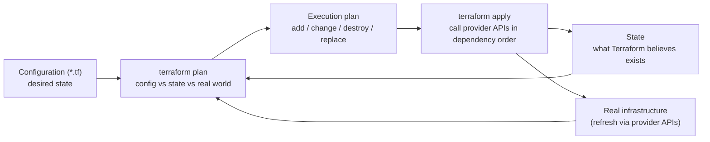
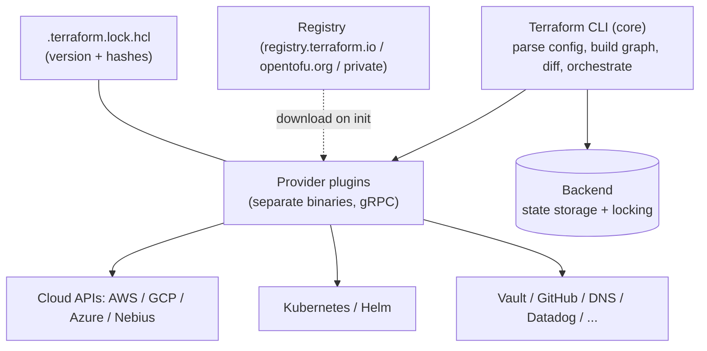
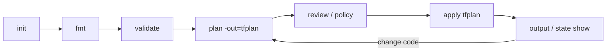

# 4.18 Terraform refresher: why, providers, resources and the workflow

| | |
|---|---|
| Level | Beginner to intermediate |
| Priority tier | 0 |
| Lab venue | Terraform 1.6+ or OpenTofu 1.6+; Docker for the local provider labs; optional GCP/AWS sandbox |
| Part | Part 4: Automation and infrastructure as code |
| Status | Drafted, labs **untested** |

## Why this matters for AI infrastructure

GPU capacity, networks, storage buckets, Kubernetes clusters and IAM are created through cloud and datacentre APIs. Doing that by console or ad-hoc scripts means environments nobody can reproduce, reviews that cannot see the real change, and bills nobody can explain. Terraform (and its open-source fork OpenTofu) turns infrastructure into declarative code with a **plan** step that shows exactly what will change, a **state** that records what exists, and **providers** that speak to hundreds of platforms: all major clouds, Kubernetes, Helm, GitHub, DNS, Vault, Nebius, CoreWeave, and bare-metal tooling. This chapter is a rigorous refresher: the model, the architecture, the language, the workflow, and the commands you reach for under pressure. The next chapters go deep on state (4.19), modules (4.20), loops and lifecycle (4.21), secrets and multiple providers (4.22), team workflows (4.23), GPU clouds (4.24) and Kubernetes (4.25).

## Prerequisites and outcomes

Needs 4.1 and 4.2. After this chapter you can:

- Contrast declarative IaC with imperative scripting and explain idempotence, drift and the plan/apply model.
- Describe Terraform's architecture: CLI core, providers (plugins over gRPC), the resource graph (DAG), state, backends, and how a plan is computed.
- Write HCL: providers, resources, variables (types, validation), locals, outputs, data sources, expressions, functions, dynamic blocks, and meta-arguments.
- Run the full workflow and use the command line fluently (`init`, `fmt`, `validate`, `plan -out`, `apply tfplan`, `destroy`, `state`, `import`, `moved`, `console`, `graph`, `output`, `workspace`).
- Import existing infrastructure and refactor safely.
- Compare Terraform OSS, HCP Terraform and OpenTofu, and make a reasoned choice.

## 1. Declarative versus imperative

An **imperative** script says how: "create a VPC; if it fails, retry; create a subnet; attach..." Run twice it either errors or duplicates. A **declarative** configuration says what: "there is a VPC with this CIDR, a subnet in it, three GPU instances." The tool computes the difference between desired and actual state and performs only the necessary actions.



Key ideas:

- **Idempotence**: apply twice, the second run reports no changes.
- **Drift**: the real world differs from state/config (manual edits, autoscalers, provider-side changes). `plan` detects it by refreshing.
- **Dependency graph**: Terraform infers ordering from references (`aws_subnet.x.id` in another resource) and builds a **DAG**; independent resources are created in parallel (default concurrency 10: `-parallelism`).
- **Plan as review artefact**: a saved plan is the change you approve; applying that exact file guarantees no surprise (4.2).
- **Immutable replacement**: many attribute changes force **replacement** (destroy then create, or create-before-destroy); plans mark these `-/+`. Reading the plan carefully for replacements of stateful resources (disks, databases, clusters) is the core operational skill.
- **Ansible vs Terraform**: Terraform manages the *existence and configuration of infrastructure objects* with state; Ansible configures *what runs on machines* (4.16).

### The Five IaC Categories and Six Trade-Off Axes from *Terraform: Up and Running* (`TUR` Chapter 1)

In *Terraform: Up and Running* Chapter 1 (*Why Terraform*), Yevgeniy Brikman maps the entire Infrastructure-as-Code landscape into **five tool categories** and **six architectural trade-off axes**:
1. **The five categories of IaC tools:**
   - **Ad-hoc scripts (`setup-webserver.sh`):** Imperative Bash/Python scripts; fine for one-off tasks, but lack idempotency, state tracking, and structure at scale.
   - **Configuration management tools (`Ansible`, `Chef`, `Puppet`):** Designed to install and configure software on *existing* servers.
   - **Server templating tools (`Packer`, `Docker`, `Vagrant`):** Bake self-contained VM images (running on a hypervisor that emulates hardware + guest OS kernel) or container images (isolating user space via Linux namespaces/cgroups while sharing the host kernel) to enable **immutable infrastructure**.
   - **Orchestration tools (`Kubernetes`, `Nomad`, `ECS`):** Schedule, heal, scale, and route traffic across containers/VMs.
   - **Provisioning tools (`Terraform`, `OpenTofu`, `CloudFormation`, `OpenStack Heat`, `Pulumi`):** Create the underlying servers, VPC networks, load balancers, databases, storage buckets, and IAM roles themselves.
2. **The six IaC trade-off axes (`TUR` Chapter 1 Table 1-4):**
   - **Configuration management vs. provisioning:** Server-templating + provisioning tools (`Packer` + `Terraform`) fit immutable infrastructure naturally, whereas configuration management tools (`Ansible`) fit mutable in-place configuration.
   - **Mutable vs. immutable infrastructure:** Rather than SSH-ing into running servers to upgrade packages in place (accumulating subtle configuration drift), immutable deployments bake a new image and replace the server.
   - **Procedural vs. declarative (the `count: 10 -> 15 -> 5` thought experiment):** Suppose you deploy 10 EC2 instances (`count: 10`). Later you want 15 instances: in a naive procedural script or task (`count: 15`), re-running it launches **15 additional instances (25 total)** unless you write custom tag-counting logic (`exact_count`), and if you later reduce the count to `5` or change `ami`, a stateless procedural tool has no record of which instances it created. In declarative **Terraform**, `terraform.tfstate` tracks all 10 instances: changing `count = 10` to `15` adds **5** instances, changing `15` to `5` terminates **10** instances, and changing `ami` plans an exact replacement (`-/+`).
   - **General-purpose languages (`GPL`: Pulumi in Python/TypeScript/Go) vs. domain-specific languages (`DSL`: Terraform HCL):** HCL intentionally restricts arbitrary loops and side effects so the infrastructure dependency graph remains declarative, inspectable, and predictable across every repository.
   - **Master server vs. masterless**, and **Agent-based vs. agentless**: Terraform is both **masterless** and **agentless** by default—the CLI talks directly to cloud provider APIs over HTTPS without requiring a background agent on target VMs or a dedicated master daemon (though HCP Terraform / Atlantis / CI runners can host remote execution when desired).

## 2. Architecture



- **Core** parses HCL, resolves variables, builds the resource graph, computes diffs between configuration, state and refreshed reality, and sequences operations. It knows nothing about clouds.
- **Providers** are plugins (Go binaries speaking the plugin protocol) that implement resource types and data sources for one platform. They are versioned independently; `terraform init` downloads them into `.terraform/providers` and records exact versions and checksums in `.terraform.lock.hcl` (**commit this file**).
- **State** (`terraform.tfstate`, JSON) maps each resource address in config to a real object ID and stores attributes, including sensitive values in plaintext. Treat it as a secret; store remotely with locking (4.19).
- **Backends** define where state lives and where operations run: local, S3+DynamoDB/lockfile, GCS, Azure Blob, Terraform Cloud/HCP, Consul, PostgreSQL, Kubernetes secret.
- **Registry and modules**: reusable configuration packaged and versioned (4.20).
- **Workspaces**: multiple state instances from one configuration (section 7).
- **Terraform vs OpenTofu**: OpenTofu is the Linux Foundation fork created after HashiCorp's licence change (BUSL); the CLI and HCL are largely compatible (`tofu` command), with additional features diverging over time (for example state encryption in OpenTofu). Choose by licence, support and feature needs; both read the same configuration for the common subset.

## 3. HCL language essentials

### Files and blocks

A configuration is the set of `*.tf` files in a directory (the **root module**), merged in lexical order; filenames do not matter, but conventions do: `main.tf`, `variables.tf`, `outputs.tf`, `providers.tf`/`versions.tf`, `locals.tf`, `data.tf`.

```hcl
terraform {
  required_version = ">= 1.6.0, < 2.0.0"
  required_providers {
    google = { source = "hashicorp/google", version = "~> 5.30" }
    random = { source = "hashicorp/random", version = "~> 3.6" }
  }
}

provider "google" {
  project = var.project_id
  region  = var.region
}
```

Version constraints: `=`, `!=`, `>`, `>=`, `<`, `<=`, `~>` (pessimistic: `~> 5.30` allows `>= 5.30, < 6.0`; `~> 5.30.1` allows `>= 5.30.1, < 5.31`). Pin providers with a range and rely on the lock file for exactness; upgrade deliberately with `terraform init -upgrade` and review the diff.

### Variables, locals, outputs

```hcl
variable "gpu_node_count" {
  type        = number
  description = "Number of GPU worker nodes"
  default     = 2
  validation {
    condition     = var.gpu_node_count >= 1 && var.gpu_node_count <= 64
    error_message = "gpu_node_count must be between 1 and 64."
  }
}

variable "labels" {
  type    = map(string)
  default = { owner = "ml-platform", env = "lab" }
}

variable "node_pools" {
  type = map(object({
    machine_type = string
    gpu_type     = optional(string)
    gpu_count    = optional(number, 0)
    min_nodes    = number
    max_nodes    = number
  }))
}

variable "db_password" {
  type      = string
  sensitive = true                 # redacted in plan/apply output (still stored in state!)
}

locals {
  name_prefix = "${var.env}-${var.cluster}"
  common_labels = merge(var.labels, { managed_by = "terraform", cluster = var.cluster })
  total_max_gpus = sum([for p in values(var.node_pools) : p.max_nodes * p.gpu_count])
}

output "cluster_endpoint" {
  value       = google_container_cluster.main.endpoint
  description = "API server endpoint"
}
output "kubeconfig_cmd" {
  value = "gcloud container clusters get-credentials ${google_container_cluster.main.name} --region ${var.region}"
}
output "admin_password" {
  value     = random_password.admin.result
  sensitive = true
}
```

Types: primitives `string`, `number`, `bool`; collections `list(T)`, `set(T)`, `map(T)`; structural `object({...})`, `tuple([...])`; `any`. Type constraints with `optional()` defaults make module interfaces self-documenting. Variable precedence (lowest to highest): the variable's `default`, environment `TF_VAR_name`, `terraform.tfvars`, `terraform.tfvars.json`, `*.auto.tfvars` (alphabetical), then `-var` and `-var-file` on the command line in the order given (last wins). `validation`, `precondition`, `postcondition` and `check` blocks add guardrails.

### Resources and data sources

```hcl
data "google_compute_image" "ubuntu" {
  family  = "ubuntu-2204-lts"
  project = "ubuntu-os-cloud"
}

resource "google_compute_network" "fabric" {
  name                    = "${local.name_prefix}-vpc"
  auto_create_subnetworks = false
  mtu                     = 8896                         # jumbo frames within the VPC
}

resource "google_compute_subnetwork" "compute" {
  name          = "${local.name_prefix}-compute"
  ip_cidr_range = "10.10.0.0/20"
  region        = var.region
  network       = google_compute_network.fabric.id       # implicit dependency edge
}

resource "google_compute_instance" "gpu" {
  count        = var.gpu_node_count
  name         = "${local.name_prefix}-gpu-${count.index}"
  machine_type = "a2-highgpu-1g"
  zone         = var.zone
  boot_disk {
    initialize_params {
      image = data.google_compute_image.ubuntu.self_link
      size  = 200
    }
  }
  guest_accelerator {
    type  = "nvidia-tesla-a100"
    count = 1
  }
  scheduling {
    on_host_maintenance = "TERMINATE"                    # required for GPU instances
  }
  network_interface {
    subnetwork = google_compute_subnetwork.compute.id
  }
  labels = local.common_labels
}
```

- A **resource** block `resource "TYPE" "NAME"` creates and manages an object; its address is `TYPE.NAME` (with `[index]` or `["key"]` for repeated ones). Attributes referenced from other resources create **implicit dependencies**; `depends_on` creates explicit ones when there is a hidden dependency.
- A **data source** (`data "TYPE" "NAME"`) reads existing information (latest image, existing VPC, caller identity, available zones) without managing it. Data sources are read during plan; if their arguments depend on unknown values they defer to apply.
- **Expressions**: references, string interpolation `"${...}"`, conditional `cond ? a : b`, `for` expressions (`[for x in list : upper(x)]`, `{for k, v in map : k => v.name}`), splat `aws_instance.web[*].id`, `try()`, `coalesce()`, `lookup()`. **Functions**: string, numeric, collection (`merge`, `flatten`, `zipmap`, `setproduct`, `cidrsubnet`, `cidrhost`), filesystem (`file`, `templatefile`), encoding (`jsonencode`, `yamlencode`, `base64encode`), hash/crypto, date/time. Terraform has no user-defined functions; use locals and modules.
- **Meta-arguments**: `count`, `for_each`, `depends_on`, `provider`, `lifecycle` (4.21).
- **Dynamic blocks** generate repeated nested blocks from collections:

```hcl
resource "google_compute_firewall" "internal" {
  name    = "${local.name_prefix}-allow-internal"
  network = google_compute_network.fabric.name
  dynamic "allow" {
    for_each = { tcp = ["0-65535"], udp = ["0-65535"], icmp = [] }
    content {
      protocol = allow.key
      ports    = allow.value
    }
  }
  source_ranges = ["10.10.0.0/16"]
}
```

- **Provisioners** (`local-exec`, `remote-exec`) are a last resort; prefer user-data/cloud-init, images, or Ansible (4.2, 4.17). `terraform_data` and `null_resource` can trigger external actions on change.
- **Sensitive values**: `sensitive = true` hides output but state still contains them; **ephemeral** values/resources (newer Terraform/OpenTofu) keep some secrets out of state (4.22).
- **From a single server to an Auto Scaling Group + Application Load Balancer (`TUR` Chapter 2 walkthrough):** In *Terraform: Up and Running* Chapter 2 (*Getting Started with Terraform*), Brikman demonstrates how implicit references and `lifecycle` rules wire a multi-resource architecture together:
  1. *Single server + Security Group:* An `aws_instance.example` (`user_data = <<-EOF ... busybox httpd -f -p ${var.server_port} & EOF`, `user_data_replace_on_change = true`) references `vpc_security_group_ids = [aws_security_group.instance.id]`, creating an implicit dependency edge visible in `terraform graph` (`[root] aws_instance.example -> [root] aws_security_group.instance`).
  2. *Auto Scaling Group (`aws_autoscaling_group` + `aws_launch_configuration`) and `create_before_destroy`:* Because an `aws_launch_configuration` is immutable, any change to its `image_id` or `user_data` forces replacement (`-/+`). However, since `aws_autoscaling_group.example` points to `aws_launch_configuration.example.name`, AWS refuses to delete the old launch configuration while the ASG still references it. Adding **`lifecycle { create_before_destroy = true }`** flips the replacement order (`+/-`): Terraform creates the new launch configuration first, updates the ASG to point to the new one, and only then deletes the old launch configuration (modeled in `code/part04/terraform_workflow_dag.py`).
  3. *Data sources and Application Load Balancer (`aws_lb`):* Using `data "aws_vpc" "default" { default = true }` and `data "aws_subnets" "default"` queries existing VPC subnets so `aws_lb` (`load_balancer_type = "application"`), `aws_lb_listener` (port `80`, default `fixed-response` `404`), `aws_lb_target_group` (`health_check`), and `aws_lb_listener_rule` (`path_pattern = ["*"]` forwarding to the ASG's `target_group_arns`) route traffic across the healthy instances and export `output "alb_dns_name"`.

## 4. The workflow and CLI reference



```bash
terraform version                              # CLI + provider versions
terraform init                                 # download providers/modules, configure backend, write .terraform.lock.hcl
terraform init -upgrade                        # move to the newest versions allowed by constraints
terraform init -reconfigure                    # change backend config without migrating state
terraform init -migrate-state                  # move state to a new backend (prompts)
terraform fmt -recursive -check                # CI formatting check (exit 3 if unformatted); drop -check to rewrite
terraform validate                             # syntax, types, references (no API calls)
terraform plan -out=tfplan -var-file=envs/lab.tfvars       # compute the diff and save the plan
terraform plan -refresh-only                   # show drift only (updates state if you then apply)
terraform plan -replace=google_compute_instance.gpu[1]     # force recreation of one resource (replaces `taint`)
terraform plan -target=module.net              # emergency only; leaves partial drift
terraform show tfplan                          # human-readable saved plan
terraform show -json tfplan > plan.json        # machine-readable plan for policy checks (4.2)
terraform apply tfplan                         # apply exactly the reviewed plan (no prompt)
terraform apply -auto-approve                  # CI only, after a saved plan was reviewed
terraform destroy                              # delete everything in this state (plan first: `plan -destroy`)
terraform output -json                         # outputs as JSON (feeds Ansible/CI)
terraform state list                           # resources in state
terraform state show google_compute_instance.gpu[0]
terraform state mv A B                         # rename an address without recreating
terraform state rm ADDR                        # forget a resource without deleting it
terraform import ADDR ID                       # adopt an existing object (or use import blocks, below)
terraform console                              # REPL for expressions
terraform graph | dot -Tsvg > graph.svg        # DAG visualisation
terraform providers                            # providers required, by module
terraform force-unlock LOCK_ID                 # break a stuck lock (confirm nobody is running)
terraform taint / untaint                      # legacy; use -replace
TF_LOG=DEBUG TF_LOG_PATH=tf.log terraform plan # debug logging (may contain secrets)
```

Reading a plan: symbols `+` create, `~` update in place, `-` destroy, `-/+` replace (destroy and create) or `+/-` (create before destroy), `<=` data read; "(known after apply)" marks computed values; "forces replacement" annotates the attribute that triggered a replacement. **Always read the summary line** ("Plan: X to add, Y to change, Z to destroy") and look for unexpected destroys and replacements of stateful objects.

Environment variables: `TF_VAR_*`, `TF_CLI_ARGS_plan`, `TF_IN_AUTOMATION=1`, `TF_INPUT=0` (never prompt in CI), `TF_PLUGIN_CACHE_DIR` (share provider downloads), `TF_DATA_DIR`, `TF_WORKSPACE`. CLI config `~/.terraformrc` (provider mirrors, credentials).

### Targeted and partial runs

`-target` is an escape hatch for recovery and breaking cycles; routine use leaves the configuration and state inconsistent and hides dependencies. For large estates, split state by blast radius (4.23) instead of targeting.

## 5. Drift, import and refactoring

### Detecting and handling drift

`terraform plan` refreshes by default. Use `-refresh-only` to accept real-world changes into state without changing infrastructure; otherwise the plan shows the changes needed to revert to the configuration. Decide per drift: revert it (apply), codify it (edit config to match), or ignore a legitimately external attribute with `lifecycle { ignore_changes = [...] }` (4.21). Schedule a nightly plan (4.2).

### Importing existing infrastructure

Infrastructure created by hand can be brought under management without recreating it.

```hcl
# imports.tf (Terraform 1.5+)
import {
  to = google_storage_bucket.checkpoints
  id = "my-project/ml-checkpoints-prod"
}
```

```bash
terraform plan -generate-config-out=generated.tf     # draft HCL from the real resource; review and edit it
terraform plan                                        # shows "1 to import"
terraform apply                                       # records it in state
```

Always follow the import with a clean `plan` ("No changes") to prove the configuration matches reality; imported resources often need arguments added to avoid planned changes. `terraform import` (CLI) does the same one resource at a time without generating code. Tools like `terraformer` and cloud-specific exporters help bulk discovery but produce messy code that needs refactoring.

### Refactoring safely

Renaming resources or moving them into modules would destroy and recreate them; declare the move instead:

```hcl
moved {
  from = google_compute_network.fabric
  to   = module.network.google_compute_network.this
}
removed {                                 # Terraform 1.7+: stop managing without destroying
  from = google_compute_instance.legacy
  lifecycle { destroy = false }
}
```

`moved` blocks are reviewed code (state surgery with `terraform state mv` is manual and unreviewed); they let a module upgrade or rename flow through CI. Review the plan: the move should show "has moved", not destroy/create.

### State commands (use with care)

`state list/show/mv/rm/pull/push`: `pull` downloads raw state for inspection; `push` overwrites remote state and can destroy someone's work (it refuses on lineage/serial mismatch unless forced). Prefer `moved`/`import`/`removed` blocks to hand-edited state, back up state before surgery, and ensure nobody else is applying (locks).

## 6. Providers and authentication

- **Declare** providers in `required_providers`; configure in `provider` blocks. Multiple configurations use `alias` (4.22).
- **Authenticate without static keys**: environment-provided credentials, workload identity, instance profiles, OIDC from CI (4.2). Never put keys in `.tf` files or `.tfvars` committed to Git.
- **GPU-cloud providers**: major clouds (`hashicorp/google`, `aws`, `azurerm`), Nebius (`nebius/nebius` provider), CoreWeave (Kubernetes-native and API provider), Oracle OCI, Lambda, and bare-metal tooling (MAAS, Ironic via OpenStack, Redfish providers for BMCs); see 4.24 and Part 7.
- **Kubernetes and Helm providers** (4.25) manage in-cluster resources; avoid creating the cluster and deploying into it in one configuration (providers need cluster credentials at plan time); split into layers.
- **Provider mirrors/caches** for air-gapped or rate-limited environments; verify checksums via the lock file.

## 7. Workspaces and environments

A workspace is a named instance of state for the same configuration: `terraform workspace new staging`, `workspace select`, `workspace list`, and `terraform.workspace` inside configuration. Conveniences, not isolation: all workspaces share code, backend config and credentials, so a mistaken `apply` in the wrong workspace hits the wrong environment. Many teams prefer **directory-per-environment** (separate root modules `envs/prod`, `envs/staging` with different backends and credentials, shared modules) for production safety and clearer reviews (4.23). Workspaces suit temporary copies (benchmark clusters, per-branch preview environments).

## 8. Terraform OSS, HCP Terraform and OpenTofu

| Option | Strengths | Considerations |
|---|---|---|
| Terraform OSS CLI (BUSL licence) | Ubiquitous, mature, largest provider ecosystem | Licence terms for building competing products; you operate remote state, locking, CI and policy yourself |
| HCP Terraform / Terraform Enterprise | Managed runs, remote state, RBAC, Sentinel/OPA policy, private registry, cost estimation, drift detection, run triggers | Vendor dependency and cost; credentials live in the platform |
| OpenTofu (MPL, Linux Foundation) | Open governance; state encryption; early evaluation features; registry at opentofu.org | Compatibility drift over time; check provider and module support |
| Alternatives | Pulumi (general-purpose languages), Crossplane (Kubernetes-native control plane), CDK for Terraform, Ansible cloud modules, cloud-native (CloudFormation, Bicep, Config Connector) | Different models: code vs HCL, reconciliation loops vs plan/apply |

Whichever you pick: pin the CLI version in CI (`required_version`, `tfenv`/`tofuenv`/`asdf`), commit `.terraform.lock.hcl`, keep state remote with locking, and test upgrades.

## 9. A small end-to-end example

```hcl
# main.tf: local-only providers, safe to try anywhere
terraform {
  required_providers {
    random = { source = "hashicorp/random", version = "~> 3.6" }
    local  = { source = "hashicorp/local",  version = "~> 2.5" }
  }
}

variable "nodes" {
  type    = map(object({ gpus = number }))
  default = { gpu01 = { gpus = 8 }, gpu02 = { gpus = 8 }, gpu03 = { gpus = 4 } }
}

resource "random_pet" "cluster" { length = 2 }

resource "local_file" "inventory" {
  filename = "${path.module}/inventory.ini"
  content = templatefile("${path.module}/inventory.tftpl", {
    cluster = random_pet.cluster.id
    nodes   = var.nodes
  })
}

output "inventory_path" { value = local_file.inventory.filename }
```

```text
# inventory.tftpl
# cluster: ${cluster}
[gpu]
%{ for name, n in nodes ~}
${name} gpus=${n.gpus}
%{ endfor ~}
```

```bash
terraform init && terraform plan -out=tfplan && terraform apply tfplan
terraform plan                           # "No changes": idempotent
# edit var.nodes to add gpu04, plan: only the file changes, random_pet is untouched
terraform state list; terraform output
terraform destroy
```

This pattern (Terraform output rendered as an Ansible inventory) is the simplest bridge between provisioning and configuration (4.27).

## 10. Lab

First, run the self-checking Python lab (`code/part04/terraform_workflow_dag_lab.py`) locally. It verifies the `terraform plan` action classifier (`compute_terraform_plan_actions`: `+ create`, `~ update_in_place`, `-/+ replace_destroy_first`, `+/- replace_create_first` with `create_before_destroy`, `- destroy`, and `moved` address refactoring without recreation, `TUR` Ch. 2), the resource dependency DAG wave planner (`build_dependency_execution_waves`), and pessimistic version constraints (`matches_pessimistic_constraint` on `~> 5.30` vs `~> 5.30.1`).

```bash
python3 code/part04/terraform_workflow_dag_lab.py
```

Next, on any machine with Terraform 1.6+ or OpenTofu 1.6+ (all interactive shell steps below are `untested here`), work through these exercises:

1. **Install and pin**: install Terraform and/or OpenTofu with a version manager; create `required_version` and provider constraints; run `init`; inspect `.terraform/` and `.terraform.lock.hcl`; commit the lock file.
2. **Plan reading**: with local providers, create resources, change an attribute that forces replacement, and read the `-/+` plan; change one that updates in place; use `-replace`.
3. **Variables**: use types with `optional`, validation, sensitive variables, `.tfvars` and `TF_VAR_*`; demonstrate precedence by setting the same variable in each of those places.
4. **Expressions**: write `for` expressions, conditionals, `merge`, `cidrsubnet`, `templatefile`, `try`; explore with `terraform console`.
5. **Graph**: render `terraform graph`; add an implicit and an explicit dependency; show parallelism with `-parallelism=1` vs default.
6. **Drift**: apply, change something out-of-band (edit the generated file or a cloud label), run `plan` and `plan -refresh-only`; handle by revert, codify, and `ignore_changes`.
7. **Import**: create a resource by hand (Docker container/volume via the Docker provider, or a cloud bucket), write an `import` block, generate config, fix it until the plan is clean.
8. **Refactor**: rename a resource and move it into a module with a `moved` block; verify "has moved" in the plan and no recreate; try `state mv` and compare.
9. **Workspaces**: create `dev` and `bench` workspaces with different tfvars; show how the wrong workspace could be applied; implement directory-per-environment as the alternative.
10. **Destroy safely**: `plan -destroy`, `prevent_destroy` lifecycle (4.21), and `terraform destroy`; verify cleanup.
11. **Cloud sandbox (optional)**: apply the VPC, subnet, firewall and one small instance from section 3 in a sandbox project; add a GPU instance only if quota and budget allow; destroy immediately.
12. **OpenTofu vs Terraform**: run the same config with both CLIs; note differences.
13. **Clean up.**

## 11. Common mistakes

- Treating `apply` without a reviewed plan as normal; ignoring replacements in the plan.
- Editing state by hand, or using `-target` as a habit.
- Committing `.tfstate`, `.tfvars` with secrets, or crash logs; not committing `.terraform.lock.hcl`.
- Unpinned providers or Terraform versions; surprise upgrades in CI.
- Hard-coded IDs/regions/AMIs instead of variables and data sources.
- One giant root module/state for everything (huge blast radius, slow plans).
- Using workspaces as the primary production isolation boundary.
- Using provisioners to configure machines when images or Ansible would be better.
- Copying resources instead of using `for_each`/modules; using `count` where keys are needed (index shifts destroy resources).
- Not testing `destroy` and `import` paths until an incident.

## 12. Interview angles

- "What is Terraform state and why is it needed? What can go wrong with it?"
- "Explain `plan` and `apply`; what does `-out` give you?"
- "How does Terraform decide ordering? What is `depends_on` for?"
- "A plan shows `-/+` on a database. What do you do?"
- "How do you bring existing infrastructure under Terraform?" (import blocks, plan clean.)
- "How do you rename or move resources without recreating them?" (`moved`.)
- "Terraform vs OpenTofu vs Pulumi vs Crossplane vs Ansible for provisioning?"
- "Workspaces vs directories for environments?"
- "How do you handle drift?"

## Exercises

1. **The Five IaC Categories, Six Trade-Off Axes, and Procedural vs. Declarative Scaling (`count = 10 -> 15 -> 5`, `TUR` Chapter 1):** (a) Contrast ad-hoc scripts, configuration management (`Ansible`), server templating (`Packer`/`Docker`), orchestration (`Kubernetes`), and provisioning (`Terraform`/`OpenTofu`); (b) use the `count = 10 -> 15 -> 5` EC2 thought experiment from `TUR` Chapter 1 to explain why declarative state-backed provisioning beats stateless procedural tasks for managing cloud lifecycles.
2. **Terraform Architecture (Core, gRPC Provider Plugins, `.terraform.lock.hcl`, State, Backends) and Dependency DAG Execution Waves (`TUR` Chapters 1 & 2):** Using `build_dependency_execution_waves()` and `matches_pessimistic_constraint()` in `code/part04/terraform_workflow_dag.py`, explain how Terraform Core and Provider plugins interact, why `.terraform.lock.hcl` must be committed to Git, the difference between `~> 5.30` and `~> 5.30.1`, and how implicit reference edges determine parallel execution waves (`-parallelism=10`).
3. **HCL Language Essentials: Variables (Types, `optional()`, `validation`, Precedence), `locals`, `outputs`, `data` Sources, and `dynamic` Blocks (`TUR` Chapter 2):** State the exact variable precedence order from lowest (`default`) to highest (`-var` / `-var-file`), explain why `sensitive = true` does not encrypt values in `terraform.tfstate`, and trace how `data "google_compute_image"`, `google_compute_network` (`mtu = 8896`), `google_compute_subnetwork`, and `google_compute_instance` (`on_host_maintenance = "TERMINATE"`) wire together.
4. **Reading `terraform plan` Symbols (`+`, `~`, `-/+`, `+/-`, `-`, `<=`) and `create_before_destroy` on ASGs (`TUR` Chapter 2):** Using `compute_terraform_plan_actions()` in `code/part04/terraform_workflow_dag.py`, explain every symbol in a Terraform plan, why changing `image_id` on an `aws_launch_configuration` referenced by an `aws_autoscaling_group` fails without `lifecycle { create_before_destroy = true }`, and why `terraform plan -out=tfplan` + `terraform apply tfplan` is mandatory in production.
5. **Handling Drift (`-refresh-only`), Adopting Unmanaged Resources (`import` + `-generate-config-out`), and Safe Refactoring (`moved` and `removed` Blocks):** Trace how to: (a) inspect and resolve out-of-band drift; (b) bring an existing GCS checkpoint bucket under Terraform management with an `import {}` block and prove convergence; and (c) move `google_compute_network.fabric` into `module.network.google_compute_network.this` via a `moved {}` block in Git without destroying the VPC.
6. **Workspaces vs. Directory-per-Environment, Terraform OSS vs. HCP Terraform vs. OpenTofu, and Rendering Ansible Inventories (`templatefile`):** Explain why `terraform workspace` is risky as a production/staging boundary compared to directory-per-environment, compare Terraform OSS (BUSL), HCP Terraform, and OpenTofu (MPL 2.0, Linux Foundation), and show how `local_file` + `templatefile()` bridges Terraform outputs into an Ansible `inventory.ini`.

## Checkpoint questions (20)

<details>
<summary>1. In *Terraform: Up and Running* Chapter 1, what are the five categories of Infrastructure-as-Code tools, and how do they fit together in an AI platform?</summary>

1. **Ad-hoc scripts (`Bash` / `Python`):** One-off operational glue and custom checks.
2. **Server templating tools (`Packer`, `Docker`):** Bake immutable VM golden images (with pre-installed NVIDIA drivers/OFED) and container images.
3. **Provisioning tools (`Terraform`, `OpenTofu`, `CloudFormation`, `Pulumi`):** Provision the cloud/datacenter foundation (VPCs, subnets, firewall rules, storage buckets, IAM, GKE/EKS clusters, and GPU VM instances booted from Packer images).
4. **Configuration management tools (`Ansible`):** Perform day-2 host configuration, Slurm/fabric tuning, and rolling maintenance on running servers.
5. **Orchestration tools (`Kubernetes`, `Slurm`):** Schedule, monitor, heal, and autoscale distributed training and inference workloads on the fleet.
</details>

<details>
<summary>2. How does Brikman's `count = 10 -> 15 -> 5` example (`TUR` Chapter 1) illustrate the difference between procedural configuration management and declarative stateful provisioning?</summary>

Suppose you deploy 10 EC2 instances (`count: 10`) and then change the number to `15`:
- **Procedural & stateless:** Re-running a naive `count: 15` task executes \"launch 15 instances\" again, leaving **25 instances running** (unless you manually configure tag-based `exact_count` filters), and if you later reduce `count` to `5`, a stateless tool does not know which 10 instances to terminate.
- **Declarative & stateful (`Terraform`):** Because `terraform.tfstate` records the exact IDs of the 10 existing instances, changing `count = 10` to `15` computes a diff of **`+5 to add`**, and changing `15` to `5` computes **`-10 to destroy`** automatically.
</details>

<details>
<summary>3. How do Terraform Core and Provider plugins divide responsibilities, and why must `.terraform.lock.hcl` be committed to Git?</summary>

- **Terraform Core (the CLI binary):** Parses HCL files, evaluates expressions, builds the resource dependency DAG, diffs configuration against state, and orchestrates parallel graph execution (`-parallelism=10`). Core contains **zero cloud-specific code**.
- **Provider Plugins (`hashicorp/google`, `hashicorp/aws`, `nebius/nebius`):** Separate Go binaries downloaded by `terraform init` into `.terraform/providers/` that communicate with Core over **local gRPC** and translate resource CRUD operations into cloud REST API calls.
- **`.terraform.lock.hcl`:** Records the exact resolved provider version and **cryptographic SHA-256 hashes (`h1:`, `zh:`)** across platforms. Committing `.terraform.lock.hcl` to Git guarantees that every engineer and CI runner installs the exact same verified provider binary.
</details>

<details>
<summary>4. What is the difference between the pessimistic version constraints `~> 5.30` and `~> 5.30.1`, and how do you upgrade providers intentionally?</summary>

The pessimistic constraint operator **`~>`** allows only the **rightmost specified version component** to increment:
- **`~> 5.30`** (two components): allows any `5.x` release **`>= 5.30.0, < 6.0.0`** (e.g., `5.42.0` is allowed; `6.0.0` is blocked).
- **`~> 5.30.1`** (three components): allows only patch releases **`>= 5.30.1, < 5.31.0`** (e.g., `5.30.9` is allowed; `5.31.0` is blocked).
On normal runs, `terraform init` obeys `.terraform.lock.hcl`; to intentionally upgrade within your `~>` bounds and update the lock file, run **`terraform init -upgrade`** and review the `.terraform.lock.hcl` diff in a pull request.
</details>

<details>
<summary>5. What is the exact precedence order for Terraform Input Variables from lowest to highest?</summary>

From **lowest to highest** precedence (later sources override earlier ones):
1. The `default` value inside the `variable "..." {}` block.
2. **`TF_VAR_<name>`** environment variables.
3. The **`terraform.tfvars`** file (if present).
4. The **`terraform.tfvars.json`** file (if present).
5. Any **`*.auto.tfvars`** or **`*.auto.tfvars.json`** files (processed in lexical filename order).
6. Command-line **`-var="k=v"`** and **`-var-file="envs/prod.tfvars"`** flags, evaluated in the order they appear on the command line (**last flag wins**).
</details>

<details>
<summary>6. What does `sensitive = true` on a variable or output actually protect, and what does it NOT protect?</summary>

Setting `sensitive = true` on a `variable` or `output` redacts its value as **`(sensitive value)`** in terminal console output during `terraform plan`, `terraform apply`, and `terraform output` (and propagates sensitivity to any expression derived from it). However, **`sensitive = true` does NOT encrypt or omit the value in `terraform.tfstate` or in a saved `tfplan` file**—both files still store the raw plaintext value. Therefore, remote state buckets and plan artifacts must always be encrypted and IAM-restricted (and Terraform 1.10+ / OpenTofu `ephemeral` variables/resources can keep transient tokens out of state).
</details>

<details>
<summary>7. How does Terraform build its Resource Dependency Graph (`DAG`), and when do you need `depends_on`?</summary>

When Resource B references an attribute of Resource A (for example, `google_compute_subnetwork.compute` sets `network = google_compute_network.fabric.id`), Terraform automatically infers an **implicit dependency edge**: during `apply`, `fabric` is created before `compute`; during `destroy`, `compute` is destroyed before `fabric`; and unrelated resources are created in parallel (up to `-parallelism=10`). You only need explicit **`depends_on = [...]`** when a dependency is invisible in HCL—for example, when an instance's startup script requires an IAM role binding (`google_project_iam_member`) or NAT gateway route to be active before the VM boots, even though the VM block does not reference an attribute of the IAM binding.
</details>

<details>
<summary>8. Why do GPU instances on GCP require `scheduling { on_host_maintenance = "TERMINATE" }`?</summary>

Standard CPU VMs on Google Cloud default to `on_host_maintenance = "MIGRATE"` (live migration during host hardware maintenance). Because physical NVIDIA GPUs (`nvidia-tesla-a100`, H100 `a3-highgpu-8g`) are attached directly via PCIe/NVLink passthrough and cannot be live-migrated across hypervisors, GCP's API rejects GPU VM creation unless **`on_host_maintenance = "TERMINATE"`** is explicitly configured.
</details>

<details>
<summary>9. Decode all six action symbols in `terraform plan` output (`+`, `~`, `-`, `-/+`, `+/-`, `<=`).</summary>

- **`+` (create):** Resource will be created.
- **`~` (update in-place):** Mutable attribute (such as labels/tags or firewall rules) will be updated via the cloud API without destroying the resource.
- **`-` (destroy):** Resource will be permanently deleted.
- **`-/+` (destroy and then create replacement):** An immutable attribute changed (`# forces replacement`); Terraform will **destroy the existing resource first** and then create a new one.
- **`+/-` (create replacement and then destroy):** Triggered when **`lifecycle { create_before_destroy = true }`** is set; Terraform creates the replacement resource first, updates dependents, and destroys the old resource last.
- **`<=` (read):** A `data` source whose inputs depend on values only known during `apply` will be read during the apply phase.
</details>

<details>
<summary>10. In `TUR` Chapter 2, why did replacing an `aws_launch_configuration` used by an `aws_autoscaling_group` fail until `create_before_destroy = true` was added?</summary>

An `aws_launch_configuration` is immutable: changing its `image_id` or `user_data` forces a `-/+` replacement. Under default order (destroy first, then create), Terraform tries to delete the old launch configuration *before* updating the `aws_autoscaling_group`—and AWS rejects the API call because an active ASG is still referencing that launch configuration. Adding `lifecycle { create_before_destroy = true }` to `aws_launch_configuration` (and the ASG) makes Terraform create the new launch config first (`+/-`), repoint the ASG to the new launch config, and then delete the old one cleanly.
</details>

<details>
<summary>11. Compare `terraform fmt -check`, `terraform validate`, and `terraform plan` in a CI pipeline.</summary>

- **`terraform fmt -recursive -check`:** Checks canonical HCL formatting in milliseconds without provider plugins (exiting **`3`** if any `.tf` file is unformatted).
- **`terraform validate`:** Runs after `terraform init -backend=false`; verifies HCL syntax, attribute names against provider schemas, variable types, and internal references **offline without calling cloud APIs or reading state**.
- **`terraform plan -out=tfplan` (with `TF_INPUT=0` / `-input=false`):** Authenticates to the backend and cloud APIs, locks state, refreshes live resources, evaluates `data` sources, and computes the exact execution plan.
</details>

<details>
<summary>12. How do you force Terraform to recreate a single unhealthy VM without using the deprecated `terraform taint` command?</summary>

Pass **`-replace=<resource_address>`** directly to `terraform plan` / `apply`:
`terraform plan -replace="google_compute_instance.gpu[1]" -out=tfplan`
Unlike `terraform taint` (which mutated the remote state file immediately before anyone reviewed a plan, affecting concurrent runs), `-replace` is a clean, reviewable plan-time flag included inside `tfplan`.
</details>

<details>
<summary>13. What is the difference between normal `terraform plan` and `terraform plan -refresh-only` when investigating drift?</summary>

- **Normal `terraform plan`:** Refreshes state from the cloud APIs and then proposes actions (`~`, `-/+`, `+`, `-`) to **overwrite real-world drift so reality matches your `.tf` code**.
- **`terraform plan -refresh-only`:** Compares the current `terraform.tfstate` against the live cloud APIs and shows **only what changed out-of-band in the real world**, without proposing any changes to cloud resources (if you apply a `-refresh-only` plan, Terraform updates `terraform.tfstate` to match reality).
</details>

<details>
<summary>14. How do Declarative `import {}` blocks (Terraform 1.5+) and `-generate-config-out` improve on the legacy `terraform import` CLI command?</summary>

- **Legacy `terraform import ADDR ID`:** Immediately mutates the live remote state file on the command line without a PR review, requires you to hand-write the `.tf` block beforehand, and can only import one resource at a time.
- **Declarative `import { to = ..., id = "..." }` blocks:** Are committed and reviewed in Git like any other code, can import dozens of resources in a single `plan`/`apply` cycle, and support **`terraform plan -generate-config-out=generated.tf`** to automatically scaffold the HCL resource block from the cloud API. Always run a follow-up `terraform plan` until it reports **`No changes`** before merging.
</details>

<details>
<summary>15. How do `moved {}` and `removed {}` blocks allow safe refactoring in CI without manual `terraform state mv/rm` surgery?</summary>

- **`moved { from = google_compute_network.fabric, to = module.network.google_compute_network.this }`:** When you rename a resource or extract it into a child module, Terraform would normally see the old address removed (`- destroy`) and the new address added (`+ create`). Adding a `moved` block in `.tf` code tells Terraform during `plan` to rebind the existing state object to the new address (`# google_compute_network.fabric has moved to module.network.google_compute_network.this`) with **zero infrastructure destruction**, reviewed safely in a PR.
- **`removed { from = google_compute_instance.legacy, lifecycle { destroy = false } }` (`destroy=false`, Terraform 1.7+):** Declaratively removes a resource from Terraform state (`terraform state rm` as code) while leaving the real cloud object running.
</details>

<details>
<summary>16. Why is routine use of `terraform plan -target=...` an anti-pattern, and what should you do instead?</summary>

`-target=module.net` tells Terraform to evaluate only a subgraph of the dependency DAG—meaning dependent resources outside the target are ignored, leaving your `.tf` code, `terraform.tfstate`, and live cloud infrastructure out of sync until a full untargeted `apply` is run. Reserve `-target` strictly for emergency break-glass recovery; if routine plans are too slow or risky, **split the monolithic root module into smaller, layered root modules** (`network/`, `storage/`, `gke/`, `gpu-pools/`, Chapter 4.23).
</details>

<details>
<summary>17. Why are `terraform workspace`s risky for separating `prod` and `staging`, and when ARE workspaces useful?</summary>

All CLI workspaces (`terraform workspace select prod`) in a directory **share the exact same backend storage bucket, the same cloud credentials, and the same `.tf` files**—so an engineer who forgets which workspace their terminal is in (`terraform workspace show`) can accidentally apply a dev change to production, and you cannot restrict IAM permissions per workspace easily. Use **separate directories (`envs/prod/`, `envs/staging/`)** with separate state buckets and separate OIDC IAM roles for permanent environments; use CLI workspaces only for short-lived ephemeral feature/benchmark copies inside a dev account.
</details>

<details>
<summary>18. Why shouldn't you create a Kubernetes cluster (`google_container_cluster`) and deploy resources into it (`kubernetes_namespace`, `helm_release`) inside the same root module?</summary>

The `kubernetes` and `helm` providers initialize their API connections during the **plan phase**. If `google_container_cluster.main` does not exist yet (or is being replaced), its `endpoint` and CA certificate are `(known after apply)`—causing the `kubernetes`/`helm` providers to fail during `plan` or fall back to `localhost:8080` (and if you `terraform destroy` a combined stack, cluster deletion races with in-cluster finalizers). Always split **Layer 1 (Cluster & Node Pools)** and **Layer 2 (Platform Helm Charts / GitOps Bootstrap)** into separate root modules (Chapter 4.25).
</details>

<details>
<summary>19. Compare Terraform OSS, HCP Terraform (Terraform Cloud/Enterprise), and OpenTofu.</summary>

- **Terraform OSS CLI:** HashiCorp's standard CLI (licensed under the Business Source License `BUSL 1.1` since v1.5.6); ubiquitous provider ecosystem via `registry.terraform.io`.
- **HCP Terraform / Terraform Enterprise:** HashiCorp's managed control plane adding remote execution runners, state storage, RBAC, Sentinel/OPA policy gates, private module registry, and continuous drift detection.
- **OpenTofu (`tofu` CLI):** The Linux Foundation open-source (`MPL 2.0`) drop-in fork of Terraform 1.6+, adding native client-side **state and plan encryption** (AES-GCM via KMS/passphrase), `for_each` on `provider` blocks, and early variable evaluation in `backend` / `module` source blocks.
</details>

<details>
<summary>20. How do `local_file` and `templatefile()` bridge Terraform provisioning with Ansible configuration management?</summary>

After Terraform provisions GPU VMs and networks, a `resource "local_file" "inventory"` task (or `terraform output -json`) renders `inventory.tftpl` using **`templatefile("${path.module}/inventory.tftpl", { cluster = ..., nodes = ... })`** to produce a ready-to-use `inventory.ini` / `hosts.yml` containing every provisioned node's private IP, rack/zone label, and GPU count—eliminating manual IP copy-pasting between Terraform and Ansible.
</details>

## Sources and review notes

- **Sources read in full:**
  - `terraform-up-and-running-3rd-edition` — Yevgeniy Brikman, *Terraform: Up and Running*, 3rd ed., **Chapter 1: Why Terraform** (read in full: the DevOps transformation, the 5 categories of IaC tools—ad-hoc scripts, configuration management, server templating VMs vs containers, orchestration, and provisioning; the 6 benefits of IaC; and comparing Chef, Puppet, Ansible, Pulumi, CloudFormation, Heat, and Terraform across 6 axes including mutable vs immutable, procedural vs declarative `count = 10 -> 15 -> 5` EC2 scaling, GPL vs DSL, master vs masterless, and agent vs agentless) and **Chapter 2: Getting Started with Terraform** (read in full: AWS account setup, deploying a single EC2 server with `user_data` `<<-EOF` and `user_data_replace_on_change = true`, `aws_security_group`, `terraform init`/`plan`/`apply`/`destroy`/`graph`, input `variable`s and `output`s, deploying a cluster with `aws_launch_configuration` + `aws_autoscaling_group` and `lifecycle { create_before_destroy = true }`, `data` sources `aws_vpc` and `aws_subnets`, and deploying an `aws_lb` Application Load Balancer with listener, target group, and listener rule).
  - `nvidia-devops` (`volume-10/05-terraform-for-infrastructure-as-code.md`): paradigm, architecture, HCL masterclass, CLI reference, import and refactoring (`import`, `moved`, `removed`), workspaces, and OSS vs HCP vs OpenTofu.
- **Run here:** `python3 code/part04/terraform_workflow_dag_lab.py` (3 passed, 0 failed).
- **Explicitly labelled inferences:** The `compute_terraform_plan_actions`, `build_dependency_execution_waves`, and `matches_pessimistic_constraint` models in `code/part04/terraform_workflow_dag.py` and the GCP `google_compute_network`/`google_compute_instance` and `local_file` `inventory.tftpl` examples are the author's constructions synthesizing `TUR` Chapters 1 & 2 and `volume-10/05` (plus original study items 21, 22, 23, 24, 25, 26, 27, 28, 29, 30, 31, 32, 33, 34, and 35).
- **Not verified on live hardware:** Live `terraform` / `tofu` executions against GCP/AWS (`1.6.0`, `2.0.0`, `~> 5.30`, `~> 3.6`, `~> 2.5`, `1..64` nodes, `8896` MTU, `10.10.0.0/20`, `10.10.0.0/16`, `a2-highgpu-1g`, `200` GB, `0-65535`, `8080`, `10` parallelism, exit code `3`) are marked (`untested here`) where not executed by `terraform_workflow_dag_lab.py`.
