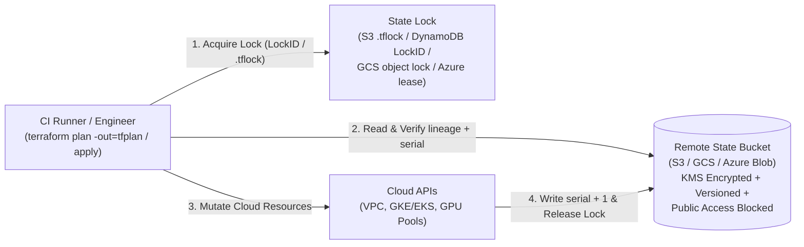

# 4.19 Terraform state in depth: backends, locking and drift

| | |
|---|---|
| Level | Intermediate |
| Priority tier | 0 |
| Lab venue | Terraform/OpenTofu 1.6+; Docker with MinIO (S3-compatible) or a cloud sandbox bucket |
| Part | Part 4: Automation and infrastructure as code |
| Status | Drafted, labs **untested** |

## Why this matters for AI infrastructure

State is the single most dangerous file in your platform. It maps names in code to real GPU clusters, buckets full of checkpoints and databases; it contains secrets in plaintext; if it is lost, Terraform forgets what it manages and tries to recreate it (duplicates, conflicts, outages); if it is corrupted or two people write it at once, resources can be orphaned or destroyed. In a team running training infrastructure across dev, staging and production, state design (where it lives, how it is locked, how it is split, who can read it) is a core architectural decision. This chapter covers state mechanics, remote backends, locking, layout strategies, migration, recovery and drift in practical depth.

## Prerequisites and outcomes

Needs 4.18. After this chapter you can:

- Explain what state contains, how plan/apply read and write it, and why it must be protected.
- Configure remote backends (S3, GCS, Azure Blob, HCP Terraform, PostgreSQL, Kubernetes) with encryption, versioning and locking, and bootstrap them safely.
- Choose a state layout (per environment, per layer/component, per team) that limits blast radius and plan time; share data across stacks safely.
- Migrate state between backends and workspaces; split and merge state with `moved`, `import`, `removed`, `state mv/rm`; recover from lost, corrupted or locked state.
- Detect and handle drift; manage secrets and sensitive values; encrypt state (OpenTofu) and restrict access.
- Operate state in CI/CD: locking, concurrency, least privilege.

## 1. What state is

State is a JSON document (`terraform.tfstate`) with a `version`, a `lineage` (unique id for this state's history), a `serial` (incremented on each write), the Terraform version, outputs, and a list of resources. Each resource instance records its address, provider, attributes (including values the provider computed such as IDs, IPs, ARNs), dependencies, and schema version.

```json
{
  "version": 4,
  "terraform_version": "1.8.5",
  "serial": 42,
  "lineage": "b2a4c5f0-....",
  "outputs": { "cluster_endpoint": { "value": "34.1.2.3", "type": "string" } },
  "resources": [
    { "mode": "managed", "type": "google_compute_instance", "name": "gpu",
      "provider": "provider[\"registry.terraform.io/hashicorp/google\"]",
      "instances": [ { "index_key": 0, "attributes": { "id": "projects/p/zones/z/instances/lab-gpu-0", "name": "lab-gpu-0", "...": "..." } } ] }
  ]
}
```

Why Terraform needs it:

1. **Mapping**: config address (`google_compute_instance.gpu[0]`) to the real ID. Without it Terraform cannot know the resource already exists (cloud APIs generally lack a "which resources did Terraform make" query).
2. **Metadata and dependency order**, particularly for destroys of resources no longer in config.
3. **Performance**: caching attributes so plan need not query every object (though it refreshes by default).
4. **Collaboration and sync**: a shared record plus locking.

Properties to remember: state is **not a backup of the infrastructure**, it is not authoritative about reality (the cloud is), and it contains **sensitive values in plaintext** (database passwords, private keys from `tls_private_key`, access keys created by Terraform, secrets read via data sources, even values marked `sensitive`). Anyone who can read state can often compromise the resources it describes.

## 2. Local state and its limits

By default state is `terraform.tfstate` in the working directory (plus a `.backup` file). Acceptable for experiments; unacceptable for teams: no locking (two applies corrupt it), no backup/versioning, secrets on laptops, no access control, easily lost or committed to Git. **Never commit state to Git** (`.gitignore`, 4.1). As Yevgeniy Brikman details in *Terraform: Up and Running* Chapter 3 (*How to Manage Terraform State*), storing `terraform.tfstate` in version control fails for three concrete reasons:
1. **Manual error:** It is all too easy for a developer to forget to run `git pull` before running `terraform apply` or to forget `git push` afterward—causing a teammate's subsequent `apply` to roll back changes or create duplicate resources.
2. **Lack of locking:** Git and GitHub have no mechanism to lock `terraform.tfstate` while a `terraform apply` is in flight, so two concurrent runs corrupt the JSON state or race on cloud APIs.
3. **Plaintext secrets:** Every attribute of every Terraform resource (`aws_db_instance.example.password`, TLS private keys, tokens) is written in cleartext inside `terraform.tfstate`, so committing it to Git exposes every secret to anyone with repository read access.

Remote state is the baseline for anything shared.



## 3. Remote backends

A **backend** configures (a) where state is stored and (b) whether operations run locally or remotely. Most backends store state and run operations on your machine/CI runner; HCP Terraform can also run them remotely.

### Amazon S3 (with locking)

```hcl
terraform {
  backend "s3" {
    bucket         = "acme-tfstate-prod"
    key            = "ai-platform/network/terraform.tfstate"
    region         = "us-east-1"
    encrypt        = true
    kms_key_id     = "arn:aws:kms:us-east-1:123456789012:key/abcd-..."
    use_lockfile   = true                    # native S3 locking (newer Terraform/OpenTofu)
    # dynamodb_table = "acme-tfstate-lock"   # legacy locking via DynamoDB (deprecated in newer releases)
  }
}
```

Bucket hardening (`TUR` Chapter 3): in AWS, provision `aws_s3_bucket` (`lifecycle { prevent_destroy = true }`), **`aws_s3_bucket_versioning`** (`status = "Enabled"` so every state write is preserved as an S3 object version for instant rollback), **`aws_s3_bucket_server_side_encryption_configuration`** (`sse_algorithm = "AES256"` or `aws:kms`), and **`aws_s3_bucket_public_access_block`** (`block_public_acls = true`, `block_public_policy = true`, `ignore_public_acls = true`, `restrict_public_buckets = true`), plus either native S3 `.tflock` locking (`use_lockfile = true` in Terraform 1.10+ / OpenTofu) or an **`aws_dynamodb_table`** (`billing_mode = "PAY_PER_REQUEST"`, primary key **`hash_key = "LockID"`** of type `"S"`). Also enable bucket policies limiting principals, access logging, lifecycle rules for noncurrent versions, MFA delete or object lock for production, and cross-region replication for disaster recovery.

### Google Cloud Storage

```hcl
terraform {
  backend "gcs" {
    bucket = "acme-tfstate-prod"
    prefix = "ai-platform/network"           # state at <prefix>/default.tfstate (+ workspaces)
  }
}
```

GCS provides native locking and object versioning (enable it); use CMEK for encryption; grant `roles/storage.objectAdmin` on the bucket only to the CI service account and a break-glass group.

### Azure Blob Storage

```hcl
terraform {
  backend "azurerm" {
    resource_group_name  = "rg-tfstate"
    storage_account_name = "acmetfstate"
    container_name       = "tfstate"
    key                  = "ai-platform/network.tfstate"
    use_oidc             = true                  # CI identity via workload federation
  }
}
```

Blob leases provide locking; enable soft delete and versioning and private endpoints.

### HCP Terraform / Terraform Enterprise (`cloud` block)

```hcl
terraform {
  cloud {
    organization = "acme"
    workspaces { name = "ai-platform-network-prod" }
  }
}
```

Managed state with locking, versions, access control, run history and optionally remote execution; sensitive variables stored in the platform.

### Others

`pg` (PostgreSQL; advisory locks), `kubernetes` (Secret in a cluster; size limits ~1 MiB), `consul`, `http` (custom), `oss`, `cos`, `local`. Pick one with native locking, durable storage, versioning, encryption and access control; avoid backends that cannot lock.

### Backend rules and gotchas

- **Backend blocks cannot use variables or references** (partial configuration instead): pass values via `-backend-config=key=value` or `-backend-config=backend.hcl` at `init` (also how you reuse one code base across environments).
- Changing backend settings requires `terraform init -reconfigure` (no migration) or `-migrate-state` (copy state to the new location).
- The backend's own credentials are separate from provider credentials; scope them to the state bucket only.
- Authentication in CI via OIDC (4.2); no static keys.
- **Bootstrapping chicken-and-egg**: the state bucket must exist before use. Create it with a tiny bootstrap configuration using local state (then migrate that state into the bucket it created), or with a script/CloudFormation, or use a managed backend. Document and protect it; `prevent_destroy` and deletion protection on the bucket.

```bash
# environment-specific backend settings kept outside code
terraform init -backend-config=backends/prod.hcl
# backends/prod.hcl
#   bucket = "acme-tfstate-prod"
#   key    = "ai-platform/network/terraform.tfstate"
#   region = "us-east-1"
```

## 4. Locking

When a command that may write state starts (`plan` with refresh, `apply`, `destroy`, `import`, `state` subcommands), Terraform acquires a lock through the backend, preventing concurrent writes. If another process holds it, you see `Error acquiring the state lock` with the lock ID, who and when. Handling:

- Wait (`-lock-timeout=5m`) rather than fail immediately in CI.
- **Never disable locking** (`-lock=false`) except for read-only `plan` in drift jobs where you accept the risk (`plan -lock=false` is safe from corruption but may race with a running apply).
- A crashed process can leave a stale lock: verify nothing is running (CI jobs, colleagues), then `terraform force-unlock <LOCK_ID>`. For S3 lockfile or DynamoDB backends, you can also inspect and remove the lock object manually; for GCS delete the `.tflock` object.
- CI must also serialise applies per state (concurrency groups, Atlantis locks) to avoid queues of stale plans (4.2): a plan generated before another apply is stale, and Terraform will refuse to apply a saved plan if state changed ("Saved plan is stale").

## 5. State layout: how to split

One giant state for the whole company is slow (refresh of thousands of resources), risky (any change can touch anything) and awkward for ownership. Many tiny states create dependency tangles. Split along **blast radius, change frequency and ownership**.

```text
infra-live/
├── global/                 # identity, DNS root zone, state buckets (rarely changes)
│   └── iam/ dns/ tfstate-bootstrap/
├── prod/
│   ├── network/            # VPC, subnets, firewalls, peering (changes rarely)
│   ├── storage/            # buckets for datasets & checkpoints (never destroy casually)
│   ├── k8s-cluster/        # GKE/EKS/AKS or Slurm VMs (changes occasionally)
│   ├── gpu-pools/          # node pools & quotas (changes often)
│   └── observability/
├── staging/ ...
└── lab/ ...
modules/                    # reusable, versioned
```

Guidelines:

- **Separate by lifecycle**: networks and IAM change rarely and cannot be allowed to be destroyed by a routine node-pool change; GPU capacity changes often; datasets and checkpoint stores must be protected.
- **Separate environments** into different states, accounts/projects and credentials (prod apply roles cannot be assumed by dev pipelines).
- **Keep layers acyclic**: higher layers consume lower layers' outputs, never the reverse.
- **Small enough to plan in minutes**, large enough to avoid excessive wiring. Tools like Terragrunt, Terraform stacks (HCP), Atlantis project configs, or Terramate help orchestrate many states and dependency order.
- **Keys/paths mirror directory structure** for discoverability: `prod/network/terraform.tfstate`.
- **Standard top-level environment and file layout (`TUR` Chapter 3):** In *Terraform: Up and Running* Chapter 3, Brikman organizes live infrastructure into four top-level directories—**`stage/`**, **`prod/`**, **`mgmt/`** (bastion host, CI server), and **`global/`** (IAM, Route 53 DNS, S3 state bucket)—with each environment broken into **`vpc/`**, **`services/`** (`webserver-cluster/`), and **`data-stores/`** (`mysql/`, `redis/`). Inside every component folder, files follow a strict convention: `main.tf` (resources), `variables.tf` (input variables), `outputs.tf` (output values), **`dependencies.tf`** (external `data` sources so dependencies are visible at a glance), and **`providers.tf`** (`provider` and `terraform` backend blocks). When the `webserver-cluster` in `stage/services/webserver-cluster` needs the RDS database endpoint (`address`) and `port` (`3306`) created by `stage/data-stores/mysql`, it reads them read-only via **`data "terraform_remote_state" "db"`** (`data.terraform_remote_state.db.outputs.address`) and passes them into **`templatefile("${path.module}/user-data.sh", { db_address = ..., db_port = ... })`**. (And to orchestrate `plan`/`apply` across multiple folders without copy-pasting backend blocks, **Terragrunt** provides `terragrunt run-all`.)

### Sharing data across states

| Mechanism | How | Trade-offs |
|---|---|---|
| `terraform_remote_state` data source | Reads another state's outputs | Gives read access to the whole state (including secrets); tight coupling to output names; permission to read entire state file |
| Provider data sources | Look up resources by name/tag/ID (`data "google_compute_network"`) | Loose coupling, no state access; relies on naming conventions |
| Published outputs to a parameter store | Write IDs to SSM Parameter Store / Secret Manager / Consul; read via data sources | Explicit contract; extra resource |
| Module composition in one root | Pass outputs as arguments | Same state (bigger blast radius) |
| Terraform stacks / `tfe_outputs` | Platform-managed | Platform dependency |

Prefer data sources or a parameter store for cross-team boundaries, `terraform_remote_state` for tightly-coupled layers owned by one team, and **restrict who can read each state** because remote state read implies secret read.

## 6. Workspaces and state keys

Workspaces create multiple state files under one backend (S3: `env:/<workspace>/<key>`; GCS: `<prefix>/<workspace>.tfstate`). They share configuration and backend credentials, so the isolation is only logical (4.18). If used, combine with explicit variable files per workspace, naming that includes the workspace, and CI checks that the selected workspace matches the intended environment. For production-critical separation prefer separate directories/accounts/backends.

## 7. Migrating and restructuring state

### Move between backends

```bash
# 1. Make sure nobody is applying; take a backup
terraform state pull > backup-$(date +%F-%H%M).tfstate
# 2. Edit the backend block (local -> s3)
# 3. Migrate
terraform init -migrate-state          # confirms copy of existing state to the new backend
terraform plan                         # must show "No changes"
```

### Split or merge states, rename resources

Prefer **declarative refactoring blocks** (reviewable, repeatable in CI):

```hcl
moved {                      # rename or move within the same state
  from = aws_instance.gpu
  to   = module.compute.aws_instance.gpu
}

import {                     # adopt into the new state
  to = aws_s3_bucket.checkpoints
  id = "acme-ml-checkpoints-prod"
}

removed {                    # stop managing in the old state without deleting the real thing
  from = aws_s3_bucket.checkpoints
  lifecycle { destroy = false }
}
```

Splitting a resource from state A into state B without downtime: (1) in B add the resource config and an `import` block; (2) apply B (state B now tracks it); (3) in A add a `removed` block with `destroy = false`; apply A; (4) delete the code from A. Verify both plans are clean at each step. The older imperative way: `terraform state mv -state-out=other.tfstate ADDR ADDR`, or `state rm` + `import`; use only with backups and locks held.

### State surgery commands

```bash
terraform state list
terraform state show ADDR
terraform state pull > s.json                         # inspect (jq) or back up
terraform state mv ADDR_OLD ADDR_NEW
terraform state rm ADDR                               # forget; real resource stays
terraform state replace-provider registry.terraform.io/-/aws registry.terraform.io/hashicorp/aws
terraform state push s.json                           # DANGEROUS: overwrites; refuses on lineage mismatch or lower serial unless -force
```

Procedure for any surgery: announce, take a backup copy, ensure no CI is running (lock), operate, run `plan` expecting **no changes** (or only expected ones), and record what you did.

## 8. Recovery scenarios

| Scenario | Action |
|---|---|
| **State file deleted/lost** (no versioning) | Restore from backup/versioned bucket or `.backup`; otherwise rebuild state by `import` of every resource (use import blocks and `-generate-config-out`), carefully verifying plans show no changes; costly, hence versioning and replication |
| **State is corrupted** or an apply was killed midway | The backend usually holds the last good version (versioning). Restore previous object version and rerun `plan`; partially created resources not in state need import or manual deletion; Terraform writes state incrementally during apply so most crashes lose little |
| **Resource deleted outside Terraform** | `plan` shows re-create; accept, or `state rm` if intentionally gone |
| **Resource created outside, same name** | `import`; or rename/delete the stray |
| **Stuck lock** | Verify no runs, `force-unlock` |
| **Saved plan stale** | Re-plan; ensure serialised pipeline |
| **Provider upgrade changed schema** | Read changelog; run `plan` on a copy; use `moved`/`state replace-provider`; upgrade states in order |
| **Two stacks manage the same resource** | Pick one owner; `removed`/`state rm` from the other |
| **Accidental `destroy` plan** | Do not apply; investigate (wrong workspace, wrong directory, variable). Use `prevent_destroy` on critical resources and review plans for destroys |
| **Secrets exposed through state/logs** | Rotate secrets, restrict access, check access logs, then fix design (4.22) |

Backups: versioned buckets (keep many versions), periodic `terraform state pull` snapshots into a separate account, cross-region replication, tested restore procedure. State recovery is only real if you have practised it.

## 9. Drift

**Drift** is divergence between state/config and the real world: console edits, autoscalers or controllers changing fields, other automation, provider-side defaults, manual hotfixes during incidents.

Detection and handling:

- `terraform plan` (refresh on by default) displays drift as changes needed to revert; `terraform plan -refresh-only` shows only real-world differences from state; `terraform apply -refresh-only` writes them into state.
- Schedule `terraform plan -detailed-exitcode` nightly per environment (4.2); alert on exit code 2; assign owners to triage.
- Decide per drift: **revert** (apply to restore intended config), **adopt** (edit config to match, plan clean), or **tolerate** (`lifecycle { ignore_changes = [...] }` for fields legitimately managed elsewhere, such as autoscaler-managed `desired_size` or labels added by controllers).
- Reduce drift causes: restrict console write access (read-only for humans in production, break-glass with audit), use tags/labels to mark managed resources, policy engines that deny out-of-band changes, and GitOps controllers where relevant.
- Beware refresh costs and API rate limits on large states (`-refresh=false` speeds a plan but can plan against stale state; use sparingly, and split state).
- Some resources have **write-only or computed fields** the provider cannot read back; they show perpetual diffs or hide drift; check provider docs.

```hcl
resource "google_container_node_pool" "gpu" {
  # ...
  node_count = 2
  lifecycle {
    ignore_changes = [node_count]          # cluster autoscaler adjusts it
  }
}
```

## 10. Secrets and sensitive data in state

- Assume everything in state is readable by anyone with state access. Control access with IAM: separate read vs write, use per-environment buckets, KMS keys with audit trails, and no human access in production except break-glass.
- `sensitive = true` only redacts CLI output; it does not encrypt state. Sources of secrets in state: `random_password`, `tls_private_key`, `aws_db_instance.password`, `aws_iam_access_key`, data sources reading from Vault/Secrets Manager, provisioner outputs.
- Reduce exposure: prefer **not creating secrets in Terraform** (let the service generate them and store in a secret manager; reference by ID), use write-only/ephemeral arguments and ephemeral resources where supported (newer Terraform/OpenTofu), use IAM database auth/OIDC/workload identity instead of passwords, and rotate externally.
- **State encryption at rest**: backend-provided (KMS, SSE) is the baseline; **OpenTofu** additionally supports client-side state and plan encryption (key providers: PBKDF2 passphrase, AWS/GCP KMS, OpenBao); Terraform OSS relies on backend encryption.
- **Plan files** also contain sensitive values: treat saved plan artefacts as secrets (CI artefact retention and access control).
- Logs: `TF_LOG` output can contain secrets; keep off in shared CI logs.

## 11. State in CI/CD

- Plan and apply jobs use the same backend with least privilege: plan identity with read access to state (and lock write only if refresh locking is needed), apply identity with read/write only on protected branches (4.2).
- Serialise applies per state, cancel stale plans, use `-lock-timeout`, set `TF_IN_AUTOMATION` and `-input=false`.
- Upload the plan artefact and apply the exact artefact; handle "stale plan" by re-running the plan job.
- Keep modules versioned and state paths stable; changing a `key` creates a new empty state.
- Protect the backend: deletion protection, separate admin account, audit logs, alerts on state bucket policy changes or unexpected reads.
- Include state hygiene in reviews: PRs that touch `backend`, `moved`, `import`, `removed` blocks get platform-owner review (CODEOWNERS, 4.1).

## 12. Lab

First, run the self-checking Python lab (`code/part04/terraform_state_engine_lab.py`) locally. It verifies distributed backend locking and `force-unlock` (`RemoteStateBackend.acquire_lock` / `force_unlock` with `LockID`), `lineage` and `serial` state-push protection and stale-plan rejection (`push_state` and `apply_saved_plan`), and zero-downtime declarative cross-state resource migration via `import` + `removed { lifecycle { destroy = false } }` (`migrate_resource_between_states_declaratively`).

```bash
python3 code/part04/terraform_state_engine_lab.py
```

Next, on a machine with Terraform/OpenTofu 1.6+ and Docker/MinIO (all interactive shell steps below are `untested here`), work through these exercises:

1. **Read a state file**: apply a small local-provider config, then inspect `terraform.tfstate` with `jq`: serial, lineage, resources, attributes; change something and watch `serial` increment; find a "secret" generated by `random_password` in plaintext.
2. **Remote backend with MinIO**: run MinIO in Docker; create a bucket with versioning; configure the S3 backend (endpoint override, path style); migrate local state with `-migrate-state`; verify locking by running two applies concurrently.
3. **Locking behaviour**: hold a lock (a long `local-exec` sleep), try a second plan with and without `-lock-timeout`; simulate a stale lock and `force-unlock`.
4. **Bootstrap**: write the bootstrap configuration that creates the state bucket (with versioning, encryption, public-access block), then migrate its own state into it; add deletion protection.
5. **Partial backend config**: create `backends/dev.hcl` and `backends/prod.hcl`; run `init -backend-config`; show `-reconfigure` vs `-migrate-state`.
6. **Layered layout**: build `network` and `compute` roots; expose outputs; consume with `terraform_remote_state`, then replace with data sources; compare permissions needed.
7. **Refactor with blocks**: rename a resource and move it to a module (`moved`); then split a resource into another state using `import` + `removed` (destroy=false) with clean plans at each step.
8. **State surgery**: take a backup, `state mv`, `state rm`, `import`; make a mistake deliberately (wrong ID) and recover; try `state push` with a lower serial to see the safeguard.
9. **Disaster recovery**: delete the state object (versioned bucket) and restore the previous version; then simulate loss with no versioning and rebuild with `import` blocks for 5 resources.
10. **Drift**: change a resource out-of-band; `plan`, `plan -refresh-only`, `apply -refresh-only`; add `ignore_changes` for an autoscaler-managed field; schedule a `-detailed-exitcode` job.
11. **Secrets**: show a generated password in state; mitigate by using a random provider with write-only/ephemeral features (if available), or by moving the secret to a secret manager; with OpenTofu configure state encryption and verify the state file is ciphertext.
12. **CI**: add `-lock-timeout`, concurrency control and saved-plan artefacts to a pipeline; trigger two PRs at once; show serialised behaviour and stale plan handling.
13. **Clean up** buckets, containers and cloud resources.

## 13. Common mistakes

- Local state on laptops or in Git; no versioning on the backend bucket.
- Disabling locking, or force-unlocking without checking who holds it.
- One giant state; or hundreds of micro-states with circular data dependencies.
- Workspaces as the only production isolation; shared credentials across environments.
- `terraform_remote_state` everywhere (grants broad state read) instead of data sources.
- Hand-editing JSON state; `state push` without backup; surgery during active CI.
- Treating `sensitive = true` as encryption; secrets generated by Terraform with state readable by everyone.
- Ignoring drift until the day a plan wants to destroy a cluster.
- `ignore_changes = all` or ignoring fields that hide real problems.
- No tested recovery plan; state bucket not protected from deletion.
- Changing the backend `key` and unknowingly starting with empty state.

## 14. Interview angles

- "What is in the state file? Why is it sensitive? How do you protect it?"
- "Local versus remote state; what does a backend provide? How does locking work?"
- "How would you structure state for dev/stage/prod and for network/compute/storage?"
- "How do you move a resource between states without downtime?" (import + removed, clean plans.)
- "Someone deleted the state. What now?" (versioning/restore; rebuild by import.)
- "What is drift and how do you detect and handle it?"
- "`terraform_remote_state` vs data sources: trade-offs."
- "How do you handle secrets that Terraform must create?"
- "Two engineers apply at the same time. What prevents corruption?"

## Exercises

1. **Anatomy of `terraform.tfstate` (`version`, `serial`, `lineage`, `outputs`, `resources`) and Why State Must Never Live in Git (`TUR` Chapter 3):** Using `RemoteStateBackend` in `code/part04/terraform_state_engine.py`, explain the four reasons Terraform needs state, how `lineage` and `serial` prevent accidental state overwrites and stale-plan execution, and the three reasons (`manual pull/push errors`, `lack of locking`, `plaintext secrets`) why `terraform.tfstate` must never be committed to Git.
2. **Hardened Remote Backends (`S3`, `GCS`, `Azure Blob`, `HCP`), Chicken-and-Egg Bootstrapping, and Partial Configuration (`-backend-config`, `TUR` Chapter 3):** Trace how `TUR` Chapter 3 provisions a hardened S3 state backend (`aws_s3_bucket` with `prevent_destroy`, `aws_s3_bucket_versioning`, `aws_s3_bucket_server_side_encryption_configuration`, `aws_s3_bucket_public_access_block`, and `aws_dynamodb_table` with `hash_key = "LockID"` or `use_lockfile = true`), how to bootstrap and migrate its own state (`init -migrate-state`), and why `backend.hcl` partial configuration is required.
3. **Distributed State Locking (`-lock-timeout`, `force-unlock`) and Stale Saved Plans in CI:** Using `acquire_lock()`, `force_unlock()`, and `apply_saved_plan()` in `code/part04/terraform_state_engine.py`, trace what happens when two CI jobs or engineers run `apply` concurrently, when `terraform force-unlock <LOCK_ID>` is safe vs dangerous, and why Terraform rejects a saved `tfplan` if another run incremented `serial` in the meantime.
4. **State Isolation and Directory Layout (`global`/`prod`/`stage` x `network`/`storage`/`k8s-cluster`/`gpu-pools`) and Cross-State Data Sharing (`TUR` Chapter 3):** Compare isolating state via CLI Workspaces (`env:/<workspace>/<key>`) versus directory-per-environment/component (`stage/data-stores/mysql` and `stage/services/webserver-cluster`), and compare sharing outputs via `terraform_remote_state` vs provider `data` sources vs SSM/Secret Manager parameters.
5. **Zero-Downtime Cross-State Resource Splitting (`import` + `removed`) and Disaster Recovery:** Using `migrate_resource_between_states_declaratively()` in `code/part04/terraform_state_engine.py`, write the exact 4-step procedure to move `aws_s3_bucket.checkpoints` from a monolithic state into a dedicated `storage/` state without destroying the bucket, and explain how to recover from a deleted or corrupted state file.
6. **Drift Detection (`-refresh-only`, `-detailed-exitcode`, `ignore_changes`) and Protecting Secrets in State (OpenTofu State Encryption & Ephemeral Values):** Explain the three responses to drift (**revert**, **adopt**, **tolerate** with `lifecycle { ignore_changes = [node_count] }`), why `sensitive = true` does not protect `terraform.tfstate` or `tfplan`, and how IAM isolation, external secret managers, ephemeral resources, and OpenTofu client-side state encryption mitigate state secret exposure.

## Checkpoint questions (20)

<details>
<summary>1. What fields are stored inside `terraform.tfstate`, and how do `serial` and `lineage` prevent state corruption?</summary>

`terraform.tfstate` is a JSON document containing:
- **`version`** (`4`) and **`terraform_version`**.
- **`lineage`**: a random UUID generated when the state is first initialized that uniquely identifies this state's history.
- **`serial`**: a monotonically increasing integer incremented on every state write.
- **`outputs`** and **`resources`** (mapping each HCL address like `google_compute_instance.gpu[0]` to its cloud provider ID and full attribute dictionary).
When writing state or running `terraform state push`, Terraform checks that the `lineage` matches and the new `serial` is strictly greater than the remote `serial`—refusing to overwrite a different environment's state or a newer state version.
</details>

<details>
<summary>2. In *Terraform: Up and Running* Chapter 3, what are the three reasons you must NEVER store `terraform.tfstate` in Git?</summary>

1. **Manual human error:** Engineers inevitably forget to `git pull` before running `terraform apply` or `git push` afterward, causing teammates to apply against stale state and accidentally roll back or duplicate infrastructure.
2. **No distributed locking:** Git servers do not lock `terraform.tfstate` while a `terraform apply` is running, allowing two people or CI jobs to mutate the same cloud resources simultaneously.
3. **Plaintext secrets:** Every attribute of every resource (RDS passwords, TLS keys, tokens) is stored in unencrypted plaintext inside `terraform.tfstate`—committing it to Git leaks every secret to anyone who ever clones the repository.
</details>

<details>
<summary>3. How do you configure a production-hardened AWS S3 remote backend, and how does `use_lockfile = true` compare with `dynamodb_table` (`TUR` Chapter 3)?</summary>

Provision the S3 bucket with four mandatory resources (`TUR` Chapter 3):
1. `aws_s3_bucket` with `lifecycle { prevent_destroy = true }`.
2. `aws_s3_bucket_versioning` (`status = "Enabled"`).
3. `aws_s3_bucket_server_side_encryption_configuration` (`AES256` or `aws:kms` with `kms_key_id`).
4. `aws_s3_bucket_public_access_block` (all four `block_public_*` / `ignore_public_acls` / `restrict_public_buckets` flags set to `true`).
For state locking, historically S3 required a separate **`aws_dynamodb_table`** (`billing_mode = "PAY_PER_REQUEST"`, primary key **`hash_key = "LockID"`** of type `"S"`). Newer Terraform (1.10+) and OpenTofu releases support native S3 conditional-write locking via **`use_lockfile = true`** (writing a `.tflock` object alongside the `.tfstate` object in S3 without needing DynamoDB).
</details>

<details>
<summary>4. How do you solve the \"chicken-and-egg\" problem when using Terraform to create the S3/GCS bucket that stores Terraform's own state (`TUR` Chapter 3)?</summary>

1. Create a small `global/s3/` bootstrap configuration that defines the S3 state bucket (and DynamoDB lock table) **without a `backend "s3"` block** initially.
2. Run `terraform init` and `terraform apply`—creating the S3 bucket in the cloud while storing state in a local `terraform.tfstate` file.
3. Add the `backend "s3" { ... }` block to `global/s3/main.tf` and run **`terraform init -migrate-state`**, which copies the local `terraform.tfstate` into the newly created S3 bucket and deletes the local copy. (If you ever need to destroy the state bucket in a lab, reverse the process: remove the `backend "s3"` block, run `terraform init -migrate-state` to pull state back to local disk, and then run `terraform destroy`.)
</details>

<details>
<summary>5. Why can't you use `var.bucket_name` inside a `backend "s3" {}` block, and how does Partial Backend Configuration (`-backend-config`) solve it (`TUR` Chapter 3)?</summary>

Terraform initializes the backend during `terraform init` **before** evaluating input variables, locals, or modules—so `var.*` references are forbidden inside `backend {}` blocks (in Terraform OSS). Instead, use **partial configuration**: put only static or environment-specific keys inside `backend "s3" { key = "network/terraform.tfstate" }`, and pass the shared or per-environment settings (`bucket`, `region`, `encrypt`) at init time via **`terraform init -backend-config=backends/prod.hcl`**.
</details>

<details>
<summary>6. Contrast `terraform init -reconfigure` and `terraform init -migrate-state`.</summary>

- **`terraform init -migrate-state`**: connects to both the old backend and the new backend and **copies your existing state file** into the new backend location (prompting for confirmation).
- **`terraform init -reconfigure`**: switches `.terraform/` to the new backend configuration **without copying or migrating existing state** (used when pointing local working directories at an already-populated remote backend).
</details>

<details>
<summary>7. What happens when `terraform apply` encounters a held state lock, and what must you verify before running `terraform force-unlock <LOCK_ID>`?</summary>

When another process holds the state lock, Terraform prints `Error acquiring the state lock` along with the **`LockID`**, holder identity (`Who`), operation (`OperationTypeApply`), and timestamp (`Created`). In CI, pass **`-lock-timeout=5m`** so jobs wait up to 5 minutes for an active run to finish. If a runner crashed mid-apply (e.g., OOM-killed or network drop) and left an orphaned lock, **first verify in your CI dashboard and with teammates that no `terraform` process is actually running against that state**, and only then run **`terraform force-unlock <LOCK_ID>`**.
</details>

<details>
<summary>8. Why does `terraform apply tfplan` fail with `Saved plan is stale`, and why is that a critical safety feature?</summary>

When `terraform plan -out=tfplan` creates a binary plan file, it embeds the exact **`serial`** number of `terraform.tfstate` at the moment the plan was computed. If another PR or operator modifies the state before `terraform apply tfplan` runs, the remote state's `serial` increments—and Terraform refuses to apply `tfplan` (`Saved plan is stale`) because applying a diff computed against an older world state could overwrite or conflict with the intermediate changes.
</details>

<details>
<summary>9. Why should you split a platform's Terraform state by environment and lifecycle layer (`network/`, `storage/`, `k8s-cluster/`, `gpu-pools/`) instead of using one giant root module?</summary>

A single monolithic state file for an entire company suffers from three fatal problems (`TUR` Chapter 3):
1. **Huge blast radius:** A typo or broken variable when scaling a routine `gpu-pools` node group could accidentally modify or destroy the production `network` VPC or `storage` checkpoint buckets.
2. **Slow plans and API rate limits:** Refreshing 3,000 resources on every `terraform plan` takes 10+ minutes and throttles cloud API quotas.
3. **Lock contention and ownership:** Ten engineers across networking, storage, and compute teams constantly block one another on a single state lock. Splitting by **environment** (`prod/`, `staging/`, `lab/`) and **lifecycle layer** (`network/`, `storage/`, `k8s-cluster/`, `gpu-pools/`) isolates blast radius, permissions, and plan times.
</details>

<details>
<summary>10. Compare sharing data between Terraform states via `terraform_remote_state` vs. Provider `data` Sources vs. Parameter Store.</summary>

- **`data "terraform_remote_state" "net"` (`TUR` Chapter 3):** Reads the `outputs` block directly from another state file (`data.terraform_remote_state.net.outputs.vpc_id`). *Drawback:* requires granting the consumer IAM read access to the **entire producer `.tfstate` file** (including any plaintext secrets in that state) and tightly couples consumer code to producer output names.
- **Provider `data` sources (`data "google_compute_network" "fabric" { name = "prod-vpc" }`):** Queries the cloud API directly by resource name or tags; requires **zero access to the producer's `.tfstate` file**.
- **SSM Parameter Store / Secret Manager / Consul:** Producer explicitly writes specific non-secret IDs (`aws_ssm_parameter`) that consumers read via `data "aws_ssm_parameter"` with fine-grained per-path IAM.
</details>

<details>
<summary>11. How do S3 and GCS store state files when you create multiple CLI Workspaces (`terraform workspace new staging`), and what are the drawbacks (`TUR` Chapter 3)?</summary>

- **Storage paths:** The `default` workspace lives at `<key>` (`ai-platform/network/terraform.tfstate` in S3, or `<prefix>/default.tfstate` in GCS); non-default workspaces are stored under **`env:/<workspace>/<key>`** in S3 (or `<prefix>/<workspace>.tfstate` in GCS).
- **Drawbacks (`TUR` Chapter 3):** All workspaces share the **same S3 bucket, the same IAM credentials, and the same source code** (`instance_type = terraform.workspace == "default" ? "t2.medium" : "t2.micro"`), and the active workspace is invisible in files unless you run `terraform workspace show`—making it easy to run `terraform destroy` in `prod` by mistake.
</details>

<details>
<summary>12. Walk through the 4-step declarative procedure to split a resource (`aws_s3_bucket.checkpoints`) from State A into State B with zero downtime.</summary>

Never delete and recreate a stateful resource just to move it between states:
1. **In State B (target):** Copy the `resource "aws_s3_bucket" "checkpoints"` HCL block and add an **`import { to = aws_s3_bucket.checkpoints, id = "acme-ml-checkpoints-prod" }`** block.
2. **Apply State B:** Run `terraform plan` (verifying `1 to import, 0 to add, 0 to change, 0 to destroy`) and `terraform apply` so State B now tracks the bucket.
3. **In State A (source):** Remove the `resource` block and replace it with **`removed { from = aws_s3_bucket.checkpoints; lifecycle { destroy = false } }`**.
4. **Apply State A:** Run `terraform plan` (verifying `1 to forget, 0 to destroy`) and `terraform apply`, then remove the `import` and `removed` blocks on the next cleanup commit.
</details>

<details>
<summary>13. Compare `terraform state rm ADDR` with `terraform destroy -target=ADDR`.</summary>

- **`terraform state rm ADDR`** (or a `removed { lifecycle { destroy = false } }` block): removes the resource entry from **`terraform.tfstate` only**—the real cloud resource continues running untouched (it is simply "forgotten" by Terraform).
- **`terraform destroy -target=ADDR`**: calls the cloud provider API to **permanently delete the real cloud resource** and then removes it from state.
</details>

<details>
<summary>14. What happens if someone deletes `terraform.tfstate` from an S3/GCS bucket, and how do you recover?</summary>

- **With bucket versioning enabled (best practice):** List the object versions in S3/GCS (`aws s3api list-object-versions --bucket acme-tfstate-prod --prefix ...`), copy or restore the immediately preceding version ID back as the current object, and run `terraform plan` (which should report `No changes`).
- **Without bucket versioning or backups:** Every cloud resource is still running, but Terraform has lost its mapping. You must write `import {}` blocks for every existing resource ID and run `terraform plan` / `apply` until state is reconstructed and `terraform plan` reports `No changes`.
</details>

<details>
<summary>15. When `terraform plan` detects out-of-band drift, what are the three ways to resolve it?</summary>

1. **Revert the drift (enforce Git as truth):** Run `terraform apply` so Terraform overwrites the manual out-of-band console change back to what `.tf` specifies.
2. **Adopt / codify the drift (accept the emergency change):** Update the `.tf` file to match the live cloud setting (and optionally run `terraform apply -refresh-only`), then verify `terraform plan` shows `No changes`.
3. **Tolerate external dynamic management (`ignore_changes`):** When an external controller legitimately owns a field (such as Kubernetes Cluster Autoscaler adjusting `node_count` on `google_container_node_pool.gpu`), add `lifecycle { ignore_changes = [node_count] }`.
</details>

<details>
<summary>16. Why is `lifecycle { ignore_changes = all }` dangerous?</summary>

Setting `ignore_changes = all` tells Terraform to ignore **every attribute change** on that resource forever after initial creation—meaning updates to security groups, images, disk sizes, or IAM roles in your `.tf` file are silently ignored during `plan` and `apply`, turning Git into a lie. Always list only the specific externally managed attributes (`ignore_changes = [node_count]`).
</details>

<details>
<summary>17. What happens if you change the `key` (or `prefix`) in your `backend "s3"` block without running `-migrate-state`?</summary>

If you change `key = "network/terraform.tfstate"` to `key = "prod/network/terraform.tfstate"` and run `terraform init -reconfigure`, Terraform looks at the new S3 key, finds no file there, and initializes a **brand-new empty state**. The next `terraform plan` will propose creating duplicates of every resource in your stack while leaving the old state file orphaned at the old key. Always use **`terraform init -migrate-state`** when renaming state keys.
</details>

<details>
<summary>18. Which Terraform resources and data sources commonly leak plaintext secrets into `terraform.tfstate`, and how do you avoid them?</summary>

Common culprits: `random_password`, `tls_private_key`, `aws_iam_access_key`, `aws_db_instance.password`, and `data "vault_generic_secret"` / `data "google_secret_manager_secret_version"`. Avoid storing secrets in state by:
1. Using **passwordless workload identity / OIDC / IAM database authentication** so no static password or key exists at all.
2. Letting the cloud service manage the secret (e.g., AWS RDS `manage_master_user_password = true`, which stores and rotates the password directly in AWS Secrets Manager without Terraform ever seeing the plaintext value).
3. Using **ephemeral variables/resources and write-only arguments (`password_wo`)** in newer Terraform (1.10+/1.11+) and OpenTofu, or enabling **OpenTofu client-side state encryption**.
</details>

<details>
<summary>19. How does OpenTofu client-side state and plan encryption work compared to S3/GCS bucket encryption?</summary>

- **S3 / GCS bucket encryption (SSE-KMS / CMEK):** Encrypts the state file at rest on the cloud provider's disks, **but anyone with S3/GCS `GetObject` permission receives the decrypted plaintext JSON** over HTTPS.
- **OpenTofu client-side state encryption (`terraform { encryption { key_provider "aws_kms" ... method "aes_gcm" ... state { method = ... } plan { method = ... } } }`):** Encrypts `terraform.tfstate` and saved `tfplan` files with **AES-GCM on the client before uploading to S3/GCS**, so the object stored in the bucket is ciphertext and an attacker with bucket read access cannot read state without KMS decrypt permissions.
</details>

<details>
<summary>20. What does `terraform state replace-provider` do during a provider migration?</summary>

When a provider changes its registry namespace or source address in `terraform.tfstate` (for example, migrating legacy `registry.terraform.io/-/aws` or a forked provider namespace to `registry.terraform.io/hashicorp/aws`), running **`terraform state replace-provider <from_provider_fqn> <to_provider_fqn>`** updates all provider references across the state file in place without recreating any resources.
</details>

## Sources and review notes

- **Sources read in full:**
  - `terraform-up-and-running-3rd-edition` — Yevgeniy Brikman, *Terraform: Up and Running*, 3rd ed., **Chapter 3: How to Manage Terraform State** (read in full: what Terraform state is, why state must not be stored in Git across manual error / locking / secrets, configuring the AWS S3 backend with `aws_s3_bucket`, `aws_s3_bucket_versioning`, `aws_s3_bucket_server_side_encryption_configuration` `AES256`, `aws_s3_bucket_public_access_block`, and `aws_dynamodb_table` `PAY_PER_REQUEST` with `hash_key = "LockID"`, chicken-and-egg bootstrapping and partial backend configurations `-backend-config=backend.hcl`, isolating state via Workspaces `env:/<workspace>/<key>` vs file layouts `stage`/`prod`/`mgmt`/`global` -> `vpc`/`services`/`data-stores` with `main.tf`/`variables.tf`/`outputs.tf`/`dependencies.tf`/`providers.tf`, and sharing outputs via `terraform_remote_state` and `templatefile()`).
  - `nvidia-devops` (`volume-10/05-terraform-for-infrastructure-as-code.md`): state commands, drift handling, declarative `import`/`moved`/`removed` blocks, and workspaces.
- **Run here:** `python3 code/part04/terraform_state_engine_lab.py` (3 passed, 0 failed).
- **Explicitly labelled inferences:** The `RemoteStateBackend` and `migrate_resource_between_states_declaratively` models in `code/part04/terraform_state_engine.py`, the `infra-live/` GPU platform directory tree, and the S3/GCS/Azure/HCP backend blocks are the author's constructions synthesizing `TUR` Chapter 3 and `volume-10/05` (plus original study items 21, 22, 23, 24, 25, 26, 27, 28, 29, 30, 31, 32, 33, 34, and 35).
- **Not verified on live hardware:** Live `terraform init -migrate-state`, S3/GCS/Azure Blob locking, MinIO, and OpenTofu encryption commands (`version: 4`, `1.8.5`, `serial: 42`, `34.1.2.3`, `123456789012`, `~1 MiB`, `-lock-timeout=5m`, `node_count = 2`, `3306`) are marked (`untested here`) where not executed by `terraform_state_engine_lab.py`.
