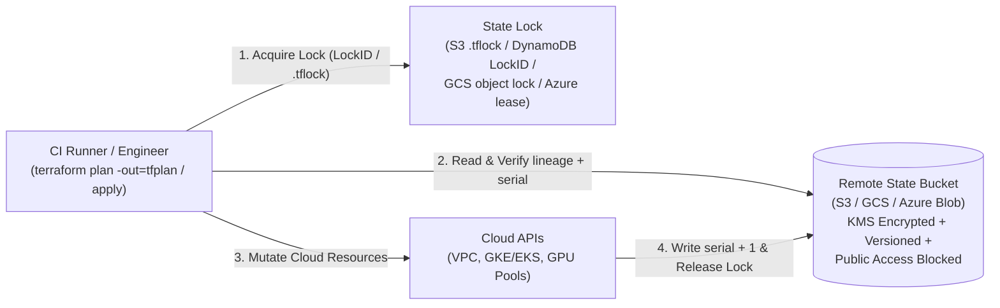

# 4.19 Terraform state in depth: backends, locking and drift

| | |
|---|---|
| Level | Intermediate |
| Priority tier | 0 |
| Lab venue | Terraform/OpenTofu 1.6+; Docker with MinIO (S3-compatible) or a cloud sandbox bucket |
| Part | Part 4: Automation and infrastructure as code |
| Status | Drafted, labs not run on live hardware |

## Why this matters for AI infrastructure

Suppose the state file is lost on a Friday afternoon. Terraform forgets what it manages, so the next plan treats every cluster, bucket and database as something it has never seen. The plan then proposes to create them all again. Apply that plan and you get duplicates, name conflicts and outages, all caused by a file that never held a single GPU.

State is the most dangerous file in your platform. It maps names in your code to real GPU clusters, buckets full of checkpoints and databases. It also holds secrets in plaintext. If it is corrupted, or two people write it at once, resources can be orphaned, where Terraform no longer tracks them, or destroyed when Terraform believes they are unwanted.

In a team that runs training infrastructure across dev, staging and production, state design is a core architectural decision. You have to decide where state lives, how it is locked, how it is split and who can read it. Those four choices shape every later change. This chapter covers state mechanics, remote backends, locking, layout strategies, migration, recovery and drift in practical depth, and it does so in the order you will meet those problems on a real team.

## Prerequisites and outcomes

You need 4.18 first, because this chapter assumes you already know the plan and apply loop. The topics below are the ones you will return to when a change goes wrong, so each one has a section of its own. Read the list as a map of the chapter.

- Explain what state contains, how plan and apply read and write it, and why it must be protected.
- Configure remote backends (S3, GCS, Azure Blob, HCP Terraform, PostgreSQL, Kubernetes) with encryption, versioning and locking, and bootstrap them safely.
- Choose a state layout (per environment, per layer or component, per team) that limits blast radius and plan time, and share data across stacks safely.
- Migrate state between backends and workspaces. Split and merge state with `moved`, `import`, `removed`, `state mv` and `state rm`, and recover from lost, corrupted or locked state.
- Detect and handle drift, manage secrets and sensitive values, encrypt state with OpenTofu, and restrict access.
- Operate state in CI/CD with locking, concurrency and least privilege.

## 1. What state is

Terraform keeps its memory in one JSON document, `terraform.tfstate`. Open that file and you can see what Terraform believes it manages, which is a useful exercise the first time you inherit a stack. The top level holds a `version`, a `lineage` (a unique id for this state's history), a `serial` (incremented on each write), the Terraform version, the outputs and a list of resources. The lineage tells Terraform that two state files come from the same history, and the serial tells it which version is newer. Each resource instance records its address, provider, attributes, dependencies and schema version. Its attributes include values the provider computed, such as IDs, IPs and ARNs. Those computed values are the reason state exists at all, because your code rarely contains them.

Here is a small example with one GPU instance.

```json
{
  "version": 4,
  "terraform_version": "1.8.5",
  "serial": 42,
  "lineage": "b2a4c5f0-....",
  "outputs": { "cluster_endpoint": { "value": "34.1.2.3", "type": "string" } },
  "resources": [
    { "mode": "managed", "type": "google_compute_instance", "name": "gpu",
      "provider": "provider[\"registry.terraform.io/hashicorp/google\"]",
      "instances": [ { "index_key": 0, "attributes": { "id": "projects/p/zones/z/instances/lab-gpu-0", "name": "lab-gpu-0", "...": "..." } } ] }
  ]
}
```

Notice the `id` attribute. You never typed it in your code. The cloud provider returned it, and Terraform saved it here. That is the link between the name in your code and the object in the cloud, and everything the plan does depends on that link being correct.

Terraform needs this file for four reasons. Each reason maps to a failure you will see if the file goes wrong.

1. It maps each config address, such as `google_compute_instance.gpu[0]`, to the real ID. Without that map, Terraform cannot tell that a resource already exists. Cloud APIs generally lack a query that answers "which resources did Terraform make?", so the state is the only place that answer lives.
2. It records metadata and dependency order. That matters most when you destroy a resource that is no longer in your config, because the file is the only record of what depended on what.
3. It caches attributes, so `plan` does not have to query every object. Terraform still refreshes by default, but the cache gives the plan a starting point and a record of the last known values.
4. It is a shared record. Together with locking, it supports collaboration, because two engineers can work on the same stack in turn without guessing what the other one did.

Keep three properties in mind. State is not a backup of your infrastructure, because it stores identifiers and attributes, not the data inside a bucket or a database. It is also not authoritative about reality, because the cloud is the source of truth and state is Terraform's last record of it. And it holds sensitive values in plaintext, including database passwords, private keys from `tls_private_key`, access keys Terraform created, secrets read through data sources, and even values marked `sensitive`. Anyone who can read state can often compromise the resources it describes.

## 2. Local state and its limits

Picture a laptop with a `terraform.tfstate` file in the working directory. For a quick experiment, you can live with that. For a team it breaks down fast. The file has no locking, no backup or versioning, and no access control. Two applies can corrupt it, secrets end up on laptops, and the file is easily lost or committed to Git. The first time a colleague runs `apply` from their own copy, the two copies diverge, and neither person knows which one is right.

By default, state is `terraform.tfstate` in the working directory, with a `.backup` file beside it. The backup is the previous version, written on each change, and it is a useful last resort but not a plan. **Never commit state to Git.** Use `.gitignore` for it, as covered in 4.1.

Yevgeniy Brikman details why this fails in Chapter 3 of *Terraform: Up and Running*, titled *How to Manage Terraform State*. Storing `terraform.tfstate` in version control fails for three concrete reasons, and each one has caused a real outage for real teams.

1. A developer can forget to run `git pull` before `terraform apply`, or forget `git push` afterward. A teammate's next apply can then roll back changes or create duplicate resources, because it works from a state that is out of date.
2. Git and GitHub have no way to lock `terraform.tfstate` while `terraform apply` is running. Two concurrent runs can corrupt the JSON state or race on cloud APIs, and neither run sees the other coming.
3. Every attribute of every Terraform resource is written in cleartext inside `terraform.tfstate`. Examples include `aws_db_instance.example.password`, TLS private keys and tokens. Commit the file to Git, and anyone with repository read access sees every secret, including the people who only needed to read the code.

Remote state is the baseline for anything shared. Remote means the file lives in a storage service that every runner can reach, and the service adds the locking and access control that Git cannot.



Read the diagram from top to bottom, so you see the order of each step. The runner takes the lock first, so no other run can start a change. It then reads and verifies the state, checking that the lineage and serial match what it expects, and only then changes the cloud resources. Finally it writes the new serial and releases the lock. If the runner crashes between steps three and four, the lock stays held, which is the situation section 4 deals with.

## 3. Remote backends

A backend tells Terraform two things: where state is stored, and whether operations run locally or remotely. Most backends store state and run operations on your machine or CI runner. HCP Terraform can also run them remotely, which means the plan and apply happen on the platform's machines. Choose the backend first, because the backend decides which locking and encryption features you get for free.

### Amazon S3 (with locking)

Here is an S3 backend. It stores state in a bucket, and it can lock state either with a native lockfile or with DynamoDB. The settings below are what you would commit for an AI platform network stack, with the prod key and region named explicitly.

```hcl
terraform {
  backend "s3" {
    bucket         = "acme-tfstate-prod"
    key            = "ai-platform/network/terraform.tfstate"
    region         = "us-east-1"
    encrypt        = true
    kms_key_id     = "arn:aws:kms:us-east-1:123456789012:key/abcd-..."
    use_lockfile   = true                    # native S3 locking (newer Terraform/OpenTofu)
    # dynamodb_table = "acme-tfstate-lock"   # legacy locking via DynamoDB (deprecated in newer releases)
  }
}
```

Harden the bucket before you store anything in it. The reason is simple. The first write of state is the first time the bucket holds something you cannot afford to lose. In AWS, *Terraform: Up and Running* Chapter 3 uses four resources. Start with an `aws_s3_bucket` that has `lifecycle { prevent_destroy = true }`, so a stray `terraform destroy` cannot delete the bucket that holds every other state. Add `aws_s3_bucket_versioning` with `status = "Enabled"`, so every state write is kept as an S3 object version for instant rollback. If a bad apply corrupts the current state, you restore the previous version rather than rebuilding from memory.

Next, add `aws_s3_bucket_server_side_encryption_configuration` with `sse_algorithm = "AES256"` or `aws:kms`. Server-side encryption means S3 encrypts the file on disk, so a leaked disk image does not expose secrets. Then add `aws_s3_bucket_public_access_block`, with `block_public_acls = true`, `block_public_policy = true`, `ignore_public_acls = true` and `restrict_public_buckets = true`. These four switches stop a future policy mistake from making the bucket public.

For locking, you have two choices. You can use native S3 `.tflock` locking with `use_lockfile = true`, which needs Terraform 1.10+ or OpenTofu. A lock file is a small object that S3 creates while a run is active, and a second run sees it and waits. Or you can use an `aws_dynamodb_table` with `billing_mode = "PAY_PER_REQUEST"` and the primary key `hash_key = "LockID"` of type `"S"`. DynamoDB stores the lock as a row, and the row is deleted when the run finishes. The DynamoDB approach is the older one, and the newer releases are moving away from it.

Finally, add the rest of the protection. Bucket policies should limit principals, so only the CI role and a break-glass group can read the state. Access logging should be on, so you can see who read it. Lifecycle rules should cover noncurrent versions, so old versions are cleaned up on a schedule rather than piling up forever. For production, enable MFA delete or object lock, which stop anyone from removing versions without a second factor or a retention period. For disaster recovery, enable cross-region replication, so a regional outage does not take the state with it.

### Google Cloud Storage

Here is a GCS backend. It keeps state under a prefix inside one bucket, so several stacks can share the bucket and still keep separate files.

```hcl
terraform {
  backend "gcs" {
    bucket = "acme-tfstate-prod"
    prefix = "ai-platform/network"           # state at <prefix>/default.tfstate (+ workspaces)
  }
}
```

Google Cloud Storage provides native locking and object versioning, and you should enable versioning, for the same reason as the S3 bucket. Use customer-managed encryption keys (CMEK) for encryption, which means your own key controls who can decrypt the state. Grant `roles/storage.objectAdmin` on the bucket only to the CI service account and a break-glass group, so ordinary engineers get no standing write access to state.

### Azure Blob Storage

Here is an Azure backend. It uses OIDC for the CI identity, through workload federation, so no static key is needed. Workload federation means the CI system proves its identity with a short-lived token that Azure trusts, rather than a password stored in a secret variable.

```hcl
terraform {
  backend "azurerm" {
    resource_group_name  = "rg-tfstate"
    storage_account_name = "acmetfstate"
    container_name       = "tfstate"
    key                  = "ai-platform/network.tfstate"
    use_oidc             = true                  # CI identity via workload federation
  }
}
```

Azure Blob Storage uses blob leases for locking. A lease is a short exclusive hold on the blob, so only the run holding it can write. Enable soft delete, so a deleted state blob can be recovered within a retention window, along with versioning and private endpoints, which keep the storage account off the public internet.

### HCP Terraform / Terraform Enterprise (`cloud` block)

With a `cloud` block, the platform manages state for you. You do not need to build a bucket or a lock table, because the service provides them. The trade-off is that the platform now holds your state and your sensitive variables.

```hcl
terraform {
  cloud {
    organization = "acme"
    workspaces { name = "ai-platform-network-prod" }
  }
}
```

HCP Terraform gives you locking, versions, access control and run history. It can also run operations remotely, and it stores sensitive variables in the platform, so the secrets live in a service you must trust and audit.

### Others

Other backends include `pg`, `kubernetes`, `consul`, `http`, `oss`, `cos` and `local`. The `pg` backend uses PostgreSQL advisory locks, which are row-free locks the database hands out by number. The `kubernetes` backend stores state in a Secret, and that Secret has a size limit of ~1 MiB, so a very large state can fail to save. The `http` backend is the custom option, and it is only as good as the server behind it. Choose a backend with native locking, durable storage, versioning, encryption and access control, and avoid any backend that cannot lock. A backend without locking is a file that two people can overwrite.

### Backend rules and gotchas

A few rules trip people up when they write backend blocks, and each one has produced a confusing first-day error for someone on your team.

- A backend block cannot use variables or references, because Terraform reads it before it evaluates anything else. Use partial configuration instead, and pass the values at `init` with `-backend-config=key=value` or `-backend-config=backend.hcl`. This is also how one code base serves several environments, since each environment passes its own file.
- Changing backend settings needs `terraform init -reconfigure`, which switches without migrating state, or `-migrate-state`, which copies state to the new location. Picking the wrong one either leaves the old state behind or copies it when you did not mean to.
- Backend credentials are separate from provider credentials. Scope them to the state bucket only, so a leaked CI token for the state cannot also create cloud resources.
- In CI, authenticate with OIDC (4.2) and use no static keys.
- Bootstrapping has a chicken-and-egg problem, because the state bucket must exist before you use it, and creating it with a remote backend would need the bucket first. You can create it with a tiny bootstrap configuration that uses local state, then migrate that state into the bucket it created. You can also use a script, CloudFormation or a managed backend. Document and protect the bucket, with `prevent_destroy` and deletion protection on it, because it is the one resource everything else depends on.

Keep environment-specific backend settings in files outside the code.

```bash
# environment-specific backend settings kept outside code
terraform init -backend-config=backends/prod.hcl
# backends/prod.hcl
#   bucket = "acme-tfstate-prod"
#   key    = "ai-platform/network/terraform.tfstate"
#   region = "us-east-1"
```

Pass the file for the environment you want, and the same code base serves it. Harden the state bucket before the first `terraform apply` writes to it, because the first apply is the moment real state arrives.

## 4. Locking

Picture a CI job that starts an `apply` while a teammate's run is still going. Two applies against the same state can each read the old serial, write their own changes, and leave a state that matches neither run. Terraform guards against that with a lock. Any command that may write state first acquires a lock through the backend. Those commands include `plan` with refresh, `apply`, `destroy`, `import` and the `state` subcommands. A plan with refresh reads the state and may write it back, so it takes the lock too.

If another process already holds the lock, you see `Error acquiring the state lock`. The message gives you the lock ID, who holds it and when. Read that message before you act, because the holder may be a live apply that will finish in two minutes. Handle it with these habits.

- Wait rather than fail at once in CI, using `-lock-timeout=5m`. The timeout lets a short apply finish before the next run gives up.
- Never disable locking with `-lock=false`. The one exception is a read-only `plan` in a drift job, where you accept the risk. That plan is safe from corruption, but it may race with a running apply and report drift that is about to disappear.
- A crashed process can leave a stale lock, usually because a runner was killed in the middle of an apply. Check that nothing is running, including CI jobs and colleagues, then run `terraform force-unlock <LOCK_ID>`. For S3 lockfile or DynamoDB backends, you can also inspect and remove the lock object by hand. For GCS, delete the `.tflock` object. Removing a lock while a live apply still runs is how two writers end up in the same state.
- CI must also serialise applies per state, using concurrency groups or Atlantis locks, so stale plans do not pile up (4.2). A plan made before another apply is stale. Terraform refuses to apply a saved plan if the state has changed, and it reports "Saved plan is stale", which is the safety net doing its job.

In CI, wait with a lock timeout, and never switch locking off to get past a held lock.

## 5. State layout: how to split

Splitting state is a design choice, and you can get it wrong in two directions. Put the whole company in one state, and every plan refreshes thousands of resources, so plans become slow, while any change can touch anything. Split into many tiny states, and you end up with dependency tangles, where a network change needs three other states to be applied first. The usual rule is to split along blast radius, change frequency and ownership. A state that changes weekly should not share a file with a state that changes hourly, and a state that holds production data should not share a lock with a lab.

A layout like this one keeps each layer in its own state, so you can change one without touching the rest. The folders map directly to the state keys, so the path on disk tells you where the state lives.

```text
infra-live/
├── global/                 # identity, DNS root zone, state buckets (rarely changes)
│   └── iam/ dns/ tfstate-bootstrap/
├── prod/
│   ├── network/            # VPC, subnets, firewalls, peering (changes rarely)
│   ├── storage/            # buckets for datasets & checkpoints (never destroy casually)
│   ├── k8s-cluster/        # GKE/EKS/AKS or Slurm VMs (changes occasionally)
│   ├── gpu-pools/          # node pools & quotas (changes often)
│   └── observability/
├── staging/ ...
└── lab/ ...
modules/                    # reusable, versioned
```

Notice that each environment has its own folders, and the state paths follow those folders. When an engineer runs a plan in `prod/network`, the folder itself says which state will change, which is a safety feature in its own right.

Guidelines:

- Separate by lifecycle. Networks and IAM change rarely, and a routine node-pool change must not be able to destroy them. GPU capacity changes often. Datasets and checkpoint stores need protection, because losing a checkpoint can cost days of training.
- Separate environments into different states, accounts or projects, and credentials. Prod apply roles cannot be assumed by dev pipelines, so a mistake in a dev branch cannot reach production.
- Keep layers acyclic. Higher layers consume outputs from lower layers, never the reverse. A cycle means two states each wait for the other, and neither can be applied first.
- Keep each state small enough to plan in minutes, but large enough to avoid excessive wiring. Tools such as Terragrunt, Terraform stacks (HCP), Atlantis project configs or Terramate help orchestrate many states and their dependency order, so you do not hand-sequence them.
- Let keys and paths mirror the directory structure, such as `prod/network/terraform.tfstate`, so they are easy to find when something goes wrong at 2 a.m.

*Terraform: Up and Running* Chapter 3 takes a similar approach with its own top-level directories. It uses `stage/`, `prod/`, `mgmt/` and `global/`. The `mgmt/` directory holds a bastion host and a CI server, and `global/` holds IAM, Route 53 DNS and the S3 state bucket. Each environment splits into `vpc/`, `services/` (`webserver-cluster/`) and `data-stores/` (`mysql/`, `redis/`). The naming matches the blast radius, so `data-stores/` is visibly the place where a careless destroy would hurt most.

Inside every component folder, the files follow one convention. `main.tf` holds the resources, `variables.tf` the input variables, and `outputs.tf` the output values. `dependencies.tf` holds external `data` sources, so dependencies are visible at a glance. `providers.tf` holds the `provider` and `terraform` backend blocks.

Here is how the pieces connect when you wire them together. The `webserver-cluster` in `stage/services/webserver-cluster` needs the RDS database endpoint and the port created by `stage/data-stores/mysql`. It reads them read-only through `data "terraform_remote_state" "db"`, using `data.terraform_remote_state.db.outputs.address` for the endpoint. The port is `3306`. It passes both values into `templatefile("${path.module}/user-data.sh", { db_address = ..., db_port = ... })`, so the servers boot already knowing where the database lives. To run `plan` and `apply` across many folders without copy-pasting backend blocks, Terragrunt offers `terragrunt run-all`, which walks the folders in dependency order.

### Sharing data across states

Sharing data across states decides how much access one team gives another. The network team owns the VPC and the GPU team needs its subnet ID, so something has to carry that ID across the boundary. The options below differ in how tightly they couple teams and how much state they expose. Each row is a different answer to "how much of my state do you need to see?"

| Mechanism | How | Trade-offs |
|---|---|---|
| `terraform_remote_state` data source | Reads another state's outputs | Gives read access to the whole state (including secrets); tight coupling to output names; permission to read entire state file |
| Provider data sources | Look up resources by name/tag/ID (`data "google_compute_network"`) | Loose coupling, no state access; relies on naming conventions |
| Published outputs to a parameter store | Write IDs to SSM Parameter Store / Secret Manager / Consul; read via data sources | Explicit contract; extra resource |
| Module composition in one root | Pass outputs as arguments | Same state (bigger blast radius) |
| Terraform stacks / `tfe_outputs` | Platform-managed | Platform dependency |

Use data sources or a parameter store across team boundaries. A data source or a parameter store exposes only the values someone chose to publish, which is the contract you want between teams. Use `terraform_remote_state` for tightly coupled layers that one team owns, where both sides change together and the coupling is intended. Restrict who can read each state, because reading remote state means reading its secrets, including values the other team never meant to share.

## 6. Workspaces and state keys

Workspaces let you keep several state files under one backend. In S3, a non-default workspace is stored at `env:/<workspace>/<key>`, so the same key under a different prefix holds a separate state. In GCS, it is stored at `<prefix>/<workspace>.tfstate`. Knowing where the file lands matters when you list a bucket and wonder why three copies of a key appear.

Workspaces share configuration and backend credentials, so the isolation is only logical, as covered in 4.18. If you use them anyway, pair each workspace with its own variable file, put the workspace name in resource names, and have CI check that the selected workspace matches the intended environment. A check in the pipeline is cheap, and it catches the wrong-target apply before it happens.

For production, choose separate directories, accounts or backends rather than workspaces. Production deserves a boundary that a wrong keystroke cannot cross.

## 7. Migrating and restructuring state

### Move between backends

Moving state to a new backend is a copy, so treat it like one. A copy can fail halfway, and a backup is what lets you undo it. Take a backup first, then change the backend block and migrate. The migration step asks you to confirm before it copies anything, so read the prompt rather than typing "yes" by reflex.

```bash
# 1. Make sure nobody is applying; take a backup
terraform state pull > backup-$(date +%F-%H%M).tfstate
# 2. Edit the backend block (local -> s3)
# 3. Migrate
terraform init -migrate-state          # confirms copy of existing state to the new backend
terraform plan                         # must show "No changes"
```

The final `plan` must show "No changes" before you consider the move finished.

### Split or merge states, rename resources

Prefer declarative refactoring blocks, because you can review them and repeat them in CI.

```hcl
moved {                      # rename or move within the same state
  from = aws_instance.gpu
  to   = module.compute.aws_instance.gpu
}

import {                     # adopt into the new state
  to = aws_s3_bucket.checkpoints
  id = "acme-ml-checkpoints-prod"
}

removed {                    # stop managing in the old state without deleting the real thing
  from = aws_s3_bucket.checkpoints
  lifecycle { destroy = false }
}
```

Splitting a resource from state A into state B needs no downtime, because the object is never destroyed. Think of it as adding the new owner before removing the old one. Step 1 is to add the resource configuration and an `import` block in state B. Step 2 is to apply B, so it tracks the resource. Step 3 is to add a `removed` block with `destroy = false` in state A and apply A, which tells A to let go without touching the bucket. Step 4 deletes the code from A. Check that both plans are clean at each step, because a dirty plan at any step means two states are now fighting over one object.

The older, imperative way is `terraform state mv -state-out=other.tfstate ADDR ADDR`, or `state rm` followed by `import`. It works, but nothing in the code records what happened, so nobody reviewing a later change can see the move. Use it only with backups in hand and locks held.

### State surgery commands

Surgery means changing state by hand. Each command below edits the record of what Terraform manages, and none of them changes the real object by itself. These commands cover the common cases.

```bash
terraform state list
terraform state show ADDR
terraform state pull > s.json                         # inspect (jq) or back up
terraform state mv ADDR_OLD ADDR_NEW
terraform state rm ADDR                               # forget; real resource stays
terraform state replace-provider registry.terraform.io/-/aws registry.terraform.io/hashicorp/aws
terraform state push s.json                           # DANGEROUS: overwrites; refuses on lineage mismatch or lower serial unless -force
```

The last command is dangerous. It overwrites state, and Terraform refuses on a lineage mismatch or a lower serial unless you add `-force`. That refusal is a guard, so read it as a warning that the file you hold is older or from a different history than the one in the backend. Adding `-force` tells Terraform to trust you over the guard, which is the moment to stop and check.

Follow the same procedure for any surgery. Announce it, take a backup copy and make sure no CI run is active. Then operate, run `plan` and expect **no changes**, or only the changes you expected. Finally, record what you did in the change ticket, so the next person can see why the state looks the way it does.

## 8. Recovery scenarios

State will eventually go wrong, and the question is which path you take next. A calm decision now saves a long rebuild later. The table lists common failures and the first action for each, and it is worth printing for the team's on-call binder.

| Scenario | Action |
|---|---|
| **State file deleted/lost** (no versioning) | Restore from backup/versioned bucket or `.backup`; otherwise rebuild state by `import` of every resource (use import blocks and `-generate-config-out`), carefully verifying plans show no changes; costly, hence versioning and replication |
| **State is corrupted** or an apply was killed midway | The backend usually holds the last good version (versioning). Restore previous object version and rerun `plan`; partially created resources not in state need import or manual deletion; Terraform writes state incrementally during apply so most crashes lose little |
| **Resource deleted outside Terraform** | `plan` shows re-create; accept, or `state rm` if intentionally gone |
| **Resource created outside, same name** | `import`; or rename/delete the stray |
| **Stuck lock** | Verify no runs, `force-unlock` |
| **Saved plan stale** | Re-plan; ensure serialised pipeline |
| **Provider upgrade changed schema** | Read changelog; run `plan` on a copy; use `moved`/`state replace-provider`; upgrade states in order |
| **Two stacks manage the same resource** | Pick one owner; `removed`/`state rm` from the other |
| **Accidental `destroy` plan** | Do not apply; investigate (wrong workspace, wrong directory, variable). Use `prevent_destroy` on critical resources and review plans for destroys |
| **Secrets exposed through state/logs** | Rotate secrets, restrict access, check access logs, then fix design (4.22) |

Build backups in layers. A single copy in a single place is one mistake away from loss. Keep a versioned bucket with many versions, take periodic `terraform state pull` snapshots into a separate account, and replicate across regions. Then test the restore procedure on a scratch copy. State recovery only counts once you have practised it, because the first real restore is a bad time to learn which step you forgot.

## 9. Drift

Suppose someone hotfixes a setting in the console during an incident at 3 a.m. Nothing in your code says so, and the state still holds the old value. That gap between state and config on one side, and the real world on the other, is drift. It comes from console edits, autoscalers or controllers changing fields, other automation, provider-side defaults and manual hotfixes during incidents. Drift is not always a mistake. The hotfix may have been the right fix, and the question is whether the code should learn about it.

Start with the plan. `terraform plan` refreshes by default and shows drift as the changes needed to revert it. `terraform plan -refresh-only` shows only the real-world differences from state, without proposing any change to the infrastructure, and `terraform apply -refresh-only` writes those differences into state so the record catches up with reality.

- Schedule `terraform plan -detailed-exitcode` nightly for each environment (4.2). That flag makes the exit code say what the plan found: 0 for no changes, 2 for changes present, and 1 for an error. Alert on exit code 2, and assign owners to triage what it finds, so the alert leads to a decision rather than being ignored.
- Decide case by case. You can revert the drift by applying the intended config, when the hotfix was temporary. You can adopt it by editing the config to match, so the plan comes back clean, when the hotfix is the new truth. Or you can tolerate it with `lifecycle { ignore_changes = [...] }` for fields managed elsewhere, such as an autoscaler-managed `desired_size` or labels added by controllers.
- Reduce drift at the source. Keep console write access read-only for people in production, with audited break-glass access for emergencies. Use tags or labels to mark managed resources, so a person in the console can see that Terraform owns an object. Policy engines that deny out-of-band changes, and GitOps controllers where relevant, help too.
- Watch the refresh cost. Each refresh asks the provider about every object, so large states hit API rate limits. `-refresh=false` speeds up a plan, but it can plan against stale state, so use it sparingly and split large states instead.
- Some resources have write-only or computed fields that the provider cannot read back. These show perpetual diffs or hide drift, so check the provider docs before you trust a clean plan on that resource.

Here is a GPU node pool where the cluster autoscaler adjusts `node_count`, so Terraform ignores that one field. Without the `ignore_changes` line, every plan would propose to reset the pool to 2 nodes, and every apply would fight the autoscaler.

```hcl
resource "google_container_node_pool" "gpu" {
  # ...
  node_count = 2
  lifecycle {
    ignore_changes = [node_count]          # cluster autoscaler adjusts it
  }
}
```

Decide, for each drift item, whether to revert, adopt or tolerate it before the next apply.

## 10. Secrets and sensitive data in state

Assume that **anyone with state access can read every secret in it**. That assumption shapes every access decision that follows. As you set up access, control it with IAM. Separate read from write, use one bucket per environment, use KMS keys with audit trails, and allow no human access in production except break-glass. Break-glass means a documented emergency path that is logged and reviewed afterward, so the normal path stays closed.

`sensitive = true` only redacts CLI output. It does not encrypt state. Secrets get into state through `random_password`, `tls_private_key`, `aws_db_instance.password`, `aws_iam_access_key`, data sources that read from Vault or Secrets Manager, and provisioner outputs. Each of those writes the value to the file in full, even when the code never prints it.

The best fix is to avoid creating secrets in Terraform at all. Let the service generate them, store them in a secret manager, and reference them by ID. A reference holds only the ID, so the secret itself never enters state. Where your version supports them, use write-only or ephemeral arguments and ephemeral resources, which newer Terraform and OpenTofu releases offer, because those values exist during a run and are never saved. Use IAM database auth, OIDC or workload identity instead of passwords, and rotate secrets outside Terraform, so a rotation does not require a plan and apply.

State encryption at rest comes from the backend first. KMS and SSE are the baseline, and they protect the file on the storage side. OpenTofu also supports client-side state and plan encryption, which encrypts the file before it leaves the runner, using key providers such as a PBKDF2 passphrase, AWS KMS, GCP KMS and OpenBao. Client-side means even the storage operator sees only ciphertext. Terraform OSS relies on backend encryption.

Saved plan files contain sensitive values too. Treat plan artefacts as secrets, and control how long CI keeps them and who can access them. A plan artefact that sits in a public CI log for a week is as exposed as a state file in a public bucket.

`TF_LOG` output can contain secrets, so keep it off in shared CI logs. Debug logging prints the requests and responses, and those can carry the values you were trying to protect.

Keep secrets out of Terraform wherever a secret manager can hold them.

## 11. State in CI/CD

Your pipelines touch state on every run, so give each job the access it needs and no more. A pipeline that holds more access than its job needs turns one leaked token into a much larger incident.

Plan and apply jobs use the same backend, but with different permissions. The plan identity needs read access to state, and it needs lock write access only if refresh locking is needed. The apply identity gets read and write access only on protected branches (4.2), so a feature branch cannot change production state.

Serialise applies per state. Cancel stale plans, use `-lock-timeout`, and set `TF_IN_AUTOMATION` and `-input=false`. Without `-input=false`, a missing variable makes the job wait for keyboard input that never comes.

Upload the plan artefact, then apply that exact artefact. Applying the saved file guarantees the apply matches what the reviewer read. If you hit a "stale plan", handle it by re-running the plan job, which produces a new artefact for the new state.

Keep modules versioned, and keep state paths stable. Changing a `key` creates a new, empty state, so the next plan proposes to create everything that already exists. Treat a key change as a migration, never as a rename.

Protect the backend with deletion protection, a separate admin account, audit logs, and alerts on state bucket policy changes or unexpected reads. An unexpected read of the state bucket is often the first sign that a credential has leaked.

Include state hygiene in review. PRs that touch `backend`, `moved`, `import` or `removed` blocks need platform-owner review through CODEOWNERS (4.1). Treat a change to any of those blocks as a platform change, because each one can move or forget real infrastructure.

## 12. Lab

Start with the self-checking Python lab. Run it on your own machine. It needs no cloud account, and it runs the state rules that matter most. It checks distributed backend locking and `force-unlock` (`RemoteStateBackend.acquire_lock` / `force_unlock` with `LockID`). It checks `lineage` and `serial` protection on state push, and stale-plan rejection (`push_state` and `apply_saved_plan`). It also checks zero-downtime cross-state migration with `import` plus `removed { lifecycle { destroy = false } }` (`migrate_resource_between_states_declaratively`).

```bash
python3 code/part04/terraform_state_engine_lab.py
```

Next comes the hands-on part. You need Terraform or OpenTofu 1.6+, and Docker with MinIO, which is an S3-compatible storage server you can run on a laptop. The interactive shell steps below have not been run on live hardware or a live cloud account. Work through these exercises in order, because later steps reuse the bucket and state that earlier steps create.

1. Read a state file. Apply a small local-provider configuration, then inspect `terraform.tfstate` with `jq`. Look at serial, lineage, resources and attributes. Change something and watch `serial` increment. Then find a "secret" generated by `random_password` in plaintext.
2. Set up a remote backend with MinIO. Run MinIO in Docker and create a bucket with versioning. Configure the S3 backend with an endpoint override and path style. Migrate local state with `-migrate-state`, then verify locking by running two applies concurrently.
3. Test locking behaviour. Hold a lock with a long `local-exec` sleep. Try a second plan with and without `-lock-timeout`. Simulate a stale lock, and clear it with `force-unlock`.
4. Bootstrap the state bucket. Write the bootstrap configuration that creates the state bucket with versioning, encryption and a public-access block. Then migrate its own state into that bucket. Add deletion protection.
5. Practise partial backend configuration. Create `backends/dev.hcl` and `backends/prod.hcl`. Run `init -backend-config`, then show the difference between `-reconfigure` and `-migrate-state`.
6. Build a layered layout. Create `network` and `compute` roots and expose outputs. Consume those outputs with `terraform_remote_state`, then replace them with data sources. Compare the permissions each version needs.
7. Refactor with blocks. Rename a resource and move it into a module using `moved`. Then split a resource into another state using `import` and `removed` with `destroy = false`. Check that each step gives a clean plan.
8. Practise state surgery. Take a backup, then run `state mv`, `state rm` and `import`. Make a mistake on purpose with a wrong ID, and recover from it. Try `state push` with a lower serial to see the safeguard fire.
9. Practise disaster recovery. Delete the state object in a versioned bucket, then restore the previous version. Next, simulate loss with no versioning, and rebuild the state with `import` blocks for 5 resources.
10. Work through drift. Change a resource out-of-band. Run `plan`, `plan -refresh-only` and `apply -refresh-only`. Add `ignore_changes` for an autoscaler-managed field, then schedule a `-detailed-exitcode` job.
11. Check secrets. Show a generated password in state. Reduce the exposure, either with a random provider that uses write-only or ephemeral features if your version has them, or by moving the secret into a secret manager. With OpenTofu, configure state encryption and verify that the state file is ciphertext.
12. Test CI behaviour. Add `-lock-timeout`, concurrency control and saved-plan artefacts to a pipeline. Trigger two PRs at once, then show serialised behaviour and stale-plan handling.
13. Clean up buckets, containers and cloud resources when you finish.

## 13. Common mistakes

Watch out for local state on laptops or in Git, and for a backend bucket with no versioning. Each of these is a quiet risk that becomes loud on the day something breaks. Disabling locking causes trouble too, because two runs can then write over each other with no warning. So does force-unlocking without checking who holds the lock, since the lock may belong to a live apply.

Avoid one giant state, and avoid hundreds of micro-states with circular data dependencies. Both extremes make changes slow or fragile. Do not use workspaces as your only production isolation, and do not share credentials across environments, because one shared credential turns every environment into the same blast radius.

Do not use `terraform_remote_state` everywhere. It grants broad state read where data sources would do, so the consuming team sees more than it needs. Also avoid hand-editing JSON state, running `state push` without a backup, and doing surgery during active CI, since a pipeline that starts mid-surgery can read a half-edited file.

Do not treat `sensitive = true` as encryption. Secrets that Terraform generates sit in state that everyone with read access can open.

Ignoring drift is a mistake that waits to show itself, usually on the day a plan wants to destroy a cluster. Avoid `ignore_changes = all`, because it stops Terraform from seeing any change at all, and do not ignore fields that hide real problems. Finally, make sure you have a tested recovery plan, a protected state bucket, and no accidental change to the backend `key`, which would start you with empty state.

Check your current layout against this list before the next change to the backend.

## 14. Interview angles

- "What is in the state file? Why is it sensitive? How do you protect it?"
- "Local versus remote state; what does a backend provide? How does locking work?"
- "How would you structure state for dev/stage/prod and for network/compute/storage?"
- "How do you move a resource between states without downtime?" (import + removed, clean plans.)
- "Someone deleted the state. What now?" (versioning/restore; rebuild by import.)
- "What is drift and how do you detect and handle it?"
- "`terraform_remote_state` vs data sources: trade-offs."
- "How do you handle secrets that Terraform must create?"
- "Two engineers apply at the same time. What prevents corruption?"

## Exercises

Work through these as you would explain them to a colleague. Each one starts from a situation a team could meet, and each question is one you should answer in your own words.

1. A teammate proposes committing `terraform.tfstate` so the whole team sees the same state. Using `RemoteStateBackend` in `code/part04/terraform_state_engine.py`, explain the four reasons Terraform needs state.
2. Your apply was rejected with a lineage mismatch. Show how `lineage` and `serial` stop an older state from overwriting a newer one.
3. Two CI jobs start `apply` at the same minute. Trace what `acquire_lock()` and the lock timeout do in `code/part04/terraform_state_engine.py`.
4. A stuck lock appears after a killed runner. Work out when `terraform force-unlock <LOCK_ID>` is safe.
5. A saved `tfplan` is rejected after another run finished first. Explain why `apply_saved_plan()` refuses it.
6. A new S3 state bucket needs a hardened setup. List the four resources in Chapter 3 of *Terraform: Up and Running* that protect it, and say what `hash_key = "LockID"` does.
7. A bucket needs its own state, but it is still defined in the monolithic state. Use `migrate_resource_between_states_declaratively()` to write the four steps that move `aws_s3_bucket.checkpoints` without destroying it.
8. A `plan` shows a GPU node count reset by the autoscaler. Which `lifecycle` setting tells Terraform to tolerate that field?
9. A security reviewer asks whether `sensitive = true` protects `tfplan`. Explain why it does not.
10. A staging team wants a production value without reading the production state. Compare `terraform_remote_state` with a provider data source and a parameter store.

## Checkpoint questions (20)

<details>
<summary>1. What fields are stored inside `terraform.tfstate`, and how do `serial` and `lineage` prevent state corruption?</summary>

`terraform.tfstate` is a JSON document with these fields:
- **`version`** (`4`) and **`terraform_version`**.
- **`lineage`**: a random UUID created when the state is first initialized. It identifies this state's history.
- **`serial`**: an integer that increases on every state write.
- **`outputs`** and **`resources`**. Resources map each HCL address, such as `google_compute_instance.gpu[0]`, to its cloud provider ID and full attribute dictionary.

When Terraform writes state or runs `terraform state push`, it checks two things. The `lineage` must match, and the new `serial` must be strictly greater than the remote `serial`. If either check fails, Terraform refuses to overwrite another environment's state or a newer state version.
</details>

<details>
<summary>2. In *Terraform: Up and Running* Chapter 3, what are the three reasons you must NEVER store `terraform.tfstate` in Git?</summary>

1. Engineers inevitably forget to run `git pull` before `terraform apply`, or to run `git push` afterward. Teammates then apply against stale state and accidentally roll back or duplicate infrastructure.
2. Git servers do not lock `terraform.tfstate` while `terraform apply` is running. Two people or CI jobs can then change the same cloud resources at once.
3. Every attribute of every resource, such as RDS passwords and TLS keys, sits in plaintext inside `terraform.tfstate`. Committing it to Git leaks every secret to anyone who has cloned the repository.
</details>

<details>
<summary>3. How do you configure a production-hardened AWS S3 remote backend, and how does `use_lockfile = true` compare with `dynamodb_table` (*Terraform: Up and Running*, Chapter 3)?</summary>

Provision the S3 bucket with four resources, as the book does:
1. `aws_s3_bucket` with `lifecycle { prevent_destroy = true }`.
2. `aws_s3_bucket_versioning` (`status = "Enabled"`).
3. `aws_s3_bucket_server_side_encryption_configuration` (`AES256` or `aws:kms` with `kms_key_id`).
4. `aws_s3_bucket_public_access_block`, with all four `block_public_*` / `ignore_public_acls` / `restrict_public_buckets` flags set to `true`.

For locking, S3 used to need a separate `aws_dynamodb_table`, with `billing_mode = "PAY_PER_REQUEST"` and the primary key `hash_key = "LockID"` of type `"S"`. Newer Terraform (1.10+) and OpenTofu releases support native S3 locking with `use_lockfile = true`. That writes a `.tflock` object next to the `.tfstate` object, so DynamoDB is not needed.
</details>

<details>
<summary>4. How do you solve the \"chicken-and-egg\" problem when using Terraform to create the S3/GCS bucket that stores Terraform's own state (*Terraform: Up and Running*, Chapter 3)?</summary>

1. Create a small `global/s3/` bootstrap configuration that defines the S3 state bucket and the DynamoDB lock table, with no `backend "s3"` block at first.
2. Run `terraform init` and `terraform apply`. The bucket is created in the cloud, while state lives in a local `terraform.tfstate` file.
3. Add the `backend "s3" { ... }` block to `global/s3/main.tf`, then run **`terraform init -migrate-state`**. That copies the local `terraform.tfstate` into the new S3 bucket and deletes the local copy. If you ever need to destroy the state bucket in a lab, reverse the process. Remove the `backend "s3"` block, run `terraform init -migrate-state` to pull state back to local disk, and then run `terraform destroy`.
</details>

<details>
<summary>5. Why can't you use `var.bucket_name` inside a `backend "s3" {}` block, and how does Partial Backend Configuration (`-backend-config`) solve it (*Terraform: Up and Running*, Chapter 3)?</summary>

Terraform sets up the backend during `terraform init`, before it evaluates input variables, locals or modules. So `var.*` references are not allowed inside `backend {}` blocks in Terraform OSS. Partial configuration solves this. Keep only static or environment-specific keys in the block, such as `key = "network/terraform.tfstate"`. Pass the shared or per-environment settings, such as `bucket`, `region` and `encrypt`, at init time with **`terraform init -backend-config=backends/prod.hcl`**.
</details>

<details>
<summary>6. Contrast `terraform init -reconfigure` and `terraform init -migrate-state`.</summary>

- **`terraform init -migrate-state`** connects to the old backend and the new one. It copies your existing state into the new backend, after asking you to confirm.
- **`terraform init -reconfigure`** points `.terraform/` at the new backend without copying or migrating existing state. Use it when a local working directory should point at a remote backend that already holds state.
</details>

<details>
<summary>7. What happens when `terraform apply` encounters a held state lock, and what must you verify before running `terraform force-unlock <LOCK_ID>`?</summary>

Terraform prints `Error acquiring the state lock`, along with the **`LockID`**, the holder's identity (`Who`), the operation (`OperationTypeApply`) and the timestamp (`Created`). In CI, pass **`-lock-timeout=5m`** so jobs wait up to 5 minutes for an active run to finish. Suppose a runner crashed mid-apply, for example because it was OOM-killed or lost its network, and left an orphaned lock. First check your CI dashboard and ask teammates. Make sure no `terraform` process is actually running against that state. Only then run **`terraform force-unlock <LOCK_ID>`**.
</details>

<details>
<summary>8. Why does `terraform apply tfplan` fail with `Saved plan is stale`, and why is that a critical safety feature?</summary>

`terraform plan -out=tfplan` writes a binary plan that records the exact **`serial`** of `terraform.tfstate` at the moment the plan was computed. If another PR or operator changes the state before `terraform apply tfplan` runs, the remote `serial` goes up. Terraform then refuses to apply `tfplan` with `Saved plan is stale`. That protects you, because a diff computed against an older state could overwrite or conflict with the changes made in between.
</details>

<details>
<summary>9. Why should you split a platform's Terraform state by environment and lifecycle layer (`network/`, `storage/`, `k8s-cluster/`, `gpu-pools/`) instead of using one giant root module?</summary>

A single state file for an entire company causes three serious problems, as *Terraform: Up and Running* Chapter 3 explains.
1. The blast radius is huge. A typo or a broken variable made while scaling a routine `gpu-pools` node group could modify or destroy the production `network` VPC or the `storage` checkpoint buckets.
2. Plans are slow, and they throttle cloud API quotas. Refreshing 3,000 resources on every `terraform plan` takes 10+ minutes.
3. Lock contention blocks ownership. Ten engineers across networking, storage and compute teams keep blocking one another on a single state lock. Splitting by environment, such as `prod/`, `staging/` and `lab/`, and by lifecycle layer, such as `network/`, `storage/`, `k8s-cluster/` and `gpu-pools/`, isolates blast radius, permissions and plan times.
</details>

<details>
<summary>10. Compare sharing data between Terraform states via `terraform_remote_state` vs. Provider `data` Sources vs. Parameter Store.</summary>

- **`data "terraform_remote_state" "net"`** (*Terraform: Up and Running*, Chapter 3) reads the `outputs` block directly from another state file, such as `data.terraform_remote_state.net.outputs.vpc_id`. The drawback is that the consumer needs IAM read access to the entire producer `.tfstate` file, including any plaintext secrets in it. It also ties the consumer code to the producer's output names.
- **Provider `data` sources**, such as `data "google_compute_network" "fabric" { name = "prod-vpc" }`, query the cloud API by name or tags. They need no access to the producer's `.tfstate` file.
- **SSM Parameter Store, Secret Manager or Consul** let the producer write specific, non-secret IDs with `aws_ssm_parameter`. Consumers read them with `data "aws_ssm_parameter"`, under fine-grained IAM per path.
</details>

<details>
<summary>11. How do S3 and GCS store state files when you create multiple CLI Workspaces (`terraform workspace new staging`), and what are the drawbacks (*Terraform: Up and Running*, Chapter 3)?</summary>

- **Storage paths:** The `default` workspace lives at `<key>`, such as `ai-platform/network/terraform.tfstate` in S3 or `<prefix>/default.tfstate` in GCS. Non-default workspaces are stored under **`env:/<workspace>/<key>`** in S3, or as `<prefix>/<workspace>.tfstate` in GCS.
- **Drawbacks:** All workspaces share the same S3 bucket, the same IAM credentials and the same source code. An example is `instance_type = terraform.workspace == "default" ? "t2.medium" : "t2.micro"`. The active workspace is invisible in the files unless you run `terraform workspace show`, so it is easy to run `terraform destroy` in `prod` by mistake.
</details>

<details>
<summary>12. Walk through the 4-step declarative procedure to split a resource (`aws_s3_bucket.checkpoints`) from State A into State B with zero downtime.</summary>

Never delete and recreate a stateful resource just to move it between states. Follow these four steps.
1. In State B, copy the `resource "aws_s3_bucket" "checkpoints"` block and add an **`import { to = aws_s3_bucket.checkpoints, id = "acme-ml-checkpoints-prod" }`** block.
2. Apply State B. Run `terraform plan` and check for `1 to import, 0 to add, 0 to change, 0 to destroy`. Then run `terraform apply`, so State B tracks the bucket.
3. In State A, remove the `resource` block and replace it with **`removed { from = aws_s3_bucket.checkpoints; lifecycle { destroy = false } }`**.
4. Apply State A. Run `terraform plan` and check for `1 to forget, 0 to destroy`. Then run `terraform apply`. Remove the `import` and `removed` blocks in the next cleanup commit.
</details>

<details>
<summary>13. Compare `terraform state rm ADDR` with `terraform destroy -target=ADDR`.</summary>

- **`terraform state rm ADDR`** (or a `removed { lifecycle { destroy = false } }` block) removes the resource entry from **`terraform.tfstate` only**. The real cloud resource keeps running untouched, because Terraform simply forgets it.
- **`terraform destroy -target=ADDR`** calls the cloud provider API to permanently delete the real cloud resource, then removes it from state.
</details>

<details>
<summary>14. What happens if someone deletes `terraform.tfstate` from an S3/GCS bucket, and how do you recover?</summary>

- **With bucket versioning enabled (best practice):** List the object versions with `aws s3api list-object-versions --bucket acme-tfstate-prod --prefix ...`. Then copy or restore the version ID just before the current one as the current object. Run `terraform plan`, which should report `No changes`.
- **Without bucket versioning or backups:** Every cloud resource still runs, but Terraform has lost its mapping. Write `import {}` blocks for every existing resource ID. Run `terraform plan` and `apply` until the state is rebuilt and `terraform plan` reports `No changes`.
</details>

<details>
<summary>15. When `terraform plan` detects out-of-band drift, what are the three ways to resolve it?</summary>

1. Revert the drift, so Git stays the source of truth. Run `terraform apply`, and Terraform overwrites the manual console change with what your `.tf` files specify.
2. Adopt the drift and accept the emergency change. Update the `.tf` file to match the live setting, optionally run `terraform apply -refresh-only`, and then confirm that `terraform plan` shows `No changes`.
3. Tolerate fields that an external controller owns. When the Kubernetes Cluster Autoscaler adjusts `node_count` on `google_container_node_pool.gpu`, add `lifecycle { ignore_changes = [node_count] }`.
</details>

<details>
<summary>16. Why is `lifecycle { ignore_changes = all }` dangerous?</summary>

Setting `ignore_changes = all` tells Terraform to ignore every attribute change on that resource after its initial creation. Updates to security groups, images, disk sizes or IAM roles in your `.tf` file are then silently skipped during `plan` and `apply`, which turns Git into a lie. List only the externally managed attributes, such as `ignore_changes = [node_count]`.
</details>

<details>
<summary>17. What happens if you change the `key` (or `prefix`) in your `backend "s3"` block without running `-migrate-state`?</summary>

If you change `key = "network/terraform.tfstate"` to `key = "prod/network/terraform.tfstate"` and run `terraform init -reconfigure`, Terraform finds no file at the new key. It starts a brand-new empty state. The next `plan` proposes creating duplicates of every resource in the stack, and the old state file stays orphaned at the old key. When you rename state keys, always use **`terraform init -migrate-state`**.
</details>

<details>
<summary>18. Which Terraform resources and data sources commonly leak plaintext secrets into `terraform.tfstate`, and how do you avoid them?</summary>

Common culprits are `random_password`, `tls_private_key`, `aws_iam_access_key`, `aws_db_instance.password`, and `data "vault_generic_secret"` or `data "google_secret_manager_secret_version"`. To avoid them:
1. Use passwordless workload identity, OIDC or IAM database authentication, so no static password or key exists at all.
2. Let the cloud service manage the secret. With AWS RDS, `manage_master_user_password = true` stores and rotates the password in AWS Secrets Manager, and Terraform never sees the plaintext value.
3. Use ephemeral variables and resources, and write-only arguments such as `password_wo`, in newer Terraform (1.10+/1.11+) and OpenTofu. Or enable OpenTofu client-side state encryption.
</details>

<details>
<summary>19. How does OpenTofu client-side state and plan encryption work compared to S3/GCS bucket encryption?</summary>

- **S3 and GCS bucket encryption** (SSE-KMS or CMEK) encrypts the state file at rest on the provider's disks. But anyone with `GetObject` permission on S3 or GCS receives the decrypted plaintext JSON over HTTPS.
- **OpenTofu client-side state and plan encryption** uses a block like `terraform { encryption { key_provider "aws_kms" ... method "aes_gcm" ... state { method = ... } plan { method = ... } } }`. It encrypts `terraform.tfstate` and saved `tfplan` files with AES-GCM on the client, before upload. The object in the bucket is ciphertext, so an attacker with bucket read access cannot read state without KMS decrypt permissions.
</details>

<details>
<summary>20. What does `terraform state replace-provider` do during a provider migration?</summary>

When a provider changes its registry namespace or source address, the state still refers to the old one. For example, a legacy `registry.terraform.io/-/aws`, or a forked provider namespace, can move to `registry.terraform.io/hashicorp/aws`. Run **`terraform state replace-provider <from_provider_fqn> <to_provider_fqn>`**. It updates every provider reference in the state file in place, without recreating any resources.
</details>

## Sources and review notes

- **Sources read in full:**
  - `terraform-up-and-running-3rd-edition` — Yevgeniy Brikman, *Terraform: Up and Running*, 3rd ed., **Chapter 3: How to Manage Terraform State** (read in full: what Terraform state is, why state must not be stored in Git across manual error / locking / secrets, configuring the AWS S3 backend with `aws_s3_bucket`, `aws_s3_bucket_versioning`, `aws_s3_bucket_server_side_encryption_configuration` `AES256`, `aws_s3_bucket_public_access_block`, and `aws_dynamodb_table` `PAY_PER_REQUEST` with `hash_key = "LockID"`, chicken-and-egg bootstrapping and partial backend configurations `-backend-config=backend.hcl`, isolating state via Workspaces `env:/<workspace>/<key>` vs file layouts `stage`/`prod`/`mgmt`/`global` -> `vpc`/`services`/`data-stores` with `main.tf`/`variables.tf`/`outputs.tf`/`dependencies.tf`/`providers.tf`, and sharing outputs via `terraform_remote_state` and `templatefile()`).
  - `nvidia-devops` (`volume-10/05-terraform-for-infrastructure-as-code.md`): state commands, drift handling, declarative `import`/`moved`/`removed` blocks, and workspaces.
- **Run here:** `python3 code/part04/terraform_state_engine_lab.py` (3 passed, 0 failed).
- **Explicitly labelled inferences:** The `RemoteStateBackend` and `migrate_resource_between_states_declaratively` models in `code/part04/terraform_state_engine.py`, the `infra-live/` GPU platform directory tree, and the S3/GCS/Azure/HCP backend blocks are the author's constructions synthesizing *Terraform: Up and Running* Chapter 3 and `volume-10/05` (plus original study items 21, 22, 23, 24, 25, 26, 27, 28, 29, 30, 31, 32, 33, 34, and 35).
- **Not verified on live hardware:** Live `terraform init -migrate-state`, S3/GCS/Azure Blob locking, MinIO, and OpenTofu encryption commands (`version: 4`, `1.8.5`, `serial: 42`, `34.1.2.3`, `123456789012`, `~1 MiB`, `-lock-timeout=5m`, `node_count = 2`, `3306`) are not run here, and are marked where not executed by `terraform_state_engine_lab.py`.
