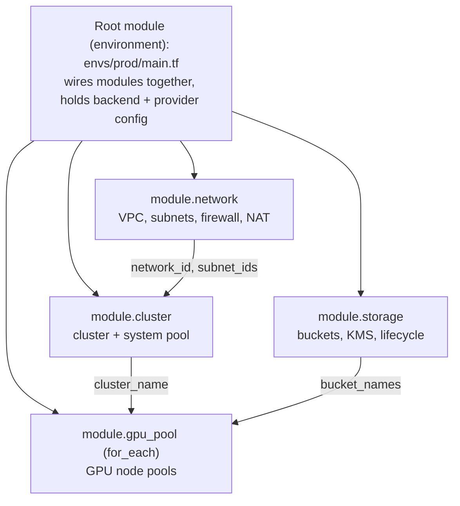

# 4.20 Terraform modules and reusable infrastructure

| | |
|---|---|
| Level | Intermediate |
| Priority tier | 0 |
| Lab venue | Terraform/OpenTofu 1.6+ (`terraform test` needs 1.6+); a Git repo; optional cloud sandbox |
| Part | Part 4: Automation and infrastructure as code |
| Status | Drafted, labs **untested** |

## Why this matters for AI infrastructure

Picture a Tuesday morning when your platform team has to stand up a new AI environment. You need a VPC with a training subnet and jumbo MTU, a bucket for checkpoints with versioning and encryption, a GPU node pool with quotas and labels, an IAM role for the training service account, and a Kubernetes cluster baseline. The first time, someone copies the HCL from the last environment, changes a few names and it works. Six months later the copies have quietly diverged. Staging has an encryption setting that production never received, and nobody remembers who added it or why.

Now the security team asks for a change to one default, such as turning on public access prevention for every bucket. In the copy-paste world, that change means finding and editing fifty files, and missing one is easy. A module solves this. It packages one piece of infrastructure behind a small, documented interface, so the rule lives in one place. You write the module once, give it a version, test it and review it once. Then every environment calls the same code. The next environment becomes a short file of inputs.

Module design is where Terraform codebases succeed or fail at scale. Good modules make a new environment a ten-line file. Bad modules turn into a tangle of conditionals that nobody dares to touch, and at that point the team starts copying again.

## Prerequisites and outcomes

You need 4.18 and 4.19 first, because this chapter assumes you already read plans, keep state and configure providers. Once you finish reading, use the five lines below as a self-check:

- Create modules with a clear structure and a typed, validated interface, and call them with `source`, `version`, `providers`, `count`, `for_each` and `depends_on`.
- Choose the right module size. Keep the root module as the composition layer, keep modules small and focused, and avoid both god modules and thin wrappers.
- Version and distribute modules through Git tags, registries and monorepo paths, and handle breaking changes with `moved` blocks.
- Test modules with static checks, `terraform test`, Terratest, ephemeral environments and policy checks.
- Avoid common anti-patterns, and know when not to use a module at all.

## 1. What a module is

Open a repository for a new environment and you will usually find a `main.tf` full of `module` blocks. When you run `terraform plan` in that directory, Terraform reads every `.tf` file it finds there. Some of those files call other directories as modules. Every Terraform configuration is a module, and the directory where you run commands is the **root module**. Think of the root as the main program that calls the helpers.

Any other directory of `.tf` files that the root calls with a `module` block is a **child module**. A module takes **inputs**, which are variables, and returns **outputs**. Calling it works like calling a function. Arguments go in, results come out, and the internals stay hidden from the caller. Its resources stay namespaced, so `module.network.google_compute_network.this` names one resource inside the `network` module. That prefix matters later, when you read a plan or the state file, because it tells you which module owns a resource.

The diagram shows how a root wires its child modules together. Read it from the top. The root calls each child module once and passes values between them. Each arrow is a value that one module hands to the next, such as a network ID that the cluster needs before it can be created. Nothing in the cluster module looks up the network by name.



This is the same wiring in HCL. The GPU pool gets its subnet from `module.network` and never looks the network up by name. The wiring is the whole point, so it is worth reading slowly.

```hcl
module "network" {
  source = "../../modules/network"          # local path

  name       = "ai-prod"
  region     = var.region
  cidr_block = "10.20.0.0/16"
  mtu        = 8896
  labels     = local.labels
}

module "gpu_pool" {
  source   = "git::https://git.example.com/platform/terraform-modules.git//gke-gpu-pool?ref=v2.3.1"
  for_each = var.gpu_pools                  # one pool per key

  cluster_name = module.cluster.name
  name         = each.key
  machine_type = each.value.machine_type
  gpu_type     = each.value.gpu_type
  gpu_count    = each.value.gpu_count
  min_nodes    = each.value.min_nodes
  max_nodes    = each.value.max_nodes
  subnet_id    = module.network.subnet_ids["compute"]
}
```

Here is what happens when you run `terraform plan` on that root. Terraform sees that `module "gpu_pool"` refers to `module.network` and `module.cluster`, so it orders the work from those references alone. The network module comes first in the graph. The pool then reads `module.network.subnet_ids["compute"]` and receives that value as its `subnet_id`. It also needs a cluster name, so it waits for `module.cluster` to produce one. You never write this order down by hand. If the pool suddenly stops getting a subnet, look at the reference first, because the pool's own code is usually fine.

## 2. Anatomy of a good module

Good modules look the same every time, and that sameness is the point. Picture an on-call engineer at 2 a.m. who needs to change the autoscaling bounds of a GPU pool. If every module has the same shape, that engineer knows at once that the inputs are in `variables.tf` and the resources are in `main.tf`. Nobody has to hunt through the repository while the pager keeps ringing. The tree below shows the files that a GPU pool module needs.

```text
modules/gke-gpu-pool/
├── main.tf          # resources
├── variables.tf     # inputs: types, descriptions, validation
├── outputs.tf       # outputs
├── versions.tf      # required_version, required_providers (constraints, NOT provider config)
├── locals.tf        # internal derivations (optional)
├── README.md        # purpose, usage example, inputs/outputs (generate with terraform-docs)
├── examples/        # runnable examples used as tests and documentation
│   ├── basic/main.tf
│   └── multi-pool/main.tf
├── tests/           # *.tftest.hcl and/or Go tests
└── CHANGELOG.md
```

Each file has one job, and the split follows what a reader needs to find. A reader who wants to know what a caller must supply opens `variables.tf` first. A reader who wants to know what the module hands back opens `outputs.tf`. The `versions.tf` file declares which provider versions are needed, without configuring any provider. The interface is the part other teams call, so it deserves the most care. Once other teams depend on it, every change to it becomes expensive.

### Interface design

Start with the interface, because the people who call the module only ever see that part. The `name` variable below shows how a module rejects bad input before anything is planned. Suppose a caller types `GPU_Pool_1` as the pool name. Without validation, the cloud API rejects the name halfway through an apply, after other resources were already created. With the `validation` block, Terraform stops during planning and prints the message you wrote.

```hcl
# variables.tf
variable "name" {
  type        = string
  description = "Node pool name (unique within the cluster)."
  validation {
    condition     = can(regex("^[a-z]([-a-z0-9]{0,38}[a-z0-9])?$", var.name))
    error_message = "name must be a valid DNS label up to 40 characters."
  }
}

variable "gpu_type" {
  type        = string
  description = "Accelerator type, e.g. nvidia-h100-80gb."
  default     = null
}

variable "gpu_count" {
  type        = number
  description = "GPUs per node (0 for CPU pools)."
  default     = 0
  validation {
    condition     = contains([0, 1, 2, 4, 8], var.gpu_count)
    error_message = "gpu_count must be 0, 1, 2, 4 or 8."
  }
}

variable "taints" {
  type = list(object({
    key    = string
    value  = string
    effect = string
  }))
  default = []
}

variable "labels" {
  type    = map(string)
  default = {}
}
```

Walk through the `gpu_count` rule once, slowly. A caller sets `gpu_count` to 3, because they want three GPUs per node. The condition asks whether 3 appears in the list `[0, 1, 2, 4, 8]`. It does not, so the check fails, and Terraform prints `gpu_count must be 0, 1, 2, 4 or 8.` The caller changes the value to 4 or 8, and the plan goes on. The list stands in for the node shapes your platform team supports, so the rule protects callers from a shape nobody can run.

The resource itself is easier to read once the interface is clear. Each input feeds one part of the resource, so you can trace a variable to the argument it controls. The `lifecycle` block adds a `precondition` that refuses a GPU pool with a count above zero and no GPU type. A precondition differs from a variable validation in one way. It can look at several values together, such as `var.gpu_count` and `var.gpu_type` at once.

```hcl
# main.tf
resource "google_container_node_pool" "this" {
  name     = var.name
  cluster  = var.cluster_name
  location = var.location

  autoscaling {
    min_node_count = var.min_nodes
    max_node_count = var.max_nodes
  }

  node_config {
    machine_type = var.machine_type
    labels       = merge(var.labels, { pool = var.name })

    dynamic "guest_accelerator" {
      for_each = var.gpu_count > 0 ? [1] : []
      content {
        type  = var.gpu_type
        count = var.gpu_count
        gpu_driver_installation_config { gpu_driver_version = "LATEST" }
      }
    }

    dynamic "taint" {
      for_each = var.taints
      content {
        key    = taint.value.key
        value  = taint.value.value
        effect = taint.value.effect
      }
    }
  }

  lifecycle {
    ignore_changes = [initial_node_count]
    precondition {
      condition     = var.gpu_count == 0 || var.gpu_type != null
      error_message = "gpu_type is required when gpu_count > 0."
    }
  }
}

# outputs.tf
output "id"   { value = google_container_node_pool.this.id }
output "name" { value = google_container_node_pool.this.name }
```

The outputs are short on purpose. They expose only `id` and `name`, not the whole resource. Imagine a caller that reaches through your module and reads the labels of an internal node pool directly. When you later restructure that internal argument, the caller breaks, and nobody on your team knew they depended on it. Two small outputs give callers what they need and leave you room to change everything else.

The rules below come from one kind of mistake, made in different places. A module grows past what anyone can change safely, and every new caller locks in a little more of its shape.

**Keep the interface small, typed and contractual.** Every variable is a public API, which means you must support it, document it and version it. A caller who sets ten knobs they never needed carries those knobs forever. So expose the settings that really vary between uses, hide the implementation details, and give sensible defaults. Require only the inputs the module cannot guess for itself.

Types and validation catch a mistake at plan time, when the message is still useful, instead of at apply time, when half-built infrastructure is already running. Object types with `optional()` defaults need Terraform 1.3 or later. The `validation`, `precondition` and `postcondition` blocks do the checking, and a good `description` doubles as documentation, because it appears in the generated README.

Treat outputs as the contract. Output IDs, names, ARNs or self-links, endpoints and structured maps that other modules consume, and mark secrets `sensitive`. A contract only works when the consumer never needs your resource internals. Avoid outputting whole resources unless you mean to, because that couples consumers to the provider schema.

**Keep provider configuration out of reusable modules.** Think of a provider block as the power outlet in a building. A reusable module should be a lamp that works in any outlet, so the caller decides which outlet to use. Declare requirements in `required_providers`, and let the caller pass configured providers with `providers = { google = google.eu }`. A module with `provider` blocks is hard to use with `count` or `for_each`, and it complicates deletion. Use `configuration_aliases` when a module needs several providers. Modules that contain `provider` blocks or `configuration_aliases` have restrictions on `count` and `for_each`, so design the module so the caller can repeat it.

**Give each module one responsibility, and add value.** A network, a storage bucket, a node pool and an IAM role each deserve their own module. A platform module that does everything is hard to evolve, so compose small modules in the root instead. A module that forwards 30 variables to `aws_instance` adds indirection and no policy. Picture a reviewer who opens that wrapper and finds the same thirty arguments they could have read in the provider docs. Add value by encoding conventions such as naming, tags, labels, encryption defaults and logging, or by adding validations and companion resources. A bucket module that sets encryption, versioning and labels once means every caller gets those defaults without remembering them.

Make the module secure by default, with private access, encryption and deletion protection for stateful resources. The safe choice should be the default, and the risky choice should be an explicit input. A caller who forgets a setting should get private access, not public access. Allow overrides on purpose, through named inputs, not through a catch-all `extra_config` map that bypasses validation.

**Keep the module stable.** Think of each resource name inside a module as an address in the state file. Rename one, and Terraform believes the old thing is gone and a new thing should appear, even though nothing changed in the cloud. Renaming a resource inside a module is a breaking change for users' state. When you refactor, add `moved` blocks inside the module, because they travel with the module version. Accept IDs as inputs instead of looking things up by name, unless lookup is the module's job, because loose coupling makes the module easier to test. Avoid `timestamp()`, and avoid random values unless you use `random_*` resources. Derive `for_each` keys from static inputs, never from values unknown at plan time.

Three gotchas from *Terraform: Up and Running*, chapter 4, catch almost every team once. Each one looks harmless in a small test, and each one breaks only when a second caller shows up.

The first is file paths. When a module calls `file(...)` or `templatefile(...)`, Terraform resolves relative paths from the root module directory, not from the child module directory. The mistake hides well, because the module works fine when you test it from its own folder. Suppose `modules/services/webserver-cluster/main.tf` writes `templatefile("user-data.sh", ...)`, and a root in `stage/services/webserver-cluster/` calls it. Terraform fails, because `user-data.sh` is not in `stage/`. Prefix module-internal files with `${path.module}/user-data.sh`. Here `path.module` is the directory of the module where the expression is written. `path.root` is the root module directory, and `path.cwd` is the current working directory.

The second is inline blocks against separate resources. Resources such as `aws_security_group`, `aws_route_table` and `aws_network_acl` accept rules either as inline blocks or as standalone resources. Suppose your module uses inline `ingress {}` blocks. A caller in `stage` then attaches an extra `aws_security_group_rule` on port `12345` to `module.webserver_cluster.alb_security_group_id`. The inline block and the standalone rule overwrite each other on alternating `terraform apply` runs. The first apply removes the extra rule, and the next apply adds it back, so the plan never settles. Inside reusable modules, always use separate `aws_security_group_rule`, `aws_route` and `aws_network_acl_rule` resources, which reference their group with `security_group_id = aws_security_group.alb.id`. Callers can then extend them safely.

The third is constants and extension points. Put internal constants such as `http_port = 80` and `all_ips = ["0.0.0.0/0"]` in a `locals` block, not in variables, when callers should not override them. Export identifiers such as `asg_name` and `alb_security_group_id` as outputs. A caller can then attach environment-specific resources, such as the `prod` schedule actions `scale_out_during_business_hours` at `0 9 * * *` and `scale_in_at_night` at `0 17 * * *`, without environment conditionals in the module.

Decide which knobs are public before you publish a module, because every public variable becomes a promise you must keep. Make that decision on paper before the first release. Ask which values a second team will really want to change, and make only those public. Everything else stays a local detail that you can change freely.

## 3. Composition patterns

A team that copies one root configuration for each environment soon finds the copies disagree. Composition patterns keep each root thin, so the shared logic lives in modules instead. Think of a root as the conductor of an orchestra. It decides which section plays and when, but it does not play the instruments itself. These are the patterns to reach for.

- Keep the root module as a composition layer. Environment directories mostly contain module calls and environment-specific values, such as `envs/prod/main.tf` and `terraform.tfvars`. They also hold the backend and provider configuration. Keep logic out of roots, because a fix made inside one root has to be copied by hand into every other root.
- Use dependency inversion. Modules take IDs as inputs, such as `subnet_id`, instead of creating or looking up the network themselves. The same module then works in different topologies, and a unit test can pass a dummy ID without building a real network.
- Build layered stacks, as in 4.19. A `network` stack's outputs feed the `cluster` stack through data sources, and modules are used inside each stack.
- Write convention modules. A small `labels` or `naming` module returns the standard names and tags that every other module uses, so two teams never invent two spellings for the same label.
- Add facade modules after the building blocks settle. A facade composes several lower-level modules, such as `ai-training-environment`, which combines network, storage, cluster, pools and observability into one golden path. Keep the facade thin, and keep the building blocks usable on their own.
- Make roots data-driven. A root reads a YAML or JSON file of pools or tenants with `yamldecode(file("pools.yaml"))` and runs `for_each` over the result. Adding a pool becomes a data change that a reviewer can check without knowing HCL.

The locals block below reads the pool definitions from a file, so the root never hard-codes them. Each entry becomes one `gpu_pool` module instance, keyed by its name. Read it as a loop over a table. Each row of the YAML file is one pool, and each row turns into one call of the module.

```hcl
locals {
  pools = yamldecode(file("${path.module}/gpu-pools.yaml"))
}
module "gpu_pool" {
  source       = "../../modules/gke-gpu-pool"
  for_each     = local.pools
  cluster_name = module.cluster.name
  name         = each.key
  machine_type = each.value.machine_type
  gpu_type     = try(each.value.gpu_type, null)
  gpu_count    = try(each.value.gpu_count, 0)
  min_nodes    = each.value.min_nodes
  max_nodes    = each.value.max_nodes
}
```

Suppose the YAML file holds two entries, `h100-train` and `a100-infer`. Terraform turns them into `module.gpu_pool["h100-train"]` and `module.gpu_pool["a100-infer"]`. When a reviewer adds a third entry, the plan shows exactly one new instance, and the other two stay untouched.

### Passing providers and multi-region

Picture a platform that runs one training cluster in the United States and another in Europe. Each region needs its own provider configuration, because the region setting lives there. A root can configure the same provider twice, once per region. It then hands one of them to each module call, so the same module code builds both pools.

```hcl
provider "google" {
  alias  = "us"
  region = "us-central1"
}
provider "google" {
  alias  = "eu"
  region = "europe-west4"
}

module "pool_us" {
  source    = "../../modules/gke-gpu-pool"
  providers = { google = google.us }
  # ...
}
module "pool_eu" {
  source    = "../../modules/gke-gpu-pool"
  providers = { google = google.eu }
  # ...
}
```

You cannot choose a provider per instance inside `for_each`, because provider mappings are static. Terraform fixes them while it reads the configuration, so a loop cannot pick a different region for each key. You have two honest options. Repeat the module call for each region, which is explicit and easy to read, or use a separate stack per region, which keeps each region's state apart. Decide which of the two you want before the platform grows, because the choice is much harder to undo once both regions hold state.

## 4. Sources, versions and distribution

A module helps only when every environment can pull the same version of it. Picture two teams that both use the network module. If one team pins `v1.4.0` and the other pulls whatever is on `main` on Friday, the same code can produce two different plans. The source you choose decides how you pin and upgrade that version. The table compares the common source types.

| Source | Example | Notes |
|---|---|---|
| Local path | `source = "../../modules/network"` | Fast iteration; no versioning; fine inside a monorepo, but all consumers move together |
| Git | `git::https://git.example.com/org/repo.git//subdir?ref=v1.4.0` | Pin tags or SHAs, not branches; SSH or token auth; the `//` selects a subdirectory |
| Terraform Registry (public) | `source = "terraform-google-modules/network/google"`, `version = "~> 9.0"` | Review code and maintenance; pin versions |
| Private registry (HCP, Artifactory, GitLab/GitHub registries) | `app.terraform.io/acme/network/google` | Versioned, access-controlled, searchable |
| S3/GCS bucket archive | `s3::https://s3.amazonaws.com/bucket/module.zip` | Simple internal distribution |
| OCI registry (OpenTofu 1.10+) | `oci://registry.example.com/modules/network` | Reuse container registry infrastructure |

Whichever source you pick, pin the version in production. Pinning answers one question: when does a change reach production? An exact pin means a change arrives only when someone opens a pull request that bumps it, and the reviewer sees the new version number in the diff. Use semantic versions, such as `v2.3.1`. Bump the major version for breaking input, output or resource changes, and keep a changelog. In production roots, pin an exact version with `version = "= 2.3.1"` or a Git tag, and change that pin deliberately through pull requests, with a plan for each environment. Renovate or Dependabot can open those upgrade pull requests for you. In a monorepo, tags such as `network/v1.4.0` let each module path move at its own pace.

### Upgrading modules safely

Picture a Thursday release. The module author has tagged `v2.0.0`, and a consumer wants it in production by the weekend. Moving one environment at a time gives you a checkpoint after each move, so a surprise shows up in dev rather than in production. Work through these steps in order.

1. Read the changelog, then run `terraform init -upgrade` in a branch. The changelog tells you which inputs changed, and the upgrade command fetches the new code.
2. Run `terraform plan` in the lower environments first. Confirm that there are **no unexpected replacements**. A change to a resource address appears as a destroy and a create, unless `moved` blocks exist. Read the plan line by line, and look for `must be replaced` before you trust it.
3. Promote the version pin through dev, staging and prod, using the same artefact described in 4.2.
4. For breaking changes, ship a migration guide, `moved` blocks and deprecation periods. Keep the old variable names working for one major version, with a warning delivered through a `validation` block or documentation. Callers then have time to move before the old names disappear.

Promote the pin one environment at a time, and stop as soon as a plan shows an unexpected replacement. Stopping is a success, not a failure. The plan has just saved you from rebuilding a stateful resource.

## 5. Testing modules

A broken module is expensive, because every root you build on it breaks as well. One bad default in a shared module can break ten environments in one afternoon. Test in layers, starting with cheap checks and working up to real cloud resources. The pyramid below mirrors the testing approach in 4.13 and 3.9.

| Level | Tooling | What it checks |
|---|---|---|
| Static | `terraform fmt -check`, `terraform validate`, `tflint` (with provider rulesets), `checkov`/`trivy config`/`tfsec`, `terraform-docs` freshness | Style, syntax, misconfigurations, docs |
| Plan-level / unit | `terraform test` with `command = plan` and mock providers (Terraform 1.7+) | Variable validation, computed names, conditionals, `for_each` keys, outputs, without creating anything |
| Integration | `terraform test` with `command = apply` (creates real resources, destroys after), Terratest (Go), Kitchen-Terraform, `pytest` + `python-terraform` | Real provider behaviour in an ephemeral sandbox account |
| Policy | OPA/Conftest/Sentinel against `plan.json` (4.2) | Organisation rules (encryption, labels, instance types) |
| Compatibility | Matrix over Terraform/OpenTofu and provider versions | Upgrade safety |
| Examples as tests | Each `examples/*` is planned (and sometimes applied) in CI | Documentation always works |

The lower rows cost more time and money, so run them less often. A plan-level test finishes in seconds and needs no cloud account, so it can run on every pull request. An apply-level test creates real resources, which costs money and can fail for reasons outside your code. The test file below uses native tests, which need Terraform 1.6 or later.

```hcl
# tests/validation.tftest.hcl (Terraform 1.6+ native tests)
variables {
  name         = "h100-pool"
  cluster_name = "test"
  location     = "us-central1"
  machine_type = "a3-highgpu-8g"
  gpu_type     = "nvidia-h100-80gb"
  gpu_count    = 8
  min_nodes    = 0
  max_nodes    = 4
}

run "valid_gpu_pool_plans" {
  command = plan
  assert {
    condition     = google_container_node_pool.this.autoscaling[0].max_node_count == 4
    error_message = "max nodes not propagated"
  }
}

run "rejects_bad_gpu_count" {
  command = plan
  variables { gpu_count = 3 }
  expect_failures = [var.gpu_count]
}
```

In the first run, you plan a valid GPU pool and check that its maximum node count reaches the module. In the second run, you set `gpu_count` to 3 and expect the validation to fail. The second run is the more useful one, because it proves the guard rail works. It is the run that uses `expect_failures = [var.gpu_count]`. A test that only checks the happy path would still pass after someone deleted the validation block.

Terratest is the integration option, and you write it in Go. A Terratest sketch runs `terraform.InitAndApply` on an example directory with random names. It then checks the result with provider SDKs, such as `gcp.GetBucket...`. Think of it as a test that really builds the thing, checks it and tears it down. The `defer terraform.Destroy` line runs at the end of the test, even when an assertion fails, so the sandbox does not keep paying for leftovers. Integration tests cost money and time. Run them nightly or on release tags, in a dedicated sandbox with budgets and reaper jobs, and never against production state.

Run the fast plan-level tests on every change, and save the apply-level tests for release tags. That split keeps each pull request quick while still catching real provider behavior before a release.

## 6. Worked example: network + checkpoint storage + GPU pool modules

Say a team needs a training environment with a network, a checkpoint bucket and a GPU pool. Start with the bucket, because checkpoints are the one thing you cannot rebuild. Picture a long training run that fails near the end. The job can restart, but only from the last checkpoint that survived. A bucket that loses files by accident is therefore one of the most expensive mistakes in this stack. The module below protects the data.

```hcl
# modules/checkpoint-bucket/main.tf
resource "google_storage_bucket" "this" {
  name                        = var.name
  location                    = var.location
  uniform_bucket_level_access = true
  public_access_prevention    = "enforced"
  force_destroy               = false
  versioning { enabled = true }

  dynamic "encryption" {
    for_each = var.kms_key_id == null ? [] : [1]
    content { default_kms_key_name = var.kms_key_id }
  }

  lifecycle_rule {
    condition {
      num_newer_versions = var.keep_versions
      with_state         = "ARCHIVED"
    }
    action {
      type = "Delete"
    }
  }
  labels = var.labels

  lifecycle { prevent_destroy = true }          # checkpoints are irreplaceable: refuse accidental destroys
}

resource "google_storage_bucket_iam_member" "writers" {
  for_each = toset(var.writer_service_accounts)
  bucket   = google_storage_bucket.this.name
  role     = "roles/storage.objectUser"
  member   = "serviceAccount:${each.value}"
}

output "bucket_name" { value = google_storage_bucket.this.name }
output "bucket_url"  { value = "gs://${google_storage_bucket.this.name}" }
```

The `lifecycle` block at the bottom of the resource refuses accidental destroys. Checkpoints cannot be replaced, so that refusal is the point. A developer who runs a destroy against the wrong stack gets an error that names `prevent_destroy`, not a deleted bucket. To remove the bucket on purpose, the owner must first edit the module, which leaves a reviewable trace in version control. The IAM bindings take a typed list of writer service accounts, and the outputs expose only the bucket name and URL.

The root module then wires the bucket to the network, the KMS key, the workload identity and the GPU pool. Notice that the root never builds the bucket's internals. It only passes in a name, a location, a key ID and a list of writers, and it reads back the outputs it needs.

```hcl
module "network"    { source = "../../modules/network"           /* ... */ }
module "checkpoints" {
  source                   = "../../modules/checkpoint-bucket"
  name                     = "acme-${var.env}-ml-checkpoints"
  location                 = var.region
  kms_key_id               = module.kms.key_id
  writer_service_accounts  = [module.workload_identity.training_sa_email]
  labels                   = local.labels
}
module "gpu_pool" {
  source   = "../../modules/gke-gpu-pool"
  for_each = local.pools
  # ...
}
```

The example shows five habits. The bucket protects its own data with a lifecycle rule. Its IAM inputs are typed. Its outputs form a contract. The root stays thin, and the pool definitions live in data. Each habit answers a question a reviewer will ask. What protects the data? What must the caller provide? What does the module promise to return? Copy this shape for your next stateful resource.

## 7. Anti-patterns

Most anti-patterns look harmless in a single change. They hurt when the module grows or when you need to upgrade it. Picture a reviewer who opens a pull request that adds one more boolean to a module. The change looks small, and only the sum of many such changes is painful. A God module with 150 variables is hard to review, and every consumer must learn all of them.

- A God module has 150 variables and nested conditionals. A mega-wrapper re-exports every argument of one resource. Both are hard to change safely.
- Providers configured inside child modules make those modules hard to reuse, count or delete.
- Hidden global dependencies hurt too. A module that reads environment variables, hard-codes project IDs, regions or account IDs, or looks up resources it does not own is hard to move.
- Count-based indexing breaks for things that can be reordered. Use `for_each` with stable keys instead.
- Conditional resource creation toggles, such as `create_x`, appear everywhere. Each boolean doubles the test matrix, so prefer separate modules or composition.
- Unpinned module versions are risky in production roots, especially `ref=main`.
- Changing resource names or addresses inside a module release, without `moved` blocks, breaks consumers.
- Secrets passed as inputs or outputs need `sensitive`, and you must think about state exposure, which 4.22 covers.
- Modules that hide dangerous behavior, such as auto-destroy or public exposure, behind friendly names mislead their callers.
- Copy-pasted modules drift as their forks diverge. Monorepo modules edited in place also affect every environment that references them by path, so the next plan changes all of them.
- Environment-specific branches in a shared module, such as `if var.env == "prod"`, hide behavior inside library code. Pass explicit inputs instead.
- Over-abstracting too early is risky, so wait until you have seen the pattern three times. The rule of three is a habit, not a law, but it protects you from guessing the wrong abstraction.

When you spot one of these in a review, ask whether a smaller module or an explicit input would remove it. Usually one of the two does.

## 8. Operating a module ecosystem

Picture a Monday when a security patch lands in the shared network module. Who reviews it? Who tells the eight teams that still pin an old tag? These questions decide whether a module stays healthy after you publish it.
- Ownership and review: `CODEOWNERS` files in module repos (4.1) name who approves changes. The platform team owns shared modules, and consumers propose changes through pull requests.
- Documentation: generate a README with `terraform-docs`, and keep examples and diagrams alongside it. Maintain a "golden path" catalogue and an internal registry that people can search.
- Compatibility: publish a support policy, such as supporting the last two majors. Announce deprecations, and automate the upgrade pull requests.
- Security and compliance by default: encryption, logging, labels and restricted public exposure. Scan in CI with Checkov or Trivy, and track every exception.
- Cost guardrails: variables that cap GPU counts per environment, and required `ttl` and `owner` labels, which the policy checks in 4.2 enforce.
- Telemetry: record which module versions each stack uses, through outputs, tags or a registry of deployments. That record lets you find stragglers on vulnerable versions.

Assign an owner to every shared module before you publish it. An unowned module drifts, and nobody notices until a plan fails in production.

## 9. Lab

Before you touch any cloud account, you want to know that the rules in the module are right. The self-checking Python lab below runs on your laptop for that reason. It checks the `gke-gpu-pool` input `validation` and `precondition` rules, which match `tests/validation.tftest.hcl` (see `validate_gke_gpu_pool_inputs`). It also checks the Git module `source` rules: the `//` subdirectory and the `?ref=` immutability (`parse_git_module_source`, from *Terraform: Up and Running*, chapter 4). Last, it looks for the inline-versus-separate `aws_security_group_rule` conflict (`detect_inline_vs_separate_sg_conflict`, from the same chapter). Run it from the repository root, and read its pass and fail summary before you move on.

```bash
python3 code/part04/terraform_modules_validator_lab.py
```

The commands in this lab have not been run on live hardware. Then, on a machine with Terraform or OpenTofu 1.6 or later, work through the exercises below. Do them in order, because each one reuses the module that the one before it produced.

1. Turn a flat configuration into a first module. Extract a "checkpoint-bucket"-like module from it, using `local_file` or `random_pet` if you have no cloud account. This first extraction is where you feel how a module separates inputs from internals. Define typed variables with validation and outputs, then call the module twice with different inputs.
2. Review the interface. Write down which inputs are required and which have defaults. Add `precondition` and `validation` blocks, then test the failure messages with invalid values. A message you cannot read at 2 a.m. is a bug in the module.
3. Define pools in YAML and read them with `yamldecode`. Create one module instance per key. Add a key, then remove one, and read the plan each time. Only that instance should change. If another instance shows up in the plan, a key is probably derived from the wrong value.
4. Create three resources with `count`. Remove the middle one and watch the churn. Then repeat the exercise with `for_each` and stable keys. The difference between the two plans is the reason this chapter prefers keys.
5. Write a module that needs two providers, using `configuration_aliases`. Call it with a `providers` map. Then see for yourself why a module that contains a `provider` block is hard to remove or repeat.
6. Host the module in Git with the tags `v1.0.0` and `v1.1.0`. Consume it with `?ref=`, and bump the version with a plan in a branch. Make a breaking rename twice, once with a `moved` block and once without, and compare the two plans. The pair of plans shows you the value of a `moved` block more clearly than any sentence in this chapter.
7. Write plan-level tests with assertions and `expect_failures`, and run them in CI. Then write an apply-level test against local providers. Notice how much faster the first kind runs.
8. Run `tflint`, `checkov` (or `trivy config`) and `terraform-docs`. Fix the findings, and fail the pipeline on any violation. A warning that nobody reads is the same as no warning at all.
9. Take a God module, either the one provided or one you invent, and split it into focused modules with a thin root. Measure the plan time and the size of the review. Smaller numbers are your evidence that the split worked.
10. Generate `plan.json` from your root. Write a Conftest rule, covered in 4.2, that rejects any bucket without versioning and any GPU count above a threshold you choose. Pick the threshold yourself, and explain it to a teammate.
11. Release module v2 with a breaking change. Migrate a consumer using `moved` blocks, and promote the change through the environments in phases. Watch each plan before you move to the next environment.
12. Clean up. Destroy the sandbox resources, and confirm that no bucket or pool remains in the cloud console.

Start with exercise 1, because the later exercises reuse the module it produces.

## 10. Common mistakes

Picture a module that began as a quick fix and became the shared dependency for six teams. Its problems usually trace back to a few habits. Watch for these in your own work, because they are easy to fall into when a deadline is close.

- Designing modules before you understand the pattern, or never extracting code that repeats.
- Declaring variables without types or descriptions, skipping validation, and setting surprising defaults.
- Outputting everything, or nothing at all.
- Making breaking changes under the same version number, or referencing branches.
- Hiding state-destroying behavior, or leaving `prevent_destroy` off irreplaceable resources.
- Configuring providers inside modules, or hard-coding environment values.
- Testing only by running `apply`, and doing that in production.
- Treating the module registry as a dumping ground without an owner.

Pick the mistake that appears most often in your repositories, and fix that one first. Fixing the most common habit usually removes more pain than fixing the most dramatic one.

## 11. Interview angles

Interviewers ask these questions because each answer shows whether you have run modules in production, not just read about them. Use these questions to check your understanding before an interview. Try to answer each one in your own words, out loud, as if a colleague were listening.

- "What is a module? How do you design its interface?"
- "Root module vs child module; how do you compose?"
- "How do you version and upgrade modules without breaking production?"
- "Why shouldn't child modules configure providers?"
- "`count` vs `for_each` in modules; why do keys matter?"
- "How do you test a Terraform module?"
- "How would you provide a standard GPU training environment to ten teams?" A good answer uses a facade of building-block modules, plus validation, policy and versioning.
- "A module upgrade wants to destroy the cluster. What do you do?" Stop, check for `moved` blocks, read the changelog, and plan in a lower environment.

The last question ties the whole chapter together, so practice that one first. A calm answer to it shows that you know how to protect state, review changes and move one environment at a time.

## Exercises

1. A new teammate asks how one module hangs together. How do `variables.tf`, `locals.tf` and `outputs.tf` work together inside one module? How does a caller read an output as `module.<NAME>.<OUTPUT>`? Use `validate_gke_gpu_pool_inputs()` in `code/part04/terraform_modules_validator.py` as your reference.
2. A module calls `templatefile("user-data.sh", ...)`, and the plan fails when a root directory runs it. Why does the path resolve from the root? How does `${path.module}` fix it?
3. A reusable module declares its firewall rules with inline `ingress {}` blocks. Why does `detect_inline_vs_separate_sg_conflict()` flag that choice? Why must reusable modules use standalone `aws_security_group_rule` resources instead?
4. A child module has its own `provider "google" {}` block, and a caller wants to add `count` to it. What breaks? How do `configuration_aliases` change that picture?
5. A multi-region root has two Google providers. How does it pass `providers = { google = google.eu }` into one child module, and why does the other module get a different provider?
6. A new engineer opens `envs/prod/main.tf` and asks where the network comes from. Which modules does that file compose? What does `for_each = yamldecode(file("${path.module}/gpu-pools.yaml"))` buy the team?
7. Someone proposes looking up the VPC by name inside `gke-gpu-pool`. Why does `subnet_id = module.network.subnet_ids["compute"]` work better?
8. A colleague reads the source `git::https://...git//gke-gpu-pool?ref=v2.3.1` and asks what the double slash means. What does `//` select, and what does `?ref=v2.3.1` pin?
9. The `stage` root tests `?ref=v0.0.2` while `prod` stays on `?ref=v0.0.1`. Why is that a safe arrangement? How does a `moved {}` block in a v2 release stop consumers from recreating a pool?
10. A plan-level test file has a run that plans a valid pool and a run that sets `gpu_count` to 3. What does each run prove? Why does the second run need `expect_failures = [var.gpu_count]`?
11. A teammate wants a fast test in CI. Should they write a plan-level `.tftest.hcl` test or a Go Terratest test that calls `terraform.InitAndApply`? Why?
12. A module has 150 variables and a dozen boolean `create_x` toggles. Which problem does each one create for reviewers?
13. A shared module contains `if var.env == "prod"`. Why does that line hide behavior from callers, as *Terraform: Up and Running*, chapter 4, describes?
14. A team wraps a raw `google_storage_bucket` in a module and asks whether it adds value. What does `modules/checkpoint-bucket` add over the raw resource?

Write your answers down before you open the validator code, so you can check your reasoning against it.

## Checkpoint questions (20)

<details>
<summary>1. What is the difference between a Root Module and a Child Module in Terraform, and how are resources inside a child module addressed in `terraform.tfstate`?</summary>

The **root module** is the working directory where you run `terraform init`, `plan` and `apply`. It holds the `backend` configuration, the `provider` configurations and the top-level `module` calls. A **child module** is any module called from a `module "<name>" { source = "..." }` block. Each resource inside `module "network"` is stored in `terraform.tfstate` under **`module.network.<resource_type>.<resource_name>`**, for example `module.network.google_compute_network.this`. The caller reads the module's outputs as **`module.network.<output_name>`**.
</details>

<details>
<summary>2. In *Terraform: Up and Running* Chapter 4, why must a child module use `${path.module}` when referencing files with `file()` or `templatefile()`?</summary>

Terraform resolves a relative file path, such as `templatefile("user-data.sh", ...)`, from the root module directory (`path.root`) where you run `terraform plan`. It does not resolve it from the child module's folder, so you must point at the child folder yourself. Writing `${path.module}/user-data.sh` makes Terraform look in the child module's own directory. Here `path.root` is the root module directory, and `path.cwd` is the current working directory.
</details>

<details>
<summary>3. Why does *Terraform: Up and Running* Chapter 4 warn against using inline `ingress {}` / `egress {}` blocks inside `aws_security_group` in a reusable module?</summary>

Inline `ingress {}` and `egress {}` blocks make `aws_security_group` own the complete list of rules. Suppose a consumer in `staging` attaches a standalone **`aws_security_group_rule`** (`allow_testing_inbound` on port `12345`) that references `module.webserver_cluster.alb_security_group_id`. The next `apply` deletes that standalone rule, and the run after that re-adds it. The two then fight in an endless flip-flop. Define rules as separate **`aws_security_group_rule`**, `aws_route` or `aws_network_acl_rule` resources inside reusable modules instead.
</details>

<details>
<summary>4. When designing a module, what belongs in `variables.tf` versus `locals.tf` (*Terraform: Up and Running* Chapter 4)?</summary>

- **`variables.tf` (Module Inputs):** This file defines the module's **public API**. It holds the parameters that legitimately vary across environments or callers, such as `name`, `machine_type`, `gpu_type`, `gpu_count`, `min_nodes` and `max_nodes`.
- **`locals.tf` (Internal Constants & Derivations):** This file holds internal named values, such as `http_port = 80` or `common_labels = merge(...)`. They remove magic numbers from `main.tf` without exposing them as input variables that callers could override.
</details>

<details>
<summary>5. Why must reusable child modules NEVER contain `provider "..." {}` configuration blocks, and how do you pass providers instead?</summary>

A `provider` configuration block, which sets `region`, `project` or credentials, belongs only in the **root module**. A child module with its own `provider` block causes two problems. Callers cannot use `count`, `for_each` or `depends_on` on that `module` block. Removing the `module` block also fails until the provider block is present in the root. Instead, the child module declares only version constraints in `versions.tf`, using `required_providers`. Add `configuration_aliases = [google.replica]` when it needs several providers. The root then passes configured providers with **`providers = { google = google.eu }`**.
</details>

<details>
<summary>6. Compare `validation {}` blocks on input variables with `precondition {}` and `postcondition {}` blocks inside `lifecycle {}`.</summary>

- **Variable `validation {}` block:** This checks one input variable on its own, such as `var.gpu_count` being in `[0, 1, 2, 4, 8]`, or `var.name` matching a DNS regex. Before Terraform 1.9, a `validation` block can reference only its own `var.<self>`.
- **Resource/data `lifecycle { precondition {} }`:** This checks conditions across several variables, locals or data sources before a resource is created or updated. An example is `condition = var.gpu_count == 0 || var.gpu_type != null`, which requires a `gpu_type` whenever `gpu_count` is above zero.
- **Resource/data `lifecycle { postcondition {} }`:** This checks properties of the real, computed resource after it is read or applied, such as `self.status`.
</details>

<details>
<summary>7. What makes a \"thin wrapper module\" an anti-pattern versus a high-value module like `modules/checkpoint-bucket`?</summary>

- **Thin wrapper anti-pattern:** This is a module that wraps one `google_storage_bucket` resource and exposes 35 pass-through variables, one for each provider argument. It adds indirection without enforcing any organizational standard.
- **High-value module (`modules/checkpoint-bucket`):** This module sets security and operational policy by default. It turns on `uniform_bucket_level_access = true`, `public_access_prevention = "enforced"` and `versioning { enabled = true }`. It also sets `lifecycle { prevent_destroy = true }`, KMS encryption, retention rules for archived versions and `google_storage_bucket_iam_member` bindings. Callers see just 5 clean inputs.
</details>

<details>
<summary>8. Why is writing `if var.env == "prod"` inside a shared module an anti-pattern, and how did *Terraform: Up and Running* Chapter 4 attach production-only autoscaling schedules?</summary>

Hardcoding environment names, such as `var.env == "prod" ? ...`, hides environment behavior inside library code. It also breaks as soon as a team adds `staging-eu`, `preprod` or `bench`. Instead, expose explicit inputs, such as `min_nodes`, `max_nodes` and `enable_deletion_protection`, and let each environment's root module set them. Export resource IDs and names as module outputs, such as `output "asg_name"`. The `prod` root module can then add its own companion resources. For example, `aws_autoscaling_schedule.scale_out_during_business_hours` references `module.webserver_cluster.asg_name` and sits directly in `prod/main.tf`.
</details>

<details>
<summary>9. In a Git module source string (`git::https://git.example.com/platform/terraform-modules.git//gke-gpu-pool?ref=v2.3.1`), what do `//` and `?ref=` do (*Terraform: Up and Running* Chapter 4)?</summary>

- **The double slash `//`:** It separates the Git repository URL, `https://git.example.com/platform/terraform-modules.git`, from the subdirectory inside that repository, `gke-gpu-pool`.
- **`?ref=v2.3.1`:** It checks out that exact Git tag or commit SHA. Never use `?ref=main` in production. Any commit merged to `main` would silently change the next `terraform plan` in production without a version bump pull request. In a monorepo with several modules, path-prefixed Git tags, such as `?ref=gke-gpu-pool/v2.3.1`, pin each module separately.
</details>

<details>
<summary>10. How do you promote a module upgrade from `v0.0.1` to `v0.0.2` across environments (*Terraform: Up and Running* Chapter 4)?</summary>

1. Tag and release the module update as **`v0.0.2`** with `git tag -a "v0.0.2" -m "..." && git push --follow-tags`.
2. In **`stage/`**, change `?ref=v0.0.1` to **`?ref=v0.0.2`**. Run `terraform init` and `terraform plan`, and check for unintended resource replacements (`-/+`). Then apply to staging and run smoke or integration tests.
3. **`prod/`** stays pinned on `?ref=v0.0.1` the whole time. It changes only when you open and approve a separate pull request that bumps it to `?ref=v0.0.2`.
</details>

<details>
<summary>11. What happens when a module author renames a resource inside a module, and how do `moved {}` blocks inside the module prevent consumer outages?</summary>

Suppose a module author renames `resource "google_container_node_pool" "pool"` to `resource "google_container_node_pool" "this"` in `v2.0.0`. Every consumer that upgrades to `v2.0.0` then sees a plan to destroy its existing GPU node pool, `module.gpu_pool.google_container_node_pool.pool`, and create a new one. If the author adds this block to the module's `.tf` files:

```hcl
moved {
  from = google_container_node_pool.pool
  to   = google_container_node_pool.this
}
```

Terraform migrates every consumer's state address during `plan` and `apply`, with zero destruction.
</details>

<details>
<summary>12. What is Dependency Inversion in Terraform module composition?</summary>

A module does not need to call `data "google_compute_subnetwork"` by a hard-coded name, and it does not need to create its own network. It accepts `subnet_id = var.subnet_id` as a plain string input instead. The root module then wires it with `subnet_id = module.network.subnet_ids["compute"]`. That makes the dependency explicit in Terraform's dependency graph, or DAG. In unit tests, you can also pass a dummy value, such as `subnet_id = "sub-123"`, without needing a real VPC.
</details>

<details>
<summary>13. How does Data-Driven Module Composition (`yamldecode(file("gpu-pools.yaml"))` + `for_each`) simplify day-2 operations?</summary>

Store the node pool definitions in `gpu-pools.yaml`. A pool looks like `h100-train: { machine_type: a3-highgpu-8g, gpu_type: nvidia-h100-80gb, gpu_count: 8, min_nodes: 0, max_nodes: 32 }`. Then `module "gpu_pool"` loops over the file with `for_each = yamldecode(file("${path.module}/gpu-pools.yaml"))`. Adding a new GPU pool, or changing `max_nodes`, becomes a 4-line YAML change. JSON Schema and `terraform plan` validate that change, and you never touch the HCL logic.
</details>

<details>
<summary>14. Why should `for_each` with stable map keys (`h100-train`, `a100-infer`) always be preferred over `count` when instantiating modules or resources?</summary>

`count` identifies instances by a 0-based numeric list index, such as `module.gpu_pool[0]`, `module.gpu_pool[1]` and `module.gpu_pool[2]`. If you remove the first pool from a 3-element list, item `[1]` shifts to `[0]`, while item `[2]` shifts to `[1]`. Terraform then destroys or replaces every later pool in the list. `for_each` identifies each instance by an immutable string key, such as `module.gpu_pool["h100-train"]`. Removing one key affects only that pool.
</details>

<details>
<summary>15. Why must `for_each` keys never depend on values that are `(known after apply)`?</summary>

Terraform must know the exact set of `for_each` keys during the plan phase, so it can build the resource graph nodes, such as `module.gpu_pool["<key>"]`. If the keys come from an attribute that exists only after `apply`, such as a random ID or a cloud-assigned instance ID, `terraform plan` fails with `The "for_each" map includes keys derived from resource attributes that cannot be determined until apply`. You should derive the keys from static input variables or YAML keys. The map values can still reference computed resource attributes.
</details>

<details>
<summary>16. How does `terraform test` (`.tftest.hcl`, Terraform 1.6+/1.7+) test a module without creating cloud resources?</summary>

A `tests/validation.tftest.hcl` file defines `variables {}` and one or more **`run "<name>" {}`** blocks:
- When you set **`command = plan`**, the test runs a fast, local plan without cloud credentials or API calls. In Terraform 1.7+, add `mock_provider "google" {}` as well.
- **`assert { condition = ...; error_message = "..." }`** checks computed resource attributes, locals and outputs.
- **`expect_failures = [var.gpu_count]`** confirms that invalid inputs are rejected by `validation` or `precondition` blocks.
</details>

<details>
<summary>17. How do `examples/` directories inside a module repository serve a dual purpose?</summary>

Each subdirectory under `examples/`, such as `examples/basic/main.tf` and `examples/multi-pool/main.tf`, is a self-contained root module. It calls the module with `source = "../../"`. That gives you two things. Human readers get realistic usage to learn from. CI also treats each example as a test target. It runs `terraform init && terraform validate` on every example, and it can run `terraform test` or a Terratest apply-and-destroy in a sandbox account, so the documentation never drifts out of date.
</details>

<details>
<summary>18. What is a \"Facade Module\", and when should a platform team introduce one?</summary>

A **facade module**, such as `modules/ai-training-environment`, is a thin, high-level module. It composes several proven building-block modules, such as `network`, `checkpoint-bucket`, `gke-cluster` and `gke-gpu-pool`, into one golden-path call for product teams. Introduce a facade only after those building blocks have stabilized. Advanced consumers should still be able to compose the building blocks directly once they outgrow the facade.
</details>

<details>
<summary>19. Why shouldn't a module output an entire resource object (`output "node_pool" { value = google_container_node_pool.this }`) by default?</summary>

Exporting the whole resource object couples callers to the provider's internal schema, so a major provider upgrade can break them. It also fills `terraform plan` output with hundreds of attributes, and it can expose sensitive attributes by accident. Export explicit, curated outputs instead, such as `id`, `name`, `endpoint` and `service_account_email`. Those outputs form a stable contract.
</details>

<details>
<summary>20. What tools automate documentation, linting, and security scanning in a Terraform module CI pipeline?</summary>

1. `terraform fmt -check` and `terraform validate` check canonical formatting and schema validity.
2. `tflint`, with `tflint-ruleset-google` or `aws` rules, catches invalid machine types, deprecated arguments and unused declarations.
3. `checkov`, `trivy config` or `tfsec` are static security scanners. They flag public buckets, missing KMS encryption and overly permissive firewall rules.
4. `terraform-docs markdown table --output-file README.md --output-check .` verifies that the `Inputs` and `Outputs` tables in `README.md` match `variables.tf` and `outputs.tf`.
</details>

## Sources and review notes

- **Sources read in full:**
  - `terraform-up-and-running-3rd-edition`: Yevgeniy Brikman, *Terraform: Up and Running*, 3rd ed., **Chapter 4: How to Create Reusable Infrastructure with Terraform Modules** (read in full: module basics, module inputs `variables.tf`, module `locals`, module `outputs` and `module.<NAME>.<OUTPUT>` composition with external `aws_autoscaling_schedule` and `aws_security_group_rule`, module gotchas `path.module` vs `path.root` vs `path.cwd` and inline `ingress` blocks vs standalone `aws_security_group_rule` resources, and module versioning with Git tags `?ref=v0.0.1` and `//` subdirectory paths across staging and production).
  - `nvidia-devops` (`volume-10/05-terraform-for-infrastructure-as-code.md`): module structure, interface design, `gke-gpu-pool` and `checkpoint-bucket` modules, `terraform test`, and anti-patterns.
- **Run here:** `python3 code/part04/terraform_modules_validator_lab.py` (3 passed, 0 failed).
- **Explicitly labelled inferences:** The `validate_gke_gpu_pool_inputs`, `parse_git_module_source`, and `detect_inline_vs_separate_sg_conflict` models in `code/part04/terraform_modules_validator.py` and the `gke-gpu-pool`, `checkpoint-bucket`, and `validation.tftest.hcl` listings are the author's constructions synthesizing *Terraform: Up and Running* chapter 4 and `volume-10/05` (plus original study items 21, 22, 23, 24, 25, 26, 27, 28, 29, and 30).
- **Not verified on live hardware:** Live `terraform test`, Terratest, GKE GPU node pool, and GCS bucket executions (`10.20.0.0/16`, `8896` MTU, `v2.3.1`, `40` chars, `[0, 1, 2, 4, 8]` GPUs, `~> 9.0`, `a3-highgpu-8g`, `150` vars, `12345` port) were not executed by `terraform_modules_validator_lab.py`.
