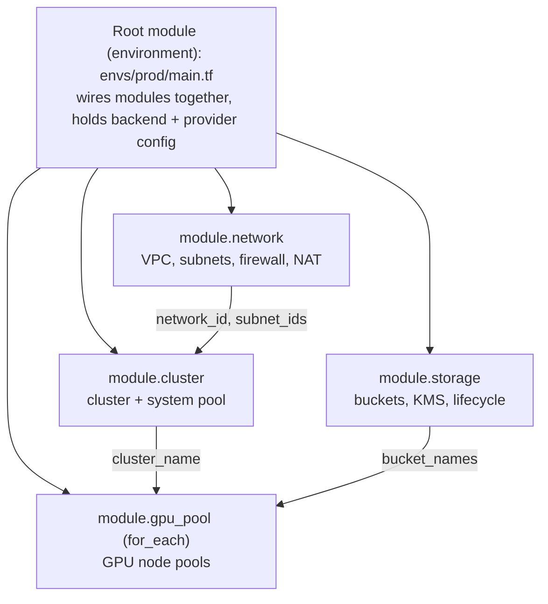

# 4.20 Terraform modules and reusable infrastructure

| | |
|---|---|
| Level | Intermediate |
| Priority tier | 0 |
| Lab venue | Terraform/OpenTofu 1.6+ (`terraform test` needs 1.6+); a Git repo; optional cloud sandbox |
| Part | Part 4: Automation and infrastructure as code |
| Status | Drafted, labs **untested** |

## Why this matters for AI infrastructure

Every AI platform team ends up creating the same shapes repeatedly: a VPC with a training subnet and jumbo MTU, a bucket for checkpoints with versioning and encryption, a GPU node pool with quotas and labels, an IAM role for a training service account, a Kubernetes cluster baseline. Copy-pasting HCL between environments produces divergent clusters, and changing a security default means editing fifty files. Modules package a piece of infrastructure behind a small, documented interface so it can be reused, versioned, tested and reviewed once. Module design is also where Terraform codebases succeed or fail at scale: good modules make the next environment a ten-line file; bad modules become a tangle of conditionals nobody dares to touch.

## Prerequisites and outcomes

Needs 4.18 and 4.19. After this chapter you can:

- Create modules with a clear structure and interface (typed variables with validation, outputs, docs) and call them with `source`, `version`, `providers`, `count`/`for_each`, `depends_on`.
- Choose module granularity and composition patterns (root module as composition layer; small focused modules; avoiding god modules and thin wrappers).
- Version and distribute modules (Git tags, registries, monorepo paths), handle upgrades and breaking changes with `moved` blocks.
- Test modules (static checks, `terraform test`, Terratest, ephemeral environments, policy checks).
- Avoid common anti-patterns and know when not to use a module.

## 1. What a module is

Every Terraform configuration is a module. The directory you run commands in is the **root module**; any other directory of `.tf` files called from it with a `module` block is a **child module**. A module has **inputs** (variables), **outputs**, **resources** and optionally nested modules. Calling a module is like calling a function: arguments in, results out; the resources inside are namespaced (`module.network.google_compute_network.this`).



```hcl
module "network" {
  source = "../../modules/network"          # local path

  name       = "ai-prod"
  region     = var.region
  cidr_block = "10.20.0.0/16"
  mtu        = 8896
  labels     = local.labels
}

module "gpu_pool" {
  source   = "git::https://git.example.com/platform/terraform-modules.git//gke-gpu-pool?ref=v2.3.1"
  for_each = var.gpu_pools                  # one pool per key

  cluster_name = module.cluster.name
  name         = each.key
  machine_type = each.value.machine_type
  gpu_type     = each.value.gpu_type
  gpu_count    = each.value.gpu_count
  min_nodes    = each.value.min_nodes
  max_nodes    = each.value.max_nodes
  subnet_id    = module.network.subnet_ids["compute"]
}
```

## 2. Anatomy of a good module

```text
modules/gke-gpu-pool/
├── main.tf          # resources
├── variables.tf     # inputs: types, descriptions, validation
├── outputs.tf       # outputs
├── versions.tf      # required_version, required_providers (constraints, NOT provider config)
├── locals.tf        # internal derivations (optional)
├── README.md        # purpose, usage example, inputs/outputs (generate with terraform-docs)
├── examples/        # runnable examples used as tests and documentation
│   ├── basic/main.tf
│   └── multi-pool/main.tf
├── tests/           # *.tftest.hcl and/or Go tests
└── CHANGELOG.md
```

### Interface design

```hcl
# variables.tf
variable "name" {
  type        = string
  description = "Node pool name (unique within the cluster)."
  validation {
    condition     = can(regex("^[a-z]([-a-z0-9]{0,38}[a-z0-9])?$", var.name))
    error_message = "name must be a valid DNS label up to 40 characters."
  }
}

variable "gpu_type" {
  type        = string
  description = "Accelerator type, e.g. nvidia-h100-80gb."
  default     = null
}

variable "gpu_count" {
  type        = number
  description = "GPUs per node (0 for CPU pools)."
  default     = 0
  validation {
    condition     = contains([0, 1, 2, 4, 8], var.gpu_count)
    error_message = "gpu_count must be 0, 1, 2, 4 or 8."
  }
}

variable "taints" {
  type = list(object({
    key    = string
    value  = string
    effect = string
  }))
  default = []
}

variable "labels" {
  type    = map(string)
  default = {}
}
```

```hcl
# main.tf
resource "google_container_node_pool" "this" {
  name     = var.name
  cluster  = var.cluster_name
  location = var.location

  autoscaling {
    min_node_count = var.min_nodes
    max_node_count = var.max_nodes
  }

  node_config {
    machine_type = var.machine_type
    labels       = merge(var.labels, { pool = var.name })

    dynamic "guest_accelerator" {
      for_each = var.gpu_count > 0 ? [1] : []
      content {
        type  = var.gpu_type
        count = var.gpu_count
        gpu_driver_installation_config { gpu_driver_version = "LATEST" }
      }
    }

    dynamic "taint" {
      for_each = var.taints
      content {
        key    = taint.value.key
        value  = taint.value.value
        effect = taint.value.effect
      }
    }
  }

  lifecycle {
    ignore_changes = [initial_node_count]
    precondition {
      condition     = var.gpu_count == 0 || var.gpu_type != null
      error_message = "gpu_type is required when gpu_count > 0."
    }
  }
}

# outputs.tf
output "id"   { value = google_container_node_pool.this.id }
output "name" { value = google_container_node_pool.this.name }
```

Design rules:

1. **Small, focused interface**: expose the knobs that vary between uses; hide implementation details. Every variable is a public API that you must support and version. Prefer sensible defaults, required inputs only for what the module cannot guess.
2. **Typed with validation**: use object types with `optional()` defaults (Terraform 1.3+), `validation` blocks, `precondition`/`postcondition`; fail at plan with a useful message. Good `description`s become documentation.
3. **Outputs are the contract**: output IDs, names, ARNs/self-links, endpoints, and structured maps others will consume; mark secrets `sensitive`. Do not output entire resources unless intended (couples consumers to provider schema).
4. **Do not configure providers inside reusable modules** (no `provider` blocks): declare requirements in `required_providers` and let the caller pass configured providers (`providers = { google = google.eu }`); modules containing provider blocks cannot be used with `count`/`for_each` easily and complicate deletion. Use `configuration_aliases` when a module needs multiple providers.
5. **One responsibility per module**: network, storage bucket, node pool, IAM role. A "platform" module that does everything is hard to evolve; compose small modules in the root.
6. **Don't wrap a single resource without adding value.** A module that just forwards 30 variables to `aws_instance` adds indirection and no policy. Add value by encoding conventions (naming, tags/labels, encryption defaults, logging), validations, companion resources (alarms, IAM), or multiple resources that belong together.
7. **Opinionated defaults, escape hatches sparingly**: secure by default (private access, encryption, deletion protection for stateful resources); allow overrides deliberately, not via a catch-all `extra_config` map that bypasses validation.
8. **Stable internal addresses**: renaming resources inside a module is a breaking change for users' state; use `moved` blocks inside the module when refactoring (they travel with the module version).
9. **Avoid data sources that depend on caller state**; accept IDs as inputs instead of looking things up by name inside the module unless that is the module's job (looser coupling, more testable).
10. **Idempotent and plan-stable**: no `timestamp()`, no random values without `random_*` resources, no dependence on values unknown at plan time in `for_each` keys (derive keys from static inputs).
11. **Respect `count`/`for_each` use on module calls**: modules that contain `provider` blocks or `configuration_aliases` have restrictions; design for the caller to repeat the module.
12. **Module Gotchas from *Terraform: Up and Running* (`TUR` Chapter 4):**
    - *Gotcha 1 — File paths (`path.module` vs. `path.root` vs. `path.cwd`):* When a module calls `file(...)` or `templatefile(...)`, Terraform resolves relative file paths relative to the **root module directory (`path.root`)**, *not* the child module directory. If `modules/services/webserver-cluster/main.tf` writes `templatefile("user-data.sh", ...)` and is called from `stage/services/webserver-cluster/`, Terraform fails because `user-data.sh` is not in `stage/`. Always prefix module-internal files with **`${path.module}/user-data.sh`** (`path.module` = directory of the module where the expression is written; `path.root` = directory of the root module; `path.cwd` = current working directory).
    - *Gotcha 2 — Inline blocks vs. separate resources (`aws_security_group` vs. `aws_security_group_rule`):* Several cloud resources (`aws_security_group`, `aws_route_table`, `aws_network_acl`) allow defining rules either via **inline blocks** (`ingress { ... }`) OR via **separate standalone resources** (`aws_security_group_rule` referencing `security_group_id = aws_security_group.alb.id`). If your reusable module uses inline `ingress {}` blocks and a caller in `stage` attaches an extra `aws_security_group_rule` (`allow_testing_inbound` on port `12345`) to `module.webserver_cluster.alb_security_group_id`, **the inline block and the standalone resource will overwrite each other on alternating `terraform apply` runs**. Always use **separate `aws_security_group_rule` (`aws_route`, `aws_network_acl_rule`) resources** inside reusable modules so callers can extend them safely.
    - *Using `locals` for internal constants and `outputs` for external extension (`TUR` Chapter 4):* Put internal constants (`http_port = 80`, `any_port = 0`, `any_protocol = "-1"`, `tcp_protocol = "tcp"`, `all_ips = ["0.0.0.0/0"]`) in a **`locals` block** rather than `variable`s when you do not want callers overriding them; and export key resource identifiers (`output "asg_name"`, `output "alb_security_group_id"`) so callers (`module.webserver_cluster.asg_name`) can attach environment-specific resources like `aws_autoscaling_schedule` (`scale_out_during_business_hours` at `0 9 * * *` and `scale_in_at_night` at `0 17 * * *` in `prod`) without bloating the module with environment conditionals.

## 3. Composition patterns

- **Root module as composition layer**: environment directories contain mostly module calls plus environment-specific values (`envs/prod/main.tf`, `terraform.tfvars`), the backend config, and provider configuration. Keep logic out of roots.
- **Dependency inversion**: modules take IDs as inputs (e.g. `subnet_id`) rather than creating or looking up the network themselves, so the same module works in different topologies.
- **Layered stacks** (4.19): `network` stack outputs consumed by `cluster` stack through data sources; modules are used inside each stack.
- **Convention modules**: a small `labels` or `naming` module returning standard names and tags used everywhere.
- **Facade modules**: a higher-level module composing several lower-level ones for a golden path ("ai-training-environment" = network + storage + cluster + pools + observability). Provide it after the building blocks stabilise; keep it thin and keep the building blocks directly usable.
- **Data-driven**: a root reads a YAML/JSON file of pools or tenants (`yamldecode(file("pools.yaml"))`) and `for_each` over it, so adding a pool is a data change reviewed without HCL knowledge.

```hcl
locals {
  pools = yamldecode(file("${path.module}/gpu-pools.yaml"))
}
module "gpu_pool" {
  source       = "../../modules/gke-gpu-pool"
  for_each     = local.pools
  cluster_name = module.cluster.name
  name         = each.key
  machine_type = each.value.machine_type
  gpu_type     = try(each.value.gpu_type, null)
  gpu_count    = try(each.value.gpu_count, 0)
  min_nodes    = each.value.min_nodes
  max_nodes    = each.value.max_nodes
}
```

### Passing providers and multi-region

```hcl
provider "google" {
  alias  = "us"
  region = "us-central1"
}
provider "google" {
  alias  = "eu"
  region = "europe-west4"
}

module "pool_us" {
  source    = "../../modules/gke-gpu-pool"
  providers = { google = google.us }
  # ...
}
module "pool_eu" {
  source    = "../../modules/gke-gpu-pool"
  providers = { google = google.eu }
  # ...
}
```

Module `for_each` with a provider chosen per instance is not supported (provider mappings are static); repeat module calls or use separate stacks per region.

## 4. Sources, versions and distribution

| Source | Example | Notes |
|---|---|---|
| Local path | `source = "../../modules/network"` | Fast iteration; no versioning; fine inside a monorepo, but all consumers move together |
| Git | `git::https://git.example.com/org/repo.git//subdir?ref=v1.4.0` | Pin tags or SHAs, not branches; SSH or token auth; the `//` selects a subdirectory |
| Terraform Registry (public) | `source = "terraform-google-modules/network/google"`, `version = "~> 9.0"` | Review code and maintenance; pin versions |
| Private registry (HCP, Artifactory, GitLab/GitHub registries) | `app.terraform.io/acme/network/google` | Versioned, access-controlled, searchable |
| S3/GCS bucket archive | `s3::https://s3.amazonaws.com/bucket/module.zip` | Simple internal distribution |
| OCI registry (OpenTofu 1.10+) | `oci://registry.example.com/modules/network` | Reuse container registry infrastructure |

Versioning practice: **semantic versions** (`v2.3.1`); breaking input/output/resource changes bump major; keep a changelog; pin exact versions in production roots (`version = "= 2.3.1"` or Git tag) and update deliberately via PRs with plans per environment. Use Renovate/Dependabot to open upgrade PRs. For Git modules in a monorepo, tags like `network/v1.4.0` allow independent versions per module path.

### Upgrading modules safely

1. Read the changelog; run `terraform init -upgrade` in a branch.
2. `terraform plan` in lower environments first; confirm **no unexpected replacements** (resource address changes appear as destroy/create unless `moved` blocks exist).
3. Promote the version pin through environments (dev → staging → prod) with the same artefact (4.2).
4. For breaking changes, ship a migration guide, `moved` blocks, and deprecation periods (keep old variable names accepted with a warning via `validation` or documentation for one major version).

## 5. Testing modules

Pyramid mirroring 4.13 and 3.9:

| Level | Tooling | What it checks |
|---|---|---|
| Static | `terraform fmt -check`, `terraform validate`, `tflint` (with provider rulesets), `checkov`/`trivy config`/`tfsec`, `terraform-docs` freshness | Style, syntax, misconfigurations, docs |
| Plan-level / unit | `terraform test` with `command = plan` and mock providers (Terraform 1.7+) | Variable validation, computed names, conditionals, `for_each` keys, outputs, without creating anything |
| Integration | `terraform test` with `command = apply` (creates real resources, destroys after), Terratest (Go), Kitchen-Terraform, `pytest` + `python-terraform` | Real provider behaviour in an ephemeral sandbox account |
| Policy | OPA/Conftest/Sentinel against `plan.json` (4.2) | Organisation rules (encryption, labels, instance types) |
| Compatibility | Matrix over Terraform/OpenTofu and provider versions | Upgrade safety |
| Examples as tests | Each `examples/*` is planned (and sometimes applied) in CI | Documentation always works |

```hcl
# tests/validation.tftest.hcl (Terraform 1.6+ native tests)
variables {
  name         = "h100-pool"
  cluster_name = "test"
  location     = "us-central1"
  machine_type = "a3-highgpu-8g"
  gpu_type     = "nvidia-h100-80gb"
  gpu_count    = 8
  min_nodes    = 0
  max_nodes    = 4
}

run "valid_gpu_pool_plans" {
  command = plan
  assert {
    condition     = google_container_node_pool.this.autoscaling[0].max_node_count == 4
    error_message = "max nodes not propagated"
  }
}

run "rejects_bad_gpu_count" {
  command = plan
  variables { gpu_count = 3 }
  expect_failures = [var.gpu_count]
}
```

Terratest sketch (Go): `terraform.InitAndApply` an example directory with random names, run assertions with provider SDKs (`gcp.GetBucket...`), `defer terraform.Destroy`. Integration tests cost money and time: run them nightly or on release tags, in a dedicated sandbox with budgets and reaper jobs, never against production state.

## 6. Worked example: network + checkpoint storage + GPU pool modules

```hcl
# modules/checkpoint-bucket/main.tf
resource "google_storage_bucket" "this" {
  name                        = var.name
  location                    = var.location
  uniform_bucket_level_access = true
  public_access_prevention    = "enforced"
  force_destroy               = false
  versioning { enabled = true }

  dynamic "encryption" {
    for_each = var.kms_key_id == null ? [] : [1]
    content { default_kms_key_name = var.kms_key_id }
  }

  lifecycle_rule {
    condition {
      num_newer_versions = var.keep_versions
      with_state         = "ARCHIVED"
    }
    action {
      type = "Delete"
    }
  }
  labels = var.labels

  lifecycle { prevent_destroy = true }          # checkpoints are irreplaceable: refuse accidental destroys
}

resource "google_storage_bucket_iam_member" "writers" {
  for_each = toset(var.writer_service_accounts)
  bucket   = google_storage_bucket.this.name
  role     = "roles/storage.objectUser"
  member   = "serviceAccount:${each.value}"
}

output "bucket_name" { value = google_storage_bucket.this.name }
output "bucket_url"  { value = "gs://${google_storage_bucket.this.name}" }
```

Root composition for an environment:

```hcl
module "network"    { source = "../../modules/network"           /* ... */ }
module "checkpoints" {
  source                   = "../../modules/checkpoint-bucket"
  name                     = "acme-${var.env}-ml-checkpoints"
  location                 = var.region
  kms_key_id               = module.kms.key_id
  writer_service_accounts  = [module.workload_identity.training_sa_email]
  labels                   = local.labels
}
module "gpu_pool" {
  source   = "../../modules/gke-gpu-pool"
  for_each = local.pools
  # ...
}
```

Points illustrated: protective lifecycle on the stateful resource inside the module; typed IAM inputs; outputs as contract; the root as thin composition; pool definitions as data.

## 7. Anti-patterns

- **God module** with 150 variables and nested conditionals; or **mega-wrapper** around one resource that re-exports every argument.
- **Providers configured in child modules**, making them hard to reuse, count, or delete.
- **Hidden global dependencies**: modules that read environment variables, hard-coded project IDs, regions, account IDs, or call data sources for names of resources they do not own.
- **Count-based indexing** for things that can be reordered; use `for_each` with stable keys.
- **Conditional resource creation toggles everywhere** (`create_x`); each boolean doubles the test matrix. Prefer separate modules or composition.
- **Unpinned module versions** in production roots (especially `ref=main`).
- **Changing resource names/addresses inside a module release** without `moved` blocks.
- **Secrets as module outputs/inputs** without `sensitive` and without considering state exposure (4.22).
- **Using modules to hide dangerous behaviour** (auto-destroy, public exposure) behind friendly names.
- **Copy-pasted modules** with forks that drift; or monorepo modules edited in place while environments reference them by path (an edit changes every environment at the next plan).
- **Environment-specific `if` branches** in a shared module (`if var.env == "prod"`); pass explicit inputs instead.
- **Over-abstracting too early**: wait until you have seen the pattern three times.

## 8. Operating a module ecosystem

- Ownership and review: CODEOWNERS for module repos (4.1); platform team owns shared modules; consumers propose changes via PRs.
- Documentation: generated README with `terraform-docs`, examples, and diagrams; a "golden path" catalogue; internal registry with search.
- Compatibility: support policy (e.g., last two majors), deprecation notices, automated upgrade PRs.
- Security and compliance baked in: default encryption, logging, labels, restricted public exposure; scanning in CI (Checkov, Trivy) with exceptions tracked.
- Cost guardrails: variables that cap GPU counts per environment, required `ttl`/`owner` labels (4.2 policy checks).
- Telemetry: record which module versions each stack uses (outputs, tags, a registry of deployments) so you can find stragglers on vulnerable versions.

## 9. Lab

First, run the self-checking Python lab (`code/part04/terraform_modules_validator_lab.py`) locally. It verifies the `gke-gpu-pool` module input `validation` and `precondition` rules (`validate_gke_gpu_pool_inputs`, matching `tests/validation.tftest.hcl`), Git module `source` double-slash (`//`) subdirectory and `?ref=` immutability checks (`parse_git_module_source`, `TUR` Ch. 4), and the inline-vs-separate `aws_security_group_rule` conflict detector (`detect_inline_vs_separate_sg_conflict`, `TUR` Ch. 4).

```bash
python3 code/part04/terraform_modules_validator_lab.py
```

Next, on a machine with Terraform/OpenTofu 1.6+ (all interactive shell steps below are `untested here`), work through these exercises:

1. **First module**: extract a "checkpoint-bucket"-like module (use `local_file`/`random_pet` if no cloud) from a flat configuration; define typed variables with validation and outputs; call it twice with different inputs.
2. **Interface review**: write down which inputs are required vs defaulted; add `precondition`/`validation` blocks and test failure messages with invalid values.
3. **for_each over data**: define pools in YAML, `yamldecode`, and create module instances per key; add and remove a key and read the plan (only that instance should change).
4. **Count vs for_each**: create three resources with `count`, remove the middle one, observe churn; redo with `for_each` and stable keys.
5. **Providers**: write a module needing two providers via `configuration_aliases`; call it with a `providers` map; then see why a module containing a `provider` block cannot be easily removed/repeated.
6. **Versioning**: host the module in Git with tags `v1.0.0`, `v1.1.0`; consume by `?ref=`; bump with a plan in a branch; make a breaking rename with and without a `moved` block and compare plans.
7. **terraform test**: write plan-level tests with assertions and `expect_failures`; run them in CI; then an apply-level test with local providers.
8. **Static analysis**: run `tflint`, `checkov` (or `trivy config`), `terraform-docs`; fix findings; fail the pipeline on violations.
9. **Anti-pattern audit**: take a God module (provided or invented) and split it into focused modules with a thin root; measure plan time and review size.
10. **Policy**: generate `plan.json` from your root; write a Conftest rule that rejects any bucket without versioning or any GPU count above a threshold (4.2).
11. **Upgrade drill**: release module v2 with a breaking change; migrate a consumer using `moved` blocks and phased environment promotion.
12. **Clean up.**

## 10. Common mistakes

- Designing modules before the pattern is understood; or never extracting repeated code.
- Variables without types or descriptions; no validation; surprising defaults.
- Outputting everything or nothing.
- Breaking changes under the same version number; referencing branches.
- Hiding state-destroying behaviour; no `prevent_destroy` on irreplaceable resources.
- Provider configuration inside modules; hard-coded environment values.
- Testing only by `apply` in production.
- Treating the module registry as a dumping ground without ownership.

## 11. Interview angles

- "What is a module? How do you design its interface?"
- "Root module vs child module; how do you compose?"
- "How do you version and upgrade modules without breaking production?"
- "Why shouldn't child modules configure providers?"
- "`count` vs `for_each` in modules; why do keys matter?"
- "How do you test a Terraform module?"
- "How would you provide a standard GPU training environment to ten teams?" (facade of building-block modules, validation, policy, versioning.)
- "A module upgrade wants to destroy the cluster. What do you do?" (stop; check `moved`; changelog; plan in lower env.)

## Exercises

1. **Root vs. Child Modules, Interface Design (`variables.tf`, `locals.tf`, `outputs.tf`), and the Two Module Gotchas (`TUR` Chapter 4):** Using `validate_gke_gpu_pool_inputs()` and `detect_inline_vs_separate_sg_conflict()` in `code/part04/terraform_modules_validator.py`, explain: (a) how `variables.tf`, `locals.tf`, and `outputs.tf` (`module.<NAME>.<OUTPUT>`) work together; (b) why child modules must use `${path.module}/...` for local files; and (c) why reusable modules must use standalone `aws_security_group_rule` (`aws_route`) resources rather than inline `ingress {}` blocks.
2. **Provider Inheritance, `configuration_aliases`, and Why Child Modules Must Never Contain `provider` Blocks:** Explain why defining a `provider "google" {}` block inside a child module breaks `count`, `for_each`, and module removal, and show how a multi-region root module passes `providers = { google = google.eu }` into a child module.
3. **Module Composition Patterns: Dependency Inversion, Data-Driven `yamldecode` + `for_each`, and Facade Modules:** Trace how `envs/prod/main.tf` composes `module.network`, `module.checkpoints`, `module.cluster`, and `module.gpu_pool` (`for_each = yamldecode(file("${path.module}/gpu-pools.yaml"))`), and explain why passing `subnet_id = module.network.subnet_ids["compute"]` (dependency inversion) beats looking up the VPC inside `gke-gpu-pool`.
4. **Module Sources (`//` Subdirectory Syntax), Semantic Versioning (`?ref=v2.3.1`), and Safe Phased Upgrades (`moved` Blocks, `TUR` Chapter 4):** Using `parse_git_module_source()` in `code/part04/terraform_modules_validator.py`, explain the double-slash `//` syntax in Git/registry module sources, why `stage` can test `?ref=v0.0.2` while `prod` stays pinned on `?ref=v0.0.1`, and how embedding a `moved {}` block inside a module's v2 release prevents resource recreation across consumers.
5. **Testing Terraform Modules (`terraform test` `.tftest.hcl`, `expect_failures`, Mock Providers, and `Terratest`):** Trace `tests/validation.tftest.hcl` in Section 5 (`run "valid_gpu_pool_plans" { command = plan ... }` and `run "rejects_bad_gpu_count" { expect_failures = [var.gpu_count] }`), and compare fast plan-level `.tftest.hcl` unit tests with Go `Terratest` integration tests (`terraform.InitAndApply` + `defer terraform.Destroy`).
6. **Auditing Module Anti-Patterns (God Modules, Thin Pass-Through Wrappers, `if var.env == "prod"`, and Boolean `create_x` Sprawl):** Explain why a 150-variable "God module" and a 1-to-1 resource wrapper both hurt maintainability, why `if var.env == "prod"` inside a shared module is an anti-pattern (`TUR` Ch. 4), and what value `modules/checkpoint-bucket` adds over a raw `google_storage_bucket` resource.

## Checkpoint questions (20)

<details>
<summary>1. What is the difference between a Root Module and a Child Module in Terraform, and how are resources inside a child module addressed in `terraform.tfstate`?</summary>

- **Root module:** The working directory of `.tf` files where you run `terraform init`, `plan`, and `apply`; it holds the `backend` configuration, `provider` configurations, and top-level `module` calls.
- **Child module:** Any module invoked by a `module "<name>" { source = "..." }` block. Every resource created inside `module "network"` is namespaced in `terraform.tfstate` under **`module.network.<resource_type>.<resource_name>`** (for example, `module.network.google_compute_network.this`), and its outputs are read by the caller as **`module.network.<output_name>`**.
</details>

<details>
<summary>2. In *Terraform: Up and Running* Chapter 4, why must a child module use `${path.module}` when referencing files with `file()` or `templatefile()`?</summary>

By default, Terraform resolves relative file paths (`templatefile("user-data.sh", ...)`) relative to the **root module directory (`path.root`)** where `terraform plan` is executed—not the directory of the child module where the code lives. Using **`${path.module}/user-data.sh`** guarantees that Terraform resolves the file inside the child module's own directory (`path.root` = root module directory; `path.cwd` = current working directory).
</details>

<details>
<summary>3. Why does `TUR` Chapter 4 warn against using inline `ingress {}` / `egress {}` blocks inside `aws_security_group` in a reusable module?</summary>

When a reusable module defines rules using inline `ingress {}` blocks inside `aws_security_group`, `aws_security_group` assumes it owns the **complete list of rules**. If a consumer in `staging` attaches an additional standalone **`aws_security_group_rule`** (`allow_testing_inbound` on port `12345`) referencing `module.webserver_cluster.alb_security_group_id`, the inline block deletes the standalone rule on the next `apply`, and the standalone rule re-adds it on the run after that—creating an endless flip-flop conflict. Always define rules as **separate `aws_security_group_rule` (`aws_route`, `aws_network_acl_rule`) resources** inside reusable modules.
</details>

<details>
<summary>4. When designing a module, what belongs in `variables.tf` versus `locals.tf` (`TUR` Chapter 4)?</summary>

- **`variables.tf` (Module Inputs):** Defines the module's **public API**—parameters that legitimately vary across environments or callers (`name`, `machine_type`, `gpu_type`, `gpu_count`, `min_nodes`, `max_nodes`).
- **`locals.tf` (Internal Constants & Derivations):** Defines internal named expressions and constants (`http_port = 80`, `common_labels = merge(...)`) that eliminate magic numbers inside `main.tf` **without exposing them as overridable input variables**.
</details>

<details>
<summary>5. Why must reusable child modules NEVER contain `provider "..." {}` configuration blocks, and how do you pass providers instead?</summary>

A `provider` configuration block (setting `region`, `project`, or credentials) belongs strictly in the **root module**. If a child module defines its own `provider` block:
1. Callers **cannot use `count`, `for_each`, or `depends_on`** on that `module` block.
2. Removing the `module` block from the root configuration fails until the provider block is also present in the root.
Instead, child modules declare only version constraints in `versions.tf` (`required_providers`, plus `configuration_aliases = [google.replica]` if multiple providers are needed), and the root module passes configured providers via **`providers = { google = google.eu }`**.
</details>

<details>
<summary>6. Compare `validation {}` blocks on input variables with `precondition {}` and `postcondition {}` blocks inside `lifecycle {}`.</summary>

- **Variable `validation {}` block:** Checks a **single input variable** in isolation (`var.gpu_count` in `[0, 1, 2, 4, 8]` or `var.name` matching a DNS regex). In Terraform < 1.9, a `validation` block can only reference `var.<self>`.
- **Resource/data `lifecycle { precondition {} }`:** Checks invariants across **multiple variables, locals, or data sources** before creating/updating the resource (e.g., `condition = var.gpu_count == 0 || var.gpu_type != null`, ensuring `gpu_type` is supplied whenever `gpu_count > 0`).
- **Resource/data `lifecycle { postcondition {} }`:** Asserts properties of the **real/computed resource attributes** (`self.status`) after reading or applying.
</details>

<details>
<summary>7. What makes a \"thin wrapper module\" an anti-pattern versus a high-value module like `modules/checkpoint-bucket`?</summary>

- **Thin wrapper anti-pattern:** A module that wraps a single `google_storage_bucket` resource and exposes 35 pass-through variables matching the provider's arguments 1-for-1. It adds boilerplate indirection without enforcing any organizational standards.
- **High-value module (`modules/checkpoint-bucket`):** Encodes **opinionated security and operational policy by default**—enforcing `uniform_bucket_level_access = true`, `public_access_prevention = "enforced"`, `versioning { enabled = true }`, `lifecycle { prevent_destroy = true }`, KMS encryption, archived-version retention rules, and companion `google_storage_bucket_iam_member` bindings behind 5 clean inputs.
</details>

<details>
<summary>8. Why is writing `if var.env == "prod"` inside a shared module an anti-pattern, and how did `TUR` Chapter 4 attach production-only autoscaling schedules?</summary>

Hardcoding environment names (`var.env == "prod" ? ...`) inside a shared module hides environment behavior inside library code and breaks as soon as a team adds `staging-eu`, `preprod`, or `bench` environments. Instead:
1. Expose explicit capability/sizing inputs (`min_nodes`, `max_nodes`, `enable_deletion_protection`) that each environment's root module sets explicitly.
2. Export resource IDs/names as **module outputs** (`output "asg_name"`) so the `prod` root module can attach prod-specific companion resources (`aws_autoscaling_schedule.scale_out_during_business_hours` referencing `module.webserver_cluster.asg_name`) directly in `prod/main.tf`.
</details>

<details>
<summary>9. In a Git module source string (`git::https://git.example.com/platform/terraform-modules.git//gke-gpu-pool?ref=v2.3.1`), what do `//` and `?ref=` do (`TUR` Chapter 4)?</summary>

- **`//` (double slash):** Separates the Git repository URL (`https://git.example.com/platform/terraform-modules.git`) from the **subdirectory path inside that repository** (`gke-gpu-pool`).
- **`?ref=v2.3.1`:** Checks out the exact Git tag or commit SHA. Never set `?ref=main` in production, because any commit merged to `main` would silently alter the next `terraform plan` in production without a version bump PR. In a multi-module monorepo, use path-prefixed Git tags such as `?ref=gke-gpu-pool/v2.3.1`.
</details>

<details>
<summary>10. How do you promote a module upgrade from `v0.0.1` to `v0.0.2` across environments (`TUR` Chapter 4)?</summary>

1. Tag and release the module update as **`v0.0.2`** (`git tag -a "v0.0.2" -m "..." && git push --follow-tags`).
2. In **`stage/`**, update `?ref=v0.0.1` to **`?ref=v0.0.2`**, run `terraform init` and `terraform plan`, verify there are no unintended resource replacements (`-/+`), apply to staging, and run smoke/integration tests.
3. Meanwhile, **`prod/` remains pinned on `?ref=v0.0.1`** completely unaffected until you open and approve a dedicated PR bumping `prod/` to `?ref=v0.0.2`.
</details>

<details>
<summary>11. What happens when a module author renames a resource inside a module, and how do `moved {}` blocks inside the module prevent consumer outages?</summary>

If a module author renames `resource "google_container_node_pool" "pool"` to `resource "google_container_node_pool" "this"` in `v2.0.0`, every consumer upgrading to `v2.0.0` will see a plan to **destroy their existing GPU node pool (`module.gpu_pool.google_container_node_pool.pool`) and create a new one**. If the module author includes:
```hcl
moved {
  from = google_container_node_pool.pool
  to   = google_container_node_pool.this
}
```
inside the module's `.tf` files, Terraform automatically migrates every consumer's state address during `plan`/`apply` with zero destruction.
</details>

<details>
<summary>12. What is Dependency Inversion in Terraform module composition?</summary>

Instead of having `module "gke_gpu_pool"` call `data "google_compute_subnetwork"` by hardcoded name (or create its own network), the module accepts **`subnet_id = var.subnet_id`** as a plain string input, and the **root module** wires `subnet_id = module.network.subnet_ids["compute"]`. This decouples the node-pool module from how the network was created, makes the dependency edge explicit to Terraform's DAG, and lets unit tests pass a dummy string `subnet_id = "sub-123"` without needing a real VPC.
</details>

<details>
<summary>13. How does Data-Driven Module Composition (`yamldecode(file("gpu-pools.yaml"))` + `for_each`) simplify day-2 operations?</summary>

By storing node-pool definitions in a clean `gpu-pools.yaml` file (`h100-train: { machine_type: a3-highgpu-8g, gpu_type: nvidia-h100-80gb, gpu_count: 8, min_nodes: 0, max_nodes: 32 }`) and iterating `module "gpu_pool" { for_each = yamldecode(file("${path.module}/gpu-pools.yaml")) ... }`, adding a new GPU pool or adjusting `max_nodes` is a 4-line YAML change validated by JSON Schema and `terraform plan`—without touching HCL logic.
</details>

<details>
<summary>14. Why should `for_each` with stable map keys (`h100-train`, `a100-infer`) always be preferred over `count` when instantiating modules or resources?</summary>

`count` identifies instances by **0-based numeric list index** (`module.gpu_pool[0]`, `module.gpu_pool[1]`, `module.gpu_pool[2]`). If you remove the first pool from a 3-element list, element `[1]` shifts to `[0]` and element `[2]` shifts to `[1]`—causing Terraform to **destroy or replace every subsequent node pool in the list**. `for_each` identifies instances by **immutable string key** (`module.gpu_pool["h100-train"]`), so removing one key affects only that single pool.
</details>

<details>
<summary>15. Why must `for_each` keys never depend on values that are `(known after apply)`?</summary>

Terraform must know the exact set of `for_each` keys during the **plan phase** to construct the resource graph nodes (`module.gpu_pool["<key>"]`). If the map keys come from a resource attribute generated only during `apply` (such as random IDs or cloud-assigned instance IDs), `terraform plan` fails with `The "for_each" map includes keys derived from resource attributes that cannot be determined until apply`. Always derive `for_each` **keys** from static input variables/YAML keys, while letting the map **values** reference computed resource attributes.
</details>

<details>
<summary>16. How does `terraform test` (`.tftest.hcl`, Terraform 1.6+/1.7+) test a module without creating cloud resources?</summary>

A `tests/validation.tftest.hcl` file defines `variables {}` and one or more **`run "<name>" {}`** blocks:
- Setting **`command = plan`** (plus `mock_provider "google" {}` in Terraform 1.7+) executes a fast, local plan-mode evaluation without cloud credentials or API calls.
- **`assert { condition = ...; error_message = "..." }`** verifies computed resource attributes, locals, and outputs.
- **`expect_failures = [var.gpu_count]`** verifies that invalid inputs are rejected by `validation` or `precondition` blocks.
</details>

<details>
<summary>17. How do `examples/` directories inside a module repository serve a dual purpose?</summary>

Each subdirectory under `examples/` (`examples/basic/main.tf`, `examples/multi-pool/main.tf`) is a self-contained root module that calls `source = "../../"`:
1. **Living documentation** for human consumers showing realistic usage.
2. **Executable CI test targets**: CI runs `terraform init && terraform validate` (and `terraform test` / `Terratest` apply-and-destroy in a sandbox account) against every `examples/*` directory so documentation never drifts out of date.
</details>

<details>
<summary>18. What is a \"Facade Module\", and when should a platform team introduce one?</summary>

A **facade module** (`modules/ai-training-environment`) is a thin high-level module that composes several already-proven building-block modules (`network` + `checkpoint-bucket` + `gke-cluster` + `gke-gpu-pool`) into a single "golden path" call for product teams. Introduce a facade module **only after** the underlying building-block modules have stabilized, and always allow advanced consumers to compose the building-block modules directly when they outgrow the facade.
</details>

<details>
<summary>19. Why shouldn't a module output an entire resource object (`output "node_pool" { value = google_container_node_pool.this }`) by default?</summary>

Exporting the entire resource object couples callers to the provider's internal schema (so upgrading the provider major version can break callers), clutters `terraform plan` output with ratusan of attributes, and risks exporting sensitive attributes unintentionally. Instead, export **explicit, curated outputs** (`id`, `name`, `endpoint`, `service_account_email`) that form a stable contract.
</details>

<details>
<summary>20. What tools automate documentation, linting, and security scanning in a Terraform module CI pipeline?</summary>

1. **`terraform fmt -check` & `terraform validate`**: canonical formatting and schema validation.
2. **`tflint`** (with `tflint-ruleset-google` / `aws`): catches invalid machine types, deprecated arguments, and unused declarations.
3. **`checkov` / `trivy config` / `tfsec`**: static security policy scanners flagging public buckets, missing KMS encryption, or overly permissive firewall rules.
4. **`terraform-docs markdown table --output-file README.md --output-check .`**: verifies that the `Inputs` and `Outputs` tables in `README.md` match `variables.tf` and `outputs.tf`.
</details>

## Sources and review notes

- **Sources read in full:**
  - `terraform-up-and-running-3rd-edition` — Yevgeniy Brikman, *Terraform: Up and Running*, 3rd ed., **Chapter 4: How to Create Reusable Infrastructure with Terraform Modules** (read in full: module basics, module inputs `variables.tf`, module `locals`, module `outputs` and `module.<NAME>.<OUTPUT>` composition with external `aws_autoscaling_schedule` and `aws_security_group_rule`, module gotchas `path.module` vs `path.root` vs `path.cwd` and inline `ingress` blocks vs standalone `aws_security_group_rule` resources, and module versioning with Git tags `?ref=v0.0.1` and `//` subdirectory paths across staging and production).
  - `nvidia-devops` (`volume-10/05-terraform-for-infrastructure-as-code.md`): module structure, interface design, `gke-gpu-pool` and `checkpoint-bucket` modules, `terraform test`, and anti-patterns.
- **Run here:** `python3 code/part04/terraform_modules_validator_lab.py` (3 passed, 0 failed).
- **Explicitly labelled inferences:** The `validate_gke_gpu_pool_inputs`, `parse_git_module_source`, and `detect_inline_vs_separate_sg_conflict` models in `code/part04/terraform_modules_validator.py` and the `gke-gpu-pool`, `checkpoint-bucket`, and `validation.tftest.hcl` listings are the author's constructions synthesizing `TUR` Chapter 4 and `volume-10/05` (plus original study items 21, 22, 23, 24, 25, 26, 27, 28, 29, and 30).
- **Not verified on live hardware:** Live `terraform test`, `Terratest`, GKE GPU node pool, and GCS bucket executions (`10.20.0.0/16`, `8896` MTU, `v2.3.1`, `40` chars, `[0, 1, 2, 4, 8]` GPUs, `~> 9.0`, `a3-highgpu-8g`, `150` vars, `12345` port) are marked (`untested here`) where not executed by `terraform_modules_validator_lab.py`.
