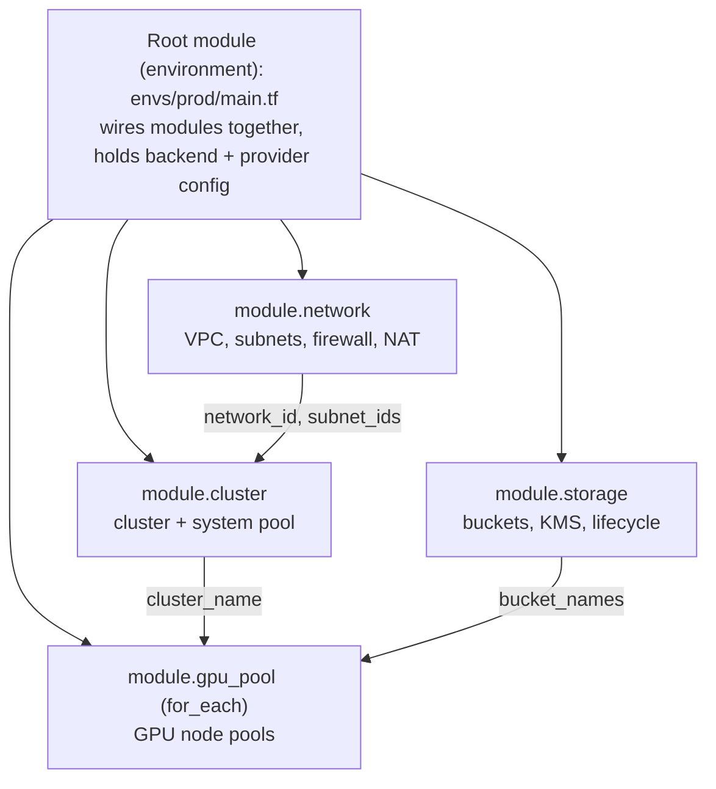

# 4.20 Terraform modules and reusable infrastructure

| | |
|---|---|
| Level | Intermediate |
| Priority tier | 0 |
| Lab venue | Terraform/OpenTofu 1.6+ (`terraform test` needs 1.6+); a Git repo; optional cloud sandbox |
| Part | Part 4: Automation and infrastructure as code |
| Status | Drafted, labs **untested** |

## Why this matters for AI infrastructure

Every AI platform team ends up creating the same shapes repeatedly: a VPC with a training subnet and jumbo MTU, a bucket for checkpoints with versioning and encryption, a GPU node pool with quotas and labels, an IAM role for a training service account, a Kubernetes cluster baseline. Copy-pasting HCL between environments produces divergent clusters, and changing a security default means editing fifty files. Modules package a piece of infrastructure behind a small, documented interface so it can be reused, versioned, tested and reviewed once. Module design is also where Terraform codebases succeed or fail at scale: good modules make the next environment a ten-line file; bad modules become a tangle of conditionals nobody dares to touch.

## Prerequisites and outcomes

Needs 4.18 and 4.19. After this chapter you can:

- Create modules with a clear structure and interface (typed variables with validation, outputs, docs) and call them with `source`, `version`, `providers`, `count`/`for_each`, `depends_on`.
- Choose module granularity and composition patterns (root module as composition layer; small focused modules; avoiding god modules and thin wrappers).
- Version and distribute modules (Git tags, registries, monorepo paths), handle upgrades and breaking changes with `moved` blocks.
- Test modules (static checks, `terraform test`, Terratest, ephemeral environments, policy checks).
- Avoid common anti-patterns and know when not to use a module.

## 1. What a module is

Every Terraform configuration is a module. The directory you run commands in is the **root module**; any other directory of `.tf` files called from it with a `module` block is a **child module**. A module has **inputs** (variables), **outputs**, **resources** and optionally nested modules. Calling a module is like calling a function: arguments in, results out; the resources inside are namespaced (`module.network.google_compute_network.this`).



```hcl
module "network" {
  source = "../../modules/network"          # local path

  name       = "ai-prod"
  region     = var.region
  cidr_block = "10.20.0.0/16"
  mtu        = 8896
  labels     = local.labels
}

module "gpu_pool" {
  source   = "git::https://git.example.com/platform/terraform-modules.git//gke-gpu-pool?ref=v2.3.1"
  for_each = var.gpu_pools                  # one pool per key

  cluster_name = module.cluster.name
  name         = each.key
  machine_type = each.value.machine_type
  gpu_type     = each.value.gpu_type
  gpu_count    = each.value.gpu_count
  min_nodes    = each.value.min_nodes
  max_nodes    = each.value.max_nodes
  subnet_id    = module.network.subnet_ids["compute"]
}
```

## 2. Anatomy of a good module

```text
modules/gke-gpu-pool/
├── main.tf          # resources
├── variables.tf     # inputs: types, descriptions, validation
├── outputs.tf       # outputs
├── versions.tf      # required_version, required_providers (constraints, NOT provider config)
├── locals.tf        # internal derivations (optional)
├── README.md        # purpose, usage example, inputs/outputs (generate with terraform-docs)
├── examples/        # runnable examples used as tests and documentation
│   ├── basic/main.tf
│   └── multi-pool/main.tf
├── tests/           # *.tftest.hcl and/or Go tests
└── CHANGELOG.md
```

### Interface design

```hcl
# variables.tf
variable "name" {
  type        = string
  description = "Node pool name (unique within the cluster)."
  validation {
    condition     = can(regex("^[a-z]([-a-z0-9]{0,38}[a-z0-9])?$", var.name))
    error_message = "name must be a valid DNS label up to 40 characters."
  }
}

variable "gpu_type" {
  type        = string
  description = "Accelerator type, e.g. nvidia-h100-80gb."
  default     = null
}

variable "gpu_count" {
  type        = number
  description = "GPUs per node (0 for CPU pools)."
  default     = 0
  validation {
    condition     = contains([0, 1, 2, 4, 8], var.gpu_count)
    error_message = "gpu_count must be 0, 1, 2, 4 or 8."
  }
}

variable "taints" {
  type = list(object({
    key    = string
    value  = string
    effect = string
  }))
  default = []
}

variable "labels" {
  type    = map(string)
  default = {}
}
```

```hcl
# main.tf
resource "google_container_node_pool" "this" {
  name     = var.name
  cluster  = var.cluster_name
  location = var.location

  autoscaling {
    min_node_count = var.min_nodes
    max_node_count = var.max_nodes
  }

  node_config {
    machine_type = var.machine_type
    labels       = merge(var.labels, { pool = var.name })

    dynamic "guest_accelerator" {
      for_each = var.gpu_count > 0 ? [1] : []
      content {
        type  = var.gpu_type
        count = var.gpu_count
        gpu_driver_installation_config { gpu_driver_version = "LATEST" }
      }
    }

    dynamic "taint" {
      for_each = var.taints
      content {
        key    = taint.value.key
        value  = taint.value.value
        effect = taint.value.effect
      }
    }
  }

  lifecycle {
    ignore_changes = [initial_node_count]
    precondition {
      condition     = var.gpu_count == 0 || var.gpu_type != null
      error_message = "gpu_type is required when gpu_count > 0."
    }
  }
}

# outputs.tf
output "id"   { value = google_container_node_pool.this.id }
output "name" { value = google_container_node_pool.this.name }
```

Design rules:

1. **Small, focused interface**: expose the knobs that vary between uses; hide implementation details. Every variable is a public API that you must support and version. Prefer sensible defaults, required inputs only for what the module cannot guess.
2. **Typed with validation**: use object types with `optional()` defaults (Terraform 1.3+), `validation` blocks, `precondition`/`postcondition`; fail at plan with a useful message. Good `description`s become documentation.
3. **Outputs are the contract**: output IDs, names, ARNs/self-links, endpoints, and structured maps others will consume; mark secrets `sensitive`. Do not output entire resources unless intended (couples consumers to provider schema).
4. **Do not configure providers inside reusable modules** (no `provider` blocks): declare requirements in `required_providers` and let the caller pass configured providers (`providers = { google = google.eu }`); modules containing provider blocks cannot be used with `count`/`for_each` easily and complicate deletion. Use `configuration_aliases` when a module needs multiple providers.
5. **One responsibility per module**: network, storage bucket, node pool, IAM role. A "platform" module that does everything is hard to evolve; compose small modules in the root.
6. **Don't wrap a single resource without adding value.** A module that just forwards 30 variables to `aws_instance` adds indirection and no policy. Add value by encoding conventions (naming, tags/labels, encryption defaults, logging), validations, companion resources (alarms, IAM), or multiple resources that belong together.
7. **Opinionated defaults, escape hatches sparingly**: secure by default (private access, encryption, deletion protection for stateful resources); allow overrides deliberately, not via a catch-all `extra_config` map that bypasses validation.
8. **Stable internal addresses**: renaming resources inside a module is a breaking change for users' state; use `moved` blocks inside the module when refactoring (they travel with the module version).
9. **Avoid data sources that depend on caller state**; accept IDs as inputs instead of looking things up by name inside the module unless that is the module's job (looser coupling, more testable).
10. **Idempotent and plan-stable**: no `timestamp()`, no random values without `random_*` resources, no dependence on values unknown at plan time in `for_each` keys (derive keys from static inputs).
11. **Respect `count`/`for_each` use on module calls**: modules that contain `provider` blocks or `configuration_aliases` have restrictions; design for the caller to repeat the module.

## 3. Composition patterns

- **Root module as composition layer**: environment directories contain mostly module calls plus environment-specific values (`envs/prod/main.tf`, `terraform.tfvars`), the backend config, and provider configuration. Keep logic out of roots.
- **Dependency inversion**: modules take IDs as inputs (e.g. `subnet_id`) rather than creating or looking up the network themselves, so the same module works in different topologies.
- **Layered stacks** (4.19): `network` stack outputs consumed by `cluster` stack through data sources; modules are used inside each stack.
- **Convention modules**: a small `labels` or `naming` module returning standard names and tags used everywhere.
- **Facade modules**: a higher-level module composing several lower-level ones for a golden path ("ai-training-environment" = network + storage + cluster + pools + observability). Provide it after the building blocks stabilise; keep it thin and keep the building blocks directly usable.
- **Data-driven**: a root reads a YAML/JSON file of pools or tenants (`yamldecode(file("pools.yaml"))`) and `for_each` over it, so adding a pool is a data change reviewed without HCL knowledge.

```hcl
locals {
  pools = yamldecode(file("${path.module}/gpu-pools.yaml"))
}
module "gpu_pool" {
  source       = "../../modules/gke-gpu-pool"
  for_each     = local.pools
  cluster_name = module.cluster.name
  name         = each.key
  machine_type = each.value.machine_type
  gpu_type     = try(each.value.gpu_type, null)
  gpu_count    = try(each.value.gpu_count, 0)
  min_nodes    = each.value.min_nodes
  max_nodes    = each.value.max_nodes
}
```

### Passing providers and multi-region

```hcl
provider "google" {
  alias  = "us"
  region = "us-central1"
}
provider "google" {
  alias  = "eu"
  region = "europe-west4"
}

module "pool_us" {
  source    = "../../modules/gke-gpu-pool"
  providers = { google = google.us }
  # ...
}
module "pool_eu" {
  source    = "../../modules/gke-gpu-pool"
  providers = { google = google.eu }
  # ...
}
```

Module `for_each` with a provider chosen per instance is not supported (provider mappings are static); repeat module calls or use separate stacks per region.

## 4. Sources, versions and distribution

| Source | Example | Notes |
|---|---|---|
| Local path | `source = "../../modules/network"` | Fast iteration; no versioning; fine inside a monorepo, but all consumers move together |
| Git | `git::https://git.example.com/org/repo.git//subdir?ref=v1.4.0` | Pin tags or SHAs, not branches; SSH or token auth; the `//` selects a subdirectory |
| Terraform Registry (public) | `source = "terraform-google-modules/network/google"`, `version = "~> 9.0"` | Review code and maintenance; pin versions |
| Private registry (HCP, Artifactory, GitLab/GitHub registries) | `app.terraform.io/acme/network/google` | Versioned, access-controlled, searchable |
| S3/GCS bucket archive | `s3::https://s3.amazonaws.com/bucket/module.zip` | Simple internal distribution |
| OCI registry (OpenTofu 1.10+) | `oci://registry.example.com/modules/network` | Reuse container registry infrastructure |

Versioning practice: **semantic versions** (`v2.3.1`); breaking input/output/resource changes bump major; keep a changelog; pin exact versions in production roots (`version = "= 2.3.1"` or Git tag) and update deliberately via PRs with plans per environment. Use Renovate/Dependabot to open upgrade PRs. For Git modules in a monorepo, tags like `network/v1.4.0` allow independent versions per module path.

### Upgrading modules safely

1. Read the changelog; run `terraform init -upgrade` in a branch.
2. `terraform plan` in lower environments first; confirm **no unexpected replacements** (resource address changes appear as destroy/create unless `moved` blocks exist).
3. Promote the version pin through environments (dev → staging → prod) with the same artefact (4.2).
4. For breaking changes, ship a migration guide, `moved` blocks, and deprecation periods (keep old variable names accepted with a warning via `validation` or documentation for one major version).

## 5. Testing modules

Pyramid mirroring 4.13 and 3.9:

| Level | Tooling | What it checks |
|---|---|---|
| Static | `terraform fmt -check`, `terraform validate`, `tflint` (with provider rulesets), `checkov`/`trivy config`/`tfsec`, `terraform-docs` freshness | Style, syntax, misconfigurations, docs |
| Plan-level / unit | `terraform test` with `command = plan` and mock providers (Terraform 1.7+) | Variable validation, computed names, conditionals, `for_each` keys, outputs, without creating anything |
| Integration | `terraform test` with `command = apply` (creates real resources, destroys after), Terratest (Go), Kitchen-Terraform, `pytest` + `python-terraform` | Real provider behaviour in an ephemeral sandbox account |
| Policy | OPA/Conftest/Sentinel against `plan.json` (4.2) | Organisation rules (encryption, labels, instance types) |
| Compatibility | Matrix over Terraform/OpenTofu and provider versions | Upgrade safety |
| Examples as tests | Each `examples/*` is planned (and sometimes applied) in CI | Documentation always works |

```hcl
# tests/validation.tftest.hcl (Terraform 1.6+ native tests)
variables {
  name         = "h100-pool"
  cluster_name = "test"
  location     = "us-central1"
  machine_type = "a3-highgpu-8g"
  gpu_type     = "nvidia-h100-80gb"
  gpu_count    = 8
  min_nodes    = 0
  max_nodes    = 4
}

run "valid_gpu_pool_plans" {
  command = plan
  assert {
    condition     = google_container_node_pool.this.autoscaling[0].max_node_count == 4
    error_message = "max nodes not propagated"
  }
}

run "rejects_bad_gpu_count" {
  command = plan
  variables { gpu_count = 3 }
  expect_failures = [var.gpu_count]
}
```

Terratest sketch (Go): `terraform.InitAndApply` an example directory with random names, run assertions with provider SDKs (`gcp.GetBucket...`), `defer terraform.Destroy`. Integration tests cost money and time: run them nightly or on release tags, in a dedicated sandbox with budgets and reaper jobs, never against production state.

## 6. Worked example: network + checkpoint storage + GPU pool modules

```hcl
# modules/checkpoint-bucket/main.tf
resource "google_storage_bucket" "this" {
  name                        = var.name
  location                    = var.location
  uniform_bucket_level_access = true
  public_access_prevention    = "enforced"
  force_destroy               = false
  versioning { enabled = true }

  dynamic "encryption" {
    for_each = var.kms_key_id == null ? [] : [1]
    content { default_kms_key_name = var.kms_key_id }
  }

  lifecycle_rule {
    condition {
      num_newer_versions = var.keep_versions
      with_state         = "ARCHIVED"
    }
    action {
      type = "Delete"
    }
  }
  labels = var.labels

  lifecycle { prevent_destroy = true }          # checkpoints are irreplaceable: refuse accidental destroys
}

resource "google_storage_bucket_iam_member" "writers" {
  for_each = toset(var.writer_service_accounts)
  bucket   = google_storage_bucket.this.name
  role     = "roles/storage.objectUser"
  member   = "serviceAccount:${each.value}"
}

output "bucket_name" { value = google_storage_bucket.this.name }
output "bucket_url"  { value = "gs://${google_storage_bucket.this.name}" }
```

Root composition for an environment:

```hcl
module "network"    { source = "../../modules/network"           /* ... */ }
module "checkpoints" {
  source                   = "../../modules/checkpoint-bucket"
  name                     = "acme-${var.env}-ml-checkpoints"
  location                 = var.region
  kms_key_id               = module.kms.key_id
  writer_service_accounts  = [module.workload_identity.training_sa_email]
  labels                   = local.labels
}
module "gpu_pool" {
  source   = "../../modules/gke-gpu-pool"
  for_each = local.pools
  # ...
}
```

Points illustrated: protective lifecycle on the stateful resource inside the module; typed IAM inputs; outputs as contract; the root as thin composition; pool definitions as data.

## 7. Anti-patterns

- **God module** with 150 variables and nested conditionals; or **mega-wrapper** around one resource that re-exports every argument.
- **Providers configured in child modules**, making them hard to reuse, count, or delete.
- **Hidden global dependencies**: modules that read environment variables, hard-coded project IDs, regions, account IDs, or call data sources for names of resources they do not own.
- **Count-based indexing** for things that can be reordered; use `for_each` with stable keys.
- **Conditional resource creation toggles everywhere** (`create_x`); each boolean doubles the test matrix. Prefer separate modules or composition.
- **Unpinned module versions** in production roots (especially `ref=main`).
- **Changing resource names/addresses inside a module release** without `moved` blocks.
- **Secrets as module outputs/inputs** without `sensitive` and without considering state exposure (4.22).
- **Using modules to hide dangerous behaviour** (auto-destroy, public exposure) behind friendly names.
- **Copy-pasted modules** with forks that drift; or monorepo modules edited in place while environments reference them by path (an edit changes every environment at the next plan).
- **Environment-specific `if` branches** in a shared module (`if var.env == "prod"`); pass explicit inputs instead.
- **Over-abstracting too early**: wait until you have seen the pattern three times.

## 8. Operating a module ecosystem

- Ownership and review: CODEOWNERS for module repos (4.1); platform team owns shared modules; consumers propose changes via PRs.
- Documentation: generated README with `terraform-docs`, examples, and diagrams; a "golden path" catalogue; internal registry with search.
- Compatibility: support policy (e.g., last two majors), deprecation notices, automated upgrade PRs.
- Security and compliance baked in: default encryption, logging, labels, restricted public exposure; scanning in CI (Checkov, Trivy) with exceptions tracked.
- Cost guardrails: variables that cap GPU counts per environment, required `ttl`/`owner` labels (4.2 policy checks).
- Telemetry: record which module versions each stack uses (outputs, tags, a registry of deployments) so you can find stragglers on vulnerable versions.

## 9. Lab (untested)

1. **First module**: extract a "checkpoint-bucket"-like module (use `local_file`/`random_pet` if no cloud) from a flat configuration; define typed variables with validation and outputs; call it twice with different inputs.
2. **Interface review**: write down which inputs are required vs defaulted; add `precondition`/`validation` blocks and test failure messages with invalid values.
3. **for_each over data**: define pools in YAML, `yamldecode`, and create module instances per key; add and remove a key and read the plan (only that instance should change).
4. **Count vs for_each**: create three resources with `count`, remove the middle one, observe churn; redo with `for_each` and stable keys.
5. **Providers**: write a module needing two providers via `configuration_aliases`; call it with a `providers` map; then see why a module containing a `provider` block cannot be easily removed/repeated.
6. **Versioning**: host the module in Git with tags `v1.0.0`, `v1.1.0`; consume by `?ref=`; bump with a plan in a branch; make a breaking rename with and without a `moved` block and compare plans.
7. **terraform test**: write plan-level tests with assertions and `expect_failures`; run them in CI; then an apply-level test with local providers.
8. **Static analysis**: run `tflint`, `checkov` (or `trivy config`), `terraform-docs`; fix findings; fail the pipeline on violations.
9. **Anti-pattern audit**: take a God module (provided or invented) and split it into focused modules with a thin root; measure plan time and review size.
10. **Policy**: generate `plan.json` from your root; write a Conftest rule that rejects any bucket without versioning or any GPU count above a threshold (4.2).
11. **Upgrade drill**: release module v2 with a breaking change; migrate a consumer using `moved` blocks and phased environment promotion.
12. **Clean up.**

Mark tested only after execution.

## 10. Common mistakes

- Designing modules before the pattern is understood; or never extracting repeated code.
- Variables without types or descriptions; no validation; surprising defaults.
- Outputting everything or nothing.
- Breaking changes under the same version number; referencing branches.
- Hiding state-destroying behaviour; no `prevent_destroy` on irreplaceable resources.
- Provider configuration inside modules; hard-coded environment values.
- Testing only by `apply` in production.
- Treating the module registry as a dumping ground without ownership.

## 11. Interview angles

- "What is a module? How do you design its interface?" 
- "Root module vs child module; how do you compose?" 
- "How do you version and upgrade modules without breaking production?" 
- "Why shouldn't child modules configure providers?" 
- "`count` vs `for_each` in modules; why do keys matter?" 
- "How do you test a Terraform module?" 
- "How would you provide a standard GPU training environment to ten teams?" (facade of building-block modules, validation, policy, versioning.)
- "A module upgrade wants to destroy the cluster. What do you do?" (stop; check `moved`; changelog; plan in lower env.)

## 12. Checkpoint questions (30)

1. What is the root module? **A:** The directory where commands run.
2. What are the module interface parts? **A:** Variables (inputs) and outputs.
3. How call a module? **A:** `module "name" { source = ... }`.
4. How pin Git modules? **A:** `?ref=tag-or-sha`.
5. What does `//` in a Git source mean? **A:** Subdirectory.
6. Why not branches? **A:** Unreproducible plans.
7. Should child modules have `provider` blocks? **A:** No, accept providers from callers.
8. How pass providers? **A:** `providers = { google = google.eu }`.
9. What is `configuration_aliases`? **A:** Declares extra provider configs a module expects.
10. Why use `for_each` over `count`? **A:** Stable keys avoid churn on reordering.
11. What does `moved` do in a module release? **A:** Preserves state across renames.
12. What do `validation` blocks provide? **A:** Early input checks with messages.
13. Difference between `precondition` and `validation`? **A:** Resource/data-level check vs variable check.
14. What makes a bad wrapper module? **A:** Forwards variables with no added value.
15. What belongs in `versions.tf`? **A:** Terraform and provider requirements.
16. How generate docs? **A:** `terraform-docs`.
17. What is a facade module? **A:** Higher-level composition of building blocks.
18. What data-driven pattern? **A:** `yamldecode` + `for_each`.
19. What native test command? **A:** `terraform test` with `.tftest.hcl`.
20. What is `expect_failures`? **A:** Asserts a validation fails.
21. Cheap plan-level testing tool? **A:** `terraform test` with `command = plan`, mocks.
22. Integration testing tool in Go? **A:** Terratest.
23. Policy check input? **A:** `terraform show -json` plan.
24. How to promote versions? **A:** Pin and move through environments.
25. What to check on upgrade plan? **A:** Unexpected replacements.
26. What protects irreplaceable resources? **A:** `prevent_destroy`, deletion protection.
27. Why avoid environment `if`s in modules? **A:** Hidden behaviour, test explosion.
28. Why dependency inversion (IDs as inputs)? **A:** Reuse in different topologies.
29. Why sensitive outputs? **A:** Avoid printing secrets (state still stores).
30. When not to create a module? **A:** Single-use code or premature abstraction.

## 13. Sources and review notes

**Written in original words.** Principal sources:

- Yevgeniy Brikman, *Terraform: Up and Running* (chapter 4 on creating reusable infrastructure with Terraform modules: module basics, inputs, locals, outputs, gotchas, versioning).
- The author's `nvidia-devops` repository, volume 10 chapter 5 (modules in AI-factory implementation).
- Terraform/OpenTofu documentation for modules, `terraform test`, and registry protocols.
- Examples are the author's constructions.

**Flagged for verification before publishing:** `terraform test` mocking features by version, OCI module source support in OpenTofu, GKE node pool arguments and accelerator type names, bucket lifecycle syntax in the provider version used, and every code listing; all labs are **untested**.
