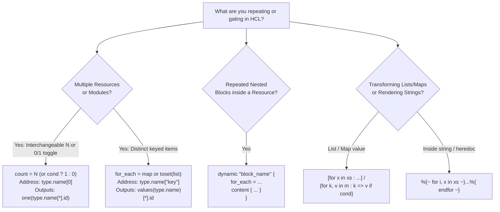

# 4.21 Terraform loops, conditionals, lifecycle and gotchas

| | |
|---|---|
| Level | Intermediate |
| Priority tier | 0 |
| Lab venue | Terraform/OpenTofu 1.6+; local providers suffice |
| Part | Part 4: Automation and infrastructure as code |
| Status | Drafted, labs **untested** |

## Why this matters for AI infrastructure

GPU platforms are repetitive by nature: eight node pools that differ in two attributes, per-team namespaces and quotas, per-rack firewall rules, N identical training nodes plus a few special ones. Loops and conditionals let you describe those patterns compactly; lifecycle rules let you protect the irreplaceable (checkpoint buckets, databases, clusters) and orchestrate safe replacement of the replaceable (GPU instances, launch templates). Misusing these features is how teams accidentally destroy a node pool because they removed an item from the middle of a list. This chapter covers the iteration and conditional constructs, how to avoid their traps, the lifecycle block, and the known sharp edges.

## Prerequisites and outcomes

Needs 4.18 to 4.20. After this chapter you can:

- Use `count`, `for_each`, `for` expressions, splats and `dynamic` blocks correctly; choose between them and explain index shifting and key stability.
- Express conditionals with ternaries, `count = cond ? 1 : 0`, `for_each` over filtered maps; avoid invalid cycles and unknown-value errors.
- Apply lifecycle arguments: `create_before_destroy`, `prevent_destroy`, `ignore_changes`, `replace_triggered_by`, `precondition`/`postcondition`; understand `moved`, `removed`.
- Implement zero-downtime replacement patterns and rolling changes for fleets.
- Diagnose gotchas: inconsistent plans, unknown `for_each` keys, dependency cycles, perpetual diffs, eventual consistency, provider bugs, and limits of the language.

## 1. count

`count` creates N instances of a resource or module, addressed by index `type.name[0]`.

```hcl
variable "gpu_node_count" { type = number }

resource "google_compute_instance" "gpu" {
  count        = var.gpu_node_count
  name         = "gpu-${format("%02d", count.index)}"
  machine_type = "a2-highgpu-8g"
  # ...
}

output "gpu_ips" { value = google_compute_instance.gpu[*].network_interface[0].network_ip }
```

Strengths: simplest way to make N identical things; conditional creation (`count = var.enabled ? 1 : 0`). Weaknesses:

- **Identity is the index.** Removing an element from the middle of a *list* that drives `count`/indexing shifts all later items, so Terraform plans to destroy and recreate them.

```hcl
variable "names" { default = ["a100-train", "h100-train", "a100-infer"] }
resource "some_pool" "p" {
  count = length(var.names)
  name  = var.names[count.index]       # remove "h100-train" => indices 1 and 2 change => pool a100-infer is replaced
}
```

- Cannot loop over inline blocks (use `dynamic`), and cannot make a resource conditional per key.
- Referencing an instance that may not exist needs care (`one(resource.x[*].id)`, `try(resource.x[0].id, null)`).

Use `count` for homogeneous, interchangeable instances where only the number matters, and for on/off switches. Even there, prefer `for_each` with stable keys when instances can be individually removed or renamed.

## 2. for_each

`for_each` takes a map or a set of strings and creates one instance per element, addressed by key `type.name["key"]`; `each.key` and `each.value` are available.

```hcl
variable "pools" {
  type = map(object({
    machine_type = string
    gpu_count    = number
    max_nodes    = number
  }))
  default = {
    h100-train = { machine_type = "a3-highgpu-8g", gpu_count = 8, max_nodes = 16 }
    l4-infer   = { machine_type = "g2-standard-24", gpu_count = 2, max_nodes = 8 }
  }
}

resource "google_container_node_pool" "gpu" {
  for_each = var.pools
  name     = each.key
  cluster  = google_container_cluster.main.name
  autoscaling { max_node_count = each.value.max_nodes }
  node_config { machine_type = each.value.machine_type }
}
```

Removing `l4-infer` from the map destroys only that pool; adding a key adds only that pool: identity is the key, not the position. This is the default choice for collections of distinct things.

Rules and limits:

- `for_each` accepts a map or a `set(string)`; convert lists with `toset(list)` (requires unique strings) or build a map with a `for` expression: `{ for p in var.pool_list : p.name => p }`.
- **Keys must be known at plan time.** `for_each = toset(aws_instance.x[*].id)` fails if IDs are unknown until apply ("The for_each map includes keys derived from resource attributes that cannot be determined until apply"). Derive keys from static inputs (names), and use values (which may be unknown) as map values.
- `count` and `for_each` cannot be used together on the same resource; `for_each` instances are removed individually by deleting keys.
- Sensitive values cannot be used as `for_each` keys.
- Chain loops by transforming data: build a flat map of "pairs" with `for` and `flatten` / `setproduct`:

```hcl
locals {
  # one firewall rule per (team, port)
  rules = {
    for pair in setproduct(keys(var.teams), var.ports) :
    "${pair[0]}-${pair[1]}" => { team = pair[0], port = pair[1] }
  }
}
resource "google_compute_firewall" "team" {
  for_each = local.rules
  name     = "allow-${each.key}"
  # ...
}
```

## 3. for expressions and splats

`for` expressions transform collections (they build values; they do not create resources):

```hcl
locals {
  upper_names   = [for n in var.names : upper(n)]                         # list -> list
  name_to_gpus  = { for k, v in var.pools : k => v.gpu_count }            # map -> map
  big_pools     = { for k, v in var.pools : k => v if v.gpu_count >= 8 }  # filter
  ip_list       = [for i in google_compute_instance.gpu : i.network_interface[0].network_ip]
  grouped       = { for p in var.pool_list : p.region => p.name... }       # "..." groups values into lists per key
  total_gpus    = sum([for p in values(var.pools) : p.gpu_count * p.max_nodes])
}
```

Splat `resource.name[*].attr` is shorthand for a `for` over a list of instances (for maps use `values(resource.name)[*].attr`). `flatten`, `merge`, `zipmap`, `lookup`, `setunion`, `setproduct`, `distinct`, `compact`, `concat`, `slice`, `range`, `chunklist` and `try`/`can` cover most reshaping needs. Test with `terraform console`.

### String Directives (`%{ for ... }` and `%{ if ... }`, `TUR` Chapter 5)

In *Terraform: Up and Running* Chapter 5, Brikman covers a fourth looping construct alongside `count`, `for_each`, and `for` expressions: **HCL string directives (`%{ ... }`)**, which embed loops and conditionals directly inside strings and heredocs (`<<-EOF`) using `~` to strip surrounding newlines and spaces:

```hcl
variable "names" {
  default = ["neo", "trinity", "morpheus"]
}

output "for_directive_index_if_strip" {
  value = <<-EOF
    %{~ for i, name in var.names ~}
    ${name}%{ if i < length(var.names) - 1 }, %{ endif }
    %{~ endfor ~}
    EOF
}
# Renders: "neo, trinity, morpheus"
```



## 4. dynamic blocks

Dynamic blocks generate repeated *nested blocks* inside a resource (firewall `allow` rules, `ingress` rules, labels as blocks, `taint` blocks, disks).

```hcl
resource "aws_security_group" "cluster" {
  name   = "${local.name}-cluster"
  vpc_id = var.vpc_id

  dynamic "ingress" {
    for_each = var.ingress_rules                     # map or list of objects
    content {
      from_port   = ingress.value.from
      to_port     = ingress.value.to
      protocol    = ingress.value.protocol
      cidr_blocks = ingress.value.cidrs
      description = ingress.key
    }
  }

  ingress {                                          # EFA requires all traffic allowed within the group itself
    from_port = 0
    to_port   = 0
    protocol  = "-1"
    self      = true
  }
}
```

Use sparingly: dynamic blocks hurt readability. Also: some resources manage rules as separate resources (`aws_security_group_rule`, `aws_vpc_security_group_ingress_rule`); mixing inline blocks and separate rule resources for the same group causes perpetual fights, so choose one.

## 5. Conditionals

```hcl
# Ternary
instance_type = var.env == "prod" ? "p5.48xlarge" : "g5.xlarge"

# Optional resource
resource "aws_cloudwatch_dashboard" "gpu" {
  count          = var.enable_dashboard ? 1 : 0
  dashboard_name = "${local.name}-gpu"
  dashboard_body = file("${path.module}/dashboard.json")
}
output "dashboard_name" { value = one(aws_cloudwatch_dashboard.gpu[*].dashboard_name) }   # null if absent

# Optional per-key resource via filtered map
resource "aws_ebs_volume" "scratch" {
  for_each = { for k, n in var.nodes : k => n if n.scratch_gb > 0 }
  size     = each.value.scratch_gb
  # ...
}

# Optional block
dynamic "kms_key" {
  for_each = var.kms_key_arn == null ? [] : [var.kms_key_arn]
  content { arn = kms_key.value }
}

# Defaults and null handling
name = coalesce(var.name_override, "${local.name}-default")
size = try(var.disk.size, 100)
```

Caveats: both branches of a ternary must have the same type (use `tolist`, `tomap` or `null` consistently); conditionals are evaluated at plan time and cannot depend on values known only after apply when used in `count`/`for_each` ("count value depends on resource attributes that cannot be determined until apply"): pass booleans/known inputs, not resource attributes. Also watch out for the **if/else `[0]` index trap (`TUR` Chapter 5)**: if you create `aws_iam_user_policy_attachment.neo_cloudwatch_full_access` (`count = var.give_neo_cloudwatch_full_access ? 1 : 0`) and `aws_iam_user_policy_attachment.neo_cloudwatch_read_only` (`count = var.give_neo_cloudwatch_full_access ? 0 : 1`), writing a ternary output referencing `...full_access[0].policy_arn : ...read_only[0].policy_arn` fails because Terraform evaluates both branches and one of the lists is empty (`index 0 out of range for list of length 0`). Instead, combine their splat lists with **`one(concat(aws_iam_user_policy_attachment.neo_cloudwatch_full_access[*].policy_arn, aws_iam_user_policy_attachment.neo_cloudwatch_read_only[*].policy_arn))`** (tested in `code/part04/terraform_loops_lifecycle_lab.py`). Each boolean toggle multiplies test cases; prefer composition over toggles in shared modules (4.20). There is no `if` statement in HCL: conditional logic is expression-level only.

## 6. The lifecycle block

```hcl
resource "aws_instance" "login" {
  # ...
  lifecycle {
    create_before_destroy = true
    prevent_destroy       = false
    ignore_changes        = [tags["last_patched"], user_data]
    replace_triggered_by  = [aws_launch_template.gpu.latest_version]
    precondition {
      condition     = data.aws_ec2_instance_type.selected.default_vcpus >= 16
      error_message = "Login nodes need at least 16 vCPUs."
    }
    postcondition {
      condition     = self.public_ip == ""
      error_message = "Login nodes must not have public IPs."
    }
  }
}
```

| Setting | Effect | Use |
|---|---|---|
| `create_before_destroy = true` | Create the replacement first, then destroy the old one | Zero-downtime replacement (launch templates, load-balanced instances, certificates); requires unique names or `name_prefix`/random suffix to avoid collisions; propagates to dependencies |
| `prevent_destroy = true` | Any plan that would destroy the resource errors | Checkpoint buckets, databases, state buckets, KMS keys; not a security control (removing the argument allows destroy) and it does not stop `terraform destroy` of the whole config from erroring only for that resource |
| `ignore_changes = [attrs]` or `all` | Changes to these attributes in the real world (or config) do not trigger updates | Fields managed elsewhere: autoscaler `desired_size`, tags added by controllers, rotating passwords; avoid `all` (hides drift) |
| `replace_triggered_by = [refs]` | Replace this resource when referenced resources/attributes change | Force instance replacement when a template/image changes without editing the instance |
| `precondition` | Validates assumptions before evaluating/creating (input/data sanity) | Check data source results, cross-variable constraints |
| `postcondition` | Validates the created object's attributes (`self`) | Assert provider returned expected values (encryption on, no public IP) |
| `ignore_changes` with `moved`/`removed` | See 4.19 | Refactors |

Related constructs: `check` blocks (non-blocking assertions with scoped data sources, good for health checks of the deployed system), `terraform_data` with `triggers_replace` (the modern `null_resource`), and the `-replace` flag for ad-hoc replacement. `depends_on` handles hidden ordering; use sparingly because it makes modules less parallel and sometimes defers data sources to apply time.

## 7. Zero-downtime and rolling patterns

Terraform replaces; it does not orchestrate rolling restarts of a fleet. Choose the pattern that delegates orchestration to a system that can do it:

1. **Instance group / node-pool update policies**: let the platform roll nodes (GCE managed instance group `update_policy` with `max_surge`/`max_unavailable`, GKE node pool upgrade settings, EKS managed node group `update_config`, AWS ASG `instance_refresh`). Terraform changes the template; the platform replaces instances gradually.
2. **Blue/green with `create_before_destroy`**: create a new node pool/launch template version (unique suffix), shift traffic or workloads (cordon/drain old), then destroy the old; scripted via CI or a controller. For Slurm clusters, add new nodes, drain old nodes through Slurm (4.17), then remove them.
3. **Immutable images**: new image ID triggers new launch template version; combine with `replace_triggered_by` or ASG refresh; pair with image pipelines (4.2).
4. **Terraform-driven canary**: variable `canary_count` for a new template version; apply; validate (4.2); then set to full.
5. **Avoid in-place mutation of stateful nodes** (kernel or driver upgrades by `remote-exec`); use images and replacement or Ansible with drain workflows (4.17).

Create-before-destroy gotchas: resources with unique naming constraints (security groups, node pool names, IAM roles) collide unless names include a random suffix (`name_prefix` or `random_id`); dependency chains get CBD propagated; some resources cannot coexist (a static IP attached to two instances); capacity-limited GPUs may not be available for both old and new simultaneously, so destroy-first (with disruption) may be the only option; plan for it with drains.

## 8. Gotchas and sharp edges

1. **Index shifting with `count`** over lists (section 1): prefer `for_each` with keys.
2. **Unknown values in `count`/`for_each`**: arguments must be known during plan. Fix by deriving from static data, splitting into layers (apply network first, then dependent stack), or two-phase apply with `-target` only as a last resort.
3. **Dependency cycles**: A references B and B references A (security group rules referencing each other). Break with separate rule resources, `self` references, or reorganising.
4. **Inconsistent final plan / "Provider produced inconsistent result after apply"**: provider bug or eventual consistency; rerun apply; report upstream; pin provider versions.
5. **Eventual consistency**: IAM roles and policies take seconds to propagate; resources fail creating with "invalid principal". Mitigate with `depends_on` on the policy attachment, retries in provider settings, or `time_sleep` resource (as a last resort).
6. **Perpetual diffs**: attributes the provider normalises (case, ordering, defaults) differ from config. Use the normalised form, `ignore_changes`, or fix the provider version. Lists vs sets ordering.
7. **Renaming forces replacement**: many `name` attributes are immutable; check docs and the plan; use `name_prefix` and CBD.
8. **Large plans/API rate limits**: split state (4.19); lower `-parallelism`; provider retry settings; avoid refreshing thousands of resources in every PR.
9. **Secrets in plans and state** (4.22): `sensitive` is cosmetic.
10. **`depends_on` on modules** defers all data sources inside to apply, producing noisy diffs; prefer passing outputs as inputs to create implicit dependencies.
11. **Provisioners and `local-exec`** are outside the model; failures taint resources; avoid.
12. **Function limits**: no loops except `for`; no user functions; `timestamp()` changes every plan; `uuid()` changes every plan; use `random_*`/`time_static`.
13. **Type inference surprises**: `tolist` on sets sorts; lists of mixed types become tuples; empty list vs null; `any` types. Use explicit types.
14. **Large `for_each` of modules/resources** can slow planning; split by ownership.
15. **Multi-region/multi-account provider config** cannot be dynamic per `for_each`; repeat module calls or separate stacks (4.22).
16. **Zero-diff upgrades**: provider upgrades may introduce new defaults; review plans after `init -upgrade`.
17. **`terraform destroy` order and protected resources**: `prevent_destroy` makes destroy fail halfway (plan fails before any change, good); some resources need `force_destroy` (buckets with objects) deliberately set to false for data stores.
18. **Moving between `count` and `for_each`** changes addresses; use `moved` blocks (`from = x[0]`, `to = x["name"]`).
19. **Order of list elements from data sources** may change between runs; sort (`sort`, `sort by key`) before use.
20. **Time-based or non-deterministic data** (latest AMI) causes unplanned replacements; pin image IDs/families deliberately and update through PRs.

## 9. Worked example: GPU capacity by data

```hcl
variable "teams" {
  type = map(object({
    gpu_quota   = number
    namespaces  = list(string)
    admins      = list(string)
  }))
}

locals {
  # flatten to one entry per (team, namespace) for per-namespace resources
  team_namespaces = merge([
    for team, cfg in var.teams : {
      for ns in cfg.namespaces : "${team}/${ns}" => { team = team, ns = ns, quota = cfg.gpu_quota }
    }
  ]...)
}

resource "kubernetes_namespace" "ns" {
  for_each = local.team_namespaces
  metadata {
    name   = each.value.ns
    labels = { team = each.value.team }
  }
}

resource "kubernetes_resource_quota" "gpu" {
  for_each = local.team_namespaces
  metadata {
    name      = "gpu-quota"
    namespace = kubernetes_namespace.ns[each.key].metadata[0].name
  }
  spec {
    hard = { "requests.nvidia.com/gpu" = tostring(each.value.quota) }
  }
}
```

Adding a team or namespace adds only its resources; removing one removes only its resources (a reviewer should still confirm the destroy of a namespace is intended: it deletes workloads). Add `lifecycle { prevent_destroy = true }` on namespaces holding persistent volumes.

## 10. Lab

First, run the self-checking Python lab (`code/part04/terraform_loops_lifecycle_lab.py`) locally. It verifies the `count` vs `for_each` middle-element removal plan simulator (`simulate_count_vs_for_each_removal` on `["neo", "trinity", "morpheus"]`, `TUR` Ch. 5), the `one(concat(...))` safe conditional output selector (`evaluate_one_concat_conditional`, `TUR` Ch. 5), and nested `(team, namespace)` map flattening (`flatten_team_namespaces`, Section 9).

```bash
python3 code/part04/terraform_loops_lifecycle_lab.py
```

Next, on any machine with Terraform/OpenTofu 1.6+ (all interactive shell steps below are `untested here`), work through these exercises:

1. **count vs for_each**: create three `terraform_data`/`random_pet` resources with `count` driven by a list; remove the middle element and read the plan; repeat with `for_each` over a map; add `moved` blocks to convert one to the other without recreation.
2. **Unknown keys**: attempt `for_each = toset(random_id.x[*].hex)` and read the error; fix by using static keys.
3. **for expressions**: from a variable of pools compute: names list, GPU totals, filtered big pools, grouped-by-region map; explore in `terraform console`.
4. **Dynamic blocks**: generate firewall/ingress rules from a map; compare with separate rule resources; show the perpetual-diff problem from mixing the two (with a provider that supports both, or by reading docs).
5. **Conditionals**: optional resource with `count = var.enabled ? 1 : 0` and `one()` in the output; optional nested block via `dynamic`; ternary type mismatch error and fix.
6. **Lifecycle**: `prevent_destroy` on a local file or bucket and try to remove it; `ignore_changes` for a field mutated outside; `replace_triggered_by` on a `terraform_data` whose input changes; `precondition`/`postcondition` with failing messages.
7. **create_before_destroy**: with a resource requiring unique names (use `random_id` suffix), force replacement and observe ordering in the plan and apply output.
8. **Rolling pattern**: in a cloud sandbox change a launch template in an instance group with an update policy and watch the platform roll instances; compare with direct instance replacement.
9. **Cycle and eventual consistency**: reproduce a dependency cycle between two security-group-like resources (with `terraform_data` references) and break it; add a `time_sleep` to model propagation.
10. **Worked example**: implement the team/namespace quotas against a kind cluster; add and remove teams; verify minimal diffs.
11. **Gotcha audit**: review an existing configuration for index-shifting `count`, `timestamp()`, `ignore_changes = all`, provisioners; file fixes.
12. **Clean up.**

## 11. Common mistakes

- Using `count` with lists of distinct items and then deleting from the middle.
- Making `for_each` keys depend on apply-time values.
- Toggling features with booleans in every module; enormous variable matrices.
- Overusing `ignore_changes = all`, `prevent_destroy` as a security control, or `-target` as workflow.
- Mixing inline rule blocks and standalone rule resources for the same parent.
- Assuming `create_before_destroy` works without unique names or capacity.
- Treating `terraform apply` as an orchestrator of rolling fleet updates.
- Using volatile functions (`timestamp`, `uuid`) in resource arguments.
- Not reading plans for replacements after provider or module upgrades.

## 12. Interview angles

- "`count` versus `for_each`: when and why? What happens when you remove an item from the middle?"
- "What does `create_before_destroy` do and what breaks?"
- "How do you stop someone from accidentally destroying a checkpoint bucket?" (prevent_destroy, deletion protection, IAM, policy.)
- "Why can't `for_each` use apply-time values? How do you work around it?"
- "How do you handle fields modified outside Terraform, e.g. autoscaler node counts?" (ignore_changes.)
- "How do you do rolling updates of GPU nodes with Terraform?" (delegate to platform update policy/drain.)
- "What are the main reasons a plan shows unexpected diffs?"
- "Explain dynamic blocks and when not to use them."

## Exercises

1. **The Four HCL Looping Constructs (`count`, `for_each`, `for` Expressions, and `%{ for ... }` String Directives, `TUR` Chapter 5):** Using `simulate_count_vs_for_each_removal()` in `code/part04/terraform_loops_lifecycle.py`, trace what happens when `"trinity"` is removed from `["neo", "trinity", "morpheus"]` under `count` versus `for_each = toset(var.user_names)`, and show how `moved` blocks migrate existing `count` state indices (`[0]`, `[1]`, `[2]`) to `for_each` keys (`["neo"]`, `["trinity"]`, `["morpheus"]`) without recreating resources.
2. **Reshaping Data with `for` Expressions (`...` Grouping), `setproduct`, and `merge([for ...])` Flattening:** Using `flatten_team_namespaces()` in `code/part04/terraform_loops_lifecycle.py`, explain how Section 9 flattens a nested `{ team => { gpu_quota, namespaces } }` map into a 1-level `"team/ns"` map for `for_each`, and how `{ for p in var.pool_list : p.region => p.name... }` groups items by key.
3. **`dynamic` Blocks (`ingress`, `tag`) vs. Provider `default_tags` (`TUR` Chapter 5):** Show how `dynamic "ingress"` (including `self = true` for EFA/NCCL intra-group traffic) and `dynamic "tag"` (filtered with `{ for k, v in var.custom_tags : k => upper(v) if k != "Name" }`) generate nested blocks, and explain when `provider "aws" { default_tags { tags = ... } }` is cleaner than `dynamic "tag"`.
4. **Conditionals in HCL (`count = cond ? 1 : 0`, Filtered `for_each`, Optional `dynamic` Blocks, and `one(concat(...))`, `TUR` Chapter 5):** Using `evaluate_one_concat_conditional()` in `code/part04/terraform_loops_lifecycle.py`, explain why `[0]` index access fails in an if/else `count` ternary output when one resource has `count = 0`, and how `one(concat(full[*].policy_arn, ro[*].policy_arn))` solves it cleanly.
5. **The `lifecycle` Block (`create_before_destroy`, `prevent_destroy`, `ignore_changes`, `replace_triggered_by`, `precondition`, `postcondition`) and Zero-Downtime Rolling Patterns (`TUR` Chapter 5):** Compare `TUR` Chapter 5's two zero-downtime ASG deployment patterns: (a) `create_before_destroy = true` + `name = "${var.cluster_name}-${aws_launch_configuration.example.name}"` + `min_elb_capacity` vs. (b) native `instance_refresh` (`strategy = "Rolling"`, `min_healthy_percentage = 50`) / GKE `update_policy`.
6. **Diagnosing Terraform Sharp Edges (Unknown `for_each` Keys, Dependency Cycles, Eventual Consistency, `depends_on` on Modules, and Perpetual Diffs):** Diagnose why each of these five gotchas happens during `plan` or `apply` and state the exact architectural fix.

## Checkpoint questions (20)

<details>
<summary>1. In *Terraform: Up and Running* Chapter 5, what are the four looping constructs in HCL, and what does each produce?</summary>

1. **`count = N`**: loops over an entire **resource or module**, creating a list of instances indexed `0..N-1` (`aws_iam_user.example[0]`).
2. **`for_each = <map_or_set>`**: loops over an entire **resource, module, or `dynamic` inline block**, creating a map of instances keyed by string (`aws_iam_user.example["neo"]`).
3. **`[for ...]` / `{for ...}` (`for` expression)**: transforms a collection into a **new list or map value** (`[for n in var.names : upper(n)]`).
4. **`%{ for i, x in xs }...%{ endfor }` (string directive)**: loops **inside a string or heredoc template** to build a single formatted string (`"neo, trinity, morpheus"`).
</details>

<details>
<summary>2. Walk through what happens in `terraform plan` when you remove `"trinity"` from `user_names = ["neo", "trinity", "morpheus"]` under `count` versus `for_each` (`TUR` Chapter 5).</summary>

- **With `count = length(var.user_names)`:** State initially holds `[0] = "neo"`, `[1] = "trinity"`, `[2] = "morpheus"`. Removing `"trinity"` makes the list `["neo", "morpheus"]` (`[0] = "neo"`, `[1] = "morpheus"`). Terraform sees **`[1]` changing from `"trinity"` to `"morpheus"`** (updating or replacing `[1]`) and **`[2]` ("morpheus") being destroyed**—corrupting or interrupting `"morpheus"` even though you only wanted to delete `"trinity"`.
- **With `for_each = toset(var.user_names)`:** State holds `["neo"]`, `["trinity"]`, and `["morpheus"]`. Removing `"trinity"` plans **`Plan: 0 to add, 0 to change, 1 to destroy`** (destroying only `aws_iam_user.example["trinity"]` while leaving `"morpheus"` completely untouched).
</details>

<details>
<summary>3. How do you migrate an existing resource from `count` (`[0]`, `[1]`) to `for_each` (`["neo"]`, `["morpheus"]`) without destroying and recreating the objects?</summary>

Change the resource from `count` to `for_each` and add declarative **`moved {}`** blocks mapping each numeric index to its new string key:
```hcl
moved {
  from = aws_iam_user.example[0]
  to   = aws_iam_user.example["neo"]
}
moved {
  from = aws_iam_user.example[1]
  to   = aws_iam_user.example["morpheus"]
}
```
Running `terraform plan` shows `2 moved, 0 to add, 0 to change, 0 to destroy`.
</details>

<details>
<summary>4. How do you extract a list of attribute values (`arn` or `id`) from a resource using `count` versus a resource using `for_each` (`TUR` Chapter 5)?</summary>

- **Resource with `count`** (stored as a list of instances): use the splat operator directly: **`aws_iam_user.example[*].arn`**.
- **Resource with `for_each`** (stored as a map of instances keyed by string): `aws_iam_user.example[*].arn` does *not* work on a map; wrap the map in **`values(...)`** first: **`values(aws_iam_user.example)[*].arn`** (or use a `for` expression `[for u in aws_iam_user.example : u.arn]`).
</details>

<details>
<summary>5. How do you loop over a two-level nested structure (such as `teams` each containing a list of `namespaces`) with `for_each`?</summary>

Because `for_each` only accepts a 1-dimensional `map` or `set(string)`, flatten the hierarchy in `locals` into a single map with composite `"team/ns"` keys using **`merge([for ... : { for ... }]...)`** (note the `...` expansion operator after the list argument to `merge()`) or **`setproduct()`**:
```hcl
locals {
  team_namespaces = merge([
    for team, cfg in var.teams : {
      for ns in cfg.namespaces : "${team}/${ns}" => { team = team, ns = ns, quota = cfg.gpu_quota }
    }
  ]...)
}
```
</details>

<details>
<summary>6. What does the ellipsis `...` do inside a `for` map expression (`{ for p in var.pool_list : p.region => p.name... }`)?</summary>

Normally, a `for` expression building a map (`{ for k, v in ... : key => val }`) fails if two elements produce the same `key`. Appending **`...` (grouping mode)** after the value expression (`p.region => p.name...`) tells Terraform to **group all values sharing the same key into a list**—producing `{"us-central1" = ["pool-a", "pool-b"], "europe-west4" = ["pool-c"]}`.
</details>

<details>
<summary>7. How do `dynamic` blocks work, and why does `aws_security_group` for an EFA / GPUDirect cluster include an `ingress` rule with `self = true`?</summary>

A `dynamic "<block_name>"` block iterates `for_each = <collection>` and renders `content { ... }` (accessing `<block_name>.key` and `<block_name>.value`) to generate repeated nested blocks inside a resource. On AWS GPU clusters using Elastic Fabric Adapter (**EFA**) or multi-node NCCL TCP/RDMA, every node in the cluster security group must accept all ports/protocols from every other node in the **same security group**—expressed via `ingress { from_port = 0; to_port = 0; protocol = "-1"; self = true }`.
</details>

<details>
<summary>8. In `TUR` Chapter 5, how do you write an if/else conditional across two resources using `count`, and why should you use `one(concat(...))` for the output?</summary>

To attach either `cloudwatch_full_access` or `cloudwatch_read_only` based on `var.give_neo_cloudwatch_full_access`:
- Set `count = var.give_neo_cloudwatch_full_access ? 1 : 0` on `neo_cloudwatch_full_access`.
- Set `count = var.give_neo_cloudwatch_full_access ? 0 : 1` on `neo_cloudwatch_read_only`.
If an output writes `var.give_neo_cloudwatch_full_access ? ...full_access[0].policy_arn : ...read_only[0].policy_arn`, it can fail or be fragile when referencing `[0]` on an empty 0-length resource list. Instead, **`one(concat(aws_iam_user_policy_attachment.neo_cloudwatch_full_access[*].policy_arn, aws_iam_user_policy_attachment.neo_cloudwatch_read_only[*].policy_arn))`** concatenates the two splat lists (one has 1 element, the other has 0) and `one()` returns that single element (or `null` if both are empty).
</details>

<details>
<summary>9. How do you make an entire resource optional per key without using `count`, and how do you make a nested block optional?</summary>

- **Optional per-key resource:** Filter the `for_each` map with an `if` clause inside a `for` expression:
  `for_each = { for k, n in var.nodes : k => n if n.scratch_gb > 0 }`.
- **Optional nested block (e.g., `encryption` only when `var.kms_key_id != null`):** Use a `dynamic` block whose `for_each` evaluates to either an empty list `[]` (0 blocks) or a 1-element list `[var.kms_key_id]`:
  `dynamic "encryption" { for_each = var.kms_key_id == null ? [] : [var.kms_key_id]; content { default_kms_key_name = encryption.value } }`.
</details>

<details>
<summary>10. What happens if the two branches of a ternary expression (`cond ? a : b`) have different types?</summary>

Terraform requires both branches of a ternary expression to resolve to the **exact same type**. If one branch is a `tuple` (e.g., `["a", "b"]`) and the other is a `list(string)` or `set(string)`, Terraform fails with `Inconsistent conditional result types`. Wrap branches in explicit type conversion functions (**`tolist(...)`**, **`tomap(...)`**, **`tostring(...)`**) so both sides match.
</details>

<details>
<summary>11. Summarize the five settings supported inside a resource `lifecycle {}` block.</summary>

1. **`create_before_destroy = true`**: creates the replacement resource *before* destroying the old one (`+/-`).
2. **`prevent_destroy = true`**: aborts `terraform plan` / `apply` with an error if any change would destroy the resource.
3. **`ignore_changes = [attr1, attr2]`**: ignores real-world or config diffs on the specified attributes (e.g., `node_count` managed by an autoscaler).
4. **`replace_triggered_by = [resource.addr.attr]`**: forces replacement of this resource whenever the referenced resource or attribute changes.
5. **`precondition {}` and `postcondition {}`**: custom validation assertions evaluated before or after the resource operation (`self.public_ip == ""`).
</details>

<details>
<summary>12. Why is `prevent_destroy = true` NOT a complete protection against resource deletion on its own?</summary>

Two reasons:
1. If someone **deletes the entire `resource` block from the `.tf` file** (or comments it out), the `lifecycle { prevent_destroy = true }` block inside it is also deleted from the configuration, so `terraform plan` will happily plan to destroy the resource.
2. It does not stop an admin from deleting the bucket/database in the cloud console or CLI.
Therefore, always combine `prevent_destroy = true` in HCL with **cloud-side deletion protection** (`deletion_protection = true` on RDS/GKE/instances, object lock/retention on buckets), **OPA/Conftest CI policy checks** blocking `-` actions on `Mission-Critical` resources (Chapter 4.2), and least-privilege IAM.
</details>

<details>
<summary>13. What are the three gotchas when enabling `create_before_destroy = true` on a resource?</summary>

1. **Name collisions:** If the resource has a fixed unique name (`name = "prod-gpu-pool"`), creating the new resource before deleting the old one fails in the cloud API with `AlreadyExists`. You must use **`name_prefix`** or append a `random_id` / template hash suffix so old and new can coexist simultaneously.
2. **Upward propagation:** Terraform automatically propagates `create_before_destroy = true` to dependent resources in the dependency chain, which can cause unexpected ordering changes if a dependency cannot coexist.
3. **GPU quota / capacity exhaustion:** Creating 32 new H100 nodes *before* terminating the 32 old H100 nodes temporarily requires **64 H100 nodes of quota and physical capacity**.
</details>

<details>
<summary>14. In `TUR` Chapter 5, why is AWS Auto Scaling Group `instance_refresh` (or GKE `update_policy`) preferred over `create_before_destroy` on the ASG itself?</summary>

In early Terraform versions (`TUR` Chapter 5's first approach), achieving zero-downtime ASG updates required interpolating the launch configuration name into the ASG name (`name = "${var.cluster_name}-${aws_launch_configuration.example.name}"`) with `create_before_destroy = true` and `min_elb_capacity`—which replaced the entire ASG on every deploy, broke attached `aws_autoscaling_schedule`s, and reset the fleet size back to `min_size` if an autoscaler had scaled it up. Using native **`instance_refresh { strategy = "Rolling"; preferences { min_healthy_percentage = 50 } }`** (or GKE `google_container_node_pool` `management`/`upgrade_settings`) keeps the ASG/node-pool object stable while the cloud platform rolls nodes in batches.
</details>

<details>
<summary>15. How do `terraform_data` and `replace_triggered_by` replace the legacy `null_resource`?</summary>

Built into `ansible-core` / Terraform 1.4+ without requiring any external provider plugin, **`resource "terraform_data" "ver" { input = var.driver_version }`** stores arbitrary values in state (`output`) and supports `triggers_replace = [...]`. Other resources can reference `lifecycle { replace_triggered_by = [terraform_data.ver] }` to force a clean replacement whenever `var.driver_version` changes.
</details>

<details>
<summary>16. What is a `check` block (Terraform 1.5+), and how does it differ from a `postcondition`?</summary>

- **`lifecycle { postcondition {} }`:** Runs during `plan`/`apply` of a specific resource; if it fails, **it halts `terraform apply` immediately and marks the run failed**, blocking downstream resources.
- **`check "<name>" { data "..." { ... } assert { condition = ...; error_message = "..." } }`:** A top-level post-apply health assertion (with its own scoped `data` source, such as checking an HTTP health endpoint or certificate expiry) that **emits a warning without halting or failing the `apply`**—making it ideal for continuous infrastructure health and drift monitoring.
</details>

<details>
<summary>17. Why does putting `depends_on = [module.network]` on a `module` block cause noisy plans on every run?</summary>

When you attach `depends_on` to an entire `module` block (or a resource that a `data` source depends on), Terraform conservatively assumes that **every `data` source inside that dependent module cannot be read until after the dependency finishes applying**. Consequently, during `terraform plan`, those `data` sources are deferred to `apply` (`<= read` / `(known after apply)`), causing every resource that references those data sources to show noisy `(known after apply)` diffs on every plan. Always prefer **implicit dependencies** (passing `module.network.vpc_id` as an input variable) over module-level `depends_on`.
</details>

<details>
<summary>18. How do you break a Dependency Cycle (`Error: Cycle: aws_security_group.a, aws_security_group.b`) between two security groups that need to allow traffic from each other?</summary>

If `aws_security_group.a` has an inline `ingress` block referencing `aws_security_group.b.id`, and `aws_security_group.b` has an inline `ingress` block referencing `aws_security_group.a.id`, neither group can be created first (`Error: Cycle`). Break the cycle by creating both `aws_security_group.a` and `aws_security_group.b` **with no inline rules**, and then creating two standalone **`aws_vpc_security_group_ingress_rule`** (or `aws_security_group_rule`) resources that reference `a.id` and `b.id` after both empty groups exist.
</details>

<details>
<summary>19. What causes \"Eventual Consistency\" errors (`InvalidPrincipalNotFound` or `does not exist`) right after creating an IAM Service Account or Role in Terraform, and how do you handle it?</summary>

Cloud IAM systems (AWS IAM, GCP IAM) replicate globally with eventual consistency: when `google_service_account.train` or `aws_iam_role.eks` returns `200 OK` from the create API, it may take 5–15 seconds before regional compute or storage APIs recognize the new principal. Mitigate this by:
1. Ensuring proper dependency edges (`depends_on = [aws_iam_role_policy_attachment.eks]`) so consumers wait for policy attachments, not just the bare role.
2. Relying on provider built-in IAM propagation retries, or inserting a **`time_sleep` (`create_duration = "15s"`)** resource between the IAM resource and the regional resource when a provider lacks propagation retries.
</details>

<details>
<summary>20. Why do functions like `timestamp()` and `uuid()` break Terraform idempotency, and what should you use instead?</summary>

`timestamp()` and `uuid()` evaluate to a **brand-new string on every single `terraform plan`**, causing any resource attribute or tag that calls them to show a diff (`~` or `-/+`) on every run. Instead:
- For a persistent random UUID or suffix, use **`resource "random_uuid"`** or **`resource "random_id"`** (which generates the value once and stores it in `terraform.tfstate`).
- For a creation-only timestamp tag, either use **`resource "time_static"`** from the `hashicorp/time` provider or add the tag key to **`lifecycle { ignore_changes = [tags["created_at"]] }`**.
</details>

## Sources and review notes

- **Sources read in full:**
  - `terraform-up-and-running-3rd-edition` — Yevgeniy Brikman, *Terraform: Up and Running*, 3rd ed., **Chapter 5: Terraform Tips and Tricks: Loops, If-Statements, Deployment, and Gotchas** (read in full: loops with `count` on `["neo", "trinity", "morpheus"]` and the middle-element deletion trap; loops with `for_each` over resources, modules, and `dynamic "tag"` blocks plus `provider "aws" { default_tags }`; `for` list and map expressions; string directives `%{~ for i, name in var.names ~}` and `%{ if ... }`; conditionals with `count = cond ? 1 : 0`, if-else with `one(concat(...))`, and filtered `for_each`; zero-downtime deployment with `create_before_destroy` + `min_elb_capacity` vs native ASG `instance_refresh`; and Terraform gotchas including `count`/`for_each` plan-time limitations and failed mid-apply deployments).
  - `nvidia-devops` (`volume-10/05-terraform-for-infrastructure-as-code.md`): HCL masterclass (`count` vs `for_each`, `dynamic` blocks, `lifecycle` arguments, and common pitfalls).
- **Run here:** `python3 code/part04/terraform_loops_lifecycle_lab.py` (3 passed, 0 failed).
- **Explicitly labelled inferences:** The `simulate_count_vs_for_each_removal`, `evaluate_one_concat_conditional`, and `flatten_team_namespaces` models in `code/part04/terraform_loops_lifecycle.py` and the GPU node-pool and Kubernetes per-team GPU `ResourceQuota` examples are the author's constructions synthesizing `TUR` Chapter 5 and `volume-10/05` (plus original study items 21, 22, 23, 24, 25, 26, 27, 28, 29, and 30).
- **Not verified on live hardware:** Live `terraform` / `tofu` executions (`a2-highgpu-8g`, `a3-highgpu-8g`, `g2-standard-24`, `p5.48xlarge`, `g5.xlarge`, `16` vCPUs, `50%` min_healthy_percentage) are marked (`untested here`) where not executed by `terraform_loops_lifecycle_lab.py`.
