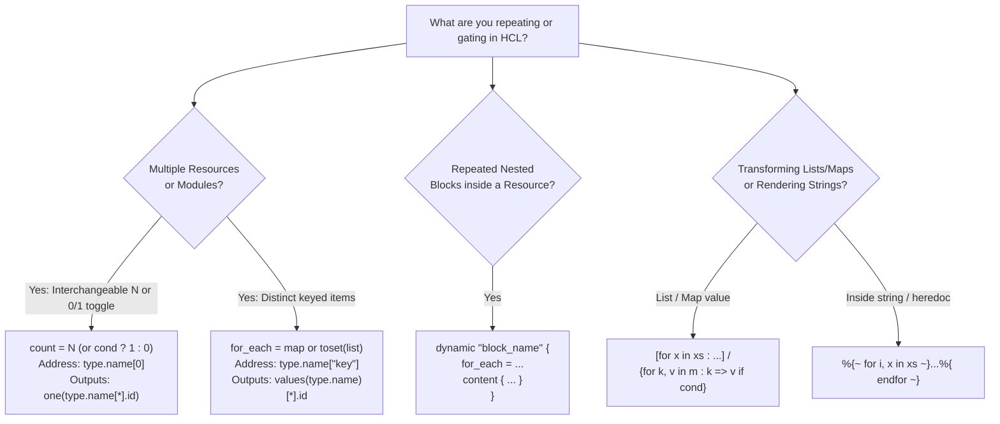

# 4.21 Terraform loops, conditionals, lifecycle and gotchas

| | |
|---|---|
| Level | Intermediate |
| Priority tier | 0 |
| Lab venue | Terraform/OpenTofu 1.6+; local providers suffice |
| Part | Part 4: Automation and infrastructure as code |
| Status | Drafted, labs **untested** |

## Why this matters for AI infrastructure

Picture a GPU platform with eight node pools that differ in two attributes. Add per-team namespaces and quotas, per-rack firewall rules, and N identical training nodes plus a few special ones. Writing all of that by hand is slow and easy to get wrong.

Loops and conditionals let you describe these patterns compactly. Lifecycle rules protect what you cannot replace, such as checkpoint buckets, databases and clusters. They also orchestrate safe replacement of what you can replace, such as GPU instances and launch templates.

Misusing these features is how teams accidentally destroy a node pool. The usual cause is removing one item from the middle of a list. This chapter covers the iteration and conditional constructs, their traps, the lifecycle block and the known sharp edges.

Before you write a loop over a list, decide which resources must never be destroyed by an accidental removal.

## Prerequisites and outcomes

This chapter assumes you have worked through 4.18 to 4.20. When you finish it, you should be able to do the following.

- Use `count`, `for_each`, `for` expressions, splats and `dynamic` blocks correctly. You should know which one to choose, why index shifting happens and why keys stay stable.
- Write conditionals with ternaries, such as `count = cond ? 1 : 0`, and with `for_each` over filtered maps. You should avoid invalid cycles and unknown-value errors.
- Apply lifecycle arguments such as `create_before_destroy`, `prevent_destroy`, `ignore_changes`, `replace_triggered_by` and `precondition`/`postcondition`. You should also understand `moved` and `removed`.
- Build zero-downtime replacement patterns and rolling changes for a fleet.
- Diagnose the common gotchas: inconsistent plans, unknown `for_each` keys, dependency cycles, perpetual diffs, eventual consistency, provider bugs and the limits of the language.

## 1. count

Say you need a set of GPU nodes that are all alike, and the only thing that changes is how many you run. `count` is built for that case. It creates N instances of a resource or module, and each one is addressed by its index, as in `type.name[0]`.

```hcl
variable "gpu_node_count" { type = number }

resource "google_compute_instance" "gpu" {
  count        = var.gpu_node_count
  name         = "gpu-${format("%02d", count.index)}"
  machine_type = "a2-highgpu-8g"
  # ...
}

output "gpu_ips" { value = google_compute_instance.gpu[*].network_interface[0].network_ip }
```

The `gpu_ips` output collects the address of every node with a splat. `count` is the simplest way to make N identical things. It also gives you an on/off switch through `count = var.enabled ? 1 : 0`.

The weakness is that identity is the index. When you remove an item from the middle of a list that drives `count`, every later item moves to a new index. Terraform then plans to destroy and recreate those items.

```hcl
variable "names" { default = ["a100-train", "h100-train", "a100-infer"] }
resource "some_pool" "p" {
  count = length(var.names)
  name  = var.names[count.index]       # remove "h100-train" => indices 1 and 2 change => pool a100-infer is replaced
}
```

The comment on the last line shows the result. Removing `h100-train` replaces `a100-infer`.

Two more limits apply. `count` cannot loop over inline blocks, which is the job of `dynamic`. It also cannot make a single resource conditional per key. When an instance may not exist, guard the reference with `one(resource.x[*].id)` or `try(resource.x[0].id, null)`.

Use `count` for homogeneous, interchangeable instances where only the number matters, and for on/off switches. If instances can be removed or renamed one at a time, prefer `for_each` with stable keys instead.

## 2. for_each

Suppose your platform has two node pools, `h100-train` and `l4-infer`, and one day you remove `l4-infer`. With `for_each`, that removal touches only that pool. `for_each` takes a map or a set of strings and creates one instance per element. Each instance is addressed by its key, as in `type.name["key"]`. Inside the block, `each.key` and `each.value` are available.

```hcl
variable "pools" {
  type = map(object({
    machine_type = string
    gpu_count    = number
    max_nodes    = number
  }))
  default = {
    h100-train = { machine_type = "a3-highgpu-8g", gpu_count = 8, max_nodes = 16 }
    l4-infer   = { machine_type = "g2-standard-24", gpu_count = 2, max_nodes = 8 }
  }
}

resource "google_container_node_pool" "gpu" {
  for_each = var.pools
  name     = each.key
  cluster  = google_container_cluster.main.name
  autoscaling { max_node_count = each.value.max_nodes }
  node_config { machine_type = each.value.machine_type }
}
```

Removing `l4-infer` from the map destroys only that pool. Adding a key adds only that pool. The identity is the key, not the position, so the rest of the fleet stays untouched. This is the default choice for a collection of distinct things.

A few rules apply. `for_each` accepts a map or a `set(string)`. To use a list, convert it with `toset(list)`, which requires unique strings. You can also build a map with a `for` expression, such as `{ for p in var.pool_list : p.name => p }`.

Keys must be known at plan time. `for_each = toset(aws_instance.x[*].id)` fails when the IDs are unknown until apply. The error reads "The for_each map includes keys derived from resource attributes that cannot be determined until apply". Derive keys from static inputs, such as names, and let the values, which may be unknown, sit in the map values.

`count` and `for_each` cannot be used together on the same resource. Sensitive values cannot be used as `for_each` keys either. To remove one `for_each` instance, you delete its key.

You can also chain loops by transforming the data first. The example below builds a flat map of pairs with a `for` expression over `setproduct`. The `flatten` and `setproduct` functions are the building blocks for this kind of pairing. The result is one firewall rule per team and port.

```hcl
locals {
  # one firewall rule per (team, port)
  rules = {
    for pair in setproduct(keys(var.teams), var.ports) :
    "${pair[0]}-${pair[1]}" => { team = pair[0], port = pair[1] }
  }
}
resource "google_compute_firewall" "team" {
  for_each = local.rules
  name     = "allow-${each.key}"
  # ...
}
```

Use `for_each` whenever the items are distinct, and derive their keys from names rather than from IDs that exist only after apply.

## 3. for expressions and splats

You often need to reshape data before you can use it. A `for` expression takes a list or a map and builds a new value from it. It builds values only and does not create resources.

```hcl
locals {
  upper_names   = [for n in var.names : upper(n)]                         # list -> list
  name_to_gpus  = { for k, v in var.pools : k => v.gpu_count }            # map -> map
  big_pools     = { for k, v in var.pools : k => v if v.gpu_count >= 8 }  # filter
  ip_list       = [for i in google_compute_instance.gpu : i.network_interface[0].network_ip]
  grouped       = { for p in var.pool_list : p.region => p.name... }       # "..." groups values into lists per key
  total_gpus    = sum([for p in values(var.pools) : p.gpu_count * p.max_nodes])
}
```

Each line turns one shape into another. The first two keep the shape of the input, and the third filters a map. The `...` in the `grouped` line gathers the values that share a key into a list.

A splat, written `resource.name[*].attr`, is shorthand for a `for` expression over a list of instances. For a map, write `values(resource.name)[*].attr` instead. Five functions cover most reshaping needs: `flatten`, `merge`, `zipmap`, `lookup` and `concat`. Others, such as `setunion`, `distinct`, `compact`, `slice`, `range`, `chunklist` and `try`, handle the rest. Test an expression with `terraform console` before you put it in a configuration.

### String Directives (`%{ for ... }` and `%{ if ... }`, *Terraform: Up and Running*, Chapter 5)

*Terraform: Up and Running*, Chapter 5, by Yevgeniy Brikman, covers a fourth looping construct next to `count`, `for_each` and `for` expressions. These are HCL string directives, written as `%{ ... }`. They let you put a loop or a condition inside a string or a heredoc (`<<-EOF`). The `~` marker strips the newlines and spaces around the directive, so the output stays on one clean line.

```hcl
variable "names" {
  default = ["neo", "trinity", "morpheus"]
}

output "for_directive_index_if_strip" {
  value = <<-EOF
    %{~ for i, name in var.names ~}
    ${name}%{ if i < length(var.names) - 1 }, %{ endif }
    %{~ endfor ~}
    EOF
}
# Renders: "neo, trinity, morpheus"
```

The comment at the bottom shows what the directive renders. The diagram below helps you pick the right construct for the job.



Start with the question the diagram asks. Repeated resources, repeated nested blocks, and reshaped values or strings each lead to a different tool.

## 4. dynamic blocks

Picture a security group that needs many ingress rules. Writing each one as its own block means a copy-paste for every new rule. A `dynamic` block generates repeated *nested blocks* inside a resource instead.

```hcl
resource "aws_security_group" "cluster" {
  name   = "${local.name}-cluster"
  vpc_id = var.vpc_id

  dynamic "ingress" {
    for_each = var.ingress_rules                     # map or list of objects
    content {
      from_port   = ingress.value.from
      to_port     = ingress.value.to
      protocol    = ingress.value.protocol
      cidr_blocks = ingress.value.cidrs
      description = ingress.key
    }
  }

  ingress {                                          # EFA requires all traffic allowed within the group itself
    from_port = 0
    to_port   = 0
    protocol  = "-1"
    self      = true
  }
}
```

The `dynamic "ingress"` block writes one `ingress` block for each entry in `var.ingress_rules`. The second `ingress` block is fixed, and it allows all traffic inside the group, which EFA requires.

Typical targets for dynamic blocks are firewall `allow` rules, labels written as blocks, `taint` blocks and disks. Use them sparingly, because they hurt readability. Some resources manage rules as separate resources, such as `aws_security_group_rule` and `aws_vpc_security_group_ingress_rule`. Mixing inline blocks with separate rule resources for the same group causes perpetual fights, so choose one approach and keep to it.

## 5. Conditionals

HCL has no `if` statement, so every choice happens inside an expression. A ternary picks one of two values. `count` and `for_each` can switch a whole resource on or off. The code below shows the common patterns.

```hcl
# Ternary
instance_type = var.env == "prod" ? "p5.48xlarge" : "g5.xlarge"

# Optional resource
resource "aws_cloudwatch_dashboard" "gpu" {
  count          = var.enable_dashboard ? 1 : 0
  dashboard_name = "${local.name}-gpu"
  dashboard_body = file("${path.module}/dashboard.json")
}
output "dashboard_name" { value = one(aws_cloudwatch_dashboard.gpu[*].dashboard_name) }   # null if absent

# Optional per-key resource via filtered map
resource "aws_ebs_volume" "scratch" {
  for_each = { for k, n in var.nodes : k => n if n.scratch_gb > 0 }
  size     = each.value.scratch_gb
  # ...
}

# Optional block
dynamic "kms_key" {
  for_each = var.kms_key_arn == null ? [] : [var.kms_key_arn]
  content { arn = kms_key.value }
}

# Defaults and null handling
name = coalesce(var.name_override, "${local.name}-default")
size = try(var.disk.size, 100)
```

The ternary chooses an instance type by environment. The dashboard is created only when `enable_dashboard` is true, and `one` returns null when it is absent. The scratch volumes are filtered per node. The `kms_key` block gets an empty list when no key is set. The last two lines supply defaults with `coalesce` and `try`.

Keep a few caveats in mind. Both branches of a ternary must have the same type, so use `tolist`, `tomap` or `null` consistently. Conditionals are evaluated at plan time. Inside `count` or `for_each`, they cannot depend on values known only after apply, and Terraform reports "count value depends on resource attributes that cannot be determined until apply". Pass booleans or other known inputs, not resource attributes.

Watch out for the **if/else `[0]` index trap** described in *Terraform: Up and Running*, Chapter 5. Suppose you create `aws_iam_user_policy_attachment.neo_cloudwatch_full_access` with `count = var.give_neo_cloudwatch_full_access ? 1 : 0`. You also create `aws_iam_user_policy_attachment.neo_cloudwatch_read_only` with `count = var.give_neo_cloudwatch_full_access ? 0 : 1`. A ternary output that reads `...full_access[0].policy_arn` in one branch and `...read_only[0].policy_arn` in the other fails. Terraform evaluates both branches, and one of those lists is empty, so the error is `index 0 out of range for list of length 0`. The fix is to combine their splat lists with **`one(concat(aws_iam_user_policy_attachment.neo_cloudwatch_full_access[*].policy_arn, aws_iam_user_policy_attachment.neo_cloudwatch_read_only[*].policy_arn))`** (tested in `code/part04/terraform_loops_lifecycle_lab.py`).

Each boolean toggle multiplies the test cases, so prefer composition over toggles in shared modules, see 4.20. Remember that conditional logic in HCL lives at the expression level only.

## 6. The lifecycle block

Some resources must never be destroyed by accident, and others should be replaced without any downtime. The `lifecycle` block lets you say which is which, inside the resource itself. The example below sets each lifecycle argument once.

```hcl
resource "aws_instance" "login" {
  # ...
  lifecycle {
    create_before_destroy = true
    prevent_destroy       = false
    ignore_changes        = [tags["last_patched"], user_data]
    replace_triggered_by  = [aws_launch_template.gpu.latest_version]
    precondition {
      condition     = data.aws_ec2_instance_type.selected.default_vcpus >= 16
      error_message = "Login nodes need at least 16 vCPUs."
    }
    postcondition {
      condition     = self.public_ip == ""
      error_message = "Login nodes must not have public IPs."
    }
  }
}
```

The login node creates its replacement before destroying the old one. It ignores changes to tags and user data, and it is replaced when the launch template version changes. The precondition checks the vCPU count before creation, and the postcondition checks the public IP after it. The table below explains what each setting does and where it fits.

| Setting | Effect | Use |
|---|---|---|
| `create_before_destroy = true` | Create the replacement first, then destroy the old one | Zero-downtime replacement (launch templates, load-balanced instances, certificates); requires unique names or `name_prefix`/random suffix to avoid collisions; propagates to dependencies |
| `prevent_destroy = true` | Any plan that would destroy the resource errors | Checkpoint buckets, databases, state buckets, KMS keys; not a security control (removing the argument allows destroy) and it does not stop `terraform destroy` of the whole config from erroring only for that resource |
| `ignore_changes = [attrs]` or `all` | Changes to these attributes in the real world (or config) do not trigger updates | Fields managed elsewhere: autoscaler `desired_size`, tags added by controllers, rotating passwords; avoid `all` (hides drift) |
| `replace_triggered_by = [refs]` | Replace this resource when referenced resources/attributes change | Force instance replacement when a template/image changes without editing the instance |
| `precondition` | Validates assumptions before evaluating/creating (input/data sanity) | Check data source results, cross-variable constraints |
| `postcondition` | Validates the created object's attributes (`self`) | Assert provider returned expected values (encryption on, no public IP) |
| `ignore_changes` with `moved`/`removed` | See 4.19 | Refactors |

Read the `prevent_destroy` row twice. The protection lasts only while the argument stays in the code, so it is not a security control. Deleting the argument allows the destroy. Set `prevent_destroy` on resources you cannot rebuild, and use `create_before_destroy` for resources you can replace without downtime.

Several related constructs sit beside the lifecycle block. `check` blocks give non-blocking assertions with scoped data sources, which suits health checks of the deployed system. `terraform_data` with `triggers_replace` is the modern `null_resource`, and the `-replace` flag handles an ad-hoc replacement. `depends_on` handles hidden ordering, but use it sparingly. It makes modules less parallel and sometimes defers data sources to apply time.

## 7. Zero-downtime and rolling patterns

Suppose a fleet of GPU nodes needs a new image, and the jobs running on it cannot stop. Terraform can replace resources, but it does not orchestrate rolling restarts across a fleet. You need a pattern that hands the orchestration to a system built for it.

Five patterns cover most cases.

1. Instance group and node-pool update policies let the platform roll the nodes. Terraform changes the template, and the platform replaces instances gradually. Examples include the GCE managed instance group `update_policy` with `max_surge` and `max_unavailable`, GKE node pool upgrade settings, the EKS managed node group `update_config`, and the AWS ASG `instance_refresh`.
2. Blue/green with `create_before_destroy` creates a new node pool or launch template version with a unique suffix. You then shift traffic or workloads by cordoning and draining the old nodes, and finally destroy the old ones. A CI job or a controller can script this. For Slurm clusters, you add new nodes, drain the old ones through Slurm (4.17), and then remove them.
3. Immutable images work well here. A new image ID triggers a new launch template version. Pair it with `replace_triggered_by` or an ASG refresh, and build the images through an image pipeline (4.2).
4. A Terraform-driven canary uses a variable such as `canary_count` for the new template version. You apply, validate the result (4.2), and then set the count to the full size.
5. Avoid changing stateful nodes in place, such as upgrading a kernel or driver through `remote-exec`. Replace the nodes from an image, or use Ansible with drain workflows (4.17).

Create-before-destroy has its own gotchas. Resources with unique naming constraints, such as security groups, node pool names and IAM roles, collide unless the names include a random suffix. The suffix comes from `name_prefix` or `random_id`. Some resources cannot coexist, such as a static IP attached to two instances. Capacity-limited GPUs may not be available for the old and new nodes at the same time, so destroy-first with disruption may be your only option, and you should plan for it with drains.

Before you choose a rolling pattern, check whether your platform can drain and replace nodes on its own.

## 8. Gotchas and sharp edges

Most Terraform failures you will see come from a short list of traps. Each item below names the trap, what it looks like and how you get out of it.

Each row below names a trap, what it does, and the way out.

| Trap | What happens | Way out |
|---|---|---|
| Index shifting with `count` over lists (section 1) | Removing one item moves every later item | Prefer `for_each` with keys |
| Unknown values in `count` or `for_each` | The plan breaks, because the arguments must be known at plan time | Derive them from static data, split the configuration into layers so the network applies first, or use a two-phase apply with `-target` as a last resort |
| Dependency cycles | A references B and B references A, as with security group rules that reference each other | Use separate rule resources, `self` references or a different layout |
| "Provider produced inconsistent result after apply" | Usually a provider bug or eventual consistency | Rerun the apply, report the bug upstream and pin the provider version |
| Eventual consistency with IAM | Roles and policies take seconds to propagate, so resources fail with "invalid principal" | Add `depends_on` on the policy attachment, configure provider retries, or use a `time_sleep` resource as a last resort |
| Perpetual diffs | The provider normalises an attribute, such as its case, ordering or defaults, so it differs from your config | Use the normalised form, add `ignore_changes`, or fix the provider version. Watch the ordering of lists versus sets |
| Renaming | Many `name` attributes are immutable, so a rename forces replacement | Check the docs and the plan first, and use `name_prefix` with `create_before_destroy` |
| Large plans | API rate limits | Split the state (4.19), lower `-parallelism`, tune provider retries, and avoid refreshing thousands of resources in every pull request |
| Secrets in plans and state (4.22) | `sensitive` only hides them in the output and does not protect the state | See 4.22 |
| `depends_on` on a module | Every data source inside it is deferred to apply time, which produces noisy diffs | Pass outputs as inputs, so the dependency is implicit |
| Provisioners and `local-exec` | They sit outside the model, and a failure taints the resource | Avoid them |
| Function limits | There are no loops except `for`, and there are no user functions. `timestamp()` and `uuid()` change on every plan | Use `random_*` or `time_static` instead |
| Type inference | `tolist` on a set sorts it, a list of mixed types becomes a tuple, and an empty list is not null | Declare explicit types |
| A large `for_each` over modules or resources | Planning slows down | Split it by ownership |
| Providers for several regions or accounts | Provider configuration cannot change per `for_each` instance | Repeat the module calls or use separate stacks (4.22) |
| Provider upgrades | New defaults can appear | Review the plan after `init -upgrade` |
| `prevent_destroy` | A destroy fails, but the plan fails before any change is made, which is the safe outcome | Set `force_destroy` deliberately to false for data stores, such as buckets with objects |
| Moving between `count` and `for_each` | The addresses change | Use `moved` blocks, such as `from = x[0]` and `to = x["name"]` |
| Data source list order | The order of elements can change between runs | Sort the list first, with `sort` or `sort by key` |
| Non-deterministic data, such as the latest AMI | Unplanned replacements | Pin image IDs or families on purpose, and update them through pull requests |

## 9. Worked example: GPU capacity by data

Say each team gets a GPU quota, and each team owns several namespaces. You want one namespace and one quota per namespace, and you want them generated from the data. The code below flattens the teams into one entry per team and namespace pair.

```hcl
variable "teams" {
  type = map(object({
    gpu_quota   = number
    namespaces  = list(string)
    admins      = list(string)
  }))
}

locals {
  # flatten to one entry per (team, namespace) for per-namespace resources
  team_namespaces = merge([
    for team, cfg in var.teams : {
      for ns in cfg.namespaces : "${team}/${ns}" => { team = team, ns = ns, quota = cfg.gpu_quota }
    }
  ]...)
}

resource "kubernetes_namespace" "ns" {
  for_each = local.team_namespaces
  metadata {
    name   = each.value.ns
    labels = { team = each.value.team }
  }
}

resource "kubernetes_resource_quota" "gpu" {
  for_each = local.team_namespaces
  metadata {
    name      = "gpu-quota"
    namespace = kubernetes_namespace.ns[each.key].metadata[0].name
  }
  spec {
    hard = { "requests.nvidia.com/gpu" = tostring(each.value.quota) }
  }
}
```

The flattened map is what makes this work. Both resources loop over the same `team_namespaces` map, so each namespace and its quota share one key. Adding a team or a namespace adds only its resources, and removing one removes only its resources. A reviewer should still confirm that a namespace destroy is intended, because it deletes the workloads inside. Add `lifecycle { prevent_destroy = true }` to namespaces that hold persistent volumes.

## 10. Lab

Start with the self-checking Python lab. It runs on your own machine and checks three things. It checks the `count` versus `for_each` plan simulator for a middle-element removal (`simulate_count_vs_for_each_removal`, run on `["neo", "trinity", "morpheus"]`, from *Terraform: Up and Running*, Chapter 5). It checks the `one(concat(...))` output selector (`evaluate_one_concat_conditional`, also from Chapter 5). It also checks how nested `(team, namespace)` maps get flattened (`flatten_team_namespaces`, Section 9).

```bash
python3 code/part04/terraform_loops_lifecycle_lab.py
```

Next comes the hands-on part. Use any machine with Terraform or OpenTofu 1.6 or later. The interactive shell steps below have not been run, so confirm the results on your own setup.

1. Compare `count` with `for_each`. Create three `terraform_data` or `random_pet` resources with `count` driven by a list. Remove the middle element and read the plan. Then repeat with `for_each` over a map, and add `moved` blocks to convert one form to the other without recreating anything.
2. Try unknown keys. Attempt `for_each = toset(random_id.x[*].hex)` and read the error. Then fix it by using static keys.
3. Work with `for` expressions. From a variable of pools, compute a names list, the GPU totals, a filtered set of big pools and a map grouped by region. Explore each one in `terraform console`.
4. Build dynamic blocks. Generate firewall or ingress rules from a map, and compare them with separate rule resources. Then show the perpetual-diff problem that comes from mixing the two. You can do this with a provider that supports both, or by reading the docs.
5. Try conditionals. Create an optional resource with `count = var.enabled ? 1 : 0`, and use `one()` in the output. Add an optional nested block with `dynamic`, then trigger a ternary type mismatch error and fix it.
6. Test the lifecycle arguments. Set `prevent_destroy` on a local file or bucket, then try to remove it. Use `ignore_changes` on a field that changes outside Terraform. Set `replace_triggered_by` on a `terraform_data` whose input changes. Finally, add `precondition` and `postcondition` checks that fail with messages.
7. Test `create_before_destroy`. Use a resource that requires unique names, with a `random_id` suffix. Force a replacement, then observe the ordering in the plan and the apply output.
8. Practice a rolling pattern. In a cloud sandbox, change a launch template in an instance group that has an update policy. Watch the platform roll the instances, then compare that with direct instance replacement.
9. Reproduce a dependency cycle between two security-group-like resources, using `terraform_data` references, and then break it. Add a `time_sleep` to model propagation.
10. Build the worked example. Implement the team and namespace quotas against a kind cluster. Add and remove teams, and check that the diffs stay minimal.
11. Audit a configuration for gotchas. Review an existing configuration for index-shifting `count`, `timestamp()`, `ignore_changes = all` and provisioners, and file a fix for each one you find.
12. Clean up.

## 11. Common mistakes

Most of these mistakes look harmless in a small configuration. They become expensive once the fleet grows. Check your own code against this list before you review a plan.

- Using `count` with a list of distinct items, then deleting an item from the middle.
- Making `for_each` keys depend on values that exist only at apply time.
- Toggling features with booleans in every module, which leads to enormous variable matrices.
- Overusing `ignore_changes = all`, treating `prevent_destroy` as a security control, or using `-target` as a normal workflow.
- Mixing inline rule blocks and standalone rule resources for the same parent.
- Assuming `create_before_destroy` works without unique names or spare capacity.
- Treating `terraform apply` as the orchestrator of a rolling fleet update.
- Using volatile functions, such as `timestamp` or `uuid`, in resource arguments.
- Skipping the plan review for replacements after a provider or module upgrade.

## 12. Interview angles

Interviewers often start with a question like the ones below. A good answer shows you know the trade-off behind it, not just the syntax. Use these questions to test yourself after you read the chapter.

- "`count` versus `for_each`: when and why? What happens when you remove an item from the middle?"
- "What does `create_before_destroy` do and what breaks?"
- "How do you stop someone from accidentally destroying a checkpoint bucket?" Your answer can cover `prevent_destroy`, deletion protection, IAM and policy.
- "Why can't `for_each` use apply-time values? How do you work around it?"
- "How do you handle fields modified outside Terraform, e.g. autoscaler node counts?" The answer is `ignore_changes`.
- "How do you do rolling updates of GPU nodes with Terraform?" Delegate the work to the platform update policy and drain the nodes.
- "What are the main reasons a plan shows unexpected diffs?"
- "Explain dynamic blocks and when not to use them."

## Exercises

1. Use `simulate_count_vs_for_each_removal()` in `code/part04/terraform_loops_lifecycle.py`. Trace what happens when `"trinity"` is removed from `["neo", "trinity", "morpheus"]` under `count`. The source is *Terraform: Up and Running*, Chapter 5.
2. Trace the same removal under `for_each = toset(var.user_names)`. Say what the plan shows.
3. Show how `moved` blocks migrate the `count` indices `[0]`, `[1]` and `[2]` to the `for_each` keys without recreating anything.
4. Use `flatten_team_namespaces()` in the same file. Explain how Section 9 flattens a nested `{ team => { gpu_quota, namespaces } }` map into a one-level `"team/ns"` map for `for_each`.
5. Explain what the `...` does in `{ for p in var.pool_list : p.region => p.name... }`.
6. Show how `dynamic "ingress"` generates nested blocks. Say why `self = true` matters for EFA and NCCL traffic inside the group.
7. Explain when `default_tags` on the provider is cleaner than `dynamic "tag"`.
8. Use `evaluate_one_concat_conditional()` in the same file. Explain why the `[0]` index fails in an if/else `count` output when one resource has `count = 0`.
9. Explain how `one(concat(full[*].policy_arn, ro[*].policy_arn))` fixes that failure.
10. Pick `create_before_destroy` from the lifecycle block. Say what it does and which three things can go wrong with it.
11. Pick `prevent_destroy`. Say why it is not a security control.
12. Compare the two zero-downtime ASG patterns in *Terraform: Up and Running*, Chapter 5. The first is `create_before_destroy` with the launch configuration name in the ASG name. The second is the native `instance_refresh`.
13. Pick two sharp edges from Section 8, for example unknown `for_each` keys and perpetual diffs. Say why each happens during `plan` or `apply`, and state the fix.

## Checkpoint questions (20)

<details>
<summary>1. In *Terraform: Up and Running* Chapter 5, what are the four looping constructs in HCL, and what does each produce?</summary>

1. **`count = N`** loops over a whole **resource or module**. It creates a list of instances indexed `0..N-1` (`aws_iam_user.example[0]`).
2. **`for_each = <map_or_set>`** loops over a whole **resource, module, or `dynamic` inline block**. It creates a map of instances keyed by string (`aws_iam_user.example["neo"]`).
3. A **`for` expression**, written `[for ...]` or `{for ...}`, transforms a collection into a **new list or map value** (`[for n in var.names : upper(n)]`).
4. A **string directive**, `%{ for i, x in xs }...%{ endfor }`, loops **inside a string or heredoc template**. It builds one formatted string (`"neo, trinity, morpheus"`).
</details>

<details>
<summary>2. Walk through what happens in `terraform plan` when you remove `"trinity"` from `user_names = ["neo", "trinity", "morpheus"]` under `count` versus `for_each`, as covered in *Terraform: Up and Running*, Chapter 5.</summary>

- **With `count = length(var.user_names)`:** State starts with `[0] = "neo"`, `[1] = "trinity"` and `[2] = "morpheus"`. Removing `"trinity"` leaves `["neo", "morpheus"]`, so `[1]` becomes `"morpheus"`. Terraform sees **`[1]` changing from `"trinity"` to `"morpheus"`**, and it updates or replaces `[1]`. It also sees **`[2]` ("morpheus") being destroyed**. That can corrupt or interrupt `"morpheus"`, even though you only meant to delete `"trinity"`.
- **With `for_each = toset(var.user_names)`:** State holds `["neo"]`, `["trinity"]` and `["morpheus"]`. Removing `"trinity"` plans **`Plan: 0 to add, 0 to change, 1 to destroy`**. Only `aws_iam_user.example["trinity"]` is destroyed, and `"morpheus"` stays completely untouched.
</details>

<details>
<summary>3. How do you migrate an existing resource from `count` (`[0]`, `[1]`) to `for_each` (`["neo"]`, `["morpheus"]`) without destroying and recreating the objects?</summary>

Change the resource from `count` to `for_each`, and add declarative **`moved {}`** blocks. Each block maps one numeric index to its new string key:
```hcl
moved {
  from = aws_iam_user.example[0]
  to   = aws_iam_user.example["neo"]
}
moved {
  from = aws_iam_user.example[1]
  to   = aws_iam_user.example["morpheus"]
}
```
After that, `terraform plan` shows `2 moved, 0 to add, 0 to change, 0 to destroy`.
</details>

<details>
<summary>4. How do you extract a list of attribute values (`arn` or `id`) from a resource using `count` versus a resource using `for_each`, in *Terraform: Up and Running*, Chapter 5?</summary>

- **Resource with `count`** is stored as a list of instances. Use the splat operator directly: **`aws_iam_user.example[*].arn`**.
- **Resource with `for_each`** is stored as a map of instances keyed by string. The splat does *not* work on a map. Wrap the map in **`values(...)`** first: **`values(aws_iam_user.example)[*].arn`**. A `for` expression, `[for u in aws_iam_user.example : u.arn]`, also works.
</details>

<details>
<summary>5. How do you loop over a two-level nested structure (such as `teams` each containing a list of `namespaces`) with `for_each`?</summary>

`for_each` accepts only a one-dimensional `map` or `set(string)`. So flatten the hierarchy in `locals` into one map with composite `"team/ns"` keys. Use **`merge([for ... : { for ... }]...)`**, and note the `...` expansion after the list argument to `merge()`. **`setproduct()`** is another option:
```hcl
locals {
  team_namespaces = merge([
    for team, cfg in var.teams : {
      for ns in cfg.namespaces : "${team}/${ns}" => { team = team, ns = ns, quota = cfg.gpu_quota }
    }
  ]...)
}
```
</details>

<details>
<summary>6. What does the ellipsis `...` do inside a `for` map expression (`{ for p in var.pool_list : p.region => p.name... }`)?</summary>

A `for` expression that builds a map fails when two elements produce the same key. Adding **`...` (grouping mode)** after the value, as in `p.region => p.name...`, tells Terraform to group all values that share a key into a list. The result looks like `{"us-central1" = ["pool-a", "pool-b"], "europe-west4" = ["pool-c"]}`.
</details>

<details>
<summary>7. How do `dynamic` blocks work, and why does `aws_security_group` for an EFA / GPUDirect cluster include an `ingress` rule with `self = true`?</summary>

A `dynamic "<block_name>"` block loops over `for_each = <collection>` and renders `content { ... }`. Inside it, you use `<block_name>.key` and `<block_name>.value`. Together they generate repeated nested blocks inside a resource. On AWS GPU clusters that use Elastic Fabric Adapter (**EFA**) or multi-node NCCL over TCP or RDMA, every node must accept all ports and protocols from every other node in the **same security group**. The rule `ingress { from_port = 0; to_port = 0; protocol = "-1"; self = true }` expresses exactly that.
</details>

<details>
<summary>8. In *Terraform: Up and Running*, Chapter 5, how do you write an if/else conditional across two resources using `count`, and why should you use `one(concat(...))` for the output?</summary>

To attach either `cloudwatch_full_access` or `cloudwatch_read_only` based on `var.give_neo_cloudwatch_full_access`, set two counts. Set `count = var.give_neo_cloudwatch_full_access ? 1 : 0` on `neo_cloudwatch_full_access`. Set `count = var.give_neo_cloudwatch_full_access ? 0 : 1` on `neo_cloudwatch_read_only`.

If an output reads `...full_access[0].policy_arn` or `...read_only[0].policy_arn` from a zero-length list, it can fail or be fragile. Use **`one(concat(aws_iam_user_policy_attachment.neo_cloudwatch_full_access[*].policy_arn, aws_iam_user_policy_attachment.neo_cloudwatch_read_only[*].policy_arn))`** instead. The `concat` joins the two splat lists, where one has 1 element and the other has 0. The `one()` function returns that single element, or `null` if both are empty.
</details>

<details>
<summary>9. How do you make an entire resource optional per key without using `count`, and how do you make a nested block optional?</summary>

- **Optional per-key resource:** filter the `for_each` map with an `if` clause inside a `for` expression, as in `for_each = { for k, n in var.nodes : k => n if n.scratch_gb > 0 }`.
- **Optional nested block (for example, `encryption` only when `var.kms_key_id != null`):** use a `dynamic` block whose `for_each` evaluates either to an empty list `[]`, which gives zero blocks, or to a one-element list `[var.kms_key_id]`. The code is `dynamic "encryption" { for_each = var.kms_key_id == null ? [] : [var.kms_key_id]; content { default_kms_key_name = encryption.value } }`.
</details>

<details>
<summary>10. What happens if the two branches of a ternary expression (`cond ? a : b`) have different types?</summary>

Terraform requires both branches of a ternary to resolve to the **exact same type**. If one branch is a `tuple`, such as `["a", "b"]`, and the other is a `list(string)` or `set(string)`, Terraform fails with `Inconsistent conditional result types`. Wrap the branches in explicit conversion functions, such as **`tolist(...)`**, **`tomap(...)`** or **`tostring(...)`**, so both sides match.
</details>

<details>
<summary>11. Summarize the five settings supported inside a resource `lifecycle {}` block.</summary>

1. **`create_before_destroy = true`** creates the replacement before it destroys the old resource (`+/-`).
2. **`prevent_destroy = true`** stops `terraform plan` or `apply` with an error if a change would destroy the resource.
3. **`ignore_changes = [attr1, attr2]`** ignores real-world or config differences on the listed attributes, such as a `node_count` managed by an autoscaler.
4. **`replace_triggered_by = [resource.addr.attr]`** forces replacement whenever the referenced resource or attribute changes.
5. **`precondition {}` and `postcondition {}`** run custom validation before or after the operation, as in `self.public_ip == ""`.
</details>

<details>
<summary>12. Why is `prevent_destroy = true` NOT a complete protection against resource deletion on its own?</summary>

There are two reasons. First, if someone deletes the whole resource block from the `.tf` file, or comments it out, the `lifecycle { prevent_destroy = true }` block goes with it. Then `terraform plan` will happily plan to destroy the resource. Second, it does not stop an admin from deleting the bucket or database in the cloud console or the CLI.

So combine `prevent_destroy = true` with cloud-side deletion protection. Examples are `deletion_protection = true` on RDS, GKE or instances, and object lock or retention on buckets. Add OPA or Conftest CI policy checks that block `-` actions on `Mission-Critical` resources (chapter 4.2), and use least-privilege IAM.
</details>

<details>
<summary>13. What are the three gotchas when enabling `create_before_destroy = true` on a resource?</summary>

1. **Name collisions:** A fixed unique name, such as `name = "prod-gpu-pool"`, makes the cloud API reject the new resource with `AlreadyExists`, because the old one still exists. Use **`name_prefix`**, or add a `random_id` or template hash suffix, so the old and new resources can coexist.
2. **Upward propagation:** Terraform applies `create_before_destroy = true` to dependent resources in the chain automatically. That can change the order of operations unexpectedly when a dependency cannot coexist.
3. **GPU quota and capacity:** Creating 32 new H100 nodes before terminating the 32 old ones temporarily needs **64 H100 nodes of quota and physical capacity**.
</details>

<details>
<summary>14. In *Terraform: Up and Running*, Chapter 5, why is AWS Auto Scaling Group `instance_refresh` (or GKE `update_policy`) preferred over `create_before_destroy` on the ASG itself?</summary>

The first approach in *Terraform: Up and Running*, Chapter 5, interpolated the launch configuration name into the ASG name, as in `name = "${var.cluster_name}-${aws_launch_configuration.example.name}"`. It used `create_before_destroy = true` with `min_elb_capacity` for zero-downtime updates. The cost was high. Every deploy replaced the entire ASG, which broke attached `aws_autoscaling_schedule` resources. It also reset the fleet size to `min_size` if an autoscaler had scaled it up.

Native **`instance_refresh { strategy = "Rolling"; preferences { min_healthy_percentage = 50 } }`**, or the GKE `google_container_node_pool` `management` and `upgrade_settings` settings, keeps the ASG or node-pool object stable. The cloud platform then rolls the nodes in batches.
</details>

<details>
<summary>15. How do `terraform_data` and `replace_triggered_by` replace the legacy `null_resource`?</summary>

Built into Terraform 1.4 and later, without any external provider plugin,, **`resource "terraform_data" "ver" { input = var.driver_version }`** stores arbitrary values in state (`output`) and supports `triggers_replace = [...]`. Other resources can reference `lifecycle { replace_triggered_by = [terraform_data.ver] }`, which forces a clean replacement whenever `var.driver_version` changes.
</details>

<details>
<summary>16. What is a `check` block (Terraform 1.5+), and how does it differ from a `postcondition`?</summary>

- **`lifecycle { postcondition {} }`** runs during plan or apply of one specific resource. If it fails, it stops `terraform apply` immediately and marks the run as failed, which blocks any downstream resources.
- **`check "<name>" { data "..." { ... } assert { condition = ...; error_message = "..." } }`** is a top-level assertion that runs after apply. It has its own scoped data source, such as an HTTP health endpoint or a certificate expiry check. It emits a warning without halting or failing `apply`, which makes it a good fit for continuous health and drift monitoring.
</details>

<details>
<summary>17. Why does putting `depends_on = [module.network]` on a `module` block cause noisy plans on every run?</summary>

When you put `depends_on` on an entire `module` block, Terraform assumes conservatively that every data source inside that module cannot be read until the dependency finishes applying. During `terraform plan`, those data sources are deferred to apply, shown as `<= read` or `(known after apply)`. Every resource that uses them then shows noisy `(known after apply)` diffs on every plan. Prefer implicit dependencies instead, by passing `module.network.vpc_id` as an input variable.
</details>

<details>
<summary>18. How do you break a Dependency Cycle (`Error: Cycle: aws_security_group.a, aws_security_group.b`) between two security groups that need to allow traffic from each other?</summary>

Suppose `aws_security_group.a` has an inline `ingress` block that references `aws_security_group.b.id`. Suppose `aws_security_group.b` has an inline `ingress` block that references `aws_security_group.a.id`. Then neither group can be created first, and you get `Error: Cycle`. To break the cycle, create both `aws_security_group.a` and `aws_security_group.b` with no inline rules. Then create standalone **`aws_vpc_security_group_ingress_rule`** resources, or `aws_security_group_rule` resources, that reference `a.id` and `b.id`. They come after both empty groups exist.
</details>

<details>
<summary>19. What causes \"Eventual Consistency\" errors (`InvalidPrincipalNotFound` or `does not exist`) right after creating an IAM Service Account or Role in Terraform, and how do you handle it?</summary>

Cloud IAM systems such as AWS IAM and GCP IAM replicate globally, so they are eventually consistent. When `google_service_account.train` or `aws_iam_role.eks` returns `200 OK`, regional compute or storage APIs can take 5–15 seconds to recognize the new principal. Two fixes help:
1. Add proper dependency edges, such as `depends_on = [aws_iam_role_policy_attachment.eks]`, so consumers wait for the policy attachments and not just the bare role.
2. Rely on the provider's built-in IAM propagation retries. If the provider has none, insert a **`time_sleep` (`create_duration = "15s"`)** resource between the IAM resource and the regional resource.
</details>

<details>
<summary>20. Why do functions like `timestamp()` and `uuid()` break Terraform idempotency, and what should you use instead?</summary>

`timestamp()` and `uuid()` return a brand-new string on every `terraform plan`. Any resource attribute or tag that calls them therefore shows a diff (`~` or `-/+`) on every run. Use these instead:
- For a persistent random UUID or suffix, use **`resource "random_uuid"`** or **`resource "random_id"`**. They generate the value once and store it in `terraform.tfstate`.
- For a timestamp tag set only at creation, use **`resource "time_static"`** from the `hashicorp/time` provider. Or add the tag key to **`lifecycle { ignore_changes = [tags["created_at"]] }`**.
</details>

## Sources and review notes

- **Sources read in full:**
  - `terraform-up-and-running-3rd-edition` — Yevgeniy Brikman, *Terraform: Up and Running*, 3rd ed., **Chapter 5: Terraform Tips and Tricks: Loops, If-Statements, Deployment, and Gotchas** (read in full: loops with `count` on `["neo", "trinity", "morpheus"]` and the middle-element deletion trap; loops with `for_each` over resources, modules, and `dynamic "tag"` blocks plus `provider "aws" { default_tags }`; `for` list and map expressions; string directives `%{~ for i, name in var.names ~}` and `%{ if ... }`; conditionals with `count = cond ? 1 : 0`, if-else with `one(concat(...))`, and filtered `for_each`; zero-downtime deployment with `create_before_destroy` + `min_elb_capacity` vs native ASG `instance_refresh`; and Terraform gotchas including `count`/`for_each` plan-time limitations and failed mid-apply deployments).
  - `nvidia-devops` (`volume-10/05-terraform-for-infrastructure-as-code.md`): HCL masterclass (`count` vs `for_each`, `dynamic` blocks, `lifecycle` arguments, and common pitfalls).
- **Run here:** `python3 code/part04/terraform_loops_lifecycle_lab.py` (3 passed, 0 failed).
- **Explicitly labelled inferences:** The `simulate_count_vs_for_each_removal`, `evaluate_one_concat_conditional`, and `flatten_team_namespaces` models in `code/part04/terraform_loops_lifecycle.py` and the GPU node-pool and Kubernetes per-team GPU `ResourceQuota` examples are the author's constructions synthesizing *Terraform: Up and Running*, Chapter 5, and `volume-10/05` (plus original study items 21, 22, 23, 24, 25, 26, 27, 28, 29, and 30).
- **Not verified on live hardware:** Live `terraform` / `tofu` executions (`a2-highgpu-8g`, `a3-highgpu-8g`, `g2-standard-24`, `p5.48xlarge`, `g5.xlarge`, `16` vCPUs, `50%` min_healthy_percentage) are marked (`untested here`) where not executed by `terraform_loops_lifecycle_lab.py`.
