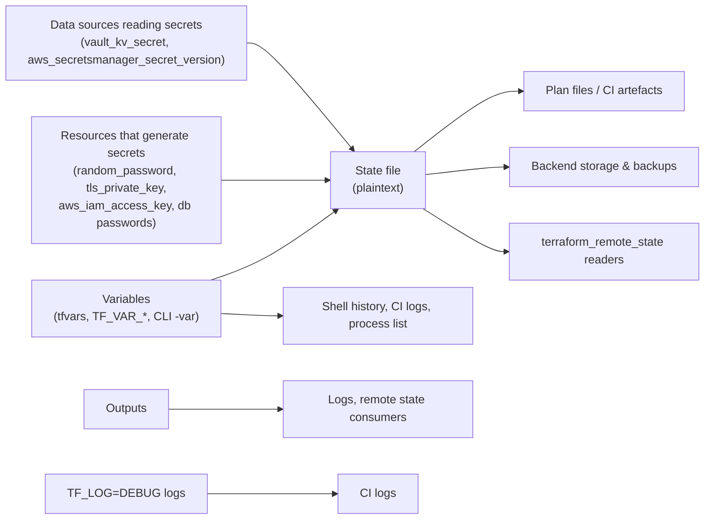
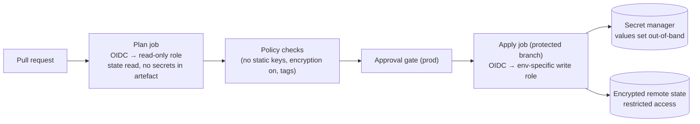

# 4.22 Terraform secrets and multiple providers

| | |
|---|---|
| Level | Intermediate |
| Priority tier | 1 |
| Lab venue | Terraform/OpenTofu 1.6+; `vault server -dev` in Docker; sandbox cloud accounts (two regions or projects) |
| Part | Part 4: Automation and infrastructure as code |
| Status | Drafted, labs **untested** |

## Why this matters for AI infrastructure

Picture a Tuesday evening. A colleague runs `terraform plan` from a laptop to add one more GPU pool, and the output looks harmless. Two days later, someone with read access to the state bucket finds a plaintext database password in a JSON file. Nobody typed the password into a `.tf` file, and nobody committed it. Terraform generated it, then wrote it down as part of its normal bookkeeping.

That is the central problem of this chapter. Terraform is the tool in your organisation that can create and destroy GPU clusters, IAM roles, networks and databases. It therefore holds the strongest credentials you have. Its configuration and its state are also where secrets leak most quietly. A database password generated by `random_password`, a service-account key created by a resource, or a token read through a data source all end up in plaintext in state, plan files and CI logs.

AI platforms are inherently multi-everything. You may need several regions to chase GPU capacity, because capacity differs from one region to the next. You may need several accounts or projects so that a training experiment cannot touch the production inference fleet. There are several clouds too, such as a hyperscaler alongside a GPU cloud like Nebius or CoreWeave. Kubernetes, Helm, Vault, GitHub and DNS providers sit in the same estate as well. Each one needs its own configuration, and each one needs its own credentials.

This chapter covers three things. It shows how to keep secrets out of places they should not be. It shows how to authenticate with short-lived identity instead of static keys. And it shows how to structure multiple providers without making a mess.

## Prerequisites and outcomes

Read 4.18 to 4.21 first, and review the secrets concepts from 4.12. Those chapters give you the tools this one builds on. A provider is the plugin that lets Terraform talk to one API, such as AWS, Google Cloud or Kubernetes. A state file is the JSON record where Terraform remembers what it created. You will see both terms used constantly from here on. By the end of this chapter, you will be able to do the following:

- Identify every place a secret can leak in Terraform (state, plan, outputs, logs, variables, history) and apply layered mitigations.
- Use `sensitive`, ephemeral values and resources, write-only arguments, secret-manager data sources, external generation, and state encryption appropriately, and know the limits of each.
- Authenticate providers with environment-supplied, short-lived, federated credentials (OIDC or workload identity), and never hard-code credentials.
- Configure multiple providers and aliases, pass them to modules, and structure multi-region, multi-account and multi-cloud estates. Understand dependency ordering across providers, including the cluster-then-Kubernetes-provider problem.
- Pin, mirror and verify providers, and manage provider upgrades.

## 1. Where secrets leak

Before you can protect a secret, you need to know every place it can land. In Terraform that list is longer than most people expect. Think of a secret as water. It does not stay in the glass you poured it into. It runs down every channel that connects to that glass, and each channel needs its own cover. The diagram below traces those channels.



Start with the state file, since many of these paths run through it. Terraform keeps a record of every real thing it manages, and that record is the state. For each resource, the state holds every attribute value that the provider returns. That includes generated passwords and private keys, even when you never wrote them down yourself. So anyone who can read the state can read those secrets.

Here is a worked example. Suppose you create a `random_password` called `db` and feed it into an `aws_db_instance`. Terraform generates a random value, sends it to AWS, and records it in the state file. The `.tf` files contain only the word `random_password`, yet the JSON on disk contains the value itself.

Many people assume that `sensitive = true` fixes this. It does not. Setting `sensitive = true` only redacts the value in CLI display, so the plan output shows `(sensitive value)` instead of the text. The value is still in state and in plan files. Sensitivity also flows through expressions, but any output marked sensitive can still be read with `terraform output -json`. And `terraform_remote_state` consumers, which are other stacks that read your outputs, can read it from state.

Variables are the next path to watch. A value passed on the command line, such as `-var 'password=...'`, appears in shell history and in process lists. Anyone on the same machine who runs `ps` at the right moment can see it. A `.tfvars` file that holds secrets must never be committed. Provisioners and `local-exec` may also echo secrets to logs, because whatever the command prints ends up in the run output.

Plan files and logs are the last paths. A plan file made with `-out` contains the planned values, and teams often store it as a CI artefact so that the apply job can use the exact same plan. That artefact is a copy of your secrets. `TF_LOG` output records the API requests Terraform makes, and sometimes those requests carry credentials or tokens. Git history keeps secrets forever, even after you delete the line in a later commit (4.1).

Decide now who may read your state, because anyone who can read it can read its secrets. Write that answer down before you pick any of the strategies in the next section.

## 2. Strategies, from best to worst

A database that needs a password is a good test case. Imagine the mlflow metadata database that your experiment tracker depends on. It needs a master password, and somebody has to decide where that password lives. The seven strategies below run from best to worst, so work down the list until one fits your case. The first strategy that your provider and version support is usually the right one.

Strategy 1 is to avoid secrets altogether. Prefer identity-based access, such as IAM roles, workload identity, managed identities, IAM database authentication, IRSA and Kubernetes service accounts, over passwords and keys. A password is a thing that can be copied. An identity is a thing that the platform checks at the moment of access. Many cases that seem to need a password can be replaced by a role bound to the workload, so the workload never holds a secret at all.

Strategy 2 lets the target service generate and store the secret, so Terraform only holds a reference. A managed database with `manage_master_user_password = true` is one example, because AWS RDS creates the password in Secrets Manager and rotates it there. Another is Cloud SQL IAM auth. Terraform stores only the secret's ARN or name, which is an address rather than the secret itself.

Strategy 3 creates the secret container but not the value. Terraform creates `aws_secretsmanager_secret` or `google_secret_manager_secret`. A CI step, an operator or a rotation Lambda sets the value out of band, so the value never enters state. The container is like a locked box that Terraform installs on the wall, while a person puts the key inside later.

Strategy 4 uses the ephemeral and write-only features of newer Terraform and OpenTofu versions. Ephemeral resources and values exist only during the run, and they are not persisted to state or plan. One example is reading a secret from a secret manager to use in a provider configuration or a write-only argument. Write-only arguments, named like `password_wo`, accept a value that is sent to the provider but never stored. Support depends on version and on each provider and resource, so verify it before you rely on it.

Strategy 5 reads the value at apply time from a secret manager, using a data source, and passes it into the resource. This is better than a hard-coded value, because the secret lives in one place and rotates in one place. But the value is still stored in state if the resource attribute persists it. Pair this approach with encrypted, access-controlled state.

Strategy 6 encrypts state. Use backend encryption and, in OpenTofu, client-side state and plan encryption. Client-side encryption means the state is scrambled before it leaves the machine, so the storage service only ever sees ciphertext. Restrict who can read the state, and keep separate state for each sensitivity level.

Strategy 7 is the last resort. Pass the value through environment variables, such as `TF_VAR_db_password`, taken from the CI secret store. Mark the variable `sensitive`, and accept that the value ends up in state. Use this only when nothing above it fits, and write down why.

The anti-patterns are worth memorising, because they are the mistakes that show up most often in real reviews. Committing `terraform.tfvars` with secrets is one, and generating long-lived access keys in Terraform and then outputting them is another. Others include storing secrets as plaintext `locals`, passing secrets through `-var` on a shared host, using `terraform_remote_state` outputs to move secrets between teams, and trusting `sensitive` as protection.

### Secret Management Taxonomy from *Terraform: Up and Running* (Chapter 6)

In chapter 6 of *Terraform: Up and Running*, titled *Managing Secrets with Terraform*, Yevgeniy Brikman classifies secrets along three dimensions. They are the type of secret, the storage architecture, and how secrets reach providers versus resources. The classification is useful because it tells you which tool fits which secret. A password for a human engineer needs different protection from a password for a database that an app uses.

The first dimension is the type of secret, and the book lists three kinds.

- **Personal secrets:** Credentials that belong to an individual human. They live in password managers such as 1Password, LastPass, Dashlane, KeePass or pass, or in the OS keychain through aws-vault, so humans never store plaintext keys in `~/.aws/credentials`.
- **Customer secrets:** Passwords and API keys that belong to the end users of your application. They are stored as salted cryptographic hashes, or managed through Auth0, AWS Cognito or Okta.
- **Infrastructure secrets:** Database passwords, TLS private keys, service-to-service tokens, and cloud provider credentials used by servers and CI pipelines. This is the kind that Terraform touches most often, so it deserves the most care in this chapter.

The second dimension is the storage architecture, and it splits secret stores into two groups. File-based stores, such as AWS KMS with `data "aws_kms_secrets"`, GCP KMS, Azure Key Vault, PGP and sops, encrypt a file. For example, you encrypt a `db-creds.yml.encrypted` file with a Customer Master Key (`aws_kms_key` plus `aws_kms_alias` `alias/kms-cmk-example`) or with sops. You commit the ciphertext to Git, and you decrypt it at plan or apply time with `yamldecode(data.aws_kms_secrets.creds.plaintext["db"])`. The ciphertext is safe in Git, but the decrypted value still becomes part of the run.

Centralized stores, such as HashiCorp Vault, AWS Secrets Manager with `data "aws_secretsmanager_secret_version"`, Google Secret Manager, Azure Key Vault and SSM Parameter Store, are dedicated API services. They offer fine-grained IAM, audit logs and automatic rotation. Think of the file-based store as a sealed envelope you carry around, and the centralized store as a safe deposit box that the bank opens only when you show your ID.

The most important caveat is the universal state problem, and it is the reason this section exists. In Terraform below 1.10, or without write-only arguments, the `aws_db_instance` resource still records `password` in plaintext inside `terraform.tfstate`. That holds whether the password comes from `TF_VAR_db_password`, `data "aws_kms_secrets"` or `data "aws_secretsmanager_secret_version"`. The source of the password does not matter, because the resource stores whatever you hand it. The chapter models this in `classify_secret_state_exposure()` in `code/part04/terraform_secrets_providers.py`. To remove the exposure, use `manage_master_user_password = true`, IAM database authentication, write-only arguments (`password_wo`) together with `ephemeral` blocks, or OpenTofu state encryption.

### Examples

The first block below shows a variable that stays in state, followed by a managed alternative. The second block shows the ephemeral pattern. Read them one after the other. In the first block, the password is handed to Terraform, so Terraform keeps it. In the managed version, AWS creates the password and Terraform keeps only the address of the secret.

```hcl
variable "db_password" {
  type      = string
  sensitive = true                     # redacted in output; still in state
}

# Better: let AWS manage and rotate the master password
resource "aws_db_instance" "meta" {
  identifier                  = "mlflow-meta"
  engine                      = "postgres"
  instance_class              = "db.m6g.large"
  allocated_storage           = 100
  username                    = "mlflow"
  manage_master_user_password = true   # secret lives in Secrets Manager, rotated by AWS
  storage_encrypted           = true
  deletion_protection         = true
  lifecycle { prevent_destroy = true }
}
output "db_secret_arn" {
  value = aws_db_instance.meta.master_user_secret[0].secret_arn   # reference, not the secret
}

# Secret container only; value set elsewhere
resource "google_secret_manager_secret" "hf_token" {
  secret_id = "huggingface-token"
  replication { auto {} }
}
# the version is added by a controlled process (not in Terraform state)

# Consumers read secrets at runtime via IAM, not via Terraform outputs
resource "google_secret_manager_secret_iam_member" "trainer" {
  secret_id = google_secret_manager_secret.hf_token.id
  role      = "roles/secretmanager.secretAccessor"
  member    = "serviceAccount:${google_service_account.trainer.email}"
}
```

The output exposes only the secret's ARN, which is a reference, and never the secret itself. A reader of the state can see where the secret lives, but not what it says. That is the difference between a map to the vault and the gold itself.

The Hugging Face token block shows the same idea for an API key. Terraform creates the box and grants the trainer's service account permission to open it. Someone else fills the box, and the trainer reads the value at runtime. Notice that the trainer never gets the value from a Terraform output, which is the step most teams get wrong.

```hcl
# Ephemeral pattern (illustrative; check your version's syntax and provider support)
ephemeral "aws_secretsmanager_secret_version" "db" {
  secret_id = aws_db_instance.meta.master_user_secret[0].secret_arn
}
provider "postgresql" {
  host     = aws_db_instance.meta.address
  username = "mlflow"
  password = jsondecode(ephemeral.aws_secretsmanager_secret_version.db.secret_string)["password"]   # not persisted in state
}
```

The comment on the last line notes that this password is not persisted in state. The value exists in memory while the run uses it, then it is gone. That is why the pattern needs a provider version that supports ephemeral values. An older version would quietly write the password into state, and nothing in the code would warn you.

### Generated credentials

Sometimes Terraform itself must generate a secret, because nothing else can. Examples include a `random_password` for a service account or a `tls_private_key` for an internal endpoint. In that case, treat the state as a secret store, because it is one. Use an encrypted backend with KMS, versioning, tight IAM and audit logs. KMS is the cloud's key service, and a backend encrypted with KMS means the bucket holds only ciphertext without the key. Allow no human read access in production, so that only the pipeline identity can read the state.

Rotation is the next step. Rotate the secret periodically with `-replace=random_password.x`, which tells Terraform to throw away the old value and generate a new one on the next apply. Have consumers read it from a secret manager, so that the new value reaches them through the manager and not through a Terraform output. Never expose generated secrets as outputs. For TLS private keys, prefer issuing certificates from a CA, such as ACME, Vault PKI or cert-manager, so the keys never pass through Terraform. A CA, short for certificate authority, is the service that signs certificates, and the private key can be created on the machine that needs it.

For each secret, start at the top of this list and stop at the first strategy that your provider and version support. Walking the list in order keeps you from reaching for the convenient option too early.

## 3. Authenticating providers

A CI job runs `terraform plan` on every pull request, and it needs cloud access to do that. The question you have to answer is where that access comes from. Picture two options. In the first, the CI system holds a permanent key that opens every account, and a leaked log exposes that key for years. In the second, the CI job asks the cloud for a token that is short-lived and valid only for one role, and the token expires before anyone can misuse it. The second option is what this section is about.

Five principles guide the answer. Keep credentials out of code. Make them short-lived wherever you can. Grant least privilege per stack, so that a network stack cannot delete a database. Use separate identities for plan, which is read-only, and for apply, which can change things. And use separate identities for each environment, so that a mistake in dev cannot touch production.

Use this table to find the preferred mechanism for each platform. Most rows rely on federation or short-lived tokens. Federation means the CI system proves who it is with a signed token from its own identity provider, and the cloud trusts that proof. If you work with a GPU cloud, note that its row also allows service-account credentials, so check that provider's docs for auth modes.

| Platform | Preferred mechanism in CI | Notes |
|---|---|---|
| AWS | OIDC federation to an IAM role (`AssumeRoleWithWebIdentity`); `assume_role` in provider; instance/Task roles | Trust policy conditions on repo/branch/environment |
| GCP | Workload Identity Federation; service account impersonation (`impersonate_service_account`); ADC | No JSON keys |
| Azure | Federated credentials / managed identity (`use_oidc`, `use_msi`) | |
| Kubernetes/Helm | Short-lived tokens from cloud CLI exec plugin (`exec { command = "gke-gcloud-auth-plugin" }`), service account tokens | Avoid static kubeconfig with admin certs |
| Vault | JWT/OIDC auth from CI, AppRole for machines | Tokens with short TTL |
| GitHub/GitLab | App installation tokens, fine-grained PATs from a secret manager | |
| Nebius / CoreWeave / other GPU clouds | Service-account credentials or federated tokens supported by the provider; secrets from environment | Check provider docs for auth modes |

The two blocks below show how the AWS and GCP providers take their identity. Neither block contains a key. Instead, each one names a role or a service account, and the provider exchanges the CI system's own identity for a temporary credential. Read the AWS block first. It says, in effect, "become this role in the target account." The GCP block says, "act as this service account." In both cases the caller stays the same, and the permission comes from the role.

```hcl
provider "aws" {
  region = var.region
  assume_role {
    role_arn     = var.deploy_role_arn           # role in the target account
    session_name = "terraform-${var.env}"
  }
}

provider "google" {
  project                     = var.project_id
  region                      = var.region
  impersonate_service_account = var.tf_service_account    # CI identity impersonates a scoped SA
}
```

Provider configuration can use variables and data sources, but it cannot reliably depend on values that are unknown at plan time (see section 5). If ephemeral options exist for a secret, do not interpolate that secret into a provider block from a plain variable. Redact logs. And never store provider credentials in the same state they secure, because a state read would then reveal the key that unlocks the state.

Choose the federated mechanism for each platform first, and only then write its provider block. The provider block is the easy part, and the trust policy on the cloud side is where the real control lives.

## 4. Multiple provider configurations

Suppose your GPU capacity sits in two regions, and you want a checkpoint bucket in each. Checkpoints are the saved snapshots of a model during training, and losing them means losing hours of compute. Terraform needs a way to point one resource at one region and another resource at the other. Provider aliases do that. An alias is a second name for a provider configuration, so that a resource can choose which one to use.

### Aliases

Start with the default provider configuration. Any resource that names no other provider uses it. An alias adds a second configuration, such as a second region or account. Each resource or data source selects its alias with the `provider` meta-argument. A meta-argument is a setting that Terraform itself understands, rather than the cloud API, and `provider` is one of them. If you omit that argument, Terraform uses the default, unaliased configuration.

The example below builds a small world with three configurations. The default lives in `us-east-1`. The `usw2` alias lives in `us-west-2`. The `shared_services` alias assumes a role in a separate account. Two buckets follow, and the second one names its alias explicitly.

```hcl
terraform {
  required_providers {
    aws = { source = "hashicorp/aws", version = "~> 5.60" }
  }
}

provider "aws" {            # default configuration
  region = "us-east-1"
}
provider "aws" {
  alias  = "usw2"
  region = "us-west-2"
}
provider "aws" {
  alias = "shared_services"
  region = "us-east-1"
  assume_role { role_arn = "arn:aws:iam::111111111111:role/terraform-shared" }
}

resource "aws_s3_bucket" "ckpt_east" { bucket = "acme-ckpt-use1" }
resource "aws_s3_bucket" "ckpt_west" {
  provider = aws.usw2
  bucket   = "acme-ckpt-usw2"
}
```

Aliases are static. They cannot be computed dynamically, and they cannot vary by a `for_each` key. This surprises people who expect to loop over regions. You cannot write a list of regions and let Terraform create one provider per entry. For N regions, you have three options. You can write N provider blocks and N module calls, which is verbose but clear. You can generate the files with a tool, such as Terragrunt, CDKTF or templating. Or you can use separate stacks per region, where each stack is a separate state with one region in it.

### Passing providers to modules

Child modules inherit the default provider on their own. Any other configuration must be passed in explicitly, as the block below shows. The block calls the same module twice, once with the default provider and once with the west alias. The module code does not change between the two calls. Only the provider it receives changes, so one piece of code can build capacity in either region.

```hcl
module "pool_us" {
  source    = "../../modules/gpu-capacity"
  providers = { aws = aws }
}
module "pool_west" {
  source    = "../../modules/gpu-capacity"
  providers = { aws = aws.usw2 }
}
```

Inside the module, `configuration_aliases` declares the extra configuration that the module expects. This is how a module says, "I need a second provider, and the caller must hand it to me under this name." The declaration is a contract, and Terraform checks that the caller honours it.

```hcl
# inside the module
terraform {
  required_providers {
    aws = {
      source                = "hashicorp/aws"
      configuration_aliases = [aws.peer]          # module expects an extra configuration
    }
  }
}
resource "aws_vpc_peering_connection_accepter" "this" {
  provider = aws.peer
  # ...
}
```

A module that declares its own `provider` block is hard to remove cleanly. The provider configuration disappears with the module, while its resources still need it. Such a module also cannot be used with `count` or `for_each`. For that reason, keep provider blocks in the root. The root is the top-level directory you run Terraform in, and it is the one place that should decide which regions and accounts exist.

### Typical multi-provider patterns for AI platforms

Multi-region capacity comes first. GPU quota and capacity differ from region to region, so an estate that can run in only one region is fragile. Deploy an identical stack in each region, with one module per region and a regional alias for each. Keep a global layer for DNS, IAM and artefact registries, because those things are shared and do not belong to any one region.

Two multi-region realities matter, and both come from *Terraform: Up and Running* chapter 7. First, AMI IDs and zone names are region-specific. An AMI, short for Amazon Machine Image, is the template that a virtual machine starts from. The AMI `ami-0fb653ca2d3203ac1` in `us-east-2` does not exist in `us-west-1`, so use regional `data "aws_ami"` lookups with `provider = aws.region_1` and `provider = aws.region_2`. A data lookup asks the cloud for the right ID in each region, rather than copying a value that only works in one place. Second, a cross-region stateful service, such as an RDS MySQL primary with a read replica, needs the same `modules/data-stores/mysql` module twice. Call it once in `region_1` with `backup_retention_period = 1`. Call it again in `region_2` with `providers = { aws = aws.region_2 }` and `replicate_source_db = module.mysql_primary.arn`. Each `provider` block also starts a separate OS subprocess that talks over RPC, which is a remote procedure call, meaning Terraform sends requests to that process and reads the answers. Keep the number of provider blocks per root module reasonable, and do not define dozens of regional providers you never use, because each one costs a process and some setup time.

Multi-account isolation comes second. Separate dev, staging, prod and shared services into their own accounts or projects, using `aws_organizations_organization` and `aws_organizations_account` on AWS. Shared services hold logging, networks and ECR or Artifact Registry, which are the container image registries. Provider aliases with `assume_role` or impersonation let one pipeline manage a shared services account and a workload account in the same apply. That matters for cross-account trust, such as a peering requester and accepter, RAM shares and bucket policies, declared with `configuration_aliases = [aws.parent, aws.child]`. Prefer separate states and pipelines per account, because that limits blast radius. Blast radius is how much damage one mistake can reach. Use cross-account aliases only where an atomic cross-account link is needed, meaning a change that must succeed on both sides or not at all.

Multi-cloud GPU estates pair a hyperscaler with a GPU cloud. The hyperscaler handles the control plane and data services, such as the databases and the identity system, and the GPU cloud supplies capacity. Each cloud gets its own providers, such as `google`, `nebius`, `kubernetes`, `helm`, `vault` or `cloudflare` for DNS, and each lives in a distinct layer. Put networking, VPN or interconnect first, then cluster provisioning, then cluster add-ons. The order matters because each layer needs the one beneath it. Consistency across clouds comes from modules that expose a common interface, such as node pool inputs, with provider-specific implementations behind it. A caller says "give me a pool of eight GPUs," and the module decides how each cloud does that.

Kubernetes and Helm providers need extra care. Configure them from the cluster's outputs only when the cluster is created in the same apply, and that often fails. The endpoint is unknown at plan time, and authentication tokens can expire. The fix is layering. Stack 1 creates the cluster. Stack 2 configures the `kubernetes` and `helm` providers using data sources, such as `google_container_cluster`, `aws_eks_cluster_auth` or an exec plugin, and then installs add-ons (4.25). An add-on is an extra component such as a GPU operator or an ingress controller. Two stacks look like extra work at first, but they stop the cluster and its add-ons from failing together.

```hcl
data "google_client_config" "default" {}
data "google_container_cluster" "main" {
  name     = var.cluster_name
  location = var.region
}
provider "kubernetes" {
  host                   = "https://${data.google_container_cluster.main.endpoint}"
  token                  = data.google_client_config.default.access_token
  cluster_ca_certificate = base64decode(data.google_container_cluster.main.master_auth[0].cluster_ca_certificate)
}
provider "helm" {
  kubernetes {
    host                   = "https://${data.google_container_cluster.main.endpoint}"
    token                  = data.google_client_config.default.access_token
    cluster_ca_certificate = base64decode(data.google_container_cluster.main.master_auth[0].cluster_ca_certificate)
  }
}
```

Tokens from `google_client_config` are short-lived, but they still end up in state. An `exec` plugin avoids storing them. Either way, the cluster must exist before this stack runs. If the cluster is missing, the data source fails, and that failure is a clear signal that the layers are out of order.

### Provider dependency ordering and the "provider depends on resource" problem

Terraform initialises providers before it plans resources. Initialising a provider means it reads its configuration and starts its process, so it can answer questions. So if a provider argument depends on a value that does not exist yet, such as a cluster endpoint, the plan either fails or quietly uses empty settings. Empty settings are the worse outcome, because the run may appear to succeed while it talks to the wrong place.

Here is a concrete picture. You write a root module that creates a GKE cluster and, in the same file, configures the `kubernetes` provider with the cluster's endpoint. On the first run, the endpoint is unknown, so the provider gets an empty host. The plan may then report errors that look unrelated, or it may try to reach `localhost`. Nothing in the message says "your provider order is wrong."

You have four ways out. Layered stacks are the preferred fix, because each stack has one job. You can also read an already-created cluster with data sources, which is the approach in the previous section. For first-time creation only, you can bootstrap with `-target`, which limits one run to a named resource, as a documented one-off. Or you can split create and configure into separate pipelines. Avoid using one provider to create resources and then depending on the credentials it created, all within one plan, wherever you can.

For the Kubernetes layer, build the cluster first, and configure the providers in a later stack. This one rule removes most of the pain that teams hit with this problem.

## 5. Provider versioning, locking and distribution

How do you know that your laptop and your CI runner use the same provider? A provider is a separate program with its own version, and two machines can quietly run different versions of it. Locking answers that question. A lock file records the exact version and fingerprint of every provider the root module uses, so every machine installs the same binary.

Declare `required_providers` with a `source` and a `version` range in every module. The `source` says where to fetch the provider, and the `version` says which releases are acceptable. The root's `.terraform.lock.hcl` file records the exact versions and hashes, using `h1:` and `zh:` checksums. A checksum is a fingerprint, so a changed binary produces a different value and fails the check. Commit that file. Then run `terraform providers lock -platform=linux_amd64 -platform=darwin_arm64 ...`, so that CI and laptops share the same hashes. Without this step, a lock file made on a Mac may not work on a Linux runner.

Upgrades should be deliberate. Run `terraform init -upgrade` on a branch, and read the provider changelog. The changelog is the list of what changed in each release. Then run plans across all stacks, and look for new defaults and resource behaviour changes. A new default can change a resource you never touched, so the plan diff is your safety net. Promote the change through environments (4.2), from dev to staging to production, so that a surprise shows up somewhere cheap first.

Mirrors and caches matter for air-gapped or rate-limited environments. An air-gapped network has no route to the public internet, so providers must come from inside. A mirror is a local copy that the runners fetch from. Configure `provider_installation` in `~/.terraformrc` with a `network_mirror` or `filesystem_mirror`, plus `direct { exclude }` rules. The `direct` block tells Terraform which providers it may still download from the public registry, and the `exclude` rules keep certain ones off that path. Set `TF_PLUGIN_CACHE_DIR` to share downloads on runners, so each provider is downloaded once rather than once per job. Verify signatures and checksums. You can also restrict which providers may be installed. For example, allow only `hashicorp/*` and approved namespaces through the mirror, as a supply-chain control. A supply chain attack happens when someone slips a malicious package into a dependency you trust, and a mirror with an allow list makes that much harder.

Custom or in-house providers, for BCM, Redfish gateways or internal APIs, are built with the Terraform Plugin Framework in Go. Publish them to a private registry or a filesystem mirror, and version and document them like any module. BCM is the Base Command Manager that many GPU clusters use for node provisioning. A Redfish gateway is a service that speaks the standard hardware management API, so a provider can change server settings through it.

Provider quality varies. Sort providers into official, partner and community, and check maintenance, the issue tracker and the release cadence. Official providers come from the company that owns the cloud or tool. Community providers can be excellent, but a single maintainer who has stopped responding is a risk on any path that matters. Avoid unmaintained providers on critical paths. Wrap providers in modules to isolate changes, so that if you ever have to replace one, only the module changes.

When no provider exists for a system, you have several options. You can use `null_resource` or `terraform_data` with `local-exec` to call an API or CLI, which is fragile because Terraform cannot see what the command really did. You can use the `restapi` or `http` provider. You can use an `external` data source, which runs a script that returns JSON. You can write a provider. Or you can hand that part to Ansible or Crossplane (4.16). Pick the option that gives you the cleanest plan output, because a plan you can read is a plan you can trust.

Commit the lock file, and test each provider upgrade on a branch where you can read the plan differences. A lock file that nobody reads is a file that drifts without anyone noticing.

## 6. Putting it together: a secure pipeline sketch

Who may read your state, and which identity applies the change? The diagram answers both questions. It shows one pull request moving through two jobs, with a human approval between them for production. Read the arrows as the path a change must travel, and notice that no arrow skips the policy check.



Your plan job uses a read-only role, and policy checks run next. A policy check is an automated rule that reads the plan and rejects anything unsafe. Only the apply job uses a write role, behind the prod approval gate. Check your pipeline against this list: no credentials in the repo or tfvars; different identities for plan and apply; encrypted, versioned state with narrow access; secrets referenced, not materialised; secret scanning in pre-commit and CI (4.1, 4.12). Materialised here means a secret written out in plain form somewhere it should not be. Each item on the list closes one of the leak paths from section 1.

Decide the plan role first, because the apply role must differ from it. If the same identity can both read and change, then a compromised pull request can change production. Separating the two means a reviewer sees the plan before anything writes.

## 7. Lab

The commands in this lab have not been run on live hardware, so treat each step as unverified until you run it yourself. Start with the self-checking Python lab, which you can run on your own machine. It needs no cloud account, and it checks the logic that the rest of the chapter depends on. It checks the state exposure classifier (`classify_secret_state_exposure`, which contrasts `sensitive_var_or_data_source` and `random_password_resource` with `manage_master_user_password` and `ephemeral_or_write_only`). It also checks the GitHub Actions OIDC `AssumeRoleWithWebIdentity` trust-policy evaluator (`verify_github_oidc_assume_role`, from *Terraform: Up and Running* chapter 6). Last, it checks the `configuration_aliases` wiring (`validate_child_module_provider_wiring`, from chapter 7).

```bash
python3 code/part04/terraform_secrets_providers_lab.py
```

Next, on a machine with Terraform or OpenTofu 1.6+ and Docker, work through the exercises below. Each exercise changes one thing, so that you can see its effect on the state and the plan. Keep a scratch cloud account for these steps, and destroy what you create before you stop.

1. Start by finding the leaks. Create `random_password`, `tls_private_key` and a `sensitive` variable, then apply. Use `jq` to read each plaintext value from the state. Show that `terraform output -json` exposes a sensitive output. Then show the plan file content with `terraform show -json tfplan`.
2. Mitigate the leaks. Replace the generated password with a managed-secret design, either a secret container with an out-of-band value or `manage_master_user_password`. Then confirm that the state no longer contains the secret.
3. Try Vault integration. Run a Vault dev server, and read a secret with the `vault` provider data source. Observe the secret in state. Then try the ephemeral variant, if your version supports it, and compare the two.
4. Work on state encryption. With OpenTofu, configure state encryption using a passphrase or KMS key. Inspect the state file bytes, and test key rotation. With Terraform OSS, enable backend encryption and restrict bucket access. Document the difference between the two.
5. Set up OIDC auth. Configure a CI job in GitHub Actions or GitLab to assume a cloud role through OIDC. Remove the static keys. Then prove that a feature branch cannot assume the apply role.
6. Test aliases. Deploy a bucket in two regions using provider aliases. Refactor the code into a module that you call twice, with `providers` maps. Then try `for_each` over regions, and observe the limitation.
7. Test cross-account access. Use `assume_role` aliases to create a peering requester and accepter, or a cross-account bucket policy, in one apply. Then split the work into two stacks, and compare the risk and permissions.
8. Explore Kubernetes layering. Try creating a kind or GKE cluster and configuring the `kubernetes` provider in the same apply. Observe the failure or fragility. Then split the work into two stacks that use data sources (4.25).
9. Lock providers and set up mirrors. Generate multi-platform lock hashes. Configure a filesystem mirror and block direct downloads. Upgrade a provider on a branch, and review the plan differences.
10. Add secret scanning. Add gitleaks and pre-commit, plus a Conftest policy that rejects plans containing `aws_iam_access_key` or outputs not marked `sensitive`. Then demonstrate a failing PR.
11. Rotate a generated password. Rotate a Terraform-generated password with `-replace`, update the consuming workload through the secret manager, and validate zero downtime.
12. Finally, clean up. Destroy every resource you created, and check the cloud console for anything left behind, such as a bucket or a key.

Start with exercise 1, since it shows the leaks that the rest of the lab removes.

## 8. Common mistakes

When you review code, watch for these mistakes. Each one reverses a point you read earlier in this chapter. A good review habit is to ask of each one, "where in this pull request would I see it?"

Believing `sensitive = true` protects state, plans or remote-state consumers is the first mistake. It is the most common one, and it is comforting, which is why it survives. Generating IAM access keys or private keys in Terraform and outputting them is another. One state that holds secrets for many teams, with broad `terraform_remote_state` access, is a third.

Static cloud keys in CI variables or `.tfvars` are a mistake, and so are admin credentials for every pipeline. Provider blocks inside child modules are another, along with attempts to `for_each` over providers. Sharing a default provider configuration across prod and dev accounts through the same credentials also belongs on the list, because one bad apply then reaches both.

Configuring the Kubernetes or Helm provider from a cluster created in the same apply is a mistake. Unpinned providers, a missing lock file in Git, and no mirror in restricted environments form the next group. Each of these lets a run differ from the last one without anyone choosing it.

Leaving `TF_LOG=DEBUG` on in CI is risky, because the debug output can carry tokens into the logs. So is having no rotation plan for credentials that Terraform created. A secret that never rotates is a secret that someone will eventually copy.

Start by checking whether any of your pipelines still treats `sensitive` as protection.

## 9. Interview angles

The questions below are angles an interviewer might take. Use them to test whether the chapter's ideas have stuck. Try to answer each one in two or three sentences, and then check your answer against the section that covers it.

- How do you handle secrets in Terraform? What does `sensitive` really do?
- How do you authenticate Terraform in CI to AWS/GCP without keys? (OIDC/WIF, scoped roles.)
- How do you deploy to multiple regions or accounts? What are provider aliases and their limits?
- Why shouldn't modules define providers? How do you pass them?
- How do you configure the Kubernetes provider for a cluster you also create? (layered stacks/data sources.)
- How do you protect the state file? Who may read it?
- How do you pin and verify providers? What does the lock file contain?
- What would you do if you discover a secret in state? (rotate, restrict, redesign, encrypt.)

Pick the two questions you find hardest, and answer them in your own words.

## Exercises

Each exercise gives you one situation and one question. Trace the chapter's code for that situation, then explain what each piece does in your own words. Do not skip the first exercise, because the others assume you understand where the secrets go.

1. A teammate says that the database password is safe because the variable is marked sensitive. Use `classify_secret_state_exposure()` in `code/part04/terraform_secrets_providers.py` to trace where the password still lands in `terraform.tfstate`. Explain why it still lands there when the password comes from `sensitive = true`, from `data "aws_kms_secrets"` or from `data "aws_secretsmanager_secret_version"`. Then compare that with a workload identity approach. Which option removes the static password entirely?
2. A CI job on GitHub Actions needs to apply a change to AWS without any stored key. Use `verify_github_oidc_assume_role()` in `code/part04/terraform_secrets_providers.py` to check the trust policy. Trace the exact HCL for `aws_iam_openid_connect_provider`, with `https://token.actions.githubusercontent.com` and `client_id_list = ["sts.amazonaws.com"]`. Explain what the `StringEquals` match on `token.actions.githubusercontent.com:sub == "repo:<ORG>/<REPO>:ref:refs/heads/main"` allows. Then explain how `aws-vault` protects a developer's credentials on a laptop.
3. A team wants the same bucket in two AWS regions, and the AMI ID that works in one region fails in the other. Explain how `provider "aws" { alias = "usw2" }` and `provider = aws.usw2` route a resource to the second region. Explain why AMI IDs cannot be hardcoded across regions. Then explain how the chapter wires a cross-region RDS MySQL read replica with `replicate_source_db`, and why spawning hundreds of `provider` blocks slows Terraform down.
4. A module must create a peering connection in a network account and accept it in a workload account. Use `validate_child_module_provider_wiring()` in `code/part04/terraform_secrets_providers.py` to check the wiring. Show how the child module declares `configuration_aliases = [aws.parent, aws.child]` in `versions.tf`. Then show how the root module passes `providers = { aws.parent = aws.mgmt, aws.child = aws.prod }` using `assume_role`.
5. A single root module creates an EKS or GKE cluster and deploys a `helm_release` into it, and the run fails on clean creation. Explain why the provider cannot connect while the cluster is still unknown. Then show how layered stacks, using `data "google_container_cluster"` with `data "google_client_config"`, or an `exec` auth plugin, solve the problem.
6. A regulated team needs every provider installed from an internal mirror, with no direct downloads. Show the command that locks provider SHA-256 hashes across `linux_amd64` and `darwin_arm64` in `.terraform.lock.hcl`. Then configure a `filesystem_mirror` or `network_mirror` in `~/.terraformrc` that blocks unapproved namespaces. Finally, write a Conftest policy rule that rejects `aws_iam_access_key` resources in `plan.json`.

Begin with exercise 1, which asks you to trace the leaks that the rest of the chapter mitigates.

## Checkpoint questions (20)

<details>
<summary>1. List all seven places where a secret can leak in a Terraform workflow.</summary>

1. **`terraform.tfstate` (and `.tfstate.backup`):** It stores all resource and data-source attribute values in plaintext JSON.
2. **Saved plan files (`-out=tfplan`) and `plan.json` CI artifacts:** They hold every planned attribute value in plaintext.
3. **CLI variables (`-var="db_password=..."`):** They show up in shell history (`~/.bash_history`) and in `/proc/<pid>/cmdline` (`ps aux`).
4. **Committed `.tfvars` or `.tf` files in Git history.**
5. **`terraform output -json` and `terraform_remote_state` consumers:** Any consumer with state read access can read sensitive outputs.
6. **Provisioner (`local-exec` / `remote-exec`) stdout logs.**
7. **Debug logs (`TF_LOG=DEBUG` / `TF_LOG=TRACE`):** They dump raw HTTP and gRPC request payloads into CI logs.
</details>

<details>
<summary>2. In *Terraform: Up and Running* chapter 6, what are the three categories of secrets and the two secret storage architectures?</summary>

Table 6-1 lists three categories of secrets.

1. **Personal secrets:** Individual human credentials, stored in 1Password, pass, or the OS Keychain via **aws-vault**.
2. **Customer secrets:** End-user application credentials, hashed or managed in Auth0, Cognito or Okta.
3. **Infrastructure secrets:** Database passwords, API tokens and certificates used by services and automation.

The two storage architectures are these.

1. **File-based secret stores (AWS KMS with `aws_kms_secrets`, GCP KMS, PGP, sops):** They encrypt files in Git using KMS or age keys, and decrypt them in memory during runs.
2. **Centralized secret stores (HashiCorp Vault, AWS Secrets Manager, Google Secret Manager, Azure Key Vault):** They are dedicated API services with IAM, audit logs and rotation.
</details>

<details>
<summary>3. Why does reading a password from `data "aws_secretsmanager_secret_version"` (or `data "aws_kms_secrets"`) and passing it to `aws_db_instance.password` STILL leak the password into `terraform.tfstate` (*Terraform: Up and Running* chapter 6)?</summary>

Terraform records the password twice. It stores the values of the data source, `data.aws_secretsmanager_secret_version.creds.secret_string`, and it stores the `password` attribute of the target `aws_db_instance` resource. Keeping the secret out of `.tf` files in Git does not help, because `terraform.tfstate` still holds two plaintext copies of the password.
</details>

<details>
<summary>4. What are the four best ways to keep a database password or API token completely OUT of `terraform.tfstate`?</summary>

1. **Eliminate the password:** Use IAM database authentication for RDS or Cloud SQL, or Workload Identity on GCP or AWS, so no static password exists.
2. **Service-managed secrets (`manage_master_user_password = true`):** Tell AWS RDS to generate, store and rotate the master password directly in AWS Secrets Manager. Terraform stores only `master_user_secret[0].secret_arn` in state.
3. **Create the secret container only (`google_secret_manager_secret` or `aws_secretsmanager_secret`):** Terraform creates the empty secret metadata and IAM bindings (`roles/secretmanager.secretAccessor`). A separate CLI or rotation job fills in the secret version payload.
4. **Use `ephemeral` resources and write-only arguments (`password_wo`):** This works in Terraform 1.10+ or 1.11+, or in OpenTofu. You can also enable **OpenTofu client-side state encryption**.
</details>

<details>
<summary>5. How do `ephemeral` resources/variables and write-only arguments (`password_wo`) work in modern Terraform and OpenTofu?</summary>

- **`ephemeral "<type>" "<name>"` and `variable "..." { ephemeral = true }`:** These blocks exist only in memory during the current `plan` or `apply`. They are never written to `terraform.tfstate` or `tfplan` files. They suit a temporary token or password that a `provider` block or a write-only argument needs.
- **Write-only arguments (`password_wo` and `password_wo_version`):** A write-only argument accepts an ephemeral or sensitive value and sends it to the cloud API during create or update. It stores `null` in `terraform.tfstate`. Incrementing the integer `password_wo_version` is what triggers a future update.
</details>

<details>
<summary>6. How does `aws-vault` protect human engineers running Terraform locally (*Terraform: Up and Running* chapter 6)?</summary>

Plaintext `aws_access_key_id` and `aws_secret_access_key` values in `~/.aws/credentials` can be stolen by malware, an npm package or an accidental backup. `aws-vault add dev` avoids that by encrypting the credentials in your OS keychain. The keychain can be macOS Keychain, Windows Credential Manager, or Linux Secret Service or KWallet. Running `aws-vault exec dev -- terraform plan` calls AWS STS `GetSessionToken` or `AssumeRole`. It injects short-lived temporary `AWS_ACCESS_KEY_ID`, `AWS_SECRET_ACCESS_KEY` and `AWS_SESSION_TOKEN` environment variables into that single child process only.
</details>

<details>
<summary>7. In *Terraform: Up and Running* chapter 6, how do you configure AWS IAM OIDC Federation for GitHub Actions in Terraform (`aws_iam_openid_connect_provider`)?</summary>

1. Create `resource "aws_iam_openid_connect_provider" "github_actions"` with `url = "https://token.actions.githubusercontent.com"`, `client_id_list = ["sts.amazonaws.com"]`, and `thumbprint_list = [data.tls_certificate.github.certificates[0].sha1_fingerprint]`.
2. Create an `aws_iam_role` whose `assume_role_policy` allows `sts:AssumeRoleWithWebIdentity` from that OIDC provider ARN, but only when `StringEquals` matches `"token.actions.githubusercontent.com:sub" = "repo:<ORG>/<REPO>:ref:refs/heads/main"`. That condition applies to the apply role.
3. In `.github/workflows/terraform.yml`, set `permissions: { id-token: write, contents: read }`, and use `aws-actions/configure-aws-credentials` with `role-to-assume: <ROLE_ARN>`.
</details>

<details>
<summary>8. How do EC2 instances or GKE pods running Terraform (such as self-hosted Atlantis or CI runners) authenticate to the cloud without static keys (*Terraform: Up and Running* chapter 6)?</summary>

- **On AWS EC2 or EKS:** Attach an **`aws_iam_instance_profile`** (built on an `aws_iam_role`) to the EC2 instance, or use IRSA or Pod Identity on EKS. The AWS provider queries the local Instance Metadata Service at `http://169.254.169.254/latest/meta-data/iam/security-credentials/...`, using IMDSv2 session tokens, for short-lived, auto-rotated credentials.
- **On GCP GCE or GKE:** Attach a scoped Google Service Account and Workload Identity. The `google` provider uses Application Default Credentials automatically, and it can impersonate per-environment roles through **`impersonate_service_account`**.
</details>

<details>
<summary>9. How do Provider Aliases (`alias = "usw2"`) work, and how do you select an aliased provider on a resource, data source or module (*Terraform: Up and Running* chapter 7)?</summary>

Define a default `provider "aws" { region = "us-east-1" }`, plus one or more aliased blocks such as `provider "aws" { alias = "usw2"; region = "us-west-2" }`. For example, a resource that sets `provider = aws.usw2` uses the us-west-2 region.

- **On a `resource` or `data` block:** Set **`provider = aws.usw2`**.
- **On a `module` block:** Pass the **`providers` map**, such as `providers = { aws = aws.usw2 }`. If the child module declares `configuration_aliases = [aws.primary, aws.replica]`, pass `providers = { aws.primary = aws, aws.replica = aws.usw2 }` instead.
</details>

<details>
<summary>10. Why can't you dynamically loop over provider blocks or pass `provider = aws.${each.key}` inside a `for_each` resource (*Terraform: Up and Running* chapter 7)?</summary>

In Terraform OSS, provider configurations and `provider = ...` references are static graph constructs. Terraform resolves them before `for_each` expands. Each `provider` block also spawns its own OS plugin subprocess over RPC, as chapter 7 explains. So you cannot write `provider = aws.${each.key}` in Terraform OSS. OpenTofu 1.9+ added support for `for_each` on `provider` blocks. In Terraform OSS, create one module block per region, or use separate per-region state stacks.
</details>

<details>
<summary>11. In *Terraform: Up and Running* chapter 7, why did launching an EC2 instance across two regions with the same hardcoded `ami` ID fail, and how do you fix it?</summary>

Unlike GCP's global image families, every AMI ID is scoped to a single AWS region. The `us-east-2` ID `ami-0fb653ca2d3203ac1` fails with `InvalidAMIID.NotFound` when it is used with `provider = aws.region_2`, which is `us-west-1`. The fix is to query `data "aws_ami"` in each region, using `provider = aws.region_1` and `provider = aws.region_2`. Filter on the owner `099720109477` and an image name pattern.
</details>

<details>
<summary>12. How does *Terraform: Up and Running* chapter 7 deploy a cross-region RDS MySQL primary and read replica using a single reusable module?</summary>

1. In `us-east-2` (`aws.region_1`), call `module "mysql_primary"` with `backup_retention_period = 1`. That setting is mandatory on RDS, because it enables automated backups for replication. Export `output "arn"` from the module.
2. In `us-west-1` (`aws.region_2`), call the exact same module as `module "mysql_replica"`. Pass `providers = { aws = aws.region_2 }` and `replicate_source_db = module.mysql_primary.arn`. That tells RDS to create a cross-region read replica instead of a standalone primary.
</details>

<details>
<summary>13. How do you use Provider Aliases with `assume_role` for multi-account AWS operations (*Terraform: Up and Running* chapter 7)?</summary>

Give each target account its own aliased provider with `assume_role`, as this block shows.

```hcl
provider "aws" {
  alias  = "prod"
  region = "us-east-1"
  assume_role {
    role_arn     = "arn:aws:iam::222222222222:role/OrganizationAccountAccessRole"
    session_name = "terraform-prod"
  }
}
```

When a module must create resources in both a parent or network account and a child or workload account, declare `configuration_aliases = [aws.parent, aws.child]` in `versions.tf`. The root module then passes `providers = { aws.parent = aws.mgmt, aws.child = aws.prod }`. For example, this covers a VPC peering requester in account A and an `aws_vpc_peering_connection_accepter` in account B.
</details>

<details>
<summary>14. Why is it dangerous to create a GKE or EKS cluster (`google_container_cluster` or `aws_eks_cluster`) and configure the `kubernetes` or `helm` provider in the same root module?</summary>

Terraform initializes providers before it evaluates the resource graph. When the cluster does not exist yet, `google_container_cluster.main.endpoint` is unknown during `plan`. The `kubernetes` or `helm` provider then fails to initialize, or connects to `localhost`. If you later replace the cluster or run `terraform destroy`, the `kubernetes` provider fails once the API server disappears, before the Kubernetes resources are deleted. Always separate Layer 1 (Cluster Provisioning) from Layer 2 (Kubernetes/Helm Add-ons) in separate states.
</details>

<details>
<summary>15. When configuring the `kubernetes` and `helm` providers in Layer 2, why is an `exec` credential plugin safer than `token = data.google_client_config.default.access_token`?</summary>

Using `token = data.google_client_config.default.access_token`, or `data.aws_eks_cluster_auth`, works. However, the data source writes its attributes into `terraform.tfstate`, including the short-lived OAuth2 bearer `access_token`. An `exec {}` block avoids this. Set `command = "gke-gcloud-auth-plugin"` or `aws eks get-token`, and the provider fetches the token itself at runtime, inside its subprocess. No token is stored in `terraform.tfstate`.
</details>

<details>
<summary>16. Why does `terraform init` fail in CI when a developer on an Apple Silicon Mac (`darwin_arm64`) commits `.terraform.lock.hcl` and CI runs on Linux (`linux_amd64`), and how do you fix it?</summary>

By default, `terraform init` records the binary `h1:` hash in `.terraform.lock.hcl` only for the current OS and architecture, here `darwin_arm64`. It records Registry `zh:` zip hashes alongside it. If a provider comes from a filesystem mirror or a non-standard source without `zh:` hashes, a `linux_amd64` CI runner fails with `checksum list has no SHA-256 hash fordarwin_arm64 / linux_amd64`. Fix it by running the following command before you commit `.terraform.lock.hcl`:

**`terraform providers lock -platform=linux_amd64 -platform=darwin_arm64 -platform=darwin_amd64`**
</details>

<details>
<summary>17. How do `provider_installation` mirrors in `~/.terraformrc` and `TF_PLUGIN_CACHE_DIR` work in air-gapped or high-scale CI environments?</summary>

- **`TF_PLUGIN_CACHE_DIR="/var/cache/terraform/plugin-cache"`:** It caches provider binaries, which are often 100–300 MiB each, on a shared runner volume. `terraform init` then links or copies from local disk in 1 second, instead of downloading hundreds of megabytes on every PR.
- **`provider_installation` in `~/.terraformrc`:** It redirects provider downloads to an internal **`filesystem_mirror`** or an HTTPS **`network_mirror`**, with `include = ["registry.terraform.io/hashicorp/*"]`. It also sets `direct { exclude = ["registry.terraform.io/*/*"] }`, so CI runners never reach the public internet. They can install only vetted provider namespaces.
</details>

<details>
<summary>18. If Terraform generated a secret via `random_password.db` and you need to rotate it, how do you trigger rotation safely?</summary>

Run `terraform plan -replace="random_password.db" -out=tfplan`, or change a `keepers = { rotation_date = "2026-10" }` map on `random_password.db`. Keep in mind that rotating a single password in place causes brief authentication failures in running apps, until they reload the new secret. For zero downtime, use a secret manager with two-phase rotation (chapter 4.12), or use `manage_master_user_password = true` with AWS Secrets Manager rotation Lambdas.
</details>

<details>
<summary>19. What are your options when no Terraform provider exists for an internal AI platform service or hardware appliance?</summary>

Use these options, in order of durability.

1. **Write a custom Terraform provider in Go** with the **Terraform Plugin Framework** (`terraform-plugin-framework`), and publish it to your private registry or mirror.
2. **Delegate day-2 configuration to Ansible**, which CI or AWX/AAP invokes after Terraform outputs inventory.
3. For simple JSON CRUD endpoints, use a generic REST provider, `Mastercard/restapi`.
4. Use `data "external"` for read-only lookups. It runs a local script that reads JSON on `stdin` and emits a flat `map(string)` JSON on `stdout`. Use `terraform_data` with `local-exec` only as a last resort.
</details>

<details>
<summary>20. How do you write an OPA/Conftest policy that blocks PRs from creating static `aws_iam_access_key` or `google_service_account_key` resources in `plan.json`?</summary>

Look through `input.resource_changes[_]` in `plan.json`. The policy below denies any resource that creates one of the forbidden key types.

```rego
package terraform.security

FORBIDDEN_KEY_TYPES := {"aws_iam_access_key", "google_service_account_key"}

deny contains msg if {
  rc := input.resource_changes[_]
  rc.type in FORBIDDEN_KEY_TYPES
  "create" in rc.change.actions
  msg := sprintf("%s (%s) creates a static long-lived key; use OIDC / Workload Identity instead", [rc.address, rc.type])
}
```
</details>

## Sources and review notes

- **Sources read in full:**
  - `terraform-up-and-running-3rd-edition` — Yevgeniy Brikman, *Terraform: Up and Running*, 3rd ed., **Chapter 6: Managing Secrets with Terraform** (read in full: 3 secret categories personal/customer/infrastructure, file-based `AWS KMS`/`sops` vs centralized `Vault`/`AWS Secrets Manager`/`Google Secret Manager` stores, provider auth via `aws-vault` for humans, EC2 IAM Instance Profiles via `169.254.169.254` IMDS, and GitHub Actions OIDC via `aws_iam_openid_connect_provider` + `sts:AssumeRoleWithWebIdentity` conditioned on `repo:<ORG>/<REPO>:ref:refs/heads/main`, plus passing secrets to resources via `TF_VAR_*`, `aws_kms_secrets`, and `aws_secretsmanager_secret_version` and their plaintext presence in `terraform.tfstate`) and **Chapter 7: Working with Multiple Providers** (read in full: how providers work over RPC subprocesses, multi-region `alias` deployment, regional `data "aws_ami"` lookups, RDS MySQL primary + cross-region read replica via `replicate_source_db`, multi-account isolation with `aws_organizations_account`, `assume_role`, and `configuration_aliases = [aws.parent, aws.child]`, and multi-provider `aws` EKS + `kubernetes` deployment).
  - `nvidia-devops` (`volume-10/05-terraform-for-infrastructure-as-code.md` and `volume-10/11-cicd-for-infrastructure-and-cluster-configuration.md`): secrets in pipelines, ephemeral/write-only patterns, and multi-provider state handling.
- **Run here:** `python3 code/part04/terraform_secrets_providers_lab.py` (3 passed, 0 failed).
- **Explicitly labelled inferences:** The `classify_secret_state_exposure`, `verify_github_oidc_assume_role`, and `validate_child_module_provider_wiring` models in `code/part04/terraform_secrets_providers.py`, the `aws_db_instance.meta` (`manage_master_user_password = true`), `google_secret_manager_secret.hf_token`, and `ephemeral "aws_secretsmanager_secret_version"` examples are the author's constructions synthesizing *Terraform: Up and Running* Chapters 6 & 7 and `volume-10` (plus original study items 21, 22, 23, 24, 25, 26, 27, 28, 29, and 30).
- **Not verified on live hardware:** Live `aws-vault`, AWS KMS/Secrets Manager, GCP Secret Manager, OIDC federation, and multi-region/multi-account `terraform apply` runs (`db.m6g.large`, `100` GB, `~> 5.60`, `111111111111`, `169.254.169.254`, `099720109477`) are not run here, except where `terraform_secrets_providers_lab.py` executes them.
