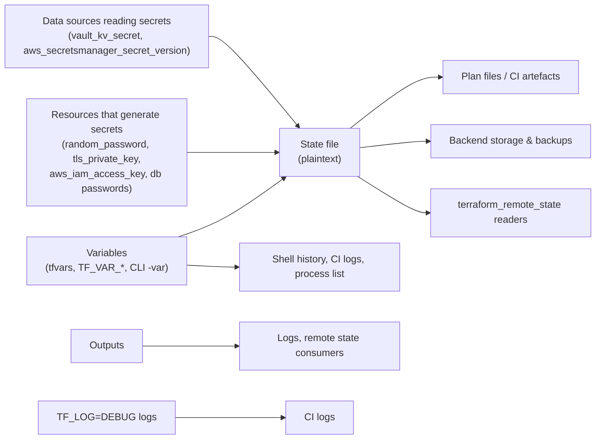
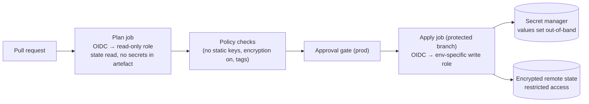

# 4.22 Terraform secrets and multiple providers

| | |
|---|---|
| Level | Intermediate |
| Priority tier | 1 |
| Lab venue | Terraform/OpenTofu 1.6+; `vault server -dev` in Docker; sandbox cloud accounts (two regions or projects) |
| Part | Part 4: Automation and infrastructure as code |
| Status | Drafted, labs **untested** |

## Why this matters for AI infrastructure

Terraform is the tool with the strongest credentials in your organisation: it can create and destroy GPU clusters, IAM roles, networks and databases. Its configuration and state are also where secrets leak most quietly: a database password generated by `random_password`, a service-account key created by a resource, a token read through a data source, all land in plaintext in state, plan files and CI logs. And AI platforms are inherently multi-everything: several regions to chase GPU capacity, several accounts or projects for isolation, several clouds (a hyperscaler plus a GPU cloud such as Nebius or CoreWeave), plus Kubernetes, Helm, Vault, GitHub and DNS providers in the same estate. This chapter covers how to keep secrets out of places they should not be, how to authenticate with short-lived identity instead of static keys, and how to structure multiple providers without making a mess.

## Prerequisites and outcomes

Needs 4.18 to 4.21 and secrets concepts from 4.12. After this chapter you can:

- Identify every place a secret can leak in Terraform (state, plan, outputs, logs, variables, history) and apply layered mitigations.
- Use `sensitive`, ephemeral values/resources, write-only arguments, secret-manager data sources, external generation, and state encryption appropriately and know the limits of each.
- Authenticate providers with environment-supplied, short-lived, federated credentials (OIDC/workload identity), and never hard-code credentials.
- Configure multiple providers and aliases, pass them to modules, and structure multi-region, multi-account and multi-cloud estates; understand dependency ordering across providers (the cluster-then-Kubernetes-provider problem).
- Pin, mirror and verify providers; manage provider upgrades.

## 1. Where secrets leak



Key facts:

- **`sensitive = true` only redacts CLI display.** The value is still in state and plan files. Sensitivity propagates through expressions, but any output marked sensitive can be read with `terraform output -json`, and `terraform_remote_state` consumers can read it from state.
- **State contains all attribute values** returned by the provider, including generated passwords and private keys. Anyone who can read the state can read the secrets.
- **Variables** passed on the command line (`-var 'password=...'`) appear in shell history and process lists; `.tfvars` files with secrets must never be committed.
- **Provisioners and `local-exec`** may echo secrets to logs.
- **`TF_LOG`** output includes API requests and sometimes credentials/tokens.
- **Plan files** (`-out`) contain the values and are often stored as CI artefacts.
- **Git history** keeps secrets forever (4.1).

## 2. Strategies, from best to worst

1. **Don't use secrets at all**: prefer identity-based access (IAM roles, workload identity, managed identities, IAM database authentication, IRSA, Kubernetes service accounts) over passwords and keys. Many "needs a password" cases can be replaced by roles bound to the workload.
2. **Let the target service generate and store the secret; Terraform only references it.** For example, a managed database with `manage_master_user_password = true` (AWS RDS creates the password in Secrets Manager) or Cloud SQL IAM auth; Terraform stores only the secret's ARN/name.
3. **Create the secret container, not the value**: Terraform creates `aws_secretsmanager_secret`/`google_secret_manager_secret`; the value is set out-of-band (CI step, operator, rotation Lambda) so it never enters state.
4. **Use ephemeral/write-only features** (newer Terraform and OpenTofu): *ephemeral resources/values* exist only during the run and are not persisted to state or plan (for example reading a secret from a secret manager for use in a provider configuration or a write-only argument); *write-only arguments* (named like `password_wo`) accept a value that is sent to the provider but never stored. Support depends on version and on each provider/resource; verify before relying on it.
5. **Read at apply time from a secret manager** with a data source and pass it into the resource: the value is still stored in state if the resource attribute persists it. Pair with encrypted, access-controlled state.
6. **Encrypt state** (backend encryption plus, in OpenTofu, client-side state and plan encryption) and restrict who can read it; separate state per sensitivity level.
7. **Last resort: pass via environment variables** (`TF_VAR_db_password`) from the CI secret store, marked `sensitive`, with the understanding that it ends up in state.

Anti-patterns: committing `terraform.tfvars` with secrets; generating long-lived access keys in Terraform and outputting them; storing secrets as plaintext `locals`; passing secrets through `-var` on a shared host; using `terraform_remote_state` outputs to move secrets between teams; trusting `sensitive` as protection.

### Examples

```hcl
variable "db_password" {
  type      = string
  sensitive = true                     # redacted in output; still in state
}

# Better: let AWS manage and rotate the master password
resource "aws_db_instance" "meta" {
  identifier                  = "mlflow-meta"
  engine                      = "postgres"
  instance_class              = "db.m6g.large"
  allocated_storage           = 100
  username                    = "mlflow"
  manage_master_user_password = true   # secret lives in Secrets Manager, rotated by AWS
  storage_encrypted           = true
  deletion_protection         = true
  lifecycle { prevent_destroy = true }
}
output "db_secret_arn" {
  value = aws_db_instance.meta.master_user_secret[0].secret_arn   # reference, not the secret
}

# Secret container only; value set elsewhere
resource "google_secret_manager_secret" "hf_token" {
  secret_id = "huggingface-token"
  replication { auto {} }
}
# the version is added by a controlled process (not in Terraform state)

# Consumers read secrets at runtime via IAM, not via Terraform outputs
resource "google_secret_manager_secret_iam_member" "trainer" {
  secret_id = google_secret_manager_secret.hf_token.id
  role      = "roles/secretmanager.secretAccessor"
  member    = "serviceAccount:${google_service_account.trainer.email}"
}
```

```hcl
# Ephemeral pattern (illustrative; check your version's syntax and provider support)
ephemeral "aws_secretsmanager_secret_version" "db" {
  secret_id = aws_db_instance.meta.master_user_secret[0].secret_arn
}
provider "postgresql" {
  host     = aws_db_instance.meta.address
  username = "mlflow"
  password = jsondecode(ephemeral.aws_secretsmanager_secret_version.db.secret_string)["password"]   # not persisted in state
}
```

### Generated credentials

If Terraform must generate a secret (`random_password`, `tls_private_key`), treat the state as a secret store: encrypted backend with KMS, versioning, tight IAM, audit logs, no human read access in production, and rotate periodically (`-replace=random_password.x`) with consumers reading from a secret manager. Do not expose generated secrets as outputs. For TLS private keys, prefer issuing certificates from a CA (ACME, Vault PKI, cert-manager) so keys never pass through Terraform.

## 3. Authenticating providers

Principles: **no credentials in code**, **short-lived** where possible, **least privilege per stack**, **separate identities** for plan (read-only) and apply, and **separate identities per environment**.

| Platform | Preferred mechanism in CI | Notes |
|---|---|---|
| AWS | OIDC federation to an IAM role (`AssumeRoleWithWebIdentity`); `assume_role` in provider; instance/Task roles | Trust policy conditions on repo/branch/environment |
| GCP | Workload Identity Federation; service account impersonation (`impersonate_service_account`); ADC | No JSON keys |
| Azure | Federated credentials / managed identity (`use_oidc`, `use_msi`) | |
| Kubernetes/Helm | Short-lived tokens from cloud CLI exec plugin (`exec { command = "gke-gcloud-auth-plugin" }`), service account tokens | Avoid static kubeconfig with admin certs |
| Vault | JWT/OIDC auth from CI, AppRole for machines | Tokens with short TTL |
| GitHub/GitLab | App installation tokens, fine-grained PATs from a secret manager | |
| Nebius / CoreWeave / other GPU clouds | Service-account credentials or federated tokens supported by the provider; secrets from environment | Check provider docs for auth modes |

```hcl
provider "aws" {
  region = var.region
  assume_role {
    role_arn     = var.deploy_role_arn           # role in the target account
    session_name = "terraform-${var.env}"
  }
}

provider "google" {
  project                     = var.project_id
  region                      = var.region
  impersonate_service_account = var.tf_service_account    # CI identity impersonates a scoped SA
}
```

Operational rules: provider configuration may use variables and data sources but **cannot depend on values unknown at plan time** reliably (see section 5); do not interpolate secrets into provider blocks from plain variables if ephemeral options are available; log redaction; and never store provider credentials in the same state they secure.

## 4. Multiple provider configurations

### Aliases

```hcl
terraform {
  required_providers {
    aws = { source = "hashicorp/aws", version = "~> 5.60" }
  }
}

provider "aws" {            # default configuration
  region = "us-east-1"
}
provider "aws" {
  alias  = "usw2"
  region = "us-west-2"
}
provider "aws" {
  alias = "shared_services"
  region = "us-east-1"
  assume_role { role_arn = "arn:aws:iam::111111111111:role/terraform-shared" }
}

resource "aws_s3_bucket" "ckpt_east" { bucket = "acme-ckpt-use1" }
resource "aws_s3_bucket" "ckpt_west" {
  provider = aws.usw2
  bucket   = "acme-ckpt-usw2"
}
```

The `provider` meta-argument selects an alias per resource/data source; if omitted, the default (unaliased) configuration is used. Aliases cannot be computed dynamically or varied by `for_each` key; for N regions you either write N provider blocks and N module calls, or generate files with a tool (Terragrunt, CDKTF, templating) or use separate stacks per region.

### Passing providers to modules

```hcl
module "pool_us" {
  source    = "../../modules/gpu-capacity"
  providers = { aws = aws }
}
module "pool_west" {
  source    = "../../modules/gpu-capacity"
  providers = { aws = aws.usw2 }
}
```

```hcl
# inside the module
terraform {
  required_providers {
    aws = {
      source                = "hashicorp/aws"
      configuration_aliases = [aws.peer]          # module expects an extra configuration
    }
  }
}
resource "aws_vpc_peering_connection_accepter" "this" {
  provider = aws.peer
  # ...
}
```

Rules: child modules inherit the default provider implicitly; non-default configurations must be passed explicitly; a module that declares its own `provider` block cannot be removed cleanly (the provider config disappears with the module while resources still need it) and cannot be used with `count`/`for_each`; keep provider blocks in the root.

### Typical multi-provider patterns for AI platforms

- **Multi-region capacity**: GPU quota and capacity differ per region; deploy identical stacks per region (module per region), with a regional alias each, and a global layer for DNS, IAM and artefact registries.
- **Multi-account isolation**: separate accounts/projects for dev, staging, prod and shared services (logging, networks, ECR/Artifact Registry). Provider aliases with `assume_role` or impersonation let one pipeline manage a **shared services** account and a **workload** account in the same apply for cross-account trust (e.g., peering requester/accepter, RAM shares, bucket policies). Prefer separate states and pipelines per account for blast radius; use cross-account aliases only where an atomic cross-account link is needed.
- **Multi-cloud / GPU cloud**: hyperscaler for control plane and data services, a GPU cloud for capacity. Providers for each (`google`, `nebius`, `kubernetes`, `helm`, `vault`, `cloudflare`/DNS) in distinct layers: networking/VPN or interconnect first, then cluster provisioning, then cluster add-ons. Cross-cloud consistency comes from modules that expose a common interface (node pool inputs) with provider-specific implementations.
- **Kubernetes and Helm providers**: configure from the cluster resource's outputs only if the cluster is created in the same apply, which often fails (unknown at plan, authentication tokens expiring). **Layer it**: stack 1 creates the cluster; stack 2 configures `kubernetes`/`helm` providers using data sources (`google_container_cluster`, `aws_eks_cluster_auth`, exec plugin) and installs add-ons (4.25).

```hcl
data "google_client_config" "default" {}
data "google_container_cluster" "main" {
  name     = var.cluster_name
  location = var.region
}
provider "kubernetes" {
  host                   = "https://${data.google_container_cluster.main.endpoint}"
  token                  = data.google_client_config.default.access_token
  cluster_ca_certificate = base64decode(data.google_container_cluster.main.master_auth[0].cluster_ca_certificate)
}
provider "helm" {
  kubernetes {
    host                   = "https://${data.google_container_cluster.main.endpoint}"
    token                  = data.google_client_config.default.access_token
    cluster_ca_certificate = base64decode(data.google_container_cluster.main.master_auth[0].cluster_ca_certificate)
  }
}
```

(Tokens from `google_client_config` are short-lived and end up in state; an `exec` plugin avoids storing them; the cluster must exist before this stack runs.)

### Provider dependency ordering and the "provider depends on resource" problem

Providers are initialised before resources are planned, so provider arguments derived from unknown values (a cluster endpoint not yet created) cause errors or silently use empty settings. Solutions: layered stacks (preferred), data sources that read an already-created cluster, `-target` bootstrapping only for first-time creation (documented one-off), or splitting create/configure into separate pipelines. Never use the same provider for creating and then depending on its own created credentials in one plan if you can avoid it.

## 5. Provider versioning, locking and distribution

- Declare `required_providers` with `source` and `version` ranges in every module; the root's `.terraform.lock.hcl` records exact versions and hashes (`h1:` and `zh:` checksums). Commit it; use `terraform providers lock -platform=linux_amd64 -platform=darwin_arm64 ...` so CI and laptops share hashes.
- **Upgrades** are deliberate: `terraform init -upgrade` in a branch; read the provider changelog; run plans across all stacks; look for new defaults and resource behaviour changes; promote through environments (4.2).
- **Mirrors and caches**: `provider_installation` in `~/.terraformrc` with `network_mirror`/`filesystem_mirror` and `direct { exclude }` rules for air-gapped or rate-limited environments, `TF_PLUGIN_CACHE_DIR` to share downloads on runners. Verify signatures/checksums; restrict which providers may be installed (supply-chain control: allow only `hashicorp/*` and approved namespaces through the mirror).
- **Custom or in-house providers** (for BCM, Redfish gateways, internal APIs) are built with the Terraform Plugin Framework (Go), published to a private registry or filesystem mirror, versioned and documented like any module.
- **Provider quality**: official vs partner vs community; check maintenance, issue tracker, release cadence; avoid unmaintained providers for critical paths; wrap with modules to isolate changes.
- **Resource coverage gaps**: when no provider exists for a system, options include `null_resource`/`terraform_data` with `local-exec` calling an API/CLI (fragile), the `restapi` or `http` provider, `external` data source (script returning JSON), writing a provider, or using Ansible/Crossplane for that part (4.16).

## 6. Putting it together: a secure pipeline sketch



Checklist: no credentials in repo or tfvars; plan identity ≠ apply identity; per-environment identities; encrypted, versioned state with narrow access; secrets referenced, not materialised; saved plans stored encrypted with short retention; logs scrubbed; secret scanning in pre-commit/CI (4.1, 4.12); drift/audit jobs read-only.

## 7. Lab (untested)

1. **Find the leaks**: create `random_password`, `tls_private_key`, and a `sensitive` variable; apply; `jq` the state to read each plaintext; show `terraform output -json` exposing a sensitive output; show the plan file content with `terraform show -json tfplan`.
2. **Mitigate**: replace the generated password by a managed-secret design (secret container + out-of-band value, or `manage_master_user_password`); confirm the state no longer contains the secret.
3. **Vault integration**: run a Vault dev server; read a secret with the `vault` provider data source; observe it in state; then try the ephemeral variant (if your version supports it) and compare.
4. **State encryption**: with OpenTofu configure state encryption using a passphrase/KMS key; inspect the state file bytes; test key rotation. With Terraform OSS, enable backend encryption and restrict bucket access; document the difference.
5. **OIDC auth**: configure a CI job (GitHub Actions or GitLab) to assume a cloud role via OIDC; remove static keys; prove a feature branch cannot assume the apply role.
6. **Aliases**: deploy a bucket in two regions with provider aliases; refactor into a module called twice with `providers` maps; try `for_each` over regions and observe the limitation.
7. **Cross-account**: use `assume_role` aliases to create a peering requester/accepter or a cross-account bucket policy in one apply; then split into two stacks and compare risk and permissions.
8. **Kubernetes layering**: try creating a kind/GKE cluster and configuring the `kubernetes` provider in the same apply, observe the failure/fragility; split into two stacks using data sources (4.25).
9. **Provider locking and mirrors**: generate multi-platform lock hashes; configure a filesystem mirror and block direct downloads; upgrade a provider in a branch and review the plan differences.
10. **Secret scanning**: add gitleaks/pre-commit and a policy (Conftest) that rejects plans containing `aws_iam_access_key` or outputs not marked sensitive; demonstrate a failing PR.
11. **Rotation**: rotate a Terraform-generated password with `-replace`, update the consuming workload via the secret manager, and validate zero downtime.
12. **Clean up.**

Mark tested only after execution.

## 8. Common mistakes

- Believing `sensitive = true` protects state, plans or remote-state consumers.
- Static cloud keys in CI variables or `.tfvars`; admin credentials for every pipeline.
- Generating IAM access keys or private keys in Terraform and outputting them.
- One state holding secrets for many teams; broad `terraform_remote_state` access.
- Provider blocks inside child modules; attempts to `for_each` over providers.
- Configuring the Kubernetes/Helm provider from a cluster created in the same apply.
- Unpinned providers; missing lock file in Git; no mirror in restricted environments.
- Sharing a default provider configuration across prod and dev accounts through the same credentials.
- Leaving `TF_LOG=DEBUG` on in CI.
- No rotation plan for credentials Terraform created.

## 9. Interview angles

- "How do you handle secrets in Terraform? What does `sensitive` really do?" 
- "How do you authenticate Terraform in CI to AWS/GCP without keys?" (OIDC/WIF, scoped roles.)
- "How do you deploy to multiple regions or accounts? What are provider aliases and their limits?" 
- "Why shouldn't modules define providers? How do you pass them?" 
- "How do you configure the Kubernetes provider for a cluster you also create?" (layered stacks/data sources.)
- "How do you protect the state file? Who may read it?" 
- "How do you pin and verify providers? What does the lock file contain?" 
- "What would you do if you discover a secret in state?" (rotate, restrict, redesign, encrypt.)

## 10. Checkpoint questions (30)

1. Does `sensitive` encrypt state? **A:** No, only redacts display.
2. Where do generated secrets end up? **A:** Plaintext in state (and plans).
3. Best strategy for DB passwords? **A:** Managed secret / IAM auth; reference, don't materialise.
4. What is an ephemeral value/resource? **A:** Exists only during the run; not stored in state/plan.
5. What is a write-only argument? **A:** Sent to provider, never stored.
6. Why avoid `-var` secrets? **A:** Shell history/process list.
7. What exposes plan secrets? **A:** Saved plan files/artefacts.
8. What should the CI use to auth to clouds? **A:** OIDC/workload identity federation.
9. Why separate plan and apply identities? **A:** Least privilege.
10. What is a provider alias? **A:** Additional named configuration of a provider.
11. How select an alias? **A:** `provider = aws.alias` on the resource.
12. How pass providers to modules? **A:** `providers = { aws = aws.usw2 }`.
13. What is `configuration_aliases`? **A:** Declares extra provider configs a module needs.
14. Why not provider blocks in modules? **A:** Can't remove/repeat modules cleanly.
15. Can aliases be dynamic per `for_each`? **A:** No.
16. Multi-region approach? **A:** Module per region with aliased providers or separate stacks.
17. Cross-account with one apply? **A:** Aliases with `assume_role`.
18. Why layer Kubernetes provider usage? **A:** Provider config can't depend on unknown cluster values.
19. What records provider versions? **A:** `.terraform.lock.hcl`.
20. How lock multi-platform hashes? **A:** `terraform providers lock -platform=...`.
21. What is `TF_PLUGIN_CACHE_DIR`? **A:** Shared provider download cache.
22. What is a network mirror? **A:** Internal source for providers.
23. How restrict providers? **A:** Mirror allow-lists via `provider_installation`.
24. What do custom providers use? **A:** Plugin Framework (Go).
25. Gap-filling for unsupported APIs? **A:** `restapi`/`external`/custom provider/Ansible.
26. What does OpenTofu add for secrets? **A:** Client-side state/plan encryption.
27. Danger of `terraform_remote_state`? **A:** Whole-state read access.
28. What protects state in the backend? **A:** Encryption, versioning, IAM, audit.
29. Rotation of generated passwords? **A:** `-replace` and update consumers.
30. Why secret scanning on tfvars? **A:** Prevent committed credentials.

## 11. Sources and review notes

**Written in original words.** Principal sources:

- Yevgeniy Brikman, *Terraform: Up and Running* (chapter 6 on managing secrets with Terraform; chapter 7 on working with multiple providers).
- The author's `nvidia-devops` repository, volume 10 chapter 5 and chapter 11 (secrets in pipelines, provider/state handling).
- Terraform and OpenTofu documentation: sensitive values, ephemeral resources, write-only arguments, provider configuration, state encryption; provider documentation for AWS, Google, Azure, Vault, Kubernetes and Helm.
- Examples are the author's constructions.

**Flagged for verification before publishing:** ephemeral resource and write-only argument syntax/support by Terraform and OpenTofu version and provider, `manage_master_user_password` availability, provider auth argument names, Nebius/CoreWeave provider details, and every code listing; all labs are **untested**.
