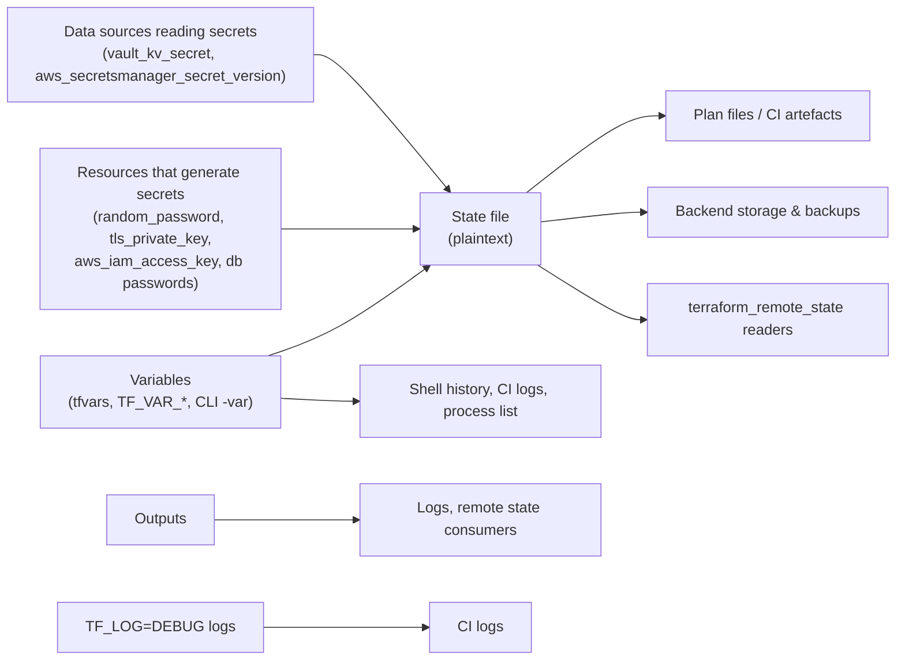
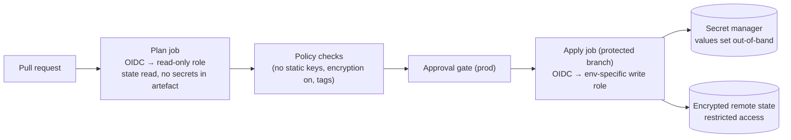

# 4.22 Terraform secrets and multiple providers

| | |
|---|---|
| Level | Intermediate |
| Priority tier | 1 |
| Lab venue | Terraform/OpenTofu 1.6+; `vault server -dev` in Docker; sandbox cloud accounts (two regions or projects) |
| Part | Part 4: Automation and infrastructure as code |
| Status | Drafted, labs **untested** |

## Why this matters for AI infrastructure

Terraform is the tool with the strongest credentials in your organisation: it can create and destroy GPU clusters, IAM roles, networks and databases. Its configuration and state are also where secrets leak most quietly: a database password generated by `random_password`, a service-account key created by a resource, a token read through a data source, all land in plaintext in state, plan files and CI logs. And AI platforms are inherently multi-everything: several regions to chase GPU capacity, several accounts or projects for isolation, several clouds (a hyperscaler plus a GPU cloud such as Nebius or CoreWeave), plus Kubernetes, Helm, Vault, GitHub and DNS providers in the same estate. This chapter covers how to keep secrets out of places they should not be, how to authenticate with short-lived identity instead of static keys, and how to structure multiple providers without making a mess.

## Prerequisites and outcomes

Needs 4.18 to 4.21 and secrets concepts from 4.12. After this chapter you can:

- Identify every place a secret can leak in Terraform (state, plan, outputs, logs, variables, history) and apply layered mitigations.
- Use `sensitive`, ephemeral values/resources, write-only arguments, secret-manager data sources, external generation, and state encryption appropriately and know the limits of each.
- Authenticate providers with environment-supplied, short-lived, federated credentials (OIDC/workload identity), and never hard-code credentials.
- Configure multiple providers and aliases, pass them to modules, and structure multi-region, multi-account and multi-cloud estates; understand dependency ordering across providers (the cluster-then-Kubernetes-provider problem).
- Pin, mirror and verify providers; manage provider upgrades.

## 1. Where secrets leak



Key facts:

- **`sensitive = true` only redacts CLI display.** The value is still in state and plan files. Sensitivity propagates through expressions, but any output marked sensitive can be read with `terraform output -json`, and `terraform_remote_state` consumers can read it from state.
- **State contains all attribute values** returned by the provider, including generated passwords and private keys. Anyone who can read the state can read the secrets.
- **Variables** passed on the command line (`-var 'password=...'`) appear in shell history and process lists; `.tfvars` files with secrets must never be committed.
- **Provisioners and `local-exec`** may echo secrets to logs.
- **`TF_LOG`** output includes API requests and sometimes credentials/tokens.
- **Plan files** (`-out`) contain the values and are often stored as CI artefacts.
- **Git history** keeps secrets forever (4.1).

## 2. Strategies, from best to worst

1. **Don't use secrets at all**: prefer identity-based access (IAM roles, workload identity, managed identities, IAM database authentication, IRSA, Kubernetes service accounts) over passwords and keys. Many "needs a password" cases can be replaced by roles bound to the workload.
2. **Let the target service generate and store the secret; Terraform only references it.** For example, a managed database with `manage_master_user_password = true` (AWS RDS creates the password in Secrets Manager) or Cloud SQL IAM auth; Terraform stores only the secret's ARN/name.
3. **Create the secret container, not the value**: Terraform creates `aws_secretsmanager_secret`/`google_secret_manager_secret`; the value is set out-of-band (CI step, operator, rotation Lambda) so it never enters state.
4. **Use ephemeral/write-only features** (newer Terraform and OpenTofu): *ephemeral resources/values* exist only during the run and are not persisted to state or plan (for example reading a secret from a secret manager for use in a provider configuration or a write-only argument); *write-only arguments* (named like `password_wo`) accept a value that is sent to the provider but never stored. Support depends on version and on each provider/resource; verify before relying on it.
5. **Read at apply time from a secret manager** with a data source and pass it into the resource: the value is still stored in state if the resource attribute persists it. Pair with encrypted, access-controlled state.
6. **Encrypt state** (backend encryption plus, in OpenTofu, client-side state and plan encryption) and restrict who can read it; separate state per sensitivity level.
7. **Last resort: pass via environment variables** (`TF_VAR_db_password`) from the CI secret store, marked `sensitive`, with the understanding that it ends up in state.

Anti-patterns: committing `terraform.tfvars` with secrets; generating long-lived access keys in Terraform and outputting them; storing secrets as plaintext `locals`; passing secrets through `-var` on a shared host; using `terraform_remote_state` outputs to move secrets between teams; trusting `sensitive` as protection.

### Secret Management Taxonomy from *Terraform: Up and Running* (`TUR` Chapter 6)

In *Terraform: Up and Running* Chapter 6 (*Managing Secrets with Terraform*), Yevgeniy Brikman classifies secrets across three dimensions—**type of secret**, **storage architecture**, and **how secrets are passed to providers vs. resources**:
1. **Three types of secrets (`TUR` Chapter 6 Table 6-1):**
   - **Personal secrets:** Credentials belonging to an individual human (stored in password managers like `1Password`, `LastPass`, `Dashlane`, `KeePass`, `pass`, or OS Keychain via **`aws-vault`** so humans never store plaintext keys in `~/.aws/credentials`).
   - **Customer secrets:** Passwords and API keys belonging to end users of your application (stored as salted cryptographic hashes or managed via `Auth0`, `AWS Cognito`, `Okta`).
   - **Infrastructure secrets:** Database passwords, TLS private keys, service-to-service tokens, and cloud provider credentials used by servers and CI pipelines.
2. **File-based vs. Centralized secret stores (`TUR` Chapter 6 Table 6-3):**
   - *File-based secret stores (`AWS KMS` + `data "aws_kms_secrets"`, `GCP KMS`, `Azure Key Vault`, `PGP`, `sops`):* Encrypt a `db-creds.yml.encrypted` file using a Customer Master Key (`aws_kms_key` + `aws_kms_alias` `alias/kms-cmk-example`) or `sops`, commit the ciphertext to Git, and decrypt at plan/apply time (`yamldecode(data.aws_kms_secrets.creds.plaintext["db"])`).
   - *Centralized secret stores (`HashiCorp Vault`, `AWS Secrets Manager` + `data "aws_secretsmanager_secret_version"`, `Google Secret Manager`, `Azure Key Vault`, `SSM Parameter Store`):* Store secrets in a dedicated API service with fine-grained IAM, audit logs, and automatic rotation.
   - *The universal state caveat:* In Terraform (< 1.10 / without write-only arguments), whether you pass a database password to `aws_db_instance` via `TF_VAR_db_password`, `data "aws_kms_secrets"`, or `data "aws_secretsmanager_secret_version"`, **the `aws_db_instance` resource still records `password` in plaintext inside `terraform.tfstate`** (modeled in `classify_secret_state_exposure()` in `code/part04/terraform_secrets_providers.py`). Eliminate state exposure by using `manage_master_user_password = true`, IAM database authentication, write-only arguments (`password_wo`) + `ephemeral` blocks, or OpenTofu state encryption.

### Examples

```hcl
variable "db_password" {
  type      = string
  sensitive = true                     # redacted in output; still in state
}

# Better: let AWS manage and rotate the master password
resource "aws_db_instance" "meta" {
  identifier                  = "mlflow-meta"
  engine                      = "postgres"
  instance_class              = "db.m6g.large"
  allocated_storage           = 100
  username                    = "mlflow"
  manage_master_user_password = true   # secret lives in Secrets Manager, rotated by AWS
  storage_encrypted           = true
  deletion_protection         = true
  lifecycle { prevent_destroy = true }
}
output "db_secret_arn" {
  value = aws_db_instance.meta.master_user_secret[0].secret_arn   # reference, not the secret
}

# Secret container only; value set elsewhere
resource "google_secret_manager_secret" "hf_token" {
  secret_id = "huggingface-token"
  replication { auto {} }
}
# the version is added by a controlled process (not in Terraform state)

# Consumers read secrets at runtime via IAM, not via Terraform outputs
resource "google_secret_manager_secret_iam_member" "trainer" {
  secret_id = google_secret_manager_secret.hf_token.id
  role      = "roles/secretmanager.secretAccessor"
  member    = "serviceAccount:${google_service_account.trainer.email}"
}
```

```hcl
# Ephemeral pattern (illustrative; check your version's syntax and provider support)
ephemeral "aws_secretsmanager_secret_version" "db" {
  secret_id = aws_db_instance.meta.master_user_secret[0].secret_arn
}
provider "postgresql" {
  host     = aws_db_instance.meta.address
  username = "mlflow"
  password = jsondecode(ephemeral.aws_secretsmanager_secret_version.db.secret_string)["password"]   # not persisted in state
}
```

### Generated credentials

If Terraform must generate a secret (`random_password`, `tls_private_key`), treat the state as a secret store: encrypted backend with KMS, versioning, tight IAM, audit logs, no human read access in production, and rotate periodically (`-replace=random_password.x`) with consumers reading from a secret manager. Do not expose generated secrets as outputs. For TLS private keys, prefer issuing certificates from a CA (ACME, Vault PKI, cert-manager) so keys never pass through Terraform.

## 3. Authenticating providers

Principles: **no credentials in code**, **short-lived** where possible, **least privilege per stack**, **separate identities** for plan (read-only) and apply, and **separate identities per environment**.

| Platform | Preferred mechanism in CI | Notes |
|---|---|---|
| AWS | OIDC federation to an IAM role (`AssumeRoleWithWebIdentity`); `assume_role` in provider; instance/Task roles | Trust policy conditions on repo/branch/environment |
| GCP | Workload Identity Federation; service account impersonation (`impersonate_service_account`); ADC | No JSON keys |
| Azure | Federated credentials / managed identity (`use_oidc`, `use_msi`) | |
| Kubernetes/Helm | Short-lived tokens from cloud CLI exec plugin (`exec { command = "gke-gcloud-auth-plugin" }`), service account tokens | Avoid static kubeconfig with admin certs |
| Vault | JWT/OIDC auth from CI, AppRole for machines | Tokens with short TTL |
| GitHub/GitLab | App installation tokens, fine-grained PATs from a secret manager | |
| Nebius / CoreWeave / other GPU clouds | Service-account credentials or federated tokens supported by the provider; secrets from environment | Check provider docs for auth modes |

```hcl
provider "aws" {
  region = var.region
  assume_role {
    role_arn     = var.deploy_role_arn           # role in the target account
    session_name = "terraform-${var.env}"
  }
}

provider "google" {
  project                     = var.project_id
  region                      = var.region
  impersonate_service_account = var.tf_service_account    # CI identity impersonates a scoped SA
}
```

Operational rules: provider configuration may use variables and data sources but **cannot depend on values unknown at plan time** reliably (see section 5); do not interpolate secrets into provider blocks from plain variables if ephemeral options are available; log redaction; and never store provider credentials in the same state they secure.

## 4. Multiple provider configurations

### Aliases

```hcl
terraform {
  required_providers {
    aws = { source = "hashicorp/aws", version = "~> 5.60" }
  }
}

provider "aws" {            # default configuration
  region = "us-east-1"
}
provider "aws" {
  alias  = "usw2"
  region = "us-west-2"
}
provider "aws" {
  alias = "shared_services"
  region = "us-east-1"
  assume_role { role_arn = "arn:aws:iam::111111111111:role/terraform-shared" }
}

resource "aws_s3_bucket" "ckpt_east" { bucket = "acme-ckpt-use1" }
resource "aws_s3_bucket" "ckpt_west" {
  provider = aws.usw2
  bucket   = "acme-ckpt-usw2"
}
```

The `provider` meta-argument selects an alias per resource/data source; if omitted, the default (unaliased) configuration is used. Aliases cannot be computed dynamically or varied by `for_each` key; for N regions you either write N provider blocks and N module calls, or generate files with a tool (Terragrunt, CDKTF, templating) or use separate stacks per region.

### Passing providers to modules

```hcl
module "pool_us" {
  source    = "../../modules/gpu-capacity"
  providers = { aws = aws }
}
module "pool_west" {
  source    = "../../modules/gpu-capacity"
  providers = { aws = aws.usw2 }
}
```

```hcl
# inside the module
terraform {
  required_providers {
    aws = {
      source                = "hashicorp/aws"
      configuration_aliases = [aws.peer]          # module expects an extra configuration
    }
  }
}
resource "aws_vpc_peering_connection_accepter" "this" {
  provider = aws.peer
  # ...
}
```

Rules: child modules inherit the default provider implicitly; non-default configurations must be passed explicitly; a module that declares its own `provider` block cannot be removed cleanly (the provider config disappears with the module while resources still need it) and cannot be used with `count`/`for_each`; keep provider blocks in the root.

### Typical multi-provider patterns for AI platforms

- **Multi-region capacity (`TUR` Chapter 7 Part 1):** GPU quota and capacity differ per region; deploy identical stacks per region (module per region), with a regional alias each, and a global layer for DNS, IAM and artefact registries. As `TUR` Chapter 7 demonstrates, remember two multi-region realities: (1) **AMI IDs and zone names are region-specific** (`ami-0fb653ca2d3203ac1` in `us-east-2` does not exist in `us-west-1`—use regional `data "aws_ami"` lookups with `provider = aws.region_1` and `provider = aws.region_2`), and (2) for cross-region stateful services like an **RDS MySQL primary + read replica**, instantiate the same `modules/data-stores/mysql` module twice—once in `region_1` (`backup_retention_period = 1`) and once in `region_2` (`providers = { aws = aws.region_2 }`, `replicate_source_db = module.mysql_primary.arn`). Also note that **every `provider` block spawns a separate OS subprocess over RPC** (`TUR` Chapter 7), so keep the number of `provider` blocks per root module reasonable rather than defining dozens of unused regional providers.
- **Multi-account isolation (`TUR` Chapter 7 Part 2):** separate accounts/projects (`aws_organizations_organization`, `aws_organizations_account`) for dev, staging, prod and shared services (logging, networks, ECR/Artifact Registry). Provider aliases with `assume_role` or impersonation let one pipeline manage a **shared services** account and a **workload** account in the same apply for cross-account trust (e.g., peering requester/accepter, RAM shares, bucket policies, declared via `configuration_aliases = [aws.parent, aws.child]`). Prefer separate states and pipelines per account for blast radius; use cross-account aliases only where an atomic cross-account link is needed.
- **Multi-cloud / GPU cloud**: hyperscaler for control plane and data services, a GPU cloud for capacity. Providers for each (`google`, `nebius`, `kubernetes`, `helm`, `vault`, `cloudflare`/DNS) in distinct layers: networking/VPN or interconnect first, then cluster provisioning, then cluster add-ons. Cross-cloud consistency comes from modules that expose a common interface (node pool inputs) with provider-specific implementations.
- **Kubernetes and Helm providers**: configure from the cluster resource's outputs only if the cluster is created in the same apply, which often fails (unknown at plan, authentication tokens expiring). **Layer it**: stack 1 creates the cluster; stack 2 configures `kubernetes`/`helm` providers using data sources (`google_container_cluster`, `aws_eks_cluster_auth`, exec plugin) and installs add-ons (4.25).

```hcl
data "google_client_config" "default" {}
data "google_container_cluster" "main" {
  name     = var.cluster_name
  location = var.region
}
provider "kubernetes" {
  host                   = "https://${data.google_container_cluster.main.endpoint}"
  token                  = data.google_client_config.default.access_token
  cluster_ca_certificate = base64decode(data.google_container_cluster.main.master_auth[0].cluster_ca_certificate)
}
provider "helm" {
  kubernetes {
    host                   = "https://${data.google_container_cluster.main.endpoint}"
    token                  = data.google_client_config.default.access_token
    cluster_ca_certificate = base64decode(data.google_container_cluster.main.master_auth[0].cluster_ca_certificate)
  }
}
```

(Tokens from `google_client_config` are short-lived and end up in state; an `exec` plugin avoids storing them; the cluster must exist before this stack runs.)

### Provider dependency ordering and the "provider depends on resource" problem

Providers are initialised before resources are planned, so provider arguments derived from unknown values (a cluster endpoint not yet created) cause errors or silently use empty settings. Solutions: layered stacks (preferred), data sources that read an already-created cluster, `-target` bootstrapping only for first-time creation (documented one-off), or splitting create/configure into separate pipelines. Never use the same provider for creating and then depending on its own created credentials in one plan if you can avoid it.

## 5. Provider versioning, locking and distribution

- Declare `required_providers` with `source` and `version` ranges in every module; the root's `.terraform.lock.hcl` records exact versions and hashes (`h1:` and `zh:` checksums). Commit it; use `terraform providers lock -platform=linux_amd64 -platform=darwin_arm64 ...` so CI and laptops share hashes.
- **Upgrades** are deliberate: `terraform init -upgrade` in a branch; read the provider changelog; run plans across all stacks; look for new defaults and resource behaviour changes; promote through environments (4.2).
- **Mirrors and caches**: `provider_installation` in `~/.terraformrc` with `network_mirror`/`filesystem_mirror` and `direct { exclude }` rules for air-gapped or rate-limited environments, `TF_PLUGIN_CACHE_DIR` to share downloads on runners. Verify signatures/checksums; restrict which providers may be installed (supply-chain control: allow only `hashicorp/*` and approved namespaces through the mirror).
- **Custom or in-house providers** (for BCM, Redfish gateways, internal APIs) are built with the Terraform Plugin Framework (Go), published to a private registry or filesystem mirror, versioned and documented like any module.
- **Provider quality**: official vs partner vs community; check maintenance, issue tracker, release cadence; avoid unmaintained providers for critical paths; wrap with modules to isolate changes.
- **Resource coverage gaps**: when no provider exists for a system, options include `null_resource`/`terraform_data` with `local-exec` calling an API/CLI (fragile), the `restapi` or `http` provider, `external` data source (script returning JSON), writing a provider, or using Ansible/Crossplane for that part (4.16).

## 6. Putting it together: a secure pipeline sketch



Checklist: no credentials in repo or tfvars; plan identity ≠ apply identity; per-environment identities; encrypted, versioned state with narrow access; secrets referenced, not materialised; saved plans stored encrypted with short retention; logs scrubbed; secret scanning in pre-commit/CI (4.1, 4.12); drift/audit jobs read-only.

## 7. Lab

First, run the self-checking Python lab (`code/part04/terraform_secrets_providers_lab.py`) locally. It verifies the state secret-exposure classifier (`classify_secret_state_exposure`: contrasting `sensitive_var_or_data_source` and `random_password_resource` against `manage_master_user_password` and `ephemeral_or_write_only`), the GitHub Actions OIDC `AssumeRoleWithWebIdentity` trust-policy evaluator (`verify_github_oidc_assume_role`, `TUR` Ch. 6), and multi-provider `configuration_aliases` wiring validation (`validate_child_module_provider_wiring`, `TUR` Ch. 7).

```bash
python3 code/part04/terraform_secrets_providers_lab.py
```

Next, on a machine with Terraform/OpenTofu 1.6+ and Docker (all interactive shell steps below are `untested here`), work through these exercises:

1. **Find the leaks**: create `random_password`, `tls_private_key`, and a `sensitive` variable; apply; `jq` the state to read each plaintext; show `terraform output -json` exposing a sensitive output; show the plan file content with `terraform show -json tfplan`.
2. **Mitigate**: replace the generated password by a managed-secret design (secret container + out-of-band value, or `manage_master_user_password`); confirm the state no longer contains the secret.
3. **Vault integration**: run a Vault dev server; read a secret with the `vault` provider data source; observe it in state; then try the ephemeral variant (if your version supports it) and compare.
4. **State encryption**: with OpenTofu configure state encryption using a passphrase/KMS key; inspect the state file bytes; test key rotation. With Terraform OSS, enable backend encryption and restrict bucket access; document the difference.
5. **OIDC auth**: configure a CI job (GitHub Actions or GitLab) to assume a cloud role via OIDC; remove static keys; prove a feature branch cannot assume the apply role.
6. **Aliases**: deploy a bucket in two regions with provider aliases; refactor into a module called twice with `providers` maps; try `for_each` over regions and observe the limitation.
7. **Cross-account**: use `assume_role` aliases to create a peering requester/accepter or a cross-account bucket policy in one apply; then split into two stacks and compare risk and permissions.
8. **Kubernetes layering**: try creating a kind/GKE cluster and configuring the `kubernetes` provider in the same apply, observe the failure/fragility; split into two stacks using data sources (4.25).
9. **Provider locking and mirrors**: generate multi-platform lock hashes; configure a filesystem mirror and block direct downloads; upgrade a provider in a branch and review the plan differences.
10. **Secret scanning**: add gitleaks/pre-commit and a policy (Conftest) that rejects plans containing `aws_iam_access_key` or outputs not marked sensitive; demonstrate a failing PR.
11. **Rotation**: rotate a Terraform-generated password with `-replace`, update the consuming workload via the secret manager, and validate zero downtime.
12. **Clean up.**

## 8. Common mistakes

- Believing `sensitive = true` protects state, plans or remote-state consumers.
- Static cloud keys in CI variables or `.tfvars`; admin credentials for every pipeline.
- Generating IAM access keys or private keys in Terraform and outputting them.
- One state holding secrets for many teams; broad `terraform_remote_state` access.
- Provider blocks inside child modules; attempts to `for_each` over providers.
- Configuring the Kubernetes/Helm provider from a cluster created in the same apply.
- Unpinned providers; missing lock file in Git; no mirror in restricted environments.
- Sharing a default provider configuration across prod and dev accounts through the same credentials.
- Leaving `TF_LOG=DEBUG` on in CI.
- No rotation plan for credentials Terraform created.

## 9. Interview angles

- "How do you handle secrets in Terraform? What does `sensitive` really do?"
- "How do you authenticate Terraform in CI to AWS/GCP without keys?" (OIDC/WIF, scoped roles.)
- "How do you deploy to multiple regions or accounts? What are provider aliases and their limits?"
- "Why shouldn't modules define providers? How do you pass them?"
- "How do you configure the Kubernetes provider for a cluster you also create?" (layered stacks/data sources.)
- "How do you protect the state file? Who may read it?"
- "How do you pin and verify providers? What does the lock file contain?"
- "What would you do if you discover a secret in state?" (rotate, restrict, redesign, encrypt.)

## Exercises

1. **Where Secrets Leak in Terraform (`state`, `tfplan`, `outputs`, `TF_LOG`) and the 7-Tier Mitigation Hierarchy (`TUR` Chapter 6):** Using `classify_secret_state_exposure()` in `code/part04/terraform_secrets_providers.py`, trace why `sensitive = true`, `data "aws_kms_secrets"`, and `data "aws_secretsmanager_secret_version"` still leave plaintext secrets inside `terraform.tfstate` when passed to standard resource arguments, and compare them with (a) workload identity, (b) `manage_master_user_password = true`, (c) secret-container-only (`google_secret_manager_secret` without version), and (d) `ephemeral` resources + write-only (`password_wo`) arguments.
2. **Authenticating Providers Without Static Keys (`aws-vault`, EC2 `IMDS`, and GitHub Actions OIDC `AssumeRoleWithWebIdentity`, `TUR` Chapter 6):** Using `verify_github_oidc_assume_role()` in `code/part04/terraform_secrets_providers.py`, trace the exact HCL for `aws_iam_openid_connect_provider` (`https://token.actions.githubusercontent.com`, `client_id_list = ["sts.amazonaws.com"]`) and the IAM role trust policy (`StringEquals` on `token.actions.githubusercontent.com:sub == "repo:<ORG>/<REPO>:ref:refs/heads/main"`), and explain how `aws-vault` protects developer credentials locally.
3. **Multi-Region Provider Aliases (`alias`, Regional `data "aws_ami"`, and RDS Primary + Read Replica, `TUR` Chapter 7 Part 1):** Explain how `provider "aws" { alias = "usw2" }` and `provider = aws.usw2` work, why AMI IDs cannot be hardcoded across regions, how `TUR` Chapter 7 wires a cross-region RDS MySQL read replica (`replicate_source_db`), and why spawning hundreds of `provider` blocks hurts RPC performance.
4. **Multi-Account Isolation (`aws_organizations_account`, `assume_role`, and `configuration_aliases`, `TUR` Chapter 7 Part 2):** Using `validate_child_module_provider_wiring()` in `code/part04/terraform_secrets_providers.py`, show how a child module declares `configuration_aliases = [aws.parent, aws.child]` in `versions.tf` and how the root module passes `providers = { aws.parent = aws.mgmt, aws.child = aws.prod }` using `assume_role`.
5. **The \"Provider Depends on Resource\" Problem (`aws`/`google` Cluster + `kubernetes`/`helm` Providers, `TUR` Chapter 7 Part 3):** Explain why creating an EKS/GKE cluster and deploying `kubernetes_deployment` / `helm_release` resources into it in the same root module fails on clean creation or destruction, and show how layered stacks (`data "google_container_cluster"` + `data "google_client_config"` or `exec` auth plugin) solve it.
6. **Provider Locking (`terraform providers lock`), Air-Gapped Mirrors (`provider_installation`), and Supply-Chain Security:** Show the command to lock provider SHA-256 hashes across `linux_amd64` and `darwin_arm64` in `.terraform.lock.hcl`, configure a `filesystem_mirror` / `network_mirror` in `~/.terraformrc` blocking unapproved namespaces, and write a Conftest policy rule rejecting `aws_iam_access_key` resources in `plan.json`.

## Checkpoint questions (20)

<details>
<summary>1. List all seven places where a secret can leak in a Terraform workflow.</summary>

1. **`terraform.tfstate` (and `.tfstate.backup`):** Stores all resource and data-source attribute values in plaintext JSON.
2. **Saved plan files (`-out=tfplan`) and `plan.json` CI artifacts:** Contain every planned attribute value in plaintext.
3. **CLI variables (`-var="db_password=..."`):** Visible in shell history (`~/.bash_history`) and `/proc/<pid>/cmdline` (`ps aux`).
4. **Committed `.tfvars` or `.tf` files in Git history.**
5. **`terraform output -json` and `terraform_remote_state` consumers:** Any consumer with state read access can read sensitive outputs.
6. **Provisioner (`local-exec` / `remote-exec`) stdout logs.**
7. **Debug logs (`TF_LOG=DEBUG` / `TF_LOG=TRACE`):** Dump raw HTTP/gRPC request payloads into CI logs.
</details>

<details>
<summary>2. In *Terraform: Up and Running* Chapter 6, what are the three categories of secrets and the two secret storage architectures?</summary>

- **Three categories of secrets (`Table 6-1`):**
  1. **Personal secrets:** Individual human credentials (stored in `1Password`, `pass`, or OS Keychain via **`aws-vault`**).
  2. **Customer secrets:** End-user application credentials (hashed or managed in `Auth0`, `Cognito`, `Okta`).
  3. **Infrastructure secrets:** Database passwords, API tokens, and certs used by services and automation.
- **Two storage architectures:**
  1. **File-based secret stores (`AWS KMS` + `aws_kms_secrets`, `GCP KMS`, `PGP`, `sops`):** Encrypt files in Git using KMS/age keys and decrypt in memory during runs.
  2. **Centralized secret stores (`HashiCorp Vault`, `AWS Secrets Manager`, `Google Secret Manager`, `Azure Key Vault`):** Dedicated API services with IAM, audit logs, and rotation.
</details>

<details>
<summary>3. Why does reading a password from `data "aws_secretsmanager_secret_version"` (or `data "aws_kms_secrets"`) and passing it to `aws_db_instance.password` STILL leak the password into `terraform.tfstate` (`TUR` Chapter 6)?</summary>

Because Terraform records the state of **both** the `data` source (`data.aws_secretsmanager_secret_version.creds.secret_string`) **and** the target `aws_db_instance` resource (`password` attribute) inside `terraform.tfstate`. Even though you kept the secret out of `.tf` files in Git, `terraform.tfstate` still holds two plaintext copies of the password.
</details>

<details>
<summary>4. What are the four best ways to keep a database password or API token completely OUT of `terraform.tfstate`?</summary>

1. **Eliminate the password via IAM authentication / Workload Identity:** Use RDS/Cloud SQL IAM database authentication or GCP/AWS Workload Identity so no static password exists.
2. **Service-managed secrets (`manage_master_user_password = true`):** Tell AWS RDS to generate, store, and rotate the master password directly in AWS Secrets Manager; Terraform only stores `master_user_secret[0].secret_arn` in state.
3. **Create the secret container only (`google_secret_manager_secret` / `aws_secretsmanager_secret`):** Let Terraform create the empty secret metadata + IAM bindings (`roles/secretmanager.secretAccessor`), while an out-of-band CLI/rotation job populates the secret version payload.
4. **Use `ephemeral` resources and write-only arguments (`password_wo`)** in Terraform 1.10+/1.11+ or OpenTofu (or enable **OpenTofu client-side state encryption**).
</details>

<details>
<summary>5. How do `ephemeral` resources/variables and write-only arguments (`password_wo`) work in modern Terraform and OpenTofu?</summary>

- **`ephemeral "<type>" "<name>"` (and `variable "..." { ephemeral = true }`):** Ephemeral blocks exist **only in memory during the current `plan`/`apply` execution** and are **never written to `terraform.tfstate` or `tfplan` files** (ideal for fetching a temporary token or password needed by a `provider` block or write-only argument).
- **Write-only arguments (`password_wo` + `password_wo_version`):** Provider resource arguments marked write-only accept an ephemeral or sensitive value, transmit it to the cloud API during create/update, and store **`null` in `terraform.tfstate`** (triggering future updates only when the integer `password_wo_version` is incremented).
</details>

<details>
<summary>6. How does `aws-vault` protect human engineers running Terraform locally (`TUR` Chapter 6)?</summary>

Instead of storing plaintext `aws_access_key_id` and `aws_secret_access_key` in `~/.aws/credentials` (where any malware, npm package, or accidental backup can steal them), **`aws-vault add dev`** encrypts the credentials inside your OS native keychain (macOS Keychain, Windows Credential Manager, or Linux Secret Service/KWallet). Running **`aws-vault exec dev -- terraform plan`** calls AWS STS `GetSessionToken` / `AssumeRole` and injects **short-lived temporary `AWS_ACCESS_KEY_ID`, `AWS_SECRET_ACCESS_KEY`, and `AWS_SESSION_TOKEN` environment variables** into that single child process only.
</details>

<details>
<summary>7. In `TUR` Chapter 6, how do you configure AWS IAM OIDC Federation for GitHub Actions in Terraform (`aws_iam_openid_connect_provider`)?</summary>

1. Create `resource "aws_iam_openid_connect_provider" "github_actions"` with `url = "https://token.actions.githubusercontent.com"`, `client_id_list = ["sts.amazonaws.com"]`, and `thumbprint_list = [data.tls_certificate.github.certificates[0].sha1_fingerprint]`.
2. Create an `aws_iam_role` whose `assume_role_policy` allows `sts:AssumeRoleWithWebIdentity` from that OIDC provider ARN **only when** `StringEquals` matches `"token.actions.githubusercontent.com:sub" = "repo:<ORG>/<REPO>:ref:refs/heads/main"` (for the apply role).
3. In `.github/workflows/terraform.yml`, set `permissions: { id-token: write, contents: read }` and use `aws-actions/configure-aws-credentials` with `role-to-assume: <ROLE_ARN>`.
</details>

<details>
<summary>8. How do EC2 instances or GKE pods running Terraform (such as self-hosted Atlantis or CI runners) authenticate to the cloud without static keys (`TUR` Chapter 6)?</summary>

- **On AWS EC2 / EKS:** Attach an **`aws_iam_instance_profile` (`aws_iam_role`)** to the EC2 instance (or **IRSA / Pod Identity** on EKS). The AWS provider automatically queries the local Instance Metadata Service (**`http://169.254.169.254/latest/meta-data/iam/security-credentials/...`**, using IMDSv2 session tokens) for short-lived, auto-rotated credentials.
- **On GCP GCE / GKE:** Attach a scoped Google Service Account and Workload Identity; the `google` provider uses Application Default Credentials (**ADC**) automatically, and can impersonate per-environment roles via **`impersonate_service_account`**.
</details>

<details>
<summary>9. How do Provider Aliases (`alias = "usw2"`) work, and how do you select an aliased provider on a resource, data source, or module (`TUR` Chapter 7)?</summary>

Define a default `provider "aws" { region = "us-east-1" }` and one or more aliased blocks `provider "aws" { alias = "usw2"; region = "us-west-2" }`:
- **On a `resource` or `data` block:** Set **`provider = aws.usw2`**.
- **On a `module` block:** Pass the **`providers` map**: `providers = { aws = aws.usw2 }` (or `providers = { aws.primary = aws, aws.replica = aws.usw2 }` when the child module declares `configuration_aliases = [aws.primary, aws.replica]`).
</details>

<details>
<summary>10. Why can't you dynamically loop over provider blocks or pass `provider = aws.${each.key}` inside a `for_each` resource (`TUR` Chapter 7)?</summary>

In Terraform OSS, **provider configurations and `provider = ...` references are static graph constructs** resolved before `for_each` expansion—each `provider` block spawns a dedicated OS plugin subprocess over RPC (`TUR` Chapter 7). Therefore, you cannot write `provider = aws.${each.key}` in Terraform OSS (note: OpenTofu 1.9+ added support for `for_each` on `provider` blocks; in Terraform OSS, instantiate one module block per region or use separate per-region state stacks).
</details>

<details>
<summary>11. In `TUR` Chapter 7, why did launching an EC2 instance across two regions with the same hardcoded `ami` ID fail, and how do you fix it?</summary>

In AWS (unlike GCP global image families), **every AMI ID (`ami-0fb653ca2d3203ac1`) is scoped to a single AWS region**—using an `us-east-2` AMI ID with `provider = aws.region_2` (`us-west-1`) fails with `InvalidAMIID.NotFound`. Fix it by querying **`data "aws_ami"`** in each region (`provider = aws.region_1` and `provider = aws.region_2`) filtering on owner (`099720109477`) and image name pattern.
</details>

<details>
<summary>12. How does `TUR` Chapter 7 deploy a cross-region RDS MySQL Primary and Read Replica using a single reusable module?</summary>

1. In `us-east-2` (`aws.region_1`), call `module "mysql_primary"` with `backup_retention_period = 1` (mandatory on RDS to enable automated backups for replication) and export `output "arn"`.
2. In `us-west-1` (`aws.region_2`), call the **exact same module** as `module "mysql_replica"` passing `providers = { aws = aws.region_2 }` and **`replicate_source_db = module.mysql_primary.arn`** (which tells RDS to create a cross-region read replica instead of a standalone primary).
</details>

<details>
<summary>13. How do you use Provider Aliases with `assume_role` for Multi-Account AWS operations (`TUR` Chapter 7)?</summary>

Define an aliased provider for each target AWS account:
```hcl
provider "aws" {
  alias  = "prod"
  region = "us-east-1"
  assume_role {
    role_arn     = "arn:aws:iam::222222222222:role/OrganizationAccountAccessRole"
    session_name = "terraform-prod"
  }
}
```
When a module needs to create resources in both a parent/network account and a child/workload account (such as a VPC peering requester in Account A and an `aws_vpc_peering_connection_accepter` in Account B), the child module declares `configuration_aliases = [aws.parent, aws.child]` in `versions.tf` and the root module passes `providers = { aws.parent = aws.mgmt, aws.child = aws.prod }`.
</details>

<details>
<summary>14. Why is it dangerous to create a GKE/EKS cluster (`google_container_cluster` / `aws_eks_cluster`) and configure the `kubernetes`/`helm` provider in the same root module?</summary>

Terraform initializes providers **before** evaluating the resource graph. When the cluster does not exist yet, `google_container_cluster.main.endpoint` is unknown during `plan`, causing `kubernetes`/`helm` provider initialization to fail or connect to `localhost`; and if you later replace the cluster or run `terraform destroy`, the `kubernetes` provider fails when the API server disappears before Kubernetes resources are deleted. Always **separate Layer 1 (Cluster Provisioning)** from **Layer 2 (Kubernetes/Helm Add-ons)** in separate states.
</details>

<details>
<summary>15. When configuring the `kubernetes` and `helm` providers in Layer 2, why is an `exec` credential plugin safer than `token = data.google_client_config.default.access_token`?</summary>

While `token = data.google_client_config.default.access_token` (or `data.aws_eks_cluster_auth`) works, reading the token via a `data` source causes the `data` source's attributes—including that short-lived OAuth2/bearer `access_token`—to be **written into `terraform.tfstate`**. Configuring the provider's **`exec {}` block** (`command = "gke-gcloud-auth-plugin"` or `aws eks get-token`) fetches the token directly inside the provider subprocess at runtime without storing any token in `terraform.tfstate`.
</details>

<details>
<summary>16. Why does `terraform init` fail in CI when a developer on an Apple Silicon Mac (`darwin_arm64`) commits `.terraform.lock.hcl` and CI runs on Linux (`linux_amd64`), and how do you fix it?</summary>

By default, `terraform init` records the binary `h1:` hash in `.terraform.lock.hcl` only for the **current OS/architecture** (`darwin_arm64`) alongside Registry `zh:` zip hashes. If a provider comes from a filesystem mirror or non-standard source without `zh:` hashes, a `linux_amd64` CI runner fails with `checksum list has no SHA-256 hash fordarwin_arm64 / linux_amd64`. Fix it by running:
**`terraform providers lock -platform=linux_amd64 -platform=darwin_arm64 -platform=darwin_amd64`**
before committing `.terraform.lock.hcl`.
</details>

<details>
<summary>17. How do `provider_installation` mirrors in `~/.terraformrc` and `TF_PLUGIN_CACHE_DIR` work in air-gapped or high-scale CI environments?</summary>

- **`TF_PLUGIN_CACHE_DIR="/var/cache/terraform/plugin-cache"`:** Caches downloaded provider binaries (which are often 100–300 MiB each) on a shared runner volume so `terraform init` links/copies from local disk in 1 second instead of downloading hundreds of megabytes on every PR.
- **`provider_installation` in `~/.terraformrc`:** Redirects provider downloads to an internal **`filesystem_mirror`** or HTTPS **`network_mirror`** (`include = ["registry.terraform.io/hashicorp/*"]`) while setting **`direct { exclude = ["registry.terraform.io/*/*"] }`** so CI runners never reach the public internet and can only install vetted provider namespaces.
</details>

<details>
<summary>18. If Terraform generated a secret via `random_password.db` and you need to rotate it, how do you trigger rotation safely?</summary>

Run `terraform plan -replace="random_password.db" -out=tfplan` (or change a `keepers = { rotation_date = "2026-10" }` map on `random_password.db`). Remember that rotating a single password in place causes brief authentication failures on running apps until they reload the new secret—for zero downtime, use a Secret Manager with two-phase rotation (Chapter 4.12) or `manage_master_user_password = true` with AWS Secrets Manager rotation Lambdas.
</details>

<details>
<summary>19. What are your options when no Terraform provider exists for an internal AI platform service or hardware appliance?</summary>

In order of durability:
1. **Write a custom Terraform Provider in Go** using the **Terraform Plugin Framework** (`terraform-plugin-framework`) and publish it to your private registry/mirror.
2. **Delegate day-2 configuration to Ansible** (invoked by CI or AWX/AAP after Terraform outputs inventory).
3. Use a generic REST provider (**`Mastercard/restapi`**) for simple JSON CRUD endpoints.
4. Use `data "external"` (a local script reading JSON on `stdin` and emitting a flat `map(string)` JSON on `stdout` for read-only lookups) or `terraform_data` + `local-exec` only as a last resort.
</details>

<details>
<summary>20. How do you write an OPA/Conftest policy that blocks PRs from creating static `aws_iam_access_key` or `google_service_account_key` resources in `plan.json`?</summary>

Inspect `input.resource_changes[_]` in `plan.json`:
```rego
package terraform.security

FORBIDDEN_KEY_TYPES := {"aws_iam_access_key", "google_service_account_key"}

deny contains msg if {
  rc := input.resource_changes[_]
  rc.type in FORBIDDEN_KEY_TYPES
  "create" in rc.change.actions
  msg := sprintf("%s (%s) creates a static long-lived key; use OIDC / Workload Identity instead", [rc.address, rc.type])
}
```
</details>

## Sources and review notes

- **Sources read in full:**
  - `terraform-up-and-running-3rd-edition` — Yevgeniy Brikman, *Terraform: Up and Running*, 3rd ed., **Chapter 6: Managing Secrets with Terraform** (read in full: 3 secret categories personal/customer/infrastructure, file-based `AWS KMS`/`sops` vs centralized `Vault`/`AWS Secrets Manager`/`Google Secret Manager` stores, provider auth via `aws-vault` for humans, EC2 IAM Instance Profiles via `169.254.169.254` IMDS, and GitHub Actions OIDC via `aws_iam_openid_connect_provider` + `sts:AssumeRoleWithWebIdentity` conditioned on `repo:<ORG>/<REPO>:ref:refs/heads/main`, plus passing secrets to resources via `TF_VAR_*`, `aws_kms_secrets`, and `aws_secretsmanager_secret_version` and their plaintext presence in `terraform.tfstate`) and **Chapter 7: Working with Multiple Providers** (read in full: how providers work over RPC subprocesses, multi-region `alias` deployment, regional `data "aws_ami"` lookups, RDS MySQL primary + cross-region read replica via `replicate_source_db`, multi-account isolation with `aws_organizations_account`, `assume_role`, and `configuration_aliases = [aws.parent, aws.child]`, and multi-provider `aws` EKS + `kubernetes` deployment).
  - `nvidia-devops` (`volume-10/05-terraform-for-infrastructure-as-code.md` and `volume-10/11-cicd-for-infrastructure-and-cluster-configuration.md`): secrets in pipelines, ephemeral/write-only patterns, and multi-provider state handling.
- **Run here:** `python3 code/part04/terraform_secrets_providers_lab.py` (3 passed, 0 failed).
- **Explicitly labelled inferences:** The `classify_secret_state_exposure`, `verify_github_oidc_assume_role`, and `validate_child_module_provider_wiring` models in `code/part04/terraform_secrets_providers.py`, the `aws_db_instance.meta` (`manage_master_user_password = true`), `google_secret_manager_secret.hf_token`, and `ephemeral "aws_secretsmanager_secret_version"` examples are the author's constructions synthesizing `TUR` Chapters 6 & 7 and `volume-10` (plus original study items 21, 22, 23, 24, 25, 26, 27, 28, 29, and 30).
- **Not verified on live hardware:** Live `aws-vault`, AWS KMS/Secrets Manager, GCP Secret Manager, OIDC federation, and multi-region/multi-account `terraform apply` runs (`db.m6g.large`, `100` GB, `~> 5.60`, `111111111111`, `169.254.169.254`, `099720109477`) are marked (`untested here`) where not executed by `terraform_secrets_providers_lab.py`.
