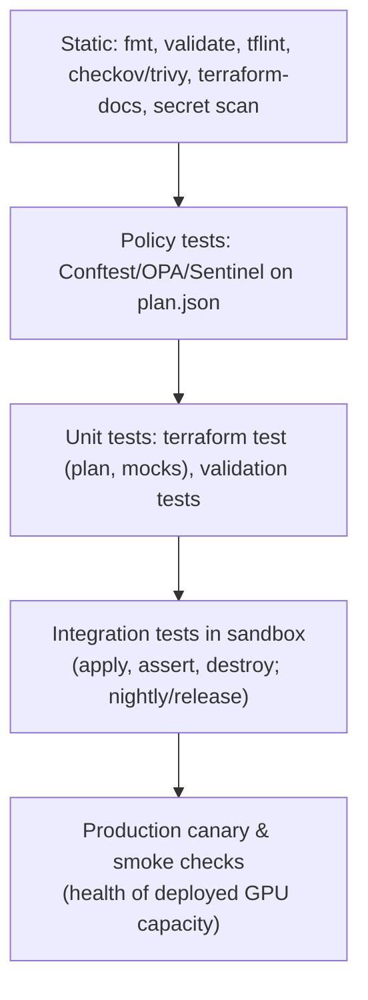
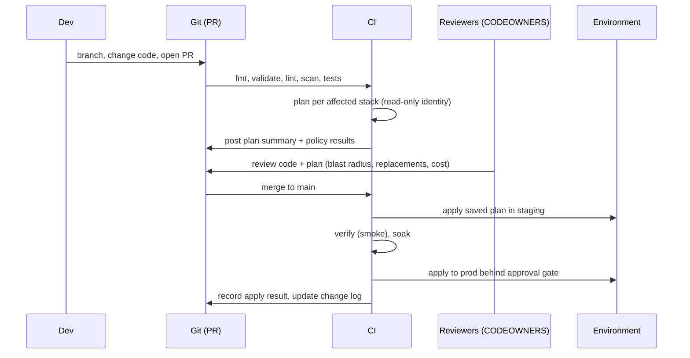

# 4.23 Production-grade Terraform: structure, testing and team workflows

| | |
|---|---|
| Level | Advanced |
| Priority tier | 1 |
| Lab venue | Terraform/OpenTofu 1.6+, GitHub or GitLab with Actions/CI, Atlantis (optional), sandbox cloud account with budgets |
| Part | Part 4: Automation and infrastructure as code |
| Status | Drafted, labs **untested** |

## Why this matters for AI infrastructure

Consider a GPU training platform that changes constantly. New capacity turns up in a new region, a new node pool arrives for a new accelerator generation, quotas get adjusted, and a new team needs its own network policy. Each change can cost tens of thousands of dollars per day or interrupt a multi-week training run.

Terraform that works on a laptop is not enough for this. You need a repeatable process. That process has a repository layout that limits blast radius, standards that make changes reviewable, and tests at several levels. It also has pipelines that produce evidence (4.2), policies that stop expensive or insecure mistakes, and operating practices that keep dozens of engineers from stepping on each other. This chapter turns individual Terraform skills into a production practice.

## Prerequisites and outcomes

This chapter builds on 4.2 and 4.18 to 4.22, so work through those first. When you finish, you will be able to do six things:

- Organise a repository for several environments, accounts and teams. You will weigh live code against modules, and layered stacks against orchestration with Terragrunt, Terramate or stacks.
- Write a production-readiness checklist that Terraform code and modules must pass.
- Build a test strategy that covers static analysis, unit tests with `terraform test`, integration tests in ephemeral environments, policy tests, upgrade tests and smoke tests of what was deployed.
- Run team workflows: branching, review, plan on pull request, apply on merge, locking, promotion between environments, drift detection and emergency changes.
- Add guardrails for cost, security and compliance with OPA, Sentinel, budgets, quotas and tagging, and design controls specific to GPUs.
- Plan upgrades of Terraform or OpenTofu, providers and modules, and plan migrations such as state moves and refactors, so that each one stays safe.

## 1. Repository structure

A new engineer's first question is usually where a change belongs. The repository layout answers that before anyone opens a file. Reusable building blocks live in one place, the stacks that actually deploy live in another, and each stack keeps its own state.

### Live vs modules

```text
platform-infra/
├── modules/                         # reusable, versioned building blocks (or separate repo)
│   ├── network/  checkpoint-bucket/  gke-cluster/  gpu-pool/  iam-workload/
├── live/                            # deployable stacks (root modules); one state each
│   ├── _envcommon/                  # shared variable defaults (if using Terragrunt/Terramate)
│   ├── global/{iam,dns,tfstate}/
│   ├── prod/
│   │   ├── account.hcl              # account/project IDs, regions
│   │   ├── us-central1/
│   │   │   ├── network/ storage/ cluster/ gpu-pools/ observability/
│   │   └── europe-west4/ ...
│   ├── staging/ ...
│   └── lab/ ...
├── policies/                        # OPA/Rego, Checkov custom checks
├── tests/                           # integration tests (Terratest/pytest)
├── tools/                           # scripts, pre-commit config
├── .github/workflows/ or .gitlab-ci.yml
├── CODEOWNERS
└── docs/ (ADRs, runbooks)
```

The tree separates reusable code from deployable code. Each folder under `live/` is a root module with one state, so its path also tells a reviewer how far a change can reach.

Give every stack its own directory, and give every environment its own directory too. Do not use Git branches for environments (4.1). A stack's path expresses its blast radius, which makes that path the first thing to check in a review.

Keep modules apart from live code. If you work inside a monorepo, a local path is fine during development. Higher environments should still consume modules through pinned versions, either Git tags or a registry, and the promotion process has to pin the version before production (4.20).

Layer the stacks by dependency and by how often they change: global or foundation first, then network, storage, cluster, gpu-pools and add-ons (4.19, 4.25). Dependencies flow downward only, so a lower layer never reads from a higher one.

Give each stack one owner, recorded in CODEOWNERS. The platform team owns shared foundations. A research team can own its own pools, with platform review of the module interface.

Enforce naming and tagging standards through modules and policies. The tags are `owner`, `cost_center`, `environment`, `managed_by=terraform`, and `ttl` for ephemeral stacks.

Keep environment values in `terraform.tfvars`, or in a small `locals` or YAML data file per stack. Put no business logic in tfvars, and keep secrets out of it entirely (4.22).

### Orchestration of many stacks

Plain Terraform has no cross-stack orchestration, so you need a tool or a script for that job. The table compares the common options.

| Tool | Idea | Notes |
|---|---|---|
| **Terragrunt** | Thin wrapper: DRY backend and provider config, `dependency` blocks, `run-all` ordering | Widely used; additional abstraction and its own learning curve |
| **Terramate** | Stack metadata, change detection (only stacks touched by a PR), code generation | Good with CI path filtering |
| **Terraform stacks / HCP** | First-party multi-stack orchestration with deployments | Platform-dependent; evolving |
| **Atlantis / Spacelift / env0 / Scalr / HCP workspaces** | PR-driven runs per project with locks, policies, dependencies | Choose by hosting and policy needs |
| **Make/scripts/CI matrix** | Simple per-directory loops | Fine for small estates; grows brittle |

Whichever tool you choose, you should plan only what changed (using path filters or change detection), apply in dependency order, serialise per state, and make it obvious to reviewers which stacks a PR affects.

### Keeping `live/` DRY with Terragrunt (*Terraform: Up and Running* Chapter 10)

Copy-pasted `backend` and `provider` blocks multiply quickly across dozens of folders in `live/`. *Terraform: Up and Running*, chapter 10 (*How to Use Terraform as a Team*), by Yevgeniy Brikman, shows how Terragrunt removes that repetition. Two pieces do most of the work.

1. The root file, `live/stage/terragrunt.hcl`, defines the S3 backend once for the environment. It uses `path_relative_to_include()` to set the state key, so `live/stage/services/hello-world-app/terragrunt.hcl` stores its state at `services/hello-world-app/terraform.tfstate`. That behaviour is tested in `code/part04/terraform_production_guardrails_lab.py`.
   ```hcl
   remote_state {
     backend = "s3"
     generate = {
       path      = "backend.tf"
       if_exists = "overwrite"
     }
     config = {
       bucket         = "acme-tfstate-stage"
       key            = "${path_relative_to_include()}/terraform.tfstate"
       region         = "us-east-2"
       encrypt        = true
       dynamodb_table = "acme-tfstate-locks"
     }
   }
   ```
2. Each child `terragrunt.hcl` pulls in the root backend with `include { path = find_in_parent_folders() }`. The hello-world-app stack points its `terraform { source = "github.com/<OWNER>/modules//services/hello-world-app?ref=v0.0.8" }` at a versioned module, and declares its cross-stack dependency with `dependency "mysql" { config_path = "../../data-stores/mysql" }`. It passes `inputs = { mysql_config = dependency.mysql.outputs }` into the module. Running `terragrunt run-all apply` builds the cross-folder graph, applies `data-stores/mysql` first, and then applies `services/hello-world-app`.

## 2. Production-readiness checklist

A stack that works on a laptop can still fail the first time it manages production. Before you let any stack or module near production, walk through the checklist below and tick every item.

**Correctness and safety**
- [ ] Pinned `required_version`, provider versions with lock file committed; module versions pinned.
- [ ] Remote state with locking, versioning, encryption; restricted access; tested restore (4.19).
- [ ] Stateful/irreplaceable resources have `prevent_destroy`, deletion protection, backups and are in a separate state.
- [ ] `plan` is clean (no unexpected changes) on a fresh checkout; `apply` twice is idempotent.
- [ ] Inputs validated (types, `validation`); sensible defaults; no hard-coded account IDs/regions.
- [ ] `moved` blocks accompany renames; no manual state surgery needed for upgrades.
- [ ] No `-target`, `local-exec` or `null_resource` hacks in the normal path; provisioners documented if present.

**Security and compliance**
- [ ] No secrets in code, tfvars, plans, logs; secrets designed per 4.22; state encryption.
- [ ] Least-privilege identities (OIDC), separate plan/apply, environment-specific roles.
- [ ] Encryption at rest and in transit by default; private networking; public exposure only deliberate.
- [ ] Logging/audit enabled (cloud audit logs, flow logs where policy requires), retention set.
- [ ] Security scanning (Checkov/Trivy/tfsec) and policy checks pass; exceptions tracked with owner and expiry.

**Operability**
- [ ] README with purpose, inputs/outputs, how to plan/apply, rollback, ownership, on-call contacts.
- [ ] Outputs documented and stable; consumers known.
- [ ] Monitoring/alerts defined for what the stack creates (quotas, node health, budget alerts).
- [ ] Drift detection scheduled; failure notifications routed.
- [ ] Cost labels and budgets; teardown procedure documented.
- [ ] Runbook for partial failure: what to do when an apply dies halfway (4.19).

**Quality**
- [ ] Formatted (`fmt`), validated, linted (`tflint`), docs generated (`terraform-docs`).
- [ ] Tests exist at appropriate levels (section 3); examples run in CI.
- [ ] Code review by owners; CHANGELOG for modules.

Why does production infrastructure take so long? *Terraform: Up and Running*, chapter 8 (*Production-Grade Terraform Code*), by Yevgeniy Brikman, gives a sense of the scale. It estimates `1–2 weeks` for managed RDS, `2–4 weeks` for a stateless ASG, `2–4 months` for a stateful distributed datastore, and `6–36 months` for an end-to-end architecture. Teams get bogged down by accidental complexity and yak shaving (Seth Godin) when they underestimate the essential complexity (Fred Brooks, *The Mythical Man-Month*). That essential complexity is the 20-item Production-Grade Infrastructure Checklist (`Table 8-2`). It spans Install, Configure, Provision, Deploy, High Availability, Scalability, Performance, Networking, Security, Metrics, Logs, Backup & Restore, Cost Optimization, Documentation, and Tests.

Chapter 8 also makes three points worth carrying into your own code.

- Decompose large modules into small, composable functions. The monolithic `webserver-cluster` module becomes `modules/cluster/asg-rolling-deploy`, `modules/networking/alb` and `modules/services/hello-world-app`. Each has matching `examples/` and `test/` folders, so callers can reuse the ASG or the ALB on their own. If you need only one of them, you can take just that module.
- Pin the Terraform CLI binary with `tfenv` and a `.terraform-version` file. Running `tfenv install 1.2.3 && tfenv use 1.2.3` alongside `required_version` keeps developer laptops and CI runners on the same CLI version. Without that pin, you cannot be sure which version ran your plan.
- Treat escape hatches as a last resort. Reach for `provisioner "local-exec"` (with `when = destroy`), `provisioner "remote-exec"` or `data "external"` only when no native provider resource exists. Each one weakens the predictability of the plan. A `data "external"` program reads JSON arguments on `stdin` and writes a flat `map(string)` JSON object to `stdout`.

Before a stack manages production, decide what you will do about every unchecked item on this list.

## 3. Testing strategy

A change can pass review and still break a cluster on its first apply. Tests catch many of those failures earlier. Each level of testing looks for a different kind of mistake, from syntax at the bottom to a working deployment at the top.



| Level | Tools | Runs | Purpose |
|---|---|---|---|
| Static | `terraform fmt -check`, `validate`, `tflint`, `checkov`/`trivy config`/`tfsec`, `terraform-docs`, gitleaks | Every commit/PR | Syntax, style, known misconfigurations |
| Unit / plan-level | `terraform test` (`command = plan`, `mock_provider`), Rego unit tests (`opa test`) | Every PR | Variable validation, expressions, conditional logic, outputs |
| Plan review artefact | `plan -out`, `show -json`, plan comment on PR | Every PR | The change itself (4.2) |
| Policy | Conftest/OPA, Sentinel, cloud policy-as-code | Every PR | Cost, security, naming, region/instance allow-lists |
| Integration | `terraform test` (`command = apply`), Terratest, Kitchen-Terraform, pytest | Nightly/release; PR for critical modules | Real provider behaviour; create resources, assert, destroy |
| Upgrade | Plan with new provider/Terraform version against existing state copies | Before upgrades | Detect replacements/behaviour changes |
| Post-deploy smoke | Scripts/`check` blocks/Ansible validation (4.17) | After apply | The deployed thing works: nodes join, GPUs visible, NCCL passes |
| Operational | DR restore drills, game days, drift reports | Scheduled | State restore, rebuild in new region |

Read the table with its Runs column in mind, because it tells you when each check happens. Static checks run on every commit, while integration tests run nightly or at release because they create real resources.

Run your integration tests in a sandbox account. Set budget caps, deny expensive SKUs by default, and clean up automatically. Tag resources with `ttl`, and let a reaper job such as **`cloud-nuke`** or **`aws-nuke`** delete anything older than 24 hours (*Terraform: Up and Running*, chapter 9). Keep the sandbox away from production data and networks.

Two techniques keep tests fast and isolated, and both come from *Terraform: Up and Running*, chapter 9.

1. Dependency injection in modules. If a service module (`hello-world-app`) hardcodes `data "terraform_remote_state" "db"`, you cannot unit-test it without first setting up an S3 state bucket and deploying a database. Add an optional input, `variable "mysql_config" { type = object({ address = string, port = number }); default = null }`, and set `count = var.mysql_config == null ? 1 : 0` on `data "terraform_remote_state" "db"`. Tests can then inject a mock `{ address = "mock-mysql", port = 3306 }`, or wire `mysql_config = module.mysql` directly in memory.
2. Skipping slow stages during local development. Deploying and tearing down an RDS database or GKE cluster on every test edit takes a long time. The book's integration test run for the hello-world app stage printed `795.63s`, about 13 minutes. Wrap each test phase in Terratest's **`test_structure.RunTestStage(t, "deploy_db", func() { ... })`**, which saves state to `/tmp` with `test_structure.SaveTerraformOptions`. Run `go test` once. Then iterate on `deploy_app` and `validate_app` in seconds with **`SKIP_deploy_db=true SKIP_teardown_db=true SKIP_teardown_app=true go test -timeout 30m`**. The pattern is modeled in `run_terratest_stages()` in `code/part04/terraform_production_guardrails.py`.

Why not test the whole company stack from scratch on every commit? Spinning it up and tearing it down takes hours, and it is too brittle. Transient cloud API rate limits and timeouts turn every run into a whack-a-mole. Run fast static, unit and module integration tests in ephemeral sandboxes instead. Then test full-stack interactions by promoting immutable module versions through a persistent **`staging`** environment.

You can test a GPU module without a GPU. Validate it with plan-level tests, and apply it with the cheapest accelerator, or with a zero-GPU variant if the module supports one. Run a small GPU smoke test on a schedule rather than on every PR.

After `apply`, run `plan -detailed-exitcode` and require exit 0. This is the idempotency test. A destroy test matters just as much, because `destroy` must succeed with no dependency leftovers, which is critical for ephemeral environments.

Each module's `examples/` folder doubles as documentation and as an integration test target. The Terratest sketch below shows the usual shape. It uses a unique name suffix, `terraform.InitAndApply`, assertions made with provider SDKs (for example, bucket versioning or node pool labels), `defer terraform.Destroy`, and `retry.DoWithRetry` for eventual consistency.

```go
// tests/gpu_pool_test.go (sketch)
func TestGpuPool(t *testing.T) {
    t.Parallel()
    opts := &terraform.Options{
        TerraformDir: "../examples/basic",
        Vars: map[string]interface{}{"name": fmt.Sprintf("t-%s", strings.ToLower(random.UniqueId()))},
    }
    defer terraform.Destroy(t, opts)
    terraform.InitAndApply(t, opts)
    poolName := terraform.Output(t, opts, "pool_name")
    assert.Contains(t, poolName, "t-")
}
```

Before you merge a module, decide which of these levels it needs. A critical module earns integration tests on its PRs, while a simple one may not.

## 4. Team workflow

Suppose an engineer applies a change to shared production from a laptop. Nobody else reviewed the plan, and nobody can see what changed. The process below is built to stop that from happening.

### Change lifecycle



Read the diagram from top to bottom. Code moves through a pull request first, then through staging, and only then reaches production behind an approval gate. When you review a change, you will see most of the rules below in action.

1. Plan on the PR, then apply on merge or through an approved command. Applying from laptops is forbidden for shared environments. The only exception is a logged break-glass path.
2. A saved plan that someone reviewed is the plan that gets applied (4.2). Stale plans fail and must be regenerated.
3. Allow one apply per state at a time. Other PRs queue or lock, using Atlantis locks or CI concurrency groups.
4. Promote the same module versions and the same code from dev to staging to prod. Environment differences live only in variables. Do not merge the same change by hand into each environment.
5. Reviewers read the plan, not just the diff. They look for destroys, replacements (`-/+`), scope creep (resources unrelated to the PR) and cost changes. A PR template can carry a checklist: expected changes, rollback plan, blast radius, cost estimate, and customer or team impact.
6. Keep changes small and frequent. Separate refactors (state moves) from behaviour changes, and separate provider upgrades from feature work.
7. Document a break-glass path for emergencies, such as a manual apply or a console change. Then require a follow-up PR that reconciles code and state within a day, plus a postmortem for any manual change. Alert on out-of-band changes.
8. Run drift detection nightly (4.2). Owners triage the results. Chronic drift is a bug, either in the code or in the access controls.
9. Use protected branches, signed commits (optional), required checks and CODEOWNERS (4.1).
10. Give engineers read access to plans and state metadata, but not apply credentials. The pipeline holds apply rights. Production console access stays read-only, with break-glass elevation and audit logging.

### Atlantis-style flow (summary)

The Atlantis-style flow is driven by `atlantis.yaml`. That file lists projects (directories), workflows (init, plan, policy and apply steps), `apply_requirements: [approved, mergeable]`, and autoplan file patterns. Comments such as `atlantis plan -d live/prod/us-central1/gpu-pools` and `atlantis apply -d ...` start the runs. Locks hold a project until the PR merges, and Conftest policy checks run after the plan. Equivalent flows exist in GitHub Actions or GitLab, using change detection through Terramate or path filters, and in HCP Terraform, using VCS-driven runs.

### Promotion with versions

Each environment pins its own module version. Staging points at the newest version, and production keeps the previous one until the change is promoted.

```hcl
# live/staging/.../gpu-pools/main.tf
module "pool" {
  source  = "git::https://git.example.com/platform/tf-modules.git//gpu-pool?ref=v2.4.0"   # newest in staging
  ...
}
# live/prod/.../gpu-pools/main.tf
module "pool" {
  source  = "git::https://git.example.com/platform/tf-modules.git//gpu-pool?ref=v2.3.1"   # previous until promoted
  ...
}
```

To promote, you open a PR that bumps `ref` in production once staging has soaked. Renovate can open those PRs for each environment automatically.

## 5. Guardrails: cost, security, compliance

A plan that looks harmless can still delete a production node pool or open an SSH port to the world. Policy as code reads the plan before anything is applied, so it can stop those changes first. Each rule below is a check that a policy engine runs against the plan (4.2), and the examples are specific to AI infrastructure.

- Cost: deny creation of more than N GPUs in a plan without an approval tag. Allow-list accelerator types and regions. Require `ttl` on sandbox resources, forbid on-demand GPU instances in non-prod, and require budgets and alerts on every project. Show cost estimates (Infracost) in PR comments, and fail any PR that goes above a threshold.
- Capacity and quota: validate changes against known quotas, through a data source or a policy. Require reservation IDs or capacity blocks for large clusters, and prevent deletion of a reservation that backs running capacity.
- Security: block `0.0.0.0/0` on SSH or management ports. Allow private nodes only. Use CMEK or KMS for checkpoint buckets, enforce public access prevention, and ban static IAM keys. Review workload identity bindings, turn on VPC flow logs, and mirror org policies in code.
- Data protection: set `prevent_destroy` and `force_destroy = false` (`force_destroy=false`) on dataset and checkpoint buckets. Also enable object versioning, retention locks where required, and cross-region replication for critical datasets.
- Networking for training: set MTU and jumbo-frame options, placement policies and compact placement. Require EFA, GPUDirect-TCPX or RDMA network interfaces on the instance types that need them. A policy should assert the NIC configuration, because forgetting it silently halves training throughput.
- Tagging: you should tag resources with owner, cost_center, project, environment and data classification.
- Blast radius: reject plans that touch more than N resources of type `*_node_pool` or `*_instance` without a label. Require two approvers for any destroy of a cluster.

The two Rego rules below show the pattern. The first blocks deleting a production node pool, and the second blocks creating an unversioned bucket.

```rego
package terraform.guardrails
import rego.v1

deny contains msg if {
    some rc in input.resource_changes
    rc.type == "google_container_node_pool"
    rc.change.actions[_] == "delete"
    rc.change.before.node_config[0].labels["tier"] == "prod"
    msg := sprintf("%s is a prod node pool: deletion needs the 'allow-prod-destroy' approval", [rc.address])
}

deny contains msg if {
    some rc in input.resource_changes
    rc.type == "google_storage_bucket"
    rc.change.actions[_] in {"create", "update"}
    not rc.change.after.versioning[0].enabled
    msg := sprintf("%s: versioning must be enabled on buckets", [rc.address])
}
```

Policy syntax and plan JSON shapes depend on the tool versions. Check them against the version you run.

Start by deciding which of these rules your team enforces as a hard deny and which as a warning. Begin with the rules that guard production data and expensive capacity.

## 6. Operating the estate

After the first apply, the work shifts to keeping the estate current. Upgrades, refactors, on-call duty and team growth each need routines rather than heroics.

- Upgrades: read the upgrade guides before each Terraform or OpenTofu version bump, and check that plans match on every stack. Upgrade one provider at a time, starting in the lower environments. Update modules with their changelogs and `moved` blocks. Set a cadence, such as a monthly patch and a quarterly minor version. Keep a compatibility matrix, let Renovate open the PRs, and budget time for cleanup so you never face a three-major-version jump.
- Refactors: split large stacks along ownership lines with `import`, `removed` and `moved` (4.19). Move one resource group at a time. You should check that the plan is clean between steps.
- Documentation and ADRs: record decisions in ADRs, such as why this layout, why this state split, and why OpenTofu. Keep diagrams (4.2) and runbooks for tasks like provisioning a new region, adding GPU pools, requesting quota and recovering state.
- On-call: pipelines should alert on failed applies, drift, stuck locks and state backend errors, with a clear escalation path. Write runbooks for an apply that failed halfway, for someone who created resources by hand, and for a plan that wants to destroy production.
- Metrics: track lead time for infrastructure changes, change failure rate, drift count, time to recover, plan duration, the number of manual (break-glass) changes, module version adoption, and cost per environment.
- Developer experience: offer golden-path modules and templates, such as `cookiecutter` scaffolding for a new stack. Keep feedback fast, with plans in minutes and clear validation errors. Let teams self-serve within guardrails, for example through a PR that adds a YAML entry for a new namespace or quota.
- Multi-tenancy: give each team its own stacks and state, and set policy boundaries with tags and quotas. Accept inner-source module contributions, reviewed through CODEOWNERS.

Decide which of these metrics your team will review together, and who owns each one.

## 7. Terraform and GPU capacity management

GPU capacity behaves differently from elastic CPU capacity, and that difference shapes how you write Terraform for it. A plan that looks like a routine node update can take capacity away from a running job or fail to get it back. The constraints below are the ones that show up in practice.

- Capacity is scarce and time-bound. You may use reservations, capacity blocks, committed use discounts, or spot and preemptible fleets. Treat each reservation as a first-class resource, with an owner, an expiry and renewal alerts. Avoid Terraform plans that recreate nodes backed by a reservation, because the replacement may fail to re-acquire capacity. Use `create_before_destroy` carefully, since the old and new nodes may not both fit (4.21). Prefer in-place updates or platform-managed rolling updates.
- Long-running jobs: infrastructure applies must coordinate with job schedules. Drain and cordon nodes through Slurm or Kubernetes before replacing them (4.17). CI should enforce maintenance windows, so that no apply touches training pools during protected periods unless the change is marked `emergency`.
- Quota requests are manual and slow, so put them in your change tickets. Code can assert that quota is sufficient through data sources or checks.
- Heterogeneous fleets can mix A100, H100, and B200/GB200 across regions or clouds. Define pools from data, such as YAML, with a per-accelerator policy and validation. Modules should expose one stable interface across providers.
- Hybrid with Slurm or BCM: use Terraform for the cloud or virtualised parts. Handle bare-metal and BMC provisioning with BCM, Ansible or Redfish (Parts 7 and 8). Keep one inventory source of truth that feeds both, with Terraform outputs turned into inventory (4.27).

Decide who owns each reservation before the next plan touches its node pool.

## 8. Lab

Start with the self-checking Python lab. It runs on your machine, so you can see the guardrail logic work before you touch any cloud account. Run it first, then move on to the exercises.

```bash
python3 code/part04/terraform_production_guardrails_lab.py
```

The lab checks three things. It verifies the OPA and Rego guardrail rules from section 5, which `evaluate_production_guardrails` applies. Those rules block deleting `tier == "prod"` node pools without `allow-prod-destroy`, block creating unversioned `google_storage_bucket` resources, and enforce `ManagedBy == "Terraform"` tags. It also checks Terragrunt's `path_relative_to_include()` backend key generator (`render_terragrunt_backend_key`, from *Terraform: Up and Running*, chapter 10), and Terratest's `test_structure.RunTestStage` with `SKIP_<stage>=true` (`run_terratest_stages`, from chapter 9).

Next, you will need a machine with Terraform or OpenTofu 1.6+ and GitHub or GitLab CI. Every interactive shell step below is marked `untested here`, so treat the results as yours to confirm. Work through these exercises in order.

1. Create `modules/` and `live/{lab,staging,prod}/...` with two stacks, `network` and `compute`, using local providers or a sandbox cloud. Give each stack its own backend with a distinct key, and add CODEOWNERS and a PR template.
2. Build the CI pipeline from 4.2, specialised for this layout. It should detect changes by path, plan each changed stack, run the policy check, post a plan comment, and apply the saved plan on merge for lab and staging. Production stays behind an approval gate.
3. Wire `fmt`, `validate`, `tflint`, `checkov` or `trivy`, `terraform-docs`, gitleaks and Conftest into the pipeline, together with the guardrails above. Write allow and deny fixtures, and show each gate failing a PR.
4. Add `terraform test` plan-level tests for a module that has validation and conditionals. Include `expect_failures`, and run the tests in CI.
5. Write an integration test against a sandbox, using Terratest or `terraform test` at apply level. Include the idempotency check (`plan -detailed-exitcode`) and destroy. Add TTL tags and a reaper that deletes leaked resources.
6. Tag the module `v1.0.0` and use it in staging. Bump it to `v1.1.0`, let it soak, and promote it to prod through a PR. Then practise a rollback by reverting the pin.
7. Make a manual console change in the sandbox, detect it with the drift job, reconcile it through a PR, and write the postmortem note.
8. Configure Atlantis, or an equivalent tool, with project locks. Open two PRs against the same stack, and watch how locking and stale plan handling behave.
9. Integrate Infracost or a pricing estimate. Add a policy that denies plans above a threshold, or plans with GPU counts above a limit that lack a label.
10. Bump a provider major version in a branch. Run plans across all stacks, classify each diff as cosmetic or replacement, and write the migration steps.
11. Split one monolithic stack into two, using `import` and `removed`. Check that each step gives a clean plan, and document the procedure as a runbook.
12. Compute lead time and change failure rate from the PR history of the lab repository.
13. Clean up.

Start with exercise 1 and check each gate as you add it. A gate that has never failed has not been tested yet.

## 9. Common mistakes

Most Terraform problems on GPU estates repeat a few mistakes. Check your team against this list.

- Running one repository or one state for the whole company, or working without module versioning discipline.
- Applying from laptops with shared admin credentials, which leaves no audit trail.
- Reviewing PRs as code without reading the plan, and skipping policy checks for cost and security.
- Creating a branch per environment, then re-applying the same change by hand to each one.
- Testing only in production, or writing integration tests that leak resources and money.
- Leaving versions unpinned, and planning an "upgrade day" every two years.
- Mixing refactors with feature changes, or doing manual state surgery without a runbook.
- Running without drift detection, and tolerating console changes over time.
- Treating GPU capacity like elastic CPU, by recreating nodes without capacity reservations or drains.
- Leaving ownership unclear, so that stacks exist that nobody maintains.

Pick the mistake your team makes most often, and fix that one first.

## 10. Interview angles

Use these questions to check whether you can explain the design to someone else.

- "How would you structure Terraform for dev/stage/prod across multiple regions and teams?"
- "Describe your Terraform CI/CD workflow. What blocks a bad change?"
- "How do you test Terraform code?"
- "What guardrails would you put on GPU spend and exposure?"
- "How do you handle emergency console changes?"
- "How do you upgrade providers or Terraform across 100 stacks?"
- "Terragrunt vs Atlantis vs HCP Terraform vs Terramate?"
- "How do you avoid disrupting running training jobs during infrastructure changes?"

## Exercises

Answer each exercise in writing before you check it against the code, so you can see where your reasoning drifts.

1. Work out how `modules/` and `live/` divide the code, and how `live/` is partitioned by environment, region and layered stack (`global -> network -> storage -> cluster -> gpu-pools`). Use `render_terragrunt_backend_key()` in `code/part04/terraform_production_guardrails.py` as your reference. Then trace how Terragrunt's `remote_state` with `path_relative_to_include()`, `find_in_parent_folders()`, `dependency` blocks and `run-all` remove duplicated backend and provider boilerplate. Cover Terragrunt, Terramate and Atlantis, using *Terraform: Up and Running*, chapters 8 and 10.
2. Summarise the four pillars of the Section 2 production-readiness checklist: Correctness and Safety, Security and Compliance, Operability and Quality. Set them beside the 20-item checklist in *Terraform: Up and Running*, chapter 8 (`Table 8-2`). Explain why decomposing `webserver-cluster` into `asg-rolling-deploy`, `alb` and `hello-world-app` improves reuse. State when the escape hatches (`local-exec`, `remote-exec`, `data "external"`) are acceptable.
3. Using `run_terratest_stages()` in `code/part04/terraform_production_guardrails.py`, explain the testing pyramid and three things, drawing on *Terraform: Up and Running*, chapter 9. (a) How `var.mysql_config` dependency injection decouples module tests from `terraform_remote_state`. (b) How `test_structure.RunTestStage`, `random.UniqueId()`, `defer terraform.Destroy`, `http_helper.HttpGetWithRetry` and `SKIP_<stage>=true` work in Terratest. (c) Why promoting through a persistent `staging` environment beats full-stack E2E tests from scratch.
4. Explain the Golden Rule of Terraform, *"The `main` branch of the `live` repository is a 1:1 representation of production"*. Explain why long-lived `stage` and `prod` Git branches fail, using the `Anna` and `Bill` merge-conflict scenario. Then trace the 7-step workflow of PR, plan, policy, merge, staging soak and prod promotion (*Terraform: Up and Running*, chapter 10).
5. Using `evaluate_production_guardrails()` in `code/part04/terraform_production_guardrails.py`, write and explain Rego `deny` rules for GPU infrastructure, drawing on chapter 9 and Section 5 with `OPA`/`Rego`, `Conftest`, `Sentinel` and `Infracost`. The rules should block deleting production GPU node pools without `allow-prod-destroy`, block unversioned checkpoint buckets, enforce `ManagedBy = "Terraform"` and `cost_center` tags, and verify multi-NIC EFA or GPUDirect-TCPX attachments.
6. Explain how to upgrade Terraform and provider versions safely across 100 stacks. Then explain how to handle emergency break-glass changes, and how capacity reservations, capacity blocks and Slurm or Kubernetes node drains interact with Terraform changes on GPU fleets.

Write your answers as short explanations, and keep a note of any step you could not verify.

## Checkpoint questions (20)

<details>
<summary>1. What is the \"Golden Rule of Terraform\" (Terraform: Up and Running, chapter 10), and why does using separate `stage` and `prod` Git branches violate it?</summary>

**The Golden Rule of Terraform:** *\"The `main` branch of the `live` repository should be a 1:1 representation of what is actually deployed in production.\"*
Long-lived `stage` and `prod` branches drift apart. Suppose Anna tests an instance-type change on `stage` while Bill merges a tag change to `prod`. Every promotion then becomes an error-prone `git merge`, which can overwrite production settings or apply unreviewed staging experiments.
</details>

<details>
<summary>2. In Terraform: Up and Running, chapter 8, what are the three reasons building production-grade infrastructure takes so long, and what is the cure?</summary>

First, DevOps is young. Its tooling and conventions are still maturing, in what the book calls its "Stone Age", while application frameworks have had decades. Second, you can fall into yak shaving (Seth Godin). Deploying one service drags you into VPCs, IAM roles, KMS keys, TLS certificates and CI runners. That is accidental complexity. Third, production infrastructure needs about 20 distinct concerns (`Table 8-2`), such as HA, scaling, networking, encryption, metrics, logs, backups, DR, cost and tests. That is essential complexity (Fred Brooks).
The cure is to build and consume small, composable, versioned, pre-tested modules. Teams then assemble proven building blocks instead of reinventing the 20-item checklist from scratch.
</details>

<details>
<summary>3. Why did Terraform: Up and Running, chapter 8 split the `webserver-cluster` module into `asg-rolling-deploy`, `alb`, and `hello-world-app`?</summary>

A single `webserver-cluster` module creates both an Auto Scaling Group and an Application Load Balancer. That forces every microservice to deploy its own separate $20+/month ALB. It also rules out background worker services that need an ASG without an ALB. Splitting the code into **`modules/cluster/asg-rolling-deploy`** and **`modules/networking/alb`**, and composing them inside **`modules/services/hello-world-app`**, solves both problems. Teams can use the high-level `hello-world-app`, or share one `alb` across 10 `asg-rolling-deploy` services.
</details>

<details>
<summary>4. How does `tfenv` (`.terraform-version`) complement `required_version` in `versions.tf` (Terraform: Up and Running, chapter 8)?</summary>

- **`required_version = ">= 1.6.0, < 2.0.0"` in `versions.tf`:** Tells Terraform to abort if someone runs an incompatible CLI version.
- **`.terraform-version` with `tfenv` (or `tofuenv`, `asdf` or `mise`):** Installs and switches the developer's or CI runner's CLI to the exact pinned version, such as `1.8.5`, when you enter the repository. The commands are `tfenv install` and `tfenv use`.
</details>

<details>
<summary>5. How does `data "external"` work as a Terraform escape hatch, and what are its rules (Terraform: Up and Running, chapter 8)?</summary>

`data "external" "<name>"` runs an external program during the **`plan` phase**. For example, `program = ["python3", "${path.module}/query.py"]` starts a script. Terraform writes the `query = { ... }` map as a JSON object to the script's **`stdin`**. The script must be strictly **read-only**, with no side effects, because it runs on every `plan`. It prints a flat **`map(string)` JSON object** (`{"key": "value"}`) to **`stdout`**, and Terraform exposes it at `data.external.<name>.result.<key>`.
</details>

<details>
<summary>6. How do Terragrunt's `remote_state`, `find_in_parent_folders()`, `path_relative_to_include()`, and `dependency` blocks keep `live/` DRY (Terraform: Up and Running, chapter 10)?</summary>

Three pieces do the work. First, the top-level `live/prod/terragrunt.hcl` defines `remote_state { backend = "s3"; generate = { path = "backend.tf", if_exists = "overwrite" }; config = { key = "${path_relative_to_include()}/terraform.tfstate" ... } }` once. Second, each child stack, such as `live/prod/us-central1/gpu-pools/terragrunt.hcl`, includes the parent with **`include { path = find_in_parent_folders() }`**. It inherits the S3 bucket and gets its own state key, `us-central1/gpu-pools/terraform.tfstate`, without writing a `backend.tf` file. Third, **`dependency "cluster" { config_path = "../cluster" }`** reads the outputs of `../cluster` through `dependency.cluster.outputs.name`. It also tells **`terragrunt run-all`** to apply `cluster` before `gpu-pools`.
</details>

<details>
<summary>7. In Terraform: Up and Running, chapter 9, how does dependency injection (`var.mysql_config`) make a Terraform module easier to unit-test?</summary>

If `modules/services/hello-world-app` reads database details straight from `data "terraform_remote_state" "db"`, you cannot test it without a real S3 bucket holding a real MySQL state file. Add an optional object variable, **`var.mysql_config` (`default = null`)**. Set `count = var.mysql_config == null ? 1 : 0` on the remote state data source, and use `local.mysql_config = var.mysql_config == null ? data.terraform_remote_state.db[0].outputs : var.mysql_config`. Unit tests can then pass a fake `{ address = "mock-db", port = 3306 }` object directly.
</details>

<details>
<summary>8. Why must every Terratest integration test use `random.UniqueId()` in resource names and `defer terraform.Destroy(t, opts)` (Terraform: Up and Running, chapter 9)?</summary>

- **`random.UniqueId()`:** When several CI jobs or `t.Parallel()` tests run at once in the same sandbox cloud account, fixed names such as `hello-world-alb`, S3 bucket names or IAM role names collide and fail. Appending a 6-character lowercase `random.UniqueId()` suffix gives each test run its own namespace.
- **`defer terraform.Destroy(t, opts)`:** Makes sure cleanup still runs if an assertion panics or fails midway. Go's `defer` stack still calls `terraform destroy`, so expensive resources come down. A nightly **`cloud-nuke` / `aws-nuke`** reaper job backs this up for crashed runners.
</details>

<details>
<summary>9. How does `test_structure.RunTestStage` with `SKIP_<stage>=true` speed up local Terratest development from 15 minutes to 15 seconds (Terraform: Up and Running, chapter 9)?</summary>

Split an integration test into named stages: `deploy_db`, `deploy_app`, `validate_app`, `teardown_app` and `teardown_db`. Wrap each one in `test_structure.RunTestStage(t, "deploy_db", func() { ... })`, and save `terraform.Options` to disk with `test_structure.SaveTerraformOptions`. Run `deploy_db` once. On later runs, pass **`SKIP_deploy_db=true SKIP_teardown_db=true SKIP_teardown_app=true go test`**. Only the application layer is then re-applied and validated, against the test database that is already running.
</details>

<details>
<summary>10. Why does Terraform: Up and Running, chapter 9 recommend testing full-stack integration in a persistent `staging` environment rather than spinning up the entire company stack from scratch on every commit?</summary>

Building a whole multi-layer production architecture from scratch on every commit takes 45–90 minutes. It is expensive, and it is flaky, because transient cloud API errors such as DNS propagation, certificate issuance and API throttling keep turning up. If you plan your test suite around that, split the work across three layers:
- Run fast **static, plan-level unit tests (`terraform test`) and policy checks** on every PR.
- Run **isolated per-module integration tests (`Terratest`)** in a sandbox when modules change.
- Validate **full-stack integration** by promoting versioned modules through a persistent, production-like **`staging`** environment.
</details>

<details>
<summary>11. What five things must a human reviewer check when reading a `terraform plan` comment on a pull request?</summary>

Never approve a Terraform PR by reading only the `.tf` code diff. Check the computed plan for five things. First, unexpected destroys (`-`) or replacements (`-/+` or `+/-`), especially on stateful resources such as databases, buckets, GKE clusters and reserved GPU pools. Second, the blast radius in the count summary, `Plan: X to add, Y to change, Z to destroy`. Does a 2-line `.tf` edit touch 40 resources? If it does, you need to know why before you approve. Third, `(known after apply)` values that spread, which can happen when a `depends_on` is too broad. Fourth, new security or network exposure, such as `0.0.0.0/0` rules, public buckets or wildcard IAM roles. Fifth, cost and quota impact through `Infracost`. Does the change match the approved GPU count and budget?
</details>

<details>
<summary>12. How do you promote a change from `staging` to `prod` without copy-pasting business logic or merging branches (Terraform: Up and Running, chapter 10)?</summary>

All resource logic lives in versioned modules in the `modules` repository, pinned with `?ref=v2.4.0`. The `live/staging/.../main.tf` and `live/prod/.../main.tf` files are thin 15-line wrappers that call that module. Promotion takes three steps. First, merge the module change and tag **`v2.4.0`**. Second, open a PR that bumps `live/staging/` from `?ref=v2.3.1` to **`?ref=v2.4.0`**, review the staging plan, merge, apply and soak. Third, open a PR that bumps `live/prod/` the same way, review the production plan, obtain the required approval and merge. If production regresses, a 1-line PR reverting `live/prod/` to `?ref=v2.3.1` rolls it back.
</details>

<details>
<summary>13. What AI-infrastructure-specific networking mistake can silently cut distributed training bandwidth in half if not caught by a CI policy check?</summary>

Some high-end GPU instance types need secondary RDMA or EFA interfaces, jumbo frames and compact placement. Examples include AWS `p5.48xlarge` and `p4d.24xlarge`, with 32 and 4 **EFA** NICs, and GCP `a3-highgpu-8g` and `a3-megagpu-8g`, with 4 and 8 **GPUDirect-TCPX / gVNIC** interfaces. Those instances also need jumbo frames (`mtu = 8896`) and **`COMPACT`** placement policies, attached explicitly in the launch template or instance config. If a Terraform configuration leaves out the secondary NIC blocks or the placement policy, the VMs still boot with 8 GPUs. NCCL then falls back to the single primary management NIC, which cuts multi-node training speed by 4x–8x. An OPA or Conftest policy on `plan.json` should assert that every `a3-highgpu-8g` or `p5.48xlarge` resource includes the required NIC and placement blocks.
</details>

<details>
<summary>14. Why is recreating GPU nodes (`-/+`) dangerous when capacity is backed by Cloud Reservations or Capacity Blocks?</summary>

Cloud GPU capacity, such as `H100` or `B200`, is scarce. It is often tied to a specific **zone**, a **reservation ID (`reservation_affinity`)** or an AWS Capacity Block. If a Terraform change forces a `-/+` replacement of a GPU node pool, the cloud API may fail to allocate new GPUs when `create_before_destroy` goes past your reserved quota. Or, if `destroy` runs first on on-demand or spot capacity, another customer may claim those GPUs before your `create` call runs. So protect reservation resources with `prevent_destroy = true`, and coordinate node updates through rolling `max_surge` and `max_unavailable` settings that stay within the reservation quota.
</details>

<details>
<summary>15. How should Terraform changes to active GPU node pools coordinate with Slurm or Kubernetes job schedulers?</summary>

Never let `terraform apply` abruptly terminate nodes that run multi-day training jobs. Enforce maintenance windows or capacity-drain gates in CI. Before you scale down or replace a node pool or instance group, cordon and drain the target nodes. In Kubernetes, use `kubectl drain` or `k8s_drain`, which respects `PodDisruptionBudget`s. In Slurm, set `scontrol update State=DRAIN` and wait for `squeue` to empty. Or hand rolling replacement to the cluster's managed node-pool upgrade controller, which cordons and drains each node automatically before it replaces the VM.
</details>

<details>
<summary>16. What is the correct procedure when an on-call engineer must make an emergency \"break-glass\" change in the cloud console during an outage?</summary>

Use audited, time-bounded break-glass elevation to mitigate the immediate incident. Then, within 24 hours and before you close the incident, open a reconciliation PR in the `live` repository. That PR either codifies the console change into `.tf` files, importing any new resource with an `import {}` block, or reverts the temporary workaround. It should end with a clean **`terraform plan` showing `No changes`**. Finally, add a policy, test or runbook improvement to the postmortem.
</details>

<details>
<summary>17. How should a team safely upgrade Terraform Core or a major Provider version (`hashicorp/google` `v5 -> v6`) across 50 live stacks?</summary>

Follow these steps. Never mix a provider or core upgrade with feature changes in the same PR. Read the provider's major-version upgrade guide. Update the version constraint and `.terraform.lock.hcl` with `terraform init -upgrade`, starting with one `lab` or `staging` stack. Run `terraform plan` and confirm **`0 to add, 0 to change, 0 to destroy`**, or only the expected benign schema migrations. Then roll the upgrade out stack by stack, or layer by layer, from `lab` to `staging` to `prod`.
</details>

<details>
<summary>18. What is `Infracost`, and how does it fit into a pull-request workflow for GPU infrastructure?</summary>

**`Infracost`** parses Terraform plans (`plan.json`) in CI. It queries cloud pricing APIs for each added, changed or removed resource, such as 16 `a3-highgpu-8g` instances or 500 TiB of provisioned IOPS storage. It posts a monthly cost diff table as a PR comment. It can also trigger an OPA or Conftest policy denial when a PR raises monthly spend above a set threshold, such as `+$10,000/month`, without a finance or director approval label.
</details>

<details>
<summary>19. Compare `Terragrunt`, `Terramate`, and `Atlantis` for managing multi-stack Terraform repositories.</summary>

- **Terragrunt:** A CLI wrapper around `terragrunt.hcl` files. It generates DRY `backend.tf` and `provider.tf` files, wires cross-stack `dependency` outputs, and runs multi-stack graphs with `terragrunt run-all`.
- **Terramate:** A lightweight code generator and Git change-detection orchestrator. `terramate run --changed -- terraform plan` runs commands only in the stacks that the current PR or commit range changes.
- **Atlantis:** A self-hosted pull-request automation server. It listens to GitHub or GitLab webhooks and locks the modified stack directories per PR. It runs `plan` and `conftest`, posts PR comments, and runs `apply` when someone comments `atlantis apply`. Teams often combine it with Terragrunt or Terramate.
</details>

<details>
<summary>20. In Terraform: Up and Running, chapter 10, what are the three practical rules for migrating an existing organization from manual operations to Terraform?</summary>

1. **Convince your boss by framing business value and opportunity cost.** Focus on concrete reductions in outage recovery time, deployment lead time and cloud cost visibility, rather than on enthusiasm for the tool.
2. **Work incrementally, and never attempt a "ground-up rewrite".** Keep existing workloads running, adopt new infrastructure in Terraform first, and import existing resources one high-value layer at a time using `import {}` blocks.
3. **Give the team time to learn.** Provide golden-path module templates, clear `README`s (*Readme-Driven Development*), pair reviews and a safe sandbox account with `cloud-nuke` budgets.
</details>

## Sources and review notes

- **Sources read in full:**
  - `terraform-up-and-running-3rd-edition` — Yevgeniy Brikman, *Terraform: Up and Running*, 3rd ed., **Chapter 8: Production-Grade Terraform Code** (read in full: why DevOps takes so long, accidental vs essential complexity, yak shaving, the 20-item Production-Grade Infrastructure Checklist `Table 8-2`, small composable modules `asg-rolling-deploy` + `alb` + `hello-world-app`, `modules/`/`examples/`/`test/` repo layout, `validation` vs `precondition` vs `postcondition`, `tfenv` `.terraform-version`, and escape hatches `local-exec`/`remote-exec`/`data "external"`), **Chapter 9: How to Test Terraform Code** (read in full: manual testing and `cloud-nuke`/`aws-nuke` cleanup, static analysis `validate`/`tflint`/`tfsec`/`checkov`/OPA `enforce_tagging.rego`, Terratest unit tests with `random.UniqueId()`, `defer terraform.Destroy`, and `http_helper.HttpGetWithRetry`, dependency injection via `var.mysql_config`, multi-stage integration tests with `test_structure.RunTestStage` and `SKIP_<stage>=true`, and the test pyramid trade-offs), and **Chapter 10: How to Use Terraform as a Team** (read in full: the Golden Rule of Terraform, why `stage`/`prod` branches fail, DRY `live/` repositories with Terragrunt `remote_state` `path_relative_to_include()` / `find_in_parent_folders()` / `dependency` / `run-all`, the 7-step deployment workflow, and incremental organizational adoption).
  - `nvidia-devops` (`volume-10/05-terraform-for-infrastructure-as-code.md` and `volume-10/11-cicd-for-infrastructure-and-cluster-configuration.md`): guardrails, OPA policies for GPU spend and deletion protection, end-to-end AI factory implementation, and drift detection.
- **Run here:** `python3 code/part04/terraform_production_guardrails_lab.py` (3 passed, 0 failed).
- **Explicitly labelled inferences:** The `evaluate_production_guardrails`, `render_terragrunt_backend_key`, and `run_terratest_stages` models in `code/part04/terraform_production_guardrails.py`, the `platform-infra/` repository layout, the `TestGpuPool` Go test sketch, and the `package terraform.guardrails` Rego policy are the author's constructions synthesizing *Terraform: Up and Running* Chapters 8–10 and `volume-10` (plus original study items 21, 22, 23, 24, 25, 26, 27, 28, 29, and 30).
- **Not verified on live hardware:** Live `terragrunt`, `terramate`, `atlantis`, `go test` (`Terratest`), `cloud-nuke`, and `infracost` executions (`v2.4.0`, `v2.3.1`, `1.2.3`, `795.63s`, `100` stacks) are marked (`untested here`) where not executed by `terraform_production_guardrails_lab.py`.
