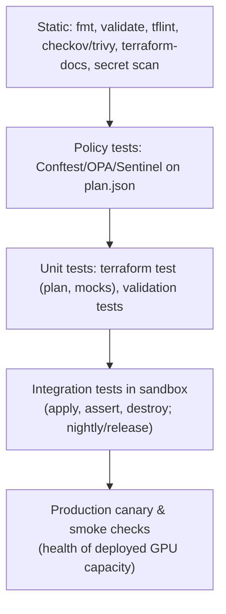
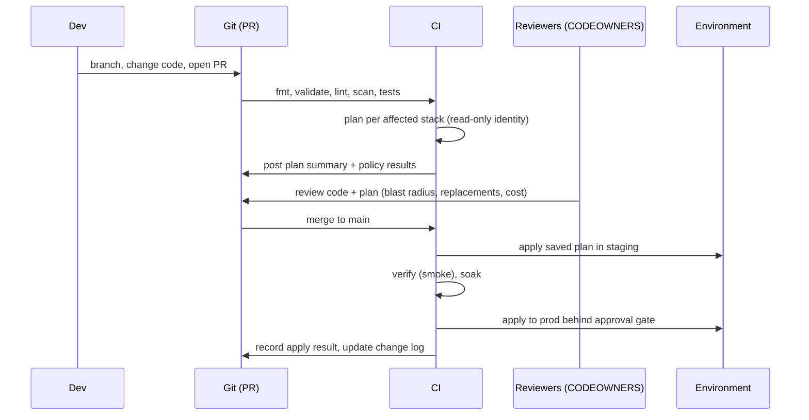

# 4.23 Production-grade Terraform: structure, testing and team workflows

| | |
|---|---|
| Level | Advanced |
| Priority tier | 1 |
| Lab venue | Terraform/OpenTofu 1.6+, GitHub or GitLab with Actions/CI, Atlantis (optional), sandbox cloud account with budgets |
| Part | Part 4: Automation and infrastructure as code |
| Status | Drafted, labs **untested** |

## Why this matters for AI infrastructure

A GPU training platform changes constantly: new regions when capacity is found, new node pools for a new accelerator generation, quota adjustments, network policy for a new team, storage tiers for dataset growth. Each change can cost tens of thousands of dollars per day or interrupt a multi-week training run. Terraform that works on a laptop is not enough; you need a repeatable process: a repository layout that limits blast radius, standards that make changes reviewable, tests at several levels, pipelines that produce evidence (4.2), policies that stop expensive or insecure mistakes, and operating practices that keep dozens of engineers from stepping on each other. This chapter turns individual Terraform skills into a production practice.

## Prerequisites and outcomes

Needs 4.2 and 4.18 to 4.22. After this chapter you can:

- Organise a repository for multiple environments, accounts and teams (live vs modules, layered stacks, orchestration with Terragrunt/Terramate/stacks).
- Define a production-readiness checklist for Terraform code and modules.
- Build a test strategy: static analysis, unit tests with `terraform test`, integration tests in ephemeral environments, policy tests, upgrade tests, and smoke tests of what was deployed.
- Implement team workflows: branching, review, plan-on-PR, apply-on-merge, locking, promotion between environments, drift detection, emergency changes.
- Apply guardrails for cost, security and compliance (OPA, Sentinel, budgets, quotas, tagging), and design GPU-specific controls.
- Plan upgrades (Terraform/OpenTofu, providers, modules) and migrations (state moves, refactors) safely.

## 1. Repository structure

### Live vs modules

```text
platform-infra/
├── modules/                         # reusable, versioned building blocks (or separate repo)
│   ├── network/  checkpoint-bucket/  gke-cluster/  gpu-pool/  iam-workload/
├── live/                            # deployable stacks (root modules); one state each
│   ├── _envcommon/                  # shared variable defaults (if using Terragrunt/Terramate)
│   ├── global/{iam,dns,tfstate}/
│   ├── prod/
│   │   ├── account.hcl              # account/project IDs, regions
│   │   ├── us-central1/
│   │   │   ├── network/ storage/ cluster/ gpu-pools/ observability/
│   │   └── europe-west4/ ...
│   ├── staging/ ...
│   └── lab/ ...
├── policies/                        # OPA/Rego, Checkov custom checks
├── tests/                           # integration tests (Terratest/pytest)
├── tools/                           # scripts, pre-commit config
├── .github/workflows/ or .gitlab-ci.yml
├── CODEOWNERS
└── docs/ (ADRs, runbooks)
```

Principles:

- **Directory per stack** (a root module with its own backend key) and **per environment**, never branches (4.1). A stack's path expresses its blast radius.
- **Modules separated from live code** and consumed by pinned versions (Git tags or registry) in higher environments; local paths acceptable inside a monorepo during development, with a promotion process that pins before production (4.20).
- **Layered stacks** ordered by dependency and change frequency: global/foundation → network → storage → cluster → gpu-pools → add-ons (4.19, 4.25). Dependencies flow downward only.
- **One owner per stack** (CODEOWNERS); shared foundations owned by the platform team; team-specific stacks (e.g., a research team's pools) owned by that team with platform review of the module interface.
- **Naming and tagging standards** enforced by modules/policies: `owner`, `cost_center`, `environment`, `managed_by=terraform`, `ttl` for ephemeral stacks.
- **Variables**: environment values in `terraform.tfvars` or a small `locals`/YAML data file per stack; no business logic in tfvars; secrets never in tfvars (4.22).

### Orchestration of many stacks

Plain Terraform has no cross-stack orchestration. Options:

| Tool | Idea | Notes |
|---|---|---|
| **Terragrunt** | Thin wrapper: DRY backend and provider config, `dependency` blocks, `run-all` ordering | Widely used; additional abstraction and its own learning curve |
| **Terramate** | Stack metadata, change detection (only stacks touched by a PR), code generation | Good with CI path filtering |
| **Terraform stacks / HCP** | First-party multi-stack orchestration with deployments | Platform-dependent; evolving |
| **Atlantis / Spacelift / env0 / Scalr / HCP workspaces** | PR-driven runs per project with locks, policies, dependencies | Choose by hosting and policy needs |
| **Make/scripts/CI matrix** | Simple per-directory loops | Fine for small estates; grows brittle |

Whatever you choose: **plan only what changed** (path filters or change detection), **apply in dependency order**, **serialise per state**, and make it obvious to reviewers which stacks a PR affects.

## 2. Production-readiness checklist

For every stack/module before it manages production:

**Correctness and safety**
- [ ] Pinned `required_version`, provider versions with lock file committed; module versions pinned.
- [ ] Remote state with locking, versioning, encryption; restricted access; tested restore (4.19).
- [ ] Stateful/irreplaceable resources have `prevent_destroy`, deletion protection, backups and are in a separate state.
- [ ] `plan` is clean (no unexpected changes) on a fresh checkout; `apply` twice is idempotent.
- [ ] Inputs validated (types, `validation`); sensible defaults; no hard-coded account IDs/regions.
- [ ] `moved` blocks accompany renames; no manual state surgery needed for upgrades.
- [ ] No `-target`, `local-exec` or `null_resource` hacks in the normal path; provisioners documented if present.

**Security and compliance**
- [ ] No secrets in code, tfvars, plans, logs; secrets designed per 4.22; state encryption.
- [ ] Least-privilege identities (OIDC), separate plan/apply, environment-specific roles.
- [ ] Encryption at rest and in transit by default; private networking; public exposure only deliberate.
- [ ] Logging/audit enabled (cloud audit logs, flow logs where policy requires), retention set.
- [ ] Security scanning (Checkov/Trivy/tfsec) and policy checks pass; exceptions tracked with owner and expiry.

**Operability**
- [ ] README with purpose, inputs/outputs, how to plan/apply, rollback, ownership, on-call contacts.
- [ ] Outputs documented and stable; consumers known.
- [ ] Monitoring/alerts defined for what the stack creates (quotas, node health, budget alerts).
- [ ] Drift detection scheduled; failure notifications routed.
- [ ] Cost labels and budgets; teardown procedure documented.
- [ ] Runbook for partial failure: what to do when an apply dies halfway (4.19).

**Quality**
- [ ] Formatted (`fmt`), validated, linted (`tflint`), docs generated (`terraform-docs`).
- [ ] Tests exist at appropriate levels (section 3); examples run in CI.
- [ ] Code review by owners; CHANGELOG for modules.

## 3. Testing strategy



| Level | Tools | Runs | Purpose |
|---|---|---|---|
| Static | `terraform fmt -check`, `validate`, `tflint`, `checkov`/`trivy config`/`tfsec`, `terraform-docs`, gitleaks | Every commit/PR | Syntax, style, known misconfigurations |
| Unit / plan-level | `terraform test` (`command = plan`, `mock_provider`), Rego unit tests (`opa test`) | Every PR | Variable validation, expressions, conditional logic, outputs |
| Plan review artefact | `plan -out`, `show -json`, plan comment on PR | Every PR | The change itself (4.2) |
| Policy | Conftest/OPA, Sentinel, cloud policy-as-code | Every PR | Cost, security, naming, region/instance allow-lists |
| Integration | `terraform test` (`command = apply`), Terratest, Kitchen-Terraform, pytest | Nightly/release; PR for critical modules | Real provider behaviour; create resources, assert, destroy |
| Upgrade | Plan with new provider/Terraform version against existing state copies | Before upgrades | Detect replacements/behaviour changes |
| Post-deploy smoke | Scripts/`check` blocks/Ansible validation (4.17) | After apply | The deployed thing works: nodes join, GPUs visible, NCCL passes |
| Operational | DR restore drills, game days, drift reports | Scheduled | State restore, rebuild in new region |

Practical advice:

- **Sandbox account** with budget caps, org policies denying expensive SKUs by default, automatic cleanup (tag `ttl`, reaper job), no access to production data/networks.
- **Test GPU modules without GPUs**: validate with plan-level tests, apply with the cheapest accelerator/or zero-GPU variant if the module supports it, and run a small GPU smoke test on a schedule rather than every PR.
- **Idempotency test**: after `apply`, run `plan -detailed-exitcode` and require exit 0.
- **Destroy test**: `destroy` must succeed (no dependency leftovers); important for ephemeral environments.
- **Example-driven**: each module's `examples/` doubles as documentation and integration test target.
- **Terratest sketch**: unique name suffix, `terraform.InitAndApply`, assertions with provider SDKs (e.g., bucket versioning enabled, node pool labels), `defer terraform.Destroy`, `retry.DoWithRetry` for eventual consistency.

```go
// tests/gpu_pool_test.go (sketch)
func TestGpuPool(t *testing.T) {
    t.Parallel()
    opts := &terraform.Options{
        TerraformDir: "../examples/basic",
        Vars: map[string]interface{}{"name": fmt.Sprintf("t-%s", strings.ToLower(random.UniqueId()))},
    }
    defer terraform.Destroy(t, opts)
    terraform.InitAndApply(t, opts)
    poolName := terraform.Output(t, opts, "pool_name")
    assert.Contains(t, poolName, "t-")
}
```

## 4. Team workflow

### Change lifecycle



Rules that keep teams safe:

1. **Plan on PR, apply on merge** (or via approved command); applying from laptops is forbidden for shared environments (break-glass only, logged).
2. **Saved plan reviewed = applied plan** (4.2). Stale plans fail and are regenerated.
3. **One apply per state at a time**; PR queues or locks (Atlantis locks, CI concurrency groups).
4. **Promotion**: the same module versions and the same code move dev → staging → prod; environment differences live in variables only. Do not merge the same change separately by hand into each environment.
5. **Reviewers read the plan, not just the diff**: look for destroys, replacements (`-/+`), scope creep (resources unrelated to the PR), and cost changes. A checklist in the PR template: expected changes, rollback plan, blast radius, cost estimate, customer/team impact.
6. **Small, frequent changes**; separate refactors (state moves) from behaviour changes; separate provider upgrades from feature work.
7. **Emergency changes**: allow a documented break-glass path (manual apply or console change), but require a follow-up PR reconciling code and state within a day and a postmortem for any manual change; alert on out-of-band changes.
8. **Drift detection** nightly (4.2); owners triage; chronic drift is a bug in the code or in access controls.
9. **Protected branches, signed commits (optional), required checks, CODEOWNERS** (4.1).
10. **Access model**: engineers get read access to plans/state metadata but not apply credentials; the pipeline holds apply rights; production console access is read-only with break-glass elevation and audit logging.

### Atlantis-style flow (summary)

`atlantis.yaml` lists projects (directories), workflows (init/plan/policy/apply steps), `apply_requirements: [approved, mergeable]`, and autoplan file patterns; comments `atlantis plan -d live/prod/us-central1/gpu-pools` and `atlantis apply -d ...` drive runs; locks hold the project until merge; policy checks (Conftest) run after plan. Equivalent flows exist in GitHub Actions/GitLab with change detection (Terramate/path filters) and in HCP Terraform with VCS-driven runs.

### Promotion with versions

```hcl
# live/staging/.../gpu-pools/main.tf
module "pool" {
  source  = "git::https://git.example.com/platform/tf-modules.git//gpu-pool?ref=v2.4.0"   # newest in staging
  ...
}
# live/prod/.../gpu-pools/main.tf
module "pool" {
  source  = "git::https://git.example.com/platform/tf-modules.git//gpu-pool?ref=v2.3.1"   # previous until promoted
  ...
}
```

Promote prod by a PR that bumps `ref` after staging soak. Automate with Renovate PRs per environment.

## 5. Guardrails: cost, security, compliance

Policy as code (4.2) applied to plans. Examples specific to AI infrastructure:

- **Cost**: deny creation of more than N GPUs in a plan without an approval tag; allow-list accelerator types and regions; require `ttl` on sandbox resources; forbid on-demand GPU instances in non-prod; require budgets/alerts on every project; show cost estimates (Infracost) in PR comments and fail above thresholds.
- **Capacity/quota**: validate against known quotas (data source or policy); require reservation IDs or capacity blocks for large clusters; prevent deleting a reservation that backs running capacity.
- **Security**: no `0.0.0.0/0` on SSH or management ports; private nodes only; CMEK/KMS for checkpoint buckets; public access prevention; no static IAM keys; workload identity bindings reviewed; VPC flow logs; org policies mirrored in code.
- **Data protection**: `prevent_destroy` and `force_destroy = false` on dataset/checkpoint buckets; object versioning; retention locks where required; cross-region replication for critical datasets.
- **Networking for training**: MTU and jumbo-frame settings, placement policies/compact placement, EFA/GPUDirect-TCPX/RDMA network interfaces required for specific instance types (policy asserting the NIC configuration, because forgetting it silently halves training throughput).
- **Tagging**: owner, cost_center, project, environment, data classification.
- **Blast-radius controls**: reject plans touching more than N resources of type `*_node_pool`/`*_instance` without a label; require two approvers for destroys of clusters.

```rego
package terraform.guardrails
import rego.v1

deny contains msg if {
    some rc in input.resource_changes
    rc.type == "google_container_node_pool"
    rc.change.actions[_] == "delete"
    rc.change.before.node_config[0].labels["tier"] == "prod"
    msg := sprintf("%s is a prod node pool: deletion needs the 'allow-prod-destroy' approval", [rc.address])
}

deny contains msg if {
    some rc in input.resource_changes
    rc.type == "google_storage_bucket"
    rc.change.actions[_] in {"create", "update"}
    not rc.change.after.versioning[0].enabled
    msg := sprintf("%s: versioning must be enabled on buckets", [rc.address])
}
```

(Policy syntax and plan JSON shapes depend on the tool versions.)

## 6. Operating the estate

- **Upgrades**: Terraform/OpenTofu version bumps (read upgrade guides; test plan equality on all stacks), provider upgrades (one provider at a time, in lower environments first), module upgrades (changelogs, `moved`), and a cadence (monthly patch, quarterly minor). Keep a compatibility matrix and let tooling (Renovate) open PRs; budget for periodic cleanup so you never face a three-major-version jump.
- **Refactors**: split large stacks along ownership lines using `import`/`removed`/`moved` (4.19), one resource group at a time, with clean plans between steps.
- **Documentation and ADRs**: record decisions (why this layout, why this state split, why OpenTofu), diagrams (4.2), runbooks (provisioning a new region, adding GPU pools, quota requests, state recovery).
- **On-call**: pipelines alert on failed applies, drift, stuck locks, state backend errors; clear escalation; runbooks for "apply failed halfway", "someone created resources by hand", "plan wants to destroy production".
- **Metrics**: lead time for infrastructure changes, change failure rate, drift count, time to recover, plan duration, number of manual (break-glass) changes, module version adoption, cost per environment.
- **Developer experience**: golden-path modules and templates (`cookiecutter`/scaffolding for a new stack), fast feedback (plans in minutes), clear error messages from validations, self-service with guardrails for teams (e.g., a PR adding a YAML entry for a new namespace/quota).
- **Multi-tenancy**: per-team stacks and state, policy boundaries (tags, quotas), inner-source module contributions with CODEOWNERS review.

## 7. Terraform and GPU capacity management

Real-world constraints that shape workflows:

- **Capacity is scarce and time-bound**: reservations, capacity blocks, committed use discounts, spot/preemptible fleets. Treat reservations as first-class resources with owners, expiry and renewal alerts; avoid Terraform plans that recreate nodes backed by a reservation (replacement could fail to re-acquire capacity). Use `create_before_destroy` carefully since both old and new may not fit (4.21); prefer in-place updates or platform-managed rolling updates.
- **Long-running jobs**: infrastructure applies must coordinate with job schedules; drain and cordon via Slurm/Kubernetes before replacements (4.17); maintenance windows enforced by CI (no applies to training pools during protected periods unless `emergency`).
- **Quota requests** are manual/slow: include them in change tickets; code can assert quota sufficiency via data sources or checks.
- **Heterogeneous fleets** (A100, H100, B200/GB200 in different regions or clouds): data-driven pool definitions (YAML) with per-accelerator policy and validation, modules exposing a stable interface across providers.
- **Hybrid with Slurm/BCM**: Terraform for cloud or virtualised parts; bare-metal and BMC provisioning handled by BCM/Ansible/Redfish (Parts 7 and 8); keep a single inventory source of truth that feeds both (Terraform outputs → inventory, 4.27).

## 8. Lab (untested)

1. **Repository skeleton**: create `modules/` and `live/{lab,staging,prod}/...` with two stacks (`network`, `compute`) using local providers or a sandbox cloud; backend per stack with distinct keys; CODEOWNERS and a PR template.
2. **Pipeline**: implement the CI from 4.2 specialised to this layout: change detection by path, plan per changed stack, policy check, plan comment, saved-plan apply on merge for lab/staging, approval-gated prod.
3. **Static and policy gates**: wire `fmt`, `validate`, `tflint`, `checkov`/`trivy`, `terraform-docs`, gitleaks, and Conftest with the guardrails above; write allow/deny fixtures; demonstrate each gate failing a PR.
4. **Unit tests**: add `terraform test` plan-level tests for a module with validation and conditionals; include `expect_failures`; run in CI.
5. **Integration test**: Terratest or `terraform test` apply-level against a sandbox; include the idempotency check (`plan -detailed-exitcode`) and destroy; add TTL tags and a reaper that deletes leaked resources.
6. **Promotion**: tag module `v1.0.0`, use in staging, bump to `v1.1.0`, soak, promote to prod via PR; practise a rollback by reverting the pin.
7. **Break-glass drill**: make a manual console change in the sandbox; detect with the drift job; reconcile by PR; write the postmortem note.
8. **Atlantis or equivalent**: configure project locks; open two PRs on the same stack and observe locking and stale plan handling.
9. **Cost guardrail**: integrate Infracost (or a pricing estimate) and a policy denying plans above a threshold or with GPU counts above a limit without a label.
10. **Upgrade rehearsal**: bump a provider major version in a branch; run plans across all stacks; classify diffs (cosmetic vs replacement); write the migration steps.
11. **Refactor**: split a monolithic stack into two with `import` + `removed`, clean plans at each step; document the procedure as a runbook.
12. **Metrics**: compute lead time and change failure rate from your PR history for the lab repo.
13. **Clean up.**

Mark tested only after execution.

## 9. Common mistakes

- One repository/state for the whole company, or no module/versioning discipline.
- Applying from laptops with shared admin credentials; no audit trail.
- PRs reviewed as code without reading the plan; no policy checks for cost and security.
- Branch-per-environment; manual re-application of the same change per environment.
- Testing only in production; integration tests that leak resources and money.
- Unpinned versions; "upgrade day" every two years.
- Refactors mixed with feature changes; manual state surgery without runbooks.
- No drift detection; chronic console changes tolerated.
- Treating GPU capacity like elastic CPU: recreating nodes without capacity reservations or drains.
- Ownership unclear: stacks nobody maintains.

## 10. Interview angles

- "How would you structure Terraform for dev/stage/prod across multiple regions and teams?" 
- "Describe your Terraform CI/CD workflow. What blocks a bad change?" 
- "How do you test Terraform code?" 
- "What guardrails would you put on GPU spend and exposure?" 
- "How do you handle emergency console changes?" 
- "How do you upgrade providers or Terraform across 100 stacks?" 
- "Terragrunt vs Atlantis vs HCP Terraform vs Terramate?" 
- "How do you avoid disrupting running training jobs during infrastructure changes?" 

## 11. Checkpoint questions (30)

1. Why directory per environment? **A:** Isolation and clear review; avoid branches drifting.
2. Why layered stacks? **A:** Limit blast radius, speed plans, clear ownership.
3. What do modules vs live directories hold? **A:** Reusable code vs deployable stacks.
4. What orchestrates many stacks? **A:** Terragrunt/Terramate/stacks/Atlantis etc.
5. Required backend properties? **A:** Locking, versioning, encryption, restricted access.
6. Why `prevent_destroy` on checkpoint buckets? **A:** Irreplaceable data.
7. Static tools list? **A:** fmt, validate, tflint, checkov/trivy, docs, secret scan.
8. What does `terraform test` with `command = plan` check? **A:** Logic without creating resources.
9. What is an idempotency test? **A:** Plan after apply shows no changes.
10. Why a destroy test? **A:** Ensure clean teardown for ephemeral envs.
11. Sandbox protections? **A:** Budgets, TTL, org policies, reaper.
12. Plan-on-PR benefit? **A:** Reviewers see the real change.
13. Why saved plans? **A:** Apply exactly what was reviewed.
14. Why serialise applies? **A:** Prevent state races.
15. What do reviewers look for in plans? **A:** Destroys, replacements, scope creep, cost.
16. How promote across envs? **A:** Pin and bump module versions via PRs.
17. Break-glass requirement? **A:** Logged, reconciled with code, postmortem.
18. Drift detection method? **A:** Scheduled `plan -detailed-exitcode`.
19. Common cost guardrails? **A:** GPU count limits, allow-lists, budgets, Infracost.
20. Network guardrail example? **A:** No public SSH/management ports.
21. Data guardrail example? **A:** Versioning, `force_destroy=false`.
22. Why validate NIC config in policy? **A:** Missing high-speed interfaces silently halve throughput.
23. How upgrade providers safely? **A:** Lower envs first, review plans, one provider at a time.
24. How split a state? **A:** `import` in new + `removed` in old, clean plans.
25. What are ADRs? **A:** Recorded architectural decisions.
26. DORA-style metrics here? **A:** Lead time, change failure rate, time to restore, frequency.
27. Why CODEOWNERS? **A:** Enforce domain reviews.
28. Why not apply from laptops? **A:** No audit, credential sprawl.
29. Risk of recreating GPU nodes? **A:** Lose capacity, disrupt jobs.
30. How coordinate with schedulers? **A:** Drain/cordon and maintenance windows.

## 12. Sources and review notes

**Written in original words.** Principal sources:

- Yevgeniy Brikman, *Terraform: Up and Running* (chapter 8 on production-grade Terraform code, chapter 9 on how to test Terraform code, chapter 10 on how to use Terraform as a team).
- The author's `nvidia-devops` repository, volume 10 chapters 5 and 11 (guardrails, OPA policies for GPU spend and deletion protection, end-to-end AI factory implementation, drift detection).
- Terraform/OpenTofu, Atlantis, Terragrunt, Terramate, Conftest and Infracost documentation.
- Examples are the author's constructions.

**Flagged for verification before publishing:** `terraform test` mocking and apply-level behaviour by version, Terraform stacks status, Rego plan JSON shapes and syntax by OPA version, Atlantis configuration keys, Terratest API details, and every code listing; all labs are **untested**.
