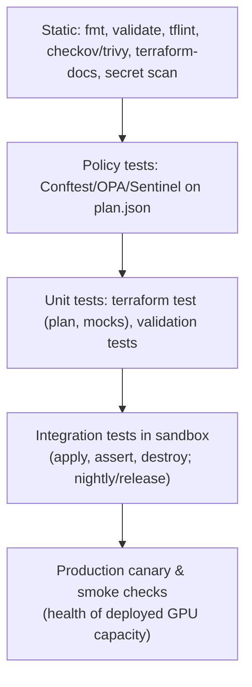
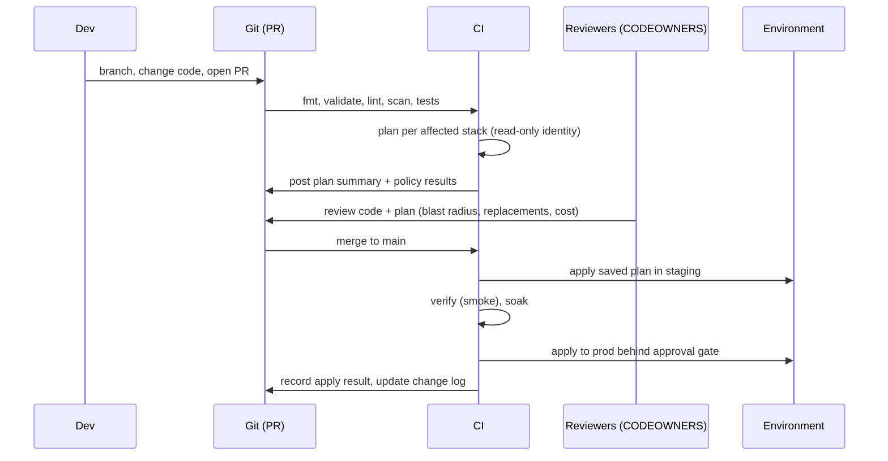

# 4.23 Production-grade Terraform: structure, testing and team workflows

| | |
|---|---|
| Level | Advanced |
| Priority tier | 1 |
| Lab venue | Terraform/OpenTofu 1.6+, GitHub or GitLab with Actions/CI, Atlantis (optional), sandbox cloud account with budgets |
| Part | Part 4: Automation and infrastructure as code |
| Status | Drafted, labs **untested** |

## Why this matters for AI infrastructure

A GPU training platform changes constantly: new regions when capacity is found, new node pools for a new accelerator generation, quota adjustments, network policy for a new team, storage tiers for dataset growth. Each change can cost tens of thousands of dollars per day or interrupt a multi-week training run. Terraform that works on a laptop is not enough; you need a repeatable process: a repository layout that limits blast radius, standards that make changes reviewable, tests at several levels, pipelines that produce evidence (4.2), policies that stop expensive or insecure mistakes, and operating practices that keep dozens of engineers from stepping on each other. This chapter turns individual Terraform skills into a production practice.

## Prerequisites and outcomes

Needs 4.2 and 4.18 to 4.22. After this chapter you can:

- Organise a repository for multiple environments, accounts and teams (live vs modules, layered stacks, orchestration with Terragrunt/Terramate/stacks).
- Define a production-readiness checklist for Terraform code and modules.
- Build a test strategy: static analysis, unit tests with `terraform test`, integration tests in ephemeral environments, policy tests, upgrade tests, and smoke tests of what was deployed.
- Implement team workflows: branching, review, plan-on-PR, apply-on-merge, locking, promotion between environments, drift detection, emergency changes.
- Apply guardrails for cost, security and compliance (OPA, Sentinel, budgets, quotas, tagging), and design GPU-specific controls.
- Plan upgrades (Terraform/OpenTofu, providers, modules) and migrations (state moves, refactors) safely.

## 1. Repository structure

### Live vs modules

```text
platform-infra/
├── modules/                         # reusable, versioned building blocks (or separate repo)
│   ├── network/  checkpoint-bucket/  gke-cluster/  gpu-pool/  iam-workload/
├── live/                            # deployable stacks (root modules); one state each
│   ├── _envcommon/                  # shared variable defaults (if using Terragrunt/Terramate)
│   ├── global/{iam,dns,tfstate}/
│   ├── prod/
│   │   ├── account.hcl              # account/project IDs, regions
│   │   ├── us-central1/
│   │   │   ├── network/ storage/ cluster/ gpu-pools/ observability/
│   │   └── europe-west4/ ...
│   ├── staging/ ...
│   └── lab/ ...
├── policies/                        # OPA/Rego, Checkov custom checks
├── tests/                           # integration tests (Terratest/pytest)
├── tools/                           # scripts, pre-commit config
├── .github/workflows/ or .gitlab-ci.yml
├── CODEOWNERS
└── docs/ (ADRs, runbooks)
```

Principles:

- **Directory per stack** (a root module with its own backend key) and **per environment**, never branches (4.1). A stack's path expresses its blast radius.
- **Modules separated from live code** and consumed by pinned versions (Git tags or registry) in higher environments; local paths acceptable inside a monorepo during development, with a promotion process that pins before production (4.20).
- **Layered stacks** ordered by dependency and change frequency: global/foundation → network → storage → cluster → gpu-pools → add-ons (4.19, 4.25). Dependencies flow downward only.
- **One owner per stack** (CODEOWNERS); shared foundations owned by the platform team; team-specific stacks (e.g., a research team's pools) owned by that team with platform review of the module interface.
- **Naming and tagging standards** enforced by modules/policies: `owner`, `cost_center`, `environment`, `managed_by=terraform`, `ttl` for ephemeral stacks.
- **Variables**: environment values in `terraform.tfvars` or a small `locals`/YAML data file per stack; no business logic in tfvars; secrets never in tfvars (4.22).

### Orchestration of many stacks

Plain Terraform has no cross-stack orchestration. Options:

| Tool | Idea | Notes |
|---|---|---|
| **Terragrunt** | Thin wrapper: DRY backend and provider config, `dependency` blocks, `run-all` ordering | Widely used; additional abstraction and its own learning curve |
| **Terramate** | Stack metadata, change detection (only stacks touched by a PR), code generation | Good with CI path filtering |
| **Terraform stacks / HCP** | First-party multi-stack orchestration with deployments | Platform-dependent; evolving |
| **Atlantis / Spacelift / env0 / Scalr / HCP workspaces** | PR-driven runs per project with locks, policies, dependencies | Choose by hosting and policy needs |
| **Make/scripts/CI matrix** | Simple per-directory loops | Fine for small estates; grows brittle |

Whatever you choose: **plan only what changed** (path filters or change detection), **apply in dependency order**, **serialise per state**, and make it obvious to reviewers which stacks a PR affects.

### Keeping `live/` DRY with Terragrunt (`TUR` Chapter 10)

In *Terraform: Up and Running* Chapter 10 (*How to Use Terraform as a Team*), Yevgeniy Brikman shows how **Terragrunt** eliminates copy-pasted `backend` and `provider` blocks across dozens of folders in `live/`:
1. **Root `live/stage/terragrunt.hcl` (`remote_state` and `path_relative_to_include()`):** Defines the S3 backend once at the root of the environment and dynamically sets `key = "${path_relative_to_include()}/terraform.tfstate"` (so `live/stage/services/hello-world-app/terragrunt.hcl` automatically stores its state at `services/hello-world-app/terraform.tfstate`, tested in `code/part04/terraform_production_guardrails_lab.py`):
   ```hcl
   remote_state {
     backend = "s3"
     generate = {
       path      = "backend.tf"
       if_exists = "overwrite"
     }
     config = {
       bucket         = "acme-tfstate-stage"
       key            = "${path_relative_to_include()}/terraform.tfstate"
       region         = "us-east-2"
       encrypt        = true
       dynamodb_table = "acme-tfstate-locks"
     }
   }
   ```
2. **Child `terragrunt.hcl` (`find_in_parent_folders()` and `dependency` blocks):** Each child stack (`live/stage/services/hello-world-app/terragrunt.hcl`) inherits the root backend via `include { path = find_in_parent_folders() }`, points `terraform { source = "github.com/<OWNER>/modules//services/hello-world-app?ref=v0.0.8" }`, declares cross-stack dependencies via `dependency "mysql" { config_path = "../../data-stores/mysql" }`, and passes `inputs = { mysql_config = dependency.mysql.outputs }`. Running **`terragrunt run-all apply`** builds the cross-folder DAG, applies `data-stores/mysql` first, and then applies `services/hello-world-app`.

## 2. Production-readiness checklist

For every stack/module before it manages production:

**Correctness and safety**
- [ ] Pinned `required_version`, provider versions with lock file committed; module versions pinned.
- [ ] Remote state with locking, versioning, encryption; restricted access; tested restore (4.19).
- [ ] Stateful/irreplaceable resources have `prevent_destroy`, deletion protection, backups and are in a separate state.
- [ ] `plan` is clean (no unexpected changes) on a fresh checkout; `apply` twice is idempotent.
- [ ] Inputs validated (types, `validation`); sensible defaults; no hard-coded account IDs/regions.
- [ ] `moved` blocks accompany renames; no manual state surgery needed for upgrades.
- [ ] No `-target`, `local-exec` or `null_resource` hacks in the normal path; provisioners documented if present.

**Security and compliance**
- [ ] No secrets in code, tfvars, plans, logs; secrets designed per 4.22; state encryption.
- [ ] Least-privilege identities (OIDC), separate plan/apply, environment-specific roles.
- [ ] Encryption at rest and in transit by default; private networking; public exposure only deliberate.
- [ ] Logging/audit enabled (cloud audit logs, flow logs where policy requires), retention set.
- [ ] Security scanning (Checkov/Trivy/tfsec) and policy checks pass; exceptions tracked with owner and expiry.

**Operability**
- [ ] README with purpose, inputs/outputs, how to plan/apply, rollback, ownership, on-call contacts.
- [ ] Outputs documented and stable; consumers known.
- [ ] Monitoring/alerts defined for what the stack creates (quotas, node health, budget alerts).
- [ ] Drift detection scheduled; failure notifications routed.
- [ ] Cost labels and budgets; teardown procedure documented.
- [ ] Runbook for partial failure: what to do when an apply dies halfway (4.19).

**Quality**
- [ ] Formatted (`fmt`), validated, linted (`tflint`), docs generated (`terraform-docs`).
- [ ] Tests exist at appropriate levels (section 3); examples run in CI.
- [ ] Code review by owners; CHANGELOG for modules.

In *Terraform: Up and Running* Chapter 8 (*Production-Grade Terraform Code*), Brikman explains why building production-grade infrastructure takes weeks to months (`1–2 weeks` for managed RDS, `2–4 weeks` for a stateless ASG, `2–4 months` for a stateful distributed datastore, `6–36 months` for an end-to-end architecture): teams get bogged down by **accidental complexity** and **yak shaving** (Seth Godin) when they underestimate the **essential complexity** (Fred Brooks, *The Mythical Man-Month*) of the **20-item Production-Grade Infrastructure Checklist (`Table 8-2`)**—spanning Install, Configure, Provision, Deploy, High Availability, Scalability, Performance, Networking, Security, Metrics, Logs, Backup & Restore, Cost Optimization, Documentation, and Tests. Chapter 8 also highlights:
- **Decomposing large modules into small, composable functions:** Splitting the monolithic `webserver-cluster` module into `modules/cluster/asg-rolling-deploy`, `modules/networking/alb`, and `modules/services/hello-world-app` (each with matching `examples/` and `test/` folders) so callers can reuse the ASG or ALB independently.
- **Pinning the Terraform CLI binary with `tfenv` (`.terraform-version`):** Using `tfenv install 1.2.3 && tfenv use 1.2.3` alongside `required_version` so developer laptops and CI runners never drift on CLI versions.
- **Understanding escape hatches (`local-exec`, `remote-exec`, `data "external"`):** Using `provisioner "local-exec"` (`when = destroy`), `provisioner "remote-exec"`, or `data "external"` (which executes an external program reading JSON args on `stdin` and writing a flat `map(string)` JSON to `stdout`) only when no native provider resource exists, because escape hatches diminish Terraform's plan predictability.

## 3. Testing strategy



| Level | Tools | Runs | Purpose |
|---|---|---|---|
| Static | `terraform fmt -check`, `validate`, `tflint`, `checkov`/`trivy config`/`tfsec`, `terraform-docs`, gitleaks | Every commit/PR | Syntax, style, known misconfigurations |
| Unit / plan-level | `terraform test` (`command = plan`, `mock_provider`), Rego unit tests (`opa test`) | Every PR | Variable validation, expressions, conditional logic, outputs |
| Plan review artefact | `plan -out`, `show -json`, plan comment on PR | Every PR | The change itself (4.2) |
| Policy | Conftest/OPA, Sentinel, cloud policy-as-code | Every PR | Cost, security, naming, region/instance allow-lists |
| Integration | `terraform test` (`command = apply`), Terratest, Kitchen-Terraform, pytest | Nightly/release; PR for critical modules | Real provider behaviour; create resources, assert, destroy |
| Upgrade | Plan with new provider/Terraform version against existing state copies | Before upgrades | Detect replacements/behaviour changes |
| Post-deploy smoke | Scripts/`check` blocks/Ansible validation (4.17) | After apply | The deployed thing works: nodes join, GPUs visible, NCCL passes |
| Operational | DR restore drills, game days, drift reports | Scheduled | State restore, rebuild in new region |

Practical advice:

- **Sandbox account** with budget caps, org policies denying expensive SKUs by default, automatic cleanup (tag `ttl`, reaper job such as **`cloud-nuke`** or **`aws-nuke`** deleting any resource older than 24 hours, `TUR` Chapter 9), no access to production data/networks.
- **Dependency injection (`var.mysql_config`) and Test Stages (`test_structure.RunTestStage` + `SKIP_<stage>=true`, `TUR` Chapter 9):**
  1. *Dependency injection in modules:* If a service module (`hello-world-app`) hardcodes `data "terraform_remote_state" "db"`, you cannot unit-test it without first setting up an S3 state bucket and deploying a database. By adding an optional input `variable "mysql_config" { type = object({ address = string, port = number }); default = null }` and setting `count = var.mysql_config == null ? 1 : 0` on `data "terraform_remote_state" "db"`, tests can inject a mock `{ address = "mock-mysql", port = 3306 }` or wire `mysql_config = module.mysql` directly in memory.
  2. *Skipping slow stages during local development (`RunTestStage`):* Deploying and tearing down an RDS database or GKE cluster on every test edit takes 15–25 minutes (`795.63s`). Wrapping test phases in Terratest's **`test_structure.RunTestStage(t, "deploy_db", func() { ... })`** (saving state to `/tmp` with `test_structure.SaveTerraformOptions`) lets you run `go test` once and then iterate on `deploy_app` and `validate_app` in seconds via **`SKIP_deploy_db=true SKIP_teardown_db=true SKIP_teardown_app=true go test -timeout 30m`** (modeled in `run_terratest_stages()` in `code/part04/terraform_production_guardrails.py`).
  3. *Why persistent `stage` beats full-stack E2E from scratch (`TUR` Chapter 9):* Attempting to spin up and tear down an entire company's multi-stack architecture from scratch on every commit is both too slow (hours) and too brittle (a "whack-a-mole" of transient cloud API rate limits and timeouts). Instead, run fast static/unit/module integration tests in ephemeral sandboxes and test full-stack interactions by promoting immutable module versions through a persistent **`staging`** environment.
- **Test GPU modules without GPUs**: validate with plan-level tests, apply with the cheapest accelerator/or zero-GPU variant if the module supports it, and run a small GPU smoke test on a schedule rather than every PR.
- **Idempotency test**: after `apply`, run `plan -detailed-exitcode` and require exit 0.
- **Destroy test**: `destroy` must succeed (no dependency leftovers); important for ephemeral environments.
- **Example-driven**: each module's `examples/` doubles as documentation and integration test target.
- **Terratest sketch**: unique name suffix, `terraform.InitAndApply`, assertions with provider SDKs (e.g., bucket versioning enabled, node pool labels), `defer terraform.Destroy`, `retry.DoWithRetry` for eventual consistency.

```go
// tests/gpu_pool_test.go (sketch)
func TestGpuPool(t *testing.T) {
    t.Parallel()
    opts := &terraform.Options{
        TerraformDir: "../examples/basic",
        Vars: map[string]interface{}{"name": fmt.Sprintf("t-%s", strings.ToLower(random.UniqueId()))},
    }
    defer terraform.Destroy(t, opts)
    terraform.InitAndApply(t, opts)
    poolName := terraform.Output(t, opts, "pool_name")
    assert.Contains(t, poolName, "t-")
}
```

## 4. Team workflow

### Change lifecycle



Rules that keep teams safe:

1. **Plan on PR, apply on merge** (or via approved command); applying from laptops is forbidden for shared environments (break-glass only, logged).
2. **Saved plan reviewed = applied plan** (4.2). Stale plans fail and are regenerated.
3. **One apply per state at a time**; PR queues or locks (Atlantis locks, CI concurrency groups).
4. **Promotion**: the same module versions and the same code move dev → staging → prod; environment differences live in variables only. Do not merge the same change separately by hand into each environment.
5. **Reviewers read the plan, not just the diff**: look for destroys, replacements (`-/+`), scope creep (resources unrelated to the PR), and cost changes. A checklist in the PR template: expected changes, rollback plan, blast radius, cost estimate, customer/team impact.
6. **Small, frequent changes**; separate refactors (state moves) from behaviour changes; separate provider upgrades from feature work.
7. **Emergency changes**: allow a documented break-glass path (manual apply or console change), but require a follow-up PR reconciling code and state within a day and a postmortem for any manual change; alert on out-of-band changes.
8. **Drift detection** nightly (4.2); owners triage; chronic drift is a bug in the code or in access controls.
9. **Protected branches, signed commits (optional), required checks, CODEOWNERS** (4.1).
10. **Access model**: engineers get read access to plans/state metadata but not apply credentials; the pipeline holds apply rights; production console access is read-only with break-glass elevation and audit logging.

### Atlantis-style flow (summary)

`atlantis.yaml` lists projects (directories), workflows (init/plan/policy/apply steps), `apply_requirements: [approved, mergeable]`, and autoplan file patterns; comments `atlantis plan -d live/prod/us-central1/gpu-pools` and `atlantis apply -d ...` drive runs; locks hold the project until merge; policy checks (Conftest) run after plan. Equivalent flows exist in GitHub Actions/GitLab with change detection (Terramate/path filters) and in HCP Terraform with VCS-driven runs.

### Promotion with versions

```hcl
# live/staging/.../gpu-pools/main.tf
module "pool" {
  source  = "git::https://git.example.com/platform/tf-modules.git//gpu-pool?ref=v2.4.0"   # newest in staging
  ...
}
# live/prod/.../gpu-pools/main.tf
module "pool" {
  source  = "git::https://git.example.com/platform/tf-modules.git//gpu-pool?ref=v2.3.1"   # previous until promoted
  ...
}
```

Promote prod by a PR that bumps `ref` after staging soak. Automate with Renovate PRs per environment.

## 5. Guardrails: cost, security, compliance

Policy as code (4.2) applied to plans. Examples specific to AI infrastructure:

- **Cost**: deny creation of more than N GPUs in a plan without an approval tag; allow-list accelerator types and regions; require `ttl` on sandbox resources; forbid on-demand GPU instances in non-prod; require budgets/alerts on every project; show cost estimates (Infracost) in PR comments and fail above thresholds.
- **Capacity/quota**: validate against known quotas (data source or policy); require reservation IDs or capacity blocks for large clusters; prevent deleting a reservation that backs running capacity.
- **Security**: no `0.0.0.0/0` on SSH or management ports; private nodes only; CMEK/KMS for checkpoint buckets; public access prevention; no static IAM keys; workload identity bindings reviewed; VPC flow logs; org policies mirrored in code.
- **Data protection**: `prevent_destroy` and `force_destroy = false` (`force_destroy=false`) on dataset/checkpoint buckets; object versioning; retention locks where required; cross-region replication for critical datasets.
- **Networking for training**: MTU and jumbo-frame settings, placement policies/compact placement, EFA/GPUDirect-TCPX/RDMA network interfaces required for specific instance types (policy asserting the NIC configuration, because forgetting it silently halves training throughput).
- **Tagging**: owner, cost_center, project, environment, data classification.
- **Blast-radius controls**: reject plans touching more than N resources of type `*_node_pool`/`*_instance` without a label; require two approvers for destroys of clusters.

```rego
package terraform.guardrails
import rego.v1

deny contains msg if {
    some rc in input.resource_changes
    rc.type == "google_container_node_pool"
    rc.change.actions[_] == "delete"
    rc.change.before.node_config[0].labels["tier"] == "prod"
    msg := sprintf("%s is a prod node pool: deletion needs the 'allow-prod-destroy' approval", [rc.address])
}

deny contains msg if {
    some rc in input.resource_changes
    rc.type == "google_storage_bucket"
    rc.change.actions[_] in {"create", "update"}
    not rc.change.after.versioning[0].enabled
    msg := sprintf("%s: versioning must be enabled on buckets", [rc.address])
}
```

(Policy syntax and plan JSON shapes depend on the tool versions.)

## 6. Operating the estate

- **Upgrades**: Terraform/OpenTofu version bumps (read upgrade guides; test plan equality on all stacks), provider upgrades (one provider at a time, in lower environments first), module upgrades (changelogs, `moved`), and a cadence (monthly patch, quarterly minor). Keep a compatibility matrix and let tooling (Renovate) open PRs; budget for periodic cleanup so you never face a three-major-version jump.
- **Refactors**: split large stacks along ownership lines using `import`/`removed`/`moved` (4.19), one resource group at a time, with clean plans between steps.
- **Documentation and ADRs**: record decisions (why this layout, why this state split, why OpenTofu), diagrams (4.2), runbooks (provisioning a new region, adding GPU pools, quota requests, state recovery).
- **On-call**: pipelines alert on failed applies, drift, stuck locks, state backend errors; clear escalation; runbooks for "apply failed halfway", "someone created resources by hand", "plan wants to destroy production".
- **Metrics**: lead time for infrastructure changes, change failure rate, drift count, time to recover, plan duration, number of manual (break-glass) changes, module version adoption, cost per environment.
- **Developer experience**: golden-path modules and templates (`cookiecutter`/scaffolding for a new stack), fast feedback (plans in minutes), clear error messages from validations, self-service with guardrails for teams (e.g., a PR adding a YAML entry for a new namespace/quota).
- **Multi-tenancy**: per-team stacks and state, policy boundaries (tags, quotas), inner-source module contributions with CODEOWNERS review.

## 7. Terraform and GPU capacity management

Real-world constraints that shape workflows:

- **Capacity is scarce and time-bound**: reservations, capacity blocks, committed use discounts, spot/preemptible fleets. Treat reservations as first-class resources with owners, expiry and renewal alerts; avoid Terraform plans that recreate nodes backed by a reservation (replacement could fail to re-acquire capacity). Use `create_before_destroy` carefully since both old and new may not fit (4.21); prefer in-place updates or platform-managed rolling updates.
- **Long-running jobs**: infrastructure applies must coordinate with job schedules; drain and cordon via Slurm/Kubernetes before replacements (4.17); maintenance windows enforced by CI (no applies to training pools during protected periods unless `emergency`).
- **Quota requests** are manual/slow: include them in change tickets; code can assert quota sufficiency via data sources or checks.
- **Heterogeneous fleets** (A100, H100, B200/GB200 in different regions or clouds): data-driven pool definitions (YAML) with per-accelerator policy and validation, modules exposing a stable interface across providers.
- **Hybrid with Slurm/BCM**: Terraform for cloud or virtualised parts; bare-metal and BMC provisioning handled by BCM/Ansible/Redfish (Parts 7 and 8); keep a single inventory source of truth that feeds both (Terraform outputs → inventory, 4.27).

## 8. Lab

First, run the self-checking Python lab (`code/part04/terraform_production_guardrails_lab.py`) locally. It verifies the Section 5 and `TUR` Chapter 9 OPA/Rego guardrail rules (`evaluate_production_guardrails`: blocking deletion of `tier == "prod"` node pools without `allow-prod-destroy`, blocking unversioned `google_storage_bucket` creation, and enforcing `ManagedBy == "Terraform"` tags), Terragrunt's `path_relative_to_include()` DRY backend key generator (`render_terragrunt_backend_key`, `TUR` Ch. 10), and Terratest's `test_structure.RunTestStage` with `SKIP_<stage>=true` (`run_terratest_stages`, `TUR` Ch. 9).

```bash
python3 code/part04/terraform_production_guardrails_lab.py
```

Next, on a machine with Terraform/OpenTofu 1.6+ and GitHub/GitLab CI (all interactive shell steps below are `untested here`), work through these exercises:

1. **Repository skeleton**: create `modules/` and `live/{lab,staging,prod}/...` with two stacks (`network`, `compute`) using local providers or a sandbox cloud; backend per stack with distinct keys; CODEOWNERS and a PR template.
2. **Pipeline**: implement the CI from 4.2 specialised to this layout: change detection by path, plan per changed stack, policy check, plan comment, saved-plan apply on merge for lab/staging, approval-gated prod.
3. **Static and policy gates**: wire `fmt`, `validate`, `tflint`, `checkov`/`trivy`, `terraform-docs`, gitleaks, and Conftest with the guardrails above; write allow/deny fixtures; demonstrate each gate failing a PR.
4. **Unit tests**: add `terraform test` plan-level tests for a module with validation and conditionals; include `expect_failures`; run in CI.
5. **Integration test**: Terratest or `terraform test` apply-level against a sandbox; include the idempotency check (`plan -detailed-exitcode`) and destroy; add TTL tags and a reaper that deletes leaked resources.
6. **Promotion**: tag module `v1.0.0`, use in staging, bump to `v1.1.0`, soak, promote to prod via PR; practise a rollback by reverting the pin.
7. **Break-glass drill**: make a manual console change in the sandbox; detect with the drift job; reconcile by PR; write the postmortem note.
8. **Atlantis or equivalent**: configure project locks; open two PRs on the same stack and observe locking and stale plan handling.
9. **Cost guardrail**: integrate Infracost (or a pricing estimate) and a policy denying plans above a threshold or with GPU counts above a limit without a label.
10. **Upgrade rehearsal**: bump a provider major version in a branch; run plans across all stacks; classify diffs (cosmetic vs replacement); write the migration steps.
11. **Refactor**: split a monolithic stack into two with `import` + `removed`, clean plans at each step; document the procedure as a runbook.
12. **Metrics**: compute lead time and change failure rate from your PR history for the lab repo.
13. **Clean up.**

## 9. Common mistakes

- One repository/state for the whole company, or no module/versioning discipline.
- Applying from laptops with shared admin credentials; no audit trail.
- PRs reviewed as code without reading the plan; no policy checks for cost and security.
- Branch-per-environment; manual re-application of the same change per environment.
- Testing only in production; integration tests that leak resources and money.
- Unpinned versions; "upgrade day" every two years.
- Refactors mixed with feature changes; manual state surgery without runbooks.
- No drift detection; chronic console changes tolerated.
- Treating GPU capacity like elastic CPU: recreating nodes without capacity reservations or drains.
- Ownership unclear: stacks nobody maintains.

## 10. Interview angles

- "How would you structure Terraform for dev/stage/prod across multiple regions and teams?"
- "Describe your Terraform CI/CD workflow. What blocks a bad change?"
- "How do you test Terraform code?"
- "What guardrails would you put on GPU spend and exposure?"
- "How do you handle emergency console changes?"
- "How do you upgrade providers or Terraform across 100 stacks?"
- "Terragrunt vs Atlantis vs HCP Terraform vs Terramate?"
- "How do you avoid disrupting running training jobs during infrastructure changes?"

## Exercises

1. **Repository Architecture (`modules/` vs. `live/`) and Multi-Stack Orchestration (`Terragrunt`, `Terramate`, `Atlantis`, `TUR` Chapters 8 & 10):** Using `render_terragrunt_backend_key()` in `code/part04/terraform_production_guardrails.py`, explain how `live/` is partitioned by environment, region, and layered stack (`global -> network -> storage -> cluster -> gpu-pools`), and trace how Terragrunt's `remote_state` (`path_relative_to_include()`), `find_in_parent_folders()`, `dependency` blocks, and `run-all` eliminate duplicated backend/provider boilerplate.
2. **The Production-Readiness Checklist, Essential vs. Accidental Complexity, and Module Decomposition (`TUR` Chapter 8):** Summarize the four pillars of the Section 2 production-readiness checklist (Correctness/Safety, Security/Compliance, Operability, Quality) alongside `TUR` Chapter 8's 20-item checklist (`Table 8-2`), explain why decomposing `webserver-cluster` into `asg-rolling-deploy` + `alb` + `hello-world-app` improves reuse, and state when escape hatches (`local-exec`, `remote-exec`, `data "external"`) are acceptable.
3. **The Terraform Testing Pyramid, Dependency Injection (`var.mysql_config`), and `test_structure.RunTestStage` (`TUR` Chapter 9):** Using `run_terratest_stages()` in `code/part04/terraform_production_guardrails.py`, explain: (a) how `var.mysql_config` dependency injection decouples module tests from `terraform_remote_state`; (b) how `random.UniqueId()`, `defer terraform.Destroy`, `http_helper.HttpGetWithRetry`, and `SKIP_<stage>=true` work in Terratest; and (c) why promoting through a persistent `staging` environment beats full-stack E2E tests from scratch.
4. **Team Workflow, the Golden Rule of Terraform, and Artifact Promotion Across Environments (`TUR` Chapter 10):** Explain the Golden Rule of Terraform (*"The `main` branch of the `live` repository is a 1:1 representation of production"*), why long-lived `stage`/`prod` Git branches fail (`Anna` and `Bill` merge-conflict scenario), and trace the 7-step PR -> plan -> policy -> merge -> staging soak -> prod promotion workflow.
5. **Policy as Code Guardrails (`OPA`/`Rego`, `Conftest`, `Sentinel`, `Infracost`) for GPU Infrastructure (`TUR` Chapter 9 & Section 5):** Using `evaluate_production_guardrails()` in `code/part04/terraform_production_guardrails.py`, write and explain Rego `deny` rules that block deleting production GPU node pools without `allow-prod-destroy`, block unversioned checkpoint buckets, enforce `ManagedBy = "Terraform"` and `cost_center` tags, and verify multi-NIC EFA/GPUDirect-TCPX attachments.
6. **Operating the Estate at Scale: Upgrades, State Refactoring, Break-Glass Reconciliation, and GPU Capacity Reservations:** Explain how to safely upgrade Terraform/provider versions across 100 stacks, how to handle emergency break-glass changes, and how capacity reservations/blocks and Slurm/Kubernetes node drains interact with Terraform changes on GPU fleets.

## Checkpoint questions (20)

<details>
<summary>1. What is the \"Golden Rule of Terraform\" (`TUR` Chapter 10), and why does using separate `stage` and `prod` Git branches violate it?</summary>

**The Golden Rule of Terraform:** *\"The `main` branch of the `live` repository should be a 1:1 representation of what is actually deployed in production.\"*
When teams use long-lived `stage` and `prod` branches instead of `live/staging/` and `live/prod/` directories on `main`, the branches quickly diverge (`Anna` testing an instance-type change on `stage` while `Bill` merges a tag change to `prod`), turning every promotion into an error-prone `git merge` that can accidentally overwrite production settings or apply unreviewed staging experiments.
</details>

<details>
<summary>2. In `TUR` Chapter 8, what are the three reasons building production-grade infrastructure takes so long, and what is the cure?</summary>

1. **DevOps is young ("Stone Age"):** Tooling and conventions are still maturing compared to decades-old application frameworks.
2. **Vulnerability to "yak shaving" (Seth Godin):** Trying to deploy one service pulls you into fixing VPCs, IAM roles, KMS keys, TLS certs, and CI runners (`accidental complexity`).
3. **High essential complexity (Fred Brooks):** Production infrastructure genuinely requires ~20 distinct concerns (`Table 8-2`: HA, scaling, networking, encryption, metrics, logs, backups, DR, cost, tests).
**The cure:** Build and consume **small, composable, versioned, pre-tested modules** so teams assemble proven building blocks rather than reinventing the 20-item checklist from scratch.
</details>

<details>
<summary>3. Why did `TUR` Chapter 8 split the `webserver-cluster` module into `asg-rolling-deploy`, `alb`, and `hello-world-app`?</summary>

A single monolithic `webserver-cluster` module that creates both an Auto Scaling Group and an Application Load Balancer forces every microservice to deploy its own separate $20+/month ALB, and cannot be used by background worker services that need an ASG *without* an ALB. Splitting **`modules/cluster/asg-rolling-deploy`** and **`modules/networking/alb`** into small standalone modules—and composing them inside **`modules/services/hello-world-app`**—lets teams either use the high-level `hello-world-app` facade or share one `alb` across 10 `asg-rolling-deploy` services.
</details>

<details>
<summary>4. How does `tfenv` (`.terraform-version`) complement `required_version` in `versions.tf` (`TUR` Chapter 8)?</summary>

- **`required_version = ">= 1.6.0, < 2.0.0"` in `versions.tf`:** Tells Terraform to abort if someone runs an incompatible CLI version.
- **`.terraform-version` + `tfenv` (or `tofuenv` / `asdf` / `mise`):** Automatically installs and switches the developer's or CI runner's CLI binary (`tfenv install` / `tfenv use`) to the exact pinned version (e.g., `1.8.5`) when entering the repository directory.
</details>

<details>
<summary>5. How does `data "external"` work as a Terraform escape hatch, and what are its rules (`TUR` Chapter 8)?</summary>

`data "external" "<name>"` executes an external CLI program (`program = ["python3", "${path.module}/query.py"]`) during the **`plan` phase**:
1. Terraform serializes the `query = { ... }` map as a JSON object and passes it to the script's **`stdin`**.
2. The script must be strictly **read-only** (no side effects, since it runs on every `plan`) and print a flat **`map(string)` JSON object** (`{"key": "value"}`) to **`stdout`**, which Terraform exposes at `data.external.<name>.result.<key>`.
</details>

<details>
<summary>6. How do Terragrunt's `remote_state`, `find_in_parent_folders()`, `path_relative_to_include()`, and `dependency` blocks keep `live/` DRY (`TUR` Chapter 10)?</summary>

1. The top-level `live/prod/terragrunt.hcl` defines `remote_state { backend = "s3"; generate = { path = "backend.tf", if_exists = "overwrite" }; config = { key = "${path_relative_to_include()}/terraform.tfstate" ... } }`.
2. Every child stack (`live/prod/us-central1/gpu-pools/terragrunt.hcl`) includes the parent via **`include { path = find_in_parent_folders() }`**—inheriting the S3 bucket and automatically getting the unique state key `us-central1/gpu-pools/terraform.tfstate` without writing a `backend.tf` file.
3. **`dependency "cluster" { config_path = "../cluster" }`** reads `../cluster`'s outputs (`dependency.cluster.outputs.name`) and tells **`terragrunt run-all`** to apply `cluster` before `gpu-pools`.
</details>

<details>
<summary>7. In `TUR` Chapter 9, how does Dependency Injection (`var.mysql_config`) make a Terraform module easier to unit-test?</summary>

If `modules/services/hello-world-app` unconditionally reads database connection details from `data "terraform_remote_state" "db"`, you cannot test `hello-world-app` without a real S3 bucket containing a real MySQL state file. By adding an optional object variable **`var.mysql_config` (`default = null`)**, setting `count = var.mysql_config == null ? 1 : 0` on `data "terraform_remote_state" "db"`, and using `local.mysql_config = var.mysql_config == null ? data.terraform_remote_state.db[0].outputs : var.mysql_config`, unit tests can pass a fake `{ address = "mock-db", port = 3306 }` object directly.
</details>

<details>
<summary>8. Why must every Terratest integration test use `random.UniqueId()` in resource names and `defer terraform.Destroy(t, opts)` (`TUR` Chapter 9)?</summary>

- **`random.UniqueId()`:** When multiple CI jobs or `t.Parallel()` tests run concurrently in the same sandbox cloud account, fixed resource names (`hello-world-alb`, S3 bucket names, IAM role names) collide and fail the tests. Appending a 6-character lowercase `random.UniqueId()` suffix isolates every test run into its own namespace.
- **`defer terraform.Destroy(t, opts)`:** Ensures that even if an assertion panics or fails mid-test, Go's `defer` stack still runs `terraform destroy` to tear down expensive cloud resources (backed up by a nightly **`cloud-nuke` / `aws-nuke`** reaper job for crashed runners).
</details>

<details>
<summary>9. How does `test_structure.RunTestStage` with `SKIP_<stage>=true` speed up local Terratest development from 15 minutes to 15 seconds (`TUR` Chapter 9)?</summary>

By splitting an integration test into named stages (`deploy_db`, `deploy_app`, `validate_app`, `teardown_app`, `teardown_db`) with `test_structure.RunTestStage(t, "deploy_db", func() { ... })` and persisting `terraform.Options` to disk with `test_structure.SaveTerraformOptions`, you run the initial `deploy_db` stage once, and on subsequent iterations pass **`SKIP_deploy_db=true SKIP_teardown_db=true SKIP_teardown_app=true go test`**—re-applying and validating only the fast application layer against the already-running test database.
</details>

<details>
<summary>10. Why does `TUR` Chapter 9 recommend testing full-stack integration in a persistent `staging` environment rather than spinning up the entire company stack from scratch on every commit?</summary>

Spinning up an entire multi-layer production architecture (VPCs, RDS clusters, GKE/EKS clusters, GPU node pools, monitoring) from scratch on every commit takes 45–90 minutes, costs a fortune, and suffers from **flaky transient cloud API errors** ("whack-a-mole" of DNS propagation, certificate issuance, and API throttling). Instead:
- Run fast **static + plan-level unit tests (`terraform test`) + policy checks** on every PR.
- Run **isolated per-module integration tests (`Terratest`)** in a sandbox on module changes.
- Validate **full-stack integration** by promoting versioned modules through a persistent, production-like **`staging`** environment.
</details>

<details>
<summary>11. What five things must a human reviewer check when reading a `terraform plan` comment on a pull request?</summary>

Never approve a Terraform PR by reading only the `.tf` code diff; always inspect the computed `terraform plan` output for:
1. **Unexpected destroys (`-`) or replacements (`-/+` / `+/-`)**, especially on stateful resources (databases, buckets, GKE clusters, reserved GPU pools).
2. **Blast radius / count summary (`Plan: X to add, Y to change, Z to destroy`):** Does a 2-line `.tf` edit unexpectedly touch 40 resources?
3. **`(known after apply)` propagation:** Are critical attributes deferred unexpectedly because of an overly broad `depends_on`?
4. **Security & network exposure:** Are any `0.0.0.0/0` rules, public buckets, or wildcard IAM roles introduced?
5. **Cost & quota impact (`Infracost`):** Does the change match the approved GPU count and budget?
</details>

<details>
<summary>12. How do you promote a change from `staging` to `prod` without copy-pasting business logic or merging branches (`TUR` Chapter 10)?</summary>

All resource logic lives inside versioned modules in the `modules` repository (`?ref=v2.4.0`). The `live/staging/.../main.tf` and `live/prod/.../main.tf` files are thin 15-line wrappers calling that module. To promote a change:
1. Merge the module change and tag **`v2.4.0`**.
2. Open a PR bumping `live/staging/` from `?ref=v2.3.1` to **`?ref=v2.4.0`**, review the staging plan, merge, apply, and soak.
3. Open a PR bumping `live/prod/` from `?ref=v2.3.1` to **`?ref=v2.4.0`**, review the production plan, obtain required approval, and merge.
If a regression appears in production, rolling back is a 1-line PR reverting `live/prod/` back to `?ref=v2.3.1`.
</details>

<details>
<summary>13. What AI-infrastructure-specific networking mistake can silently cut distributed training bandwidth in half if not caught by a CI policy check?</summary>

High-end GPU instance types (such as AWS `p5.48xlarge` / `p4d.24xlarge` with 32/4 **EFA** NICs, or GCP `a3-highgpu-8g` / `a3-megagpu-8g` with 4/8 **GPUDirect-TCPX / gVNIC** interfaces and `COMPACT` placement policies) require secondary RDMA/EFA network interfaces, jumbo frames (`mtu = 8896`), and compact placement policies explicitly attached in the launch template / instance config. If a Terraform configuration omits the secondary NIC blocks or placement policy, the VMs boot fine with 8 GPUs, **but NCCL falls back to the single primary management NIC, cutting multi-node training speed by 4x–8x**. An OPA/Conftest policy on `plan.json` asserts that every `a3-highgpu-8g` or `p5.48xlarge` resource includes the required NIC and placement blocks.
</details>

<details>
<summary>14. Why is recreating GPU nodes (`-/+`) dangerous when capacity is backed by Cloud Reservations or Capacity Blocks?</summary>

Cloud GPU capacity (`H100`, `B200`) is scarce and often tied to a specific **Zone, Reservation ID (`reservation_affinity`), or AWS Capacity Block**. If a Terraform change triggers a `-/+` replacement of a GPU node pool, the cloud API may fail to allocate new GPUs if `create_before_destroy` exceeds your reserved quota—or if `destroy` happens first on on-demand/spot capacity, another customer may claim those GPUs before your `create` call runs. Always protect reservation resources with `prevent_destroy = true` and coordinate node updates via node-pool rolling `max_surge`/`max_unavailable` policies within your reservation quota.
</details>

<details>
<summary>15. How should Terraform changes to active GPU node pools coordinate with Slurm or Kubernetes job schedulers?</summary>

Never let `terraform apply` abruptly terminate nodes running multi-day training jobs:
1. Enforce **maintenance windows** or capacity-drain gates in CI.
2. Before scaling down or replacing a node pool/instance group, **cordon and drain** the target nodes in Kubernetes (`kubectl drain` / `k8s_drain` respecting `PodDisruptionBudget`s) or Slurm (`scontrol update State=DRAIN` and wait for `squeue` to empty).
3. Delegate rolling node replacement to the cluster's managed node-pool upgrade controller (which cordons and drains each node automatically before replacing the VM).
</details>

<details>
<summary>16. What is the correct procedure when an on-call engineer must make an emergency \"break-glass\" change in the cloud console during an outage?</summary>

1. Use audited, time-bounded break-glass elevation to mitigate the immediate production incident.
2. **Within 24 hours (before closing the incident):** Open a reconciliation PR in the `live` repository that either **codifies** the console change into `.tf` (and imports any newly created resource via an `import {}` block) or **reverts** the temporary workaround, ending with a clean **`terraform plan` showing `No changes`**.
3. Add a policy, test, or runbook improvement in the postmortem.
</details>

<details>
<summary>17. How should a team safely upgrade Terraform Core or a major Provider version (`hashicorp/google` `v5 -> v6`) across 50 live stacks?</summary>

1. **Never mix a provider/core upgrade with feature changes in the same PR.**
2. Read the provider's major-version upgrade guide.
3. Update the version constraint and `.terraform.lock.hcl` (`terraform init -upgrade`) on **one `lab` / `staging` stack first**.
4. Run `terraform plan` and verify **`0 to add, 0 to change, 0 to destroy`** (or only expected benign schema migrations).
5. Roll the upgrade PR out stack-by-stack (or layer-by-layer) from `lab` -> `staging` -> `prod`.
</details>

<details>
<summary>18. What is `Infracost`, and how does it fit into a pull-request workflow for GPU infrastructure?</summary>

**`Infracost`** parses Terraform plans (`plan.json`) in CI, queries cloud pricing APIs for every added/modified/removed resource (such as 16 `a3-highgpu-8g` instances or 500 TiB of provisioned IOPS storage), posts a **monthly cost diff table directly as a PR comment**, and can trigger an OPA/Conftest policy denial if a PR increases monthly spend by more than a configured threshold (e.g., `+$10,000/month`) without a finance/director approval label.
</details>

<details>
<summary>19. Compare `Terragrunt`, `Terramate`, and `Atlantis` for managing multi-stack Terraform repositories.</summary>

- **Terragrunt:** CLI wrapper (`terragrunt.hcl`) that generates DRY `backend.tf`/`provider.tf` files, wires cross-stack `dependency` outputs, and executes multi-stack DAGs with `terragrunt run-all`.
- **Terramate:** Lightweight code generator and **Git change-detection orchestrator** (`terramate run --changed -- terraform plan`) that runs commands only in stacks modified by the current PR or commit range.
- **Atlantis:** Self-hosted pull-request automation server that listens to GitHub/GitLab webhooks, locks modified stack directories per PR, runs `plan` + `conftest`, posts PR comments, and runs `apply` on `atlantis apply` comments. (Often combined with Terragrunt or Terramate.)
</details>

<details>
<summary>20. In `TUR` Chapter 10, what are the three practical rules for migrating an existing organization from manual operations to Terraform?</summary>

1. **Convince your boss by framing business value and opportunity cost:** Focus on concrete reductions in outage recovery time, deployment lead time, and cloud cost visibility rather than abstract tool enthusiasm.
2. **Work incrementally (never attempt a "ground-up rewrite"):** Keep existing workloads running, adopt new infrastructure in Terraform first, and import existing resources one high-value layer at a time using `import {}` blocks.
3. **Give the team time to learn:** Provide golden-path module templates, clear `README`s (*Readme-Driven Development*), pair reviews, and a safe sandbox account with `cloud-nuke` budgets.
</details>

## Sources and review notes

- **Sources read in full:**
  - `terraform-up-and-running-3rd-edition` — Yevgeniy Brikman, *Terraform: Up and Running*, 3rd ed., **Chapter 8: Production-Grade Terraform Code** (read in full: why DevOps takes so long, accidental vs essential complexity, yak shaving, the 20-item Production-Grade Infrastructure Checklist `Table 8-2`, small composable modules `asg-rolling-deploy` + `alb` + `hello-world-app`, `modules/`/`examples/`/`test/` repo layout, `validation` vs `precondition` vs `postcondition`, `tfenv` `.terraform-version`, and escape hatches `local-exec`/`remote-exec`/`data "external"`), **Chapter 9: How to Test Terraform Code** (read in full: manual testing and `cloud-nuke`/`aws-nuke` cleanup, static analysis `validate`/`tflint`/`tfsec`/`checkov`/OPA `enforce_tagging.rego`, Terratest unit tests with `random.UniqueId()`, `defer terraform.Destroy`, and `http_helper.HttpGetWithRetry`, dependency injection via `var.mysql_config`, multi-stage integration tests with `test_structure.RunTestStage` and `SKIP_<stage>=true`, and the test pyramid trade-offs), and **Chapter 10: How to Use Terraform as a Team** (read in full: the Golden Rule of Terraform, why `stage`/`prod` branches fail, DRY `live/` repositories with Terragrunt `remote_state` `path_relative_to_include()` / `find_in_parent_folders()` / `dependency` / `run-all`, the 7-step deployment workflow, and incremental organizational adoption).
  - `nvidia-devops` (`volume-10/05-terraform-for-infrastructure-as-code.md` and `volume-10/11-cicd-for-infrastructure-and-cluster-configuration.md`): guardrails, OPA policies for GPU spend and deletion protection, end-to-end AI factory implementation, and drift detection.
- **Run here:** `python3 code/part04/terraform_production_guardrails_lab.py` (3 passed, 0 failed).
- **Explicitly labelled inferences:** The `evaluate_production_guardrails`, `render_terragrunt_backend_key`, and `run_terratest_stages` models in `code/part04/terraform_production_guardrails.py`, the `platform-infra/` repository layout, the `TestGpuPool` Go test sketch, and the `package terraform.guardrails` Rego policy are the author's constructions synthesizing `TUR` Chapters 8–10 and `volume-10` (plus original study items 21, 22, 23, 24, 25, 26, 27, 28, 29, and 30).
- **Not verified on live hardware:** Live `terragrunt`, `terramate`, `atlantis`, `go test` (`Terratest`), `cloud-nuke`, and `infracost` executions (`v2.4.0`, `v2.3.1`, `1.2.3`, `795.63s`, `100` stacks) are marked (`untested here`) where not executed by `terraform_production_guardrails_lab.py`.
