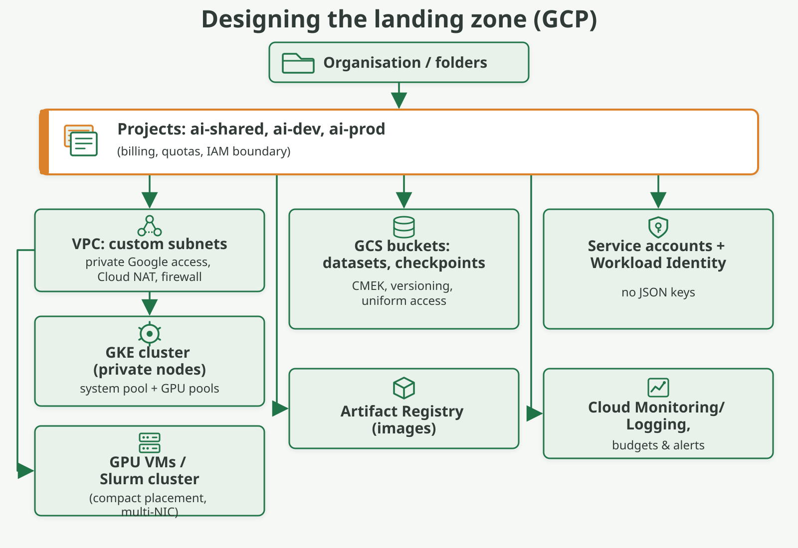

# 4.24 Terraform on GCP and Nebius: networks, GPU VMs and GKE

| | |
|---|---|
| Level | Intermediate |
| Priority tier | 1 |
| Lab venue | Terraform/OpenTofu, `gcloud`, GCP project with GPU quota (or CPU-only rehearsal); optional Nebius account and CLI |
| Part | Part 4: Automation and infrastructure as code |
| Status | Drafted, labs **untested** |

## Why this matters for AI infrastructure

Think about the bill for a GPU platform. Most of that money goes to GPU capacity, and that capacity comes from two very different kinds of cloud. Hyperscalers such as GCP give you rich building blocks, including VPC, IAM, GKE, managed storage and reservations. Those blocks surround a limited set of GPU machine families. GPU-focused providers such as Nebius, CoreWeave or Lambda work differently. They expose clusters with InfiniBand fabrics, shared filesystems and Kubernetes or Slurm layers, often through simpler but different APIs.

Picture a team that learned to build its network on GCP, and then wins a contract for GPU capacity on a GPU cloud. The team's first instinct is to copy the GCP design across. It quickly learns that the same idea, "all my training nodes can talk to each other fast," is written in a different resource on each side. The concept transfers, but the code does not. Understanding which parts of a design are the idea and which parts are the provider's syntax is what this chapter is really about.

As a platform engineer, you need to express both kinds of cloud as code. That covers the network, the capacity, the clusters, the storage and the identity, all within the guardrails of 4.23. This chapter builds a representative GCP stack from end to end. It then maps the same design onto a Nebius-style GPU cloud, so you can see which concepts transfer and which stay provider-specific. Products and APIs change quickly, so verify every identifier here against current provider documentation.

## Prerequisites and outcomes

This chapter assumes 4.18 to 4.23 and the networking basics from Part 2. Read those first, because the examples build on them. A VPC is a virtual private network in the cloud, and a subnet is a range of addresses inside it. A node is one virtual or physical machine in a cluster. When you finish, you should be able to:

- Design and code a GCP landing zone for AI: projects, VPC/subnets, private access, firewall, Cloud NAT, service accounts and workload identity, KMS, and storage buckets for datasets and checkpoints.
- Provision GPU VMs in the A2, A3 and A4 classes, and in the G2/L4 family, along with GKE clusters that have GPU node pools, taints/labels, autoscaling, and driver installation options. Understand capacity options (on-demand, reservations, spot, DWS flex/calendar) and quotas.
- Configure high-performance networking for multi-node training on GCP. That means multiple VPCs and NICs, jumbo MTU, compact placement and the GPUDirect-TCPX or RDMA variants. Cover it at a conceptual and Terraform level.
- Describe Nebius's resource model: tenants and projects, networks and subnets, compute instances with GPU platforms, GPU clusters with InfiniBand fabrics, shared filesystems, managed Kubernetes and Slurm options, and service accounts. Then explain how its Terraform provider is used, and compare it with GCP and CoreWeave.
- Structure multi-cloud modules around a common interface, and keep provider-specific details inside.

## 1. Designing the landing zone (GCP)

Before you write any Terraform, you need a map of where things live. The landing zone is that map. It starts at the organisation, runs through the projects and the network, and ends at the GPU pools, storage and monitoring. A landing zone is the agreed starting structure that every later workload is built inside. Read the diagram from the top down.



*Figure 4.24.1. Designing the landing zone (GCP), as a diagram.*

Four decisions shape everything below, and you should make them before you write code. Each decision is cheap to make now and expensive to change later, because every stack built afterwards depends on it.

Start with the project and environment structure. Give each environment its own project, and add a shared-services project for the registry, DNS and logging. A GCP project is the unit that holds billing, quotas and permissions. Quotas, billing and IAM boundaries follow project boundaries, so a dev experiment cannot use up the production GPU quota if it lives in its own project. Create the projects with Terraform in a `global` stack, using a service account with organisation-level permissions, and keep that account tightly controlled.

Next, choose regions and zones for GPUs. GPU families exist only in specific zones, and capacity varies from zone to zone. Check `gcloud compute accelerator-types list`, `gcloud compute machine-types list --filter="name~a3"` and the quota pages. Plan for zones where you actually hold quota or reservations. A zone is one data-centre location inside a region. Multi-region fallbacks carry cost and data-gravity implications, so treat them as a deliberate choice. Data gravity is the pull that large datasets exert: moving them across regions costs time and money, so compute tends to stay near them.

Identity is the third decision. Use workload identity federation for CI (4.22), one service account per workload, and no long-lived keys. A service account is the identity a workload uses when it calls Google APIs. Organisation policies such as `iam.disableServiceAccountKeyCreation` can enforce the no-keys rule for you, so a developer cannot create a key even by accident.

The last decision covers data and checkpoints. Put buckets in the same region as the compute, for throughput and egress cost. Egress means data leaving a region or the cloud, and it is billed. Use CMEK, which means customer-managed encryption keys, along with versioning and retention. For training IO, consider Filestore, Parallelstore, Managed Lustre or GCS FUSE with Anywhere Cache. IO is input and output, the reading of data and the writing of checkpoints, and training often stalls on it. Part 13 covers all of these.

Settle the project layout and the regions first, because every later stack depends on them. Changing a project later means moving resources between projects, which is slow and error-prone.

## 2. Network

A GPU node with no public IP still has to reach Google APIs and pull packages from the internet. Private Google Access and Cloud NAT solve that problem. Private Google Access lets a machine with only a private address call Google's own APIs. Cloud NAT lets that same machine reach the wider internet outbound, without anything being able to reach it inbound. The code below sets up both, along with the subnet and the firewall rules.

```hcl
resource "google_compute_network" "train" {
  name                    = "${local.prefix}-train"
  auto_create_subnetworks = false
  routing_mode            = "REGIONAL"
  mtu                     = 8896                        # up to 8896 supported; match on NICs/pods
}

resource "google_compute_subnetwork" "nodes" {
  name                     = "${local.prefix}-nodes"
  region                   = var.region
  network                  = google_compute_network.train.id
  ip_cidr_range            = "10.30.0.0/20"
  private_ip_google_access = true
  secondary_ip_range {
    range_name    = "pods"
    ip_cidr_range = "10.32.0.0/14"
  }
  secondary_ip_range {
    range_name    = "services"
    ip_cidr_range = "10.36.0.0/20"
  }
  log_config {
    aggregation_interval = "INTERVAL_10_MIN"
    flow_sampling        = 0.1
    metadata             = "INCLUDE_ALL_METADATA"
  }
}

resource "google_compute_router" "nat" {
  name    = "${local.prefix}-router"
  region  = var.region
  network = google_compute_network.train.id
}
resource "google_compute_router_nat" "egress" {
  name                               = "${local.prefix}-nat"
  router                             = google_compute_router.nat.name
  region                             = var.region
  nat_ip_allocate_option             = "AUTO_ONLY"
  source_subnetwork_ip_ranges_to_nat = "ALL_SUBNETWORKS_ALL_IP_RANGES"
}

resource "google_compute_firewall" "internal" {
  name      = "${local.prefix}-allow-internal"
  network   = google_compute_network.train.name
  direction = "INGRESS"
  allow { protocol = "tcp" }
  allow { protocol = "udp" }
  allow { protocol = "icmp" }
  source_ranges = ["10.30.0.0/20", "10.32.0.0/14"]
}
resource "google_compute_firewall" "iap_ssh" {
  name          = "${local.prefix}-allow-iap-ssh"
  network       = google_compute_network.train.name
  allow {
    protocol = "tcp"
    ports    = ["22"]
  }
  source_ranges = ["35.235.240.0/20"]          # Identity-Aware Proxy range: SSH via `gcloud compute ssh --tunnel-through-iap`
}
```

Read the network block first. It is the foundation that every node sits on, so a mistake here reaches everything. GCP VPCs are global, while their subnets are regional. That difference surprises people from other clouds. A single VPC can span many regions, but each subnet lives in exactly one region. Firewall rules are stateful, which means that once a connection is allowed in, the replies go back out without a second rule. They are applied through tags or service accounts, so prefer service-account targets. A tag is a label you attach to a VM, and anyone who can edit a VM can change its tags, so a service-account target is harder to bypass. Use Cloud NAT instead of public IPs on nodes, and enable Private Google Access. Avoid ranges that overlap with on-premises networks, because two networks with the same address range cannot be connected cleanly.

Look closely at the internal firewall rule. It allows TCP, UDP and ICMP from two sources: the nodes subnet at `10.30.0.0/20` and the pods range at `10.32.0.0/14`. A worked example makes the sources concrete. A training pod on one node that opens a connection to a pod on another node uses an address from the pods range, so the rule must allow that range to talk to itself. Without the pods range in the source list, the nodes could reach each other but the pods could not. Size the pod and service ranges for the largest cluster you will run, because GKE needs large alias ranges, and resizing a range later is hard. VPC flow logs record the traffic that crosses the network, which is useful for debugging. They cost money, so sample them. The `flow_sampling` setting above keeps only a fraction of the flows, which is how the cost stays under control.

Multi-node GPU training on A3-class machines needs a different design. Google documents multi-NIC layouts with several additional VPC networks, one per GPU NIC. A NIC is a network interface card, the hardware port that connects a machine to a network. Each network gets its own subnet and an MTU of 8244 or 8896, as the documentation describes. The MTU, or maximum transmission unit, is the largest packet a link carries, and bigger packets mean less overhead for large transfers. The firewall rules allow all traffic within each network. The main NIC carries general traffic, while the extra NICs carry GPU-to-GPU traffic. That traffic uses GPUDirect-TCPX, or the newer GPUDirect-RDMA variants on A3 Ultra and A4 that run over RoCE VPCs. RoCE, RDMA over Converged Ethernet, lets one GPU write straight into another machine's memory over Ethernet, skipping the CPU in the middle.

Follow the current guide to GPU VMs with high-performance networking, because machine types, images and network topology change between generations. The image matters too. Container-Optimized OS and Ubuntu with the NCCL plugin are two examples. NCCL is the NVIDIA library that GPUs use to share gradients during training, and a plugin tunes it for the network underneath. Before you size the ranges, check the largest cluster you plan to run.

## 3. GPU virtual machines

Suppose you need one GPU VM for a quick test today, and a fleet of them for training later. The resource block below is the starting point for that single VM. Its settings control Secure Boot, scheduling, networking and access, so read it closely before you copy it. Each setting is there for a reason, and copying the block without understanding it is how a test VM quietly becomes an unsafe one.

```hcl
resource "google_compute_instance" "gpu_login" {
  name         = "${local.prefix}-gpu-test"
  zone         = var.zone
  machine_type = var.gpu_machine_type             # e.g. "g2-standard-8" (1x L4) for rehearsal; "a3-highgpu-8g" for H100 x8
  tags         = ["gpu-node"]

  boot_disk {
    initialize_params {
      image = "projects/ubuntu-os-cloud/global/images/family/ubuntu-2204-lts"
      size  = 500
      type  = "pd-ssd"
    }
  }

  # For N1/A2/G2 families, accelerators attach via guest_accelerator or are bundled in the machine type (A2/A3/G2 bundle GPUs)
  scheduling {
    on_host_maintenance = "TERMINATE"
    automatic_restart   = false
    provisioning_model  = var.use_spot ? "SPOT" : "STANDARD"
    instance_termination_action = var.use_spot ? "STOP" : null
  }

  network_interface {
    subnetwork = google_compute_subnetwork.nodes.id
  }

  service_account {
    email  = google_service_account.node.email
    scopes = ["cloud-platform"]                  # restrict via IAM roles on the SA, not scopes
  }

  shielded_instance_config {
    enable_secure_boot          = false          # NVIDIA driver modules need signing if Secure Boot is on
    enable_vtpm                 = true
    enable_integrity_monitoring = true
  }

  metadata = {
    enable-oslogin = "TRUE"
    startup-script = file("${path.module}/scripts/bootstrap.sh")    # keep minimal; configure with Ansible (4.17)
  }
  labels = local.labels

  lifecycle {
    ignore_changes = [metadata["ssh-keys"]]
  }
}
```

A few choices in this block matter. The `provisioning_model` switches between `SPOT` and `STANDARD` depending on `var.use_spot`. A spot VM is cheaper spare capacity that the cloud may take back, so it is a good fit for work that can restart. When `use_spot` is true, `instance_termination_action` is `STOP`, which means the VM is stopped rather than deleted when it is reclaimed. Secure Boot stays off because NVIDIA driver modules need signing when Secure Boot is on. The service account uses the `cloud-platform` scope, and you restrict what it can do through IAM roles on the service account, not through scopes. Scopes are an older, coarser control, so the real limit is the role. The bootstrap script stays minimal, and Ansible (4.17) configures the rest. Keeping the startup script small means a failure in it is easy to find. The lifecycle block ignores changes to the `ssh-keys` metadata, so that keys added by OS Login or by hand do not trigger a replacement on the next plan.

Machine families differ in how they carry GPUs. These families bundle their GPUs into the machine type, so choosing the machine type also chooses the GPU. A2 brings A100 GPUs. A3 brings H100 GPUs, in machine types such as `a3-highgpu-8g`, `a3-megagpu-8g` and `a3-edgegpu`. A3 Ultra brings H200, A4 brings B200, A4X brings GB200 NVL72, and G2 brings L4. N1 is the exception, because it uses attached accelerators. An attached accelerator is a GPU plugged into a general-purpose machine, so you pick the CPU shape and the GPU separately. Machine types, GPU counts, networking and availability differ by zone and change over time. Verify them with `gcloud compute machine-types list` and the accelerator documentation.

Capacity comes in several forms, and choosing among them is a decision about risk and cost. On-demand capacity has a quota for each GPU family and region, and you can take it when it is free. Reservations, written as `google_compute_reservation`, hold capacity for you so it is there when you need it, and they are shared across projects. Future reservations sit alongside them, as do Dynamic Workload Scheduler (DWS) in flex-start and calendar mode, Spot and preemptible VMs, and committed use discounts. Preemptible VMs are the older name for the same kind of spare capacity that Spot VMs now provide. DWS suits large short jobs, because it waits until enough capacity is free to start the whole job together. Spot and preemptible VMs need termination handling and frequent checkpoints. Treat reservations as code, with owners and expiry (4.23).

For boot images, you have three options. Deep Learning VM images come with drivers preinstalled. Container-Optimized OS comes with a GPU driver installer. You can also build your own golden image with Packer and Ansible (4.2, 4.17). A golden image is a fully prepared disk image that every VM starts from, so each VM starts the same way. Whichever you pick, Secure Boot requires signed modules.

Compact placement keeps VMs close together for low-latency collectives. A collective is an operation where many GPUs exchange data at once, such as an all-reduce that sums gradients across every node. Those operations are only as fast as the slowest link, so keeping the machines close together helps. You set it through `resource_policies` with a `COMPACT` `group_placement_policy`. Host maintenance needs planning too. Live migration is unsupported for GPU VMs, which means GCP cannot move a running GPU VM to new hardware without stopping it. So plan for `TERMINATE` or scheduled maintenance windows.

Use local SSD for scratch, since A3 includes it. Scratch is temporary space that you can lose without harm, so local SSD suits it well. Use Hyperdisk or PD for persistent data, and cover mount options and filesystem choices in Part 13. Use OS Login and IAP for SSH, and give no node a public IP.

For homogeneous worker pools, use instance templates and managed instance groups (MIGs), with update policies for rolling replacement (4.21). A managed instance group keeps a set of identical VMs running and replaces any that fail. A rolling replacement swaps them out a few at a time, so the pool never goes fully dark. For Slurm-style static clusters with deterministic names, use one `google_compute_instance` per node instead. Deterministic names mean each node has a fixed name, such as `train-a`, which Slurm expects.

Compact placement is its own resource. Create it once, and attach it to each instance, as the comment at the end of this block shows.

```hcl
resource "google_compute_resource_policy" "compact" {
  name   = "${local.prefix}-compact"
  region = var.region
  group_placement_policy {
    collocation  = "COLLOCATED"
    vm_count     = var.node_count
  }
}
# attach with: resource_policies = [google_compute_resource_policy.compact.id] on the instances
```

Choose the machine family and the capacity model first. The family decides which GPU you get, and the capacity model decides what you pay and what happens when the cloud needs the machine back.

## 4. GKE clusters and GPU node pools

Suppose you define your GPU node pools inside the cluster resource. A change to one pool could then force Terraform to replace the entire cluster, which would take the control plane and every other pool down with it. The code below avoids that trap by managing the pools as separate resources. The control plane is the part of Kubernetes that makes decisions, and the node pools are the groups of machines that run the actual work.

```hcl
resource "google_container_cluster" "main" {
  name     = "${local.prefix}-gke"
  location = var.region                                  # regional control plane; or a zone for a zonal cluster
  network    = google_compute_network.train.id
  subnetwork = google_compute_subnetwork.nodes.id

  remove_default_node_pool = true
  initial_node_count       = 1
  deletion_protection      = true

  ip_allocation_policy {
    cluster_secondary_range_name  = "pods"
    services_secondary_range_name = "services"
  }
  private_cluster_config {
    enable_private_nodes    = true
    enable_private_endpoint = false
    master_ipv4_cidr_block  = "172.16.0.0/28"
  }
  master_authorized_networks_config {
    cidr_blocks {
      cidr_block   = var.admin_cidr
      display_name = "admin"
    }
  }
  workload_identity_config { workload_pool = "${var.project_id}.svc.id.goog" }
  release_channel { channel = "REGULAR" }
  datapath_provider = "ADVANCED_DATAPATH"                 # Dataplane V2 (eBPF/Cilium)
  logging_config { enable_components = ["SYSTEM_COMPONENTS", "WORKLOADS"] }
  monitoring_config {
    enable_components = ["SYSTEM_COMPONENTS"]
    managed_prometheus { enabled = true }
  }
}

resource "google_container_node_pool" "system" {
  name       = "system"
  cluster    = google_container_cluster.main.name
  location   = var.region
  node_count = 1
  node_config {
    machine_type    = "e2-standard-8"
    service_account = google_service_account.node.email
    oauth_scopes    = ["https://www.googleapis.com/auth/cloud-platform"]
    workload_metadata_config { mode = "GKE_METADATA" }
  }
}

resource "google_container_node_pool" "gpu" {
  for_each   = var.gpu_pools
  name       = each.key
  cluster    = google_container_cluster.main.name
  location   = var.region
  node_locations = each.value.zones
  autoscaling {
    min_node_count = each.value.min_nodes
    max_node_count = each.value.max_nodes
    location_policy = "ANY"
  }
  management {
    auto_repair  = true
    auto_upgrade = false                               # control upgrades yourself for training pools
  }
  upgrade_settings {
    strategy        = "SURGE"
    max_surge       = 0
    max_unavailable = 1
  }
  node_config {
    machine_type    = each.value.machine_type
    service_account = google_service_account.node.email
    disk_size_gb    = 500
    disk_type       = "pd-ssd"
    labels          = { pool = each.key, accelerator = each.value.gpu_type }
    taint {
      key    = "nvidia.com/gpu"
      value  = "present"
      effect = "NO_SCHEDULE"
    }
    guest_accelerator {
      type  = each.value.gpu_type                       # e.g. "nvidia-l4"; for A3 the GPUs come with the machine type
      count = each.value.gpu_count
      gpu_driver_installation_config { gpu_driver_version = "LATEST" }
    }
    workload_metadata_config { mode = "GKE_METADATA" }
    reservation_affinity {
      consume_reservation_type = each.value.reservation == null ? "NO_RESERVATION" : "SPECIFIC_RESERVATION"
      key    = each.value.reservation == null ? null : "compute.googleapis.com/reservation-name"
      values = each.value.reservation == null ? null : [each.value.reservation]
    }
  }
  lifecycle { ignore_changes = [initial_node_count] }
}
```

The cluster sets `remove_default_node_pool = true`, so Terraform creates the control plane and then deletes the temporary default pool. The system pool and the GPU pools are separate resources. The GPU pools use `for_each`, so you can add, resize or replace one of them without touching the control plane. `for_each` builds one resource per entry in a map, so each pool is addressed by its name, and changing one entry does not renumber the others. The system pool holds the cluster's own helpers, and keeping it apart from the GPU pools means a GPU problem cannot starve the system components.

Upgrade settings are where a GPU pool most often goes wrong. By default, GKE uses surge upgrades, with `max_surge = 1` and `max_unavailable = 0`. GKE boots one extra GPU VM before it drains and deletes an existing node. Suppose your reservation holds exactly 16 `a3-highgpu-8g` nodes, and all 16 are running. The 17th node has nowhere to fit, so it fails with `QUOTA_EXCEEDED` or `RESERVATION_EXHAUSTED`, and the upgrade stalls. Setting `max_surge = 0` and `max_unavailable = 1` avoids the extra node. GKE then cordons, drains and upgrades one existing node at a time, inside the 16-node reservation.

The rest of the pool settings follow the same logic. Think of each one as a question about the pool's future. What happens when GKE wants to upgrade it? What happens when the pool needs more capacity? Who can use the hardware? Layering comes first. Create the cluster and node pools in the cluster stack. Install add-ons, such as the GPU operator or GKE's device plugin and drivers, Kueue or JobSet, Prometheus, ingress and Argo CD, in a separate stack or Helm layer (4.25, 4.26). A device plugin is the component that tells Kubernetes a node has GPUs to hand out.

For drivers, GKE can install them for supported GPU types through `gpu_driver_installation_config`. You can also run the NVIDIA GPU Operator, with `driver.enabled=false` or `true` depending on your node images, as Part 11 covers. Do not run two managers for the same driver. Two managers fight over the same hardware and leave the node in an unpredictable state.

Taint GPU pools so that only GPU workloads land on them. A taint is a mark on a node that repels pods unless they explicitly tolerate it. Label the pools for node selection and cost reporting. GKE adds `cloud.google.com/gke-accelerator` labels automatically, so you do not need to add that one yourself.

GPU pools that scale from zero (min 0) save money, but they depend on capacity being available. A pool at zero costs nothing while idle, but the first job waits for a node to appear. `location_policy = "ANY"` prefers zones that have capacity, so the autoscaler can pick the zone that has room. For tightly coupled multi-node jobs, consider fixed-size pools with compact placement, or GKE multi-host TPU and GPU features. Tightly coupled means the nodes must all be ready at once and talk constantly, so a partial pool is no use. Use Kueue with ProvisioningRequest and DWS to acquire capacity all at once. That way the job either gets its whole set of nodes or waits, rather than starting with half of them.

Surge upgrades with `max_surge` consume extra GPUs that may not exist. A `max_unavailable` above 0, with drains, is the typical choice when capacity is tight. Schedule maintenance windows as well, so upgrades land at times when no critical job is running. If a pool has reservations and you need control over upgrades, disable auto-upgrade, and balance that choice against your security patch policy. Turning off auto-upgrade means you own the patching schedule, so the decision should be written down with its reason.

Workload Identity binds a Kubernetes service account to a Google service account, so pods can reach buckets without keys. The three resources below do that work, in order. Read them as a chain. The first creates the identity, the second lets a Kubernetes account act as that identity, and the third lets that identity read and write the bucket.

```hcl
resource "google_service_account" "trainer" {
  account_id = "trainer"
}
resource "google_service_account_iam_member" "wi" {
  service_account_id = google_service_account.trainer.name
  role               = "roles/iam.workloadIdentityUser"
  member             = "serviceAccount:${var.project_id}.svc.id.goog[training/trainer-ksa]"
}
resource "google_storage_bucket_iam_member" "rw" {
  bucket = google_storage_bucket.checkpoints.name
  role   = "roles/storage.objectUser"
  member = "serviceAccount:${google_service_account.trainer.email}"
}
```

Enable deletion protection with `deletion_protection = true`, and add `prevent_destroy` for clusters (4.21). Node pool replacement is expected, because pools get resized and upgraded. Cluster replacement is not expected, and it would take every workload with it. Before you add a GPU pool, decide whether it needs manual upgrades, because that choice sets when you schedule maintenance.

## 5. Storage, KMS and IAM building blocks

Checkpoints and datasets live in buckets, and each bucket needs an encryption key, a lifecycle and an identity. KMS, the key management service, holds the keys that encrypt the data. A lifecycle is the set of rules that decide when objects are moved or deleted. The code below builds the key and the checkpoint bucket.

```hcl
resource "google_kms_key_ring" "ml" {
  name     = "${local.prefix}-ml"
  location = var.region
}
resource "google_kms_crypto_key" "ckpt" {
  name            = "checkpoints"
  key_ring        = google_kms_key_ring.ml.id
  rotation_period = "7776000s"                       # 90 days
  lifecycle { prevent_destroy = true }
}

resource "google_storage_bucket" "checkpoints" {
  name                        = "${var.project_id}-${local.prefix}-ckpt"
  location                    = var.region
  uniform_bucket_level_access = true
  public_access_prevention    = "enforced"
  force_destroy               = false
  versioning { enabled = true }
  encryption { default_kms_key_name = google_kms_crypto_key.ckpt.id }
  lifecycle_rule {
    condition {
      age        = 30
      with_state = "ARCHIVED"
    }
    action { type = "Delete" }
  }
  lifecycle { prevent_destroy = true }
}
```

Each setting protects against a specific failure. `uniform_bucket_level_access` turns off per-object permissions, so access is decided in one place. `public_access_prevention = "enforced"` makes it impossible to expose the bucket to the internet by mistake. `force_destroy = false` stops Terraform from deleting a bucket that still holds checkpoints. Versioning keeps the older copy when an object is overwritten, which saves you from an accidental overwrite of the last good checkpoint. The key's `rotation_period` of 90 days means the encryption key is replaced on that schedule, and the `prevent_destroy` lifecycle stops Terraform from deleting the key itself, because losing the key makes the data unreadable.

The bucket's service agent needs `roles/cloudkms.cryptoKeyEncrypterDecrypter` on the key before the bucket can use it. A service agent is an identity that Google runs on your behalf for a service, and it needs permission to use your key. Without that role, the bucket creation fails, and the error does not always say why.

For training IO, consider regional buckets in the same region as the compute, hierarchical namespace buckets, the GCS FUSE CSI driver on GKE, Anywhere Cache, and parallel file systems for datasets and checkpoints. GCS FUSE mounts a bucket so that it looks like a local folder to a training job. Those parallel file systems are Parallelstore, Managed Lustre and Filestore. A parallel file system lets many machines read and write the same data at once, which training with many nodes needs. Part 13 covers them.

Budgets and alerts come next. A budget is a spending limit that you set in advance, and an alert tells you when spend crosses a point along the way. The `google_billing_budget` resource sets a spending amount, fires at the 0.5 and 0.9 thresholds, and sends its updates to a Pub/Sub topic. Pub/Sub is the messaging service that the budget uses to publish its alerts, and something must subscribe to the topic to act on them.

```hcl
resource "google_billing_budget" "gpu" {
  billing_account = var.billing_account
  display_name    = "${local.prefix}-gpu-budget"
  amount {
    specified_amount {
      currency_code = "USD"
      units         = "50000"
    }
  }
  threshold_rules { threshold_percent = 0.5 }
  threshold_rules { threshold_percent = 0.9 }
  all_updates_rule { pubsub_topic = google_pubsub_topic.budget.id }
}
```

Think of the two thresholds as an early warning and a final warning. The 0.5 threshold tells you the money is moving faster than planned, while there is still time to change course. The 0.9 threshold tells you the budget is nearly gone. Decide who owns the budget and the checkpoint bucket before the first GPU node starts writing to it, because an alert that nobody receives does nothing.

## 6. Slurm-style clusters on GCP

If your users come from HPC, Cluster Toolkit (formerly HPC Toolkit) is the tool to know. HPC means high-performance computing, the world of batch jobs and job schedulers. Cluster Toolkit generates Terraform for Slurm clusters on GCP. Slurm is the job scheduler that most HPC users already know. Its output covers the controller, the login nodes, partitions of GPU VMs, Filestore or Lustre, and ephemeral, autoscaled compute that uses Slurm's cloud scheduling. A partition is a named group of nodes that jobs are sent to.

You can use its blueprints as modules, or build your own. In a custom build, Terraform creates the VMs or instance templates, the networks and the storage. Ansible or the Slurm GCP images configure Slurm (Part 6). Node resume and suspend scripts call the GCP API to add and remove capacity. That means Slurm itself decides when a node is needed, and asks the cloud to start one. Keep the same layering and guardrails from 4.23. Network, storage, controller and partitions belong in separate stacks, or in clearly separated modules, so a change to the partitions does not put the controller at risk.

## 7. Nebius: the GPU-cloud model

Suppose your team already runs Terraform on GCP and now needs GPU capacity from Nebius. Many of the concepts map across directly, but the names and the fabric model differ. The table shows where each concern lands in each cloud. Use it as a dictionary: when you see a concept you know, look up its name in the other cloud.

Nebius AI Cloud is a GPU-focused provider. Its resources target AI training and inference. Names and APIs evolve, so treat the table and the code that follows as a conceptual map. Verify every attribute against the current Nebius Terraform provider documentation.

| Concern | Typical Nebius building block | GCP analogue |
|---|---|---|
| Tenancy | Tenant → projects (regions are tied to projects); service accounts with authorised keys / federation | Organisation → projects |
| Network | VPC networks and subnets, security groups, static IPs, private endpoints | VPC, subnets, firewall |
| GPU compute | Compute instances using GPU platforms (H100/H200/B200 families) with presets (number of GPUs, CPUs, RAM), boot disks, filesystems attached | GPU VMs (A3/A4) |
| Multi-node fabric | **GPU clusters** (InfiniBand fabric) that instances join so NCCL traffic runs over IB/RDMA | Multi-NIC RDMA VPCs / compact placement |
| Shared storage | Shared filesystems (mounted across instances), object storage (S3-compatible) | Filestore/Lustre, GCS |
| Kubernetes | Managed Kubernetes clusters and node groups (GPU node groups, optionally with GPU clusters/InfiniBand) | GKE |
| Slurm | Managed or Terraform/Helm-deployed Slurm on Kubernetes (Soperator-style) or VM-based Slurm recipes | Cluster Toolkit Slurm |
| Capacity | Reservations/commitments, preemptible options | Reservations, DWS, Spot |
| Observability | Managed Prometheus/Grafana/logging options, DCGM metrics | Cloud Monitoring, GMP |
| IaC | Terraform provider, CLI, SDKs | google provider, gcloud |

Read the table as a translation guide rather than an exact match. The multi-node fabric row matters most. Nebius places the fabric in a resource of its own, while GCP spreads the same job across VPCs and placement policies. The idea is the same in both: nodes that must talk fast need to be wired together on purpose. The syntax that expresses that wiring is what differs. DCGM, in the observability row, is NVIDIA's data-centre GPU monitoring tool, which reports the health and load of each GPU.

The shape below is illustrative. Resource and attribute names must be checked in the provider docs. Read it to see the structure: a network, a fabric, and then a set of instances that join the fabric.

```hcl
terraform {
  required_providers {
    nebius = {
      source  = "terraform-provider.storage.eu-north1.nebius.cloud/nebius/nebius"   # confirm the current registry source
      version = "~> 0.5"
    }
  }
}

provider "nebius" {
  # authentication via the environment/CLI profile or service account credentials;
  # no keys in code (4.22). Parent (project) IDs are passed per resource.
}

resource "nebius_vpc_v1_network" "train" {
  parent_id = var.project_id
  name      = "train-net"
}

resource "nebius_compute_v1_gpu_cluster" "fabric" {            # InfiniBand fabric for multi-node NCCL
  parent_id         = var.project_id
  name              = "h100-fabric-a"
  infiniband_fabric = "fabric-3"                                # fabric name per region/platform
}

resource "nebius_compute_v1_instance" "gpu" {
  for_each  = toset(var.node_names)
  parent_id = var.project_id
  name      = each.key
  gpu_cluster = { id = nebius_compute_v1_gpu_cluster.fabric.id }
  resources = {
    platform = "gpu-h100-sxm"
    preset   = "8gpu-128vcpu-1600gb"
  }
  # boot disk, network interfaces (subnet, public IP: none), cloud-init user data, attached shared filesystem ...
}
```

Notice the order of the blocks. The fabric is created before the instances, and each instance refers to the fabric's ID. That reference is how Terraform knows to build the fabric first, and it is also how each node ends up on the same fabric. A worked example: if `node_names` holds eight names, Terraform creates one fabric and eight instances, and all eight point at that single fabric ID.

The notes below cover the design choices behind the code. Each one is a decision you will face on a real Nebius estate, so read them as a checklist rather than a list of trivia.

1. Fabric membership is the key difference between the two clouds. Multi-node jobs need every node in the same GPU cluster or fabric. Place all the nodes of a training pool in one fabric, and size each fabric for the largest job you will run. Changing membership may force you to recreate nodes, so plan the topology up front. A node that sits on the wrong fabric will run, but it will not share fast links with its peers, so the job still starts and runs slowly.

2. Use immutable images with cloud-init. Immutable means you never patch a running node, you replace it with a new image. Build golden images with drivers, NCCL and OFED (4.2, 4.17), and use cloud-init for node identity. OFED is the InfiniBand driver stack. Cloud-init is the tool that gives each node its name and settings on first boot. Ansible, or the provider's Slurm or Kubernetes automation, handles the rest.

3. Define a shared filesystem once, and mount it across instances. Throughput depends on its size and type, so a small filesystem can bottleneck a large job. Treat it as stateful, with protection and backups (Part 13).

4. If the provider offers managed Kubernetes with GPU node groups and GPU Operator integration, Terraform can handle the cluster and its node groups. A separate Helm or Argo layer then installs add-ons (4.25, 4.26). For Slurm, use the provider's automation, such as Helm charts on Kubernetes or Terraform modules, or provision VMs and run Ansible (4.17, Part 6).

5. Quota and capacity are commercial terms. Reservations and commitments are negotiated, so Terraform should encode what you have and warn when a plan exceeds it. Do not assume the cloud is elastic (4.23 guardrails). A useful habit is to write the negotiated number into a variable, and let a check fail the plan when the requested count goes over it.

6. CoreWeave and other Kubernetes-native GPU clouds expose clusters where nodes join a managed Kubernetes plane. Workloads request GPUs through standard Kubernetes APIs and node labels for instance type and interconnect. Terraform manages the cluster and namespaces, quotas, storage classes and network policies through the Kubernetes and Helm providers. InfiniBand topology appears as node labels that schedulers use (Part 11). A label is a key-value tag on a node, and a scheduler reads it to decide where a job can run.

7. Expose a common module interface with name, accelerator class, node count, fabric or placement group, and storage mounts. Implement the provider-specific submodules, `modules/gpu-pool/gcp`, `/nebius` and `/coreweave`, behind that interface. Keep provider differences, such as fabrics and presets, as explicit variables rather than hiding them. Before you add a second provider, decide which differences the interface should keep visible.

## 8. Verification after apply

A green `apply` shows only that the API calls worked, not that your GPUs work. The cloud accepted the request and built the machine, but nothing has yet proved that the driver loads, the network is fast, or the storage mounts. Treat verification as a separate step with its own checklist.

Start with placement: instances in the expected zone and fabric, with labels, taints and the reservation in place. Then `nvidia-smi` should show the expected GPUs and driver, with Fabric Manager or IMEX running where needed. Fabric Manager and IMEX are NVIDIA services that let the GPUs in one machine, or across machines, talk to each other at full speed. If they are not running, the GPUs still appear, but they cannot share data quickly.

Then the network. MTU must be correct end to end, which `ping -M do -s 8972` tests. The `-M do` option forbids fragmentation, so the ping fails if any hop cannot carry the packet. The 8972 size is chosen so that the payload, plus the headers added on the way, fills the full MTU, so it checks the path in a way that a plain ping would not. RDMA and InfiniBand links must be up at speed, as `ibstat` and `rdma link` show. NCCL tests across nodes must meet the bandwidth floor, measured with `all_reduce_perf`. A bandwidth floor is the minimum speed you have decided is acceptable, and a result below it means something in the fabric is wrong.

Mounts should deliver the expected throughput, which `fio` measures, and checkpoint buckets must be reachable with workload identity. On Kubernetes, nodes must be Ready and `nvidia.com/gpu` must be allocatable. Allocatable means Kubernetes can hand out that many GPUs to pods. The GPU Operator or device plugin must be healthy, a test pod should run `nvidia-smi`, and DCGM metrics should reach Prometheus. Confirm that you attached budgets, alerts and cost labels. Put these checks into one play, run by Ansible or CI (4.17), so every pool gets the same test. A play is an Ansible term for a set of tasks run against a group of hosts, and running the same play for every pool means no pool gets a lighter check.

## 9. Lab

Start with the self-checking Python lab, and run it locally before you touch the cloud. It needs no cloud account, so it is the safe first step. It checks the validator for GCP GPU VMs and GKE node pools, `validate_gcp_gpu_node_pool`. That validator checks `on_host_maintenance == "TERMINATE"`, `mtu == 8896`, `max_surge == 0` and `max_unavailable >= 1`. It also checks `SPECIFIC_RESERVATION` for reserved GPU pools, and the `nvidia.com/gpu:NO_SCHEDULE` taints. The lab then tests the multi-NIC GPU rail VPC subnet generator, `generate_multi_nic_gpu_subnets`, and the Nebius InfiniBand fabric membership verifier for `nebius_compute_v1_gpu_cluster`, `validate_nebius_gpu_fabric_membership`.

```bash
python3 code/part04/terraform_gcp_nebius_validator_lab.py
```

The commands in this lab have not been run on live hardware, so run the CPU or L4 rehearsal variants first. Each step below touches real cloud resources, and it costs money while it runs. Provision a large GPU shape only with a budget cap and a plan to destroy it straight away.

1. Build the landing zone. Create a project, or use a sandbox, enable the APIs, and write the network stack: the VPC, a subnet with secondary ranges, router and NAT, firewall, and IAP SSH. Run `plan` and `apply`. Verify the result with `gcloud compute networks describe` and an IAP SSH session to a tiny VM.
2. Set up identity and storage. Create service accounts, a workload identity pool binding, a KMS key, and a versioned CMEK bucket with `prevent_destroy`. Test access from a VM through the service account, without keys.
3. Test a GPU VM. Provision an L4 with `g2-standard-8`, or an A2 if your quota allows. Install and verify the driver through the image or Ansible (4.17), and run `nvidia-smi`. Then try Spot, observe a preemption, and destroy the VM.
4. Work with capacity objects. Write a small, short-lived `google_compute_reservation`, consume it from an instance, and add an alert or a note about its expiry. Then delete it.
5. Build a GKE cluster. Create a private regional or zonal cluster, a system pool and an L4 GPU pool with min 0. Deploy a GPU test pod with a toleration and a node selector. Watch the scale-up from zero and the scale-down, and test Workload Identity access to the bucket.
6. Check upgrade behaviour. Change the node pool image or machine type in staging. Read the plan for `-/+` and the `upgrade_settings`, then trigger a surge upgrade. Note how much GPU capacity the upgrade needs.
7. Apply policy. Run Conftest or Checkov on the plan. Deny public IPs on nodes, require labels, cap the GPU count, and require versioning on buckets (4.23).
8. Sketch the multi-NIC design. Read Google's current A3, A3 Ultra and A4 networking document. Sketch the Terraform for the additional VPCs, subnets, firewall rules and instance NIC blocks. If you have no quota, implement the network part as a CPU-only dry run.
9. Run Slurm on GCP. Write or generate a minimal Slurm cluster with a controller and an autoscaled partition, using Cluster Toolkit modules or Terraform with Ansible. Submit a trivial job, and watch the node resume and suspend.
10. Try Nebius, if you want to. Authenticate the CLI, and apply the network and a small instance. Add a GPU cluster only if you have the capacity. Check the provider resource names against the docs, compare the steps with GCP, and record the differences in a table.
11. Define a common module interface. Write `modules/gpu-pool` with the inputs `accelerator`, `node_count`, `placement` and `storage`. Write two implementations, a GCP MIG or GKE pool and a stub for Nebius, and test plans for both.
12. Write a verification play. Automate the checks from section 8 with Ansible, `terraform test` or `check` blocks.
13. Tear everything down. Run `terraform destroy`, then confirm in billing or the console that nothing is left. Check reservations, disks, static IPs and snapshots. Leftover disks and static IPs keep charging after the VM is gone, so they are the usual source of a surprise bill.

## 10. Common mistakes

Read this list before your first `apply`. Each item is a mistake that teams make at the start, when the stakes feel low and the habit is easy to form.

Start with capacity. Planning GPU shapes without checking zone availability, quota or reservations means you find the gap at apply time. Forgetting MTU, placement or RDMA NIC configuration leaves multi-node NCCL at a fraction of the expected bandwidth. Buckets in a different region than the compute are another mistake, because every read then crosses regions and costs more. Checkpoint buckets without versioning, CMEK or `prevent_destroy` lack the protections from section 5.

Security is next. Public IPs and wide-open firewall rules on GPU nodes are a mistake, and so are SSH keys used in place of OS Login or IAP. Service-account JSON keys in repos or CI, and excessive scopes, are mistakes too. Each one is a way for a stolen credential to reach far more than it should.

Putting the cluster and node pool in the same stack as the Kubernetes add-ons causes provider and credential ordering problems (4.22). Auto-upgrades and surge settings that need extra GPUs which do not exist are another trap, and so is replacing reserved nodes. Replacing a reserved node can mean giving up the reservation's place in the queue.

Watch the cost side. Assuming spot or preemptible capacity works for long runs without checkpointing is a mistake, because a preemption then throws away everything since the last save. Running with no budgets or labels makes GPU spend untraceable, and nobody can say which team caused a spike.

Finally, treating one provider's concepts as universal is a mistake. Fabric membership, placement policies and node labels do different jobs. Before you copy a design between providers, check which of these concepts it depends on. A design that depends on a GCP placement policy has no direct twin on a fabric-based cloud, and that gap needs its own decision.

## 11. Interview angles

Use these questions to test your understanding, not just to recite answers. For each one, say the answer out loud in your own words, then check whether you named the reason as well as the resource.

- "Design the Terraform for a GKE cluster with GPU node pools and workload identity. What goes in separate stacks?"
- "How do you secure GPU nodes on GCP?" Answer with private nodes, NAT, IAP and OS Login, shielded VMs, least-privilege service accounts and org policies.
- "A GPU node pool update needs surge capacity that doesn't exist. What now?" Answer with `max_unavailable`, drains, reservations and DWS.
- "How would you give 64 H100 nodes high-bandwidth networking on GCP? On a GPU cloud like Nebius?"
- "How do you manage GPU capacity as code? Reservations, quotas, budgets?"
- "What's different about InfiniBand-fabric clouds vs hyperscalers?"
- "How do you keep a multi-cloud module interface clean?"
- "How do you validate that Terraform-created GPU infrastructure is actually healthy?"

## Exercises

Work through these on paper first, and answer before you look at any solution. Each exercise gives you one situation and one question.

1. A new engineer asks how the GCP landing zone and its multi-NIC GPU VPCs fit together. Using `generate_multi_nic_gpu_subnets()` in `code/part04/terraform_gcp_nebius_validator.py`, explain how the network resources work together. Start with `google_compute_network` set to `mtu = 8896`. Then explain `google_compute_subnetwork` with `private_ip_google_access = true` and its `pods` and `services` secondary ranges, `/14` and `/20`. Next explain `google_compute_router_nat`. Then explain the `google_compute_firewall` rule for IAP SSH from `35.235.240.0/20`. Finally, explain why A3, A3 Ultra and A4 multi-node GPU training uses several extra VPCs, one per GPU NIC, alongside the primary management VPC.
2. A team is choosing a machine family and a capacity model for a GPU test VM. Trace GCP GPU VMs across the A2, A3, A4 and G2 families. Then trace compact placement (`COLLOCATED`) through `google_compute_instance.gpu_login` and `google_compute_resource_policy.compact`. Explain why `on_host_maintenance = "TERMINATE"` is mandatory. Explain how `enable_secure_boot = false` relates to unsigned DKMS kernel modules. Finish by stating when to use On-Demand, `google_compute_reservation`, Dynamic Workload Scheduler (`DWS`) or `SPOT`.
3. A reviewer asks why the production GKE node pools are written the way they are. Using `validate_gcp_gpu_node_pool()` in `code/part04/terraform_gcp_nebius_validator.py`, explain why the cluster sets `remove_default_node_pool = true`. Explain `datapath_provider = "ADVANCED_DATAPATH"`, which is Dataplane V2 (eBPF/Cilium). Explain `auto_upgrade = false`, `max_surge = 0` with `max_unavailable = 1`, the `nvidia.com/gpu:NO_SCHEDULE` taint, and `reservation_affinity` set to `SPECIFIC_RESERVATION`. Then trace the three-resource Workload Identity binding. Name what each of `google_service_account`, `roles/iam.workloadIdentityUser` and `roles/storage.objectUser` contributes.
4. A team wants to know why its checkpoint bucket is hard to lose or expose. Trace the CMEK checkpoint storage built from `google_kms_crypto_key` and `google_storage_bucket` in Section 5. Follow `rotation_period = "7776000s"`, `uniform_bucket_level_access = true`, `public_access_prevention = "enforced"`, `versioning` and `prevent_destroy = true`. Then explain the `google_billing_budget` resource, and say what the 0.5 and 0.9 thresholds do when they publish to Pub/Sub.
5. A platform team is weighing a second GPU cloud against its GCP setup. Using `validate_nebius_gpu_fabric_membership()` in `code/part04/terraform_gcp_nebius_validator.py`, compare Nebius's resource model with the GCP multi-NIC VPC design. Cover `parent_id` for project tenancy. Cover `nebius_vpc_v1_network`. Cover the `nebius_compute_v1_gpu_cluster` InfiniBand fabric with `infiniband_fabric = "fabric-3"`. Cover `nebius_compute_v1_instance` with `platform = "gpu-h100-sxm"` and `preset = "8gpu-128vcpu-1600gb"`. Include shared filesystems and Soperator, Slurm on Kubernetes. Then compare Nebius and CoreWeave with GCP.
6. A team wants one module that can build GPU pools on either GCP or Nebius. Design a provider-agnostic `modules/gpu-pool` input and output interface, with GCP and Nebius backend submodules. Then list the 5 post-apply verification checks from Section 8 that must pass before you release Terraform-provisioned GPU nodes to jobs.

## Checkpoint questions (20)

<details>
<summary>1. How is a Google Cloud VPC scoped compared to AWS/Azure VNet, and why do GKE subnets define two `secondary_ip_range` blocks?</summary>

A GCP VPC (`google_compute_network`) is global, so it spans every region without cross-region peering. Its subnets (`google_compute_subnetwork`) are regional, and each one covers all the zones in its region. GKE VPC-native clusters give every Pod and Service a routable VPC address. They take those addresses from two secondary ranges on the subnet. The `pods` range (`10.32.0.0/14`, 262,144 IPs) supplies per-node `/24` pod blocks. The `services` range (`10.36.0.0/20`, 4,096 IPs) supplies the `ClusterIP` addresses for Services.
</details>

<details>
<summary>2. How do Private Google Access, Cloud NAT (`google_compute_router_nat`), and Identity-Aware Proxy (`IAP`, `35.235.240.0/20`) eliminate public IPs on GPU nodes?</summary>

With `private_ip_google_access = true` on the subnet, VMs without public IPs can reach Google APIs, such as `storage.googleapis.com`, Artifact Registry and the GKE control plane, over Google's private backbone. Cloud NAT, built from `google_compute_router` and `google_compute_router_nat`, gives private nodes outbound access, for example to pull upstream images or apt packages. No inbound public IP is needed. IAP forwards TCP from `35.235.240.0/20`. Combined with `enable-oslogin = "TRUE"`, it lets engineers SSH into private VMs with `gcloud compute ssh --tunnel-through-iap`, authenticated by Google IAM and MFA, with no public IP or bastion host.
</details>

<details>
<summary>3. Why do multi-node training VMs on GCP (`A3`, `A3 Ultra`, `A4`) use multiple VPC networks and `mtu = 8896`?</summary>

An 8-GPU `a3-highgpu-8g` or `a3-megagpu-8g` machine (H100), `a3-ultragpu-8g` (H200) or `a4` (B200) has several physical NICs. One primary NIC (`eth0`) handles host management, storage and pod networking. Four or eight dedicated GPU-direct NICs sit alongside the GPUs, across the PCIe and NVSwitch rails. They run GPUDirect-TCPX, or GPUDirect-RDMA over RoCE. GCP attaches each NIC to its own VPC, so Terraform creates one management VPC plus four or eight GPU-rail VPCs. All of them use jumbo frames with `mtu = 8896`, which packs more NCCL payload into each packet.
</details>

<details>
<summary>4. Compare GCP's GPU Machine Families (`G2`, `A2`, `A3`, `A3 Ultra`, `A4`, `A4X`) and how GPUs attach to them in Terraform.</summary>

- **N1 (legacy T4/V100):** A general-purpose CPU machine type. GPUs attach separately through `guest_accelerator`.
- **G2 (`g2-standard-*`):** Bundles 1 to 8 **NVIDIA L4** GPUs, which suit inference, graphics and affordable rehearsals.
- **A2 (`a2-highgpu-*` / `a2-ultragpu-*`):** Bundles 1 to 16 **NVIDIA A100** GPUs, in 40 GB or 80 GB variants, with NVLink.
- **A3 (`a3-highgpu-8g` / `a3-megagpu-8g`):** Bundles 8 **NVIDIA H100 80 GB** GPUs with NVSwitch and GPUDirect-TCPX.
- **A3 Ultra (`a3-ultragpu-8g`):** Bundles 8 **NVIDIA H200** GPUs with ConnectX-7 400G GPUDirect-RDMA over RoCE.
- **A4 and A4X:** Bundle **NVIDIA Blackwell B200** GPUs in an 8-GPU HGX board, and **GB200 NVL72** rack-scale NVLink domains.
</details>

<details>
<summary>5. Compare the five ways to acquire GPU capacity on GCP: On-Demand, Reservations, Future Reservations, Dynamic Workload Scheduler (`DWS`), and Spot.</summary>

1. **On-Demand:** Pay as you go. It depends on regional quota, and scarce GPUs can run out in a zone at any moment.
2. **Zonal Reservations (`google_compute_reservation`):** Hold a specific GPU machine shape in a zone, so the capacity exists when your VMs or pools scale up. Reservations are often paired with 1- or 3-year committed use discounts (CUDs).
3. **Future Reservations:** Request capacity ahead of time, for a planned future date or window.
4. **Dynamic Workload Scheduler (`DWS`, flex-start and calendar modes):** Queues a large multi-node GPU request as a `ProvisioningRequest` in Kubernetes Kueue. It provisions all the nodes together, as soon as capacity appears, for a bounded duration.
5. **Spot VMs (`provisioning_model = "SPOT"`):** Deeply discounted spare capacity. GCP can preempt them at any time, with a 30-second notice, so they need frequent checkpoints and fault-tolerant training.
</details>

<details>
<summary>6. What does `google_compute_resource_policy` with `collocation = "COLLOCATED"` do for distributed training?</summary>

A `google_compute_resource_policy` with `group_placement_policy`, `collocation = "COLLOCATED"` and `vm_count = var.node_count`, attached to your GPU instances through `resource_policies`, tells GCP's Borg physical scheduler to place all the VMs physically close together, in the same data-center fabric cluster or spine. That cuts network hops and tail latency for collective all-reduce operations.
</details>

<details>
<summary>7. Why does `google_compute_instance.gpu_login` set `enable_secure_boot = false` under `shielded_instance_config` by default?</summary>

With Secure Boot on, the Linux kernel refuses any out-of-tree module that is not signed by a key enrolled in the VM's Machine Owner Key (MOK) or UEFI database. That covers `nvidia.ko`, `nvidia-uvm.ko`, `nvidia-peermem.ko` and `mlx5_core.ko`. Unless you use pre-signed driver packages or enroll your own DKMS signing key in the golden image, DKMS-built NVIDIA drivers fail `modprobe` with `Key was rejected by service`. That is why the default is `enable_secure_boot = false`.
</details>

<details>
<summary>8. In `google_container_cluster.main`, why do we set `remove_default_node_pool = true` and manage `google_container_node_pool` resources separately?</summary>

Node pools defined inline can force Terraform to replace the whole GKE cluster when their configuration changes. Setting `remove_default_node_pool = true` and `initial_node_count = 1` creates the control plane and deletes the temporary default pool. The system pool (`google_container_node_pool.system`) and the GPU pools (`google_container_node_pool.gpu`, using `for_each`) are then separate resources. You can add, resize or replace them without touching the control plane.
</details>

<details>
<summary>9. Why must a GKE GPU node pool backed by a fixed reservation set `max_surge = 0` and `max_unavailable = 1` inside `upgrade_settings`?</summary>

The default surge upgrade, with `max_surge = 1` and `max_unavailable = 0`, boots one extra GPU VM before it drains a node. A fixed reservation has no spare room for that VM. With 16 `a3-highgpu-8g` nodes running, a 17th fails with `QUOTA_EXCEEDED` or `RESERVATION_EXHAUSTED`, and the upgrade stalls. Setting `max_surge = 0` and `max_unavailable = 1` upgrades one existing node at a time, cordoning and draining it first, so the upgrade stays inside the reservation.
</details>

<details>
<summary>10. Why do we set `auto_upgrade = false` (`auto_upgrade=false`) on GKE GPU training node pools while keeping `auto_repair = true`?</summary>

- **`auto_repair = true`:** Replaces a node whose kubelet or hardware stays `NotReady` for an extended period.
- **`auto_upgrade = false` (`auto_upgrade=false`):** Stops GKE from draining and rebooting GPU nodes in the middle of a multi-week training run, whenever a minor node image patch appears. You trigger pool upgrades yourself, during maintenance windows between training runs.
</details>

<details>
<summary>11. How does `reservation_affinity` on `google_container_node_pool` ensure a GPU pool consumes a specific reserved capacity pool?</summary>

Set the block below, and the pool consumes only that reservation.

```hcl
reservation_affinity {
  consume_reservation_type = "SPECIFIC_RESERVATION"
  key                      = "compute.googleapis.com/reservation-name"
  values                   = [each.value.reservation]
}
```

`consume_reservation_type = "SPECIFIC_RESERVATION"` binds the pool to one exact `google_compute_reservation`, which is configured with `specific_reservation_required = true`. No other unapproved workload in the project can take those GPUs. The pool also never spills over into unbudgeted on-demand billing.
</details>

<details>
<summary>12. Trace the three Terraform resources required to bind a Kubernetes Service Account (`training/trainer-ksa`) to a GCS checkpoint bucket using GKE Workload Identity.</summary>

First, `google_service_account.trainer` creates the Google service account, `trainer@<project>.iam.gserviceaccount.com`. Second, `google_service_account_iam_member.wi` grants `roles/iam.workloadIdentityUser` on that account to the Kubernetes service account principal `serviceAccount:${var.project_id}.svc.id.goog[training/trainer-ksa]`. The Kubernetes service account carries the `iam.gke.io/gcp-service-account` annotation. Third, `google_storage_bucket_iam_member.rw` grants `roles/storage.objectUser` on `google_storage_bucket.checkpoints` to `serviceAccount:${google_service_account.trainer.email}`. No static JSON key is ever created.
</details>

<details>
<summary>13. What IAM permission is required before a GCS bucket can use a Customer-Managed Encryption Key (`CMEK`, `google_kms_crypto_key`)?</summary>

The project's Cloud Storage service agent, `service-<project_number>@gs-project-accounts.iam.gserviceaccount.com`, needs `roles/cloudkms.cryptoKeyEncrypterDecrypter` on `google_kms_crypto_key.ckpt`. You look up the agent with `data "google_storage_project_service_account"`. Add an explicit or implicit dependency, so the IAM binding exists before the bucket is created.
</details>

<details>
<summary>14. What is GCP `Cluster Toolkit` (formerly HPC Toolkit), and when do you use it?</summary>

Cluster Toolkit is Google Cloud's open-source blueprint engine. It compiles a declarative cluster YAML blueprint into modular Terraform, for Slurm on GCP or for GKE clusters. It wires up VPCs, compact placement policies, shared filesystems such as Filestore, DDN EXAScaler Lustre or Parallelstore, the Slurm controller and login VMs, and dynamic, cloud-bursting GPU partitions (`slurm-gcp`). Use it when you want Slurm or GKE on GCP without writing every module yourself.
</details>

<details>
<summary>15. In Nebius AI Cloud (`nebius` Terraform provider), what is `nebius_compute_v1_gpu_cluster`, and why is it the most important resource for multi-node training?</summary>

In Nebius, `nebius_compute_v1_gpu_cluster` is an InfiniBand fabric domain, set with `infiniband_fabric = "fabric-3"`. Every `nebius_compute_v1_instance`, or Managed Kubernetes GPU node group, that references it through `gpu_cluster = { id = ... }` lands on the same non-blocking fabric. That lets multi-node NCCL collectives run over 400G/800G GPUDirect RDMA InfiniBand. Nodes outside the same `gpu_cluster` cannot talk to each other over InfiniBand RDMA.
</details>

<details>
<summary>16. Compare how GPU instances are sized in Nebius (`platform` + `preset`) versus GCP (`machine_type` + `guest_accelerator`).</summary>

Nebius uses a two-level structure, `resources = { platform = "gpu-h100-sxm", preset = "8gpu-128vcpu-1600gb" }`. `platform` picks the GPU generation and interconnect, and `preset` picks a fixed slice of GPUs, vCPUs and host RAM. GCP uses `machine_type = "a3-highgpu-8g"`, which bundles 8 H100 GPUs, 208 vCPUs and 1,872 GB of RAM in the A2, A3, A4 and G2 families. It then adds `guest_accelerator` for driver installation config, or for attaching GPUs to N1 and G2.
</details>

<details>
<summary>17. What is `Soperator` on Nebius, and how does it bridge Kubernetes and Slurm?</summary>

Soperator is Nebius's open-source Slurm-on-Kubernetes operator. Terraform provisions a Nebius Managed Kubernetes cluster, with InfiniBand-connected GPU node groups and a shared filesystem. Soperator then deploys a full Slurm cluster on top, with the controller, accounting, login and slurmd workers running as Kubernetes pods or sets. Researchers get the standard `sbatch` and `srun` experience, backed by Kubernetes node lifecycle management and self-healing.
</details>

<details>
<summary>18. How does CoreWeave's Kubernetes-native GPU cloud model differ from traditional VM-centric cloud providers?</summary>

CoreWeave does not hand you raw VMs to build a cluster on. It exposes a managed Kubernetes control plane. You request and scale bare-metal InfiniBand GPU nodes through Kubernetes-native APIs, node selectors and labels. Those labels choose the GPU SKU, the InfiniBand fabric or leaf group, and the NVMe or shared storage tier. So Terraform on CoreWeave mostly manages clusters, namespaces, storage, RBAC and the Helm or GitOps bootstrap, rather than individual VM network interfaces.
</details>

<details>
<summary>19. How do you design a clean multi-cloud `modules/gpu-pool` abstraction across GCP and Nebius without creating a leaky \"lowest common denominator\" module?</summary>

Define a small shared contract. Its inputs include `name`, `accelerator_class`, `gpus_per_node`, `min_nodes`, `max_nodes`, `labels` and `taints`. Its outputs include `pool_id` and `node_Selector_labels`. Then implement each provider as its own module, `modules/gpu-pool-gcp` and `modules/gpu-pool-nebius`. Each module accepts its provider's native extensions, such as `reservation` and `multi_nic_vpcs` on GCP, or `infiniband_fabric` and `shared_filesystem_id` on Nebius. Avoid hiding everything behind one large `if var.cloud == "gcp"` block in a single file.
</details>

<details>
<summary>20. Why does `terraform apply` succeeding (`Apply complete`) NOT prove a new GPU cluster is ready for production training, and what five checks verify it?</summary>

`Apply complete` only shows that the cloud control plane accepted the API calls. For example, a node can still boot with a broken driver, a degraded PCIe link, a missing RDMA NIC or an unmounted filesystem. Before you release the pool to jobs, run a post-apply verification play with these five checks:

1. GPU presence and driver: `nvidia-smi -L` shows all 8 GPUs, and `nvidia-fabricmanager` is active.
2. End-to-end jumbo MTU: `ping -M do -s 8868 <peer_ip>` must succeed without fragmentation, for an MTU of 8896.
3. RDMA and InfiniBand link state: all 4/8 rails report `Active` at the expected link speed, checked with `ibstat`, `rdma link` or the TCPX daemon.
4. Multi-node NCCL bandwidth: `all_reduce_perf` across nodes meets the expected GB/s floor.
5. Storage and Workload Identity: `fio` measures throughput on shared scratch, and keyless read and write to the CMEK checkpoint bucket succeed.
</details>

## Sources and review notes

- **Sources read in full:**
  - `terraform-up-and-running-3rd-edition` — Yevgeniy Brikman, *Terraform: Up and Running*, 3rd ed. (applied patterns from Chapters 3–10 on modules, loops, secrets, multiple providers, and production guardrails).
  - `nvidia-devops` (`volume-10/05-terraform-for-infrastructure-as-code.md` and `volume-10/04-ansible-for-infrastructure-automation.md`): AI factory Terraform and post-apply validation patterns.
- **Run here:** `python3 code/part04/terraform_gcp_nebius_validator_lab.py` (3 passed, 0 failed).
- **Explicitly labelled inferences:** The `validate_gcp_gpu_node_pool`, `generate_multi_nic_gpu_subnets`, and `validate_nebius_gpu_fabric_membership` models in `code/part04/terraform_gcp_nebius_validator.py` and the GCP VPC/VM/GKE/KMS/GCS/budget and Nebius HCL configurations are the author's constructions synthesizing GCP, Nebius, and CoreWeave provider patterns (plus original study items 21, 22, 23, 24, 25, 26, 27, 28, 29, and 30).
- **Not verified on live hardware:** Live `terraform apply` against GCP and Nebius (`8896` / `8244` MTU, `10.30.0.0/20`, `10.32.0.0/14`, `10.36.0.0/20`, `35.235.240.0/20`, `500` GB, `172.16.0.0/28`, `7776000s` = `90` days, `50000` USD budget, `0.5`/`0.9` thresholds, `~> 0.5`, `8gpu-128vcpu-1600gb`, `8972`) are not run here, except where `terraform_gcp_nebius_validator_lab.py` executes them.
