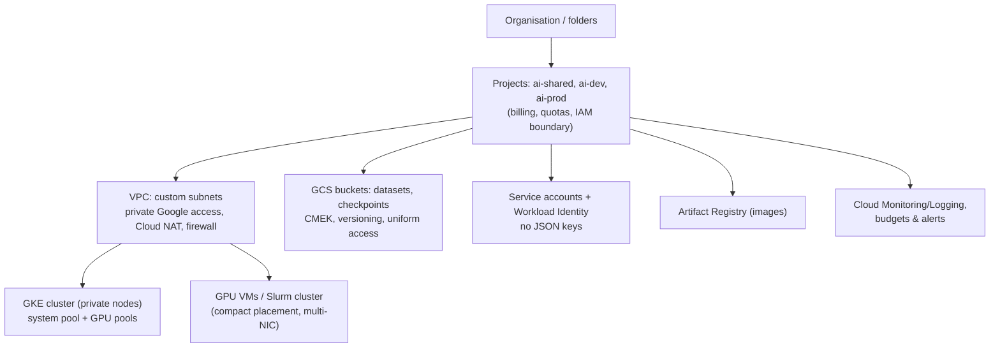

# 4.24 Terraform on GCP and Nebius: networks, GPU VMs and GKE

| | |
|---|---|
| Level | Intermediate |
| Priority tier | 1 |
| Lab venue | Terraform/OpenTofu, `gcloud`, GCP project with GPU quota (or CPU-only rehearsal); optional Nebius account and CLI |
| Part | Part 4: Automation and infrastructure as code |
| Status | Drafted, labs **untested** |

## Why this matters for AI infrastructure

GPU capacity is where AI platforms spend most of their budget, and it lives in clouds and GPU clouds with very different shapes. Hyperscalers such as GCP give you rich primitives (VPC, IAM, GKE, managed storage, reservations) around a limited set of GPU machine families; GPU-focused providers such as Nebius, CoreWeave or Lambda expose clusters with InfiniBand fabrics, shared filesystems and Kubernetes or Slurm layers, often with simpler but different APIs. A platform engineer needs to express both as code: the network, the capacity, the clusters, the storage and the identity, with the guardrails of 4.23. This chapter works through a representative GCP stack end to end and then maps the same design onto a Nebius-style GPU cloud, so you can reason about which concepts transfer and which are provider-specific. (Products and APIs change quickly; every identifier here must be verified against current provider documentation.)

## Prerequisites and outcomes

Needs 4.18 to 4.23 and networking basics (Part 2). After this chapter you can:

- Design and code a GCP landing zone for AI: projects, VPC/subnets, private access, firewall, Cloud NAT, service accounts and workload identity, KMS, storage buckets for datasets and checkpoints.
- Provision GPU VMs (A2/A3/A4-class families, G2/L4) and GKE clusters with GPU node pools, taints/labels, autoscaling, and driver installation options; understand capacity options (on-demand, reservations, spot, DWS flex/calendar) and quotas.
- Configure high-performance networking for multi-node training on GCP (multiple VPCs/NICs, jumbo MTU, compact placement, GPUDirect-TCPX/RDMA variants) at a conceptual and Terraform level.
- Describe Nebius's resource model (tenants/projects, networks and subnets, compute instances with GPU platforms, GPU clusters with InfiniBand fabrics, shared filesystems, managed Kubernetes and Slurm options, service accounts) and how its Terraform provider is used; compare with GCP and CoreWeave.
- Structure multi-cloud modules around a common interface and keep provider-specific details inside.

## 1. Designing the landing zone (GCP)



Decisions to make before writing code:

- **Project and environment structure**: separate projects per environment and a shared-services project (registry, DNS, logging); quotas, billing and IAM boundaries follow project boundaries. Create projects with Terraform in a `global` stack using a service account with organisation-level permissions (kept tightly controlled).
- **Regions and zones for GPUs**: GPU families exist only in specific zones; capacity varies; check `gcloud compute accelerator-types list`, `gcloud compute machine-types list --filter="name~a3"` and quota pages. Plan for zones where you actually have quota/reservations; multi-region fallbacks have cost and data gravity implications.
- **Identity**: workload identity federation for CI (4.22), service accounts per workload, no long-lived keys, organisation policies (`iam.disableServiceAccountKeyCreation`).
- **Data and checkpoints**: buckets colocated with compute (same region) for throughput and egress cost; CMEK; versioning and retention; consider Filestore, Parallelstore, Managed Lustre or GCS FUSE/Anywhere Cache for training IO (Part 13).

## 2. Network

```hcl
resource "google_compute_network" "train" {
  name                    = "${local.prefix}-train"
  auto_create_subnetworks = false
  routing_mode            = "REGIONAL"
  mtu                     = 8896                        # up to 8896 supported; match on NICs/pods
}

resource "google_compute_subnetwork" "nodes" {
  name                     = "${local.prefix}-nodes"
  region                   = var.region
  network                  = google_compute_network.train.id
  ip_cidr_range            = "10.30.0.0/20"
  private_ip_google_access = true
  secondary_ip_range {
    range_name    = "pods"
    ip_cidr_range = "10.32.0.0/14"
  }
  secondary_ip_range {
    range_name    = "services"
    ip_cidr_range = "10.36.0.0/20"
  }
  log_config {
    aggregation_interval = "INTERVAL_10_MIN"
    flow_sampling        = 0.1
    metadata             = "INCLUDE_ALL_METADATA"
  }
}

resource "google_compute_router" "nat" {
  name    = "${local.prefix}-router"
  region  = var.region
  network = google_compute_network.train.id
}
resource "google_compute_router_nat" "egress" {
  name                               = "${local.prefix}-nat"
  router                             = google_compute_router.nat.name
  region                             = var.region
  nat_ip_allocate_option             = "AUTO_ONLY"
  source_subnetwork_ip_ranges_to_nat = "ALL_SUBNETWORKS_ALL_IP_RANGES"
}

resource "google_compute_firewall" "internal" {
  name      = "${local.prefix}-allow-internal"
  network   = google_compute_network.train.name
  direction = "INGRESS"
  allow { protocol = "tcp" }
  allow { protocol = "udp" }
  allow { protocol = "icmp" }
  source_ranges = ["10.30.0.0/20", "10.32.0.0/14"]
}
resource "google_compute_firewall" "iap_ssh" {
  name          = "${local.prefix}-allow-iap-ssh"
  network       = google_compute_network.train.name
  allow {
    protocol = "tcp"
    ports    = ["22"]
  }
  source_ranges = ["35.235.240.0/20"]          # Identity-Aware Proxy range: SSH via `gcloud compute ssh --tunnel-through-iap`
}
```

Notes: GCP VPCs are global with regional subnets; firewall rules are stateful and applied by tags/service accounts (prefer service-account-based targets); use Cloud NAT instead of public IPs on nodes; enable Private Google Access; avoid overlapping ranges with on-prem; size pod/service ranges for the largest cluster (GKE needs large alias ranges); VPC flow logs cost money, sample them. For **multi-node GPU training on A3-class machines** Google documents multi-NIC designs: several additional VPC networks (one per GPU NIC), each with its own subnet, MTU 8244/8896 as documented, and firewall rules allowing all traffic within; the main NIC for general traffic and the extra NICs for GPU-to-GPU network traffic (GPUDirect-TCPX or newer GPUDirect-RDMA variants for A3 Ultra/A4 using RoCE VPCs). Follow the current "create GPU VMs with high-performance networking" documents because machine type, image (e.g. Container-Optimized OS or Ubuntu with the NCCL plugin), and network topology details change between generations.

## 3. GPU virtual machines

```hcl
resource "google_compute_instance" "gpu_login" {
  name         = "${local.prefix}-gpu-test"
  zone         = var.zone
  machine_type = var.gpu_machine_type             # e.g. "g2-standard-8" (1x L4) for rehearsal; "a3-highgpu-8g" for H100 x8
  tags         = ["gpu-node"]

  boot_disk {
    initialize_params {
      image = "projects/ubuntu-os-cloud/global/images/family/ubuntu-2204-lts"
      size  = 500
      type  = "pd-ssd"
    }
  }

  # For N1/A2/G2 families, accelerators attach via guest_accelerator or are bundled in the machine type (A2/A3/G2 bundle GPUs)
  scheduling {
    on_host_maintenance = "TERMINATE"
    automatic_restart   = false
    provisioning_model  = var.use_spot ? "SPOT" : "STANDARD"
    instance_termination_action = var.use_spot ? "STOP" : null
  }

  network_interface {
    subnetwork = google_compute_subnetwork.nodes.id
  }

  service_account {
    email  = google_service_account.node.email
    scopes = ["cloud-platform"]                  # restrict via IAM roles on the SA, not scopes
  }

  shielded_instance_config {
    enable_secure_boot          = false          # NVIDIA driver modules need signing if Secure Boot is on
    enable_vtpm                 = true
    enable_integrity_monitoring = true
  }

  metadata = {
    enable-oslogin = "TRUE"
    startup-script = file("${path.module}/scripts/bootstrap.sh")    # keep minimal; configure with Ansible (4.17)
  }
  labels = local.labels

  lifecycle {
    ignore_changes = [metadata["ssh-keys"]]
  }
}
```

Considerations:

- **Machine families**: A2 (A100), A3 (H100: `a3-highgpu-8g`, `a3-megagpu-8g`, `a3-edgegpu`), A3 Ultra (H200), A4 (B200), A4X (GB200 NVL72) and G2 (L4) have GPUs bundled into the machine type; N1 uses attached accelerators. Machine types, GPU counts, networking and availability differ by zone and change over time; verify with `gcloud compute machine-types list` and the accelerator documentation.
- **Capacity**: on-demand quota per GPU family and region; **reservations** (`google_compute_reservation`, shared across projects), **future reservations**, **Dynamic Workload Scheduler** flex-start and calendar mode (for large short jobs), **Spot/preemptible** with termination handling (checkpoint frequently), committed use discounts. Treat reservations as code with owners and expiry (4.23).
- **Boot images and drivers**: Deep Learning VM images (drivers preinstalled), Container-Optimized OS with the GPU driver installer, or your own golden image built with Packer + Ansible (4.2, 4.17); Secure Boot requires signed modules.
- **Compact placement** (`resource_policies` with a `COMPACT` `group_placement_policy`) for low-latency collectives; **maintenance policies** and host maintenance events (live migration is unsupported for GPU VMs: `TERMINATE` or scheduled maintenance windows).
- **Disks**: local SSD for scratch (A3 includes), Hyperdisk/PD for persistent; mount options and filesystem choices in Part 13.
- **OS Login and IAP** for SSH; no public IPs.
- **Instance templates and managed instance groups** (MIGs) for homogeneous worker pools (with update policies for rolling replacement, 4.21), or `google_compute_instance` per node for Slurm-style static clusters with deterministic names.

```hcl
resource "google_compute_resource_policy" "compact" {
  name   = "${local.prefix}-compact"
  region = var.region
  group_placement_policy {
    collocation  = "COLLOCATED"
    vm_count     = var.node_count
  }
}
# attach with: resource_policies = [google_compute_resource_policy.compact.id] on the instances
```

## 4. GKE clusters and GPU node pools

```hcl
resource "google_container_cluster" "main" {
  name     = "${local.prefix}-gke"
  location = var.region                                  # regional control plane; or a zone for a zonal cluster
  network    = google_compute_network.train.id
  subnetwork = google_compute_subnetwork.nodes.id

  remove_default_node_pool = true
  initial_node_count       = 1
  deletion_protection      = true

  ip_allocation_policy {
    cluster_secondary_range_name  = "pods"
    services_secondary_range_name = "services"
  }
  private_cluster_config {
    enable_private_nodes    = true
    enable_private_endpoint = false
    master_ipv4_cidr_block  = "172.16.0.0/28"
  }
  master_authorized_networks_config {
    cidr_blocks {
      cidr_block   = var.admin_cidr
      display_name = "admin"
    }
  }
  workload_identity_config { workload_pool = "${var.project_id}.svc.id.goog" }
  release_channel { channel = "REGULAR" }
  datapath_provider = "ADVANCED_DATAPATH"                 # Dataplane V2 (eBPF/Cilium)
  logging_config { enable_components = ["SYSTEM_COMPONENTS", "WORKLOADS"] }
  monitoring_config {
    enable_components = ["SYSTEM_COMPONENTS"]
    managed_prometheus { enabled = true }
  }
}

resource "google_container_node_pool" "system" {
  name       = "system"
  cluster    = google_container_cluster.main.name
  location   = var.region
  node_count = 1
  node_config {
    machine_type    = "e2-standard-8"
    service_account = google_service_account.node.email
    oauth_scopes    = ["https://www.googleapis.com/auth/cloud-platform"]
    workload_metadata_config { mode = "GKE_METADATA" }
  }
}

resource "google_container_node_pool" "gpu" {
  for_each   = var.gpu_pools
  name       = each.key
  cluster    = google_container_cluster.main.name
  location   = var.region
  node_locations = each.value.zones
  autoscaling {
    min_node_count = each.value.min_nodes
    max_node_count = each.value.max_nodes
    location_policy = "ANY"
  }
  management {
    auto_repair  = true
    auto_upgrade = false                               # control upgrades yourself for training pools
  }
  upgrade_settings {
    strategy        = "SURGE"
    max_surge       = 0
    max_unavailable = 1
  }
  node_config {
    machine_type    = each.value.machine_type
    service_account = google_service_account.node.email
    disk_size_gb    = 500
    disk_type       = "pd-ssd"
    labels          = { pool = each.key, accelerator = each.value.gpu_type }
    taint {
      key    = "nvidia.com/gpu"
      value  = "present"
      effect = "NO_SCHEDULE"
    }
    guest_accelerator {
      type  = each.value.gpu_type                       # e.g. "nvidia-l4"; for A3 the GPUs come with the machine type
      count = each.value.gpu_count
      gpu_driver_installation_config { gpu_driver_version = "LATEST" }
    }
    workload_metadata_config { mode = "GKE_METADATA" }
    reservation_affinity {
      consume_reservation_type = each.value.reservation == null ? "NO_RESERVATION" : "SPECIFIC_RESERVATION"
      key    = each.value.reservation == null ? null : "compute.googleapis.com/reservation-name"
      values = each.value.reservation == null ? null : [each.value.reservation]
    }
  }
  lifecycle { ignore_changes = [initial_node_count] }
}
```

Practical points:

- **Layering**: create the cluster and node pools in the cluster stack; install add-ons (GPU operator or GKE's device plugin and drivers, Kueue/JobSet, Prometheus, ingress, Argo CD) in a separate stack/Helm layer (4.25, 4.26).
- **Drivers**: GKE can install drivers for supported GPU types (`gpu_driver_installation_config`), or you can run the NVIDIA GPU Operator with `driver.enabled=false`/true depending on node images (Part 11); do not run two managers for the same driver.
- **Taints and labels**: taint GPU pools so only GPU workloads land there; label for node selection and cost reporting. GKE adds `cloud.google.com/gke-accelerator` labels automatically.
- **Autoscaling**: GPU pools scaling from zero (min 0) save money but depend on capacity availability; use `location_policy = "ANY"` to prefer available zones; for tightly coupled multi-node jobs consider fixed-size, compact-placement pools or **GKE multi-host TPU/GPU** features, and use Kueue with ProvisioningRequest/DWS to acquire capacity atomically.
- **Upgrades**: surge upgrades with `max_surge` consume extra GPUs that may not exist; `max_unavailable` > 0 with drains is typical; schedule maintenance windows; disable auto-upgrade for pools with reservations if you need control (balance with security patch policy).
- **Workload Identity** binds Kubernetes service accounts to Google service accounts for access to buckets without keys:

```hcl
resource "google_service_account" "trainer" {
  account_id = "trainer"
}
resource "google_service_account_iam_member" "wi" {
  service_account_id = google_service_account.trainer.name
  role               = "roles/iam.workloadIdentityUser"
  member             = "serviceAccount:${var.project_id}.svc.id.goog[training/trainer-ksa]"
}
resource "google_storage_bucket_iam_member" "rw" {
  bucket = google_storage_bucket.checkpoints.name
  role   = "roles/storage.objectUser"
  member = "serviceAccount:${google_service_account.trainer.email}"
}
```

- **Deletion protection** (`deletion_protection = true`) plus `prevent_destroy` for clusters (4.21); node pool replacement is expected, cluster replacement is not.

## 5. Storage, KMS and IAM building blocks

```hcl
resource "google_kms_key_ring" "ml" {
  name     = "${local.prefix}-ml"
  location = var.region
}
resource "google_kms_crypto_key" "ckpt" {
  name            = "checkpoints"
  key_ring        = google_kms_key_ring.ml.id
  rotation_period = "7776000s"                       # 90 days
  lifecycle { prevent_destroy = true }
}

resource "google_storage_bucket" "checkpoints" {
  name                        = "${var.project_id}-${local.prefix}-ckpt"
  location                    = var.region
  uniform_bucket_level_access = true
  public_access_prevention    = "enforced"
  force_destroy               = false
  versioning { enabled = true }
  encryption { default_kms_key_name = google_kms_crypto_key.ckpt.id }
  lifecycle_rule {
    condition {
      age        = 30
      with_state = "ARCHIVED"
    }
    action { type = "Delete" }
  }
  lifecycle { prevent_destroy = true }
}
```

(Bucket service agent needs `roles/cloudkms.cryptoKeyEncrypterDecrypter` on the key.) For training IO consider regional buckets in the same region as compute, hierarchical namespace buckets, GCS FUSE CSI driver on GKE, Anywhere Cache, and parallel file systems (Parallelstore/Managed Lustre/Filestore) for datasets and checkpoints (Part 13). Budgets and alerts:

```hcl
resource "google_billing_budget" "gpu" {
  billing_account = var.billing_account
  display_name    = "${local.prefix}-gpu-budget"
  amount {
    specified_amount {
      currency_code = "USD"
      units         = "50000"
    }
  }
  threshold_rules { threshold_percent = 0.5 }
  threshold_rules { threshold_percent = 0.9 }
  all_updates_rule { pubsub_topic = google_pubsub_topic.budget.id }
}
```

## 6. Slurm-style clusters on GCP

For HPC-style users: **Cluster Toolkit** (formerly HPC Toolkit) generates Terraform for Slurm clusters on GCP (controller, login nodes, partitions of GPU VMs, Filestore/Lustre, ephemeral/autoscaled compute with Slurm's cloud scheduling). You can use its blueprints as modules, or build your own: Terraform creates the VMs/instance templates, networks and storage; Ansible or the Slurm GCP images configure Slurm (Part 6); node resume/suspend scripts call the GCP API for elasticity. Keep the same layering and guardrails (4.23): network, storage, controller, partitions as separate stacks or clearly separated modules.

## 7. Nebius: the GPU-cloud model

Nebius AI Cloud (a GPU-focused provider) offers resources aimed at AI training and inference. Names and APIs evolve, so treat the following as the conceptual map and **verify every attribute against the current Nebius Terraform provider documentation**.

| Concern | Typical Nebius building block | GCP analogue |
|---|---|---|
| Tenancy | Tenant → projects (regions are tied to projects); service accounts with authorised keys / federation | Organisation → projects |
| Network | VPC networks and subnets, security groups, static IPs, private endpoints | VPC, subnets, firewall |
| GPU compute | Compute instances using GPU platforms (H100/H200/B200 families) with presets (number of GPUs, CPUs, RAM), boot disks, filesystems attached | GPU VMs (A3/A4) |
| Multi-node fabric | **GPU clusters** (InfiniBand fabric) that instances join so NCCL traffic runs over IB/RDMA | Multi-NIC RDMA VPCs / compact placement |
| Shared storage | Shared filesystems (mounted across instances), object storage (S3-compatible) | Filestore/Lustre, GCS |
| Kubernetes | Managed Kubernetes clusters and node groups (GPU node groups, optionally with GPU clusters/InfiniBand) | GKE |
| Slurm | Managed or Terraform/Helm-deployed Slurm on Kubernetes (Soperator-style) or VM-based Slurm recipes | Cluster Toolkit Slurm |
| Capacity | Reservations/commitments, preemptible options | Reservations, DWS, Spot |
| Observability | Managed Prometheus/Grafana/logging options, DCGM metrics | Cloud Monitoring, GMP |
| IaC | Terraform provider, CLI, SDKs | google provider, gcloud |

A representative Terraform shape (illustrative; resource and attribute names must be checked in the provider docs):

```hcl
terraform {
  required_providers {
    nebius = {
      source  = "terraform-provider.storage.eu-north1.nebius.cloud/nebius/nebius"   # confirm the current registry source
      version = "~> 0.5"
    }
  }
}

provider "nebius" {
  # authentication via the environment/CLI profile or service account credentials;
  # no keys in code (4.22). Parent (project) IDs are passed per resource.
}

resource "nebius_vpc_v1_network" "train" {
  parent_id = var.project_id
  name      = "train-net"
}

resource "nebius_compute_v1_gpu_cluster" "fabric" {            # InfiniBand fabric for multi-node NCCL
  parent_id         = var.project_id
  name              = "h100-fabric-a"
  infiniband_fabric = "fabric-3"                                # fabric name per region/platform
}

resource "nebius_compute_v1_instance" "gpu" {
  for_each  = toset(var.node_names)
  parent_id = var.project_id
  name      = each.key
  gpu_cluster = { id = nebius_compute_v1_gpu_cluster.fabric.id }
  resources = {
    platform = "gpu-h100-sxm"
    preset   = "8gpu-128vcpu-1600gb"
  }
  # boot disk, network interfaces (subnet, public IP: none), cloud-init user data, attached shared filesystem ...
}
```

Design guidance for GPU clouds:

1. **Fabric membership is the key difference**: multi-node jobs need all nodes in the same GPU cluster/fabric; place all nodes of a training pool in one fabric and size fabrics for the largest job; changing membership may require recreation, so plan topology up front.
2. **Immutable images + cloud-init**: build golden images with drivers/NCCL/OFED (4.2, 4.17) and use cloud-init for node identity; Ansible (or the provider's Slurm/Kubernetes automation) for the remainder.
3. **Shared filesystems**: define once, mount across instances; throughput depends on filesystem size/type; treat as stateful with protection and backups (Part 13).
4. **Kubernetes vs Slurm vs bare VMs**: if the provider offers managed Kubernetes with GPU node groups and the GPU Operator integration, Terraform handles cluster + node groups, then a separate layer (Helm/Argo) installs add-ons (4.25, 4.26); for Slurm, either use provider-supplied automation (Helm charts on Kubernetes or Terraform modules) or provision VMs and run Ansible (4.17, Part 6).
5. **Quota and capacity are commercial constructs**: reservations and commitments are negotiated; Terraform should encode what you have (and warn when plans exceed it) rather than assume elasticity (4.23 guardrails).
6. **CoreWeave and other Kubernetes-native GPU clouds** expose clusters where nodes join a managed Kubernetes plane and workloads request GPUs via standard Kubernetes APIs and node labels (instance type, interconnect); Terraform manages the cluster and namespaces, quotas, storage classes and network policies through Kubernetes/Helm providers, with InfiniBand topology exposed through node labels used by schedulers (Part 11).
7. **Abstraction**: expose a common module interface (name, accelerator class, node count, fabric/placement group, storage mounts) and implement provider-specific submodules (`modules/gpu-pool/gcp`, `/nebius`, `/coreweave`) behind it; keep provider differences (fabrics, presets) as explicit variables rather than hiding them.

## 8. Verification after apply

Terraform success does not mean usable GPUs. Verify (and automate with Ansible/CI, 4.17):

- Instances running in the expected zone/fabric; labels/taints applied; reservation consumed.
- `nvidia-smi` shows the expected GPUs and driver; Fabric Manager/IMEX as needed.
- Network: MTU correct end-to-end (`ping -M do -s 8972`), RDMA/IB links up and at speed (`ibstat`, `rdma link`), NCCL tests across nodes meet the bandwidth floor (`all_reduce_perf`).
- Storage mounts present with expected throughput (`fio`), checkpoints bucket reachable with workload identity.
- Kubernetes: nodes Ready, `nvidia.com/gpu` allocatable, GPU Operator/device plugin healthy, a test pod runs `nvidia-smi`; DCGM metrics visible in Prometheus.
- Budgets/alerts attached; labels for cost allocation present.

## 9. Lab

First, run the self-checking Python lab (`code/part04/terraform_gcp_nebius_validator_lab.py`) locally. It verifies the GCP GPU VM and GKE node-pool configuration validator (`validate_gcp_gpu_node_pool`: checking `on_host_maintenance == "TERMINATE"`, `mtu == 8896`, `max_surge == 0` / `max_unavailable >= 1` and `SPECIFIC_RESERVATION` for reserved GPU pools, and `nvidia.com/gpu:NO_SCHEDULE` taints), the multi-NIC GPU rail VPC subnet generator (`generate_multi_nic_gpu_subnets`), and the Nebius `nebius_compute_v1_gpu_cluster` InfiniBand fabric membership verifier (`validate_nebius_gpu_fabric_membership`).

```bash
python3 code/part04/terraform_gcp_nebius_validator_lab.py
```

Run the CPU/L4 rehearsal variants first (all interactive cloud steps below are `untested here`); only provision large GPU shapes with a budget cap and an immediate destroy plan:

1. **Landing zone**: create a project (or use a sandbox), enable APIs, and write the network stack (VPC, subnet with secondary ranges, router/NAT, firewall, IAP SSH); `plan` and `apply`; verify with `gcloud compute networks describe` and an IAP SSH to a tiny VM.
2. **Identity and storage**: service accounts, workload identity pool binding, KMS key, versioned CMEK bucket with `prevent_destroy`; test access from a VM via the service account without keys.
3. **GPU VM**: provision an L4 (`g2-standard-8`) VM (or A2 if quota allows), install/verify the driver via the image or Ansible (4.17), run `nvidia-smi`; try Spot and observe preemption; destroy.
4. **Capacity objects**: write a `google_compute_reservation` (small, short-lived) and consume it from an instance; add an alert/doc for expiry; delete.
5. **GKE**: create a private regional/zonal cluster, a system pool and an L4 GPU pool (min 0); deploy a GPU test pod with a toleration and node selector; observe scale-up from zero and scale-down; test Workload Identity access to the bucket.
6. **Upgrade behaviour**: change the node pool image or machine type (staging) and read the plan (`-/+`?) and the `upgrade_settings`; trigger a surge upgrade; note GPU capacity needs.
7. **Policy**: run Conftest/Checkov on the plan: deny public IPs on nodes, require labels, cap GPU count, require versioning on buckets (4.23).
8. **Multi-NIC concept**: read Google's current A3/A3 Ultra/A4 networking doc and sketch the Terraform for the additional VPCs, subnets, firewall and instance NIC blocks; implement the network part for a CPU-only dry run if no quota.
9. **Slurm on GCP**: generate or write a minimal Slurm cluster (controller + autoscaled partition) using Cluster Toolkit modules or Terraform + Ansible; submit a trivial job; observe node resume/suspend.
10. **Nebius (optional)**: authenticate the CLI, apply the network + a small instance (and a GPU cluster only with capacity); verify provider resource names against docs; compare steps with GCP; document differences in a table.
11. **Common module interface**: define `modules/gpu-pool` with an interface (`accelerator`, `node_count`, `placement`, `storage`) and two implementations (GCP MIG/GKE pool and a stub for Nebius); test plans for both.
12. **Verification play**: automate the section 8 checks with Ansible/`terraform test`/`check` blocks.
13. **Teardown**: `terraform destroy`, confirm via billing/console that nothing is left; check reservations, disks, static IPs and snapshots.

## 10. Common mistakes

- Planning GPU shapes without checking zone availability, quota or reservation; discovering it at apply time.
- Public IPs and wide-open firewall rules on GPU nodes; SSH keys instead of OS Login/IAP.
- Service-account JSON keys in repos/CI; excessive scopes.
- Cluster and node pool in the same stack as Kubernetes add-ons (provider/credential ordering problems, 4.22).
- Auto-upgrades or surge settings that need extra GPUs which do not exist; replacing reserved nodes.
- Forgetting MTU, placement or RDMA NIC configuration, leaving multi-node NCCL at a fraction of expected bandwidth.
- Checkpoint buckets without versioning/CMEK/`prevent_destroy`; buckets in a different region than the compute.
- Assuming spot/preemptible capacity for long runs without checkpointing.
- No budgets or labels, so GPU spend is untraceable.
- Treating one provider's concepts as universal (fabric membership vs placement policies vs node labels).

## 11. Interview angles

- "Design the Terraform for a GKE cluster with GPU node pools and workload identity. What goes in separate stacks?"
- "How do you secure GPU nodes on GCP?" (private nodes, NAT, IAP/OS Login, shielded VM, SA least privilege, org policies.)
- "A GPU node pool update needs surge capacity that doesn't exist. What now?" (max_unavailable, drains, reservations, DWS.)
- "How would you give 64 H100 nodes high-bandwidth networking on GCP? On a GPU cloud like Nebius?"
- "How do you manage GPU capacity as code? Reservations, quotas, budgets?"
- "What's different about InfiniBand-fabric clouds vs hyperscalers?"
- "How do you keep a multi-cloud module interface clean?"
- "How do you validate that Terraform-created GPU infrastructure is actually healthy?"

## Exercises

1. **GCP AI Landing Zone and High-Performance Multi-NIC VPC Networking (`google_compute_network`, `Cloud NAT`, `IAP SSH`, and GPU Rail VPCs):** Using `generate_multi_nic_gpu_subnets()` in `code/part04/terraform_gcp_nebius_validator.py`, explain: (a) how `google_compute_network` (`mtu = 8896`), `google_compute_subnetwork` (`private_ip_google_access = true`, `pods` `/14` and `services` `/20` secondary ranges), `google_compute_router_nat`, and `google_compute_firewall` (`35.235.240.0/20` IAP SSH) work; and (b) why A3 / A3 Ultra / A4 multi-node GPU training uses multiple additional VPCs (one per GPU NIC) alongside the primary management VPC.
2. **Provisioning GCP GPU VMs (`A2`, `A3`, `A4`, `G2`), Capacity Models (`Reservations`, `DWS`, `Spot`), and Compact Placement (`COLLOCATED`):** Trace `google_compute_instance.gpu_login` and `google_compute_resource_policy.compact`, explaining why `on_host_maintenance = "TERMINATE"` is mandatory, how `enable_secure_boot = false` relates to unsigned DKMS kernel modules, and when to use On-Demand vs `google_compute_reservation` vs Dynamic Workload Scheduler (`DWS`) vs `SPOT`.
3. **GKE Private Clusters, GPU Node Pools (`google_container_node_pool`), Surge vs. Unavailable Upgrades, and Workload Identity:** Using `validate_gcp_gpu_node_pool()` in `code/part04/terraform_gcp_nebius_validator.py`, explain why `remove_default_node_pool = true`, `datapath_provider = "ADVANCED_DATAPATH"` (Dataplane V2 eBPF/Cilium), `auto_upgrade = false`, `max_surge = 0` + `max_unavailable = 1`, `nvidia.com/gpu:NO_SCHEDULE` taints, and `reservation_affinity` (`SPECIFIC_RESERVATION`) are configured on production GKE GPU pools, and trace the 3-resource Workload Identity binding (`google_service_account`, `roles/iam.workloadIdentityUser`, `roles/storage.objectUser`).
4. **CMEK-Encrypted Checkpoint Storage (`google_kms_crypto_key`, `google_storage_bucket`) and Spend Guardrails (`google_billing_budget`):** Trace the Section 5 KMS + GCS checkpoint bucket configuration (`rotation_period = "7776000s"`, `uniform_bucket_level_access = true`, `public_access_prevention = "enforced"`, `versioning`, `prevent_destroy = true`) and `google_billing_budget` (`0.5` and `0.9` thresholds publishing to Pub/Sub).
5. **Nebius AI Cloud and Kubernetes-Native GPU Clouds (`nebius_compute_v1_gpu_cluster` InfiniBand Fabrics vs. GCP Multi-NIC VPCs):** Using `validate_nebius_gpu_fabric_membership()` in `code/part04/terraform_gcp_nebius_validator.py`, compare Nebius's resource model (`parent_id` project tenancy, `nebius_vpc_v1_network`, `nebius_compute_v1_gpu_cluster` InfiniBand fabric `infiniband_fabric = "fabric-3"`, `nebius_compute_v1_instance` with `platform = "gpu-h100-sxm"` and `preset = "8gpu-128vcpu-1600gb"`, shared filesystems, and Soperator Slurm-on-K8s) and CoreWeave with GCP.
6. **Designing a Provider-Agnostic Multi-Cloud GPU Pool Interface and Post-Apply Hardware Verification:** Design a common `modules/gpu-pool` input/output interface with GCP and Nebius backend submodules, and list the 5 post-apply verification checks (Section 8) required before releasing Terraform-provisioned GPU nodes to jobs.

## Checkpoint questions (20)

<details>
<summary>1. How is a Google Cloud VPC scoped compared to AWS/Azure VNet, and why do GKE subnets define two `secondary_ip_range` blocks?</summary>

- **Global VPC with regional subnets:** A GCP VPC (`google_compute_network`) is a **global** resource spanning all regions without needing cross-region peering inside the same VPC, while its subnets (`google_compute_subnetwork`) are **regional** (spanning all zones within a region).
- **GKE secondary IP ranges (VPC-native alias IPs):** GKE VPC-native clusters assign routable VPC IPs to every Pod and Service from two dedicated subnet secondary CIDR ranges:
  1. **`pods` (`10.32.0.0/14`, 262,144 IPs):** Used to allocate per-node `/24` pod CIDR blocks.
  2. **`services` (`10.36.0.0/20`, 4,096 IPs):** Used for Kubernetes `ClusterIP` virtual service addresses.
</details>

<details>
<summary>2. How do Private Google Access, Cloud NAT (`google_compute_router_nat`), and Identity-Aware Proxy (`IAP`, `35.235.240.0/20`) eliminate public IPs on GPU nodes?</summary>

- **`private_ip_google_access = true` (on the subnet):** Allows VMs without external public IPs to reach Google APIs (`storage.googleapis.com`, Artifact Registry, GKE control plane) over Google's private backbone.
- **Cloud NAT (`google_compute_router` + `google_compute_router_nat`):** Provides outbound internet egress (e.g., pulling upstream container images or apt packages) for private nodes without exposing any inbound public IP.
- **Identity-Aware Proxy (`IAP` TCP forwarding from `35.235.240.0/20` + `enable-oslogin = "TRUE"`):** Lets engineers SSH into private VMs (`gcloud compute ssh --tunnel-through-iap`) authenticated by Google IAM + MFA without a public IP or a public bastion host.
</details>

<details>
<summary>3. Why do multi-node training VMs on GCP (`A3`, `A3 Ultra`, `A4`) use multiple VPC networks and `mtu = 8896`?</summary>

An 8-GPU `a3-highgpu-8g` / `a3-megagpu-8g` (H100) or `a3-ultragpu-8g` (H200) / `a4` (B200) machine has **multiple physical network interfaces**: 1 primary NIC (`eth0`) for host management, storage, and pod networking, plus **4 or 8 dedicated GPU-direct NICs** paired with the GPUs across PCIe/NVSwitch rails (using GPUDirect-TCPX or GPUDirect-RDMA over RoCE). In GCP, each NIC on a VM must attach to a **separate VPC network**, so Terraform provisions 1 management VPC plus 4 or 8 dedicated GPU-rail VPCs, all configured with **jumbo frames (`mtu = 8896`)** to maximize NCCL packet payload efficiency.
</details>

<details>
<summary>4. Compare GCP's GPU Machine Families (`G2`, `A2`, `A3`, `A3 Ultra`, `A4`, `A4X`) and how GPUs attach to them in Terraform.</summary>

- **`N1` (legacy T4/V100):** General-purpose CPU machine type where GPUs are attached separately via `guest_accelerator`.
- **`G2` (`g2-standard-*`):** Bundles 1 to 8 **NVIDIA L4** GPUs (inference, graphics, and affordable rehearsals).
- **`A2` (`a2-highgpu-*` / `a2-ultragpu-*`):** Bundles 1 to 16 **NVIDIA A100** (40 GB / 80 GB) GPUs with NVLink.
- **`A3` (`a3-highgpu-8g` / `a3-megagpu-8g`):** Bundles 8 **NVIDIA H100 80 GB** GPUs with NVSwitch and GPUDirect-TCPX.
- **`A3 Ultra` (`a3-ultragpu-8g`):** Bundles 8 **NVIDIA H200** GPUs with ConnectX-7 400G GPUDirect-RDMA (RoCE).
- **`A4` & `A4X`:** Bundles **NVIDIA Blackwell B200** (8-GPU HGX) and **GB200 NVL72** rack-scale NVLink domains.
</details>

<details>
<summary>5. Compare the five ways to acquire GPU capacity on GCP: On-Demand, Reservations, Future Reservations, Dynamic Workload Scheduler (`DWS`), and Spot.</summary>

1. **On-Demand:** Pay-as-you-go; subject to regional quota and real-time zone stockouts for scarce GPUs.
2. **Zonal Reservations (`google_compute_reservation`):** Reserves specific GPU machine shapes in a zone so capacity is guaranteed to exist when your VMs or GKE pools scale up (often paired with 1- or 3-year Committed Use Discounts `CUDs`).
3. **Future Reservations:** Requests capacity ahead of time for a planned future date/window.
4. **Dynamic Workload Scheduler (`DWS`, Flex-Start and Calendar mode):** Queues a large multi-node GPU request (`ProvisioningRequest` integrated with Kubernetes **Kueue**) and provisions all nodes atomically as soon as capacity becomes available for a bounded duration.
5. **Spot VMs (`provisioning_model = "SPOT"`):** Deeply discounted spare capacity that GCP can preempt at any time with a 30-second notice (requires frequent checkpointing and elastic fault-tolerant training).
</details>

<details>
<summary>6. What does `google_compute_resource_policy` with `collocation = "COLLOCATED"` do for distributed training?</summary>

Creating a `google_compute_resource_policy` with `group_placement_policy { collocation = "COLLOCATED"; vm_count = var.node_count }` and attaching it to your GPU instances (`resource_policies = [...]`) instructs GCP's Borg physical scheduler to place all VMs **physically close together within the same data-center fabric cluster/spine**, minimizing network hop count and tail latency for collective all-reduce operations.
</details>

<details>
<summary>7. Why does `google_compute_instance.gpu_login` set `enable_secure_boot = false` under `shielded_instance_config` by default?</summary>

When UEFI **Secure Boot** (`enable_secure_boot = true`) is enabled on a Linux VM, the kernel refuses to load any out-of-tree kernel module (`nvidia.ko`, `nvidia-uvm.ko`, `nvidia-peermem.ko`, `mlx5_core.ko`) that is not cryptographically signed by a key enrolled in the VM's Machine Owner Key (`MOK`) / UEFI database. Unless you use pre-signed driver packages or enroll your own DKMS signing key during golden-image build, DKMS-built NVIDIA drivers will fail `modprobe` with `Key was rejected by service` when Secure Boot is on.
</details>

<details>
<summary>8. In `google_container_cluster.main`, why do we set `remove_default_node_pool = true` and manage `google_container_node_pool` resources separately?</summary>

If you define node pools inline inside `google_container_cluster`, any change to node-pool configuration can force Terraform to **replace the entire GKE cluster**. Setting `remove_default_node_pool = true` and `initial_node_count = 1` creates the GKE control plane, immediately deletes the temporary default pool, and lets you manage independent **`google_container_node_pool.system`** (CPU) and **`google_container_node_pool.gpu`** (`for_each`) resources that can be added, resized, or replaced without ever touching the GKE control plane.
</details>

<details>
<summary>9. Why must a GKE GPU node pool backed by a fixed reservation set `max_surge = 0` and `max_unavailable = 1` inside `upgrade_settings`?</summary>

By default, GKE node-pool upgrades use **Surge Upgrades (`max_surge = 1, max_unavailable = 0`)**—which tries to boot 1 **extra** GPU VM *before* draining and deleting an existing node. If your reservation and quota hold exactly 16 `a3-highgpu-8g` nodes and all 16 are running, booting a 17th node fails with `QUOTA_EXCEEDED` or `RESERVATION_EXHAUSTED`, stalling the upgrade forever. Setting **`max_surge = 0` and `max_unavailable = 1`** cordons, drains, and upgrades 1 existing node at a time within your exact 16-node reservation.
</details>

<details>
<summary>10. Why do we set `auto_upgrade = false` (`auto_upgrade=false`) on GKE GPU training node pools while keeping `auto_repair = true`?</summary>

- **`auto_repair = true`:** Automatically replaces a node if its kubelet or hardware becomes `NotReady` for an extended period.
- **`auto_upgrade = false` (`auto_upgrade=false`):** Prevents GKE from automatically draining and rebooting GPU nodes in the middle of a multi-week distributed training run whenever a minor GKE node image patch is released. Instead, platform engineers trigger node-pool upgrades explicitly during scheduled maintenance windows between training runs.
</details>

<details>
<summary>11. How does `reservation_affinity` on `google_container_node_pool` ensure a GPU pool consumes a specific reserved capacity pool?</summary>

Setting:
```hcl
reservation_affinity {
  consume_reservation_type = "SPECIFIC_RESERVATION"
  key                      = "compute.googleapis.com/reservation-name"
  values                   = [each.value.reservation]
}
```
binds the node pool to that exact `google_compute_reservation` name (configured with `specific_reservation_required = true`), guaranteeing that no other unapproved workload in the project can accidentally steal the reserved GPUs and that the pool never spills over into unbudgeted on-demand billing.
</details>

<details>
<summary>12. Trace the three Terraform resources required to bind a Kubernetes Service Account (`training/trainer-ksa`) to a GCS checkpoint bucket using GKE Workload Identity.</summary>

1. **`resource "google_service_account" "trainer"`**: creates the IAM Google Service Account (`trainer@<project>.iam.gserviceaccount.com`).
2. **`resource "google_service_account_iam_member" "wi"`**: grants **`roles/iam.workloadIdentityUser`** on `google_service_account.trainer` to the Kubernetes Service Account principal **`serviceAccount:${var.project_id}.svc.id.goog[training/trainer-ksa]`** (annotated on the KSA with `iam.gke.io/gcp-service-account`).
3. **`resource "google_storage_bucket_iam_member" "rw"`**: grants **`roles/storage.objectUser`** on `google_storage_bucket.checkpoints` to `serviceAccount:${google_service_account.trainer.email}`.
Zero static JSON keys are ever created.
</details>

<details>
<summary>13. What IAM permission is required before a GCS bucket can use a Customer-Managed Encryption Key (`CMEK`, `google_kms_crypto_key`)?</summary>

Before `google_storage_bucket.checkpoints` can be created with `encryption { default_kms_key_name = google_kms_crypto_key.ckpt.id }`, the project's **Cloud Storage Service Agent (`service-<project_number>@gs-project-accounts.iam.gserviceaccount.com`, retrieved via `data "google_storage_project_service_account"`)** must be granted **`roles/cloudkms.cryptoKeyEncrypterDecrypter`** on `google_kms_crypto_key.ckpt` (with an explicit or implicit dependency edge so the IAM binding exists before the bucket is created).
</details>

<details>
<summary>14. What is GCP `Cluster Toolkit` (formerly HPC Toolkit), and when do you use it?</summary>

**Cluster Toolkit** is Google Cloud's open-source blueprint engine that compiles a declarative cluster YAML blueprint into a modular Terraform deployment for **Slurm on GCP** (or GKE clusters), automatically wiring VPCs, compact placement policies, Filestore / DDN EXAScaler Lustre / Parallelstore shared filesystems, Slurm controller/login VMs, and dynamic cloud-bursting GPU partitions (`slurm-gcp`).
</details>

<details>
<summary>15. In Nebius AI Cloud (`nebius` Terraform provider), what is `nebius_compute_v1_gpu_cluster`, and why is it the most important resource for multi-node training?</summary>

In Nebius, **`nebius_compute_v1_gpu_cluster`** represents an **InfiniBand fabric domain** (`infiniband_fabric = "fabric-3"`). Every `nebius_compute_v1_instance` (or Managed Kubernetes GPU node group) that references `gpu_cluster = { id = nebius_compute_v1_gpu_cluster.fabric.id }` is physically provisioned on the same non-blocking InfiniBand fabric so multi-node NCCL collectives run over 400G/800G GPUDirect RDMA InfiniBand. Nodes not attached to the same `gpu_cluster` cannot communicate over InfiniBand RDMA.
</details>

<details>
<summary>16. Compare how GPU instances are sized in Nebius (`platform` + `preset`) versus GCP (`machine_type` + `guest_accelerator`).</summary>

- **Nebius:** Uses a two-level **`resources = { platform = "gpu-h100-sxm", preset = "8gpu-128vcpu-1600gb" }`** structure where `platform` selects the GPU hardware generation/interconnect and `preset` selects the fixed slice of GPUs, vCPUs, and host RAM.
- **GCP:** Uses `machine_type = "a3-highgpu-8g"` (which bundles 8 H100 GPUs, 208 vCPUs, and 1,872 GB RAM for A2/A3/A4/G2 families) plus `guest_accelerator` for driver installation config or N1/G2 attachment.
</details>

<details>
<summary>17. What is `Soperator` on Nebius, and how does it bridge Kubernetes and Slurm?</summary>

**Soperator** is Nebius's open-source **Slurm-on-Kubernetes operator**: Terraform provisions a Nebius Managed Kubernetes cluster with InfiniBand-connected GPU node groups and a shared filesystem, and Soperator deploys a full Slurm cluster (controller, accounting, login, and slurmd workers) as Kubernetes pods/sets on top—giving researchers a standard `sbatch`/`srun` Slurm experience backed by Kubernetes node lifecycle management and self-healing.
</details>

<details>
<summary>18. How does CoreWeave's Kubernetes-native GPU cloud model differ from traditional VM-centric cloud providers?</summary>

Instead of exposing raw IaaS VMs where you build your own cluster, **CoreWeave** exposes a managed Kubernetes control plane where bare-metal InfiniBand GPU nodes are requested and scaled through Kubernetes-native APIs and node selectors/labels (selecting GPU SKU, InfiniBand fabric/leaf group, and NVMe/shared storage tiers). Consequently, Terraform on CoreWeave primarily manages cluster/namespace provisioning, storage, RBAC, and Helm/GitOps bootstrap rather than individual VM network interfaces.
</details>

<details>
<summary>19. How do you design a clean multi-cloud `modules/gpu-pool` abstraction across GCP and Nebius without creating a leaky \"lowest common denominator\" module?</summary>

Define a shared conceptual contract for inputs (`name`, `accelerator_class`, `gpus_per_node`, `min_nodes`, `max_nodes`, `labels`, `taints`) and outputs (`pool_id`, `node_Selector_labels`), implemented as separate provider-specific modules (`modules/gpu-pool-gcp` and `modules/gpu-pool-nebius`) that accept provider-native fabric extensions (`reservation` / `multi_nic_vpcs` on GCP; `infiniband_fabric` / `shared_filesystem_id` on Nebius) rather than hiding everything behind a giant `if var.cloud == "gcp"` block inside a single file.
</details>

<details>
<summary>20. Why does `terraform apply` succeeding (`Apply complete`) NOT prove a new GPU cluster is ready for production training, and what five checks verify it?</summary>

`Apply complete` only proves the cloud control plane accepted the API calls; a node can still boot with a broken driver, a degraded PCIe link, a missing RDMA NIC, or an unmounted filesystem. Before releasing the pool to jobs, run an automated post-apply verification play checking:
1. **GPU presence & driver:** `nvidia-smi -L` shows all 8 GPUs and `nvidia-fabricmanager` is active.
2. **End-to-end Jumbo MTU:** `ping -M do -s 8868 <peer_ip>` (for MTU 8896) succeeds without fragmentation.
3. **RDMA / InfiniBand link state:** All 4/8 rails report `Active` at expected link speed (`ibstat` / `rdma link` / TCPX daemon).
4. **Multi-node NCCL bandwidth:** `all_reduce_perf` across nodes meets the expected GB/s floor.
5. **Storage & Workload Identity:** `fio` throughput on shared scratch and keyless read/write to the CMEK checkpoint bucket succeed.
</details>

## Sources and review notes

- **Sources read in full:**
  - `terraform-up-and-running-3rd-edition` — Yevgeniy Brikman, *Terraform: Up and Running*, 3rd ed. (applied patterns from Chapters 3–10 on modules, loops, secrets, multiple providers, and production guardrails).
  - `nvidia-devops` (`volume-10/05-terraform-for-infrastructure-as-code.md` and `volume-10/04-ansible-for-infrastructure-automation.md`): AI factory Terraform and post-apply validation patterns.
- **Run here:** `python3 code/part04/terraform_gcp_nebius_validator_lab.py` (3 passed, 0 failed).
- **Explicitly labelled inferences:** The `validate_gcp_gpu_node_pool`, `generate_multi_nic_gpu_subnets`, and `validate_nebius_gpu_fabric_membership` models in `code/part04/terraform_gcp_nebius_validator.py` and the GCP VPC/VM/GKE/KMS/GCS/budget and Nebius HCL configurations are the author's constructions synthesizing GCP, Nebius, and CoreWeave provider patterns (plus original study items 21, 22, 23, 24, 25, 26, 27, 28, 29, and 30).
- **Not verified on live hardware:** Live `terraform apply` against GCP and Nebius (`8896` / `8244` MTU, `10.30.0.0/20`, `10.32.0.0/14`, `10.36.0.0/20`, `35.235.240.0/20`, `500` GB, `172.16.0.0/28`, `7776000s` = `90` days, `50000` USD budget, `0.5`/`0.9` thresholds, `~> 0.5`, `8gpu-128vcpu-1600gb`, `8972`) are marked (`untested here`) where not executed by `terraform_gcp_nebius_validator_lab.py`.
