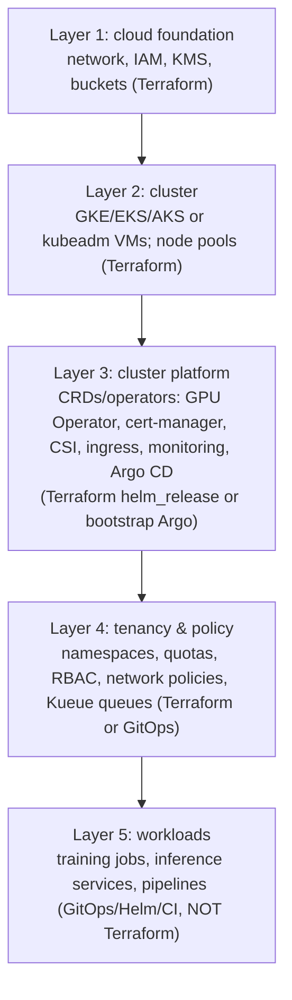

# 4.25 Terraform with Kubernetes and Helm providers, and OpenTofu

| | |
|---|---|
| Level | Intermediate |
| Priority tier | 1 |
| Lab venue | Terraform/OpenTofu, kind, kubectl, helm; optional GKE/EKS cluster |
| Part | Part 4: Automation and infrastructure as code |
| Status | Drafted, labs **untested** |

## Why this matters for AI infrastructure

Once a cluster exists, a platform team still has to turn it into an AI platform: GPU Operator or device plugins, a scheduler such as Kueue or Volcano, storage classes and CSI drivers, ingress, monitoring (Prometheus, DCGM exporter), Argo CD, cert-manager, team namespaces with GPU quotas, RBAC, network policies. Terraform's Kubernetes and Helm providers can manage these platform layers in the same workflow as the cloud infrastructure underneath. But Terraform is a poor fit for continuously reconciling application workloads, and mixing cluster creation with in-cluster resources in one state is a classic source of pain. This chapter shows what to manage with Terraform, how to wire providers correctly, how to install the common GPU platform components, where GitOps takes over (4.26), and what OpenTofu adds.

## Prerequisites and outcomes

Needs 4.18 to 4.24 and Kubernetes basics (Part 5, in particular Deployments, Services, RBAC, namespaces, CRDs). After this chapter you can:

- Configure the `kubernetes`, `helm`, `kubectl` (community) and `kustomization` providers and authenticate with short-lived credentials.
- Layer stacks so the cluster exists before providers use it; avoid CRD ordering traps (`kubernetes_manifest` plan-time schema lookup).
- Install platform components with `helm_release` (GPU Operator, cert-manager, ingress, Prometheus stack, Argo CD, Kueue) with pinned versions and reviewed values; manage namespaces, quotas, limit ranges, RBAC, network policies and storage classes as code.
- Decide the boundary between Terraform and GitOps/Helm-driven delivery; handle drift between Terraform and in-cluster controllers.
- Use OpenTofu-specific features appropriately and know compatibility considerations.

## 1. Where Terraform fits in the Kubernetes lifecycle



Guideline: Terraform owns layers 1 to 3 and the **bootstrap** of GitOps (installing Argo CD or Flux and the root Application pointing at Git). Layers 4 and 5 are best expressed as Git-managed manifests reconciled by a controller (4.26), unless your organisation prefers Terraform for tenancy objects because they derive from the same inputs as cloud IAM (teams, quotas). Whichever you choose, **one owner per object**: never let both Terraform and Argo CD manage the same resource.

Why not workloads in Terraform: they change many times a day, need continuous reconciliation and health-based rollouts, are authored by application teams, and generate noisy plans; Terraform has no concept of rollout health, pod disruption handling or progressive delivery. Why Terraform for the platform layer: infrequent, versioned, reviewed changes that need the same variables and credentials as the cloud stack and benefit from plans.

## 2. Providers and authentication

### The kubernetes provider

```hcl
terraform {
  required_providers {
    kubernetes = { source = "hashicorp/kubernetes", version = "~> 2.31" }
    helm       = { source = "hashicorp/helm",       version = "~> 2.14" }
    kubectl    = { source = "alekc/kubectl",        version = "~> 2.0" }     # community; applies raw YAML without plan-time schema lookup
  }
}

# GKE example: short-lived token, nothing stored in code
data "google_client_config" "default" {}
data "google_container_cluster" "main" {
  name     = var.cluster_name
  location = var.region
}

provider "kubernetes" {
  host                   = "https://${data.google_container_cluster.main.endpoint}"
  token                  = data.google_client_config.default.access_token
  cluster_ca_certificate = base64decode(data.google_container_cluster.main.master_auth[0].cluster_ca_certificate)
}

provider "helm" {
  kubernetes {
    host                   = "https://${data.google_container_cluster.main.endpoint}"
    token                  = data.google_client_config.default.access_token
    cluster_ca_certificate = base64decode(data.google_container_cluster.main.master_auth[0].cluster_ca_certificate)
  }
}
```

Variants: EKS uses `data.aws_eks_cluster_auth` or an `exec` block calling `aws eks get-token`; AKS uses kube_config or exec with `kubelogin`; for kind/dev use `config_path = "~/.kube/config"` and `config_context`. Prefer **`exec` plugins** (short-lived tokens fetched at run time and not stored in state) over static tokens; ensure the CI identity has Kubernetes RBAC (for example a `cluster-admin` binding for the Terraform service account **only** in the bootstrap stack, narrower roles for later stacks). The cluster API endpoint must be reachable from the runner (private clusters need self-hosted runners in the VPC, VPN, or an authorised-network entry/IAP tunnel).

### Layering rule (repeat from 4.22)

Provider configuration is evaluated before resources are planned. If the cluster is created in the same configuration, the provider's `host` is unknown at plan time and the first plan can fail or connect to the wrong cluster (a classic bug: falling back to the local kubeconfig and deploying into the wrong cluster). **Create the cluster in one state; configure Kubernetes/Helm providers in another state using data sources.** Exceptions require careful `depends_on` and are still fragile.

### Resource types you will use

| Provider | Resources | Use |
|---|---|---|
| kubernetes | `kubernetes_namespace`, `_resource_quota`, `_limit_range`, `_role`/`_role_binding`/`_cluster_role(_binding)`, `_service_account`, `_network_policy`, `_storage_class`, `_secret`, `_config_map`, `_priority_class`, generic `_manifest` | Platform primitives in HCL (typed resources give good plans) |
| kubernetes | `kubernetes_manifest` | Any resource, including CRDs; **requires the CRD/schema to exist at plan time** |
| helm | `helm_release`, `helm_repository` data, `helm_template` data | Install charts, set values |
| kubectl (alekc) | `kubectl_manifest`, `kubectl_file_documents` | Apply YAML (CRDs/custom resources) without plan-time schema validation |
| kustomization (kbst) | `kustomization_resource` | Apply Kustomize overlays |
| flux/argocd | `flux_bootstrap_git`, `argocd_application` | Bootstrap GitOps controllers and register apps |

## 3. Installing platform components with helm_release

```hcl
resource "kubernetes_namespace" "gpu_operator" {
  metadata {
    name   = "gpu-operator"
    labels = { "pod-security.kubernetes.io/enforce" = "privileged" }   # operator needs privileged pods
  }
}

resource "helm_release" "gpu_operator" {
  name             = "gpu-operator"
  namespace        = kubernetes_namespace.gpu_operator.metadata[0].name
  repository       = "https://helm.ngc.nvidia.com/nvidia"
  chart            = "gpu-operator"
  version          = var.gpu_operator_version                 # pin: e.g. "v24.6.0"; upgrades via PR
  atomic           = true                                      # roll back on failed install/upgrade
  wait             = true
  timeout          = 900
  cleanup_on_fail  = true
  max_history      = 5

  values = [yamlencode({
    driver   = { enabled = var.operator_manages_driver }       # false when drivers are preinstalled in the node image
    toolkit  = { enabled = true }
    dcgmExporter = {
      enabled = true
      serviceMonitor = { enabled = var.prometheus_operator }
    }
    mig = { strategy = var.mig_strategy }                      # none | single | mixed
    nfd  = { enabled = true }
    daemonsets = {
      tolerations = [{ key = "nvidia.com/gpu", operator = "Exists", effect = "NoSchedule" }]
    }
  })]
}
```

Practices for `helm_release`:

- **Pin chart versions** and review `values`; use `yamlencode` of HCL objects (typed, mergeable) or `templatefile` for YAML files; avoid `set` for complex values.
- **CRD handling**: charts that ship CRDs in `crds/` install them only on first install, not on upgrade (Helm limitation); operators often manage their own CRDs. Plan CRD upgrades explicitly (separate CRD chart, `kubectl_manifest` for CRDs, or the operator's documented procedure). Deleting a release may leave CRDs and custom resources behind.
- **`atomic`/`wait`/`timeout`**: ensure failed upgrades roll back; set generous timeouts for operators that compile drivers or pull large images.
- **Drift**: Helm release state is stored in Kubernetes Secrets; Terraform detects changes to chart/version/values, not manual changes to rendered resources (unlike `kubernetes_*` resources). Argo CD/Flux compare rendered manifests continuously; Terraform does not.
- **Ordering**: chain with `depends_on` or references (namespace → operator → custom resources). Dependent CRs must wait for CRDs (see section 4).
- **Secrets in values**: avoid; use external secrets operators or reference existing Secrets; remember Helm values and Terraform state contain them (4.22).
- **Helm in air-gapped setups**: OCI registries, mirrored charts, `repository` pointing internally.
- **Upgrade safety**: run `helm diff`-like review through Terraform plans (changes in `values` and `version`); for operators with disruptive upgrades (GPU driver DaemonSets restarting nodes' GPU stacks) combine with drain/cordon workflows and maintenance windows (Part 11, 4.17).

Typical platform stack for a GPU cluster, in order: namespaces and PSA labels → **cert-manager** → **ingress-nginx or Gateway API implementation** → **kube-prometheus-stack** (Prometheus Operator CRDs, Grafana, Alertmanager) → **NVIDIA GPU Operator** (NFD, device plugin, DCGM exporter, toolkit; optional driver, MIG manager) → **Network Operator** (if RDMA/InfiniBand: Multus, SR-IOV or RDMA device plugin, Whereabouts/NVIDIA IPAM) → **storage** (CSI drivers, StorageClasses) → **Kueue** and/or **Volcano**/**JobSet**/**KubeRay**/**Kubeflow Training Operator** → **Argo CD/Flux** → policy (Kyverno/Gatekeeper). Parts 5, 11 and 12 explain each component; here Terraform only installs and configures them.

## 4. CRDs, custom resources and the plan-time schema problem

`kubernetes_manifest` asks the API server for the resource's OpenAPI schema **during plan**. If the CRD is installed in the same apply (for example by a Helm chart), plan fails because the kind is unknown. Solutions:

1. **Two applies / two stacks**: install operators and CRDs first; create custom resources in a later stack (layering).
2. **`kubectl_manifest`** (alekc/kubectl): applies YAML with server-side logic and does not require the schema at plan time; use `depends_on = [helm_release.x]`; plan quality is weaker (diff is textual) but it works for first-time apply.
3. **Install CRDs separately** (`kubectl_file_documents` from a URL/file, pinned) before the chart.
4. **Let GitOps own custom resources** after bootstrap (preferred for many CRs).

```hcl
resource "kubectl_manifest" "cluster_policy" {
  yaml_body  = file("${path.module}/manifests/clusterpolicy.yaml")      # NVIDIA ClusterPolicy (CRD installed by the operator chart)
  depends_on = [helm_release.gpu_operator]
}
```

(Note: the GPU Operator chart creates a default `ClusterPolicy` itself; customise via chart values rather than managing a second one.)

## 5. Tenancy and policy as code

Typical objects per team (data-driven with `for_each`, 4.21):

```hcl
variable "teams" {
  type = map(object({
    gpu_quota   = number
    cpu_quota   = string
    mem_quota   = string
    namespaces  = list(string)
    admin_groups = list(string)
    priority    = optional(string, "normal")
  }))
}

locals {
  ns = merge([for t, c in var.teams : { for n in c.namespaces : "${t}-${n}" => merge(c, { team = t, name = n }) }]...)
}

resource "kubernetes_namespace" "team" {
  for_each = local.ns
  metadata {
    name = each.key
    labels = {
      team                                  = each.value.team
      "pod-security.kubernetes.io/enforce" = "baseline"
    }
  }
}

resource "kubernetes_resource_quota" "gpu" {
  for_each = local.ns
  metadata {
    name      = "compute"
    namespace = kubernetes_namespace.team[each.key].metadata[0].name
  }
  spec {
    hard = {
      "requests.nvidia.com/gpu" = tostring(each.value.gpu_quota)
      "requests.cpu"            = each.value.cpu_quota
      "requests.memory"         = each.value.mem_quota
      "persistentvolumeclaims"  = "50"
    }
  }
}

resource "kubernetes_role_binding" "admins" {
  for_each = local.ns
  metadata {
    name      = "team-admins"
    namespace = kubernetes_namespace.team[each.key].metadata[0].name
  }
  role_ref {
    api_group = "rbac.authorization.k8s.io"
    kind      = "ClusterRole"
    name      = "edit"
  }
  dynamic "subject" {
    for_each = each.value.admin_groups
    content {
      kind      = "Group"
      name      = subject.value
      api_group = "rbac.authorization.k8s.io"
    }
  }
}

resource "kubernetes_network_policy" "default_deny" {
  for_each = local.ns
  metadata {
    name      = "default-deny-ingress"
    namespace = kubernetes_namespace.team[each.key].metadata[0].name
  }
  spec {
    pod_selector {}
    policy_types = ["Ingress"]
  }
}
```

Because quotas and team lists derive from the same data as cloud IAM and cost allocation, Terraform is a reasonable owner of tenancy objects in smaller organisations; larger ones move these to GitOps with a self-service PR flow (4.26). With **Kueue**, ClusterQueues/ResourceFlavors/LocalQueues encode GPU quotas by team and accelerator type (applied via `kubectl_manifest` or GitOps); make sure only one system owns them.

Policy: install Kyverno or Gatekeeper and keep policies in Git; Terraform may bootstrap the engine and the baseline policy chart. Pod Security Admission labels on namespaces (Terraform above) enforce baseline/restricted profiles; GPU Operator namespace is privileged by necessity.

## 6. GitOps bootstrap

Terraform installs Argo CD (or Flux) and the root application once; Git takes over.

```hcl
resource "helm_release" "argocd" {
  name             = "argocd"
  namespace        = "argocd"
  create_namespace = true
  repository       = "https://argoproj.github.io/argo-helm"
  chart            = "argo-cd"
  version          = var.argocd_chart_version
  atomic           = true
  values = [yamlencode({
    configs = { params = { "server.insecure" = false } }
    controller = { replicas = 1 }
  })]
}

resource "kubectl_manifest" "root_app" {
  depends_on = [helm_release.argocd]
  yaml_body = yamlencode({
    apiVersion = "argoproj.io/v1alpha1"
    kind       = "Application"
    metadata   = { name = "root", namespace = "argocd" }
    spec = {
      project = "default"
      source  = { repoURL = var.gitops_repo, targetRevision = "main", path = "clusters/${var.cluster_name}" }
      destination = { server = "https://kubernetes.default.svc", namespace = "argocd" }
      syncPolicy  = { automated = { prune = true, selfHeal = true } }
    }
  })
}
```

After bootstrap, avoid Terraform changes to anything Argo manages. Alternatively, `flux_bootstrap_git` bootstraps Flux and writes its manifests to the Git repo. Chapter 4.26 covers GitOps design.

## 7. Operational concerns and pitfalls

- **Wrong-cluster danger**: a provider with no `host` falls back to the default kubeconfig context. Make every stack set explicit `host`/`config_context`; add a `check` or precondition that compares `data.kubernetes_namespace.kube_system.metadata[0].uid` (or the cluster name) against an expected value.
- **Destroy order**: destroying a cluster before deleting in-cluster resources (load balancers, PVC-backed disks) leaves orphaned cloud resources; delete platform layers first (or accept cloud-side cleanup), and set finalizer-aware timeouts. LoadBalancer Services and PersistentVolumes create cloud objects outside Terraform's knowledge.
- **Timeouts and API availability**: cluster API unavailable (upgrade, private endpoint) fails plans; run Terraform from a runner with stable access.
- **Large manifests**: `kubernetes_manifest` field-by-field diffing can be slow; chunk or use Helm for large bundles.
- **Server-side apply and field managers**: `kubernetes_manifest` uses server-side apply with field manager `Terraform`; other controllers (HPA, operators, Argo) may fight over fields; use `field_manager { force_conflicts = true }` carefully or `computed_fields`.
- **Drift handling**: controllers mutate objects (status, annotations); `kubernetes_*` resources mostly ignore server-populated fields but not all; use `lifecycle.ignore_changes` selectively (4.21).
- **Secrets**: `kubernetes_secret` values land in state; prefer external secrets or sealed/encrypted secrets via GitOps (4.12); if you must, restrict state access (4.22).
- **Upgrades**: Kubernetes API deprecations break `kubernetes_manifest` YAML; keep provider/chart versions current and test in lower environments.
- **Multiple clusters**: provider aliases cannot be created dynamically; use one stack per cluster with the same module (`module.platform` called from per-cluster roots), or a tool that generates stacks (4.23).
- **Performance**: hundreds of Kubernetes resources in a state slow plans; keep platform stacks small and push tenancy to GitOps at scale.

## 8. OpenTofu notes

OpenTofu (`tofu`) is an MPL-licensed fork of Terraform 1.5.x maintained under the Linux Foundation. For the content of this chapter it behaves the same; considerations:

- **Compatibility**: HCL and providers work; the registry is `registry.opentofu.org` (mirrors most providers/modules); binary is `tofu`; state format compatible with Terraform 1.5.x lineage, but mixing CLIs on the same state after features diverge is risky: pick one per state and pin versions in CI.
- **Features beyond Terraform** (varies by release; verify): **state and plan encryption** (client-side, with passphrase/KMS key providers), `for_each` on `provider` configuration via dynamic provider iteration (a long-requested feature that eases multi-region/multi-cluster patterns), early variable/locals evaluation in module sources and backend blocks, `-exclude` flag, OCI registry module sources, provider-defined functions across versions, and `removed`/`import` block enhancements. Terraform has its own newer features (ephemeral values, stacks, test mocks) with partial parity; check release notes.
- **Migration**: moving from Terraform to OpenTofu is usually: install `tofu`, `tofu init -upgrade`, run `tofu plan` expecting no changes, commit the lock file (regenerated hashes), adjust CI. Test on a copy of state. Moving back may be impossible after adopting OpenTofu-only features.
- **Governance**: choose based on licence policy (BUSL vs MPL), vendor strategy and ecosystem tooling (Atlantis, Terragrunt, Spacelift, env0 and others support both).

## 9. Lab (untested)

1. **kind + providers**: create a kind cluster with Terraform (or the CLI); in a **separate** stack configure the `kubernetes` and `helm` providers with explicit context; create a namespace and a quota; observe the plan; deliberately break the context and see the wrong-cluster protection precondition fire.
2. **helm_release**: install `ingress-nginx` and `kube-prometheus-stack` with pinned versions and `atomic`; check ServiceMonitor CRDs; upgrade the chart version and read the plan; trigger a failed upgrade (bad value) and watch rollback.
3. **CRD ordering**: try `kubernetes_manifest` for a `ServiceMonitor` in the same apply as the Prometheus chart, observe the plan error; fix with layering and with `kubectl_manifest`.
4. **GPU Operator rehearsal**: on a CPU-only kind cluster install the operator chart with `driver.enabled=false` and observe NFD labels and pods pending/failing without GPUs; on a real GPU cluster verify allocatable `nvidia.com/gpu` and run a `nvidia-smi` pod. Compare operator-managed driver vs preinstalled driver values.
5. **Tenancy**: implement the teams data model: namespaces, quotas, role bindings, default-deny network policies; add a team and remove a namespace; study the plan; apply a test pod exceeding GPU quota (use a fake extended resource via a patched node status in kind) and see rejection.
6. **Kueue**: install Kueue with Helm; create ResourceFlavor/ClusterQueue/LocalQueue with `kubectl_manifest`; submit a Job with a queue label; compare owning these objects in Terraform vs GitOps.
7. **GitOps bootstrap**: install Argo CD via Terraform and the root Application pointing at a Git repo containing a namespace and a deployment; show self-heal after a manual `kubectl delete`; then try to edit the same object with Terraform and observe the conflict; define the ownership rule.
8. **Drift and field managers**: modify a Terraform-managed ConfigMap with `kubectl edit` and via another controller; use `plan`; use `ignore_changes`/`force_conflicts` appropriately.
9. **Destroy order**: create a LoadBalancer Service and a PVC; destroy the cluster first and list orphaned cloud resources; repeat with layered destroy.
10. **OpenTofu**: run the same stack with `tofu`; enable state encryption with a passphrase and inspect the state; try dynamic provider iteration if available; document differences.
11. **Policy**: add a Conftest policy rejecting namespaces without a `team` label and quotas above a threshold; run on `plan.json`.
12. **Clean up**.

Mark tested only after execution.

## 10. Common mistakes

- Creating the cluster and using its endpoint in Kubernetes/Helm providers in the same state.
- Providers without explicit contexts, deploying to the wrong cluster.
- Using Terraform for fast-moving application workloads; letting Terraform and Argo CD both manage the same objects.
- Unpinned chart versions; values changes applied without review; ignoring CRD upgrade semantics.
- `kubernetes_manifest` for CRDs not yet installed.
- Secrets in `kubernetes_secret` with open state access.
- Destroying clusters with live LoadBalancers/PVs, leaving cloud costs behind.
- Running operator upgrades (driver DaemonSets) during active training without draining.
- Mixed `tofu`/`terraform` binaries on one state without agreement.
- Over-large platform states with hundreds of resources.

## 11. Interview angles

- "What would you manage with Terraform in a Kubernetes platform and what with GitOps?" 
- "How do you configure the Kubernetes provider for a cluster created by Terraform?" (separate stacks, data sources, exec auth.)
- "How do you install the NVIDIA GPU Operator via IaC and upgrade it safely?" 
- "Why does `kubernetes_manifest` fail for CRDs in the same apply? Alternatives?" 
- "How do you prevent applying to the wrong cluster?" 
- "How do you do per-team GPU quotas as code?" (namespaces, ResourceQuota, Kueue, data-driven.)
- "OpenTofu vs Terraform: practical differences? Would you migrate?" 
- "What orphaned resources can appear when destroying a cluster?" 

## 12. Checkpoint questions (30)

1. Which layers does Terraform own? **A:** Cloud foundation, cluster, platform add-ons, GitOps bootstrap.
2. Why not workloads? **A:** Fast-moving, need rollout health and continuous reconciliation.
3. Why layered stacks for Kubernetes providers? **A:** Provider config can't depend on unknown cluster values.
4. Preferred auth style? **A:** Short-lived exec/token credentials.
5. Danger of missing `host`? **A:** Falls back to local kubeconfig.
6. What does `atomic` do in `helm_release`? **A:** Roll back on failure.
7. How pin charts? **A:** `version` argument.
8. Do Helm charts upgrade CRDs in `crds/`? **A:** No, only on first install.
9. Why `kubernetes_manifest` fails for new CRDs? **A:** Needs schema at plan time.
10. Alternative provider for raw YAML? **A:** `kubectl` (alekc).
11. How set Helm values from HCL? **A:** `yamlencode` of objects.
12. Where is Helm release state stored? **A:** Kubernetes Secrets.
13. GPU Operator `driver.enabled=false` when? **A:** Drivers preinstalled in image.
14. What does NFD do? **A:** Labels nodes with hardware features.
15. What exports GPU metrics? **A:** DCGM exporter.
16. What PSA level does the operator namespace need? **A:** Privileged.
17. Kubernetes object for GPU quota? **A:** ResourceQuota `requests.nvidia.com/gpu`.
18. Kueue's role? **A:** Queueing and quota for batch workloads.
19. What bootstraps GitOps? **A:** `helm_release` Argo CD + root Application, or `flux_bootstrap_git`.
20. One owner rule? **A:** Never manage the same object from two controllers.
21. What is a field manager conflict? **A:** Two actors fighting over fields (SSA).
22. How handle controller-mutated fields? **A:** `ignore_changes` / `computed_fields`.
23. Why delete in-cluster LBs before cluster? **A:** Avoid orphaned cloud resources.
24. How avoid wrong-cluster apply? **A:** Explicit context and a precondition/check.
25. How manage multiple clusters? **A:** Stack per cluster using shared modules.
26. What is OpenTofu? **A:** Open-source fork of Terraform 1.5.x.
27. Registry for OpenTofu? **A:** `registry.opentofu.org`.
28. OpenTofu unique feature example? **A:** Client-side state encryption.
29. Risk mixing CLIs on one state? **A:** Incompatible features/state changes.
30. When move tenancy to GitOps? **A:** At scale with self-service PRs.

## 13. Sources and review notes

**Written in original words.** Principal sources:

- Yevgeniy Brikman, *Terraform: Up and Running* (multiple-providers and team-workflow chapters applied to Kubernetes and Helm; Kubernetes-related deployment patterns in later chapters).
- The author's `nvidia-devops` repository, volume 10 chapters 5 and 11 (Terraform/OpenTofu concepts, GitOps hand-off).
- Provider documentation: `hashicorp/kubernetes`, `hashicorp/helm`, `alekc/kubectl`, NVIDIA GPU Operator, kube-prometheus-stack, Kueue, Argo CD; OpenTofu documentation and release notes.
- Examples are the author's constructions.

**Flagged for verification before publishing:** provider versions and argument names, `kubernetes_manifest`/`kubectl` behaviours, Helm chart value keys (GPU Operator, Argo CD, Kueue), OpenTofu feature availability by release, and every code listing; all labs are **untested**.
