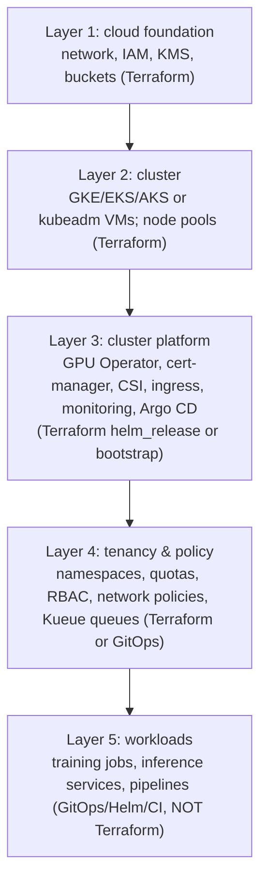

# 4.25 Terraform with Kubernetes and Helm providers, and OpenTofu

| | |
|---|---|
| Level | Intermediate |
| Priority tier | 1 |
| Lab venue | Terraform/OpenTofu, kind, kubectl, helm; optional GKE/EKS cluster |
| Part | Part 4: Automation and infrastructure as code |
| Status | Drafted, labs **untested** |

## Why this matters for AI infrastructure

Once a cluster exists, a platform team still has to turn it into an AI platform: GPU Operator or device plugins, a scheduler such as Kueue or Volcano, storage classes and CSI drivers, ingress, monitoring (Prometheus, DCGM exporter), Argo CD, cert-manager, team namespaces with GPU quotas, RBAC, network policies. Terraform's Kubernetes and Helm providers can manage these platform layers in the same workflow as the cloud infrastructure underneath. But Terraform is a poor fit for continuously reconciling application workloads, and mixing cluster creation with in-cluster resources in one state is a classic source of pain. This chapter shows what to manage with Terraform, how to wire providers correctly, how to install the common GPU platform components, where GitOps takes over (4.26), and what OpenTofu adds.

## Prerequisites and outcomes

Needs 4.18 to 4.24 and Kubernetes basics (Part 5, in particular Deployments, Services, RBAC, namespaces, CRDs). After this chapter you can:

- Configure the `kubernetes`, `helm`, `kubectl` (community) and `kustomization` providers and authenticate with short-lived credentials.
- Layer stacks so the cluster exists before providers use it; avoid CRD ordering traps (`kubernetes_manifest` plan-time schema lookup).
- Install platform components with `helm_release` (GPU Operator, cert-manager, ingress, Prometheus stack, Argo CD, Kueue) with pinned versions and reviewed values; manage namespaces, quotas, limit ranges, RBAC, network policies and storage classes as code.
- Decide the boundary between Terraform and GitOps/Helm-driven delivery; handle drift between Terraform and in-cluster controllers.
- Use OpenTofu-specific features appropriately and know compatibility considerations.

## 1. Where Terraform fits in the Kubernetes lifecycle



Guideline: Terraform owns layers 1 to 3 and the **bootstrap** of GitOps (installing Argo CD or Flux and the root Application pointing at Git). Layers 4 and 5 are best expressed as Git-managed manifests reconciled by a controller (4.26), unless your organisation prefers Terraform for tenancy objects because they derive from the same inputs as cloud IAM (teams, quotas). Whichever you choose, **one owner per object**: never let both Terraform and Argo CD manage the same resource.

Why not workloads in Terraform: they change many times a day, need continuous reconciliation and health-based rollouts, are authored by application teams, and generate noisy plans; Terraform has no concept of rollout health, pod disruption handling or progressive delivery. Why Terraform for the platform layer: infrequent, versioned, reviewed changes that need the same variables and credentials as the cloud stack and benefit from plans.

## 2. Providers and authentication

### The kubernetes provider

```hcl
terraform {
  required_providers {
    kubernetes = { source = "hashicorp/kubernetes", version = "~> 2.31" }
    helm       = { source = "hashicorp/helm",       version = "~> 2.14" }
    kubectl    = { source = "alekc/kubectl",        version = "~> 2.0" }     # community; applies raw YAML without plan-time schema lookup
  }
}

# GKE example: short-lived token, nothing stored in code
data "google_client_config" "default" {}
data "google_container_cluster" "main" {
  name     = var.cluster_name
  location = var.region
}

provider "kubernetes" {
  host                   = "https://${data.google_container_cluster.main.endpoint}"
  token                  = data.google_client_config.default.access_token
  cluster_ca_certificate = base64decode(data.google_container_cluster.main.master_auth[0].cluster_ca_certificate)
}

provider "helm" {
  kubernetes {
    host                   = "https://${data.google_container_cluster.main.endpoint}"
    token                  = data.google_client_config.default.access_token
    cluster_ca_certificate = base64decode(data.google_container_cluster.main.master_auth[0].cluster_ca_certificate)
  }
}
```

Variants: EKS uses `data.aws_eks_cluster_auth` or an `exec` block calling `aws eks get-token`; AKS uses kube_config or exec with `kubelogin`; for kind/dev use `config_path = "~/.kube/config"` and `config_context`. Prefer **`exec` plugins** (short-lived tokens fetched at run time and not stored in state) over static tokens; ensure the CI identity has Kubernetes RBAC (for example a `cluster-admin` binding for the Terraform service account **only** in the bootstrap stack, narrower roles for later stacks). The cluster API endpoint must be reachable from the runner (private clusters need self-hosted runners in the VPC, VPN, or an authorised-network entry/IAP tunnel).

### Layering rule (repeat from 4.22)

Provider configuration is evaluated before resources are planned. If the cluster is created in the same configuration, the provider's `host` is unknown at plan time and the first plan can fail or connect to the wrong cluster (a classic bug: falling back to the local kubeconfig and deploying into the wrong cluster). **Create the cluster in one state; configure Kubernetes/Helm providers in another state using data sources.** Exceptions require careful `depends_on` and are still fragile.

### Resource types you will use

| Provider | Resources | Use |
|---|---|---|
| kubernetes | `kubernetes_namespace`, `_resource_quota`, `_limit_range`, `_role`/`_role_binding`/`_cluster_role(_binding)`, `_service_account`, `_network_policy`, `_storage_class`, `_secret`, `_config_map`, `_priority_class`, generic `_manifest` | Platform primitives in HCL (typed resources give good plans) |
| kubernetes | `kubernetes_manifest` | Any resource, including CRDs; **requires the CRD/schema to exist at plan time** |
| helm | `helm_release`, `helm_repository` data, `helm_template` data | Install charts, set values |
| kubectl (alekc) | `kubectl_manifest`, `kubectl_file_documents` | Apply YAML (CRDs/custom resources) without plan-time schema validation |
| kustomization (kbst) | `kustomization_resource` | Apply Kustomize overlays |
| flux/argocd | `flux_bootstrap_git`, `argocd_application` | Bootstrap GitOps controllers and register apps |

## 3. Installing platform components with helm_release

```hcl
resource "kubernetes_namespace" "gpu_operator" {
  metadata {
    name   = "gpu-operator"
    labels = { "pod-security.kubernetes.io/enforce" = "privileged" }   # operator needs privileged pods
  }
}

resource "helm_release" "gpu_operator" {
  name             = "gpu-operator"
  namespace        = kubernetes_namespace.gpu_operator.metadata[0].name
  repository       = "https://helm.ngc.nvidia.com/nvidia"
  chart            = "gpu-operator"
  version          = var.gpu_operator_version                 # pin: e.g. "v24.6.0"; upgrades via PR
  atomic           = true                                      # roll back on failed install/upgrade
  wait             = true
  timeout          = 900
  cleanup_on_fail  = true
  max_history      = 5

  values = [yamlencode({
    driver   = { enabled = var.operator_manages_driver }       # false when drivers are preinstalled in the node image
    toolkit  = { enabled = true }
    dcgmExporter = {
      enabled = true
      serviceMonitor = { enabled = var.prometheus_operator }
    }
    mig = { strategy = var.mig_strategy }                      # none | single | mixed
    nfd  = { enabled = true }
    daemonsets = {
      tolerations = [{ key = "nvidia.com/gpu", operator = "Exists", effect = "NoSchedule" }]
    }
  })]
}
```

Practices for `helm_release`:

- **Pin chart versions** and review `values`; use `yamlencode` of HCL objects (typed, mergeable) or `templatefile` for YAML files; avoid `set` for complex values.
- **CRD handling**: charts that ship CRDs in `crds/` install them only on first install, not on upgrade (Helm limitation); operators often manage their own CRDs. Plan CRD upgrades explicitly (separate CRD chart, `kubectl_manifest` for CRDs, or the operator's documented procedure). Deleting a release may leave CRDs and custom resources behind.
- **`atomic`/`wait`/`timeout`**: ensure failed upgrades roll back; set generous timeouts for operators that compile drivers or pull large images.
- **Drift**: Helm release state is stored in Kubernetes Secrets; Terraform detects changes to chart/version/values, not manual changes to rendered resources (unlike `kubernetes_*` resources). Argo CD/Flux compare rendered manifests continuously; Terraform does not.
- **Ordering**: chain with `depends_on` or references (namespace → operator → custom resources). Dependent CRs must wait for CRDs (see section 4).
- **Secrets in values**: avoid; use external secrets operators or reference existing Secrets; remember Helm values and Terraform state contain them (4.22).
- **Helm in air-gapped setups**: OCI registries, mirrored charts, `repository` pointing internally.
- **Upgrade safety**: run `helm diff`-like review through Terraform plans (changes in `values` and `version`); for operators with disruptive upgrades (GPU driver DaemonSets restarting nodes' GPU stacks) combine with drain/cordon workflows and maintenance windows (Part 11, 4.17).

Typical platform stack for a GPU cluster, in order: namespaces and PSA labels → **cert-manager** → **ingress-nginx or Gateway API implementation** → **kube-prometheus-stack** (Prometheus Operator CRDs, Grafana, Alertmanager) → **NVIDIA GPU Operator** (NFD, device plugin, DCGM exporter, toolkit; optional driver, MIG manager) → **Network Operator** (if RDMA/InfiniBand: Multus, SR-IOV or RDMA device plugin, Whereabouts/NVIDIA IPAM) → **storage** (CSI drivers, StorageClasses) → **Kueue** and/or **Volcano**/**JobSet**/**KubeRay**/**Kubeflow Training Operator** → **Argo CD/Flux** → policy (Kyverno/Gatekeeper). Parts 5, 11 and 12 explain each component; here Terraform only installs and configures them.

## 4. CRDs, custom resources and the plan-time schema problem

`kubernetes_manifest` asks the API server for the resource's OpenAPI schema **during plan**. If the CRD is installed in the same apply (for example by a Helm chart), plan fails because the kind is unknown. Solutions:

1. **Two applies / two stacks**: install operators and CRDs first; create custom resources in a later stack (layering).
2. **`kubectl_manifest`** (alekc/kubectl): applies YAML with server-side logic and does not require the schema at plan time; use `depends_on = [helm_release.x]`; plan quality is weaker (diff is textual) but it works for first-time apply.
3. **Install CRDs separately** (`kubectl_file_documents` from a URL/file, pinned) before the chart.
4. **Let GitOps own custom resources** after bootstrap (preferred for many CRs).

```hcl
resource "kubectl_manifest" "cluster_policy" {
  yaml_body  = file("${path.module}/manifests/clusterpolicy.yaml")      # NVIDIA ClusterPolicy (CRD installed by the operator chart)
  depends_on = [helm_release.gpu_operator]
}
```

(Note: the GPU Operator chart creates a default `ClusterPolicy` itself; customise via chart values rather than managing a second one.)

## 5. Tenancy and policy as code

Typical objects per team (data-driven with `for_each`, 4.21):

```hcl
variable "teams" {
  type = map(object({
    gpu_quota   = number
    cpu_quota   = string
    mem_quota   = string
    namespaces  = list(string)
    admin_groups = list(string)
    priority    = optional(string, "normal")
  }))
}

locals {
  ns = merge([for t, c in var.teams : { for n in c.namespaces : "${t}-${n}" => merge(c, { team = t, name = n }) }]...)
}

resource "kubernetes_namespace" "team" {
  for_each = local.ns
  metadata {
    name = each.key
    labels = {
      team                                  = each.value.team
      "pod-security.kubernetes.io/enforce" = "baseline"
    }
  }
}

resource "kubernetes_resource_quota" "gpu" {
  for_each = local.ns
  metadata {
    name      = "compute"
    namespace = kubernetes_namespace.team[each.key].metadata[0].name
  }
  spec {
    hard = {
      "requests.nvidia.com/gpu" = tostring(each.value.gpu_quota)
      "requests.cpu"            = each.value.cpu_quota
      "requests.memory"         = each.value.mem_quota
      "persistentvolumeclaims"  = "50"
    }
  }
}

resource "kubernetes_role_binding" "admins" {
  for_each = local.ns
  metadata {
    name      = "team-admins"
    namespace = kubernetes_namespace.team[each.key].metadata[0].name
  }
  role_ref {
    api_group = "rbac.authorization.k8s.io"
    kind      = "ClusterRole"
    name      = "edit"
  }
  dynamic "subject" {
    for_each = each.value.admin_groups
    content {
      kind      = "Group"
      name      = subject.value
      api_group = "rbac.authorization.k8s.io"
    }
  }
}

resource "kubernetes_network_policy" "default_deny" {
  for_each = local.ns
  metadata {
    name      = "default-deny-ingress"
    namespace = kubernetes_namespace.team[each.key].metadata[0].name
  }
  spec {
    pod_selector {}
    policy_types = ["Ingress"]
  }
}
```

Because quotas and team lists derive from the same data as cloud IAM and cost allocation, Terraform is a reasonable owner of tenancy objects in smaller organisations; larger ones move these to GitOps with a self-service PR flow (4.26). With **Kueue**, ClusterQueues/ResourceFlavors/LocalQueues encode GPU quotas by team and accelerator type (applied via `kubectl_manifest` or GitOps); make sure only one system owns them.

Policy: install Kyverno or Gatekeeper and keep policies in Git; Terraform may bootstrap the engine and the baseline policy chart. Pod Security Admission labels on namespaces (Terraform above) enforce baseline/restricted profiles; GPU Operator namespace is privileged by necessity.

## 6. GitOps bootstrap

Terraform installs Argo CD (or Flux) and the root application once; Git takes over.

```hcl
resource "helm_release" "argocd" {
  name             = "argocd"
  namespace        = "argocd"
  create_namespace = true
  repository       = "https://argoproj.github.io/argo-helm"
  chart            = "argo-cd"
  version          = var.argocd_chart_version
  atomic           = true
  values = [yamlencode({
    configs = { params = { "server.insecure" = false } }
    controller = { replicas = 1 }
  })]
}

resource "kubectl_manifest" "root_app" {
  depends_on = [helm_release.argocd]
  yaml_body = yamlencode({
    apiVersion = "argoproj.io/v1alpha1"
    kind       = "Application"
    metadata   = { name = "root", namespace = "argocd" }
    spec = {
      project = "default"
      source  = { repoURL = var.gitops_repo, targetRevision = "main", path = "clusters/${var.cluster_name}" }
      destination = { server = "https://kubernetes.default.svc", namespace = "argocd" }
      syncPolicy  = { automated = { prune = true, selfHeal = true } }
    }
  })
}
```

After bootstrap, avoid Terraform changes to anything Argo manages. Alternatively, `flux_bootstrap_git` bootstraps Flux and writes its manifests to the Git repo. Chapter 4.26 covers GitOps design.

## 7. Operational concerns and pitfalls

- **Wrong-cluster danger**: a provider with no `host` falls back to the default kubeconfig context. Make every stack set explicit `host`/`config_context`; add a `check` or precondition that compares `data.kubernetes_namespace.kube_system.metadata[0].uid` (or the cluster name) against an expected value.
- **Destroy order**: destroying a cluster before deleting in-cluster resources (load balancers, PVC-backed disks) leaves orphaned cloud resources; delete platform layers first (or accept cloud-side cleanup), and set finalizer-aware timeouts. LoadBalancer Services and PersistentVolumes create cloud objects outside Terraform's knowledge.
- **Timeouts and API availability**: cluster API unavailable (upgrade, private endpoint) fails plans; run Terraform from a runner with stable access.
- **Large manifests**: `kubernetes_manifest` field-by-field diffing can be slow; chunk or use Helm for large bundles.
- **Server-side apply and field managers**: `kubernetes_manifest` uses server-side apply with field manager `Terraform`; other controllers (HPA, operators, Argo) may fight over fields; use `field_manager { force_conflicts = true }` carefully or `computed_fields`.
- **Drift handling**: controllers mutate objects (status, annotations); `kubernetes_*` resources mostly ignore server-populated fields but not all; use `lifecycle.ignore_changes` selectively (4.21).
- **Secrets**: `kubernetes_secret` values land in state; prefer external secrets or sealed/encrypted secrets via GitOps (4.12); if you must, restrict state access (4.22).
- **Upgrades**: Kubernetes API deprecations break `kubernetes_manifest` YAML; keep provider/chart versions current and test in lower environments.
- **Multiple clusters**: provider aliases cannot be created dynamically; use one stack per cluster with the same module (`module.platform` called from per-cluster roots), or a tool that generates stacks (4.23).
- **Performance**: hundreds of Kubernetes resources in a state slow plans; keep platform stacks small and push tenancy to GitOps at scale.

## 8. OpenTofu notes

OpenTofu (`tofu`) is an MPL-licensed fork of Terraform 1.5.x maintained under the Linux Foundation. For the content of this chapter it behaves the same; considerations:

- **Compatibility**: HCL and providers work; the registry is `registry.opentofu.org` (mirrors most providers/modules); binary is `tofu`; state format compatible with Terraform 1.5.x lineage, but mixing CLIs on the same state after features diverge is risky: pick one per state and pin versions in CI.
- **Features beyond Terraform** (varies by release; verify): **state and plan encryption** (client-side, with passphrase/KMS key providers), `for_each` on `provider` configuration via dynamic provider iteration (a long-requested feature that eases multi-region/multi-cluster patterns), early variable/locals evaluation in module sources and backend blocks, `-exclude` flag, OCI registry module sources, provider-defined functions across versions, and `removed`/`import` block enhancements. Terraform has its own newer features (ephemeral values, stacks, test mocks) with partial parity; check release notes.
- **Migration**: moving from Terraform to OpenTofu is usually: install `tofu`, `tofu init -upgrade`, run `tofu plan` expecting no changes, commit the lock file (regenerated hashes), adjust CI. Test on a copy of state. Moving back may be impossible after adopting OpenTofu-only features.
- **Governance**: choose based on licence policy (BUSL vs MPL), vendor strategy and ecosystem tooling (Atlantis, Terragrunt, Spacelift, env0 and others support both).

## 9. Lab

First, run the self-checking Python lab (`code/part04/terraform_k8s_helm_opentofu_lab.py`) locally. It verifies the CRD plan-time schema checker (`evaluate_crd_manifest_plan`: contrasting `kubernetes_manifest` against two-stack layering and `kubectl_manifest`), the multi-tenant Kubernetes `Namespace`/`ResourceQuota`/`RoleBinding`/`NetworkPolicy` generator (`generate_team_tenancy_objects`), and the wrong-cluster and Terraform-vs-Argo-CD dual-ownership safety guard (`check_cluster_and_ownership_safety`).

```bash
python3 code/part04/terraform_k8s_helm_opentofu_lab.py
```

Next, on a machine with Terraform/OpenTofu, `kind`, `kubectl`, and `helm` (all interactive shell steps below are `untested here`), work through these exercises:

1. **kind + providers**: create a kind cluster with Terraform (or the CLI); in a **separate** stack configure the `kubernetes` and `helm` providers with explicit context; create a namespace and a quota; observe the plan; deliberately break the context and see the wrong-cluster protection precondition fire.
2. **helm_release**: install `ingress-nginx` and `kube-prometheus-stack` with pinned versions and `atomic`; check ServiceMonitor CRDs; upgrade the chart version and read the plan; trigger a failed upgrade (bad value) and watch rollback.
3. **CRD ordering**: try `kubernetes_manifest` for a `ServiceMonitor` in the same apply as the Prometheus chart, observe the plan error; fix with layering and with `kubectl_manifest`.
4. **GPU Operator rehearsal**: on a CPU-only kind cluster install the operator chart with `driver.enabled=false` and observe NFD labels and pods pending/failing without GPUs; on a real GPU cluster verify allocatable `nvidia.com/gpu` and run a `nvidia-smi` pod. Compare operator-managed driver vs preinstalled driver values.
5. **Tenancy**: implement the teams data model: namespaces, quotas, role bindings, default-deny network policies; add a team and remove a namespace; study the plan; apply a test pod exceeding GPU quota (use a fake extended resource via a patched node status in kind) and see rejection.
6. **Kueue**: install Kueue with Helm; create ResourceFlavor/ClusterQueue/LocalQueue with `kubectl_manifest`; submit a Job with a queue label; compare owning these objects in Terraform vs GitOps.
7. **GitOps bootstrap**: install Argo CD via Terraform and the root Application pointing at a Git repo containing a namespace and a deployment; show self-heal after a manual `kubectl delete`; then try to edit the same object with Terraform and observe the conflict; define the ownership rule.
8. **Drift and field managers**: modify a Terraform-managed ConfigMap with `kubectl edit` and via another controller; use `plan`; use `ignore_changes`/`force_conflicts` appropriately.
9. **Destroy order**: create a LoadBalancer Service and a PVC; destroy the cluster first and list orphaned cloud resources; repeat with layered destroy.
10. **OpenTofu**: run the same stack with `tofu`; enable state encryption with a passphrase and inspect the state; try dynamic provider iteration if available; document differences.
11. **Policy**: add a Conftest policy rejecting namespaces without a `team` label and quotas above a threshold; run on `plan.json`.
12. **Clean up**.

## 10. Common mistakes

- Creating the cluster and using its endpoint in Kubernetes/Helm providers in the same state.
- Providers without explicit contexts, deploying to the wrong cluster.
- Using Terraform for fast-moving application workloads; letting Terraform and Argo CD both manage the same objects.
- Unpinned chart versions; values changes applied without review; ignoring CRD upgrade semantics.
- `kubernetes_manifest` for CRDs not yet installed.
- Secrets in `kubernetes_secret` with open state access.
- Destroying clusters with live LoadBalancers/PVs, leaving cloud costs behind.
- Running operator upgrades (driver DaemonSets) during active training without draining.
- Mixed `tofu`/`terraform` binaries on one state without agreement.
- Over-large platform states with hundreds of resources.

## 11. Interview angles

- "What would you manage with Terraform in a Kubernetes platform and what with GitOps?"
- "How do you configure the Kubernetes provider for a cluster created by Terraform?" (separate stacks, data sources, exec auth.)
- "How do you install the NVIDIA GPU Operator via IaC and upgrade it safely?"
- "Why does `kubernetes_manifest` fail for CRDs in the same apply? Alternatives?"
- "How do you prevent applying to the wrong cluster?"
- "How do you do per-team GPU quotas as code?" (namespaces, ResourceQuota, Kueue, data-driven.)
- "OpenTofu vs Terraform: practical differences? Would you migrate?"
- "What orphaned resources can appear when destroying a cluster?"

## Exercises

1. **The 5-Layer Kubernetes Platform Stack and the Single-Owner Boundary (Terraform vs. GitOps):** Using `check_cluster_and_ownership_safety()` in `code/part04/terraform_k8s_helm_opentofu.py`, explain why Terraform owns Layers 1–3 (Cloud Foundation, Cluster/Node Pools, Platform Bootstrap) while GitOps (Argo CD / Flux) owns Layer 5 (Workloads), and what happens if both Terraform and Argo CD (`selfHeal: true`) manage the same Kubernetes resource.
2. **Configuring `kubernetes`, `helm`, and `kubectl` Providers and Preventing Wrong-Cluster Disasters:** Explain why cluster creation (Layer 2) and `kubernetes`/`helm` provider configuration (Layer 3) must live in separate states, how an empty `host` falls back to `~/.kube/config`, and how a `check` / `precondition` on `kube-system` Namespace `uid` prevents applying to the wrong cluster.
3. **Installing the NVIDIA GPU Operator and Platform Add-Ons with `helm_release`:** Trace `resource "helm_release" "gpu_operator"` in Section 3: explain `pod-security.kubernetes.io/enforce = "privileged"` on the namespace, `atomic = true`, `wait = true`, `cleanup_on_fail = true`, `yamlencode({...})` values (`driver.enabled`, `toolkit.enabled`, `dcgmExporter`, `mig.strategy`, `nfd`, and `nvidia.com/gpu:NoSchedule` tolerations), and how Helm handles `crds/` on upgrade vs initial install.
4. **Solving the CRD Plan-Time Schema Problem (`kubernetes_manifest` vs. `kubectl_manifest` vs. Layered Stacks):** Using `evaluate_crd_manifest_plan()` in `code/part04/terraform_k8s_helm_opentofu.py`, explain why `kubernetes_manifest` fails during `terraform plan` when its CRD is installed by a `helm_release` in the same apply, and compare the four solutions in Section 4.
5. **Data-Driven Multi-Tenant GPU Quotas, RBAC, and Default-Deny NetworkPolicies (`generate_team_tenancy_objects`):** Using `generate_team_tenancy_objects()` in `code/part04/terraform_k8s_helm_opentofu.py`, trace how Section 5 flattens `var.teams` into per-namespace `kubernetes_namespace` (`baseline` PSA), `kubernetes_resource_quota` (`requests.nvidia.com/gpu`), `kubernetes_role_binding` (`edit`), and `kubernetes_network_policy` (`default-deny-ingress`) resources.
6. **Bootstrapping GitOps (`argocd` + Root `Application`), Teardown Ordering, and OpenTofu Features:** Trace how Terraform bootstraps Argo CD and hands off control via the `root` `Application` (`App-of-Apps`), explain why destroying Layer 2 before deleting in-cluster `LoadBalancer` Services and `PersistentVolumeClaim`s leaks cloud resources, and summarize OpenTofu's key additions (client-side state encryption, dynamic provider `for_each`, early evaluation, OCI module sources).

## Checkpoint questions (20)

<details>
<summary>1. What are the five layers of a Kubernetes AI platform stack, and where is the boundary between Terraform and GitOps?</summary>

1. **Layer 1 — Cloud Foundation (Terraform):** VPCs, subnets, NAT, IAM, KMS, checkpoint buckets.
2. **Layer 2 — Kubernetes Cluster & Node Pools (Terraform):** GKE/EKS/AKS control plane, system CPU node pool, and GPU node pools (`google_container_node_pool`).
3. **Layer 3 — Cluster Platform Add-Ons & GitOps Bootstrap (Terraform `helm_release` or Bootstrap Argo CD):** CNI, cert-manager, ingress, Prometheus/DCGM, NVIDIA GPU Operator, Network Operator, CSI drivers, Kueue, and **Argo CD / Flux** + the root `Application`.
4. **Layer 4 — Tenancy & Policy (GitOps or Terraform—pick one owner):** Team namespaces, `ResourceQuota`s (`requests.nvidia.com/gpu`), RBAC, `NetworkPolicy`, Kueue `ClusterQueue`s.
5. **Layer 5 — Application Workloads (GitOps / Helm / Kueue—NEVER Terraform):** Training jobs, Ray clusters, vLLM/Triton inference deployments.
</details>

<details>
<summary>2. Why is Terraform a poor fit for managing day-to-day Kubernetes application workloads (Layer 5)?</summary>

Application workloads deploy dozens of times per day, require continuous drift reconciliation (`selfHeal`), rely on Kubernetes-native progressive delivery (canary/blue-green rollouts, readiness gates, HPA/KEDA autoscaling), and are authored by ML/application engineers in Kubernetes YAML/Helm rather than HCL. Running `terraform plan` against hundreds of fast-changing Pods/Jobs creates slow, noisy plans and lock contention on infrastructure state.
</details>

<details>
<summary>3. What is the \"Wrong-Cluster Fallback\" bug in the `hashicorp/kubernetes` provider, and how do you prevent it?</summary>

If `provider "kubernetes"` is evaluated when its `host` argument is empty or unconfigured, the provider **silently falls back to `~/.kube/config` or localhost**—which on an engineer's laptop can point to a completely different cluster (such as `prod` when running a `dev` destroy). Prevent this by:
1. Always wiring explicit `host`, `cluster_ca_certificate`, and `exec` / `token` in a separate stack after the cluster exists.
2. Adding a `check` or `precondition` verifying that `data.kubernetes_namespace.kube_system.metadata[0].uid` matches the expected cluster UID.
</details>

<details>
<summary>4. Compare `hashicorp/kubernetes` typed resources (`kubernetes_namespace`), `kubernetes_manifest`, and `alekc/kubectl` (`kubectl_manifest`).</summary>

- **Typed resources (`kubernetes_namespace`, `kubernetes_resource_quota`, `kubernetes_role_binding`, `kubernetes_network_policy`):** Built-in HCL schemas validated offline during `validate`/`plan` without contacting the cluster API schema endpoint; produce clean attribute-level diffs.
- **`kubernetes_manifest` (`hashicorp/kubernetes`):** Supports any Kubernetes resource or CRD using HCL `manifest = { ... }` and Server-Side Apply (`SSA`), **but queries the live cluster API server for the resource's OpenAPI schema during `terraform plan`**.
- **`kubectl_manifest` (`alekc/kubectl`):** Accepts raw YAML (`yaml_body`) and defers schema validation until **`apply`**, allowing a CRD and its Custom Resource to be applied in the same stack using `depends_on`.
</details>

<details>
<summary>5. Why does `kubernetes_manifest` fail during `terraform plan` when its CRD is installed by a `helm_release` in the same configuration, and what are the four fixes?</summary>

Because `helm_release` does not install the CRD (`ServiceMonitor`, `ClusterPolicy`, `ClusterQueue`) until the **`apply` phase**, the cluster API server does not know the CRD's OpenAPI schema during the **`plan` phase**—so `kubernetes_manifest` fails immediately at `plan` time.
**Four fixes:**
1. **Two layered stacks:** Install operators/Helm charts in Stack A; create CRs in Stack B (or GitOps).
2. **Use `kubectl_manifest` (`alekc/kubectl`)** with `depends_on = [helm_release.gpu_operator]`.
3. **Install CRDs first** in a separate step before planning CRs.
4. **Hand off Custom Resources to Argo CD / Flux** after Terraform bootstraps Argo CD.
</details>

<details>
<summary>6. Why must the `gpu-operator` namespace carry the label `pod-security.kubernetes.io/enforce = "privileged"`?</summary>

Kubernetes Pod Security Admission (`PSA`) enforces three levels: `privileged`, `baseline`, and `restricted`. Because the NVIDIA GPU Operator DaemonSets (`nvidia-driver-daemonset`, `nvidia-container-toolkit-daemonset`, `nvidia-device-plugin`, `nvidia-dcgm-exporter`) require `privileged: true` security contexts, `hostPath` volume mounts (`/dev`, `/run/nvidia`, `/sys`), and `hostPID`/`hostNetwork` access to load kernel modules and expose GPU device nodes, `baseline` or `restricted` PSA would block the GPU Operator pods from starting. Tenant workload namespaces (`team-*`), by contrast, should enforce `baseline` or `restricted`.
</details>

<details>
<summary>7. In `helm_release.gpu_operator`, when do you set `driver.enabled = false` versus `driver.enabled = true`?</summary>

- **`driver.enabled = false`:** When the NVIDIA kernel driver is **already pre-installed on the host OS image** (for example, via a Packer + Ansible golden image in Chapter 4.17, or via GKE's built-in `gpu_driver_installation_config`).
- **`driver.enabled = true`:** When nodes boot a clean stock OS (such as Ubuntu or Red Hat CoreOS) without a host GPU driver, and you want the GPU Operator's `nvidia-driver-daemonset` container to manage the driver lifecycle inside Kubernetes. Never enable both a host-installed driver manager and the GPU Operator driver container simultaneously.
</details>

<details>
<summary>8. What do `atomic = true`, `wait = true`, `cleanup_on_fail = true`, and `yamlencode({...})` do on `resource "helm_release"`?</summary>

- **`wait = true` & `timeout = 900`:** Waits up to 15 minutes for all Deployments, DaemonSets, and Jobs in the Helm chart to reach `Ready` state before marking the Terraform resource complete.
- **`atomic = true` & `cleanup_on_fail = true`:** If the install or upgrade fails or times out (for example, a bad image tag or failing readiness probe), Helm **automatically rolls back to the previous working release revision** and cleans up newly created failed resources.
- **`values = [yamlencode({ ... })]`:** Constructs Helm values from strongly typed HCL maps/lists/booleans and serializes them to valid YAML—avoiding the quoting, escaping, and type-coercion bugs of `set { name = "..."; value = "..." }`.
</details>

<details>
<summary>9. How does Helm handle CRDs inside a chart's `crds/` directory during `helm upgrade` (`helm_release` version bump)?</summary>

By design, Helm 3 installs files in a chart's **`crds/` directory only on initial `helm install` and NEVER updates or deletes them during `helm upgrade`** (to prevent accidental data loss across cluster-wide CRs). Therefore, when upgrading `kube-prometheus-stack`, `cert-manager`, `gpu-operator`, or `kueue` to a new chart version in Terraform, you must also apply any updated CRD manifests explicitly (via a dedicated `-crds` Helm chart, `kubectl_manifest`, or server-side apply) before or during the upgrade.
</details>

<details>
<summary>10. Where does Helm store its release state inside Kubernetes, and what kind of drift does `helm_release` in Terraform NOT detect?</summary>

Helm 3 stores release metadata and rendered manifest snapshots as gzipped, base64-encoded **Kubernetes `Secret`s** (`sh.helm.release.v1.<name>.v<N>`) in the release's namespace. During `terraform plan`, the `helm` provider compares the **chart version and `values` hash** against that release Secret—it does **not** diff every individual Deployment or Service rendered by the chart against the live cluster. If someone runs `kubectl edit deployment` on a chart-managed resource, `terraform plan` on `helm_release` will report `No changes` (whereas Argo CD and Flux continuously diff every rendered child resource against live state).
</details>

<details>
<summary>11. What is the recommended installation order for platform add-ons on a GPU Kubernetes cluster?</summary>

1. **Namespaces & Pod Security Admission (`PSA`) labels**
2. **`cert-manager`** (required by admission webhooks in Kueue, GPU Operator, and ingress)
3. **Ingress / Gateway API controller**
4. **Observability (`kube-prometheus-stack`):** installs `ServiceMonitor` and `PodMonitor` CRDs first so subsequent operators can register their metrics endpoints.
5. **NVIDIA GPU Operator** (and **NVIDIA Network Operator** for RDMA / SR-IOV / Multus)
6. **Storage CSI drivers & `StorageClass`es**
7. **Batch / AI schedulers (`Kueue`, `JobSet`, `Kubeflow Training Operator`, `KubeRay`)**
8. **Argo CD / Flux** (GitOps hand-off) and **Policy engine (`Kyverno` / `Gatekeeper`)**.
</details>

<details>
<summary>12. How do `kubernetes_resource_quota` and `Kueue` complement each other for managing multi-tenant GPU capacity?</summary>

- **`kubernetes_resource_quota` (`requests.nvidia.com/gpu = "16"`):** Enforces a hard **instantaneous ceiling** per namespace at the Kubernetes API admission level—a team cannot have more than 16 GPUs requested by active Pods at any moment (pods exceeding quota are rejected immediately).
- **`Kueue` (`ResourceFlavor`, `ClusterQueue`, `LocalQueue`):** Provides **batch job queueing, fair-sharing, borrowing/lending across team cohorts, preemption, and gang admission (`all-or-nothing` pod scheduling)**—so a team can submit ten 16-GPU training Jobs and Kueue queues and admits them in order as GPUs free up rather than rejecting them.
</details>

<details>
<summary>13. Why should every tenant namespace include a `default-deny-ingress` `kubernetes_network_policy`?</summary>

By default in Kubernetes, **every Pod in every namespace can connect to every other Pod in the cluster** without restriction. Creating a baseline `kubernetes_network_policy` with an empty `pod_selector {}` and `policy_types = ["Ingress"]` (and no `ingress` allow blocks) selects all Pods in that namespace and denies all unsolicited inbound traffic unless explicitly permitted by an additional allow `NetworkPolicy` (such as allowing intra-namespace NCCL traffic and Prometheus scraping).
</details>

<details>
<summary>14. How does the \"GitOps Bootstrap\" pattern (`helm_release.argocd` + `kubectl_manifest.root_app`) work?</summary>

Terraform installs the `argo-cd` Helm chart and creates a single bootstrap **`Application` (`root`, the "App of Apps" pattern)** pointing at `clusters/${var.cluster_name}` in your GitOps repository with `automated = { prune = true, selfHeal = true }`. From that moment onward, Argo CD syncs all child `Application`s, operators, and workloads directly from Git—and Terraform never touches any resource inside `clusters/${var.cluster_name}`.
</details>

<details>
<summary>15. What happens if both Terraform and Argo CD (`selfHeal: true`) manage the same Kubernetes object, and how do Server-Side Apply (`SSA`) field managers interact?</summary>

If Terraform applies a label or replica count on a resource that Argo CD also tracks with `selfHeal: true`, **Argo CD immediately reverts Terraform's change within seconds**, and the next `terraform plan` shows drift again—an endless tug-of-war. Similarly, `kubernetes_manifest` uses Kubernetes **Server-Side Apply (`SSA`)** with `field_manager = "Terraform"`; if an operator or HPA modifies a field owned by `Terraform`, the next apply fails with a field-manager conflict unless `ignore_changes` / `computed_fields` is configured or ownership is cleanly separated.
</details>

<details>
<summary>16. Why does running `terraform destroy` on a GKE/EKS cluster BEFORE deleting in-cluster `LoadBalancer` Services and `PersistentVolumeClaim`s leak cloud resources?</summary>

When you create a Kubernetes `Service` of `type: LoadBalancer` or a `PersistentVolumeClaim` inside the cluster, the cloud controller manager and CSI driver provision **external cloud load balancers, target groups, firewall rules, and persistent disks** in your GCP/AWS account—**outside `terraform.tfstate`**. If Terraform deletes the GKE/EKS cluster first, the in-cluster controllers are destroyed before they can run finalizers to delete those external load balancers and disks, leaving orphaned cloud resources billing forever (or blocking VPC subnet deletion with `resourceInUse`). Always destroy in-cluster LoadBalancers/PVCs (Layer 3–5) before destroying the cluster (Layer 2).
</details>

<details>
<summary>17. What are five features OpenTofu (`tofu`) adds beyond Terraform 1.5.x?</summary>

1. **Native client-side State and Plan Encryption:** Encrypts `terraform.tfstate` and saved `tfplan` files using AES-GCM with PBKDF2 passphrases, AWS KMS, GCP KMS, or OpenBao before uploading to the backend.
2. **Dynamic provider iteration (`for_each` on `provider` blocks):** Allows configuring providers across a map of regions or clusters dynamically.
3. **Early variable/local evaluation:** Allows using variables and locals inside `backend {}` blocks and `module` `source` / `version` strings.
4. **OCI Registry support for modules** (`oci://...`).
5. **The `-exclude` plan/apply flag** (the inverse of `-target`).
</details>

<details>
<summary>18. Why shouldn't a team mix `terraform` and `tofu` CLIs back-and-forth on the same remote state file?</summary>

Although OpenTofu forked from Terraform 1.5.x with a compatible v4 state format, the two projects are evolving independently (for example, OpenTofu client-side state encryption or provider `for_each` vs Terraform's `ephemeral` blocks and stacks). Running different CLIs or versions against the same `.tfstate` can introduce schema/lockfile incompatibilities (`registry.opentofu.org` vs `registry.terraform.io`). Standardize on one CLI per repository/state and pin its exact version in CI and `.terraform-version` / `.opentofu-version`.
</details>

<details>
<summary>19. How do you migrate an existing Terraform stack to OpenTofu safely?</summary>

1. Back up the state file (`terraform state pull > backup.tfstate`).
2. Install the matching `tofu` version and update `required_version` if needed.
3. Run **`tofu init -upgrade`** (which updates provider checksums in `.terraform.lock.hcl` from `registry.opentofu.org`).
4. Run **`tofu plan`** and verify it reports **`No changes. Your infrastructure matches the configuration.`**
5. Commit `.terraform.lock.hcl` and update the CI workflow binary in a single PR.
</details>

<details>
<summary>20. How do you prevent `kubernetes_secret` resources from exposing secrets in Terraform state when bootstrapping a cluster?</summary>

Avoid creating raw secret payloads in Terraform whenever possible: instead, install the **External Secrets Operator (`ESO`)** or **Secrets Store CSI Driver** via `helm_release`, grant it Workload Identity / IRSA access to GCP Secret Manager / AWS Secrets Manager / HashiCorp Vault, and define declarative **`ExternalSecret`** custom resources (which contain only the secret manager key name, zero secret values) so ESO syncs the actual `Secret` directly inside the cluster without touching `terraform.tfstate`.
</details>

## Sources and review notes

- **Sources read in full:**
  - `terraform-up-and-running-3rd-edition` — Yevgeniy Brikman, *Terraform: Up and Running*, 3rd ed., **Chapter 7: Working with Multiple Providers** (deploying Kubernetes clusters and using the `kubernetes` provider) and **Chapters 8–10** (production testing and team workflows).
  - `production-kubernetes` — Josh Rosso, Rich Lander, Alexander Brand & John Harris, *Production Kubernetes*, **Chapter 11: Building Platform Services** (platform layering, operator lifecycle, and multi-tenancy).
  - `nvidia-devops` (`volume-10/05-terraform-for-infrastructure-as-code.md` and `volume-10/11-cicd-for-infrastructure-and-cluster-configuration.md`): Terraform/OpenTofu platform layering and GitOps bootstrap.
- **Run here:** `python3 code/part04/terraform_k8s_helm_opentofu_lab.py` (3 passed, 0 failed).
- **Explicitly labelled inferences:** The `evaluate_crd_manifest_plan`, `generate_team_tenancy_objects`, and `check_cluster_and_ownership_safety` models in `code/part04/terraform_k8s_helm_opentofu.py` and the `helm_release.gpu_operator`, `kubectl_manifest.cluster_policy`, multi-tenant `kubernetes_resource_quota`, and `helm_release.argocd` HCL configurations are the author's constructions synthesizing `TUR` Chapter 7, `PK` Chapter 11, and `volume-10` (plus original study items 21, 22, 23, 24, 25, 26, 27, 28, 29, and 30).
- **Not verified on live hardware:** Live `terraform` / `tofu` runs against GKE/EKS/`kind` with `hashicorp/kubernetes` (`~> 2.31`), `hashicorp/helm` (`~> 2.14`), and `alekc/kubectl` (`~> 2.0`), `gpu-operator` (`v24.6.0`, `timeout = 900`, `max_history = 5`), `persistentvolumeclaims = "50"`, and OpenTofu state encryption (`1.5.x`, `1.10+`) are marked (`untested here`) where not executed by `terraform_k8s_helm_opentofu_lab.py`.
