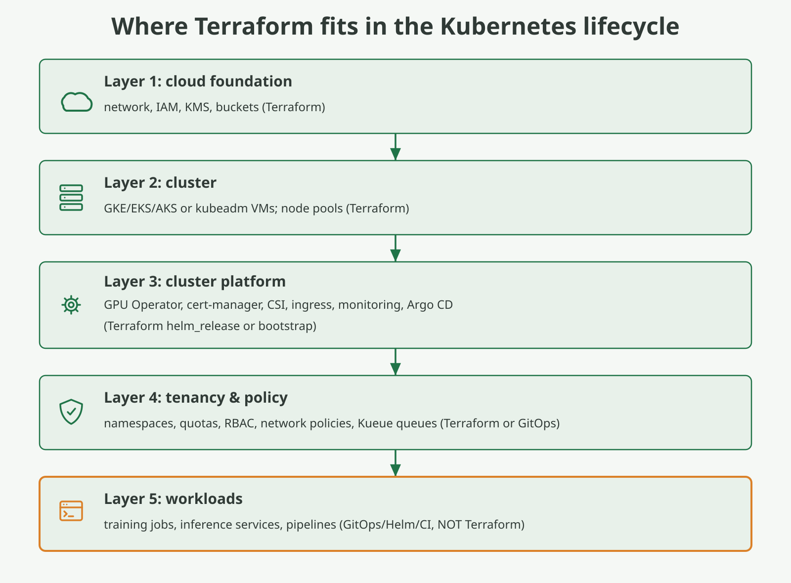

# 4.25 Terraform with Kubernetes and Helm providers, and OpenTofu

| | |
|---|---|
| Level | Intermediate |
| Priority tier | 1 |
| Lab venue | Terraform/OpenTofu, kind, kubectl, helm; optional GKE/EKS cluster |
| Part | Part 4: Automation and infrastructure as code |
| Status | Drafted, labs **untested** |

## Why this matters for AI infrastructure

Suppose your platform team has just handed over a fresh Kubernetes cluster. It is not an AI platform yet. The cluster can run containers, but it cannot yet see a GPU, schedule a training job fairly between teams, or keep a record of what is running. Someone still has to install the GPU Operator or device plugins, choose a scheduler such as Kueue or Volcano, and set up storage classes and CSI drivers. A CSI driver is the plug-in that lets Kubernetes attach a storage volume to a pod. Ingress, monitoring (Prometheus and the DCGM exporter), Argo CD, cert-manager, team namespaces with GPU quotas, RBAC and network policies come next.

Each of those pieces can be installed by hand once. The trouble starts when the cluster has to be rebuilt, or when a second cluster has to look exactly like the first. A hand-built cluster is a cluster nobody can reproduce. Terraform's Kubernetes and Helm providers can manage these platform layers in the same workflow as the cloud infrastructure underneath. But Terraform is a poor fit for continuously reconciling application workloads. Mixing cluster creation with in-cluster resources in one state is a classic source of pain. A state that holds both the cloud network and a training job's pods becomes slow, risky and hard to review.

This chapter shows what to manage with Terraform, how to wire providers correctly, and how to install the common GPU platform components. It also shows where GitOps takes over (4.26) and what OpenTofu adds. Decide which tool owns each platform layer before you write its first resource. Ownership is the question that decides almost everything else in this chapter.

## Prerequisites and outcomes

Before you write any provider block, you need chapters 4.18 to 4.24 and some Kubernetes basics from Part 5. In particular, you should know Deployments, Services, RBAC, namespaces and CRDs. A CRD, or custom resource definition, is how you teach Kubernetes a new kind of object, such as a `ServiceMonitor` or a `ClusterPolicy`. RBAC, role-based access control, decides who may do what inside the cluster. When you finish this chapter, you should be able to do the following:

- Configure the `kubernetes`, `helm`, `kubectl` (community) and `kustomization` providers, and authenticate them with short-lived credentials.
- Layer stacks so the cluster exists before the providers use it, and avoid CRD ordering traps such as the `kubernetes_manifest` plan-time schema lookup.
- Install platform components with `helm_release` (GPU Operator, cert-manager, ingress, Prometheus stack, Argo CD, Kueue) using pinned versions and reviewed values. Manage namespaces, quotas, limit ranges, RBAC, network policies and storage classes as code.
- Decide the boundary between Terraform and GitOps or Helm-driven delivery, and handle drift between Terraform and in-cluster controllers. Drift here means the live cluster no longer matches what the code says it should be.
- Use OpenTofu-specific features appropriately, and know the compatibility considerations.

## 1. Where Terraform fits in the Kubernetes lifecycle

Picture a cluster built in five layers. The cloud network sits at the bottom, and workloads sit at the top. Each layer sits on the one below it, so a problem in a lower layer shows up as strange behaviour in every layer above. Think of it as a building. Nobody decorates the top floor before the foundation is poured.



*Figure 4.25.1. Where Terraform fits in the Kubernetes lifecycle, as a diagram.*

Terraform owns layers 1 to 3. It also owns the **bootstrap** of GitOps: installing Argo CD or Flux, and the root Application that points at Git. Bootstrap means the one-time setup that starts a system running, after which the system takes over its own care. Layers 4 and 5 are better expressed as Git-managed manifests that a controller reconciles (4.26). A controller is a program inside the cluster that keeps the live state matching the desired state. One exception exists. Some organisations prefer Terraform for tenancy objects, because those objects come from the same inputs as cloud IAM, such as teams and quotas. Whichever you choose, give each object one owner, and never let both Terraform and Argo CD manage the same resource.

Workloads stay out of Terraform for a reason. They change many times a day, they need continuous reconciliation and health-based rollouts, and application teams write them. Terraform has no concept of rollout health, pod disruption handling or progressive delivery. Progressive delivery means shifting traffic to a new version a little at a time. So plans for workloads turn noisy. Platform layers are different. They change rarely, and each change is versioned and reviewed. They also need the same variables and credentials as the cloud stack, and they benefit from a plan before they apply.

For each layer, settle which tool owns it before anyone writes the first resource. A useful test is to ask who will change this object next month, and how often. If the answer is "a platform engineer, a few times a year," Terraform fits. If the answer is "an ML engineer, every day," GitOps fits.

## 2. Providers and authentication

Each provider needs two answers before it can do anything. It must know which cluster to talk to, and it must prove who you are. The example below wires both for GKE. Read it as two questions. The `data` blocks answer "which cluster," and the `token` and `cluster_ca_certificate` lines answer "who am I, and can I trust this server."

### The kubernetes provider

```hcl
terraform {
  required_providers {
    kubernetes = { source = "hashicorp/kubernetes", version = "~> 2.31" }
    helm       = { source = "hashicorp/helm",       version = "~> 2.14" }
    kubectl    = { source = "alekc/kubectl",        version = "~> 2.0" }     # community; applies raw YAML without plan-time schema lookup
  }
}

# GKE example: short-lived token, nothing stored in code
data "google_client_config" "default" {}
data "google_container_cluster" "main" {
  name     = var.cluster_name
  location = var.region
}

provider "kubernetes" {
  host                   = "https://${data.google_container_cluster.main.endpoint}"
  token                  = data.google_client_config.default.access_token
  cluster_ca_certificate = base64decode(data.google_container_cluster.main.master_auth[0].cluster_ca_certificate)
}

provider "helm" {
  kubernetes {
    host                   = "https://${data.google_container_cluster.main.endpoint}"
    token                  = data.google_client_config.default.access_token
    cluster_ca_certificate = base64decode(data.google_container_cluster.main.master_auth[0].cluster_ca_certificate)
  }
}
```

This example uses GKE. The provider reads a short-lived token at run time, so no credential sits in the code. The `cluster_ca_certificate` line matters just as much as the token. It is the certificate that proves the API server is really your cluster, and without it a connection could be intercepted. Note that the `helm` provider nests the same three values inside a `kubernetes` block, because it talks to the cluster through its own client. The values are identical, so when one is wrong, check both places.

Other clouds and local clusters need different authentication. EKS uses `data.aws_eks_cluster_auth` or an `exec` block that calls `aws eks get-token`. AKS uses kube_config or an exec block with `kubelogin`. For kind or a dev cluster, set `config_path = "~/.kube/config"` and `config_context`. A kubeconfig is the local file that lists clusters and how to log in to each one, and `config_context` picks one entry from it.

Prefer `exec` plugins over static tokens. They fetch a short-lived token when Terraform runs, and the token never lands in state. Static tokens and copied kubeconfigs sit in state or on disk, where anyone who reads them can reuse them. The CI identity also needs Kubernetes RBAC. Give the Terraform service account a `cluster-admin` binding **only** in the bootstrap stack, and give later stacks narrower roles. `cluster-admin` is the highest role in the cluster, so using it everywhere means one leaked token can do anything. The cluster API endpoint must be reachable from the runner. Private clusters need a self-hosted runner inside the VPC, a VPN, or an authorised-network entry or IAP tunnel. A runner is the machine that actually executes the pipeline, so if it cannot reach the API server, nothing else matters.

### Layering rule (repeat from 4.22)

Provider configuration is evaluated before resources are planned. If the same configuration creates the cluster, the provider's `host` is unknown at plan time. The first plan can then fail, or it can connect to the wrong cluster. Unknown at plan time means the value does not exist until the apply creates it, so Terraform cannot yet fill it in. This is a classic bug: the provider falls back to the local kubeconfig and deploys into the wrong cluster. **Create the cluster in one state, and configure the Kubernetes and Helm providers in another state using data sources.** Exceptions exist, but they need careful `depends_on` and remain fragile. A fragile setup works until the day someone changes one line.

### Resource types you will use

Each provider handles a different job. The table shows which resource fits which platform primitive. A primitive is a basic building block of the platform, such as a namespace or a quota.

| Provider | Resources | Use |
|---|---|---|
| kubernetes | `kubernetes_namespace`, `_resource_quota`, `_limit_range`, `_role`/`_role_binding`/`_cluster_role(_binding)`, `_service_account`, `_network_policy`, `_storage_class`, `_secret`, `_config_map`, `_priority_class`, generic `_manifest` | Platform primitives in HCL (typed resources give good plans) |
| kubernetes | `kubernetes_manifest` | Any resource, including CRDs; **requires the CRD/schema to exist at plan time** |
| helm | `helm_release`, `helm_repository` data, `helm_template` data | Install charts, set values |
| kubectl (alekc) | `kubectl_manifest`, `kubectl_file_documents` | Apply YAML (CRDs/custom resources) without plan-time schema validation |
| kustomization (kbst) | `kustomization_resource` | Apply Kustomize overlays |
| flux/argocd | `flux_bootstrap_git`, `argocd_application` | Bootstrap GitOps controllers and register apps |

Typed resources give the cleanest plans. A typed resource is one with a built-in schema in the provider, so Terraform can check it and show a precise diff without asking the cluster. `kubernetes_manifest` can manage any resource, including CRDs, but only when the CRD already exists at plan time. If you are unsure which one to use, start with the typed resource and reach for `kubernetes_manifest` only when you must.

## 3. Installing platform components with helm_release

Say you need the GPU Operator on a fresh cluster. The GPU Operator is NVIDIA's package that installs everything a node needs to use its GPUs, and it is a good first example because it is demanding. It needs privileged pods, so its namespace has to allow them. The release below sets that up, and it rolls back on its own if the install fails.

```hcl
resource "kubernetes_namespace" "gpu_operator" {
  metadata {
    name   = "gpu-operator"
    labels = { "pod-security.kubernetes.io/enforce" = "privileged" }   # operator needs privileged pods
  }
}

resource "helm_release" "gpu_operator" {
  name             = "gpu-operator"
  namespace        = kubernetes_namespace.gpu_operator.metadata[0].name
  repository       = "https://helm.ngc.nvidia.com/nvidia"
  chart            = "gpu-operator"
  version          = var.gpu_operator_version                 # pin: e.g. "v24.6.0"; upgrades via PR
  atomic           = true                                      # roll back on failed install/upgrade
  wait             = true
  timeout          = 900
  cleanup_on_fail  = true
  max_history      = 5

  values = [yamlencode({
    driver   = { enabled = var.operator_manages_driver }       # false when drivers are preinstalled in the node image
    toolkit  = { enabled = true }
    dcgmExporter = {
      enabled = true
      serviceMonitor = { enabled = var.prometheus_operator }
    }
    mig = { strategy = var.mig_strategy }                      # none | single | mixed
    nfd  = { enabled = true }
    daemonsets = {
      tolerations = [{ key = "nvidia.com/gpu", operator = "Exists", effect = "NoSchedule" }]
    }
  })]
}
```

Read the block from the top down. The namespace comes first, because the release needs somewhere to live. The `pod-security` label is the admission rule that lets the operator's pods run with the access they need. The release then names the chart, pins its version, and sets the rollback and wait behaviour. The `values` block is the set of options that customise the chart. Each option is a deliberate choice. For example, `driver.enabled` decides whether the operator installs the GPU driver itself, which depends on whether your node image already has one.

Several habits keep `helm_release` safe. Pin the chart version, and review the `values` before every change. Build the values with `yamlencode` on HCL objects, which are typed and mergeable, or use `templatefile` for YAML files. Avoid `set` for complex values. The `set` syntax passes each value as a text string, so a number or a true/false can be misread, and quoting bugs creep in easily. Pinning matters because a chart with no version pin installs whatever is newest on the day you run it, which may differ from the day you tested.

Charts that ship CRDs in a `crds/` directory install them only on the first install, not on upgrade. That is a Helm limitation. Operators often manage their own CRDs, so plan CRD upgrades on purpose. You can use a separate CRD chart, `kubectl_manifest` for CRDs, or the operator's documented procedure. Deleting a release may leave CRDs and custom resources behind. The CRD is the schema, and deleting it would also delete every object of that kind, so Helm leaves it in place by design.

Set `atomic` and `wait` so that a failed upgrade rolls back. A rollback returns the release to its last working version. Set `timeout` generously for operators that compile drivers or pull large images. A driver build can take many minutes on a cold node, and a short timeout would mark a healthy install as failed.

Helm stores its release state in Kubernetes Secrets. Terraform detects changes to the chart, the version and the values. It does not detect manual changes to the rendered resources, which is different from the `kubernetes_*` resources. Argo CD and Flux compare rendered manifests continuously. Terraform does not. So if someone edits a chart-managed Deployment by hand, `terraform plan` on the release stays silent. This is the single most important difference between Terraform and GitOps for in-cluster objects, and section 7 returns to it.

Chain the dependencies with `depends_on` or resource references, so the namespace comes before the operator, and the operator comes before the custom resources. Dependent custom resources must wait for their CRDs (see section 4).

Keep secrets out of values where you can. Use an external secrets operator, or reference Secrets that already exist. Remember that Helm values and Terraform state both contain them (4.22). In air-gapped setups, use OCI registries or mirrored charts, and point `repository` at an internal address. An air-gapped setup has no route to the public internet, so charts must come from inside the network.

Review every change to `values` and `version` in the Terraform plan, which works like a `helm diff`-like review. A helm diff is a comparison of what a chart would change, and the plan gives you the same kind of review. For operators with disruptive upgrades, such as GPU driver DaemonSets that restart a node's GPU stack, pair the plan with drain/cordon workflows and maintenance windows (Part 11, 4.17). A DaemonSet runs one copy of a pod on every node, so an upgrade to it touches every GPU at once unless you drain first.

Install the GPU platform stack in this order. Start with namespaces and PSA labels, then add cert-manager and the ingress-nginx or Gateway API implementation. Next comes kube-prometheus-stack, which brings the Prometheus Operator CRDs, Grafana and Alertmanager. Then install the NVIDIA GPU Operator, which includes NFD, the device plugin, the DCGM exporter, the toolkit and optionally the driver and MIG manager. NFD is Node Feature Discovery, which labels each node with the hardware it has. MIG is Multi-Instance GPU, which splits one GPU into smaller pieces. If you use RDMA or InfiniBand, add the Network Operator, which brings Multus, SR-IOV or the RDMA device plugin, and Whereabouts or NVIDIA IPAM. Multus lets a pod have more than one network interface, and SR-IOV lets a physical NIC share itself with many pods. After that come storage (CSI drivers and StorageClasses), then Kueue and/or Volcano, JobSet, KubeRay or the Kubeflow Training Operator. Argo CD or Flux comes next, and policy (Kyverno or Gatekeeper) comes last. Parts 5, 11 and 12 explain each component, so here Terraform only installs and configures them. The order is not arbitrary. Each step depends on something earlier, such as cert-manager's webhooks being ready before the GPU Operator's admission checks run.

## 4. CRDs, custom resources and the plan-time schema problem

Suppose you install an operator with a Helm chart, and in the same apply you create one of its custom resources with `kubernetes_manifest`. The plan fails. `kubernetes_manifest` asks the API server for the resource's OpenAPI schema during plan. The OpenAPI schema is the machine-readable description of what fields an object may have. The chart has not installed the CRD yet, so the API server does not know the kind.

Picture a new kind of object as a new word in a dictionary. Terraform can only check your spelling against a dictionary that already contains the word. Until the chart runs, the word does not exist, so the check cannot pass. That is why the fix is about ordering.

You have four ways out of this:

1. Use two stacks. Install the operators and CRDs first, then create the custom resources in a later stack.
2. Use `kubectl_manifest` from alekc/kubectl. It applies YAML without the schema lookup, so you can add `depends_on = [helm_release.x]`. The plan is weaker, because its diff is textual, but it works for a first-time apply. A textual diff compares the YAML as text rather than checking each field's type, so a typo in a field name is caught only at apply time.
3. Install the CRDs separately, with `kubectl_file_documents` from a pinned URL or file, before the chart.
4. Let GitOps own the custom resources after bootstrap. For many custom resources, this is the preferred option.

The `kubectl_manifest` form looks like this:

```hcl
resource "kubectl_manifest" "cluster_policy" {
  yaml_body  = file("${path.module}/manifests/clusterpolicy.yaml")      # NVIDIA ClusterPolicy (CRD installed by the operator chart)
  depends_on = [helm_release.gpu_operator]
}
```

The block is short, but the `depends_on` line does the important work. It tells Terraform to wait for the operator release to finish before it tries to create the policy. The GPU Operator chart creates a default `ClusterPolicy` on its own. Customise that object through chart values, instead of managing a second one. Two owners for one object is the same mistake this chapter warns against throughout.

## 5. Tenancy and policy as code

Every team on a shared cluster needs its own space. That means namespaces, a GPU quota, admin access and a default-deny network policy. A namespace is a named partition of the cluster, and each team gets one or more. You can generate all of these from one data structure, so adding a team means adding one entry rather than writing five resources by hand. The pattern uses `for_each` (4.21), and the example below shows the full set for each team namespace.

```hcl
variable "teams" {
  type = map(object({
    gpu_quota   = number
    cpu_quota   = string
    mem_quota   = string
    namespaces  = list(string)
    admin_groups = list(string)
    priority    = optional(string, "normal")
  }))
}

locals {
  ns = merge([for t, c in var.teams : { for n in c.namespaces : "${t}-${n}" => merge(c, { team = t, name = n }) }]...)
}

resource "kubernetes_namespace" "team" {
  for_each = local.ns
  metadata {
    name = each.key
    labels = {
      team                                  = each.value.team
      "pod-security.kubernetes.io/enforce" = "baseline"
    }
  }
}

resource "kubernetes_resource_quota" "gpu" {
  for_each = local.ns
  metadata {
    name      = "compute"
    namespace = kubernetes_namespace.team[each.key].metadata[0].name
  }
  spec {
    hard = {
      "requests.nvidia.com/gpu" = tostring(each.value.gpu_quota)
      "requests.cpu"            = each.value.cpu_quota
      "requests.memory"         = each.value.mem_quota
      "persistentvolumeclaims"  = "50"
    }
  }
}

resource "kubernetes_role_binding" "admins" {
  for_each = local.ns
  metadata {
    name      = "team-admins"
    namespace = kubernetes_namespace.team[each.key].metadata[0].name
  }
  role_ref {
    api_group = "rbac.authorization.k8s.io"
    kind      = "ClusterRole"
    name      = "edit"
  }
  dynamic "subject" {
    for_each = each.value.admin_groups
    content {
      kind      = "Group"
      name      = subject.value
      api_group = "rbac.authorization.k8s.io"
    }
  }
}

resource "kubernetes_network_policy" "default_deny" {
  for_each = local.ns
  metadata {
    name      = "default-deny-ingress"
    namespace = kubernetes_namespace.team[each.key].metadata[0].name
  }
  spec {
    pod_selector {}
    policy_types = ["Ingress"]
  }
}
```

The `locals` block is the part that takes some reading. It flattens a nested input, where each team lists several namespaces, into one flat map keyed by names such as `ml-research-dev`. A worked example helps. Suppose the team `ml` has the namespaces `dev` and `prod`. The flattening turns that into two entries, `ml-dev` and `ml-prod`, and every resource below then creates one copy of itself per entry. Adding a third namespace to the list adds one more namespace, quota, binding and policy automatically.

Notice the labels on the namespace. The `pod-security` label sets the security baseline for every pod in that namespace. Everything else in the block hangs off that one loop, so a change to the loop changes every team at once. Test such changes on a small map first.

Quotas and team lists come from the same data as cloud IAM and cost allocation. For that reason, Terraform is a reasonable owner of tenancy objects in a smaller organisation. Larger organisations move these objects to GitOps, with a self-service PR flow (4.26). With Kueue, ClusterQueues, ResourceFlavors and LocalQueues encode GPU quotas by team and accelerator type. A ResourceFlavor describes one kind of hardware, a ClusterQueue is the shared pool of quota, and a LocalQueue is the entry point a team submits jobs to. You apply them through `kubectl_manifest` or GitOps, and only one system should own them.

Install Kyverno or Gatekeeper, and keep the policies in Git. Kyverno and Gatekeeper are policy engines that reject objects breaking your rules at admission time. Terraform may bootstrap the engine and the baseline policy chart. The Pod Security Admission labels on each namespace, shown above, enforce the baseline or restricted profiles. The GPU Operator namespace stays privileged, because the operator needs it. Keeping the exception to one namespace means the rule is still strict everywhere else.

Decide who owns the tenancy objects, so that Terraform and GitOps never write to the same quota. If both write to the same `ResourceQuota`, each apply silently undoes the other, and the number on the quota changes depending on which one ran last.

## 6. GitOps bootstrap

Terraform installs Argo CD (or Flux) and the root application once. After that, Git takes over. GitOps means the desired state of the cluster lives in a Git repository, and a controller in the cluster pulls that state and applies it. The code below shows the one-time handoff. Think of it as a relay race: Terraform runs the first leg, sets up the runner, hands over the baton, and then steps off the track.

```hcl
resource "helm_release" "argocd" {
  name             = "argocd"
  namespace        = "argocd"
  create_namespace = true
  repository       = "https://argoproj.github.io/argo-helm"
  chart            = "argo-cd"
  version          = var.argocd_chart_version
  atomic           = true
  values = [yamlencode({
    configs = { params = { "server.insecure" = false } }
    controller = { replicas = 1 }
  })]
}

resource "kubectl_manifest" "root_app" {
  depends_on = [helm_release.argocd]
  yaml_body = yamlencode({
    apiVersion = "argoproj.io/v1alpha1"
    kind       = "Application"
    metadata   = { name = "root", namespace = "argocd" }
    spec = {
      project = "default"
      source  = { repoURL = var.gitops_repo, targetRevision = "main", path = "clusters/${var.cluster_name}" }
      destination = { server = "https://kubernetes.default.svc", namespace = "argocd" }
      syncPolicy  = { automated = { prune = true, selfHeal = true } }
    }
  })
}
```

The first resource installs Argo CD itself. The second creates one Application called `root`, which points at a folder in Git. That folder then lists the rest of the cluster, so the root is the single entry point. The `automated` sync policy with `prune` and `selfHeal` is what makes Git the authority. `prune` removes objects that were deleted from Git, and `selfHeal` puts back anything changed by hand. Together they mean a manual edit does not survive the next sync.

Once the bootstrap is done, do not change anything Argo manages from Terraform. If you prefer Flux, `flux_bootstrap_git` bootstraps it instead, and it writes its manifests to the Git repo. Chapter 4.26 covers GitOps design.

## 7. Operational concerns and pitfalls

Start with the wrong-cluster danger. A provider with no `host` falls back to the default kubeconfig context. On your laptop, that context may point at a different cluster from the one you meant. Set an explicit `host` or `config_context` in every stack. Then add a `check` or precondition that compares `data.kubernetes_namespace.kube_system.metadata[0].uid` (or the cluster name) against an expected value. The `kube-system` namespace exists in every cluster and has its own unique ID, so comparing that ID is a reliable way to confirm which cluster you are about to change.

Destroy order matters too. Suppose you destroy a cluster before its in-cluster resources. Load balancers and PVC-backed disks then stay behind in the cloud, because the cluster that would have cleaned them up is gone. Delete the platform layers first, or accept cloud-side cleanup, and set finalizer-aware timeouts. A finalizer is a marker that tells Kubernetes to run cleanup before an object disappears, so a timeout that is too short can cut that cleanup off. LoadBalancer Services and PersistentVolumes create cloud objects that Terraform does not know about. A cluster API that is unavailable, for example during an upgrade or on a private endpoint, also fails plans. Run Terraform from a runner with stable access.

Large manifests slow down `kubernetes_manifest`, because it diffs field by field. Chunk them, or use Helm for large bundles. `kubernetes_manifest` uses server-side apply with the field manager `Terraform`. A field manager is the name recorded against each field, showing which tool set it. Other controllers, such as HPA, operators and Argo, may fight over the same fields. HPA, the horizontal pod autoscaler, changes replica counts on its own, so Terraform and HPA can disagree about the same number. Use `field_manager { force_conflicts = true }` carefully, or use `computed_fields`. Forcing conflicts takes ownership of a field away from its current owner, so it should be a deliberate choice.

Controllers change objects too, through status and annotations. Most `kubernetes_*` resources ignore server-populated fields, but not all of them. Use `lifecycle.ignore_changes` selectively (4.21). Values from `kubernetes_secret` end up in state. Prefer external secrets, or sealed and encrypted secrets managed through GitOps (4.12). If you must use `kubernetes_secret`, restrict access to the state (4.22).

Kubernetes API deprecations break `kubernetes_manifest` YAML, so keep provider and chart versions current, and test in lower environments first. A deprecated API is one the cluster has announced it will remove, and manifests that use it stop working after the removal. Provider aliases cannot be created dynamically. Use one stack per cluster that calls the same module (`module.platform` from per-cluster roots), or a tool that generates stacks (4.23). Hundreds of Kubernetes resources in one state slow every plan. Keep platform stacks small, and push tenancy to GitOps at scale.

## 8. OpenTofu notes

OpenTofu (`tofu`) is an MPL-licensed fork of Terraform 1.5.x, maintained under the Linux Foundation. MPL is an open-source licence, and the fork exists so that the tool stays open after Terraform changed its own licence. For the content of this chapter, it behaves the same way. The sections below cover the four areas that matter when you consider the switch.

Compatibility comes first. HCL and providers work as they do in Terraform. The registry is `registry.opentofu.org`, which mirrors most providers and modules. The binary is `tofu`. The state format belongs to the Terraform 1.5.x lineage. Mixing CLIs on the same state is risky once their features diverge, so pick one CLI per state and pin the versions in CI.

OpenTofu also adds features that Terraform lacks. The list changes by release, so verify it. It includes state and plan encryption on the client side, with passphrase or KMS key providers. Client-side encryption means the state is scrambled on your machine before it is stored, so the bucket never holds readable text. It supports `for_each` on `provider` configuration through dynamic provider iteration, a long-requested feature that eases multi-region and multi-cluster patterns. Early variable and locals evaluation works in module sources and backend blocks. The list also includes the `-exclude` flag, OCI registry module sources, provider-defined functions across versions, and `removed` and `import` block enhancements. Terraform has its own newer features, such as ephemeral values, stacks and test mocks, with only partial parity. Check the release notes for both.

Migration is usually a short sequence. Install `tofu`, run `tofu init -upgrade`, and then run `tofu plan`. The plan should report no changes. Commit the regenerated lock file, and update CI. Test the whole sequence on a copy of the state first. Moving back may be impossible once you adopt an OpenTofu-only feature, because the older tool cannot read the new state format. That one-way door is the main risk, so decide it deliberately.

Governance is the last area. Choose based on your licence policy (BUSL vs MPL), your vendor strategy and the ecosystem tooling you rely on. BUSL is the licence Terraform moved to, which restricts some commercial uses. Atlantis, Terragrunt, Spacelift, env0 and others support both tools.

## 9. Lab

Start with the self-checking Python lab, and run it locally first. This is where you check the logic before you touch a cluster. It checks three things. The first is the CRD plan-time schema checker (`evaluate_crd_manifest_plan`), which contrasts `kubernetes_manifest` with two-stack layering and `kubectl_manifest`. The second is the multi-tenant generator (`generate_team_tenancy_objects`), which builds Kubernetes `Namespace`, `ResourceQuota`, `RoleBinding` and `NetworkPolicy` objects. The third is the safety guard (`check_cluster_and_ownership_safety`), which catches a wrong-cluster apply and a resource owned by both Terraform and Argo CD.

```bash
python3 code/part04/terraform_k8s_helm_opentofu_lab.py
```

The commands in this lab have not been run on live hardware, so treat each result as yours to confirm. Next, move to a machine with Terraform or OpenTofu, `kind`, `kubectl` and `helm`. Work through these exercises in order. A kind cluster is a small Kubernetes cluster that runs inside Docker, which makes it a safe place to break things.

1. Create a kind cluster with Terraform or the CLI. In a **separate** stack, configure the `kubernetes` and `helm` providers with an explicit context, and create a namespace and a quota. Study the plan. Then break the context on purpose, and watch the wrong-cluster protection precondition fire.
2. Install `ingress-nginx` and `kube-prometheus-stack` with pinned versions and `atomic`. Check the ServiceMonitor CRDs. Upgrade the chart version and read the plan. Next, trigger a failed upgrade with a bad value, and watch the rollback.
3. Try `kubernetes_manifest` for a `ServiceMonitor` in the same apply as the Prometheus chart, and observe the plan error. Then fix it two ways: once with layering, and once with `kubectl_manifest`.
4. On a CPU-only kind cluster, install the operator chart with `driver.enabled=false`. Observe the NFD labels, and the pods that stay pending or fail without GPUs. On a real GPU cluster, verify allocatable `nvidia.com/gpu` and run a `nvidia-smi` pod. Compare the operator-managed driver values with the values for a preinstalled driver.
5. Implement the teams data model: namespaces, quotas, role bindings and default-deny network policies. Add a team, remove a namespace, and study the plan. Then apply a test pod that exceeds the GPU quota. Use a fake extended resource, added through a patched node status in kind, and see the rejection.
6. Install Kueue with Helm. Create the ResourceFlavor, ClusterQueue and LocalQueue with `kubectl_manifest`, and submit a Job with a queue label. Then compare owning these objects in Terraform with owning them in GitOps.
7. Install Argo CD through Terraform, and create the root Application that points at a Git repo containing a namespace and a deployment. Show self-heal after a manual `kubectl delete`. Then try to edit the same object with Terraform, and observe the conflict. Finally, write down the ownership rule.
8. Change a Terraform-managed ConfigMap with `kubectl edit`, and change it again through another controller. Run `plan` after each change. Then use `ignore_changes` and `force_conflicts` where they fit.
9. Create a LoadBalancer Service and a PVC. Destroy the cluster first, and list the orphaned cloud resources. Repeat the exercise with a layered destroy, and compare the two results.
10. Run the same stack with `tofu`. Enable state encryption with a passphrase, and inspect the state. Try dynamic provider iteration if your version supports it. Document the differences.
11. Add a Conftest policy that rejects namespaces without a `team` label, and quotas above a threshold. Run it on `plan.json`.
12. Clean up everything you created.

## 10. Common mistakes

Watch for these ten mistakes as you write your own stacks. The first is creating the cluster and using its endpoint in the Kubernetes and Helm providers within the same state. Providers without explicit contexts can deploy to the wrong cluster. Using Terraform for fast-moving application workloads is another trap, and so is letting Terraform and Argo CD both manage the same objects. Unpinned chart versions cause trouble, and so do values changes applied without review and ignored CRD upgrade semantics.

Some mistakes come from the custom resources and the secrets. Using `kubernetes_manifest` for CRDs that are not yet installed fails. Putting secrets in `kubernetes_secret` while state access stays open is a risk. Destroying clusters with live LoadBalancers or PVs leaves cloud costs behind.

Running operator upgrades (driver DaemonSets) during active training, without draining, is another trap. Mixing `tofu` and `terraform` binaries on one state without agreement is a problem. So are over-large platform states with hundreds of resources. Pick one CLI per state, and keep the platform states small.

## 11. Interview angles

These are the questions to be ready for in an interview. For each, try to name the tool, the reason, and the failure you would expect if the reason were ignored.

- "What would you manage with Terraform in a Kubernetes platform and what with GitOps?"
- "How do you configure the Kubernetes provider for a cluster created by Terraform?" (separate stacks, data sources, exec auth.)
- "How do you install the NVIDIA GPU Operator via IaC and upgrade it safely?"
- "Why does `kubernetes_manifest` fail for CRDs in the same apply? Alternatives?"
- "How do you prevent applying to the wrong cluster?"
- "How do you do per-team GPU quotas as code?" (namespaces, ResourceQuota, Kueue, data-driven.)
- "OpenTofu vs Terraform: practical differences? Would you migrate?"
- "What orphaned resources can appear when destroying a cluster?"

## Exercises

These exercises ask you to explain the chapter's code, not just to run it. Each one points at a function or resource in `code/part04/terraform_k8s_helm_opentofu.py` or in the chapter text. As you work through them, check your answer against the section each exercise names. Write your explanation before you open the code, so you can see where your reasoning drifts.

1. A reviewer asks who owns each layer of a GPU platform. Use `check_cluster_and_ownership_safety()` in `code/part04/terraform_k8s_helm_opentofu.py` to explain the 5-layer Kubernetes platform stack and the single-owner boundary. Explain why Terraform owns Layers 1–3, which are Cloud Foundation, Cluster and Node Pools, and Platform Bootstrap. Explain why GitOps (Argo CD or Flux) owns Layer 5, the workloads. Then explain what happens when both Terraform and Argo CD (`selfHeal: true`) manage the same Kubernetes resource.
2. A team has had one wrong-cluster apply, and wants the providers wired so it cannot happen again. Explain the Terraform configuration of the `kubernetes`, `helm` and `kubectl` providers, and how to avoid a wrong-cluster disaster. Start with why cluster creation (Layer 2) must live in a separate state from the `kubernetes` and `helm` provider configuration (Layer 3). Then explain how an empty `host` falls back to `~/.kube/config`. Finally explain how a `check` or `precondition` on the `kube-system` Namespace `uid` prevents applying to the wrong cluster.
3. A new engineer must install the NVIDIA GPU Operator and can not tell why the release has so many settings. Work through `resource "helm_release" "gpu_operator"` in Section 3. Explain the `pod-security.kubernetes.io/enforce = "privileged"` label on the namespace. Explain `atomic = true`, `wait = true` and `cleanup_on_fail = true`. Explain the `yamlencode({...})` values, covering `driver.enabled`, `toolkit.enabled`, `dcgmExporter`, `mig.strategy` and `nfd`. Then explain the `nvidia.com/gpu:NoSchedule` toleration. Finally explain how Helm handles the `crds/` directory on upgrade compared with the initial install.
4. A team has a `ServiceMonitor` that fails at plan time, and wants to know why. Solve the CRD plan-time schema problem by comparing `kubernetes_manifest`, `kubectl_manifest` and layered stacks. Using `evaluate_crd_manifest_plan()` in `code/part04/terraform_k8s_helm_opentofu.py`, explain why `kubernetes_manifest` fails during `terraform plan` when its CRD is installed by a `helm_release` in the same apply. Then compare the four solutions in Section 4.
5. A platform team must give each ML team a GPU budget and isolated networking, without writing the same resources five times. Build data-driven multi-tenant GPU quotas, RBAC and default-deny NetworkPolicies. Using `generate_team_tenancy_objects()` in `code/part04/terraform_k8s_helm_opentofu.py`, trace how Section 5 flattens `var.teams` into one entry per namespace. Then trace each entry into a `kubernetes_namespace` with the `baseline` PSA label. Trace it into a `kubernetes_resource_quota` that caps `requests.nvidia.com/gpu`. Trace it into a `kubernetes_role_binding` that grants `edit`. Finally trace it into a `kubernetes_network_policy` named `default-deny-ingress`.
6. A team is bootstrapping GitOps and planning a teardown, and it wants to know the ordering risks and the OpenTofu options. Trace how Terraform bootstraps Argo CD and hands control to the `root` Application, the App-of-Apps pattern. Explain why destroying Layer 2 before deleting in-cluster `LoadBalancer` Services and `PersistentVolumeClaim`s leaks cloud resources. Then summarise OpenTofu's key additions: client-side state encryption, dynamic provider `for_each`, early evaluation and OCI module sources.

## Checkpoint questions (20)

<details>
<summary>1. What are the five layers of a Kubernetes AI platform stack, and where is the boundary between Terraform and GitOps?</summary>

1. **Layer 1 — Cloud Foundation (Terraform):** VPCs, subnets, NAT, IAM, KMS, checkpoint buckets.
2. **Layer 2 — Kubernetes Cluster & Node Pools (Terraform):** GKE/EKS/AKS control plane, system CPU node pool, and GPU node pools (`google_container_node_pool`).
3. **Layer 3 — Cluster Platform Add-Ons & GitOps Bootstrap (Terraform `helm_release` or Bootstrap Argo CD):** CNI, cert-manager, ingress, Prometheus/DCGM, NVIDIA GPU Operator, Network Operator, CSI drivers, Kueue, and **Argo CD / Flux** + the root `Application`.
4. **Layer 4 — Tenancy & Policy (GitOps or Terraform, pick one owner):** Team namespaces, `ResourceQuota`s (`requests.nvidia.com/gpu`), RBAC, `NetworkPolicy`, Kueue `ClusterQueue`s.
5. **Layer 5 — Application Workloads (GitOps / Helm / Kueue, never Terraform):** Training jobs, Ray clusters, vLLM/Triton inference deployments.
</details>

<details>
<summary>2. Why is Terraform a poor fit for managing day-to-day Kubernetes application workloads (Layer 5)?</summary>

Application workloads deploy dozens of times a day. They need continuous drift reconciliation (`selfHeal`), and they rely on Kubernetes-native progressive delivery, such as canary or blue-green rollouts, readiness gates and HPA or KEDA autoscaling. ML and application engineers write them in Kubernetes YAML or Helm, not in HCL. Running `terraform plan` against hundreds of fast-changing Pods and Jobs gives you slow, noisy plans, and it causes lock contention on the infrastructure state.
</details>

<details>
<summary>3. What is the \"Wrong-Cluster Fallback\" bug in the `hashicorp/kubernetes` provider, and how do you prevent it?</summary>

If `provider "kubernetes"` is evaluated with an empty or unconfigured `host` argument, the provider silently falls back to `~/.kube/config` or localhost. On an engineer's laptop, that can point at a completely different cluster, such as `prod` during a `dev` destroy. To prevent it, do two things:
1. Always wire an explicit `host`, `cluster_ca_certificate`, and `exec` or `token` in a separate stack, after the cluster exists.
2. Add a `check` or `precondition` that verifies `data.kubernetes_namespace.kube_system.metadata[0].uid` matches the expected cluster UID.
</details>

<details>
<summary>4. Compare `hashicorp/kubernetes` typed resources (`kubernetes_namespace`), `kubernetes_manifest`, and `alekc/kubectl` (`kubectl_manifest`).</summary>

- **Typed resources (`kubernetes_namespace`, `kubernetes_resource_quota`, `kubernetes_role_binding`, `kubernetes_network_policy`):** They use built-in HCL schemas, which are validated offline during `validate` and `plan`, without contacting the cluster API schema endpoint. Their diffs are clean and attribute-level.
- **`kubernetes_manifest` (`hashicorp/kubernetes`):** It supports any Kubernetes resource or CRD, written as an HCL `manifest = { ... }`, and it uses Server-Side Apply (`SSA`). It queries the live cluster API server for the resource's OpenAPI schema during `terraform plan`.
- **`kubectl_manifest` (`alekc/kubectl`):** It accepts raw YAML through `yaml_body`, and it defers schema validation until `apply`. That lets a CRD and its Custom Resource go in the same stack, using `depends_on`.
</details>

<details>
<summary>5. Why does `kubernetes_manifest` fail during `terraform plan` when its CRD is installed by a `helm_release` in the same configuration, and what are the four fixes?</summary>

`helm_release` does not install the CRD (`ServiceMonitor`, `ClusterPolicy`, `ClusterQueue`) until the `apply` phase. During the `plan` phase, the cluster API server does not yet know the CRD's OpenAPI schema. So `kubernetes_manifest` fails at plan time.

**Four fixes:**
1. **Two layered stacks:** install the operators and Helm charts in Stack A, and create the CRs in Stack B (or in GitOps).
2. **Use `kubectl_manifest` (`alekc/kubectl`)** with `depends_on = [helm_release.gpu_operator]`.
3. **Install the CRDs first** in a separate step, before you plan the CRs.
4. **Hand the Custom Resources to Argo CD / Flux** after Terraform bootstraps Argo CD.
</details>

<details>
<summary>6. Why must the `gpu-operator` namespace carry the label `pod-security.kubernetes.io/enforce = "privileged"`?</summary>

Kubernetes Pod Security Admission (`PSA`) enforces three levels: `privileged`, `baseline` and `restricted`. The NVIDIA GPU Operator DaemonSets (`nvidia-driver-daemonset`, `nvidia-container-toolkit-daemonset`, `nvidia-device-plugin`, `nvidia-dcgm-exporter`) need `privileged: true` security contexts. They also mount `hostPath` volumes (`/dev`, `/run/nvidia`, `/sys`) and use `hostPID` and `hostNetwork` access, so they can load kernel modules and expose GPU device nodes. With `baseline` or `restricted` PSA, the GPU Operator pods would not start. Tenant workload namespaces (`team-*`), by contrast, should enforce `baseline` or `restricted`.
</details>

<details>
<summary>7. In `helm_release.gpu_operator`, when do you set `driver.enabled = false` versus `driver.enabled = true`?</summary>

Set `driver.enabled = false` when the NVIDIA kernel driver is already installed on the host OS image. For example, a Packer and Ansible golden image from Chapter 4.17 does this, and so does GKE's built-in `gpu_driver_installation_config`.

Set `driver.enabled = true` when nodes boot a clean stock OS, such as Ubuntu or Red Hat CoreOS, with no host GPU driver. In that case, the GPU Operator's `nvidia-driver-daemonset` container manages the driver lifecycle inside Kubernetes. Never enable a host-installed driver manager and the GPU Operator driver container at the same time.
</details>

<details>
<summary>8. What do `atomic = true`, `wait = true`, `cleanup_on_fail = true`, and `yamlencode({...})` do on `resource "helm_release"`?</summary>

- **`wait = true` and `timeout = 900`:** Terraform waits up to 15 minutes for every Deployment, DaemonSet and Job in the chart to reach `Ready`, before it marks the resource complete.
- **`atomic = true` and `cleanup_on_fail = true`:** If an install or upgrade fails or times out, for example because of a bad image tag or a failing readiness probe, Helm rolls back to the previous working release revision. It also removes the newly created failed resources.
- **`values = [yamlencode({ ... })]`:** Helm values are built from typed HCL maps, lists and booleans, then serialized to valid YAML. This avoids the quoting, escaping and type-coercion bugs of `set { name = "..."; value = "..." }`.
</details>

<details>
<summary>9. How does Helm handle CRDs inside a chart's `crds/` directory during `helm upgrade` (`helm_release` version bump)?</summary>

Helm 3 installs the files in a chart's `crds/` directory only on the initial `helm install`. It never updates or deletes them during `helm upgrade`, which protects cluster-wide custom resources from accidental loss. So when you upgrade `kube-prometheus-stack`, cert-manager, `gpu-operator` or Kueue to a new chart version in Terraform, you must apply the updated CRD manifests yourself. Use a dedicated `-crds` Helm chart, `kubectl_manifest`, or server-side apply, before or during the upgrade.
</details>

<details>
<summary>10. Where does Helm store its release state inside Kubernetes, and what kind of drift does `helm_release` in Terraform NOT detect?</summary>

Helm 3 stores the release metadata and rendered manifest snapshots as gzipped, base64-encoded Kubernetes Secrets, named `sh.helm.release.v1.<name>.v<N>`, in the release's namespace. During `terraform plan`, the `helm` provider compares the chart version and the `values` hash against that release Secret. It does not diff each Deployment or Service the chart rendered against the live cluster. If someone runs `kubectl edit deployment` on a chart-managed resource, `terraform plan` on `helm_release` reports `No changes`. Argo CD and Flux, by contrast, continuously diff every rendered child resource against the live state.
</details>

<details>
<summary>11. What is the recommended installation order for platform add-ons on a GPU Kubernetes cluster?</summary>

1. **Namespaces and Pod Security Admission (`PSA`) labels.**
2. **cert-manager,** which admission webhooks in Kueue, the GPU Operator and ingress need.
3. **Ingress or Gateway API controller.**
4. **Observability (`kube-prometheus-stack`).** It installs the `ServiceMonitor` and `PodMonitor` CRDs first, so later operators can register their metrics endpoints.
5. **NVIDIA GPU Operator,** and the **NVIDIA Network Operator** for RDMA, SR-IOV and Multus.
6. **Storage CSI drivers and `StorageClass`es.**
7. **Batch and AI schedulers (Kueue, JobSet, Kubeflow Training Operator, KubeRay).**
8. **Argo CD or Flux** for the GitOps hand-off, and a **policy engine (Kyverno or Gatekeeper).**
</details>

<details>
<summary>12. How do `kubernetes_resource_quota` and `Kueue` complement each other for managing multi-tenant GPU capacity?</summary>

- **`kubernetes_resource_quota` (`requests.nvidia.com/gpu = "16"`):** It enforces a hard, instantaneous ceiling per namespace at Kubernetes API admission. A team cannot have more than 16 GPUs requested by active Pods at any moment. Pods that exceed the quota are rejected immediately.
- **Kueue (`ResourceFlavor`, `ClusterQueue`, `LocalQueue`):** It provides batch job queueing, fair sharing, borrowing and lending across team cohorts, preemption, and gang admission (all-or-nothing pod scheduling). So a team can submit ten 16-GPU training Jobs. Kueue queues them and admits them in order as GPUs free up, instead of rejecting them.
</details>

<details>
<summary>13. Why should every tenant namespace include a `default-deny-ingress` `kubernetes_network_policy`?</summary>

By default in Kubernetes, every Pod in every namespace can connect to every other Pod in the cluster, with no restrictions. A baseline `kubernetes_network_policy` with an empty `pod_selector {}` and `policy_types = ["Ingress"]`, and no `ingress` allow blocks, selects every Pod in that namespace. It denies all unsolicited inbound traffic, unless an additional allow `NetworkPolicy` permits it. Examples of such allow policies are intra-namespace NCCL traffic and Prometheus scraping.
</details>

<details>
<summary>14. How does the \"GitOps Bootstrap\" pattern (`helm_release.argocd` + `kubectl_manifest.root_app`) work?</summary>

Terraform installs the `argo-cd` Helm chart, then creates one bootstrap `Application` called `root`. This is the "App of Apps" pattern. The `root` Application points at `clusters/${var.cluster_name}` in your GitOps repository, with `automated = { prune = true, selfHeal = true }`. From then on, Argo CD syncs all child `Application`s, operators and workloads directly from Git. Terraform never touches any resource inside `clusters/${var.cluster_name}`.
</details>

<details>
<summary>15. What happens if both Terraform and Argo CD (`selfHeal: true`) manage the same Kubernetes object, and how do Server-Side Apply (`SSA`) field managers interact?</summary>

Suppose Terraform applies a label or a replica count to a resource that Argo CD also tracks with `selfHeal: true`. Argo CD reverts Terraform's change within seconds, and the next `terraform plan` shows drift again. The result is an endless tug-of-war. Similarly, `kubernetes_manifest` uses Kubernetes Server-Side Apply (`SSA`) with `field_manager = "Terraform"`. If an operator or HPA changes a field that `Terraform` owns, the next apply fails with a field-manager conflict. The only ways out are `ignore_changes` or `computed_fields`, or a clean separation of ownership.
</details>

<details>
<summary>16. Why does running `terraform destroy` on a GKE/EKS cluster BEFORE deleting in-cluster `LoadBalancer` Services and `PersistentVolumeClaim`s leak cloud resources?</summary>

When you create a Kubernetes `Service` of `type: LoadBalancer`, or a `PersistentVolumeClaim`, the cloud controller manager and the CSI driver provision external cloud load balancers, target groups, firewall rules and persistent disks in your GCP or AWS account. Terraform's state file does not track these objects. If Terraform deletes the cluster first, the in-cluster controllers disappear before they can run their finalizers to delete those external load balancers and disks. The cloud resources are then left behind, billing you indefinitely, or they block VPC subnet deletion with `resourceInUse`. Always delete the in-cluster LoadBalancers and PVCs (Layers 3 to 5) before you destroy the cluster (Layer 2).
</details>

<details>
<summary>17. What are five features OpenTofu (`tofu`) adds beyond Terraform 1.5.x?</summary>

1. **Native client-side state and plan encryption:** `terraform.tfstate` and saved `tfplan` files are encrypted with AES-GCM, using PBKDF2 passphrases, AWS KMS, GCP KMS or OpenBao, before they go to the backend.
2. **Dynamic provider iteration (`for_each` on `provider` blocks):** You can configure providers across a map of regions or clusters.
3. **Early variable and local evaluation:** Variables and locals can be used inside `backend {}` blocks and in `module` `source` and `version` strings.
4. **OCI registry support for modules** (`oci://...`).
5. **The `-exclude` plan and apply flag,** which is the inverse of `-target`.
</details>

<details>
<summary>18. Why shouldn't a team mix `terraform` and `tofu` CLIs back-and-forth on the same remote state file?</summary>

OpenTofu forked from Terraform 1.5.x and kept a compatible v4 state format. But the two projects now evolve independently. OpenTofu has client-side state encryption and provider `for_each`, while Terraform has `ephemeral` blocks and stacks. Running different CLIs or versions against the same `.tfstate` can cause schema and lockfile incompatibilities, between `registry.opentofu.org` and `registry.terraform.io`. Standardize on one CLI per repository or state, and pin its exact version in CI and in `.terraform-version` or `.opentofu-version`.
</details>

<details>
<summary>19. How do you migrate an existing Terraform stack to OpenTofu safely?</summary>

1. Back up the state file with `terraform state pull > backup.tfstate`.
2. Install the matching `tofu` version, and update `required_version` if needed.
3. Run **`tofu init -upgrade`**, which updates the provider checksums in `.terraform.lock.hcl` from `registry.opentofu.org`.
4. Run **`tofu plan`**, and check that it reports **`No changes. Your infrastructure matches the configuration.`**
5. Commit `.terraform.lock.hcl` and update the CI workflow binary in a single PR.
</details>

<details>
<summary>20. How do you prevent `kubernetes_secret` resources from exposing secrets in Terraform state when bootstrapping a cluster?</summary>

Avoid writing raw secret payloads in Terraform whenever you can. Instead, install the External Secrets Operator (`ESO`) or the Secrets Store CSI Driver with `helm_release`. Give it access to GCP Secret Manager, AWS Secrets Manager or HashiCorp Vault through Workload Identity or IRSA. Then define declarative `ExternalSecret` custom resources, which hold only the secret manager's key name and no secret values. ESO syncs the actual `Secret` inside the cluster, and `terraform.tfstate` never sees the values.
</details>

## Sources and review notes

- **Sources read in full:**
  - `terraform-up-and-running-3rd-edition` — Yevgeniy Brikman, *Terraform: Up and Running*, 3rd ed., **Chapter 7: Working with Multiple Providers** (deploying Kubernetes clusters and using the `kubernetes` provider) and **Chapters 8–10** (production testing and team workflows).
  - `production-kubernetes` — Josh Rosso, Rich Lander, Alexander Brand & John Harris, *Production Kubernetes*, **Chapter 11: Building Platform Services** (platform layering, operator lifecycle, and multi-tenancy).
  - `nvidia-devops` (`volume-10/05-terraform-for-infrastructure-as-code.md` and `volume-10/11-cicd-for-infrastructure-and-cluster-configuration.md`): Terraform/OpenTofu platform layering and GitOps bootstrap.
- **Run here:** `python3 code/part04/terraform_k8s_helm_opentofu_lab.py` (3 passed, 0 failed).
- **Explicitly labelled inferences:** The `evaluate_crd_manifest_plan`, `generate_team_tenancy_objects`, and `check_cluster_and_ownership_safety` models in `code/part04/terraform_k8s_helm_opentofu.py` and the `helm_release.gpu_operator`, `kubectl_manifest.cluster_policy`, multi-tenant `kubernetes_resource_quota`, and `helm_release.argocd` HCL configurations are the author's constructions synthesizing *Terraform: Up and Running* Chapter 7, *Production Kubernetes* Chapter 11, and `volume-10` (plus original study items 21, 22, 23, 24, 25, 26, 27, 28, 29, and 30).
- **Not verified on live hardware:** Live `terraform` / `tofu` runs against GKE/EKS/`kind` with `hashicorp/kubernetes` (`~> 2.31`), `hashicorp/helm` (`~> 2.14`), and `alekc/kubectl` (`~> 2.0`), `gpu-operator` (`v24.6.0`, `timeout = 900`, `max_history = 5`), `persistentvolumeclaims = "50"`, and OpenTofu state encryption (`1.5.x`, `1.10+`) are not run here, except where `terraform_k8s_helm_opentofu_lab.py` executes them.
