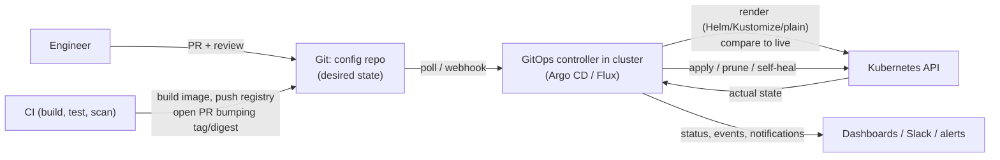
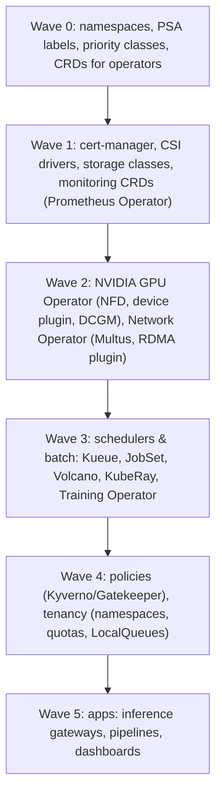

# 4.26 GitOps with Argo CD and Flux

| | |
|---|---|
| Level | Intermediate |
| Priority tier | 1 |
| Lab venue | kind, kubectl, helm, argocd CLI and flux CLI; a Git repository; optional managed cluster |
| Part | Part 4: Automation and infrastructure as code |
| Status | Drafted, labs **untested** |

## Why this matters for AI infrastructure

A GPU Kubernetes platform is a large, layered set of components: operators, CRDs, schedulers, monitoring, ingress, storage, policies, team namespaces and quotas, inference services and pipelines. They change constantly and must stay consistent across dev, staging and production clusters and across regions. GitOps makes Git the source of truth and an in-cluster controller the executor: every change is a reviewed commit, rollback is `git revert`, drift is detected and (optionally) healed, credentials never leave the cluster, and the audit trail is the Git history. For platform teams operating many clusters it is the default delivery model for everything above the infrastructure layer.

## Prerequisites and outcomes

Needs 4.1, 4.2, 4.25 and Kubernetes fundamentals (Part 5). After this chapter you can:

- State the four GitOps principles and contrast pull-based reconciliation with push-based CI/CD.
- Install and operate Argo CD and Flux; define Applications, ApplicationSets, Kustomizations, HelmReleases, sources, health checks, sync policies, waves, hooks, ignore rules.
- Design repositories (app vs config, monorepo vs polyrepo, environment overlays) and promotion flows; use Kustomize and Helm sensibly with GitOps.
- Manage secrets (SOPS, Sealed Secrets, External Secrets), multi-cluster fleets, RBAC and multi-tenancy.
- Sequence the bootstrap of a GPU platform (operators before custom resources, CRDs before consumers) and handle upgrade ordering.
- Add progressive delivery (Argo Rollouts, Flagger), notifications, observability and troubleshooting techniques.

## 1. GitOps principles and architecture

The OpenGitOps principles: the system is **declarative**; desired state is **versioned and immutable** (Git); approved changes are **pulled automatically** by software agents; agents **continuously reconcile** actual to desired state.



Differences from push CI/CD (4.1, 4.2): credentials stay in the cluster (the CI system does not hold cluster-admin), drift is continuously corrected, the cluster state is observable against Git, new clusters can be created by pointing a controller at a repo, and rollbacks are Git operations. Costs: debugging indirection (why didn't it sync?), CRD/ordering complexity, secrets handling requires design, and the controller itself becomes critical infrastructure.

**Two repositories pattern**: an **application repository** (source, Dockerfile, tests, chart) built by CI; a **config repository** (environments, Helm values, Kustomize overlays, Application definitions) watched by the controller. CI's last step updates the image tag/digest in the config repo through a pull request (or an image-update automation) so deployment is a reviewed config change, not a CI side effect.

## 2. Argo CD

### Architecture and objects

Components: **API server** (UI/CLI/gRPC), **repo-server** (clones repos and renders manifests with Helm/Kustomize/plugins), **application-controller** (compares desired vs live, syncs), **Redis**, **Dex/OIDC** (SSO), **ApplicationSet controller**, notifications controller. Custom resources: `Application`, `ApplicationSet`, `AppProject` (guardrails: allowed repos, destinations, resource kinds, roles).

```yaml
apiVersion: argoproj.io/v1alpha1
kind: Application
metadata:
  name: gpu-operator
  namespace: argocd
  finalizers: [resources-finalizer.argocd.argoproj.io]      # cascade-delete managed resources when the Application is deleted
spec:
  project: platform
  source:
    repoURL: https://helm.ngc.nvidia.com/nvidia
    chart: gpu-operator
    targetRevision: v24.6.0                                # pin
    helm:
      valuesObject:
        driver: { enabled: false }
        dcgmExporter: { serviceMonitor: { enabled: true } }
  destination:
    server: https://kubernetes.default.svc
    namespace: gpu-operator
  syncPolicy:
    automated: { prune: true, selfHeal: true }
    syncOptions:
      - CreateNamespace=true
      - ServerSideApply=true                               # large CRDs, field ownership
      - ApplyOutOfSyncOnly=true
    retry: { limit: 5, backoff: { duration: 10s, factor: 2, maxDuration: 3m } }
  ignoreDifferences:
    - group: apps
      kind: Deployment
      jsonPointers: [/spec/replicas]                       # HPA owns replicas
```

Key concepts:

- **Sync status** (Synced/OutOfSync) vs **health status** (Healthy/Progressing/Degraded/Missing, with built-in health checks for core kinds and custom Lua health checks for CRDs).
- **Sync policy**: manual vs `automated`; `prune` deletes resources removed from Git; `selfHeal` reverts out-of-band changes. Production often uses automated sync for platform layers and manual/gated sync for risky ones.
- **Sync options and ordering**: `sync-wave` annotations (`argocd.argoproj.io/sync-wave: "-1"`) order resources within a sync (CRDs and namespaces earlier, CRs later); **resource hooks** (`PreSync`, `Sync`, `PostSync`, `SyncFail`) run Jobs for migrations, smoke tests; `Replace=true`, `ServerSideApply`, `Prune=false`, `Validate=false`, `SkipDryRunOnMissingResource=true` (CRs whose CRD is installed in the same sync).
- **App-of-apps and ApplicationSets**: an Application whose manifests are other Applications bootstraps a whole platform; **ApplicationSet** generates Applications from generators (list, cluster, git directory/file, matrix, pull request, SCM provider), the standard way to stamp the same component across clusters or environments.

```yaml
apiVersion: argoproj.io/v1alpha1
kind: ApplicationSet
metadata: { name: platform-addons, namespace: argocd }
spec:
  goTemplate: true
  generators:
    - matrix:
        generators:
          - clusters: { selector: { matchLabels: { env: prod } } }      # every registered prod cluster
          - git:
              repoURL: https://git.example.com/platform/config.git
              revision: main
              directories: [ { path: addons/* } ]
  template:
    metadata: { name: '{{.name}}-{{.path.basename}}' }
    spec:
      project: platform
      source:
        repoURL: https://git.example.com/platform/config.git
        targetRevision: main
        path: '{{.path.path}}'
      destination: { server: '{{.server}}', namespace: '{{.path.basename}}' }
      syncPolicy: { automated: { prune: true, selfHeal: true }, syncOptions: [CreateNamespace=true] }
```

- **Multi-cluster**: register clusters (`argocd cluster add`, ServiceAccount token per cluster) from a hub, or run one Argo per cluster (isolation, fewer credentials, more to operate). Hub-and-spoke concentrates credentials and failure; per-cluster instances scale and isolate better, with ApplicationSets or Fleet-style management on top.
- **Projects and RBAC**: `AppProject` restricts source repos, destinations, cluster-scoped resources and roles; `argocd-rbac-cm` maps SSO groups to roles; separate projects for platform vs team applications.
- **Secrets**: Argo CD does not decrypt secrets itself; use Sealed Secrets, SOPS (via plugins/KSOPS), External Secrets Operator, Vault Agent/CSI (4.12). Never put plaintext Secrets in Git.
- **Notifications and observability**: notification triggers/templates (Slack, email, webhooks), Prometheus metrics (sync counts, reconciliation duration), audit through Git and Argo events.
- **Config management plugins**: Helm, Kustomize, plain YAML, Jsonnet; CMP sidecars for custom rendering (be careful with supply chain and performance); Helm values from files in Git (`valueFiles`) or multiple sources (`sources:`).

### CLI

```bash
argocd login argocd.example.com --sso
argocd app list
argocd app get gpu-operator --refresh
argocd app diff gpu-operator                       # desired (Git) vs live
argocd app sync gpu-operator --prune --dry-run
argocd app sync gpu-operator --resource apps:Deployment:gpu-operator/gpu-operator
argocd app rollback gpu-operator <history-id>      # not recommended with automated sync; revert in Git instead
argocd app history gpu-operator
argocd app set gpu-operator --sync-policy none     # pause automation during an incident
argocd proj list
```

## 3. Flux

Flux (CNCF graduated) is a set of Kubernetes controllers (the GitOps Toolkit): **source-controller** (Git, Helm, OCI, Bucket sources), **kustomize-controller** (reconciles Kustomizations), **helm-controller** (HelmReleases), **notification-controller**, optional **image-reflector/automation** (image tag scanning and Git write-back). Everything is declarative CRDs; there is no central UI (use Weave GitOps/Capacitor/Headlamp plugins).

```yaml
apiVersion: source.toolkit.fluxcd.io/v1
kind: GitRepository
metadata: { name: platform-config, namespace: flux-system }
spec:
  interval: 1m
  url: ssh://git@git.example.com/platform/config.git
  ref: { branch: main }
  secretRef: { name: flux-deploy-key }
---
apiVersion: kustomize.toolkit.fluxcd.io/v1
kind: Kustomization
metadata: { name: infrastructure, namespace: flux-system }
spec:
  interval: 10m
  sourceRef: { kind: GitRepository, name: platform-config }
  path: ./clusters/prod-us/infrastructure
  prune: true
  wait: true
  timeout: 15m
  dependsOn: [ { name: crds } ]                          # explicit ordering between Kustomizations
  decryption:
    provider: sops
    secretRef: { name: sops-age }                        # native SOPS decryption
  healthChecks:
    - { apiVersion: apps/v1, kind: Deployment, name: gpu-operator, namespace: gpu-operator }
---
apiVersion: helm.toolkit.fluxcd.io/v2
kind: HelmRelease
metadata: { name: gpu-operator, namespace: gpu-operator }
spec:
  interval: 30m
  chart:
    spec:
      chart: gpu-operator
      version: "v24.6.0"
      sourceRef: { kind: HelmRepository, name: nvidia, namespace: flux-system }
  install: { crds: Create, remediation: { retries: 3 } }
  upgrade: { crds: CreateReplace, remediation: { retries: 3, remediateLastFailure: true } }
  values:
    driver: { enabled: false }
```

Flux specifics:

- **Bootstrap**: `flux bootstrap github|gitlab|git --owner=... --repository=... --path=clusters/prod-us` installs controllers and commits their manifests to the repo, which then manages itself.
- **Ordering** with `dependsOn` across Kustomizations/HelmReleases and `wait`/health checks; CRDs commonly in a separate Kustomization that other Kustomizations depend on.
- **HelmRelease** can manage CRD upgrades (`crds: CreateReplace`), automatic remediation (rollback/uninstall/retry), test hooks, drift detection (`driftDetection`).
- **SOPS** decryption is built into kustomize-controller (age/PGP/KMS).
- **Multi-tenancy**: namespaced Flux objects with `serviceAccountName` to impersonate with least privilege; tenants get their own sources and Kustomizations bound to RBAC.
- **Image automation**: `ImageRepository`, `ImagePolicy`, `ImageUpdateAutomation` scan registries and commit tag bumps to Git.
- **CLI**: `flux get all`, `flux reconcile source git platform-config`, `flux reconcile kustomization infrastructure --with-source`, `flux suspend/resume`, `flux diff kustomization`, `flux logs`, `flux trace`.

### Argo CD vs Flux

| Aspect | Argo CD | Flux |
|---|---|---|
| UX | Rich web UI, visualisation of resource trees, diff, manual sync buttons | CLI/CRD-first; third-party UIs |
| Model | Applications/AppProjects; central server with API | Composable controllers per concern; no central API |
| Multi-cluster | Hub-and-spoke or per-cluster; ApplicationSets | Per-cluster agents pulling their own paths (natural fleet model); cluster API for remote apply possible |
| Helm | Renders charts to manifests, applies them (no Helm releases) | Real Helm releases via helm-controller |
| Ordering | Sync waves, hooks | `dependsOn`, health checks |
| Secrets | Plugins/operators | Native SOPS |
| Tenancy | Projects + RBAC | Kubernetes RBAC + impersonation |
| Progressive delivery | Argo Rollouts | Flagger |
| Best for | Teams wanting visibility and self-service UI, many app teams | Platform teams wanting a lean, composable, fleet-oriented system |

Both work well; do not run both against the same objects. Many organisations standardise on one per organisation.

## 4. Repository design

```text
config-repo/
├── clusters/                       # one directory per cluster: what runs there (root of reconciliation)
│   ├── prod-us/
│   │   ├── flux-system/ (or argocd root app)
│   │   ├── infrastructure.yaml     # Kustomization/Application → ../../infrastructure/overlays/prod
│   │   └── apps.yaml               # → ../../apps/overlays/prod
│   └── staging-eu/ ...
├── infrastructure/                 # platform components shared by clusters
│   ├── base/{gpu-operator,network-operator,cert-manager,ingress,monitoring,kueue,policies}/
│   └── overlays/{staging,prod}/    # per-env patches & values
├── apps/                           # tenant/team applications
│   ├── base/{inference-gateway,training-pipelines}/
│   └── overlays/{staging,prod}/
├── tenants/                        # namespaces, quotas, RBAC, queues per team (generated from YAML)
└── docs/ (ADRs, runbooks)
```

Design points:

- **Environments are directories (overlays), not branches** (4.1). Promotion = PR that changes the prod overlay (a version bump, image digest) after staging proves it; automate bump PRs (Renovate, Flux image automation).
- **Base + overlay** (Kustomize) or **values layering** (Helm) keeps shared structure DRY; avoid deep overlay chains that no one can read; render locally (`kustomize build`, `helm template`) in CI and validate with `kubeconform`, `kyverno test`, `conftest` (4.2, 4.13).
- **Pin everything**: chart versions, image digests, CRD manifests by tag; no `latest`.
- **Separate lifecycles**: CRDs/operators (infrastructure layer, rarely changes) vs custom resources/apps (frequent); separate sync/Kustomization units with explicit ordering.
- **One writer per object**: Terraform bootstraps the controller (4.25); after that Git owns the cluster state; avoid mixed ownership.
- **Access**: platform team owns `infrastructure/` and `clusters/`; teams own their `apps/<team>` paths via CODEOWNERS (4.1); branch protection and required checks gate merges; Argo/Flux read with read-only deploy keys.
- **Monorepo vs polyrepo**: a config monorepo simplifies atomic cross-component changes and fleet views; large organisations split by domain (platform, per-team repos) with a registry of repos (ApplicationSet SCM generator / Flux multi-tenancy).

## 5. Bootstrapping a GPU platform: ordering



Practical notes:

- **CRDs before CRs**: separate Applications/Kustomizations for operator install and for instances, or use sync waves with `SkipDryRunOnMissingResource`; Flux `dependsOn` + `wait`.
- **Health gates**: the GPU Operator is "Healthy" only when daemonsets are ready on nodes, which may take many minutes (driver compile/load); give generous timeouts; downstream apps should depend on the operator being ready (GPU allocatable).
- **Helm CRDs**: Argo CD applies chart CRDs via sync (with `Replace`/`ServerSideApply` for large CRDs); Flux uses `crds: CreateReplace`. Know your tool's upgrade semantics.
- **Node-level change coordination**: operator upgrades roll DaemonSets across GPU nodes; control with operator upgrade policies, `maxUnavailable`, node drains, and maintenance windows (Part 11). Do not let `automated` sync apply risky upgrades fleet-wide at once: use progressive rollout across clusters (ApplicationSet with staged `RollingSync`, Flux per-cluster paths promoted in ring order).
- **Cluster bootstrap**: Terraform creates the cluster and installs the controller plus root app (4.25); everything else flows from Git, including the controller's own upgrades (self-managed).

## 6. Progressive delivery and verification

- **Argo Rollouts / Flagger** replace Deployments with canary/blue-green strategies driven by metrics (Prometheus queries on error rate, latency, GPU utilisation, tokens/second, time-to-first-token), automatic promotion or rollback. For inference services this is how you validate a new model server version or model weights on a slice of traffic (Part 15).
- **Pre/post-sync hooks** run smoke tests (a Job that calls the service, or `nvidia-smi` in a pod); failure marks the sync failed.
- **Policy gates in CI**: `kubeconform`, Kyverno CLI tests, Conftest, image scanning and signature verification (cosign + admission policy) before merge (4.2); admission controllers enforce at runtime.
- **Notifications**: send sync failures and health degradation to chat/on-call; correlate with Git commits (Argo shows the revision; Flux events include commit SHA).
- **SLO-aware promotion**: do not auto-promote to prod unless staging metrics stayed healthy for a soak period.

## 7. Operating GitOps

### Troubleshooting

| Symptom | Likely cause | Check |
|---|---|---|
| App stuck `OutOfSync` after sync | Controller/mutating webhook alters fields (defaulting, HPA replicas), unsorted lists, CRD default values | `argocd app diff`; add `ignoreDifferences`/`managedFieldsManagers`; server-side diff; Flux `flux diff` |
| Sync fails "resource not found for kind" | CRD not yet installed / wrong order | Waves, separate apps, `SkipDryRunOnMissingResource`, `dependsOn` |
| "Unable to generate manifests" | Helm/Kustomize error, repo auth, missing values file | Repo-server logs, `helm template` locally, deploy key permissions |
| App `Progressing` forever | Health check never turns green (pods Pending: no GPU quota/taint mismatch, image pull) | `kubectl describe`, events, node capacity |
| Controller OOM/slow | Too many apps/large repos/CRDs; cache issues | Resources, sharding (Argo application-controller sharding), repo-server scaling, webhook-driven refresh |
| Unexpected deletes | `prune: true` removed objects after a path/refactor | Review diffs, `Prune=false` annotations on critical objects (PVCs), protect with `argocd.argoproj.io/sync-options: Prune=false` or Flux `kustomize.toolkit.fluxcd.io/prune: disabled` |
| Secret not decrypting | Missing age/KMS key, wrong creation rules | Controller logs, key secret in cluster |
| Webhook not triggering | Network, secret mismatch; polling interval too long | Check webhook delivery; reduce interval; `flux reconcile` |
| Drift fights | Another controller/automation modifies the same fields (Terraform, operators) | Single ownership, `ignoreDifferences`, field managers |
| Changes applied late | Reconcile interval, rate limits | Tune intervals/webhooks; manual refresh |

### Disaster recovery and security

- **Controller state is reproducible from Git**: back up secrets (SOPS keys, repo credentials), Argo CD's own config (as code), and cluster registrations; test rebuilding a cluster from scratch by bootstrapping and watching it converge.
- **Least privilege**: controllers often hold cluster-admin; reduce with impersonation (Flux), AppProjects restricting destinations/kinds (Argo), per-tenant controllers; protect the Git repos (branch protection, signed commits, required reviews) because **write access to the config repo equals cluster-admin**. Use separate repos/paths and approvals for sensitive layers (RBAC, policies, privileged operators).
- **Supply chain**: pin and verify charts (OCI + cosign), restrict allowed repositories, scan manifests, avoid arbitrary CMP plugins; set resource limits and network policies on controllers.
- **Emergency changes**: allow `kubectl` fixes only via break-glass; Argo `selfHeal` will revert them, so pause automation (`--sync-policy none`/`flux suspend`), fix, then reconcile Git to match (4.2).
- **Scale**: thousands of applications need controller sharding (Argo application-controller `--sharding`), repo-server caching, appset progressive syncs, and avoiding monolithic repos with huge renders.

## 8. Lab (untested)

1. **Argo CD basics**: install Argo CD in kind; create an Application for a Helm chart from Git; observe Sync/Health; change values in Git; use `argocd app diff`; make an out-of-band change and watch `selfHeal` revert it; toggle `prune`.
2. **Flux basics**: bootstrap Flux against a Git repo; add a `HelmRepository` + `HelmRelease` and a Kustomization; use `flux get all`, `flux reconcile`, `flux diff`; break a chart value and watch remediation.
3. **Ordering**: reproduce the CRD-before-CR failure (install an operator and its custom resource together); fix with sync waves (Argo) / `dependsOn` and separate Kustomizations (Flux).
4. **Repository layout**: build the `clusters/`, `infrastructure/`, `apps/` structure with Kustomize base/overlays for staging and prod; validate renders with `kustomize build | kubeconform` in CI.
5. **ApplicationSet**: use a list/git-directory generator to deploy the same add-ons to two kind clusters; add a cluster and see it converge; try progressive `RollingSync`.
6. **Secrets**: deploy an encrypted secret with SOPS (age) via Flux's native decryption and via KSOPS/Argo; alternatively Sealed Secrets or External Secrets backed by a Vault dev server; confirm no plaintext in Git.
7. **Promotion**: CI builds an image, opens a PR bumping the digest in `apps/overlays/staging`; merge; observe rollout; then a PR for prod after a soak; practise rollback by reverting the commit.
8. **Progressive delivery**: install Argo Rollouts or Flagger; run a canary of a toy inference service with a Prometheus-based analysis; force a failing metric and observe automated rollback.
9. **GPU platform**: on a GPU cluster (or simulated labels), deploy GPU Operator, Network Operator (if available), Kueue via GitOps in waves; verify `nvidia.com/gpu` allocatable then run a test Job through a LocalQueue.
10. **Multi-tenancy**: define an `AppProject` (Argo) or Flux tenant with impersonation limiting a team to its namespaces; attempt a cluster-scoped resource and see denial.
11. **Failure drills**: delete the controller namespace and recover from Git; lose the SOPS key (document consequence); simulate a bad commit that prunes a PVC (protect with `Prune=false`); pause automation during an "incident".
12. **Terraform bootstrap handoff**: use the Terraform from 4.25 to install the controller and root app, then verify Terraform no longer touches managed objects.
13. **Clean up**.

Mark tested only after execution.

## 9. Common mistakes

- Plaintext secrets in Git; Argo CD/Flux with cluster-admin everywhere and unprotected config repos.
- Branch-per-environment; copy-pasted manifests per cluster instead of overlays/generators.
- Unpinned chart versions or `latest` images; automated prod sync of risky upgrades across the whole fleet.
- Ignoring CRD upgrade semantics and ordering; trying to sync CRs with their CRDs in one step.
- Two controllers (or Terraform and GitOps) owning the same resources; `selfHeal` fights.
- `prune: true` with no protection on stateful objects; refactors that delete volumes.
- Treating GitOps as only a deploy mechanism and neglecting observability, notifications and ownership.
- Overlarge single Application/Kustomization that takes minutes to render and fails atomically.
- Not testing cluster rebuild from Git.
- Putting build outputs or generated manifests into Git without a source of truth.

## 10. Interview angles

- "What is GitOps? How is it different from CI/CD pushing to the cluster?" 
- "Argo CD or Flux? Trade-offs?" 
- "How do you structure repos for multiple clusters and environments? How do you promote?" 
- "How do you handle secrets in GitOps?" (SOPS, Sealed Secrets, ESO.)
- "How do you order the installation of GPU Operator, Network Operator, Kueue and apps?" (waves/dependsOn, health gates.)
- "A sync keeps showing OutOfSync. Debug." 
- "How do you roll out a risky operator upgrade across 20 clusters?" (rings, progressive sync, windows.)
- "Who has write access to the config repo and why does that matter?" 
- "How do Terraform and GitOps divide responsibility?" 

## 11. Checkpoint questions (30)

1. Four GitOps principles? **A:** Declarative, versioned/immutable, pulled automatically, continuously reconciled.
2. Why pull vs push? **A:** Credentials in-cluster, drift correction, Git audit trail.
3. What are Argo CD's main components? **A:** API server, repo-server, application-controller (+Redis, Dex, ApplicationSet).
4. What is `selfHeal`? **A:** Reverts out-of-band changes.
5. What is `prune`? **A:** Deletes resources removed from Git.
6. What is a sync wave? **A:** Ordering annotation within a sync.
7. What are hooks? **A:** PreSync/PostSync/SyncFail Jobs.
8. What is an ApplicationSet? **A:** Generator creating Applications from lists/clusters/Git dirs.
9. App-of-apps? **A:** Application whose manifests are Applications.
10. AppProject purpose? **A:** Guardrails: repos, destinations, kinds, roles.
11. Argo sync vs health? **A:** Match to Git vs runtime state.
12. Flux components? **A:** source, kustomize, helm, notification (+image).
13. What is Flux `dependsOn`? **A:** Orders reconciliations.
14. Flux bootstrap command? **A:** `flux bootstrap ...`.
15. Flux native secrets decryption? **A:** SOPS.
16. HelmRelease remediation? **A:** Auto rollback/retry on failure.
17. Argo Helm approach? **A:** Renders and applies manifests (no Helm release).
18. Flux Helm approach? **A:** Real Helm releases.
19. Environments in GitOps repos? **A:** Directories/overlays, not branches.
20. Two-repo pattern? **A:** App repo (build) and config repo (desired state).
21. How update image tags? **A:** CI PR or image automation to Git.
22. Why CRDs separately? **A:** Ordering and upgrade semantics.
23. Dangerous prune target? **A:** PVCs/stateful objects.
24. Protect from prune? **A:** `Prune=false` / `prune: disabled` annotations.
25. How handle HPA vs replicas drift? **A:** `ignoreDifferences`.
26. Why is config repo write access critical? **A:** Equivalent to cluster admin.
27. How pause automation in incident? **A:** `sync-policy none` / `flux suspend`.
28. Progressive delivery tools? **A:** Argo Rollouts, Flagger.
29. Multi-cluster Argo models? **A:** Hub-and-spoke or per-cluster instances.
30. What bootstraps GitOps? **A:** Terraform/CLI installs controller + root app.

## 12. Sources and review notes

**Written in original words.** Principal sources:

- The author's `nvidia-devops` repository, volume 10 chapter 11 (Kubernetes GitOps with Argo CD and Flux, ordering of Node Feature Discovery and GPU Operator, pull-based versus push-based delivery) and chapter 17 (Git, GitOps bridge).
- *Production Kubernetes* (Rosso, Lander, Brand, Harris; deployment and application delivery chapter) for context on delivering workloads to clusters.
- OpenGitOps principles; Argo CD, Argo Rollouts, Flux and Flagger documentation; Kustomize and Helm documentation.
- Examples are the author's constructions.

**Flagged for verification before publishing:** Argo CD and Flux API versions and fields for the versions in use, ApplicationSet generator syntax, health-check and sync-option names, Helm chart values for GPU Operator, and every code listing; all labs are **untested**.
