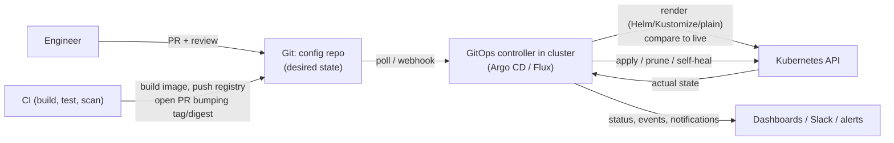
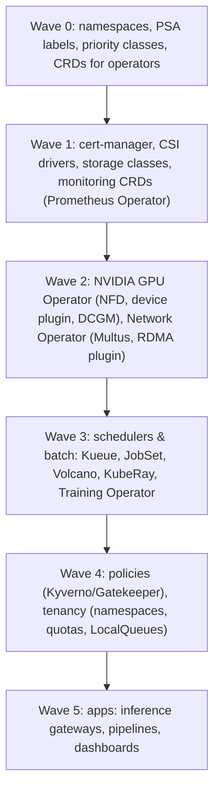

# 4.26 GitOps with Argo CD and Flux

| | |
|---|---|
| Level | Intermediate |
| Priority tier | 1 |
| Lab venue | kind, kubectl, helm, argocd CLI and flux CLI; a Git repository; optional managed cluster |
| Part | Part 4: Automation and infrastructure as code |
| Status | Drafted, labs **untested** |

## Why this matters for AI infrastructure

A GPU Kubernetes platform is a large, layered set of components: operators, CRDs, schedulers, monitoring, ingress, storage, policies, team namespaces and quotas, inference services and pipelines. They change constantly and must stay consistent across dev, staging and production clusters and across regions. GitOps makes Git the source of truth and an in-cluster controller the executor: every change is a reviewed commit, rollback is `git revert`, drift is detected and (optionally) healed, credentials never leave the cluster, and the audit trail is the Git history. For platform teams operating many clusters it is the default delivery model for everything above the infrastructure layer.

## Prerequisites and outcomes

Needs 4.1, 4.2, 4.25 and Kubernetes fundamentals (Part 5). After this chapter you can:

- State the four GitOps principles and contrast pull-based reconciliation with push-based CI/CD.
- Install and operate Argo CD and Flux; define Applications, ApplicationSets, Kustomizations, HelmReleases, sources, health checks, sync policies, waves, hooks, ignore rules.
- Design repositories (app vs config, monorepo vs polyrepo, environment overlays) and promotion flows; use Kustomize and Helm sensibly with GitOps.
- Manage secrets (SOPS, Sealed Secrets, External Secrets), multi-cluster fleets, RBAC and multi-tenancy.
- Sequence the bootstrap of a GPU platform (operators before custom resources, CRDs before consumers) and handle upgrade ordering.
- Add progressive delivery (Argo Rollouts, Flagger), notifications, observability and troubleshooting techniques.

## 1. GitOps principles and architecture

The OpenGitOps principles: the system is **declarative**; desired state is **versioned and immutable** (Git); approved changes are **pulled automatically** by software agents; agents **continuously reconcile** actual to desired state.



Differences from push CI/CD (4.1, 4.2): credentials stay in the cluster (the CI system does not hold cluster-admin), drift is continuously corrected, the cluster state is observable against Git, new clusters can be created by pointing a controller at a repo, and rollbacks are Git operations. Costs: debugging indirection (why didn't it sync?), CRD/ordering complexity, secrets handling requires design, and the controller itself becomes critical infrastructure.

**Two repositories pattern**: an **application repository** (source, Dockerfile, tests, chart) built by CI; a **config repository** (environments, Helm values, Kustomize overlays, Application definitions) watched by the controller. CI's last step updates the image tag/digest in the config repo through a pull request (or an image-update automation) so deployment is a reviewed config change, not a CI side effect.

## 2. Argo CD

### Architecture and objects

Components: **API server** (UI/CLI/gRPC), **repo-server** (clones repos and renders manifests with Helm/Kustomize/plugins), **application-controller** (compares desired vs live, syncs), **Redis**, **Dex/OIDC** (SSO), **ApplicationSet controller**, notifications controller. Custom resources: `Application`, `ApplicationSet`, `AppProject` (guardrails: allowed repos, destinations, resource kinds, roles).

```yaml
apiVersion: argoproj.io/v1alpha1
kind: Application
metadata:
  name: gpu-operator
  namespace: argocd
  finalizers: [resources-finalizer.argocd.argoproj.io]      # cascade-delete managed resources when the Application is deleted
spec:
  project: platform
  source:
    repoURL: https://helm.ngc.nvidia.com/nvidia
    chart: gpu-operator
    targetRevision: v24.6.0                                # pin
    helm:
      valuesObject:
        driver: { enabled: false }
        dcgmExporter: { serviceMonitor: { enabled: true } }
  destination:
    server: https://kubernetes.default.svc
    namespace: gpu-operator
  syncPolicy:
    automated: { prune: true, selfHeal: true }
    syncOptions:
      - CreateNamespace=true
      - ServerSideApply=true                               # large CRDs, field ownership
      - ApplyOutOfSyncOnly=true
    retry: { limit: 5, backoff: { duration: 10s, factor: 2, maxDuration: 3m } }
  ignoreDifferences:
    - group: apps
      kind: Deployment
      jsonPointers: [/spec/replicas]                       # HPA owns replicas
```

Key concepts:

- **Sync status** (Synced/OutOfSync) vs **health status** (Healthy/Progressing/Degraded/Missing, with built-in health checks for core kinds and custom Lua health checks for CRDs).
- **Sync policy**: manual vs `automated`; `prune` deletes resources removed from Git; `selfHeal` reverts out-of-band changes. Production often uses automated sync for platform layers and manual/gated sync for risky ones.
- **Sync options and ordering**: `sync-wave` annotations (`argocd.argoproj.io/sync-wave: "-1"`) order resources within a sync (CRDs and namespaces earlier, CRs later); **resource hooks** (`PreSync`, `Sync`, `PostSync`, `SyncFail`) run Jobs for migrations, smoke tests; `Replace=true`, `ServerSideApply`, `Prune=false`, `Validate=false`, `SkipDryRunOnMissingResource=true` (CRs whose CRD is installed in the same sync).
- **App-of-apps and ApplicationSets**: an Application whose manifests are other Applications bootstraps a whole platform; **ApplicationSet** generates Applications from generators (list, cluster, git directory/file, matrix, pull request, SCM provider), the standard way to stamp the same component across clusters or environments.

```yaml
apiVersion: argoproj.io/v1alpha1
kind: ApplicationSet
metadata: { name: platform-addons, namespace: argocd }
spec:
  goTemplate: true
  generators:
    - matrix:
        generators:
          - clusters: { selector: { matchLabels: { env: prod } } }      # every registered prod cluster
          - git:
              repoURL: https://git.example.com/platform/config.git
              revision: main
              directories: [ { path: addons/* } ]
  template:
    metadata: { name: '{{.name}}-{{.path.basename}}' }
    spec:
      project: platform
      source:
        repoURL: https://git.example.com/platform/config.git
        targetRevision: main
        path: '{{.path.path}}'
      destination: { server: '{{.server}}', namespace: '{{.path.basename}}' }
      syncPolicy: { automated: { prune: true, selfHeal: true }, syncOptions: [CreateNamespace=true] }
```

- **Multi-cluster**: register clusters (`argocd cluster add`, ServiceAccount token per cluster) from a hub, or run one Argo per cluster (isolation, fewer credentials, more to operate). Hub-and-spoke concentrates credentials and failure; per-cluster instances scale and isolate better, with ApplicationSets or Fleet-style management on top.
- **Projects and RBAC**: `AppProject` restricts source repos, destinations, cluster-scoped resources and roles; `argocd-rbac-cm` maps SSO groups to roles; separate projects for platform vs team applications.
- **Secrets**: Argo CD does not decrypt secrets itself; use Sealed Secrets, SOPS (via plugins/KSOPS), External Secrets Operator, Vault Agent/CSI (4.12). Never put plaintext Secrets in Git.
- **Notifications and observability**: notification triggers/templates (Slack, email, webhooks), Prometheus metrics (sync counts, reconciliation duration), audit through Git and Argo events.
- **Config management plugins**: Helm, Kustomize, plain YAML, Jsonnet; CMP sidecars for custom rendering (be careful with supply chain and performance); Helm values from files in Git (`valueFiles`) or multiple sources (`sources:`).

### CLI

```bash
argocd login argocd.example.com --sso
argocd app list
argocd app get gpu-operator --refresh
argocd app diff gpu-operator                       # desired (Git) vs live
argocd app sync gpu-operator --prune --dry-run
argocd app sync gpu-operator --resource apps:Deployment:gpu-operator/gpu-operator
argocd app rollback gpu-operator <history-id>      # not recommended with automated sync; revert in Git instead
argocd app history gpu-operator
argocd app set gpu-operator --sync-policy none     # pause automation during an incident
argocd proj list
```

## 3. Flux

Flux (CNCF graduated) is a set of Kubernetes controllers (the GitOps Toolkit): **source-controller** (Git, Helm, OCI, Bucket sources), **kustomize-controller** (reconciles Kustomizations), **helm-controller** (HelmReleases), **notification-controller**, optional **image-reflector/automation** (image tag scanning and Git write-back). Everything is declarative CRDs; there is no central UI (use Weave GitOps/Capacitor/Headlamp plugins).

```yaml
apiVersion: source.toolkit.fluxcd.io/v1
kind: GitRepository
metadata: { name: platform-config, namespace: flux-system }
spec:
  interval: 1m
  url: ssh://git@git.example.com/platform/config.git
  ref: { branch: main }
  secretRef: { name: flux-deploy-key }
---
apiVersion: kustomize.toolkit.fluxcd.io/v1
kind: Kustomization
metadata: { name: infrastructure, namespace: flux-system }
spec:
  interval: 10m
  sourceRef: { kind: GitRepository, name: platform-config }
  path: ./clusters/prod-us/infrastructure
  prune: true
  wait: true
  timeout: 15m
  dependsOn: [ { name: crds } ]                          # explicit ordering between Kustomizations
  decryption:
    provider: sops
    secretRef: { name: sops-age }                        # native SOPS decryption
  healthChecks:
    - { apiVersion: apps/v1, kind: Deployment, name: gpu-operator, namespace: gpu-operator }
---
apiVersion: helm.toolkit.fluxcd.io/v2
kind: HelmRelease
metadata: { name: gpu-operator, namespace: gpu-operator }
spec:
  interval: 30m
  chart:
    spec:
      chart: gpu-operator
      version: "v24.6.0"
      sourceRef: { kind: HelmRepository, name: nvidia, namespace: flux-system }
  install: { crds: Create, remediation: { retries: 3 } }
  upgrade: { crds: CreateReplace, remediation: { retries: 3, remediateLastFailure: true } }
  values:
    driver: { enabled: false }
```

Flux specifics:

- **Bootstrap**: `flux bootstrap github|gitlab|git --owner=... --repository=... --path=clusters/prod-us` installs controllers and commits their manifests to the repo, which then manages itself.
- **Ordering** with `dependsOn` across Kustomizations/HelmReleases and `wait`/health checks; CRDs commonly in a separate Kustomization that other Kustomizations depend on.
- **HelmRelease** can manage CRD upgrades (`crds: CreateReplace`), automatic remediation (rollback/uninstall/retry), test hooks, drift detection (`driftDetection`).
- **SOPS** decryption is built into kustomize-controller (age/PGP/KMS).
- **Multi-tenancy**: namespaced Flux objects with `serviceAccountName` to impersonate with least privilege; tenants get their own sources and Kustomizations bound to RBAC.
- **Image automation**: `ImageRepository`, `ImagePolicy`, `ImageUpdateAutomation` scan registries and commit tag bumps to Git.
- **CLI**: `flux get all`, `flux reconcile source git platform-config`, `flux reconcile kustomization infrastructure --with-source`, `flux suspend/resume`, `flux diff kustomization`, `flux logs`, `flux trace`.

### Argo CD vs Flux

| Aspect | Argo CD | Flux |
|---|---|---|
| UX | Rich web UI, visualisation of resource trees, diff, manual sync buttons | CLI/CRD-first; third-party UIs |
| Model | Applications/AppProjects; central server with API | Composable controllers per concern; no central API |
| Multi-cluster | Hub-and-spoke or per-cluster; ApplicationSets | Per-cluster agents pulling their own paths (natural fleet model); cluster API for remote apply possible |
| Helm | Renders charts to manifests, applies them (no Helm releases) | Real Helm releases via helm-controller |
| Ordering | Sync waves, hooks | `dependsOn`, health checks |
| Secrets | Plugins/operators | Native SOPS |
| Tenancy | Projects + RBAC | Kubernetes RBAC + impersonation |
| Progressive delivery | Argo Rollouts | Flagger |
| Best for | Teams wanting visibility and self-service UI, many app teams | Platform teams wanting a lean, composable, fleet-oriented system |

Both work well; do not run both against the same objects. Many organisations standardise on one per organisation.

## 4. Repository design

```text
config-repo/
├── clusters/                       # one directory per cluster: what runs there (root of reconciliation)
│   ├── prod-us/
│   │   ├── flux-system/ (or argocd root app)
│   │   ├── infrastructure.yaml     # Kustomization/Application → ../../infrastructure/overlays/prod
│   │   └── apps.yaml               # → ../../apps/overlays/prod
│   └── staging-eu/ ...
├── infrastructure/                 # platform components shared by clusters
│   ├── base/{gpu-operator,network-operator,cert-manager,ingress,monitoring,kueue,policies}/
│   └── overlays/{staging,prod}/    # per-env patches & values
├── apps/                           # tenant/team applications
│   ├── base/{inference-gateway,training-pipelines}/
│   └── overlays/{staging,prod}/
├── tenants/                        # namespaces, quotas, RBAC, queues per team (generated from YAML)
└── docs/ (ADRs, runbooks)
```

Design points:

- **Environments are directories (overlays), not branches** (4.1). Promotion = PR that changes the prod overlay (a version bump, image digest) after staging proves it; automate bump PRs (Renovate, Flux image automation).
- **Base + overlay** (Kustomize) or **values layering** (Helm) keeps shared structure DRY; avoid deep overlay chains that no one can read; render locally (`kustomize build`, `helm template`) in CI and validate with `kubeconform`, `kyverno test`, `conftest` (4.2, 4.13).
- **Pin everything**: chart versions, image digests, CRD manifests by tag; no `latest`.
- **Separate lifecycles**: CRDs/operators (infrastructure layer, rarely changes) vs custom resources/apps (frequent); separate sync/Kustomization units with explicit ordering.
- **One writer per object**: Terraform bootstraps the controller (4.25); after that Git owns the cluster state; avoid mixed ownership.
- **Access**: platform team owns `infrastructure/` and `clusters/`; teams own their `apps/<team>` paths via CODEOWNERS (4.1); branch protection and required checks gate merges; Argo/Flux read with read-only deploy keys.
- **Monorepo vs polyrepo**: a config monorepo simplifies atomic cross-component changes and fleet views; large organisations split by domain (platform, per-team repos) with a registry of repos (ApplicationSet SCM generator / Flux multi-tenancy).

## 5. Bootstrapping a GPU platform: ordering



Practical notes:

- **CRDs before CRs**: separate Applications/Kustomizations for operator install and for instances, or use sync waves with `SkipDryRunOnMissingResource`; Flux `dependsOn` + `wait`.
- **Health gates**: the GPU Operator is "Healthy" only when daemonsets are ready on nodes, which may take many minutes (driver compile/load); give generous timeouts; downstream apps should depend on the operator being ready (GPU allocatable).
- **Helm CRDs**: Argo CD applies chart CRDs via sync (with `Replace`/`ServerSideApply` for large CRDs); Flux uses `crds: CreateReplace`. Know your tool's upgrade semantics.
- **Node-level change coordination**: operator upgrades roll DaemonSets across GPU nodes; control with operator upgrade policies, `maxUnavailable`, node drains, and maintenance windows (Part 11). Do not let `automated` sync apply risky upgrades fleet-wide at once: use progressive rollout across clusters (ApplicationSet with staged `RollingSync`, Flux per-cluster paths promoted in ring order).
- **Cluster bootstrap**: Terraform creates the cluster and installs the controller plus root app (4.25); everything else flows from Git, including the controller's own upgrades (self-managed).
- **Platform Operators, CRDs, and `ownerReferences` (`PK` Chapter 11):** In *Production Kubernetes* Chapter 11 (*Building Platform Services*), Josh Rosso, Rich Lander, Alexander Brand, and John Harris explain how GitOps controllers interact with the two categories of **Kubernetes Operators** (a term coined in November 2016 by Brandon Phillips at CoreOS for a controller managing a `CustomResourceDefinition`):
  1. *App-Specific Operators (Waves 1–3):* Operators such as `cert-manager`, Prometheus Operator, NVIDIA GPU Operator, Network Operator, and KubeRay watch domain-specific CRDs (`ClusterPolicy`, `ServiceMonitor`, `RayCluster`) and reconcile complex DaemonSets, StatefulSets, and device plugins.
  2. *Platform / Tenancy Operators (`AcmeNamespace` in `PK` Chapter 11, Wave 4):* Rather than requiring developers to open PRs containing four separate YAML files (`Namespace`, `ResourceQuota`, `Role`, `RoleBinding`), a platform team can either generate them via Kustomize/Helm in GitOps or deploy a custom tenancy operator (such as `PK` Chapter 11's **`AcmeNamespace` (`tenancy.acme.com/v1alpha1`)** built with **Kubebuilder** in Go, **Operator SDK** in Go/Ansible/Helm, or **Metacontroller** webhooks). When Argo CD or Flux syncs a single `AcmeNamespace` resource (`spec: { namespaceName: app-y, adminUsername: sam, deploymentTier: dev }`), the controller's `Reconcile` loop creates the child `Namespace`, `Role`, and `RoleBinding`, sets **`ownerReferences`** on each child (`ctrl.SetControllerReference`, so deleting the parent `AcmeNamespace` automatically garbage-collects all child resources), and updates **`status.phase`** (`CreationInProgress` -> `Created`) so Argo CD / Flux health checks know when the namespace is ready.

## 6. Progressive delivery and verification

- **Argo Rollouts / Flagger** replace Deployments with canary/blue-green strategies driven by metrics (Prometheus queries on error rate, latency, GPU utilisation, tokens/second, time-to-first-token), automatic promotion or rollback. For inference services this is how you validate a new model server version or model weights on a slice of traffic (Part 15).
- **Pre/post-sync hooks** run smoke tests (a Job that calls the service, or `nvidia-smi` in a pod); failure marks the sync failed.
- **Policy gates in CI**: `kubeconform`, Kyverno CLI tests, Conftest, image scanning and signature verification (cosign + admission policy) before merge (4.2); admission controllers enforce at runtime.
- **Notifications**: send sync failures and health degradation to chat/on-call; correlate with Git commits (Argo shows the revision; Flux events include commit SHA).
- **SLO-aware promotion**: do not auto-promote to prod unless staging metrics stayed healthy for a soak period.

## 7. Operating GitOps

### Troubleshooting

| Symptom | Likely cause | Check |
|---|---|---|
| App stuck `OutOfSync` after sync | Controller/mutating webhook alters fields (defaulting, HPA replicas), unsorted lists, CRD default values | `argocd app diff`; add `ignoreDifferences`/`managedFieldsManagers`; server-side diff; Flux `flux diff` |
| Sync fails "resource not found for kind" | CRD not yet installed / wrong order | Waves, separate apps, `SkipDryRunOnMissingResource`, `dependsOn` |
| "Unable to generate manifests" | Helm/Kustomize error, repo auth, missing values file | Repo-server logs, `helm template` locally, deploy key permissions |
| App `Progressing` forever | Health check never turns green (pods Pending: no GPU quota/taint mismatch, image pull) | `kubectl describe`, events, node capacity |
| Controller OOM/slow | Too many apps/large repos/CRDs; cache issues | Resources, sharding (Argo application-controller sharding), repo-server scaling, webhook-driven refresh |
| Unexpected deletes | `prune: true` removed objects after a path/refactor | Review diffs, `Prune=false` annotations on critical objects (PVCs), protect with `argocd.argoproj.io/sync-options: Prune=false` or Flux `kustomize.toolkit.fluxcd.io/prune: disabled` |
| Secret not decrypting | Missing age/KMS key, wrong creation rules | Controller logs, key secret in cluster |
| Webhook not triggering | Network, secret mismatch; polling interval too long | Check webhook delivery; reduce interval; `flux reconcile` |
| Drift fights | Another controller/automation modifies the same fields (Terraform, operators) | Single ownership, `ignoreDifferences`, field managers |
| Changes applied late | Reconcile interval, rate limits | Tune intervals/webhooks; manual refresh |

### Disaster recovery and security

- **Controller state is reproducible from Git**: back up secrets (SOPS keys, repo credentials), Argo CD's own config (as code), and cluster registrations; test rebuilding a cluster from scratch by bootstrapping and watching it converge.
- **Least privilege**: controllers often hold cluster-admin; reduce with impersonation (Flux), AppProjects restricting destinations/kinds (Argo), per-tenant controllers; protect the Git repos (branch protection, signed commits, required reviews) because **write access to the config repo equals cluster-admin**. Use separate repos/paths and approvals for sensitive layers (RBAC, policies, privileged operators).
- **Supply chain**: pin and verify charts (OCI + cosign), restrict allowed repositories, scan manifests, avoid arbitrary CMP plugins; set resource limits and network policies on controllers.
- **Emergency changes**: allow `kubectl` fixes only via break-glass; Argo `selfHeal` will revert them, so pause automation (`--sync-policy none`/`flux suspend`), fix, then reconcile Git to match (4.2).
- **Scale**: thousands of applications need controller sharding (Argo application-controller `--sharding`), repo-server caching, appset progressive syncs, and avoiding monolithic repos with huge renders.

## 8. Lab

First, run the self-checking Python lab (`code/part04/gitops_sync_waves_lab.py`) locally. It verifies the Argo CD `sync-wave` and resource hook (`PreSync` / `Sync` / `PostSync`) scheduler (`plan_argocd_sync_waves`, ordering Waves `0..5` for GPU platform bootstrap), the `ApplicationSet` `clusters x git directories` matrix generator (`expand_applicationset_matrix`), and the GitOps drift/prune reconciler (`evaluate_gitops_reconciliation`, honoring `ignoreDifferences` on HPA-managed `/spec/replicas` and `Prune=false` protection on stateful PVCs).

```bash
python3 code/part04/gitops_sync_waves_lab.py
```

Next, on a machine with `kind`, `kubectl`, `helm`, and the `argocd` / `flux` CLIs (all interactive shell steps below are `untested here`), work through these exercises:

1. **Argo CD basics**: install Argo CD in kind; create an Application for a Helm chart from Git; observe Sync/Health; change values in Git; use `argocd app diff`; make an out-of-band change and watch `selfHeal` revert it; toggle `prune`.
2. **Flux basics**: bootstrap Flux against a Git repo; add a `HelmRepository` + `HelmRelease` and a Kustomization; use `flux get all`, `flux reconcile`, `flux diff`; break a chart value and watch remediation.
3. **Ordering**: reproduce the CRD-before-CR failure (install an operator and its custom resource together); fix with sync waves (Argo) / `dependsOn` and separate Kustomizations (Flux).
4. **Repository layout**: build the `clusters/`, `infrastructure/`, `apps/` structure with Kustomize base/overlays for staging and prod; validate renders with `kustomize build | kubeconform` in CI.
5. **ApplicationSet**: use a list/git-directory generator to deploy the same add-ons to two kind clusters; add a cluster and see it converge; try progressive `RollingSync`.
6. **Secrets**: deploy an encrypted secret with SOPS (age) via Flux's native decryption and via KSOPS/Argo; alternatively Sealed Secrets or External Secrets backed by a Vault dev server; confirm no plaintext in Git.
7. **Promotion**: CI builds an image, opens a PR bumping the digest in `apps/overlays/staging`; merge; observe rollout; then a PR for prod after a soak; practise rollback by reverting the commit.
8. **Progressive delivery**: install Argo Rollouts or Flagger; run a canary of a toy inference service with a Prometheus-based analysis; force a failing metric and observe automated rollback.
9. **GPU platform**: on a GPU cluster (or simulated labels), deploy GPU Operator, Network Operator (if available), Kueue via GitOps in waves; verify `nvidia.com/gpu` allocatable then run a test Job through a LocalQueue.
10. **Multi-tenancy**: define an `AppProject` (Argo) or Flux tenant with impersonation limiting a team to its namespaces; attempt a cluster-scoped resource and see denial.
11. **Failure drills**: delete the controller namespace and recover from Git; lose the SOPS key (document consequence); simulate a bad commit that prunes a PVC (protect with `Prune=false`); pause automation during an "incident".
12. **Terraform bootstrap handoff**: use the Terraform from 4.25 to install the controller and root app, then verify Terraform no longer touches managed objects.
13. **Clean up**.

## 9. Common mistakes

- Plaintext secrets in Git; Argo CD/Flux with cluster-admin everywhere and unprotected config repos.
- Branch-per-environment; copy-pasted manifests per cluster instead of overlays/generators.
- Unpinned chart versions or `latest` images; automated prod sync of risky upgrades across the whole fleet.
- Ignoring CRD upgrade semantics and ordering; trying to sync CRs with their CRDs in one step.
- Two controllers (or Terraform and GitOps) owning the same resources; `selfHeal` fights.
- `prune: true` with no protection on stateful objects; refactors that delete volumes.
- Treating GitOps as only a deploy mechanism and neglecting observability, notifications and ownership.
- Overlarge single Application/Kustomization that takes minutes to render and fails atomically.
- Not testing cluster rebuild from Git.
- Putting build outputs or generated manifests into Git without a source of truth.

## 10. Interview angles

- "What is GitOps? How is it different from CI/CD pushing to the cluster?"
- "Argo CD or Flux? Trade-offs?"
- "How do you structure repos for multiple clusters and environments? How do you promote?"
- "How do you handle secrets in GitOps?" (SOPS, Sealed Secrets, ESO.)
- "How do you order the installation of GPU Operator, Network Operator, Kueue and apps?" (waves/dependsOn, health gates.)
- "A sync keeps showing OutOfSync. Debug."
- "How do you roll out a risky operator upgrade across 20 clusters?" (rings, progressive sync, windows.)
- "Who has write access to the config repo and why does that matter?"
- "How do Terraform and GitOps divide responsibility?"

## Exercises

1. **The Four OpenGitOps Principles, Pull vs. Push Architecture, and the Two-Repository Pattern:** Explain the four OpenGitOps principles (Declarative, Versioned & Immutable, Pulled Automatically, Continuously Reconciled), why pull-based reconciliation keeps cluster-admin credentials inside the cluster rather than in CI, and how the App Repo + Config Repo pattern works.
2. **Argo CD Architecture, `Application` Spec (`automated`, `prune`, `selfHeal`, `ServerSideApply`, `ignoreDifferences`), and `ApplicationSet` Matrix Generators:** Using `expand_applicationset_matrix()` and `evaluate_gitops_reconciliation()` in `code/part04/gitops_sync_waves.py`, trace the `gpu-operator` `Application` manifest and the `platform-addons` `ApplicationSet` matrix generator (`clusters x git directories`), explaining `ignoreDifferences` on `/spec/replicas` and `Prune=false` on stateful PVCs.
3. **Flux Architecture (`GitRepository`, `Kustomization`, `HelmRelease`), Native SOPS Decryption, and Argo CD vs. Flux Trade-Offs:** Trace the Section 3 Flux manifests (`GitRepository`, `Kustomization` with `dependsOn: [{name: crds}]` and native SOPS `sops-age` decryption, and `HelmRelease` with `crds: CreateReplace` and auto-remediation), and compare Argo CD and Flux across Helm handling, UI, multi-cluster models, and secrets.
4. **Bootstrapping a GPU Kubernetes Platform in 6 Waves (`Wave 0` to `Wave 5`) and Platform Operators (`PK` Chapter 11):** Using `plan_argocd_sync_waves()` in `code/part04/gitops_sync_waves.py`, trace the 6-wave GPU platform bootstrap order (`Wave 0` namespaces/CRDs -> `Wave 1` `cert-manager`/CSI/Prometheus CRDs -> `Wave 2` GPU Operator & Network Operator -> `Wave 3` Kueue/Volcano/KubeRay -> `Wave 4` Kyverno/tenancy -> `Wave 5` apps), and explain how `PK` Chapter 11's `AcmeNamespace` operator uses `ownerReferences` and `status.phase`.
5. **Config Repository Layout (`clusters/`, `infrastructure/{base,overlays}`, `apps/{base,overlays}`) and Progressive Delivery (`Argo Rollouts` / `Flagger`):** Explain why environments are represented as Kustomize/Helm overlays in directories on `main` rather than Git branches, how CI validates rendered manifests offline (`kustomize build | kubeconform`), and how Argo Rollouts / Flagger gate inference rollouts on Prometheus GPU/TTFT/error metrics.
6. **Troubleshooting Stuck `OutOfSync` / `Progressing` Apps, Multi-Tenant Security (`AppProject` vs. Flux Impersonation), and Break-Glass Incident Handling:** Diagnose the top 5 GitOps failure modes in Section 7, explain why write access to the config repository is equivalent to `cluster-admin`, and state how to pause GitOps (`argocd app set --sync-policy none` / `flux suspend`) during an emergency incident.

## Checkpoint questions (20)

<details>
<summary>1. What are the four OpenGitOps principles, and how does pull-based GitOps differ from push-based CI deployment?</summary>

The four **OpenGitOps principles** are:
1. **Declarative:** Desired system state is expressed declaratively (YAML/Helm/Kustomize).
2. **Versioned and Immutable:** Desired state is stored in Git with an immutable commit history.
3. **Pulled Automatically:** Software agents inside the cluster automatically pull approved state from Git.
4. **Continuously Reconciled:** Agents continuously compare live cluster state against Git and reconcile drift.
Unlike push-based CI (where external GitHub/GitLab runners hold `cluster-admin` kubeconfigs and only act when a pipeline runs), pull-based GitOps keeps cluster credentials inside the cluster and continuously heals out-of-band drift.
</details>

<details>
<summary>2. Why do mature teams separate the Application Repository from the Config (GitOps) Repository?</summary>

- **Application repository:** Holds application source code, `Dockerfile`s, and unit tests.
- **Config (GitOps) repository:** Holds environment overlays, Helm values, and cluster manifests watched by Argo CD / Flux.
Separating them prevents every application code commit or failed test branch from triggering cluster syncs, isolates Git read/write permissions (application developers don't get write access to cluster `infrastructure/` manifests), and makes every production deployment a clean, auditable commit updating an image digest in the config repo.
</details>

<details>
<summary>3. What are the five main microservice components of Argo CD and what does each do?</summary>

1. **`argocd-server` (API/Web Server):** Exposes the Web UI, CLI gRPC/REST API, RBAC enforcement, and SSO/Dex login.
2. **`argocd-repo-server`:** Clones Git repositories, caches Helm charts, and runs `helm template` / `kustomize build` to render raw Kubernetes YAML manifests.
3. **`argocd-application-controller`:** Stateful controller (shardable across clusters) that compares the rendered manifests from `repo-server` against live Kubernetes API objects and executes syncs/self-healing.
4. **`argocd-applicationset-controller`:** Expands `ApplicationSet` generators into `Application` resources.
5. **`redis`:** Shared cache between `repo-server`, `application-controller`, and `argocd-server`.
</details>

<details>
<summary>4. In Argo CD, what is the difference between `Sync Status` (`Synced` vs. `OutOfSync`) and `Health Status` (`Healthy` vs. `Progressing` vs. `Degraded`)?</summary>

- **Sync Status (`Synced` / `OutOfSync`):** Measures whether the resource specs currently stored in the Kubernetes API server match the desired manifests rendered from Git.
- **Health Status (`Healthy` / `Progressing` / `Degraded` / `Suspended` / `Missing`):** Evaluates whether the live Kubernetes objects are actually **working at runtime** (for example, a `Deployment` or `DaemonSet` can be `Synced` because its YAML was applied, while its Health is `Progressing` or `Degraded` because its Pods are stuck in `ImagePullBackOff` or `Pending` waiting for GPUs).
</details>

<details>
<summary>5. What do `prune: true`, `selfHeal: true`, and `finalizers: [resources-finalizer.argocd.argoproj.io]` do on an Argo CD `Application`?</summary>

- **`automated.prune: true`**: Automatically deletes Kubernetes resources from the cluster when their manifests are deleted from Git.
- **`automated.selfHeal: true`**: Automatically reverts manual out-of-band `kubectl edit` / `kubectl delete` changes back to the state in Git (default reconciliation timeout 3 minutes, or instant on webhook/watch event).
- **`finalizers: [resources-finalizer.argocd.argoproj.io]`**: Ensures that if the `Application` CR itself is deleted from Argo CD, Argo CD performs a **cascading delete** of all child Kubernetes resources managed by that Application (without the finalizer, deleting the `Application` leaves the deployed resources running in the cluster).
</details>

<details>
<summary>6. Why does an HPA-scaled `Deployment` stay permanently `OutOfSync` in Argo CD unless `ignoreDifferences` is configured?</summary>

If a `Deployment` in Git specifies `replicas: 2` and a `HorizontalPodAutoscaler` (`HPA`) or KEDA scales the live Deployment up to `replicas: 8` under load, Argo CD sees `2 != 8` (`OutOfSync`)—and if `selfHeal: true` is enabled, Argo CD will **fight the autoscaler by resetting `replicas` back to `2`**, dropping live traffic. Fix this by omitting `replicas` from the Deployment YAML in Git or adding:
```yaml
ignoreDifferences:
  - group: apps
    kind: Deployment
    jsonPointers: [/spec/replicas]
```
</details>

<details>
<summary>7. How do Argo CD `sync-wave` annotations and Resource Hooks (`PreSync`, `Sync`, `PostSync`, `SyncFail`) order operations?</summary>

Within any sync operation, Argo CD processes phases in order—**`PreSync` -> `Sync` -> `PostSync`** (and `SyncFail` if an error occurs). Within each phase, resources are applied in ascending numerical order of their **`argocd.argoproj.io/sync-wave`** annotation (e.g., `"-1"` -> `"0"` -> `"1"` -> `"2"`), and **Argo CD waits for all resources in Wave $N$ to report `Healthy` before applying Wave $N+1$**.
</details>

<details>
<summary>8. Walk through the 6-Wave Bootstrap Order for a GPU Kubernetes cluster (Section 5).</summary>

- **Wave 0:** Namespaces, Pod Security Admission (`PSA`) labels, `PriorityClass`es, and operator CRDs.
- **Wave 1:** `cert-manager`, storage CSI drivers & `StorageClass`es, and Prometheus Operator CRDs (`ServiceMonitor`, `PodMonitor`).
- **Wave 2:** **NVIDIA GPU Operator** (NFD, driver/toolkit, device plugin, DCGM Exporter) and **NVIDIA Network Operator** (Multus, SR-IOV / RDMA device plugin).
- **Wave 3:** Batch & AI schedulers (**Kueue**, **JobSet**, **Volcano**, **KubeRay**, **Kubeflow Training Operator**).
- **Wave 4:** Admission policies (**Kyverno** / **Gatekeeper**) and tenant namespaces, `ResourceQuota`s, RBAC, and Kueue `ClusterQueue`s/`LocalQueue`s.
- **Wave 5:** Tenant training pipelines, inference gateways, and dashboards.
</details>

<details>
<summary>9. Why do large CRDs (like ` kube-prometheus-stack` or `gpu-operator` CRDs) fail to sync in Argo CD with `metadata.annotations: Too long: must have at most 262144 bytes`, and how does `ServerSideApply=true` fix it?</summary>

Standard client-side `kubectl apply` stores the entire previous JSON manifest inside the **`kubectl.kubernetes.io/last-applied-configuration`** annotation, which is capped at **262,144 bytes (256 KiB)** by etcd/API server. Huge OpenAPI v3 CRDs exceed 256 KiB and fail client-side apply. Adding **`syncOptions: [ServerSideApply=true]`** (or Flux's native Server-Side Apply) tracks field ownership in `metadata.managedFields` on the API server without writing the `last-applied-configuration` annotation.
</details>

<details>
<summary>10. How does an Argo CD `ApplicationSet` Matrix Generator stamp add-ons across a fleet of production clusters?</summary>

A `matrix` generator combines the outputs of two child generators (producing their Cartesian product):
1. A **`clusters` generator** (`selector: { matchLabels: { env: prod } }`) matching all registered production clusters (`prod-us`, `prod-eu`).
2. A **`git` directory generator** (`directories: [{ path: addons/* }]`) discovering every add-on folder (`addons/gpu-operator`, `addons/kueue`).
The `template` renders one `Application` (`{{.name}}-{{.path.basename}}`) for every `(cluster, addon)` pair automatically.
</details>

<details>
<summary>11. Compare how Argo CD and Flux handle Helm charts (`Application` vs. `HelmRelease`).</summary>

- **Argo CD:** By default, Argo CD's `repo-server` runs **`helm template`** internally to render the Helm chart into plain Kubernetes YAML manifests and applies those manifests directly—so `helm list` on the cluster shows **no Helm release Secret**, and Helm lifecycle hooks are mapped to Argo hooks.
- **Flux (`helm-controller` + `HelmRelease`):** Flux executes the native **Helm Go SDK** inside the cluster to perform real `helm install` and `helm upgrade` operations—storing standard Helm release Secrets, supporting **`crds: CreateReplace`** on upgrades, and running native Helm test/rollback remediation (`remediateLastFailure: true`).
</details>

<details>
<summary>12. What are the four core controllers in the Flux GitOps Toolkit, and how does `dependsOn` work across `Kustomization`s?</summary>

1. **`source-controller`**: fetches artifacts from `GitRepository`, `HelmRepository`, `OCIRepository`, and `Bucket` sources and caches them inside the cluster.
2. **`kustomize-controller`**: reconciles `Kustomization` CRs (applying plain YAML or Kustomize overlays from a source, with built-in SOPS decryption).
3. **`helm-controller`**: reconciles `HelmRelease` CRs.
4. **`notification-controller`**: handles inbound webhooks and outbound Slack/PagerDuty/Teams alerts (plus optional `image-reflector-controller` and `image-automation-controller`).
Setting **`dependsOn: [{ name: crds }]`** and **`wait: true`** on a Flux `Kustomization` or `HelmRelease` guarantees that Flux waits until the `crds` Kustomization is applied and all its resources pass readiness checks before applying the dependent Kustomization.
</details>

<details>
<summary>13. How do you manage Kubernetes `Secret`s safely in a GitOps repository without committing plaintext?</summary>

Use one of three patterns:
1. **External Secrets Operator (`ESO`, preferred for cloud/Vault environments):** Commit only an `ExternalSecret` YAML in Git referencing the key path in AWS/GCP Secret Manager or HashiCorp Vault; the in-cluster ESO controller fetches the secret over Workload Identity/IRSA and creates the native Kubernetes `Secret`.
2. **SOPS (`age` / Cloud KMS):** Encrypt only the `data` / `stringData` values in the YAML file; **Flux's `kustomize-controller` decrypts SOPS natively** (`decryption: { provider: sops, secretRef: { name: sops-age } }`), while Argo CD uses the KSOPS plugin.
3. **Bitnami Sealed Secrets (`kubeseal`):** Asymmetric encryption where developers encrypt a Secret against the cluster controller's public certificate into a `SealedSecret` CR that only the in-cluster private key can decrypt.
</details>

<details>
<summary>14. How do you protect stateful `PersistentVolumeClaim`s (`PVCs`) or namespaces from accidental deletion when `prune: true` is enabled?</summary>

If someone refactors a directory path or makes a mistake in a Kustomize overlay while `prune: true` is active, the GitOps controller will delete any resource that disappeared from the rendered output. Protect stateful PVCs and critical namespaces by annotating them with:
- **Argo CD:** `argocd.argoproj.io/sync-options: Prune=false`
- **Flux:** `kustomize.toolkit.fluxcd.io/prune: disabled`
</details>

<details>
<summary>15. Compare Multi-Cluster GitOps topologies: \"Hub-and-Spoke\" (central Argo CD) vs. \"Instance-per-Cluster\".</summary>

- **Hub-and-Spoke (one central Argo CD managing $N$ remote clusters):** Single UI dashboard for all clusters and easy `ApplicationSet` cluster generators. *Drawbacks:* the central hub holds high-privilege bearer tokens for every production cluster (a single blast-radius target if compromised), requires network reachability from the hub to every cluster's API server, and if the hub goes down, GitOps across all clusters stops.
- **Instance-per-Cluster (one Flux or Argo CD inside each cluster pulling from Git):** Zero cross-cluster admin credentials leave any cluster, works over outbound-only HTTPS to Git without inbound API access, and isolates blast radius per cluster.
</details>

<details>
<summary>16. How do `AppProject` (in Argo CD) and `serviceAccountName` impersonation (in Flux) enforce multi-tenant security?</summary>

Because the GitOps controller itself often runs with `cluster-admin` privileges, an unguarded `Application` or `Kustomization` created by an application team could deploy a `ClusterRoleBinding` granting themselves root on the cluster.
- **Argo CD `AppProject`:** Restricts a team's Applications to specific **source Git repositories** (`sourceRepos`), specific **target clusters and namespaces** (`destinations`), and an explicit allow/deny list of **`clusterResourceWhitelist` / `namespaceResourceBlacklist`** kinds.
- **Flux `spec.serviceAccountName`:** Forces `kustomize-controller` and `helm-controller` to **impersonate a tenant-scoped Kubernetes `ServiceAccount`** when applying that tenant's manifests, so standard Kubernetes RBAC blocks the tenant from touching other namespaces or cluster-scoped objects.
</details>

<details>
<summary>17. In *Production Kubernetes* Chapter 11, what is the difference between an App-Specific Operator and a Platform Operator (`AcmeNamespace`), and what do `ownerReferences` do?</summary>

- **App-Specific Operator:** Manages the operational domain knowledge of a complex stateful system or hardware stack (such as the NVIDIA GPU Operator, Prometheus Operator, or etcd Operator).
- **Platform Operator (`AcmeNamespace` in `PK` Chapter 11, built with `Kubebuilder`):** Encapsulates organization-specific multi-tenancy policy behind a high-level CRD (`kind: AcmeNamespace`). When its `Reconcile` loop creates the child `Namespace`, `Role`, and `RoleBinding`, it attaches an **`ownerReference`** (`ctrl.SetControllerReference`) pointing to the parent `AcmeNamespace`—so Kubernetes garbage collection automatically deletes all child resources whenever the `AcmeNamespace` CR is deleted.
</details>

<details>
<summary>18. How do Argo Rollouts and Flagger add SLO-driven Progressive Delivery to GitOps?</summary>

Standard Kubernetes `Deployment` rolling updates only check whether new pods pass `readinessProbe`—they do not check whether the new model version is returning HTTP 500s, hallucinating, or spiking GPU tail latency (`TTFT` / `ITL`). **Argo Rollouts** (`Rollout` + `AnalysisTemplate`) and **Flagger** (`Canary`) shift traffic to the new version in increments (`5% -> 20% -> 50% -> 100%`) while querying **Prometheus / DCGM metrics** at each step, and **automatically abort and roll back to the stable revision** if latency, error rate, or GPU XID metrics breach thresholds.
</details>

<details>
<summary>19. During a production incident where you need to apply an immediate `kubectl` hotfix, what happens if `selfHeal: true` is active, and what is the proper procedure?</summary>

If `selfHeal: true` is active and you run `kubectl edit` or `kubectl scale` on a managed resource, **Argo CD or Flux will immediately overwrite your manual fix within seconds**. During an emergency break-glass intervention:
1. **Pause GitOps reconciliation first:** Run **`argocd app set <app> --sync-policy none`** (or **`flux suspend kustomization <name>`** / **`flux suspend helmrelease <name>`**).
2. Mitigate the incident.
3. Commit the permanent fix to the Git config repository, verify `argocd app diff` / `flux diff` is clean, and **re-enable automated sync / `flux resume`**.
</details>

<details>
<summary>20. How do you roll out a high-risk operator upgrade (like the NVIDIA GPU Operator or Network Operator) across 20 clusters via GitOps without risking a simultaneous fleet-wide outage?</summary>

Never point all 20 clusters at a single unringed `HEAD` path with `automated` sync for kernel/driver-level operators:
1. Organize clusters into **deployment rings** (`clusters/lab/`, `clusters/staging/`, `clusters/prod-canary/`, `clusters/prod-fleet/`) or use **Argo CD `ApplicationSet` Progressive Syncs (`strategy: { type: RollingSync, rollingSync: { steps: [...] } }`)** matching cluster labels (`ring=1`, `ring=2`, `ring=3`).
2. Promote the chart version bump (`v24.6.0`) to Ring 1 first, wait for node-level upgrade controllers and DCGM health checks to pass, and only then advance to subsequent rings.
</details>

## Sources and review notes

- **Sources read in full:**
  - `production-kubernetes` — Josh Rosso, Rich Lander, Alexander Brand & John Harris, *Production Kubernetes*, **Chapter 11: Building Platform Services** (read in full: eliminating human toil with platform services, Kubernetes extension points, CustomResourceDefinitions `CRDs` and Operators introduced by Brandon Phillips in 2016, App-Specific Operators vs Platform/Tenancy Operators, building the `AcmeNamespace` operator in Go with **Kubebuilder** `controller-runtime`, `Reconcile` loop idempotency, `status.phase` `CreationInProgress` -> `Created`, `ownerReferences` garbage collection via `ctrl.SetControllerReference`, **Operator Framework / Operator SDK** for Go/Ansible/Helm, and **Metacontroller**).
  - `nvidia-devops` (`volume-10/11-cicd-for-infrastructure-and-cluster-configuration.md` and `volume-10/17-git-for-infrastructure-and-operations.md`): Kubernetes GitOps with Argo CD and Flux, ordering of Node Feature Discovery and GPU Operator, and pull-based vs push-based delivery.
- **Run here:** `python3 code/part04/gitops_sync_waves_lab.py` (3 passed, 0 failed).
- **Explicitly labelled inferences:** The `plan_argocd_sync_waves`, `expand_applicationset_matrix`, and `evaluate_gitops_reconciliation` models in `code/part04/gitops_sync_waves.py`, the 6-wave GPU platform bootstrap diagram, and the Argo CD `Application`/`ApplicationSet` and Flux `GitRepository`/`Kustomization`/`HelmRelease` manifests are the author's constructions synthesizing `PK` Chapter 11 and `volume-10` (plus original study items 21, 22, 23, 24, 25, 26, 27, 28, 29, and 30).
- **Not verified on live hardware:** Live `argocd`, `flux`, `kustomize`, and `kubeconform` executions (`v24.6.0`, `retry.limit: 5`, `duration: 10s, maxDuration: 3m`, `interval: 1m / 10m / 30m`, `timeout: 15m`, `retries: 3`, `20` clusters) are marked (`untested here`) where not executed by `gitops_sync_waves_lab.py`.
