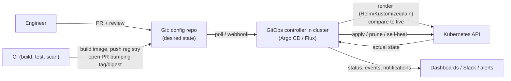
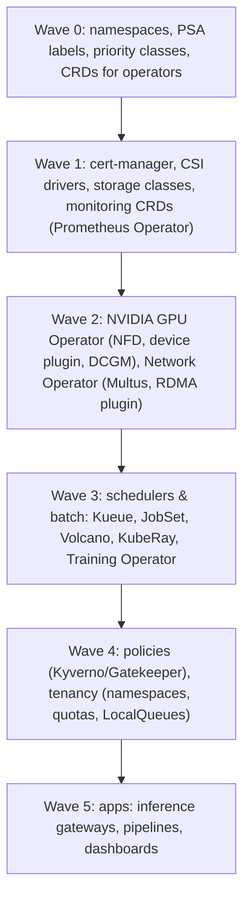

# 4.26 GitOps with Argo CD and Flux

| | |
|---|---|
| Level | Intermediate |
| Priority tier | 1 |
| Lab venue | kind, kubectl, helm, argocd CLI and flux CLI; a Git repository; optional managed cluster |
| Part | Part 4: Automation and infrastructure as code |
| Status | Drafted, labs **untested** |

## Why this matters for AI infrastructure

Picture a GPU Kubernetes platform. It is a large stack of layers: operators, CRDs, schedulers, monitoring, ingress, storage, policies, team namespaces and quotas, inference services and pipelines. All of these change constantly. They also have to stay consistent across dev, staging and production clusters, and across regions. GitOps handles this by making Git the source of truth and an in-cluster controller the executor. Every change becomes a reviewed commit, and rollback is `git revert`. Drift, meaning the live cluster no longer matches Git, is detected and optionally healed. Credentials never leave the cluster, and the audit trail is the Git history. For platform teams that run many clusters, this is the default delivery model for everything above the infrastructure layer.

## Prerequisites and outcomes

Needs 4.1, 4.2, 4.25 and Kubernetes fundamentals (Part 5). After this chapter you can:

- State the four GitOps principles and contrast pull-based reconciliation with push-based CI/CD.
- Install and operate Argo CD and Flux; define Applications, ApplicationSets, Kustomizations, HelmReleases, sources, health checks, sync policies, waves, hooks, ignore rules.
- Design repositories (app vs config, monorepo vs polyrepo, environment overlays) and promotion flows; use Kustomize and Helm sensibly with GitOps.
- Manage secrets (SOPS, Sealed Secrets, External Secrets), multi-cluster fleets, RBAC and multi-tenancy.
- Sequence the bootstrap of a GPU platform (operators before custom resources, CRDs before consumers) and handle upgrade ordering.
- Add progressive delivery (Argo Rollouts, Flagger), notifications, observability and troubleshooting techniques.

## 1. GitOps principles and architecture

Picture a cluster that someone changed by hand on a Friday night. Nobody wrote the change down, and nobody can say what the cluster should look like on Monday. GitOps is designed to catch exactly this kind of drift. The OpenGitOps principles describe a system that is declarative. Its desired state is versioned and immutable, and it lives in Git. Approved changes are pulled automatically by software agents, and those agents continuously reconcile actual state with desired state.



Read the diagram from left to right. An engineer opens a pull request against the config repo, and CI builds, tests and scans the image. The GitOps controller inside the cluster watches that repo, renders the manifests, and compares them with the live API. It then applies, prunes or self-heals the difference, and reports status.

Compared with push CI/CD, covered in 4.1 and 4.2, the differences are concrete. Credentials stay in the cluster, so the CI system does not hold cluster-admin. Drift is continuously corrected. You can check the cluster state against Git at any time. A new cluster can be created by pointing a controller at a repo, and a rollback is a Git operation. The trade-off is real. When a sync fails, you first debug the indirection: why didn't it sync? CRD and ordering complexity grows, secrets handling needs a design, and the controller itself becomes critical infrastructure.

This pattern uses two repositories. The application repository holds the source, Dockerfile, tests and chart, and CI builds it. The config repository holds environments, Helm values, Kustomize overlays and Application definitions, and the controller watches it. CI's last step updates the image tag or digest in the config repo through a pull request, or through an image-update automation. Deployment is then a reviewed config change, not a side effect of CI.

### Filesystem as the source of truth

Most people first meet Kubernetes by typing commands. You run `kubectl run` to start a Pod, or `kubectl edit` to change one in place. Over time, the YAML file starts to look like a note you write on the way to the real goal, a running cluster. For a production application, that order is backwards.

Turn it around. The truth lives in the files on disk, and the objects in the cluster are a reflection of those files. The data in `etcd` is then just the current copy of what the files say.

This view lets you treat the cluster as immutable infrastructure. Teams already do this for containers, and the same reasons hold for the cluster. Picture a cluster built by hand from random YAML downloaded off the internet. That cluster is a snowflake, and it is as fragile as a virtual machine built from imperative bash scripts. Files in source control also let several people work on the cluster state together. Conflicts become easy to see and settle.

The first principle of a good layout is simple. Every application deployed to Kubernetes is first described in files on a filesystem. The live API objects are a projection of those files into one particular cluster.

### Code review for every change

Code review for application source code is now routine. Several people read a change before it is committed, and the code gets better. Configuration deserves the same care. The book's authors say most service outages are self-inflicted, through an unexpected side effect, a typo or a simple mistake. Having at least two people look at any configuration change makes those errors much less likely.

The second principle follows from this. The layout must make it easy to review every change that goes into the files that describe your cluster. Give every configuration change the same review you give application code.

### Feature gates: code lands off by default

Once application code and deployment files are both in source control, a common question follows. Should they share one repository? Small projects can. Larger projects often split them, because the builder and the deployer see the work from different sides, even when they are the same people.

That raises the next question. How do you bring a new feature from source control into production? The answer is a feature gate, a flag that turns a feature on or off. New code sits behind the gate, and looks something like this:

```
if (featureFlags.myFlag) {
// Feature implementation goes here
}
```

The gate has three useful effects. The team can merge to the production branch long before the feature is ready. Work stays close to `HEAD`, so you avoid the painful merge conflicts of a long-lived branch. Turning the feature on is a configuration change, so it is clear what changed in production. Rolling it back is just as simple.

Using a flag also keeps debugging simple. Disabling a feature does not require a binary rollback to an older version of the code. Such a rollback would also remove the bug fixes and improvements that the newer version brings. So the third principle of application layout is this: code lands in source control, off by default, behind a flag, and is turned on only by a code-reviewed change to configuration.

### Keeping secrets out of plain Git

Git as the single source of truth creates a problem. Secrets must live somewhere, and plain Secrets in Git are a leak waiting to happen. Bitnami's Sealed Secrets solves this. You commit an encrypted version of a Secret, and the controller decrypts it in the cluster once it is applied. Applications then read the Secret as usual. Plan this design early, because the GitOps model depends on it.

### Alerting on drift that never heals

A failed push pipeline shows up as a failed job, so someone notices. A declarative controller can fail more quietly. It keeps trying to reach the declared state, and the gap can persist. Watch for the state of the cluster and the state of Git staying different for a long time. Set an alert for that case, so the drift gets fixed.

### Ordering, scripts and objects made by controllers

Not every application deploys cleanly as a flat set of YAML files. While you move to GitOps, you may need ordering rules and some scripting. Watch out for controllers that create objects through the Kubernetes API. Those objects are not in Git. In strict mode, the GitOps tool may delete them as unknown resources. That deletion is often what you want, since Git is the source of truth. Still, changes made outside Git can break the model, so plan a workaround for them.

### Why two repositories

Keep application code and deployment configuration in separate repositories. Each concern usually belongs to a different team. Developers should know how their app deploys, and they should have a say. Sizing, environments and secret injection usually belong to the platform or operations team. Security and audit rules also differ between code repositories and repositories that hold deployment pipelines, secrets and environment settings. Separate repos let each team apply its own rules.

## 2. Argo CD

Suppose an upgrade of the GPU operator stalls at two in the morning. Before you touch anything, you need to know which object holds the desired state and which one holds the live state. Argo CD is built around a small set of objects that answer that question.

### Architecture and objects

Argo CD runs as several components. The API server serves the UI, the CLI and gRPC clients. The repo-server clones repositories and renders manifests with Helm, Kustomize or plugins. The application-controller compares desired state with live state and performs the sync. Redis, Dex with OIDC for single sign-on, the ApplicationSet controller and the notifications controller complete the set. Three custom resources describe your work. `Application` and `ApplicationSet` describe what to deploy, and `AppProject` sets the guardrails: allowed repos, destinations, resource kinds and roles.

```yaml
apiVersion: argoproj.io/v1alpha1
kind: Application
metadata:
  name: gpu-operator
  namespace: argocd
  finalizers: [resources-finalizer.argocd.argoproj.io]      # cascade-delete managed resources when the Application is deleted
spec:
  project: platform
  source:
    repoURL: https://helm.ngc.nvidia.com/nvidia
    chart: gpu-operator
    targetRevision: v24.6.0                                # pin
    helm:
      valuesObject:
        driver: { enabled: false }
        dcgmExporter: { serviceMonitor: { enabled: true } }
  destination:
    server: https://kubernetes.default.svc
    namespace: gpu-operator
  syncPolicy:
    automated: { prune: true, selfHeal: true }
    syncOptions:
      - CreateNamespace=true
      - ServerSideApply=true                               # large CRDs, field ownership
      - ApplyOutOfSyncOnly=true
    retry: { limit: 5, backoff: { duration: 10s, factor: 2, maxDuration: 3m } }
  ignoreDifferences:
    - group: apps
      kind: Deployment
      jsonPointers: [/spec/replicas]                       # HPA owns replicas
```

This Application pins the chart version and turns on automated sync. The `ignoreDifferences` block tells Argo CD to leave `replicas` alone, because the HPA owns it.

Two status fields matter most, and they answer different questions. Sync status tells you whether the live objects match Git, and it shows Synced or OutOfSync. Health status tells you whether the resources work, and it shows Healthy, Progressing, Degraded or Missing. Built-in health checks cover core kinds, and you can write custom Lua health checks for CRDs.

The sync policy decides when Argo CD applies changes. A manual sync waits until someone triggers it. With `automated`, Argo CD applies changes itself. `prune` deletes resources that were removed from Git, and `selfHeal` reverts changes made outside Git. Production often uses automated sync for platform layers, and manual or gated sync for risky ones.

Sync options and ordering control how a sync runs. A `sync-wave` annotation (`argocd.argoproj.io/sync-wave: "-1"`) orders resources inside a sync, so CRDs and namespaces go in earlier and custom resources go in later. Resource hooks (`PreSync`, `Sync`, `PostSync`, `SyncFail`) run Jobs for migrations and smoke tests. Other options include `Replace=true`, `ServerSideApply`, `Prune=false`, `Validate=false` and `SkipDryRunOnMissingResource=true`, the last one for custom resources whose CRD is installed in the same sync.

App-of-apps and ApplicationSets solve the same problem at different scales. In app-of-apps, an Application's manifests are other Applications, so one object can bootstrap a whole platform. An ApplicationSet generates Applications from generators: list, cluster, git directory/file, matrix, pull request and SCM provider. It is the standard way to stamp the same component across clusters or environments. The next ApplicationSet does exactly that for every prod cluster. Read the matrix generator as a pairing: each registered prod cluster is combined with every folder under `addons/*`.

```yaml
apiVersion: argoproj.io/v1alpha1
kind: ApplicationSet
metadata: { name: platform-addons, namespace: argocd }
spec:
  goTemplate: true
  generators:
    - matrix:
        generators:
          - clusters: { selector: { matchLabels: { env: prod } } }      # every registered prod cluster
          - git:
              repoURL: https://git.example.com/platform/config.git
              revision: main
              directories: [ { path: addons/* } ]
  template:
    metadata: { name: '{{.name}}-{{.path.basename}}' }
    spec:
      project: platform
      source:
        repoURL: https://git.example.com/platform/config.git
        targetRevision: main
        path: '{{.path.path}}'
      destination: { server: '{{.server}}', namespace: '{{.path.basename}}' }
      syncPolicy: { automated: { prune: true, selfHeal: true }, syncOptions: [CreateNamespace=true] }
```

Multi-cluster setups come in two shapes. You can register clusters from a hub with `argocd cluster add`, which uses a ServiceAccount token for each cluster. Or you can run one Argo CD instance per cluster, which isolates better and needs fewer credentials, but leaves you more to operate. The hub shape concentrates credentials and failure in one place. Per-cluster instances scale and isolate better, with ApplicationSets or Fleet-style management on top.

`AppProject` restricts source repos, destinations, cluster-scoped resources and roles. The `argocd-rbac-cm` setting maps SSO groups to roles. Put platform and team applications in separate projects.

Argo CD does not decrypt secrets itself. You pair it with Sealed Secrets, SOPS (through plugins or KSOPS), External Secrets Operator, or Vault Agent/CSI, covered in 4.12. Never put plaintext Secrets in Git.

Argo CD can send notification triggers and templates to Slack, email or webhooks. Its Prometheus metrics cover sync counts and reconciliation duration. Audit runs through Git and Argo events.

Argo CD renders Helm, Kustomize, plain YAML and Jsonnet. Custom rendering goes into CMP sidecars, and those need care with supply chain and performance. You can read Helm values from files in Git with `valueFiles`, or combine several sources with `sources:`.

### CLI

Most day-to-day work uses a handful of commands. The `--dry-run` flag shows what a sync would do before it happens.

```bash
argocd login argocd.example.com --sso
argocd app list
argocd app get gpu-operator --refresh
argocd app diff gpu-operator                       # desired (Git) vs live
argocd app sync gpu-operator --prune --dry-run
argocd app sync gpu-operator --resource apps:Deployment:gpu-operator/gpu-operator
argocd app rollback gpu-operator <history-id>      # not recommended with automated sync; revert in Git instead
argocd app history gpu-operator
argocd app set gpu-operator --sync-policy none     # pause automation during an incident
argocd proj list
```

The rollback command is a warning as much as a tool. With automated sync it is not recommended, so revert the change in Git instead. When an incident starts, pause automation with `--sync-policy none`, then make the fix in Git.

## 3. Flux

Suppose you have a new cluster and a Git repository, and you want Flux to take over from there. Flux is built differently from Argo CD, so it helps to know its parts first.

Flux is a CNCF graduated project. It is a set of Kubernetes controllers, which the project calls the GitOps Toolkit. Each controller owns one concern. The source-controller handles Git, Helm, OCI and Bucket sources. The kustomize-controller reconciles Kustomizations, and the helm-controller manages HelmReleases. The notification-controller handles notifications. An optional image-reflector/automation pair scans image tags and writes them back to Git. Everything is declarative CRDs, and there is no central UI. For a UI, use the Weave GitOps/Capacitor/Headlamp plugins.

```yaml
apiVersion: source.toolkit.fluxcd.io/v1
kind: GitRepository
metadata: { name: platform-config, namespace: flux-system }
spec:
  interval: 1m
  url: ssh://git@git.example.com/platform/config.git
  ref: { branch: main }
  secretRef: { name: flux-deploy-key }
---
apiVersion: kustomize.toolkit.fluxcd.io/v1
kind: Kustomization
metadata: { name: infrastructure, namespace: flux-system }
spec:
  interval: 10m
  sourceRef: { kind: GitRepository, name: platform-config }
  path: ./clusters/prod-us/infrastructure
  prune: true
  wait: true
  timeout: 15m
  dependsOn: [ { name: crds } ]                          # explicit ordering between Kustomizations
  decryption:
    provider: sops
    secretRef: { name: sops-age }                        # native SOPS decryption
  healthChecks:
    - { apiVersion: apps/v1, kind: Deployment, name: gpu-operator, namespace: gpu-operator }
---
apiVersion: helm.toolkit.fluxcd.io/v2
kind: HelmRelease
metadata: { name: gpu-operator, namespace: gpu-operator }
spec:
  interval: 30m
  chart:
    spec:
      chart: gpu-operator
      version: "v24.6.0"
      sourceRef: { kind: HelmRepository, name: nvidia, namespace: flux-system }
  install: { crds: Create, remediation: { retries: 3 } }
  upgrade: { crds: CreateReplace, remediation: { retries: 3, remediateLastFailure: true } }
  values:
    driver: { enabled: false }
```

This set of three objects shows the Flux model in one place. The GitRepository fetches the config, the Kustomization applies the infrastructure path, and the HelmRelease installs the GPU operator chart.

Several Flux features go beyond that basic flow. Bootstrap is where Flux starts. Running `flux bootstrap github|gitlab|git --owner=... --repository=... --path=clusters/prod-us` installs the controllers and commits their manifests to the repo, which then manages itself. Ordering comes from `dependsOn` across Kustomizations and HelmReleases, together with `wait` and health checks. CRDs usually sit in their own Kustomization, and the others depend on it.

A HelmRelease can manage CRD upgrades with `crds: CreateReplace`. It also handles automatic remediation (rollback, uninstall or retry), test hooks, and drift detection through `driftDetection`. SOPS decryption is built into kustomize-controller, which supports age, PGP and KMS keys.

Multi-tenancy works through namespaced Flux objects. Each one can set `serviceAccountName` to impersonate an account with least privilege. Tenants get their own sources and Kustomizations, and those are bound to RBAC. Image automation uses ImageRepository, ImagePolicy and ImageUpdateAutomation. Together they scan registries and commit tag bumps to Git.

The CLI covers the routine work. `flux get all` lists the objects, `flux reconcile source git platform-config` runs a source reconcile on demand, and `flux reconcile kustomization infrastructure --with-source` reconciles the Kustomization along with its source. `flux suspend/resume`, `flux diff kustomization`, `flux logs` and `flux trace` handle the rest.

### Argo CD vs Flux

Both tools solve the same problem, so the choice comes down to how each one is built. The table compares them on one concern per row.

| Aspect | Argo CD | Flux |
|---|---|---|
| UX | Rich web UI, visualisation of resource trees, diff, manual sync buttons | CLI/CRD-first; third-party UIs |
| Model | Applications/AppProjects; central server with API | Composable controllers per concern; no central API |
| Multi-cluster | Hub-and-spoke or per-cluster; ApplicationSets | Per-cluster agents pulling their own paths (natural fleet model); cluster API for remote apply possible |
| Helm | Renders charts to manifests, applies them (no Helm releases) | Real Helm releases via helm-controller |
| Ordering | Sync waves, hooks | `dependsOn`, health checks |
| Secrets | Plugins/operators | Native SOPS |
| Tenancy | Projects + RBAC | Kubernetes RBAC + impersonation |
| Progressive delivery | Argo Rollouts | Flagger |
| Best for | Teams wanting visibility and self-service UI, many app teams | Platform teams wanting a lean, composable, fleet-oriented system |

Both tools work well. Whichever you pick, do not run both against the same objects. Many organisations standardise on one of them, so each set of objects has a single owner.

## 4. Repository design

Consider a team that runs `prod-us` and `staging-eu`. Someone asks which chart version runs in production right now. The repository layout decides how quickly you can answer that question. A good layout keeps every environment visible in one place.

```text
config-repo/
├── clusters/                       # one directory per cluster: what runs there (root of reconciliation)
│   ├── prod-us/
│   │   ├── flux-system/ (or argocd root app)
│   │   ├── infrastructure.yaml     # Kustomization/Application → ../../infrastructure/overlays/prod
│   │   └── apps.yaml               # → ../../apps/overlays/prod
│   └── staging-eu/ ...
├── infrastructure/                 # platform components shared by clusters
│   ├── base/{gpu-operator,network-operator,cert-manager,ingress,monitoring,kueue,policies}/
│   └── overlays/{staging,prod}/    # per-env patches & values
├── apps/                           # tenant/team applications
│   ├── base/{inference-gateway,training-pipelines}/
│   └── overlays/{staging,prod}/
├── tenants/                        # namespaces, quotas, RBAC, queues per team (generated from YAML)
└── docs/ (ADRs, runbooks)
```

The tree above separates what runs where from what is shared. Each cluster directory is the root of reconciliation, and the shared components sit beside it.

Environments are directories, not branches. Each environment's overlay is a directory, and promotion is a pull request that changes the prod overlay, such as a version bump or an image digest, after staging proves the change. You can automate those bump pull requests with Renovate or Flux image automation. This model is covered in 4.1.

Shared structure stays DRY, meaning don't repeat yourself. Use a Kustomize base with overlays, or Helm values layering. Avoid deep overlay chains, because nobody can read them. Render locally with `kustomize build` or `helm template`, and validate in CI with `kubeconform`, `kyverno test` and `conftest`, covered in 4.2 and 4.13. Pin everything: chart versions, image digests and CRD manifests by tag. Never use `latest`.

Lifecycles differ, so separate them. CRDs and operators sit in the infrastructure layer and rarely change. Custom resources and apps change often. Put them in separate sync or Kustomization units with explicit ordering. Each object should also have one writer. Terraform bootstraps the controller, covered in 4.25. After that, Git owns the cluster state, so avoid mixed ownership.

Access should follow the tree. The platform team owns `infrastructure/` and `clusters/`, while each team owns its `apps/<team>` path through CODEOWNERS, covered in 4.1. Branch protection and required checks gate merges, and Argo and Flux read the repo with read-only deploy keys. A config monorepo makes atomic cross-component changes simpler, and it gives you a fleet view. Large organisations often split by domain instead, into platform and per-team repos, and keep a registry of those repos. That registry can come from the ApplicationSet SCM generator or from Flux multi-tenancy.

### Filesystem layout for one cluster

Once you have a few services, you have to decide where each file goes. Get this right early. Moving files later is a costly refactor, and teams often never get around to it. Start by organizing the application by its semantic component or layer, such as a frontend or a batch work queue. A single team may own all of them today, but the split prepares you for the day when different teams own different pieces.

For a frontend that uses two services, the tree might look like this:

```
frontend/
service-1/
service-2/
```

Each directory holds the YAML files that describe the current state of that component. Put the service name and the object type in each file name, so the file tells you what it is.

```
frontend/
frontend-deployment.yaml
frontend-service.yaml
...
service-1/
service-1-deployment.yaml
...
```

The `...` marks the other files for that service, such as its ingress or its ConfigMap.

Kubernetes lets you put several objects in one YAML file, but that is usually a bad habit. Group objects in one file only when they are conceptually identical. Think of it like designing a class. If the objects do not form one concept, they belong in separate files.

### Keeping several releases side by side

You will often need to look back at an earlier version of the application. You also need to shape the next configuration while a stable release keeps running. So you store more than one revision of your configuration. You can do that with tags and branches, or with directories, using the file and version control systems described above. Both give you the same release control, so the choice comes down to taste.

#### Versioning with branches and tags

With tags and branches, the directory tree does not change. When you are ready for a release, place a source-control tag on it, such as `git tag v1.0`. The tag marks the configuration for that version. Meanwhile, `HEAD` keeps moving forward.

A fix to a released version takes a few more steps, but it follows the normal source-control flow. You commit the change to `HEAD` first. Then you create a branch named `v1` at the `v1.0` tag, cherry-pick the change onto that branch with `git cherry-pick <edit>`, and tag the branch as `v1.1` to mark a new point release.

A common mistake is to cherry-pick the fix only into the latest release. Put it into every active release, because you may need to roll back to an older version, and the fix will still be needed there.

#### Versioning with directories

The other option uses the filesystem. Each versioned deployment lives in its own directory:

```
frontend/
v1/
frontend-deployment.yaml
...
current/
frontend-deployment.yaml
...
service-1/
v1/
...
v2/
...
current/
...
...
```

The `...` stands for the rest of the files in each folder, which follow the same pattern.

Every deployment still runs from `HEAD`, not from a fixed revision or tag. You add new configuration to the `current` directory, and when you create a release, you copy `current` into a new directory for that release.

A bug fix to a release is a little different. The pull request must change the YAML file in every relevant release directory. That is more work than one cherry-pick, but it has a benefit. A single change request shows that every affected version gets the same fix, so no version is missed.

### Stages between HEAD and release

Shipping software is not one step. A change passes through several stages before users see it:

- `HEAD`: the bleeding edge, with the latest changes.
- Development: largely stable, but not ready to deploy. Developers use it to build features.
- Staging: the start of testing. It should change only when a problem is found.
- Canary: the first real release to users. It catches problems that only real traffic shows, and it lets some users try what comes next.
- Release: the current production release.

A source-control tag is the right way to model development. Development moves fast and stays only slightly behind `HEAD`, so a tag fits it well. Add a `development` tag, then let an automated process move it forward. On a regular schedule, run automated integration tests against `HEAD`. If they pass, move the `development` tag up to `HEAD`. Developers can then track close to the latest changes, knowing the config has passed at least a basic smoke test.

Do not make a new set of configurations for every stage. Every combination of version and stage would be a mess that is hard to reason about. Map each stage to a revision instead. With the filesystem, use symbolic links to point a stage name at a version:

```
frontend/
canary/ -> v2/
release/ -> v1/
v1/
frontend-deployment.yaml
...
```

With version control, the same map is just an extra tag on the same revision as the right version. Two processes run side by side. One cuts new release versions, and the other qualifies a release version for a stage. Each one moves forward on its own schedule.

### Parameterized environments with Helm

Once you have many environments and stages, keeping them all identical becomes impossible. Yet they should stay as similar as possible. When staging differs from production, the load tests you run in staging tell you less about production. Parameterized environments solve this. Most of the configuration lives in one shared template, and a small parameters file adds only what differs for each environment.

Almost every templating language works this way. A template file holds most of the configuration. A parameters file combines with the template to make the final result, and parameters can also have default values when none is given. The patterns here use Helm, a package manager for Kubernetes. They apply to any templating language, so choosing one is a matter of team style.

Helm templates use "mustache" syntax:

```
metadata:
  name: {{ .Release.Name }}-deployment
```

The `Release.Name` value is substituted with the name of the release. To pass that value in, use a `values.yaml` file:

```
Release:
  Name: my-release
```

After substitution, the result is:

```
metadata:
  name: my-release-deployment
```

Now apply this to the filesystem layout. Think of each deployment stage as two things together: a parameters file and a pointer to one specific version. In a directory layout, it looks like this:

```
frontend/
staging/
templates -> ../v2
staging-parameters.yaml
production/
templates -> ../v1
production-parameters.yaml
v1/
...
v2/
...
```

With version control, the layout is similar. The parameters for each stage sit at the root of the configuration tree:

```
frontend/
staging-parameters.yaml
templates/
frontend-deployment.yaml
...
```

Keep the parameters file small, so the differences between environments are easy to see at a glance.

## 5. Bootstrapping a GPU platform: ordering

Picture a fresh GPU cluster with nothing on it yet. If you install an operator before the CRDs it depends on exist, the sync fails with a missing-kind error. The diagram gives the order to bring things up in, one wave at a time.



A few practical notes follow. Each one describes a trap you are likely to hit during bootstrap.

Install CRDs before the custom resources that use them. Use separate Applications or Kustomizations for the operator install and for its instances, or use sync waves with `SkipDryRunOnMissingResource`. With Flux, combine `dependsOn` with `wait`.

The GPU Operator shows Healthy only when its daemonsets are ready on the nodes. That can take many minutes while drivers compile and load, so give the timeouts generous room. Downstream apps should depend on the operator being ready, which means GPU allocatable.

Helm CRDs behave differently in each tool. Argo CD applies chart CRDs through sync, and large CRDs need `Replace` or `ServerSideApply`. Flux uses `crds: CreateReplace` instead. Know your tool's upgrade semantics before you upgrade.

Operator upgrades roll DaemonSets across GPU nodes. You control that rollout with operator upgrade policies, `maxUnavailable`, node drains and maintenance windows, covered in Part 11. Do not let `automated` sync apply risky upgrades to the whole fleet at once. Roll them out progressively across clusters instead, with an ApplicationSet using staged `RollingSync`, or with Flux per-cluster paths promoted in ring order.

Terraform creates the cluster and installs the controller plus the root app, covered in 4.25. Everything else flows from Git, including the controller's own upgrades, because the controller is self-managed.

Operators need more care in a GitOps setup. This part draws on *Production Kubernetes*, Chapter 11, which covers how GitOps controllers interact with two categories of **Kubernetes Operators**. The term was coined in November 2016 by Brandon Phillips at CoreOS, for a controller that manages a `CustomResourceDefinition`.

The first category is the app-specific operators in Waves 1–3. Operators such as `cert-manager`, Prometheus Operator, NVIDIA GPU Operator, Network Operator and KubeRay watch domain-specific CRDs, such as `ClusterPolicy`, `ServiceMonitor` and `RayCluster`. They reconcile complex DaemonSets, StatefulSets and device plugins.

The second category is the platform and tenancy operators in Wave 4. Imagine developers opening pull requests with four separate YAML files each: `Namespace`, `ResourceQuota`, `Role` and `RoleBinding`. A platform team can generate those files with Kustomize or Helm in GitOps, or deploy a custom tenancy operator instead. The book's example is the **`AcmeNamespace`** resource (`tenancy.acme.com/v1alpha1`), which can be built with **Kubebuilder** in Go, **Operator SDK** in Go, Ansible or Helm, or with **Metacontroller** webhooks.

When Argo CD or Flux syncs a single `AcmeNamespace` resource with `spec: { namespaceName: app-y, adminUsername: sam, deploymentTier: dev }`, the controller's `Reconcile` loop creates the child `Namespace`, `Role` and `RoleBinding`. It sets **`ownerReferences`** on each child with `ctrl.SetControllerReference`. Deleting the parent `AcmeNamespace` therefore garbage-collects all the child resources automatically. The controller also updates **`status.phase`**, moving from `CreationInProgress` to `Created`, so the Argo CD and Flux health checks know when the namespace is ready.

Bring up each wave and confirm it is healthy before you start the next one.

## 6. Progressive delivery and verification

Deploying a new model server is risky. You want proof on real traffic before the whole fleet changes.

Argo Rollouts and Flagger replace Deployments with canary or blue-green strategies. The strategies are driven by metrics, such as Prometheus queries on error rate, latency, GPU utilisation, tokens/second and time-to-first-token. The tool then promotes the release automatically, or rolls it back. For inference services, this is how you validate a new model server version or new model weights on a slice of traffic, covered in Part 15.

Pre/post-sync hooks run smoke tests. A smoke test can be a Job that calls the service, or `nvidia-smi` run in a pod. If the test fails, the sync is marked failed.

Policy gates belong in CI, before merge. Run `kubeconform`, Kyverno CLI tests, Conftest, image scanning and signature verification (cosign + admission policy), covered in 4.2. Admission controllers then enforce the same kind of rule at runtime.

Notifications close the loop. Send sync failures and health degradation to chat or on-call. Then correlate them with Git commits: Argo shows the revision, and Flux events include the commit SHA.

SLO-aware promotion means you do not auto-promote to prod unless staging metrics stayed healthy for a soak period.

Let a new model version soak in staging before it sees production traffic.

### Canary, blue/green and A/B testing

Deploying a version is not the same as releasing it to users. Progressive patterns separate the two steps, so you can test on real traffic first. In a canary release, a small share of traffic goes to the new version. The share can be picked by metadata, by user or by another attribute. Watch the canary, and raise its share as your confidence grows.

Blue/green is a bigger cutover. Traffic moves in one step from the old version (blue) to the new one (green). The two can run in one cluster or in two. You can test green while users still hit blue. If errors rise, you move traffic back. Stateful apps, sessions and other shared state need careful handling in this pattern.

A/B testing sends a version with different behavior to a subset of users. You then compare usage metrics. Those metrics decide whether to roll back, roll forward or widen the experiment.

### Flagger

Most of these patterns work by shifting network traffic. Kubernetes gives you the networking primitives to do it. Flagger is one open source tool that uses them. It runs as a controller in the cluster and watches the `image` field of Deployments. It then configures a service mesh to shift traffic step by step. It also checks the health of the new version, and it either continues the rollout or halts it and reverts.

Flagger needs a service mesh for most of these patterns. That extra complexity is why many teams add progressive delivery in a second or third phase of their Kubernetes journey.

## 7. Operating GitOps

Running GitOps day to day means watching for drift, stalls and surprises. Most of them show up as a sync that will not finish, or an app that never turns green.

### Troubleshooting

When something stalls, start with the symptom. The table maps each one to its likely cause and the first thing to check.

| Symptom | Likely cause | Check |
|---|---|---|
| App stuck `OutOfSync` after sync | Controller/mutating webhook alters fields (defaulting, HPA replicas), unsorted lists, CRD default values | `argocd app diff`; add `ignoreDifferences`/`managedFieldsManagers`; server-side diff; Flux `flux diff` |
| Sync fails "resource not found for kind" | CRD not yet installed / wrong order | Waves, separate apps, `SkipDryRunOnMissingResource`, `dependsOn` |
| "Unable to generate manifests" | Helm/Kustomize error, repo auth, missing values file | Repo-server logs, `helm template` locally, deploy key permissions |
| App `Progressing` forever | Health check never turns green (pods Pending: no GPU quota/taint mismatch, image pull) | `kubectl describe`, events, node capacity |
| Controller OOM/slow | Too many apps/large repos/CRDs; cache issues | Resources, sharding (Argo application-controller sharding), repo-server scaling, webhook-driven refresh |
| Unexpected deletes | `prune: true` removed objects after a path/refactor | Review diffs, `Prune=false` annotations on critical objects (PVCs), protect with `argocd.argoproj.io/sync-options: Prune=false` or Flux `kustomize.toolkit.fluxcd.io/prune: disabled` |
| Secret not decrypting | Missing age/KMS key, wrong creation rules | Controller logs, key secret in cluster |
| Webhook not triggering | Network, secret mismatch; polling interval too long | Check webhook delivery; reduce interval; `flux reconcile` |
| Drift fights | Another controller/automation modifies the same fields (Terraform, operators) | Single ownership, `ignoreDifferences`, field managers |
| Changes applied late | Reconcile interval, rate limits | Tune intervals/webhooks; manual refresh |

Most rows point to one of a few causes, such as a CRD that is not installed yet or a field that a controller changes. Check those first, before you change the cluster.

### Disaster recovery and security

Controller state can be rebuilt from Git. Back up the secrets, such as SOPS keys and repo credentials, along with Argo CD's own config as code and your cluster registrations. Then test a rebuild from scratch by bootstrapping a cluster and watching it converge.

Least privilege matters because controllers often hold cluster-admin. You can reduce that with impersonation in Flux, with AppProjects that restrict destinations and kinds in Argo, or with per-tenant controllers. Protect the Git repos with branch protection, signed commits and required reviews, because **write access to the config repo equals cluster-admin**. Use separate repos or paths, plus approvals, for sensitive layers such as RBAC, policies and privileged operators.

Supply chain controls cover charts, sources and plugins. Pin and verify charts with OCI and cosign, restrict allowed repositories, scan manifests, and avoid arbitrary CMP plugins. Set resource limits and network policies on the controllers too.

Emergency changes need a plan. Allow `kubectl` fixes only through break-glass access. Argo's `selfHeal` will revert such fixes, so pause automation first with `--sync-policy none`/`flux suspend`, make the fix, and then reconcile Git to match, covered in 4.2.

At the scale of thousands of applications, you need controller sharding, which Argo's application-controller provides through `--sharding`. You also need repo-server caching and appset progressive syncs. Avoid monolithic repos with huge renders.

During an incident, pause automation before you touch the cluster.

## 8. Lab

Start with the self-checking Python lab, which you run locally from `code/part04/gitops_sync_waves_lab.py`. It checks three things. First, the Argo CD `sync-wave` and resource hook (`PreSync` / `Sync` / `PostSync`) scheduler. Its `plan_argocd_sync_waves` function orders Waves `0..5` for GPU platform bootstrap. Second, the `ApplicationSet` matrix generator for `clusters x git directories`, through `expand_applicationset_matrix`. Third, the GitOps drift and prune reconciler, `evaluate_gitops_reconciliation`, which honors `ignoreDifferences` on HPA-managed `/spec/replicas` and `Prune=false` protection on stateful PVCs.

```bash
python3 code/part04/gitops_sync_waves_lab.py
```

Next, you need a machine with `kind`, `kubectl`, `helm`, and the `argocd` and `flux` CLIs. All interactive shell steps you see below are `untested here`. Work through the exercises in order, and watch what changes at each step.

1. Install Argo CD in kind, and create an Application for a Helm chart from Git. Watch Sync and Health, change values in Git, and run `argocd app diff`. Then make an out-of-band change and watch `selfHeal` revert it. Finally, toggle `prune`.
2. Bootstrap Flux against a Git repo. Add a `HelmRepository`, a `HelmRelease` and a Kustomization. Use `flux get all`, `flux reconcile` and `flux diff`. Then break a chart value and watch remediation.
3. Reproduce the CRD-before-CR failure by installing an operator and its custom resource together. Then fix it with sync waves in Argo, or with `dependsOn` and separate Kustomizations in Flux.
4. Build the `clusters/`, `infrastructure/` and `apps/` structure with Kustomize base and overlays for staging and prod. Validate the renders with `kustomize build | kubeconform` in CI.
5. Use a list or git-directory generator to deploy the same add-ons to two kind clusters. Add a cluster and watch it converge, then try progressive `RollingSync`.
6. Deploy an encrypted secret with SOPS (age), using Flux's native decryption and then KSOPS/Argo. Alternatively, use Sealed Secrets or External Secrets backed by a Vault dev server. Confirm there is no plaintext in Git.
7. Have CI build an image and open a PR that bumps the digest in `apps/overlays/staging`. Merge it and observe the rollout. Then open a prod PR after a soak, and practise rollback by reverting the commit.
8. Install Argo Rollouts or Flagger. Run a canary of a toy inference service with a Prometheus-based analysis, then force a failing metric and observe the automated rollback.
9. On a GPU cluster, or one with simulated labels, deploy the GPU Operator, the Network Operator (if available) and Kueue through GitOps in waves. Verify `nvidia.com/gpu` allocatable, then run a test Job through a LocalQueue.
10. Define an `AppProject` for Argo, or a Flux tenant with impersonation, so a team stays within its namespaces. Then attempt a cluster-scoped resource and see the denial.
11. Run the failure drills. Delete the controller namespace and recover from Git. Lose the SOPS key on purpose and document the consequence. Simulate a bad commit that prunes a PVC, then protect it with `Prune=false`. Pause automation during an "incident".
12. Use the Terraform from 4.25 to install the controller and root app. Then verify that Terraform no longer touches managed objects.
13. Clean up what you created.

## 9. Common mistakes

Most GitOps trouble comes from a few recurring habits. The mistakes below are the ones teams make most often.

The first group is about access and secrets. Plaintext secrets in Git are a mistake, and so is giving Argo CD and Flux cluster-admin everywhere. Branch-per-environment and copied manifests per cluster are traps too.

The second group is about versions and change size. Unpinned chart versions and `latest` images leave you unsure what is running. Automated prod sync of risky upgrades across the whole fleet is worse, because one bad change lands everywhere at once.

The third group is about ownership and data. Two controllers, or Terraform and GitOps, can own the same resources, and `selfHeal` then fights the other owner. `prune: true` with no protection on stateful objects, or refactors that delete volumes, can remove data you need.

The last group is about operations. Treating GitOps as only a deploy mechanism, and neglecting observability, notifications and ownership, leaves you blind. Putting build outputs into Git without a source of truth muddies what is authoritative.

Start with the secrets and access items, since they carry the most risk.

## 10. Interview angles

Interviewers tend to come back to the same handful of GitOps questions. The hints in parentheses show what a strong answer covers.

- "What is GitOps? How is it different from CI/CD pushing to the cluster?"
- "Argo CD or Flux? Trade-offs?"
- "How do you structure repos for multiple clusters and environments? How do you promote?"
- "How do you handle secrets in GitOps?" (SOPS, Sealed Secrets, ESO.)
- "How do you order the installation of GPU Operator, Network Operator, Kueue and apps?" (waves/dependsOn, health gates.)
- "A sync keeps showing OutOfSync. Debug."
- "How do you roll out a risky operator upgrade across 20 clusters?" (rings, progressive sync, windows.)
- "Who has write access to the config repo and why does that matter?"
- "How do Terraform and GitOps divide responsibility?"

## Exercises

These exercises ask you to trace real manifests and explain the reasons behind them, so keep the chapter open while you work. Watch what you see at each step.

1. Explain the four OpenGitOps principles: Declarative, Versioned & Immutable, Pulled Automatically and Continuously Reconciled. Then explain why pull-based reconciliation keeps cluster-admin credentials inside the cluster rather than in CI. Finish by explaining how the App Repo + Config Repo pattern works.
2. Cover Argo CD architecture, the `Application` spec (`automated`, `prune`, `selfHeal`, `ServerSideApply`, `ignoreDifferences`) and `ApplicationSet` matrix generators. Use `expand_applicationset_matrix()` and `evaluate_gitops_reconciliation()` in `code/part04/gitops_sync_waves.py` to trace the `gpu-operator` `Application` manifest and the `platform-addons` `ApplicationSet` matrix generator (`clusters x git directories`). Explain `ignoreDifferences` on `/spec/replicas` and `Prune=false` on stateful PVCs.
3. Cover Flux architecture (`GitRepository`, `Kustomization`, `HelmRelease`), native SOPS decryption and the Argo CD vs. Flux trade-offs. Trace the Section 3 Flux manifests: a `GitRepository`, a `Kustomization` with `dependsOn: [{name: crds}]` and native SOPS `sops-age` decryption, and a `HelmRelease` with `crds: CreateReplace` and auto-remediation. Then compare Argo CD and Flux across Helm handling, UI, multi-cluster models and secrets.
4. Work through the bootstrap of a GPU Kubernetes platform in 6 Waves (`Wave 0` to `Wave 5`), and the platform operators in *Production Kubernetes* Chapter 11. Use `plan_argocd_sync_waves()` in `code/part04/gitops_sync_waves.py` to trace the 6-wave order: `Wave 0` namespaces and CRDs, `Wave 1` `cert-manager`, CSI and Prometheus CRDs, `Wave 2` GPU Operator and Network Operator, `Wave 3` Kueue, Volcano and KubeRay, `Wave 4` Kyverno and tenancy, and `Wave 5` apps. Then explain how the `AcmeNamespace` operator from *Production Kubernetes* Chapter 11 uses `ownerReferences` and `status.phase`.
5. Cover the config repository layout (`clusters/`, `infrastructure/{base,overlays}`, `apps/{base,overlays}`) and progressive delivery with `Argo Rollouts` / `Flagger`. Explain why environments are represented as Kustomize/Helm overlays in directories on `main` rather than Git branches. Then explain how CI validates rendered manifests offline with `kustomize build | kubeconform`, and how Argo Rollouts or Flagger gate inference rollouts on Prometheus GPU, TTFT and error metrics.
6. Cover troubleshooting stuck `OutOfSync` and `Progressing` apps, multi-tenant security (`AppProject` vs. Flux impersonation) and break-glass incident handling. Diagnose the top 5 GitOps failure modes in Section 7, explain why write access to the config repository is equivalent to `cluster-admin`, and state how to pause GitOps (`argocd app set --sync-policy none` / `flux suspend`) during an emergency incident.

## Checkpoint questions (20)

<details>
<summary>1. What are the four OpenGitOps principles, and how does pull-based GitOps differ from push-based CI deployment?</summary>

The four **OpenGitOps principles** are these:
1. **Declarative:** the desired system state is written in YAML/Helm/Kustomize.
2. **Versioned and Immutable:** the desired state lives in Git, with an immutable commit history.
3. **Pulled Automatically:** software agents inside the cluster pull approved state from Git.
4. **Continuously Reconciled:** those agents keep comparing live state with Git and fix any drift.

Push-based CI is different. External GitHub or GitLab runners hold `cluster-admin` kubeconfigs, and they act only when a pipeline runs. Pull-based GitOps keeps cluster credentials inside the cluster, and it heals out-of-band drift continuously.
</details>

<details>
<summary>2. Why do mature teams separate the Application Repository from the Config (GitOps) Repository?</summary>

- **Application repository:** holds application source code, `Dockerfile`s and unit tests.
- **Config (GitOps) repository:** holds environment overlays, Helm values and cluster manifests that Argo CD or Flux watches.

Separating them stops every application code commit or failed test branch from triggering a cluster sync. It also controls Git permissions, because application developers do not get write access to the cluster `infrastructure/` manifests. Each production deployment becomes a clean, auditable commit that updates an image digest in the config repo.
</details>

<details>
<summary>3. What are the five main microservice components of Argo CD and what does each do?</summary>

1. **`argocd-server` (API/Web Server):** Exposes the Web UI and the CLI's gRPC and REST API. It also enforces RBAC and handles SSO and Dex login.
2. **`argocd-repo-server`:** Clones Git repositories and caches Helm charts. It runs `helm template` or `kustomize build` to render raw Kubernetes YAML manifests.
3. **`argocd-application-controller`:** A stateful controller that can be sharded across clusters. It compares the rendered manifests from `repo-server` with live Kubernetes API objects, and it runs syncs and self-healing.
4. **`argocd-applicationset-controller`:** Expands `ApplicationSet` generators into `Application` resources.
5. **`redis`:** A shared cache used by `repo-server`, `application-controller` and `argocd-server`.
</details>

<details>
<summary>4. In Argo CD, what is the difference between `Sync Status` (`Synced` vs. `OutOfSync`) and `Health Status` (`Healthy` vs. `Progressing` vs. `Degraded`)?</summary>

- **Sync Status (`Synced` / `OutOfSync`):** tells you whether the resource specs stored in the Kubernetes API server match the desired manifests rendered from Git.
- **Health Status (`Healthy` / `Progressing` / `Degraded` / `Suspended` / `Missing`):** tells you whether the live objects are actually working at runtime. A Deployment or `DaemonSet` can be `Synced` because its YAML was applied, while its health is `Progressing` or `Degraded`. That happens when its Pods are stuck in `ImagePullBackOff`, or stay `Pending` while they wait for GPUs.
</details>

<details>
<summary>5. What do `prune: true`, `selfHeal: true`, and `finalizers: [resources-finalizer.argocd.argoproj.io]` do on an Argo CD `Application`?</summary>

- **`automated.prune: true`:** deletes Kubernetes resources from the cluster when their manifests are removed from Git.
- **`automated.selfHeal: true`:** reverts manual, out-of-band `kubectl edit` or `kubectl delete` changes back to the state in Git. The default reconciliation timeout is 3 minutes. If you use a webhook or watch event, the reconcile runs instantly.
- **`finalizers: [resources-finalizer.argocd.argoproj.io]`:** if you delete the `Application` from Argo CD, this finalizer makes Argo CD cascade the delete to every child resource that Application manages. Without it, deleting the `Application` leaves the deployed resources running in the cluster.
</details>

<details>
<summary>6. Why does an HPA-scaled `Deployment` stay permanently `OutOfSync` in Argo CD unless `ignoreDifferences` is configured?</summary>

If a Deployment in Git says `replicas: 2`, and a `HorizontalPodAutoscaler` (`HPA`) or KEDA scales the live Deployment to `replicas: 8` under load, Argo CD sees `2 != 8`. That is `OutOfSync`. With `selfHeal: true`, Argo CD fights the autoscaler by resetting `replicas` to `2`, which drops live traffic. To fix this, leave `replicas` out of the Deployment YAML in Git, or add the following:
```yaml
ignoreDifferences:
  - group: apps
    kind: Deployment
    jsonPointers: [/spec/replicas]
```
</details>

<details>
<summary>7. How do Argo CD `sync-wave` annotations and Resource Hooks (`PreSync`, `Sync`, `PostSync`, `SyncFail`) order operations?</summary>

Within a sync operation, Argo CD runs the phases in order: **`PreSync` -> `Sync` -> `PostSync`**. `SyncFail` runs if an error occurs. Inside each phase, resources are applied in ascending order of their **`argocd.argoproj.io/sync-wave`** annotation, for example `"-1"` -> `"0"` -> `"1"` -> `"2"`. Argo CD waits for every resource in Wave $N$ to report `Healthy` before it applies Wave $N+1$.
</details>

<details>
<summary>8. Walk through the 6-Wave Bootstrap Order for a GPU Kubernetes cluster (Section 5).</summary>

- **Wave 0:** namespaces, Pod Security Admission (`PSA`) labels, `PriorityClass`es and operator CRDs.
- **Wave 1:** `cert-manager`, storage CSI drivers and `StorageClass`es, and Prometheus Operator CRDs (`ServiceMonitor`, `PodMonitor`).
- **Wave 2:** **NVIDIA GPU Operator** (NFD, driver/toolkit, device plugin, DCGM Exporter) and **NVIDIA Network Operator** (Multus, SR-IOV / RDMA device plugin).
- **Wave 3:** batch and AI schedulers: **Kueue**, **JobSet**, **Volcano**, **KubeRay** and **Kubeflow Training Operator**.
- **Wave 4:** admission policies (**Kyverno** / **Gatekeeper**), tenant namespaces, `ResourceQuota`s, RBAC, and Kueue `ClusterQueue`s/`LocalQueue`s.
- **Wave 5:** tenant training pipelines, inference gateways and dashboards.
</details>

<details>
<summary>9. Why do large CRDs (like ` kube-prometheus-stack` or `gpu-operator` CRDs) fail to sync in Argo CD with `metadata.annotations: Too long: must have at most 262144 bytes`, and how does `ServerSideApply=true` fix it?</summary>

Client-side `kubectl apply` stores the entire previous JSON manifest in the **`kubectl.kubernetes.io/last-applied-configuration`** annotation. etcd and the API server cap that annotation at **262,144 bytes (256 KiB)**. Huge OpenAPI v3 CRDs exceed 256 KiB, so client-side apply fails for them. Adding **`syncOptions: [ServerSideApply=true]`** fixes this. Flux also has its own native Server-Side Apply, if you use it. Server-side apply tracks field ownership in `metadata.managedFields` on the API server, and it never writes the `last-applied-configuration` annotation.
</details>

<details>
<summary>10. How does an Argo CD `ApplicationSet` Matrix Generator stamp add-ons across a fleet of production clusters?</summary>

A `matrix` generator combines the outputs of two child generators and produces their Cartesian product. The first is a **`clusters` generator** with `selector: { matchLabels: { env: prod } }`, which matches every registered production cluster, such as `prod-us` and `prod-eu`. The second is a **`git` directory generator** with `directories: [{ path: addons/* }]`, which finds every add-on folder, such as `addons/gpu-operator` and `addons/kueue`. The template then renders one `Application`, named `{{.name}}-{{.path.basename}}`, for every cluster and add-on pair.
</details>

<details>
<summary>11. Compare how Argo CD and Flux handle Helm charts (`Application` vs. `HelmRelease`).</summary>

- **Argo CD:** by default, the `repo-server` runs `helm template` internally. It renders the chart into plain Kubernetes YAML manifests and applies them directly. As a result, `helm list` shows no Helm release Secret on the cluster, and Helm lifecycle hooks map to Argo hooks.
- **Flux (`helm-controller` + `HelmRelease`):** Flux runs the native Helm Go SDK inside the cluster to perform real `helm install` and `helm upgrade` operations. It stores standard Helm release Secrets, supports `crds: CreateReplace` on upgrades, and runs native Helm test and rollback remediation (`remediateLastFailure: true`).
</details>

<details>
<summary>12. What are the four core controllers in the Flux GitOps Toolkit, and how does `dependsOn` work across `Kustomization`s?</summary>

1. **`source-controller`:** fetches artifacts from `GitRepository`, `HelmRepository`, `OCIRepository` and `Bucket` sources, and caches them inside the cluster.
2. **`kustomize-controller`:** reconciles `Kustomization` CRs, applying plain YAML or Kustomize overlays from a source. It has built-in SOPS decryption.
3. **`helm-controller`:** reconciles `HelmRelease` CRs.
4. **`notification-controller`:** handles inbound webhooks and sends outbound alerts to Slack, PagerDuty and Teams. Optional `image-reflector-controller` and `image-automation-controller` add image scanning and automation.

Setting **`dependsOn: [{ name: crds }]`** and **`wait: true`** on a Flux `Kustomization` or `HelmRelease` makes Flux wait. It waits until the `crds` Kustomization is applied and all its resources pass readiness checks. Only then does it apply the dependent Kustomization.
</details>

<details>
<summary>13. How do you manage Kubernetes `Secret`s safely in a GitOps repository without committing plaintext?</summary>

You can use one of three patterns:
1. **External Secrets Operator (`ESO`, preferred for cloud/Vault environments):** commit only an `ExternalSecret` YAML that references the key path in AWS/GCP Secret Manager or HashiCorp Vault. The in-cluster ESO controller fetches the secret over Workload Identity/IRSA, and then creates the native Kubernetes `Secret`.
2. **SOPS (`age` / Cloud KMS):** encrypt only the `data` and `stringData` values in the YAML file. Flux's `kustomize-controller` decrypts SOPS natively, using `decryption: { provider: sops, secretRef: { name: sops-age } }`. Argo CD uses the KSOPS plugin instead.
3. **Bitnami Sealed Secrets (`kubeseal`):** developers encrypt a Secret against the cluster controller's public certificate, which produces a `SealedSecret` CR. Only the private key inside the cluster can decrypt it. This is asymmetric encryption.
</details>

<details>
<summary>14. How do you protect stateful `PersistentVolumeClaim`s (`PVCs`) or namespaces from accidental deletion when `prune: true` is enabled?</summary>

If someone refactors a directory path, or makes a mistake in a Kustomize overlay while `prune: true` is active, the GitOps controller deletes any resource that vanished from the rendered output. To protect your stateful PVCs and critical namespaces, annotate them with the key for your tool:
- **Argo CD:** `argocd.argoproj.io/sync-options: Prune=false`
- **Flux:** `kustomize.toolkit.fluxcd.io/prune: disabled`
</details>

<details>
<summary>15. Compare Multi-Cluster GitOps topologies: \"Hub-and-Spoke\" (central Argo CD) vs. \"Instance-per-Cluster\".</summary>

- **Hub-and-Spoke (one central Argo CD managing $N$ remote clusters):** you get a single UI dashboard for all clusters, and cluster generators in `ApplicationSet` are easy to set up. *Drawbacks:* the central hub holds high-privilege bearer tokens for every production cluster, which makes it a single blast-radius target if compromised. It also needs network reachability from the hub to every cluster's API server. If the hub goes down, GitOps stops across all clusters.
- **Instance-per-Cluster (one Flux or Argo CD inside each cluster, pulling from Git):** no cross-cluster admin credentials leave any cluster. It works over outbound-only HTTPS to Git, with no inbound API access, and it isolates blast radius per cluster.
</details>

<details>
<summary>16. How do `AppProject` (in Argo CD) and `serviceAccountName` impersonation (in Flux) enforce multi-tenant security?</summary>

The GitOps controller often runs with `cluster-admin` privileges. Without guards, an application team could create an `Application` or `Kustomization` that deploys a `ClusterRoleBinding`, granting themselves root on the cluster.
- **Argo CD `AppProject`:** restricts a team's Applications to specific **source Git repositories** (`sourceRepos`), to specific **target clusters and namespaces** (`destinations`), and to an explicit allow or deny list of **`clusterResourceWhitelist` / `namespaceResourceBlacklist`** kinds.
- **Flux `spec.serviceAccountName`:** forces `kustomize-controller` and `helm-controller` to **impersonate a tenant-scoped Kubernetes `ServiceAccount`** when they apply that tenant's manifests. Standard Kubernetes RBAC then blocks the tenant from touching other namespaces or cluster-scoped objects.
</details>

<details>
<summary>17. In *Production Kubernetes* Chapter 11, what is the difference between an App-Specific Operator and a Platform Operator (`AcmeNamespace`), and what do `ownerReferences` do?</summary>

- **App-Specific Operator:** manages the domain knowledge of a complex stateful system or hardware stack, such as the NVIDIA GPU Operator, Prometheus Operator or etcd Operator.
- **Platform Operator (`AcmeNamespace` in *Production Kubernetes* Chapter 11, built with `Kubebuilder`):** hides organization-specific multi-tenancy policy behind a high-level CRD, `kind: AcmeNamespace`. When its `Reconcile` loop creates the child `Namespace`, `Role` and `RoleBinding`, it attaches an **`ownerReference`**, set with `ctrl.SetControllerReference`, that points to the parent `AcmeNamespace`. Kubernetes garbage collection then deletes all the child resources whenever the `AcmeNamespace` CR is deleted.
</details>

<details>
<summary>18. How do Argo Rollouts and Flagger add SLO-driven Progressive Delivery to GitOps?</summary>

A standard Kubernetes Deployment rolling update checks only whether new pods pass their `readinessProbe`. It does not check whether the new model version returns HTTP 500 errors, starts hallucinating, or spikes GPU tail latency, such as `TTFT` / `ITL`. Argo Rollouts, using `Rollout` and `AnalysisTemplate`, and Flagger, using `Canary`, shift traffic to the new version in increments such as `5% -> 20% -> 50% -> 100%`. At each step they query **Prometheus / DCGM metrics**. If latency, error rate or GPU XID metrics breach their thresholds, they abort and roll back to the stable revision automatically.
</details>

<details>
<summary>19. During a production incident where you need to apply an immediate `kubectl` hotfix, what happens if `selfHeal: true` is active, and what is the proper procedure?</summary>

If `selfHeal: true` is active and you run `kubectl edit` or `kubectl scale` on a managed resource, Argo CD or Flux overwrites your manual fix within seconds. If you are in an emergency, use this break-glass procedure:
1. **Pause GitOps reconciliation first:** run **`argocd app set <app> --sync-policy none`**, or **`flux suspend kustomization <name>`** or **`flux suspend helmrelease <name>`**.
2. Mitigate the incident.
3. Commit the permanent fix to the Git config repository, verify that `argocd app diff` or `flux diff` is clean, and then **re-enable automated sync / `flux resume`**.
</details>

<details>
<summary>20. How do you roll out a high-risk operator upgrade (like the NVIDIA GPU Operator or Network Operator) across 20 clusters via GitOps without risking a simultaneous fleet-wide outage?</summary>

Never point all 20 clusters at one unringed `HEAD` path with `automated` sync for kernel/driver-level operators. Instead, you can work in rings:
1. Organize clusters into **deployment rings**, such as `clusters/lab/`, `clusters/staging/`, `clusters/prod-canary/` and `clusters/prod-fleet/`. Or use **Argo CD `ApplicationSet` Progressive Syncs** with `strategy: { type: RollingSync, rollingSync: { steps: [...] } }`, matched to cluster labels such as `ring=1`, `ring=2` and `ring=3`.
2. Promote the chart version bump, `v24.6.0`, to Ring 1 first. Wait for the node-level upgrade controllers and DCGM health checks to pass, and only then advance to the later rings.
</details>

## Sources and review notes

- **Sources read in full:**
  - `production-kubernetes` — Josh Rosso, Rich Lander, Alexander Brand & John Harris, *Production Kubernetes*, **Chapter 11: Building Platform Services** (read in full: eliminating human toil with platform services, Kubernetes extension points, CustomResourceDefinitions `CRDs` and Operators introduced by Brandon Phillips in 2016, App-Specific Operators vs Platform/Tenancy Operators, building the `AcmeNamespace` operator in Go with **Kubebuilder** `controller-runtime`, `Reconcile` loop idempotency, `status.phase` `CreationInProgress` -> `Created`, `ownerReferences` garbage collection via `ctrl.SetControllerReference`, **Operator Framework / Operator SDK** for Go/Ansible/Helm, and **Metacontroller**).
  - `kubernetes-up-and-running-3rd-edition` — Brendan Burns, Joe Beda, Kelsey Hightower & Lachlan Evenson, *Kubernetes: Up and Running*, 3rd ed., **Chapter 22: Organizing Your Application** (read in full: the filesystem as source of truth, code review of every change, feature gates, filesystem layout, versioning with tags/branches or directories, stages from `HEAD` to release, parameterized environments with Helm, worldwide deployment and dashboards). Used for the sections "Filesystem as the source of truth", "Code review for every change", "Feature gates", and the repository-layout subsections of Section 4.
  - `nvidia-devops` (`volume-10/11-cicd-for-infrastructure-and-cluster-configuration.md` and `volume-10/17-git-for-infrastructure-and-operations.md`): Kubernetes GitOps with Argo CD and Flux, ordering of Node Feature Discovery and GPU Operator, and pull-based vs push-based delivery.
  - `production-kubernetes` — Josh Rosso, Rich Lander, Alexander Brand & John Harris, *Production Kubernetes*, **Chapter 15: Software Supply Chain** (read in full: GitOps as a reconciling controller, Sealed Secrets, drift alerts, ordering, controller-created resources, the two-repository layout, push-based deploys, and canary, blue/green and A/B rollouts with Flagger).
- **Run here:** `python3 code/part04/gitops_sync_waves_lab.py` (3 passed, 0 failed).
- **Explicitly labelled inferences:** The `plan_argocd_sync_waves`, `expand_applicationset_matrix`, and `evaluate_gitops_reconciliation` models in `code/part04/gitops_sync_waves.py`, the 6-wave GPU platform bootstrap diagram, and the Argo CD `Application`/`ApplicationSet` and Flux `GitRepository`/`Kustomization`/`HelmRelease` manifests are the author's constructions synthesizing `PK` Chapter 11 and `volume-10` (plus original study items 21, 22, 23, 24, 25, 26, 27, 28, 29, and 30).
- **Not verified on live hardware:** Live `argocd`, `flux`, `kustomize`, and `kubeconform` executions (`v24.6.0`, `retry.limit: 5`, `duration: 10s, maxDuration: 3m`, `interval: 1m / 10m / 30m`, `timeout: 15m`, `retries: 3`, `20` clusters) are marked (`untested here`) where not executed by `gitops_sync_waves_lab.py`.
