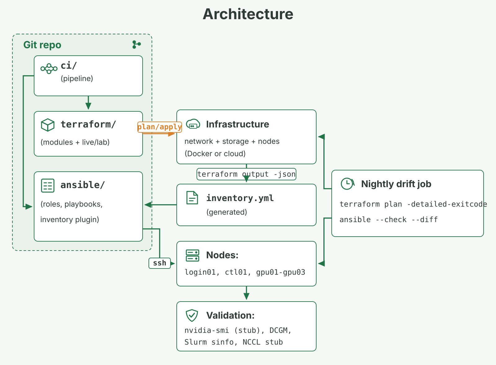

# 4.27 Lab: provision a GPU cluster with Terraform and Ansible

| | |
|---|---|
| Level | Intermediate |
| Priority tier | 0 |
| Lab venue | Path A: Docker or Multipass, Terraform/OpenTofu, ansible-core. Path B: cloud sandbox, optionally one GPU VM |
| Part | Part 4: Automation and infrastructure as code |
| Status | Drafted, labs **untested** (all steps below are unexecuted) |

## Purpose

Picture a small GPU cluster that you have to build from nothing, then rebuild, change and finally tear down. This lab ties Part 4 together by building one small but realistic platform. **Terraform creates the infrastructure**: the network, storage, nodes and outputs. **Ansible configures it**, covering the base OS, the GPU stack, monitoring and a small Slurm cluster. Validation then proves that it works, and a pipeline runs the same flow repeatably.

Think of the three parts as a relay. Terraform hands the list of machines to Ansible, Ansible prepares each machine, and validation checks the result before anyone calls the cluster ready. If any leg drops the baton, the cluster is not ready, no matter how green the earlier steps looked.

Drift and upgrade exercises show how the platform behaves on Day 2, and teardown returns everything to zero. Day 2 is the stretch of life after the first build, when the real work is change, repair and growth. Each step reuses patterns from earlier chapters. The Git workflow comes from 4.1 and pipeline design from 4.2. Ansible roles, variables, handlers and testing come from 4.3 to 4.17, while Terraform modules, state, loops, secrets and team workflow come from 4.18 to 4.25.

The lab has two paths, so you can learn without spending money.

- **Path A: local rehearsal (default).** Terraform's Docker provider, or Multipass through `local-exec` or a community provider, creates the "nodes" as systemd-enabled containers or VMs on your machine. There are no GPUs, so GPU-specific tasks run against stub `nvidia-smi` and `dcgmi` scripts. Everything else is real: the inventory export, roles, Slurm, validation, CI and drift checks. A stub is a small fake program that prints what the real tool would print, so the logic that reads its output still runs.
- **Path B: cloud.** The same Terraform root uses a cloud module instead of the Docker module. It creates a VPC, firewall, bucket and VMs in a sandbox project. Use small CPU VMs, and optionally one L4/A100 VM if you have quota and a budget cap. The Ansible side stays the same, except that the driver role runs for real.

> **Warning.** Cloud GPU resources cost money by the hour. Set a budget and alert first (4.24), prefer Spot, apply only when ready to test, and destroy at the end. Never run this in a production project. A forgotten GPU VM over a weekend is one of the most common ways a learning lab becomes an expensive surprise.

## Learning outcomes

After the lab, you can:

1. Structure a repo with `modules/`, `live/`, `ansible/` and `ci/`, and explain how Terraform outputs feed Ansible.
2. Provision nodes and a network with Terraform, using `for_each`, modules, variables with validation, outputs, remote or local state, and a generated inventory.
3. Configure the nodes with Ansible roles in the correct order, using idempotent tasks, handlers, `serial`, validation and `no_log`.
4. Run an automated end-to-end pipeline (lint, plan, apply, configure, verify) and a nightly drift check.
5. Make a safe change, such as adding a node or upgrading a package or driver stub, and then roll it back.
6. Tear down completely and verify that nothing is left.

## Architecture

Read the diagram from top to bottom, because that is the order you will work in. Terraform builds the infrastructure, its output becomes the Ansible inventory, and Ansible configures the nodes that validation then checks. The nightly drift job looks at both layers, so it can catch a change made on either side.



*Figure 4.27.1. Architecture, as a diagram.*

The nodes are `login01`, the bastion and login host, `ctl01`, which runs the Slurm controller and monitoring, and `gpu01` to `gpu03`, the workers. A bastion is the single machine that outsiders reach first, so everything else can stay private behind it. Path B adds a bucket for shared data and a service account.

## Part 0: Prerequisites and repository skeleton

Start with the self-checking Python lab. You run it locally, and it checks the links that join the two halves of the lab. It verifies the Terraform `var.nodes` to deterministic IP and SSH-port allocator, the Ansible inventory generator that writes `inventories/lab/generated/hosts.yml` (`generate_ansible_inventory_from_tf_nodes`), the `gpu_stub` template renderer for `nvidia-smi -L` (`render_stub_nvidia_smi_list`), and the end-to-end `playbooks/verify.yml` cluster health gate (`verify_cluster_end_to_end`). A passing run means the hand-off logic is sound, even before you have a single container.

```bash
python3 code/part04/gpu_cluster_e2e_bridge_lab.py
```

The commands in this lab have not been run on live hardware, so treat each step as unverified until you run it yourself. Next, check that you have the tools for the interactive walkthrough: Git, Terraform or OpenTofu 1.6+, Ansible-core 2.16+, `ansible-lint`, `yamllint`, `pre-commit`, Docker (Path A), optionally Multipass; for Path B `gcloud` authenticated with a sandbox project. Install them in one sitting, so you find missing tools before you start the work rather than halfway through a build.

```bash
mkdir gpu-lab && cd gpu-lab && git init -b main
mkdir -p terraform/modules/{network,nodes_docker,nodes_gcp} terraform/live/lab ansible/{inventories/lab,playbooks,roles,collections} ci
cat > .gitignore <<'EOF'
.terraform/
*.tfstate
*.tfstate.*
*.tfplan
*tfplan*
crash.log
*.tfvars
!*.tfvars.example
.vault_pass*
ansible/inventories/lab/generated/
*.retry
.venv/
EOF
python3 -m venv .venv && . .venv/bin/activate
pip install ansible-core ansible-lint yamllint pre-commit
ansible-galaxy collection install ansible.posix community.general community.docker
```

The `.gitignore` keeps Terraform state, plan files and generated inventory out of Git. Think of it as a fence around anything that is either secret or regenerated. State can hold secrets, plan files show what is about to change, and the generated inventory is rebuilt every time anyway. Next, add a `.pre-commit-config.yaml` file that runs `terraform fmt`, `terraform validate`, yamllint, ansible-lint and gitleaks, as covered in 4.1. Commit it, then create a branch for the work with `git switch -c lab/initial-cluster`. Working on a branch means the first change is reviewable as one unit, which is the habit you are practising.

## Part 1: Terraform: nodes and network (Path A: Docker)

Suppose a node has to appear before anything else can run on it. In Path A, that node is a container, and Terraform is the tool that creates it. The three files below define the node model, the Docker module that builds the containers, and the live root that exports the inventory for Ansible. Read them in that order, because each one depends on the one before.

### 1.1 Variables and the node model

Start with the node model. It is a map keyed by hostname, so each entry carries its own role and GPU count. A map keyed by name is useful because adding a host is one new entry, and the rest of the code picks it up without changes. The validation block rejects any role that is not `login`, `controller` or `gpu`, so a typo such as `gpus` spelled as `gpu` fails at plan time rather than in the middle of a build.

```hcl
# terraform/live/lab/variables.tf
variable "cluster_name" {
  type    = string
  default = "gpulab"
}

variable "nodes" {
  description = "Node definitions keyed by hostname"
  type = map(object({
    role = string                       # login | controller | gpu
    gpus = optional(number, 0)
  }))
  default = {
    login01 = { role = "login" }
    ctl01   = { role = "controller" }
    gpu01   = { role = "gpu", gpus = 8 }
    gpu02   = { role = "gpu", gpus = 8 }
    gpu03   = { role = "gpu", gpus = 4 }
  }
  validation {
    condition     = alltrue([for n in values(var.nodes) : contains(["login", "controller", "gpu"], n.role)])
    error_message = "role must be login, controller or gpu."
  }
}

variable "ssh_public_key_path" {
  type    = string
  default = "~/.ssh/id_ed25519.pub"
}
```

Notice that `gpus` is optional. The login and controller nodes do not need a GPU count, so Terraform fills in zero for them. That default keeps the map short, and it is the reason the GPU worker entries are the only ones that name a count.

### 1.2 The Docker node module (systemd + sshd containers)

The Docker module turns that map into containers. Each container gets a fixed address on a private network and a published SSH port on the host. Because the map is sorted by name, the same hostname always gets the same address and port. Determinism matters here. If `gpu02` moved to a different address on every apply, the inventory, the Slurm config and the Prometheus targets would all need rewriting every time.

```hcl
# terraform/modules/nodes_docker/main.tf
terraform {
  required_providers {
    docker = { source = "kreuzwerker/docker", version = "~> 3.0" }
    local  = { source = "hashicorp/local", version = "~> 2.5" }
  }
}

variable "cluster_name" { type = string }
variable "nodes" {
  type = map(object({ role = string, gpus = optional(number, 0) }))
}
variable "ssh_public_key" { type = string }

resource "docker_network" "cluster" {
  name = "${var.cluster_name}-net"
  ipam_config { subnet = "172.28.0.0/24" }
}

resource "docker_image" "node" {
  name = "${var.cluster_name}-node:latest"
  build {
    context = "${path.module}/image"        # Dockerfile: ubuntu + systemd + openssh-server + python3 + sudo (provide yourself)
    build_args = { SSH_PUBLIC_KEY = var.ssh_public_key }
  }
  triggers = { dir_sha = sha1(join("", [for f in fileset("${path.module}/image", "**") : filesha1("${path.module}/image/${f}")])) }
}

locals {
  ordered = sort(keys(var.nodes))
  ips     = { for i, n in local.ordered : n => cidrhost("172.28.0.0/24", 10 + i) }
  ports   = { for i, n in local.ordered : n => 2200 + i }              # published SSH ports on the host
}

resource "docker_container" "node" {
  for_each   = var.nodes
  name       = each.key
  hostname   = each.key
  image      = docker_image.node.image_id
  privileged = false
  tmpfs      = { "/run" = "", "/run/lock" = "", "/tmp" = "" }
  volumes {
    host_path      = "/sys/fs/cgroup"
    container_path = "/sys/fs/cgroup"
    read_only      = false
  }
  cgroupns_mode = "host"
  networks_advanced {
    name         = docker_network.cluster.name
    ipv4_address = local.ips[each.key]
  }
  ports {
    internal = 22
    external = local.ports[each.key]
  }
  labels {
    label = "role"
    value = each.value.role
  }
  labels {
    label = "gpus"
    value = tostring(each.value.gpus)
  }
}

output "nodes" {
  value = {
    for n, c in var.nodes : n => {
      role     = c.role
      gpus     = c.gpus
      address  = local.ips[n]
      ssh_host = "127.0.0.1"
      ssh_port = local.ports[n]
    }
  }
}
```

Walk through the `locals` block with a small example. Suppose the sorted names are `ctl01`, `gpu01`, `gpu02`, `gpu03` and `login01`. The index `i` runs from zero to four, so `ctl01` gets address `172.28.0.10` and SSH port `2200`, while `login01` gets `172.28.0.14` and port `2204`. The address comes from `cidrhost`, which picks the nth host inside the subnet, and the port is simply a counter added to a base. Both are reproducible, because sorting makes the order stable.

Running systemd inside containers needs cgroup settings that depend on your host OS. Docker Desktop on macOS, for example, uses a Linux VM with cgroup v2. If this gives you trouble, use Multipass VMs created by a `terraform_data` or `local-exec` wrapper, a community Multipass provider, or Vagrant. The Terraform interface stays the same, a map of nodes with addresses and ports, and that is the point. Swapping the backend without touching the consumers is exactly what a module boundary is for.

### 1.3 Live root and generated inventory

The live root calls the module and writes the Ansible inventory from its outputs. Terraform therefore decides which nodes exist, and Ansible reads the result without anyone editing a host list by hand. This is the single most important link in the lab. If a node exists in Terraform, it appears in Ansible, and nothing else has to be kept in sync.

```hcl
# terraform/live/lab/main.tf
terraform {
  required_version = ">= 1.6"
  required_providers {
    local = { source = "hashicorp/local", version = "~> 2.5" }
  }
}

module "nodes" {
  source         = "../../modules/nodes_docker"
  cluster_name   = var.cluster_name
  nodes          = var.nodes
  ssh_public_key = trimspace(file(pathexpand(var.ssh_public_key_path)))
}

resource "local_file" "inventory" {
  filename        = "${path.module}/../../../ansible/inventories/lab/generated/hosts.yml"
  file_permission = "0644"
  content = yamlencode({
    all = {
      vars = {
        ansible_user                 = "automation"
        ansible_python_interpreter   = "/usr/bin/python3"
        ansible_ssh_common_args      = "-o StrictHostKeyChecking=accept-new"
        cluster_name                 = var.cluster_name
      }
      children = {
        for role in distinct([for n in values(module.nodes.nodes) : n.role]) :
        role => {
          hosts = {
            for name, n in module.nodes.nodes : name => {
              ansible_host = n.ssh_host
              ansible_port = n.ssh_port
              node_ip      = n.address
              gpu_count    = n.gpus
            } if n.role == role
          }
        }
      }
    }
  })
}

output "inventory_path" { value = local_file.inventory.filename }
output "nodes"          { value = module.nodes.nodes }
```

The `children` expression is the part to read slowly. It collects the distinct roles, so you get one group for `login`, one for `controller` and one for `gpu`. Then, inside each group, it lists the hosts that have that role. Each host carries its SSH host and port, its internal address and its GPU count. Ansible later uses those group names, such as `gpu`, to decide which roles run where.

Run the root in the order below. The plan is the step to read carefully, because it shows what Terraform is about to change before anything happens. Read the plan before the apply, every time, even when you are sure. The habit is cheap now and expensive to lose later.

```bash
cd terraform/live/lab
terraform init
terraform fmt -check -recursive ../..
terraform validate
terraform plan -out=tfplan
terraform show tfplan | less          # read it: five containers, one network, one image, one file
terraform apply tfplan
terraform output -json nodes | jq .
cat ../../../ansible/inventories/lab/generated/hosts.yml
terraform plan                          # expect "No changes"
```

The final plan should say "No changes", which tells you the live state matches the code. If it does not, something in the cluster was changed outside Terraform, and you should find out why before going further.

The inventory file is gitignored, as the skeleton shows, so CI regenerates it on every run. That is the intent. Terraform is the source of truth for whether a node exists and what its address is. Ansible's `group_vars` are the source of truth for how each node is configured. Keeping those two questions separate is what lets each tool do its own job well.

### Path B: cloud variant (summary)

Path B swaps `nodes_docker` for `nodes_gcp`, a module that takes the same `nodes` map. It builds a VPC, a subnet, Cloud NAT and an IAP firewall (4.24). It also creates a service account without keys and a versioned bucket with `prevent_destroy`. Instances use an Ubuntu image with `enable-oslogin`. The `machine_type` comes from the role and GPU count, for example `e2-standard-4` for login and controller nodes, and `g2-standard-8` or `a2-highgpu-1g` for a single GPU worker. Labels support cost allocation, and `lifecycle.ignore_changes` covers metadata keys.

The module returns the same output shape: `address`, `ssh_host` (the instance private IP through IAP, or an external bastion) and `ssh_port` set to 22. The live root calls the cloud module instead, and the Ansible side stays identical. Configure the remote state backend (4.19) with a versioned bucket. Because the output shape is the same, swapping the module is a change to one line in the root, which is a useful test of whether your interfaces are clean.

## Part 2: Ansible: configure the cluster

Terraform has created five machines, but they are still bare. Ansible turns them into a working cluster: it sets the base OS, installs the GPU stack, starts monitoring and brings up Slurm. Slurm is the job scheduler that decides which node runs which job. The project settings and group variables come first, because every role reads them.

### 2.1 Project settings

The `ansible.cfg` file points Ansible at the generated inventory and sets the defaults for every run. The `host_key_checking` line is the one to watch. It is switched off here only because the lab containers are rebuilt often. A host key is the fingerprint that identifies a server, and when it changes Ansible refuses to connect, as a safety measure. Turning that check off is safe in a throwaway lab and dangerous anywhere else.

```ini
# ansible/ansible.cfg
[defaults]
inventory            = inventories/lab/generated/hosts.yml
roles_path           = roles
collections_path     = collections
forks                = 20
host_key_checking    = False        ; lab only: containers are rebuilt often; keep True in production (4.3)
interpreter_python   = auto_silent
stdout_callback      = yaml
callbacks_enabled    = timer, profile_tasks
retry_files_enabled  = False
[ssh_connection]
pipelining           = True
ssh_args             = -o ControlMaster=auto -o ControlPersist=60s
```

The `pipelining` and `ControlPersist` settings reuse one SSH connection for many tasks, which makes the run noticeably faster. The `forks` value sets how many hosts Ansible works on at the same time. Those settings are about speed, not safety, so they are safe to tune later.

The group variables hold the settings that apply across the cluster, plus the settings for each group. The Munge key is stored in an encrypted vault file. Munge is the small authentication service that Slurm uses to check that its daemons trust each other. Its key is a shared secret, which is why it lives in the vault rather than in plain YAML.

```yaml
# ansible/inventories/lab/group_vars/all.yml
cluster_domain: lab.local
chrony_servers: [pool.ntp.org]
nccl_env: { debug: WARN, socket_ifname: eth0 }
slurm_cluster_name: "{{ cluster_name }}"
munge_key_b64: "{{ vault_munge_key_b64 }}"          # vault.yml (encrypted): ansible-vault create ... (4.12)

# group_vars/gpu.yml
nvidia_driver_branch: "550"
expected_gpus_default: 8
gpu_tools_stub: true            # Path A: install stub nvidia-smi/dcgmi; Path B: false (real driver)
```

The `gpu_tools_stub` flag is the switch between the two paths. It is the one value you change to move from the local rehearsal to a real GPU VM. Everything else in the group variables stays the same on both paths, which keeps the two environments as close as possible.

### 2.2 Roles (compact versions)

You create each role with `ansible-galaxy role init`, then write the minimum it needs. Every role has `defaults`, `tasks`, `handlers`, `meta/argument_specs.yml` and a `README.md`. The five roles below do the real work of the cluster, and each one leaves its node in a state the next role can build on. The order they run in matters, as the site playbook shows later.

1. **`base_os`**: installs packages (`chrony`, `rsync`, `curl`, `jq`, `htop`) and creates the users and groups (`slurm`, `munge`, and `automation` with a sudoers drop-in that uses `validate: visudo -cf %s`). A sudoers drop-in is a small file that grants extra rights, and `visudo -cf` checks it for syntax before it is installed, so a typo cannot lock you out of sudo. The role also writes `/etc/hosts` from the inventory with a `hostvars` loop (4.7), sets sysctl values through `ansible.posix.sysctl` and syncs time. Every task is idempotent, and a handler restarts chrony.
2. **`gpu_stub`** (Path A) or **`nvidia_driver`** (Path B, see 4.17): installs stub scripts at `/usr/local/bin/nvidia-smi` and `dcgmi`. The stubs print plausible output based on `gpu_count`, through a Jinja template. They cover the `-L` and `--query-gpu` CSV forms, so later roles and validations run unchanged. CSV is comma-separated text, which is the format many monitoring scripts read.

```jinja
{# roles/gpu_stub/templates/nvidia-smi.j2 #}
#!/bin/bash
# {{ ansible_managed }}  (stub for lab; replaced by the real binary on GPU hosts)
case "$1" in
  -L) echo "GPU {{ i }}: NVIDIA H100 80GB HBM3 (UUID: GPU-stub-{{ inventory_hostname }}-{{ i }})"; 
      ;;
  --query-gpu*) echo "{{ i }}, NVIDIA H100 80GB HBM3, 550.90.07, 35, 0"; 
      ;;
  *) echo "stub nvidia-smi: unsupported arguments: $*" >&2; exit 1 ;;
esac
```

The template is short, but it does real work. The `for` loops print one line per GPU, so a host with four GPUs prints four lines and a host with eight prints eight. The stub also refuses any argument it does not know, which keeps it from pretending to support things it does not.

3. **`monitoring`**: runs `node_exporter` (from a package, or a binary checked by checksum) as a systemd unit. An exporter is a small program that publishes a machine's numbers, such as CPU and memory, for Prometheus to collect. On `ctl01`, Prometheus reads a `file_sd` target file rendered from `groups['all']`, which the template in 4.7 shows. File-based service discovery means Prometheus reads its target list from a file that Ansible writes, so new nodes appear without restarting Prometheus. GPU nodes get a DCGM exporter stub, a small Python HTTP server that exposes fake `DCGM_FI_DEV_GPU_UTIL` metrics. On Path B you run the real exporter.
4. **`munge_slurm`**: places the Munge key from the vault at mode `0400`, owned by `munge`. Mode `0400` means only the owner can read the file, so no other account on the machine can copy the key. It renders `slurm.conf` and `gres.conf` from the inventory (the 4.7 Slurm node template uses `gpu_count`), starts `slurmctld` on `ctl01` and `slurmd` on the GPU nodes. The `gres.conf` file tells Slurm which generic resources, here GPUs, each node has. Distro packages are fine for a lab, while production builds Slurm from source or packages, as Part 6 describes. Containers can fight `slurmd`, which may need `-D` flags or cgroup settings. If that happens, run Slurm in a single VM or use the lab's mock scheduler script and focus on the Ansible flow. Knowing when to change the approach is part of the lab, not a failure of it.
5. **`node_validate`**: has task files `quick.yml` (inventory sanity) and `standard.yml` (a stub DCGM level-1 equivalent). DCGM level-1 is a quick GPU health check that NVIDIA's tool runs, and the stub imitates its shape. The tasks assert that the GPU count equals `gpu_count`, that services are active and that ports are open. The role writes a JSON report to the control node, so the results survive after the run ends.

> **dcgm-exporter 4.9.0 version note.** dcgm-exporter 4.9.0 (2026-11-06) renamed many default metrics and changed some units. For example `DCGM_FI_DEV_GPU_UTIL` (percent) became `DCGM_FI_DEV_GPU_UTIL_RATIO` (0 to 1), and `DCGM_FI_DEV_FB_USED` (MiB) became `DCGM_FI_DEV_FB_USED_BYTES`. The metric names in this chapter are the 4.8.x names. On a 4.9.0 exporter use the [full mapping in 17.4](../part-17-operations/04-dcgm-exporter-and-interpreting-gpu-metrics.md#14-what-dcgm-exporter-490-renamed), and change thresholds together with the unit. The lesson is wider than this one exporter. A metric name is part of the contract between an exporter and every dashboard or alert that reads it, so a rename silently breaks those readers.

### 2.3 Site playbook with ordering and safety

The site playbook runs four plays in a deliberate order. The base configuration reaches every node first. Then the GPU workers are configured in small batches, so a bad driver stops the rollout after one node. The controller starts before the workers try to join, and the workers join only after they pass validation. Each play is a stage with a gate, and the gates are what make a failure safe.

```yaml
# ansible/playbooks/site.yml
- name: Base for every node
  hosts: all
  become: true
  roles: [base_os]

- name: GPU nodes
  hosts: gpu
  become: true
  serial: "{{ gpu_serial | default(['34%', '100%']) }}"      # first batch ~1 node of 3: canary
  max_fail_percentage: 0
  pre_tasks:
    - ansible.builtin.assert:
        that: [ gpu_count is defined, gpu_count | int > 0 ]
        fail_msg: "gpu_count missing for {{ inventory_hostname }}"
  roles:
    - { role: gpu_stub, when: gpu_tools_stub | default(true) }
    - { role: nvidia_driver, when: not (gpu_tools_stub | default(true)) }
    - node_validate

- name: Controller services
  hosts: controller
  become: true
  roles: [monitoring, munge_slurm]

- name: Workers join the scheduler
  hosts: gpu
  become: true
  roles: [munge_slurm]
  post_tasks:
    - ansible.builtin.import_role: { name: node_validate, tasks_from: standard }
```

The `pre_tasks` assertion catches a missing GPU count before any change is made, which is the cheapest possible failure. The `serial` line is the most important safety feature in the file. It means the GPU play runs on one small batch first. If that batch fails, `max_fail_percentage: 0` stops everything else from starting. A worked example: with three workers, the first batch is one node, so one bad driver affects one machine rather than all three.

### 2.4 Run it

Run the checks first, then the playbook. You should read the diff before you trust the first run. The `--check --diff` run is a dry run that shows the changes Ansible would make on one node. On the first full run, many tasks will report changes, so read the diff. A second full run should report no changes, apart from the probes. A probe is a read-only check, such as asking a service for its status, and it always reports as a fresh result.

```bash
cd ansible
ansible-lint && yamllint .
ansible all -m ansible.builtin.ping
ansible-playbook playbooks/site.yml --syntax-check
ansible-playbook playbooks/site.yml --check --diff --limit gpu01        # many tasks will report changes on first run; read the diff
ansible-playbook playbooks/site.yml                                      # full run
ansible-playbook playbooks/site.yml                                      # idempotency: expect changed=0 (except probes)
ansible gpu -m ansible.builtin.command -a "nvidia-smi -L" -o
ansible controller -m ansible.builtin.command -a "sinfo" -o              # if Slurm is running
```

Every spurious `changed` must be fixed, as 4.6 explains, until the second run is clean. A spurious change is a task that reports a change even though nothing really changed, and it hides real changes in the noise. A clean second run is the proof that your playbook describes the state you want, rather than a sequence that happens to work once.

## Part 3: Verification

A green run of the site playbook shows that its tasks finished. It does not show that the cluster works. Those are different claims. A playbook can finish successfully and still leave a node that cannot schedule a job. You write `playbooks/verify.yml` to check the cluster from the outside. It is read-only, so you can run it at any time, and it checks the following:

- Every host is reachable, and chrony is synchronised, meaning the `chronyc tracking` offset stays below a threshold. Clock drift matters because Slurm and Munge both reject requests from machines whose clocks disagree too much.
- GPU hosts report the right number of GPUs through `nvidia-smi -L | wc -l == gpu_count`. The exporter answers on port 9400, and `node_exporter` answers on port 9100.
- On the controller, every Prometheus target is `up` (checked by querying `http://ctl01:9090/api/v1/targets` with `uri`). `sinfo` lists all GPU nodes as `idle`, and a test job (`srun -N3 hostname`) returns three distinct hostnames. An idle node is one that is ready and waiting, so a node stuck in another state would not take work.
- An NCCL-style test runs as a stub or for real. NCCL is the library GPUs use to talk to each other during training. On Path B with GPUs, run `nccl-tests`. On Path A, run a stub that prints a plausible bus bandwidth, so the assertion logic still gets exercised. The stub cannot prove speed, but it proves that the check runs and fails when it should.

Collect the JSON reports into `reports/`. Then print a table that summarises the pass or fail result for each node. A failed node must make the playbook exit non-zero, because a CI system only notices failures through the exit code. A verification that prints a red line but still exits zero is invisible to the pipeline.

## Part 4: Pipeline

The pipeline should run the whole flow on every pull request and on a schedule, as 4.2 describes. The sketch below uses GitHub Actions. Adapt it if you use GitLab CI instead. A pipeline is the automated version of the steps you ran by hand, so anyone can repeat the same sequence and get the same result.

```yaml
# ci/lab-pipeline.yml  (copy to .github/workflows/)
name: gpu-lab
on:
  pull_request:
  schedule: [ { cron: "30 3 * * *" } ]            # nightly drift check
permissions: { contents: read }
concurrency: { group: lab-${{ github.ref }}, cancel-in-progress: false }

jobs:
  static:
    runs-on: ubuntu-latest
    steps:
    - uses: actions/checkout@v4
    - uses: hashicorp/setup-terraform@v3
    - run: terraform fmt -check -recursive terraform/
    - run: cd terraform/live/lab && terraform init -backend=false && terraform validate
    - run: pip install ansible-core ansible-lint yamllint && yamllint . && ansible-lint ansible/
    - uses: gitleaks/gitleaks-action@v2

  plan-and-test:
    needs: static
    runs-on: ubuntu-latest            # Path A runs on the runner itself with Docker
    steps:
    - uses: actions/checkout@v4
    - uses: hashicorp/setup-terraform@v3
    - run: pip install ansible-core && ansible-galaxy collection install -r ansible/collections/requirements.yml
    - name: Apply ephemeral lab
      run: |
        cd terraform/live/lab
        terraform init -input=false
        terraform apply -input=false -auto-approve
    - name: Configure and verify
      run: |
        cd ansible
        ansible-playbook playbooks/site.yml
        ansible-playbook playbooks/site.yml | tee second.log && grep -E "changed=0" second.log     # idempotency gate
        ansible-playbook playbooks/verify.yml
    - name: Destroy (always)
      if: always()
      run: cd terraform/live/lab && terraform destroy -input=false -auto-approve
```

Read the file as three stages. The `static` job is cheap, and it fails fast on formatting, lint and secrets. The `plan-and-test` job is expensive, and it runs only when the cheap checks pass. The destroy step at the bottom is the safety net that runs no matter what happened above it.

The ephemeral lab applies and destroys on the runner, so no state has to persist between runs. For Path B, use remote state, OIDC, separate plan and apply steps, and approvals, as 4.2 and 4.23 describe. The concurrency line matters on Path B, because two runs must never change the same state at once.

## Part 5: Day-2 exercises

A cluster that works on day one still has to survive changes. Each exercise below is a small operation you will meet after the first build, and each one shows whether your code and your checks hold up. Do them in order, because later ones assume the earlier ones are finished.

1. Start by adding a node. Put `gpu04 = { role = "gpu", gpus = 8 }` into `var.nodes` through a pull request, then read the plan. It should add one new container and change the inventory, and it should leave `gpu01` to `gpu03` untouched. Apply it, run Ansible with `--limit gpu04`, then run the full playbook. Finally, verify that Slurm picks up the new node.
2. Next, remove a node safely. Drain `gpu03` in Slurm with `scontrol update ... State=DRAIN`. Run a playbook that removes it from the Slurm config and from monitoring, and only then remove it from Terraform. Confirm that only that container is destroyed.
3. Try a driver or package upgrade on the stub. Bump `nvidia_driver_branch` to `555`, and the stub will report the new version. Run with `serial: 1` and a failing validation on the canary (inject a mismatch) so you can watch the rollout stop. Fix the mismatch, then roll the change out to the remaining nodes.
4. Create configuration drift on purpose. Change `/etc/sysctl.d` or stop `chronyd` on `gpu02` by hand. Run `ansible-playbook site.yml --check --diff` to see the drift, then apply the playbook to correct it. Add the check as a scheduled CI job that fails when `changed>0`.
5. Create infrastructure drift next. Run `docker rm -f gpu02` outside Terraform, and `terraform plan` will show a re-create. Apply it, re-run Ansible for that node, and automate the check in the nightly job.
6. Handle a secret carefully. Rotate the Munge key with vault `rekey`, update the value, and roll it out in a controlled order: the controller first, then the workers, with service restarts through handlers. Make sure `no_log` hides the key and that `--diff` does not print it.
7. Inject a failure. Kill SSH on one node in the middle of a run, and observe `unreachable` and the effect of `max_fail_percentage`. Re-run with `--limit @failed.txt`, and record the exit codes.
8. Test a rollback. Revert the upgrade commit in Git, push it through the pipeline, and confirm that the cluster converges back to the previous state.
9. Practise an import. Create a new container by hand, import it with an `import` block, and align the code until the plan is clean (4.18).
10. Move the state. Migrate the Terraform state to a remote backend (MinIO/S3 or GCS), and show locking by running two plans at the same time (4.19).
11. Add cost and ownership labels on Path B. Add the labels and a budget alert, then verify that the labels appear on the resources. Add a policy that fails any plan lacking `owner` or `ttl` labels (4.2).

## Part 6: Teardown and verification of cleanup

Teardown is not finished when `terraform destroy` returns, so you check for anything it missed. Terraform only destroys what its state knows about, and anything created by hand or by a side process survives. On Path A, look for leftover containers and networks. On Path B, list the instances, disks, addresses and buckets that carry the cluster label.

```bash
cd terraform/live/lab && terraform destroy
docker ps -a --filter "label=role"      # Path A: nothing left
docker network ls | grep gpulab
# Path B:
gcloud compute instances list --filter="labels.cluster=gpulab"
gcloud compute disks list --filter="labels.cluster=gpulab"
gcloud compute addresses list
gcloud storage buckets list --filter="name~gpulab"      # buckets with prevent_destroy need a deliberate override
```

Check billing the next day for stragglers, such as disks, IPs, snapshots and reserved capacity. A straggler is anything that keeps charging after its parent is gone, and a day's delay is usually enough for the charges to show up.

## Deliverables and review checklist

A reviewer should be able to inspect the following items, so keep each one ready to show. Together they prove the lab worked, and they give a reviewer enough to check the work without rerunning it.

- A Git repository with a clear history of the lab changes, made in small PRs, plus CODEOWNERS and a README with a quick start and teardown steps.
- The `terraform plan` and `apply` outputs, saved with secrets redacted, and the generated inventory.
- Ansible roles that pass `ansible-lint`, with `argument_specs`, and a second-run log showing `changed=0`.
- A verification report in JSON or table form that shows every node passing.
- The pipeline definition, one green run, and one deliberately failed run (for idempotency or validation), each with an explanation.
- A short postmortem note for the drift and failure-injection exercises. It should cover what happened, how it was detected, how it was fixed, and how to prevent it.

Then answer these self-review questions about your own build. Write the answers down, because the act of writing them shows you the gaps.

1. Where is the source of truth for node existence? For node configuration? How does information flow between them?
2. What prevents a typo from applying a change to all nodes at once?
3. What would you change to run this for 500 nodes across two regions? Consider orchestration of stacks, forks and strategy, inventory from the cloud API, golden images and pull mode (4.14, 4.23).
4. Which parts are safe to rerun at 3 a.m., and which need approval?
5. How would you extend validation to cover InfiniBand links and NCCL bandwidth floors (4.17)?

## Common mistakes in this lab

These are the mistakes to watch for as you work through the lab. Most of them feel harmless at the time, which is exactly why they are on the list.

- Leaving `host_key_checking = False` in place and forgetting to turn it back on in real environments.
- Editing the generated inventory by hand, or committing it.
- Applying Terraform and Ansible from different checkouts or versions, without pinned tool versions.
- Treating a green Ansible recap as validation, and skipping the verify playbook.
- Forgetting teardown on Path B, and paying for idle GPUs.
- Using real credentials or a production project.
- Hard-coding addresses instead of reading Terraform outputs.

## Interview angles

You may be asked questions like these. For each one, name the two tools, the hand-off between them, and the check that proves the result.

- "Walk me through provisioning and configuring a small GPU cluster from nothing, end to end, with IaC."
- "How do Terraform and Ansible hand off information? What are the alternatives, such as dynamic inventory plugins, tags or SSM?"
- "How do you make the pipeline idempotent and safe to rerun?"
- "How would you detect and respond to drift on both layers?"
- "How do you test this without GPUs?"

## Exercises

These exercises ask you to trace the lab's files and explain what each link does. Work through them with the files open, and write each explanation in your own words before you compare it with the chapter.

1. A teammate asks how the node list becomes the Ansible inventory. Trace the hand-off from Terraform to Ansible, from `var.nodes` through `local_file.inventory` to `hosts.yml`. Use `generate_ansible_inventory_from_tf_nodes()` in `code/part04/gpu_cluster_e2e_bridge.py` to explain how `terraform/live/lab/main.tf` turns the `module.nodes.nodes` output map into a grouped Ansible YAML inventory. Name the groups, which are `login`, `controller` and `gpu`, and name the fields each host carries, which are `ansible_host`, `ansible_port`, `node_ip` and `gpu_count`. Then explain why `ansible/inventories/lab/generated/` is listed in `.gitignore`.
2. A team wants the same playbook to run on a laptop and in the cloud. Compare two backends behind one module contract. Set Path A (`terraform/modules/nodes_docker`, which creates systemd and sshd containers on `172.28.0.0/24` with `cidrhost("172.28.0.0/24", 10 + i)` and host ports `2200 + i`) against Path B (`terraform/modules/nodes_gcp`, which creates a GCP VPC, Cloud NAT, an IAP firewall, a CMEK bucket and VMs). Explain why identical module inputs and outputs let `ansible/playbooks/site.yml` run unchanged on both.
3. A new engineer wonders how the GPU stub lets the whole pipeline run without GPUs. Trace the ordered configuration in `site.yml`. Use `render_stub_nvidia_smi_list()` in `code/part04/gpu_cluster_e2e_bridge.py` to follow the 4 plays in `ansible/playbooks/site.yml`. They are `Base for every node`, then `GPU nodes` with `serial: ['34%', '100%']` and `max_fail_percentage: 0`, then `Controller services`, then `Workers join the scheduler`. Explain how `roles/gpu_stub/templates/nvidia-smi.j2` lets CI test every downstream role and assertion without physical GPUs.
4. A team says a green playbook proves the cluster works. Verify the cluster end to end with `playbooks/verify.yml`. Use `verify_cluster_end_to_end()` to list the five checks in `verify.yml`. They cover SSH reachability with the `chronyc tracking` offset, the GPU count from `nvidia-smi -L`, the node and DCGM exporter ports `9100` and `9400`, Prometheus `/api/v1/targets` with every target `up`, and Slurm `sinfo` showing `idle` nodes with `srun -N3 hostname`. Then explain why a green `site.yml` recap is not enough without `verify.yml`.
5. A reviewer wants to know what stops a bad change from reaching production through CI. Trace the unified pipeline in `ci/lab-pipeline.yml`. Explain what the `static` job checks. Explain why `plan-and-test` runs `ansible-playbook playbooks/site.yml` twice and greps for `changed=0` before it runs `verify.yml`. Explain why `terraform destroy` runs under `if: always()`. Finally, explain how the nightly cron (`30 3 * * *`) detects infrastructure drift with `terraform plan -detailed-exitcode` and configuration drift with `ansible-playbook --check --diff`.
6. An operator must change the cluster on Day 2 without causing an outage, and the change involves three separate operations. Write the exact command sequence to add `gpu04` without disrupting `gpu01` to `gpu03`. Then write the sequence to remove `gpu03` safely, draining it in Slurm and updating `slurm.conf` and Prometheus before `terraform apply` destroys the node. Finally, write the sequence to rotate the Ansible-Vault-encrypted `munge.key` with `mode: "0400"` and `no_log: true` across `ctl01` and `gpu01` to `gpu03`.

## Checkpoint questions (20)

<details>
<summary>1. In the end-to-end architecture of Chapter 4.27, what is the exact division of ownership between Terraform and Ansible?</summary>

- **Terraform owns whether infrastructure exists and how the network is laid out.** It creates and destroys the network (`172.28.0.0/24` or the GCP VPC), the shared storage buckets and the compute nodes (`login01`, `ctl01`, `gpu01..03`). It then exports their IP addresses, SSH ports, roles and GPU counts into `ansible/inventories/lab/generated/hosts.yml`.
- **Ansible owns the software inside each OS and the orchestration of services.** It configures packages, `/etc/hosts`, `sysctl`, users and sudoers, NVIDIA drivers (or stubs), Prometheus, `node_exporter`, `dcgm-exporter`, Munge and Slurm (`slurmctld` and `slurmd`). It also runs the health checks after configuration.
</details>

<details>
<summary>2. Why is `ansible/inventories/lab/generated/hosts.yml` added to `.gitignore` instead of committed to Git?</summary>

Terraform computes `hosts.yml` from its live state through `local_file.inventory`, so it is a generated file. If you committed it, you would have two sources of truth. They would drift apart each time a node was added, replaced or destroyed. Ignoring `generated/` and regenerating `hosts.yml` from `terraform apply` or `terraform output` (or using a dynamic inventory plugin) means Ansible always targets the infrastructure that the Terraform state describes.
</details>

<details>
<summary>3. What are the three ways Terraform can hand off host discovery to Ansible in production, and what are their trade-offs?</summary>

1. **Generated inventory file (`local_file` / `templatefile` or `terraform output -json`):** It is simple and explicit, and it makes no cloud API calls when Ansible starts. It works the same way for local Docker or Multipass labs and for cloud VMs.
2. **Cloud dynamic inventory plugins (`google.cloud.gcp_compute`, `amazon.aws.aws_ec2`, `netbox.netbox.nb_inventory`):** Terraform labels the VMs, for example `cluster: gpulab, role: gpu`. Ansible then asks the cloud API for them at run time, using `keyed_groups`. This separates Ansible runs from the local Terraform files.
3. **Terraform state inventory plugin (`cloud.terraform.terraform_state`):** It reads hosts straight from the remote Terraform state backend.
</details>

<details>
<summary>4. How does `terraform/modules/nodes_docker/main.tf` assign deterministic IP addresses and SSH ports to each container?</summary>

Because `var.nodes` is a map, `local.ordered = sort(keys(var.nodes))` sorts the hostnames lexicographically: `ctl01`, `gpu01`, `gpu02`, `gpu03`, `login01`. From that order the module computes two values.

- **`local.ips`**: `cidrhost("172.28.0.0/24", 10 + i)`, which gives `172.28.0.10` through `172.28.0.14`.
- **`local.ports`**: `2200 + i`, which gives host ports `2200` through `2204`, each mapped to container port `22`.
</details>

<details>
<summary>5. In `docker_image.node`, what does the `triggers = { dir_sha = sha1(join("", [for f in fileset("${path.module}/image", "**") : filesha1(...)])) }` expression do?</summary>

By default, `docker_image` only checks whether an image with that `name` already exists locally. It does not rebuild the image when you edit the `Dockerfile` or the helper scripts in `image/`. The expression computes a SHA-1 hash of every file that `fileset` finds under `image/`, and it stores the result in `triggers.dir_sha`. When any file in `image/` changes, the hash changes, and Terraform rebuilds the image.
</details>

<details>
<summary>6. How do Path A (`nodes_docker`) and Path B (`nodes_gcp`) keep `ansible/playbooks/site.yml` 100% identical?</summary>

Both modules take the same inputs (`cluster_name`, `nodes`, `ssh_public_key`) and return the same output (`output "nodes"`), which maps each host to `{ role, gpus, address, ssh_host, ssh_port }`. Ansible therefore receives identical data. The only Ansible change between the paths is `gpu_tools_stub`. It is `true` on Path A, which installs the `gpu_stub` role, and `false` on Path B, which runs the real `nvidia_driver` role.
</details>

<details>
<summary>7. How does the `gpu_stub` role (`roles/gpu_stub/templates/nvidia-smi.j2`) enable realistic testing of GPU playbooks on a CPU-only laptop or CI runner?</summary>

The template `nvidia-smi.j2` renders an executable `/usr/local/bin/nvidia-smi` on each container or VM, using that host's `{{ gpu_count }}`. That count is `8` on `gpu01` and `gpu02`, and `4` on `gpu03`. When you call it with `-L` or `--query-gpu=...`, it prints one `NVIDIA H100 80GB HBM3` line for each GPU. That output lets the Slurm `gres.conf` generation, the `node_validate` GPU count assertions and the fleet health checks run their real logic without physical GPUs.
</details>

<details>
<summary>8. Why does `ansible/playbooks/site.yml` order its four plays as (1) `all` (`base_os`), (2) `gpu` (`gpu_stub`/`nvidia_driver` + `node_validate`), (3) `controller`, and (4) `gpu` (`munge_slurm`)?</summary>

1. **Play 1 (`all`, `base_os`):** It gathers facts from every node first, so `hostvars` is filled in for the `/etc/hosts`, `slurm.conf` and Prometheus `file_sd` templates. It also configures `/etc/hosts`, `chrony`, users and sysctls.
2. **Play 2 (`gpu`, driver and `node_validate`):** It sets up and validates the GPU stack on the workers, using `serial: ['34%', '100%']` and `max_fail_percentage: 0`, so `gpu01` goes first as a single-node canary.
3. **Play 3 (`controller`, `monitoring` and `munge_slurm`):** It starts `slurmctld` and Prometheus on `ctl01` before the workers try to register.
4. **Play 4 (`gpu`, `munge_slurm` and `node_validate`):** It starts `slurmd` on the validated GPU workers last, so only healthy nodes join the scheduler.
</details>

<details>
<summary>9. In Play 2 of `site.yml`, why do we set `serial: ['34%', '100%']` and `max_fail_percentage: 0`?</summary>

With three GPU nodes (`gpu01`, `gpu02`, `gpu03`), `'34%'` rounds to one canary node, `gpu01`, in the first batch. With `max_fail_percentage: 0`, a failed driver install or `node_validate` on `gpu01` halts the whole play immediately, before `gpu02` or `gpu03` is touched. Only after `gpu01` passes does the second batch, `'100%'`, roll out to `gpu02` and `gpu03`.
</details>

<details>
<summary>10. How does `site.yml` generate `/etc/hosts`, `slurm.conf`, `gres.conf`, and Prometheus `file_sd` targets without hardcoding IP addresses?</summary>

Each template builds its entries from the inventory and `hostvars`.

- **`/etc/hosts`**: it loops over `groups['all'] | sort` and writes `{{ hostvars[h]['node_ip'] }} {{ h }}.{{ cluster_domain }} {{ h }}`.
- **`slurm.conf`**: it sets `SlurmctldHost=ctl01` and loops over `groups['gpu'] | sort`, reading `hostvars[h]['gpu_count']` into `Gres=gpu:{{ hostvars[h]['gpu_count'] }}`.
- **Prometheus `file_sd`**: it builds `node_ip:9100` for every host in `groups['all']`, and `node_ip:9400` for every host in `groups['gpu']`.
</details>

<details>
<summary>11. How must the shared `/etc/munge/munge.key` be stored and deployed across `ctl01` and `gpu01..03`?</summary>

Slurm needs the same `/etc/munge/munge.key` on `ctl01` (for `slurmctld`) and on every `gpu` node (for `slurmd`). Store `vault_munge_key_b64` in an Ansible-Vault-encrypted `vault.yml` file. Deploy it with `copy` (`content: "{{ munge_key_b64 | b64decode }}"`, `dest: /etc/munge/munge.key`). Set `owner: munge`, `group: munge`, `mode: "0400"`, `no_log: true` and `diff: false`. Munge refuses to start when the key is group or world readable.
</details>

<details>
<summary>12. In `ci/lab-pipeline.yml`, why does the `plan-and-test` job run `ansible-playbook playbooks/site.yml` twice and check `grep -E "changed=0" second.log`?</summary>

The first run brings the freshly created containers from their base image to the configured cluster state, so `changed` is greater than zero. The second run is the test. The `grep -E "changed=0" second.log` check turns it into an idempotency gate in CI. If a task uses an unguarded `command` or `shell`, or a volatile template that changes hosts on every run, the second run reports changes and the pull request fails.
</details>

<details>
<summary>13. What five end-to-end behavioral assertions does `playbooks/verify.yml` perform that `site.yml` alone does not prove?</summary>

1. **Time synchronization:** the `chronyc tracking` offset is within tolerance on every node.
2. **GPU visibility:** `nvidia-smi -L | wc -l` on each GPU node matches its inventory `gpu_count` (`8`, `8`, `4`).
3. **Telemetry exporters:** `node_exporter` on `:9100/metrics` and `dcgm-exporter` on `:9400/metrics` both return HTTP 200.
4. **Central monitoring:** a `uri` query of Prometheus at `http://ctl01:9090/api/v1/targets` confirms that every scrape target reports `"health": "up"`.
5. **Scheduler readiness and job execution:** `sinfo` on `ctl01` shows `gpu01..03` as `idle`, and `srun -N3 hostname` runs across all three GPU nodes.
</details>

<details>
<summary>14. In `ci/lab-pipeline.yml`, why is the `Destroy (always)` step marked with `if: always()`?</summary>

GitHub Actions skips the remaining steps of a job as soon as one step fails. Without `if: always()`, a failure in `site.yml` or `verify.yml` would skip `terraform destroy`. Docker containers or expensive cloud GPU VMs would then keep running after a failed pull request run, and they would keep costing money.
</details>

<details>
<summary>15. Walk through the exact sequence for adding a new GPU worker (`gpu04 = { role = "gpu", gpus = 8 }`) on Day 2.</summary>

1. Add `gpu04 = { role = "gpu", gpus = 8 }` to `var.nodes` in `terraform/live/lab/variables.tf`.
2. Run `terraform plan -out=tfplan`. The plan should show only `+ docker_container.node["gpu04"]` and `~ local_file.inventory`, with zero changes to `gpu01..03`, `ctl01` and `login01`.
3. Run `terraform apply tfplan`.
4. Run `ansible-playbook playbooks/site.yml`. It updates `/etc/hosts`, `slurm.conf` and the Prometheus targets across the cluster, and it configures `gpu04`. Then run `ansible-playbook playbooks/verify.yml`.
</details>

<details>
<summary>16. Why must you run Slurm drain and Ansible cleanup BEFORE removing `gpu03` from Terraform `var.nodes`, rather than running `terraform apply` first?</summary>

If you delete `gpu03` from `var.nodes` and run `terraform apply` first, Terraform terminates `gpu03` at once. Active training jobs may still be running on it. Meanwhile, `ctl01`'s `slurm.conf` and Prometheus `file_sd` would keep pointing at a dead node, which shows up as `DOWN*`. Do this instead:

1. Drain `gpu03` in Slurm with `scontrol update NodeName=gpu03 State=DRAIN Reason="decommission"`, and wait for running jobs to finish.
2. Remove `gpu03` from `var.nodes` and run `terraform apply`. That destroys `gpu03` and regenerates `hosts.yml` without it.
3. Run `ansible-playbook playbooks/site.yml` straight away, so that `ctl01` updates `slurm.conf` and the Prometheus targets cleanly.
</details>

<details>
<summary>17. How do you detect and heal both Infrastructure Drift and Configuration Drift in this lab?</summary>

- **Infrastructure drift (e.g., `docker rm -f gpu02` or a terminated cloud VM):** Detect it with **`terraform plan -detailed-exitcode`**, which returns exit code `2` and shows `+ docker_container.node["gpu02"]`. Heal it with `terraform apply`, followed by `ansible-playbook playbooks/site.yml --limit gpu02,controller`.
- **Configuration drift (e.g., someone edits `/etc/sysctl.d/90-ai.conf` or stops `chronyd` on `gpu02`):** Detect it with **`ansible-playbook playbooks/site.yml --check --diff`**, and heal it by running `ansible-playbook playbooks/site.yml`.
</details>

<details>
<summary>18. How do you rotate the Munge key (`vault_munge_key_b64`) across the cluster without breaking Slurm communication?</summary>

1. Update `vault_munge_key_b64` inside the encrypted `vault.yml` file with `ansible-vault edit`.
2. Run the `munge_slurm` role against `controller` (`ctl01`) and `gpu` (`gpu01..03`), with `no_log: true` and `diff: false`. It updates `/etc/munge/munge.key` to `0400`, and it notifies `Restart munge`, followed by `Restart slurmctld` or `Restart slurmd`.
3. Run `playbooks/verify.yml` (`munge -n | ssh gpu01 unmunge` and `sinfo`) to confirm that authentication worked.
</details>

<details>
<summary>19. Why is `host_key_checking = False` acceptable in `ansible/ansible.cfg` for Path A (local Docker containers), and what must replace it in production?</summary>

In Path A, disposable local Docker containers are destroyed and recreated on `127.0.0.1:2200..2204` on every test run, each with new ephemeral SSH host keys. In production and on Path B, `host_key_checking = False` exposes the control node to man-in-the-middle (`MITM`) attacks. Set **`host_key_checking = True`** instead. Trust the hosts through an **SSH Host Certificate Authority (`TrustedUserCAKeys` / `@cert-authority`)**, or pre-populate `known_hosts` from the cloud instance host key metadata.
</details>

<details>
<summary>20. During Part 6 (`Teardown`), what cloud resources can survive `terraform destroy` on Path B if you don't check for them?</summary>

1. **GCS buckets with `lifecycle { prevent_destroy = true }` or `force_destroy = false` that still hold objects:** Terraform refuses to delete them until you remove `prevent_destroy` and empty the bucket.
2. **KMS keys (`google_kms_crypto_key`):** GCP cannot destroy a KMS key immediately. The key enters a scheduled destruction state, which can last from 24 hours to 30 days, and keys often carry `prevent_destroy = true`.
3. **Resources created outside Terraform**, such as manual disks, snapshots, static IPs or reservations. Check for them with `gcloud compute instances/disks/addresses/reservations list` and your billing alerts.
</details>

## Sources and review notes

- **Sources read in full:**
  - `terraform-up-and-running-3rd-edition` — Yevgeniy Brikman, *Terraform: Up and Running*, 3rd ed. (end-to-end deployment, module composition, state, testing, and CI patterns synthesized across Chapters 1–10).
  - `ansible-up-and-running-3rd-edition` — Bas Meijer, Lorin Hochstein & René Moser, *Ansible: Up and Running*, 3rd ed. (inventory, playbook, role, Vault, testing, and CI patterns synthesized across Chapters 1–24).
  - `nvidia-devops` (`volume-10/04-ansible-for-infrastructure-automation.md`, `volume-10/05-terraform-for-infrastructure-as-code.md`, `volume-10/11-cicd-for-infrastructure-and-cluster-configuration.md`, and `volume-10/17-git-for-infrastructure-and-operations.md`).
- **Run here:** `python3 code/part04/gpu_cluster_e2e_bridge_lab.py` (2 passed, 0 failed).
- **Explicitly labelled inferences:** The `generate_ansible_inventory_from_tf_nodes`, `render_stub_nvidia_smi_list`, and `verify_cluster_end_to_end` models in `code/part04/gpu_cluster_e2e_bridge.py` and the `gpu-lab` Terraform + Ansible + GitHub Actions capstone project are the author's constructions synthesizing Part 4 (`4.1`–`4.26`).
- **Not verified on live hardware:** Interactive Docker/Multipass/GCP Terraform and Ansible executions (`172.28.0.0/24`, `2200..2204`, `0644`, `0400`, `forks = 20`, `ControlPersist=60s`, `550` / `555`, `9400`, `9100`, `9090`, `cron: "30 3 * * *"`, `500` nodes, `3 a.m.`) are not run here, except where `gpu_cluster_e2e_bridge_lab.py` executes them.
