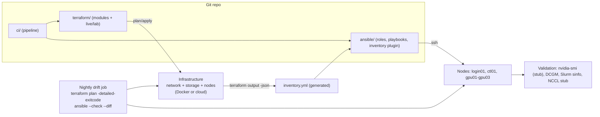

# 4.27 Lab: provision a GPU cluster with Terraform and Ansible

| | |
|---|---|
| Level | Intermediate |
| Priority tier | 0 |
| Lab venue | Path A: Docker or Multipass, Terraform/OpenTofu, ansible-core. Path B: cloud sandbox, optionally one GPU VM |
| Part | Part 4: Automation and infrastructure as code |
| Status | Drafted, labs **untested** (all steps below are unexecuted) |

## Purpose

This lab ties Part 4 together by building one small but realistic platform: **Terraform creates infrastructure** (network, storage, nodes, outputs); **Ansible configures it** (base OS, GPU stack, monitoring, a small Slurm cluster); **validation proves it works**; **a pipeline** runs the same flow repeatably; **drift and upgrade exercises** show Day-2 behaviour; **teardown** returns everything to zero. Everything uses the patterns from earlier chapters: Git workflow (4.1), pipeline design (4.2), Ansible roles/variables/handlers/testing (4.3 to 4.17), Terraform modules/state/loops/secrets/team workflow (4.18 to 4.25).

The lab has two paths so you can learn without spending money:

- **Path A: local rehearsal (default).** Terraform's Docker provider (or Multipass via `local-exec`/a community provider) creates "nodes" as systemd-enabled containers or VMs on your machine. No GPUs: GPU-specific tasks run against stub `nvidia-smi`/`dcgmi` scripts. Everything else (inventory export, roles, Slurm, validation, CI, drift) is real.
- **Path B: cloud.** The same Terraform root, with a cloud module instead of the Docker module, creates VPC, firewall, bucket and VMs in a sandbox project (use small CPU VMs, optionally one L4/A100 VM if you have quota and a budget cap). The Ansible side is unchanged except for the driver role running for real.

> **Warning.** Cloud GPU resources cost money by the hour. Set a budget and alert first (4.24), prefer Spot, apply only when ready to test, and destroy at the end. Never run this in a production project.

## Learning outcomes

After the lab you can:

1. Structure a repo with `modules/`, `live/`, `ansible/`, `ci/` and explain how Terraform outputs feed Ansible.
2. Provision nodes and a network with Terraform using `for_each`, modules, variables with validation, outputs, remote or local state, and a generated inventory.
3. Configure the nodes with Ansible roles in the correct order with idempotent tasks, handlers, `serial`, validation and `no_log`.
4. Run an automated end-to-end pipeline (lint, plan, apply, configure, verify) and a nightly drift check.
5. Perform a safe change (add a node, upgrade a package/driver stub) and a rollback.
6. Tear down completely and verify nothing is left.

## Architecture



Nodes: `login01` (bastion/login), `ctl01` (Slurm controller + monitoring), `gpu01` to `gpu03` (workers). Path B adds a bucket for shared data and a service account.

## Part 0: Prerequisites and repository skeleton

First, run the self-checking Python lab (`code/part04/gpu_cluster_e2e_bridge_lab.py`) locally. It verifies the Terraform `var.nodes` -> deterministic IP/SSH-port allocator -> Ansible `inventories/lab/generated/hosts.yml` generator (`generate_ansible_inventory_from_tf_nodes`), the `gpu_stub` `nvidia-smi -L` template renderer (`render_stub_nvidia_smi_list`), and the end-to-end `playbooks/verify.yml` cluster health gate (`verify_cluster_end_to_end`).

```bash
python3 code/part04/gpu_cluster_e2e_bridge_lab.py
```

Tools for the interactive walkthrough (`untested here`): Git, Terraform or OpenTofu 1.6+, Ansible-core 2.16+, `ansible-lint`, `yamllint`, `pre-commit`, Docker (Path A), optionally Multipass; for Path B `gcloud` authenticated with a sandbox project.

```bash
mkdir gpu-lab && cd gpu-lab && git init -b main
mkdir -p terraform/modules/{network,nodes_docker,nodes_gcp} terraform/live/lab ansible/{inventories/lab,playbooks,roles,collections} ci
cat > .gitignore <<'EOF'
.terraform/
*.tfstate
*.tfstate.*
*.tfplan
*tfplan*
crash.log
*.tfvars
!*.tfvars.example
.vault_pass*
ansible/inventories/lab/generated/
*.retry
.venv/
EOF
python3 -m venv .venv && . .venv/bin/activate
pip install ansible-core ansible-lint yamllint pre-commit
ansible-galaxy collection install ansible.posix community.general community.docker
```

Add a `.pre-commit-config.yaml` (4.1: terraform fmt/validate, yamllint, ansible-lint, gitleaks) and commit. Branch for the work: `git switch -c lab/initial-cluster`.

## Part 1: Terraform: nodes and network (Path A: Docker)

### 1.1 Variables and the node model

```hcl
# terraform/live/lab/variables.tf
variable "cluster_name" {
  type    = string
  default = "gpulab"
}

variable "nodes" {
  description = "Node definitions keyed by hostname"
  type = map(object({
    role = string                       # login | controller | gpu
    gpus = optional(number, 0)
  }))
  default = {
    login01 = { role = "login" }
    ctl01   = { role = "controller" }
    gpu01   = { role = "gpu", gpus = 8 }
    gpu02   = { role = "gpu", gpus = 8 }
    gpu03   = { role = "gpu", gpus = 4 }
  }
  validation {
    condition     = alltrue([for n in values(var.nodes) : contains(["login", "controller", "gpu"], n.role)])
    error_message = "role must be login, controller or gpu."
  }
}

variable "ssh_public_key_path" {
  type    = string
  default = "~/.ssh/id_ed25519.pub"
}
```

### 1.2 The Docker node module (systemd + sshd containers)

```hcl
# terraform/modules/nodes_docker/main.tf
terraform {
  required_providers {
    docker = { source = "kreuzwerker/docker", version = "~> 3.0" }
    local  = { source = "hashicorp/local", version = "~> 2.5" }
  }
}

variable "cluster_name" { type = string }
variable "nodes" {
  type = map(object({ role = string, gpus = optional(number, 0) }))
}
variable "ssh_public_key" { type = string }

resource "docker_network" "cluster" {
  name = "${var.cluster_name}-net"
  ipam_config { subnet = "172.28.0.0/24" }
}

resource "docker_image" "node" {
  name = "${var.cluster_name}-node:latest"
  build {
    context = "${path.module}/image"        # Dockerfile: ubuntu + systemd + openssh-server + python3 + sudo (provide yourself)
    build_args = { SSH_PUBLIC_KEY = var.ssh_public_key }
  }
  triggers = { dir_sha = sha1(join("", [for f in fileset("${path.module}/image", "**") : filesha1("${path.module}/image/${f}")])) }
}

locals {
  ordered = sort(keys(var.nodes))
  ips     = { for i, n in local.ordered : n => cidrhost("172.28.0.0/24", 10 + i) }
  ports   = { for i, n in local.ordered : n => 2200 + i }              # published SSH ports on the host
}

resource "docker_container" "node" {
  for_each   = var.nodes
  name       = each.key
  hostname   = each.key
  image      = docker_image.node.image_id
  privileged = false
  tmpfs      = { "/run" = "", "/run/lock" = "", "/tmp" = "" }
  volumes {
    host_path      = "/sys/fs/cgroup"
    container_path = "/sys/fs/cgroup"
    read_only      = false
  }
  cgroupns_mode = "host"
  networks_advanced {
    name         = docker_network.cluster.name
    ipv4_address = local.ips[each.key]
  }
  ports {
    internal = 22
    external = local.ports[each.key]
  }
  labels {
    label = "role"
    value = each.value.role
  }
  labels {
    label = "gpus"
    value = tostring(each.value.gpus)
  }
}

output "nodes" {
  value = {
    for n, c in var.nodes : n => {
      role     = c.role
      gpus     = c.gpus
      address  = local.ips[n]
      ssh_host = "127.0.0.1"
      ssh_port = local.ports[n]
    }
  }
}
```

Notes: running systemd in containers needs cgroup settings that vary by host OS (Docker Desktop on macOS uses a Linux VM with cgroup v2). If this is troublesome, use Multipass VMs created by a `terraform_data`/`local-exec` wrapper or a community Multipass provider, or use Vagrant; the Terraform interface (a map of nodes with addresses/ports) stays the same, which is the point.

### 1.3 Live root and generated inventory

```hcl
# terraform/live/lab/main.tf
terraform {
  required_version = ">= 1.6"
  required_providers {
    local = { source = "hashicorp/local", version = "~> 2.5" }
  }
}

module "nodes" {
  source         = "../../modules/nodes_docker"
  cluster_name   = var.cluster_name
  nodes          = var.nodes
  ssh_public_key = trimspace(file(pathexpand(var.ssh_public_key_path)))
}

resource "local_file" "inventory" {
  filename        = "${path.module}/../../../ansible/inventories/lab/generated/hosts.yml"
  file_permission = "0644"
  content = yamlencode({
    all = {
      vars = {
        ansible_user                 = "automation"
        ansible_python_interpreter   = "/usr/bin/python3"
        ansible_ssh_common_args      = "-o StrictHostKeyChecking=accept-new"
        cluster_name                 = var.cluster_name
      }
      children = {
        for role in distinct([for n in values(module.nodes.nodes) : n.role]) :
        role => {
          hosts = {
            for name, n in module.nodes.nodes : name => {
              ansible_host = n.ssh_host
              ansible_port = n.ssh_port
              node_ip      = n.address
              gpu_count    = n.gpus
            } if n.role == role
          }
        }
      }
    }
  })
}

output "inventory_path" { value = local_file.inventory.filename }
output "nodes"          { value = module.nodes.nodes }
```

Run:

```bash
cd terraform/live/lab
terraform init
terraform fmt -check -recursive ../..
terraform validate
terraform plan -out=tfplan
terraform show tfplan | less          # read it: five containers, one network, one image, one file
terraform apply tfplan
terraform output -json nodes | jq .
cat ../../../ansible/inventories/lab/generated/hosts.yml
terraform plan                          # expect "No changes"
```

If the inventory file is gitignored (as in the skeleton), CI regenerates it each run, which is the point: Terraform is the source of truth for existence and addresses; Ansible's `group_vars` are the source of truth for configuration.

### Path B: cloud variant (summary)

Replace `nodes_docker` with `nodes_gcp` (a module taking the same `nodes` map): VPC + subnet + Cloud NAT + IAP firewall (4.24), a service account without keys, a versioned bucket with `prevent_destroy`, instances from an Ubuntu image with `enable-oslogin`, `machine_type` derived from role/GPU count (for example `e2-standard-4` for login/controller, `g2-standard-8` or `a2-highgpu-1g` for a single GPU worker), labels for cost allocation, `lifecycle.ignore_changes` on metadata keys, and outputs with the same shape (`address`, `ssh_host` = instance private IP via IAP or an external bastion, `ssh_port` = 22). The live root calls the cloud module instead; the Ansible side stays identical. Configure the remote state backend (4.19) with a versioned bucket.

## Part 2: Ansible: configure the cluster

### 2.1 Project settings

```ini
# ansible/ansible.cfg
[defaults]
inventory            = inventories/lab/generated/hosts.yml
roles_path           = roles
collections_path     = collections
forks                = 20
host_key_checking    = False        ; lab only: containers are rebuilt often; keep True in production (4.3)
interpreter_python   = auto_silent
stdout_callback      = yaml
callbacks_enabled    = timer, profile_tasks
retry_files_enabled  = False
[ssh_connection]
pipelining           = True
ssh_args             = -o ControlMaster=auto -o ControlPersist=60s
```

Group variables (excerpt):

```yaml
# ansible/inventories/lab/group_vars/all.yml
cluster_domain: lab.local
chrony_servers: [pool.ntp.org]
nccl_env: { debug: WARN, socket_ifname: eth0 }
slurm_cluster_name: "{{ cluster_name }}"
munge_key_b64: "{{ vault_munge_key_b64 }}"          # vault.yml (encrypted): ansible-vault create ... (4.12)

# group_vars/gpu.yml
nvidia_driver_branch: "550"
expected_gpus_default: 8
gpu_tools_stub: true            # Path A: install stub nvidia-smi/dcgmi; Path B: false (real driver)
```

### 2.2 Roles (compact versions)

Create roles with `ansible-galaxy role init` and implement the minimum: each has `defaults`, `tasks`, `handlers`, `meta/argument_specs.yml`, `README.md`.

1. **`base_os`**: packages (`chrony`, `rsync`, `curl`, `jq`, `htop`), users/groups (`slurm`, `munge`, `automation` sudoers drop-in with `validate: visudo -cf %s`), `/etc/hosts` from inventory (`hostvars` loop, 4.7), sysctl via `ansible.posix.sysctl`, time sync. Idempotent; handler restarts chrony.
2. **`gpu_stub`** (Path A) or **`nvidia_driver`** (Path B, see 4.17): installs stub scripts `/usr/local/bin/nvidia-smi` and `dcgmi` that emit plausible output based on `gpu_count` (Jinja template), including `-L` and `--query-gpu` CSV forms, so later roles and validations run unchanged.

```jinja
{# roles/gpu_stub/templates/nvidia-smi.j2 #}
#!/bin/bash
# {{ ansible_managed }}  (stub for lab; replaced by the real binary on GPU hosts)
case "$1" in
  -L) echo "GPU {{ i }}: NVIDIA H100 80GB HBM3 (UUID: GPU-stub-{{ inventory_hostname }}-{{ i }})"; 
      ;;
  --query-gpu*) echo "{{ i }}, NVIDIA H100 80GB HBM3, 550.90.07, 35, 0"; 
      ;;
  *) echo "stub nvidia-smi: unsupported arguments: $*" >&2; exit 1 ;;
esac
```

3. **`monitoring`**: `node_exporter` (package or binary with checksum) as a systemd unit; on `ctl01` Prometheus with a `file_sd` target file rendered from `groups['all']` (template in 4.7); DCGM exporter stub on GPU nodes (a tiny Python HTTP server exposing fake `DCGM_FI_DEV_GPU_UTIL` metrics) or the real exporter on Path B.
4. **`munge_slurm`**: munge key (vaulted) at mode 0400 owned by `munge`; `slurm.conf` and `gres.conf` templates from inventory (4.7 Slurm node template using `gpu_count`), `slurmctld` on `ctl01`, `slurmd` on GPU nodes (package installs from distro repos work for a lab; production builds Slurm from source/packages per Part 6). In containers, `slurmd` may need `-D` flags or cgroup settings; if it fights you, run Slurm in a single VM or use the lab's mock scheduler script and focus on the Ansible flow.
5. **`node_validate`**: tasks files `quick.yml` (inventory sanity), `standard.yml` (stub DCGM level-1 equivalent), asserting GPU count equals `gpu_count`, services active, ports open; writes a JSON report to the control node.

### 2.3 Site playbook with ordering and safety

```yaml
# ansible/playbooks/site.yml
- name: Base for every node
  hosts: all
  become: true
  roles: [base_os]

- name: GPU nodes
  hosts: gpu
  become: true
  serial: "{{ gpu_serial | default(['34%', '100%']) }}"      # first batch ~1 node of 3: canary
  max_fail_percentage: 0
  pre_tasks:
    - ansible.builtin.assert:
        that: [ gpu_count is defined, gpu_count | int > 0 ]
        fail_msg: "gpu_count missing for {{ inventory_hostname }}"
  roles:
    - { role: gpu_stub, when: gpu_tools_stub | default(true) }
    - { role: nvidia_driver, when: not (gpu_tools_stub | default(true)) }
    - node_validate

- name: Controller services
  hosts: controller
  become: true
  roles: [monitoring, munge_slurm]

- name: Workers join the scheduler
  hosts: gpu
  become: true
  roles: [munge_slurm]
  post_tasks:
    - ansible.builtin.import_role: { name: node_validate, tasks_from: standard }
```

### 2.4 Run it

```bash
cd ansible
ansible-lint && yamllint .
ansible all -m ansible.builtin.ping
ansible-playbook playbooks/site.yml --syntax-check
ansible-playbook playbooks/site.yml --check --diff --limit gpu01        # many tasks will report changes on first run; read the diff
ansible-playbook playbooks/site.yml                                      # full run
ansible-playbook playbooks/site.yml                                      # idempotency: expect changed=0 (except probes)
ansible gpu -m ansible.builtin.command -a "nvidia-smi -L" -o
ansible controller -m ansible.builtin.command -a "sinfo" -o              # if Slurm is running
```

Fix every spurious `changed` (4.6) until the second run is clean.

## Part 3: Verification

Write `playbooks/verify.yml` (read-only, safe anytime) that checks:

- Every host reachable; chrony synchronised (`chronyc tracking` offset below a threshold).
- GPU hosts: `nvidia-smi -L | wc -l == gpu_count`; exporter responds on 9400; `node_exporter` on 9100.
- Controller: Prometheus targets all `up` (query `http://ctl01:9090/api/v1/targets` via `uri`, assert); `sinfo` lists all GPU nodes `idle`; a test job (`srun -N3 hostname`) returns three distinct hostnames.
- NCCL-style test (stub or real): on Path B with GPUs run `nccl-tests`; on Path A run a stub that prints a plausible bus bandwidth, so the assertion logic is exercised.

Collect JSON reports into `reports/` and print a table summarising pass/fail per node. A failed node must make the playbook exit non-zero.

## Part 4: Pipeline

Create a pipeline that does the whole flow on a pull request and on a schedule (4.2). A GitHub Actions sketch (adapt for GitLab CI):

```yaml
# ci/lab-pipeline.yml  (copy to .github/workflows/)
name: gpu-lab
on:
  pull_request:
  schedule: [ { cron: "30 3 * * *" } ]            # nightly drift check
permissions: { contents: read }
concurrency: { group: lab-${{ github.ref }}, cancel-in-progress: false }

jobs:
  static:
    runs-on: ubuntu-latest
    steps:
    - uses: actions/checkout@v4
    - uses: hashicorp/setup-terraform@v3
    - run: terraform fmt -check -recursive terraform/
    - run: cd terraform/live/lab && terraform init -backend=false && terraform validate
    - run: pip install ansible-core ansible-lint yamllint && yamllint . && ansible-lint ansible/
    - uses: gitleaks/gitleaks-action@v2

  plan-and-test:
    needs: static
    runs-on: ubuntu-latest            # Path A runs on the runner itself with Docker
    steps:
    - uses: actions/checkout@v4
    - uses: hashicorp/setup-terraform@v3
    - run: pip install ansible-core && ansible-galaxy collection install -r ansible/collections/requirements.yml
    - name: Apply ephemeral lab
      run: |
        cd terraform/live/lab
        terraform init -input=false
        terraform apply -input=false -auto-approve
    - name: Configure and verify
      run: |
        cd ansible
        ansible-playbook playbooks/site.yml
        ansible-playbook playbooks/site.yml | tee second.log && grep -E "changed=0" second.log     # idempotency gate
        ansible-playbook playbooks/verify.yml
    - name: Destroy (always)
      if: always()
      run: cd terraform/live/lab && terraform destroy -input=false -auto-approve
```

(The ephemeral lab applies and destroys on the runner, so no state needs to persist; for Path B use remote state, OIDC, plan/apply separation and approvals per 4.2/4.23.)

## Part 5: Day-2 exercises

1. **Add a node**: add `gpu04 = { role = "gpu", gpus = 8 }` to `var.nodes` via PR; read the plan (only one new container and inventory change; confirm existing nodes are untouched); apply; run Ansible limited with `--limit gpu04`, then full; verify Slurm picks it up.
2. **Remove a node safely**: drain `gpu03` in Slurm (`scontrol update ... State=DRAIN`), run a playbook that removes it from Slurm config and monitoring, then remove it from Terraform; confirm only that container is destroyed.
3. **Driver/package upgrade (stub)**: bump `nvidia_driver_branch` to `555` (the stub reports a new version); run with `serial: 1` and a failing validation on the canary (inject a mismatch) to observe the stop; fix and roll the remaining nodes.
4. **Configuration drift**: change `/etc/sysctl.d` or stop `chronyd` on `gpu02` manually; run `ansible-playbook site.yml --check --diff` and see the drift; apply to correct it; add the check as a scheduled CI job that fails when `changed>0`.
5. **Infrastructure drift**: `docker rm -f gpu02` out of band; `terraform plan` shows re-create; apply; re-run Ansible for that node; automate with the nightly job.
6. **Secret handling**: rotate the munge key (vault `rekey`, update, roll out in a controlled order: controller then workers, with service restarts through handlers); ensure `no_log` hides it and `--diff` doesn't print it.
7. **Failure injection**: kill SSH on one node mid-run; observe `unreachable`, `max_fail_percentage` behaviour and re-run with `--limit @failed.txt`; record exit codes.
8. **Rollback**: revert the upgrade commit in Git, push through the pipeline, confirm convergence to the previous state.
9. **Import**: create a new container manually, import it with an `import` block, align the code until the plan is clean (4.18).
10. **State**: migrate the Terraform state to a remote backend (MinIO/S3 or GCS) and show locking with two simultaneous plans (4.19).
11. **Cost/ownership labels** (Path B): add labels and a budget alert; verify they appear on resources; add a policy that fails a plan lacking `owner`/`ttl` labels (4.2).

## Part 6: Teardown and verification of cleanup

```bash
cd terraform/live/lab && terraform destroy
docker ps -a --filter "label=role"      # Path A: nothing left
docker network ls | grep gpulab
# Path B:
gcloud compute instances list --filter="labels.cluster=gpulab"
gcloud compute disks list --filter="labels.cluster=gpulab"
gcloud compute addresses list
gcloud storage buckets list --filter="name~gpulab"      # buckets with prevent_destroy need a deliberate override
```

Check billing the next day for stragglers (disks, IPs, snapshots, reserved capacity).

## Deliverables and review checklist

Submit/inspect:

- A Git repository with clear history of the lab changes (small PRs), CODEOWNERS and a README with quick start and teardown.
- `terraform plan`/`apply` outputs saved (redacted) and the generated inventory.
- Ansible roles passing `ansible-lint`, with `argument_specs`, and a second-run `changed=0` log.
- Verification report (JSON/table) showing all nodes pass.
- Pipeline definition and one green run plus one deliberately failed run (idempotency or validation failure) with explanations.
- A short postmortem note for the drift and failure-injection exercises: what happened, how detected, how fixed, how to prevent.

Self-review questions:

1. Where is the source of truth for node existence? For node configuration? How does information flow between them?
2. What prevents a typo from applying a change to all nodes at once?
3. What would you change to run this for 500 nodes across two regions? (Orchestration of stacks, forks/strategy, inventory from the cloud API, golden images, pull mode, 4.14, 4.23.)
4. Which parts are safe to rerun at 3 a.m., and which need approval?
5. How would you extend validation to cover InfiniBand links and NCCL bandwidth floors (4.17)?

## Common mistakes in this lab

- Running with `host_key_checking = False` and forgetting to turn it back on in real environments.
- Letting the generated inventory be edited by hand; or committing it.
- Applying Terraform and Ansible from different checkouts or versions; no pinned tool versions.
- Treating a green Ansible recap as validation; skipping the verify playbook.
- Forgetting teardown on Path B and paying for idle GPUs.
- Using real credentials or a production project.
- Hard-coding addresses instead of reading Terraform outputs.

## Interview angles

- "Walk me through provisioning and configuring a small GPU cluster from nothing, end to end, with IaC."
- "How do Terraform and Ansible hand off information? What are the alternatives (dynamic inventory plugins, tags, SSM)?"
- "How do you make the pipeline idempotent and safe to rerun?"
- "How would you detect and respond to drift on both layers?"
- "How do you test this without GPUs?"

## Exercises

1. **The Terraform-to-Ansible Hand-Off (`var.nodes` -> `local_file.inventory` -> `hosts.yml`):** Using `generate_ansible_inventory_from_tf_nodes()` in `code/part04/gpu_cluster_e2e_bridge.py`, explain how `terraform/live/lab/main.tf` transforms the `module.nodes.nodes` output map into a grouped Ansible YAML inventory (`login`, `controller`, `gpu` with `ansible_host`, `ansible_port`, `node_ip`, and `gpu_count`), and why `ansible/inventories/lab/generated/` is listed in `.gitignore`.
2. **Swapping Infrastructure Backends Behind a Stable Module Contract (`nodes_docker` vs. `nodes_gcp`):** Compare Path A (`terraform/modules/nodes_docker` creating systemd/sshd containers on `172.28.0.0/24` with `cidrhost("172.28.0.0/24", 10 + i)` and host ports `2200 + i`) with Path B (`terraform/modules/nodes_gcp` creating a GCP VPC, Cloud NAT, IAP firewall, CMEK bucket, and VMs), and explain why identical module inputs/outputs allow `ansible/playbooks/site.yml` to run unchanged across both.
3. **Ordered Cluster Configuration (`site.yml`) and Hardware Stubbing (`gpu_stub` vs. `nvidia_driver`):** Using `render_stub_nvidia_smi_list()` in `code/part04/gpu_cluster_e2e_bridge.py`, trace the 4 plays in `ansible/playbooks/site.yml` (`Base for every node` -> `GPU nodes` with `serial: ['34%', '100%']` and `max_fail_percentage: 0` -> `Controller services` -> `Workers join the scheduler`), and explain how `roles/gpu_stub/templates/nvidia-smi.j2` lets CI test all downstream roles and assertions without physical GPUs.
4. **End-to-End Behavioral Verification (`playbooks/verify.yml`):** Using `verify_cluster_end_to_end()` in `code/part04/gpu_cluster_e2e_bridge.py`, list the five verification checks in `verify.yml` (SSH reachability + `chronyc tracking` offset, `nvidia-smi -L` GPU count match, node/DCGM exporter ports `9100`/`9400`, Prometheus `/api/v1/targets` all `up`, and Slurm `sinfo` `idle` + `srun -N3 hostname`), and explain why a green `site.yml` recap is insufficient without `verify.yml`.
5. **The Unified CI/CD Pipeline (`ci/lab-pipeline.yml`), Idempotency Gate (`changed=0`), and Dual-Layer Drift Detection:** Trace `ci/lab-pipeline.yml`, explaining: (a) what the `static` job checks; (b) why `plan-and-test` runs `ansible-playbook playbooks/site.yml` twice and greps for `changed=0` before running `verify.yml`; (c) why `terraform destroy` runs under `if: always()`; and (d) how the nightly cron (`30 3 * * *`) detects both infrastructure drift (`terraform plan -detailed-exitcode`) and configuration drift (`ansible-playbook --check --diff`).
6. **Day-2 Cluster Operations: Scale-Out, Safe Scale-In (`DRAIN` Before Destroy), Canary Driver Upgrades, and Munge Key Rotation:** Walk through the exact sequence of commands to (a) add `gpu04` without disrupting `gpu01..03`, (b) remove `gpu03` safely by draining it in Slurm and updating `slurm.conf`/Prometheus *before* `terraform apply` destroys the node, and (c) rotate the Ansible-Vault-encrypted `munge.key` (`mode: "0400"`, `no_log: true`) across `ctl01` and `gpu01..03`.

## Checkpoint questions (20)

<details>
<summary>1. In the end-to-end architecture of Chapter 4.27, what is the exact division of ownership between Terraform and Ansible?</summary>

- **Terraform owns infrastructure existence and network topology:** It creates and destroys the network (`172.28.0.0/24` or GCP VPC), shared storage buckets, and compute nodes (`login01`, `ctl01`, `gpu01..03`), and exports their IP addresses, SSH ports, roles, and GPU counts into `ansible/inventories/lab/generated/hosts.yml`.
- **Ansible owns in-OS software configuration and service orchestration:** It configures packages, `/etc/hosts`, `sysctl`, users/sudoers, NVIDIA drivers (or stubs), Prometheus + `node_exporter` + `dcgm-exporter`, Munge + Slurm (`slurmctld`/`slurmd`), and post-configuration health validation.
</details>

<details>
<summary>2. Why is `ansible/inventories/lab/generated/hosts.yml` added to `.gitignore` instead of committed to Git?</summary>

Because `hosts.yml` is a **generated artifact** computed from Terraform's live state (`local_file.inventory`), committing it to Git creates two competing sources of truth that quickly drift out of sync whenever nodes are added, replaced, or destroyed. Ignoring `generated/` in Git and regenerating `hosts.yml` from `terraform apply` / `terraform output` (or using a dynamic inventory plugin) guarantees that Ansible always targets the exact infrastructure currently in Terraform state.
</details>

<details>
<summary>3. What are the three ways Terraform can hand off host discovery to Ansible in production, and what are their trade-offs?</summary>

1. **Generated inventory file (`local_file` / `templatefile` or `terraform output -json`):** Simple, explicit, zero cloud API calls during Ansible startup; works identically for local Docker/Multipass labs and cloud VMs.
2. **Cloud dynamic inventory plugins (`google.cloud.gcp_compute`, `amazon.aws.aws_ec2`, `netbox.netbox.nb_inventory`):** Terraform tags/labels the VMs (`cluster: gpulab, role: gpu`), and Ansible queries the cloud API directly at runtime using `keyed_groups`—decoupling Ansible runs from local Terraform filesystem outputs.
3. **Terraform state inventory plugin (`cloud.terraform.terraform_state`):** Reads hosts directly from the remote Terraform state backend.
</details>

<details>
<summary>4. How does `terraform/modules/nodes_docker/main.tf` assign deterministic IP addresses and SSH ports to each container?</summary>

Because `var.nodes` is a map, `local.ordered = sort(keys(var.nodes))` sorts the hostnames lexicographically (`ctl01`, `gpu01`, `gpu02`, `gpu03`, `login01`) and computes:
- **`local.ips`**: `cidrhost("172.28.0.0/24", 10 + i)` -> `172.28.0.10` through `172.28.0.14`.
- **`local.ports`**: `2200 + i` -> host ports `2200` through `2204` mapped to container port `22`.
</details>

<details>
<summary>5. In `docker_image.node`, what does the `triggers = { dir_sha = sha1(join("", [for f in fileset("${path.module}/image", "**") : filesha1(...)])) }` expression do?</summary>

By default, `docker_image` only checks if an image with `name` exists locally and will not rebuild the image when you edit the `Dockerfile` or helper scripts inside `image/`. Hashing the SHA-1 of every file matching `fileset("${path.module}/image", "**")` into `triggers.dir_sha` forces Terraform to rebuild the container image automatically whenever any file in `image/` changes.
</details>

<details>
<summary>6. How do Path A (`nodes_docker`) and Path B (`nodes_gcp`) keep `ansible/playbooks/site.yml` 100% identical?</summary>

Both `nodes_docker` and `nodes_gcp` accept the exact same input contract (`cluster_name`, `nodes`, `ssh_public_key`) and return the exact same output structure (`output "nodes"` mapping each hostname to `{ role, gpus, address, ssh_host, ssh_port }`). The only change between Path A and Path B in Ansible is toggling `gpu_tools_stub: true` (Path A installs the `gpu_stub` role) to `gpu_tools_stub: false` (Path B runs the real `nvidia_driver` role).
</details>

<details>
<summary>7. How does the `gpu_stub` role (`roles/gpu_stub/templates/nvidia-smi.j2`) enable realistic testing of GPU playbooks on a CPU-only laptop or CI runner?</summary>

`nvidia-smi.j2` renders an executable `/usr/local/bin/nvidia-smi` script on each container/VM templated with that host's `{{ gpu_count }}` (`8` on `gpu01`/`gpu02`, `4` on `gpu03`). When called with `-L` or `--query-gpu=...`, it outputs `gpu_count` lines of realistic `NVIDIA H100 80GB HBM3` records—allowing Slurm `gres.conf` generation, `node_validate` GPU-count assertions, and fleet health sweeps to execute their exact production logic without physical GPUs.
</details>

<details>
<summary>8. Why does `ansible/playbooks/site.yml` order its four plays as (1) `all` (`base_os`), (2) `gpu` (`gpu_stub`/`nvidia_driver` + `node_validate`), (3) `controller`, and (4) `gpu` (`munge_slurm`)?</summary>

1. **Play 1 (`all` -> `base_os`):** Gathers facts across **all** nodes first (so `hostvars` is populated for `/etc/hosts`, `slurm.conf`, and Prometheus `file_sd` templates) and configures `/etc/hosts`, `chrony`, users, and sysctls.
2. **Play 2 (`gpu` -> driver + `node_validate`):** Configures and validates the GPU stack on workers with `serial: ['34%', '100%']` and `max_fail_percentage: 0` (running `gpu01` as a 1-node canary first).
3. **Play 3 (`controller` -> `monitoring`, `munge_slurm`):** Starts `slurmctld` and Prometheus on `ctl01` before workers attempt to register.
4. **Play 4 (`gpu` -> `munge_slurm` + `node_validate`):** Starts `slurmd` on validated GPU workers last so only healthy nodes join the scheduler.
</details>

<details>
<summary>9. In Play 2 of `site.yml`, why do we set `serial: ['34%', '100%']` and `max_fail_percentage: 0`?</summary>

With 3 GPU nodes (`gpu01`, `gpu02`, `gpu03`), `'34%'` rounds to **1 single canary node (`gpu01`)** in Batch 1. With `max_fail_percentage: 0`, if the driver install or `node_validate` fails on `gpu01`, Ansible **halts the entire play immediately** before touching `gpu02` or `gpu03`. Only after `gpu01` passes validation does Batch 2 (`'100%'`) roll out to `gpu02` and `gpu03`.
</details>

<details>
<summary>10. How does `site.yml` generate `/etc/hosts`, `slurm.conf`, `gres.conf`, and Prometheus `file_sd` targets without hardcoding IP addresses?</summary>

Every template derives its entries dynamically from the inventory and `hostvars`:
- **`/etc/hosts`**: loops over `groups['all'] | sort`, writing `{{ hostvars[h]['node_ip'] }} {{ h }}.{{ cluster_domain }} {{ h }}`.
- **`slurm.conf`**: sets `SlurmctldHost=ctl01` and loops over `groups['gpu'] | sort` using `hostvars[h]['gpu_count']` (`Gres=gpu:{{ hostvars[h]['gpu_count'] }}`).
- **Prometheus `file_sd`**: extracts `node_ip:9100` across `groups['all']` and `node_ip:9400` across `groups['gpu']`.
</details>

<details>
<summary>11. How must the shared `/etc/munge/munge.key` be stored and deployed across `ctl01` and `gpu01..03`?</summary>

Slurm authentication requires the exact same binary `/etc/munge/munge.key` on `ctl01` (`slurmctld`) and all `gpu` nodes (`slurmd`). Store `vault_munge_key_b64` in an **Ansible-Vault-encrypted** `vault.yml` file, deploy it with `copy` (`content: "{{ munge_key_b64 | b64decode }}"`, `dest: /etc/munge/munge.key`), and enforce **`owner: munge`**, **`group: munge`**, **`mode: "0400"`**, **`no_log: true`**, and **`diff: false`** (since `munge` refuses to start if `/etc/munge/munge.key` is group- or world-readable).
</details>

<details>
<summary>12. In `ci/lab-pipeline.yml`, why does the `plan-and-test` job run `ansible-playbook playbooks/site.yml` twice and check `grep -E "changed=0" second.log`?</summary>

The first `ansible-playbook playbooks/site.yml` run converges the freshly created containers from base image state to configured cluster state (`changed > 0`). Running `ansible-playbook playbooks/site.yml` a **second time** and asserting `grep -E "changed=0" second.log` acts as an automated **idempotency gate** in CI—failing the pull request immediately if any task uses an unguarded `command`/`shell` or volatile template that mutates hosts on every run.
</details>

<details>
<summary>13. What five end-to-end behavioral assertions does `playbooks/verify.yml` perform that `site.yml` alone does not prove?</summary>

1. **Time synchronization:** `chronyc tracking` offset is within tolerance across all nodes.
2. **GPU visibility:** `nvidia-smi -L | wc -l` on each GPU node matches its inventory `gpu_count` (`8`, `8`, `4`).
3. **Telemetry exporters:** `node_exporter` (`:9100/metrics`) and `dcgm-exporter` (`:9400/metrics`) return HTTP 200.
4. **Central monitoring:** Querying Prometheus `http://ctl01:9090/api/v1/targets` via `uri` confirms all scrape targets have `"health": "up"`.
5. **Scheduler readiness & job execution:** `sinfo` on `ctl01` shows `gpu01..03` in `idle` state, and `srun -N3 hostname` successfully schedules across all 3 GPU nodes.
</details>

<details>
<summary>14. In `ci/lab-pipeline.yml`, why is the `Destroy (always)` step marked with `if: always()`?</summary>

In GitHub Actions, subsequent steps in a job are skipped as soon as any step returns a non-zero exit code. Without **`if: always()`**, a failure in `ansible-playbook playbooks/site.yml` or `verify.yml` would skip `terraform destroy`—leaving Docker containers or expensive cloud GPU VMs running and leaking money after failed PR runs.
</details>

<details>
<summary>15. Walk through the exact sequence for adding a new GPU worker (`gpu04 = { role = "gpu", gpus = 8 }`) on Day 2.</summary>

1. Add `gpu04 = { role = "gpu", gpus = 8 }` to `var.nodes` in `terraform/live/lab/variables.tf`.
2. Run `terraform plan -out=tfplan` and verify the plan shows **only `+ docker_container.node["gpu04"]` and `~ local_file.inventory`** (`0` changes to `gpu01..03`, `ctl01`, `login01`).
3. Run `terraform apply tfplan`.
4. Run `ansible-playbook playbooks/site.yml` (which updates `/etc/hosts`, `slurm.conf`, and Prometheus targets across the cluster and configures `gpu04`), followed by `ansible-playbook playbooks/verify.yml`.
</details>

<details>
<summary>16. Why must you run Slurm drain and Ansible cleanup BEFORE removing `gpu03` from Terraform `var.nodes`, rather than running `terraform apply` first?</summary>

If you delete `gpu03` from `var.nodes` and run `terraform apply` first, Terraform **immediately terminates `gpu03`** while active training jobs may still be running on it, and leaves `ctl01`'s `slurm.conf` and Prometheus `file_sd` pointing at a dead node (`DOWN*`). Instead:
1. Drain `gpu03` in Slurm (`scontrol update NodeName=gpu03 State=DRAIN Reason="decommission"`) and wait for running jobs to finish.
2. Remove `gpu03` from `var.nodes` and run `terraform apply` (which destroys `gpu03` and regenerates `hosts.yml` without `gpu03`).
3. Immediately run `ansible-playbook playbooks/site.yml` so `ctl01` updates `slurm.conf` and Prometheus targets cleanly.
</details>

<details>
<summary>17. How do you detect and heal both Infrastructure Drift and Configuration Drift in this lab?</summary>

- **Infrastructure drift (e.g., `docker rm -f gpu02` or a terminated cloud VM):** Detected by **`terraform plan -detailed-exitcode`** (returns exit code `2` showing `+ docker_container.node["gpu02"]`), healed by `terraform apply` followed by `ansible-playbook playbooks/site.yml --limit gpu02,controller`.
- **Configuration drift (e.g., someone edits `/etc/sysctl.d/90-ai.conf` or stops `chronyd` on `gpu02`):** Detected by **`ansible-playbook playbooks/site.yml --check --diff`**, healed by running `ansible-playbook playbooks/site.yml`.
</details>

<details>
<summary>18. How do you rotate the Munge key (`vault_munge_key_b64`) across the cluster without breaking Slurm communication?</summary>

1. Update `vault_munge_key_b64` inside the encrypted `vault.yml` (`ansible-vault edit`).
2. Run the `munge_slurm` role against **`controller` (`ctl01`) and `gpu` (`gpu01..03`)** with `no_log: true` and `diff: false`, which updates `/etc/munge/munge.key` (`0400`) and notifies `Restart munge` -> `Restart slurmctld` / `Restart slurmd`.
3. Run `playbooks/verify.yml` (`munge -n | ssh gpu01 unmunge` and `sinfo`) to confirm authentication succeeded.
</details>

<details>
<summary>19. Why is `host_key_checking = False` acceptable in `ansible/ansible.cfg` for Path A (local Docker containers), and what must replace it in production?</summary>

In Path A, disposable local Docker containers are destroyed and recreated on `127.0.0.1:2200..2204` with new ephemeral SSH host keys on every test run. In production (and Path B), `host_key_checking = False` exposes the control node to Man-in-the-Middle (`MITM`) attacks and must be set to **`host_key_checking = True`**, using either an **SSH Host Certificate Authority (`TrustedUserCAKeys` / `@cert-authority`)** or pre-populated `known_hosts` from cloud instance host-key metadata.
</details>

<details>
<summary>20. During Part 6 (`Teardown`), what cloud resources can survive `terraform destroy` on Path B if you don't check for them?</summary>

1. **GCS buckets with `lifecycle { prevent_destroy = true }` or `force_destroy = false` containing objects:** Terraform will refuse to delete them until `prevent_destroy` is removed and objects are emptied.
2. **KMS keys (`google_kms_crypto_key`):** KMS keys cannot be immediately destroyed in GCP (they enter a scheduled destruction state, e.g., 24 hours to 30 days) and often have `prevent_destroy = true`.
3. **Any out-of-band resources** (manual disks, snapshots, static IPs, or reservations created outside Terraform), which must be verified via `gcloud compute instances/disks/addresses/reservations list` and billing alerts.
</details>

## Sources and review notes

- **Sources read in full:**
  - `terraform-up-and-running-3rd-edition` — Yevgeniy Brikman, *Terraform: Up and Running*, 3rd ed. (end-to-end deployment, module composition, state, testing, and CI patterns synthesized across Chapters 1–10).
  - `ansible-up-and-running-3rd-edition` — Bas Meijer, Lorin Hochstein & René Moser, *Ansible: Up and Running*, 3rd ed. (inventory, playbook, role, Vault, testing, and CI patterns synthesized across Chapters 1–24).
  - `nvidia-devops` (`volume-10/04-ansible-for-infrastructure-automation.md`, `volume-10/05-terraform-for-infrastructure-as-code.md`, `volume-10/11-cicd-for-infrastructure-and-cluster-configuration.md`, and `volume-10/17-git-for-infrastructure-and-operations.md`).
- **Run here:** `python3 code/part04/gpu_cluster_e2e_bridge_lab.py` (2 passed, 0 failed).
- **Explicitly labelled inferences:** The `generate_ansible_inventory_from_tf_nodes`, `render_stub_nvidia_smi_list`, and `verify_cluster_end_to_end` models in `code/part04/gpu_cluster_e2e_bridge.py` and the `gpu-lab` Terraform + Ansible + GitHub Actions capstone project are the author's constructions synthesizing Part 4 (`4.1`–`4.26`).
- **Not verified on live hardware:** Interactive Docker/Multipass/GCP Terraform and Ansible executions (`172.28.0.0/24`, `2200..2204`, `0644`, `0400`, `forks = 20`, `ControlPersist=60s`, `550` / `555`, `9400`, `9100`, `9090`, `cron: "30 3 * * *"`, `500` nodes, `3 a.m.`) are marked (`untested here` / `not been executed`) where not executed by `gpu_cluster_e2e_bridge_lab.py`.
