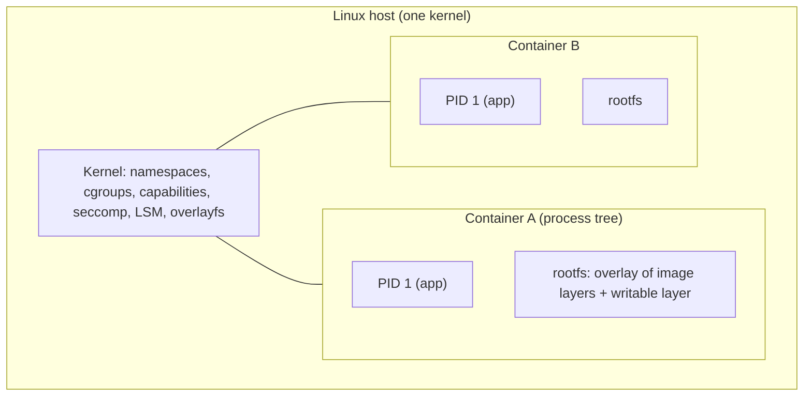
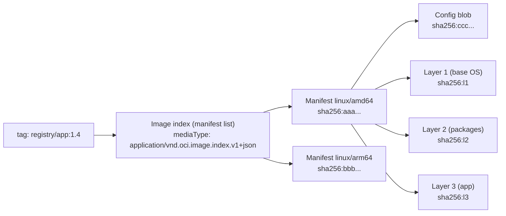
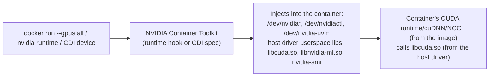

# 5.1 Containers from first principles: images, layers, registries

| | |
|---|---|
| Level | Beginner to intermediate |
| Priority tier | 0 |
| Lab venue | Docker Engine or Podman; `skopeo`, `crane`, `dive`, `buildah` optional; an NVIDIA GPU host with the container toolkit for the GPU exercise |
| Part | Part 5: Kubernetes |
| Status | Drafted, labs **untested** |

## Why this matters for AI infrastructure

Every training job, inference server and platform component in this handbook ships as a container image. A PyTorch image is routinely 10 to 30 GB; pulling it onto 500 nodes at once can saturate a registry and delay a job by an hour; a stale CUDA userspace inside an image can break against a newer host driver; a layer ordering mistake rebuilds a 20-minute dependency install on every code change; an image from an unverified registry is a supply-chain risk. Kubernetes (the rest of Part 5) schedules containers, but cannot fix any of that. Understanding what a container actually is, how images are structured and distributed, and how to build small, fast, reproducible, secure images is the foundation for everything after it.

## Prerequisites and outcomes

Needs Linux fundamentals from Part 1, especially namespaces and cgroups (1.19, 1.20), the filesystem chapters, and the process model. After this chapter you can:

- Explain that a container is an ordinary Linux process (or process tree) isolated with namespaces, limited with cgroups, given a different root filesystem, and restricted with capabilities, seccomp and LSM profiles; and that images are just layered tarballs plus metadata.
- Describe the OCI Image Spec (manifests, indexes, config, layers, digests, media types) and OCI Runtime Spec (`config.json`, bundles) and how they relate to Docker, containerd and CRI-O.
- Inspect images and registries with `docker`/`podman`, `skopeo`, `crane`; read manifests and layer digests; understand content addressing and deduplication.
- Write efficient, reproducible Dockerfiles (layer ordering, multi-stage builds, BuildKit cache and secret mounts, multi-architecture builds, non-root users, minimal bases) and know the trade-offs of distroless, scratch, Alpine and Debian/Ubuntu bases.
- Operate registries: pull-through caches, mirrors, authentication, tags vs digests, retention, replication; apply image-pull strategies for large GPU images.
- Apply baseline image security: scanning, SBOMs, signing, rootless operation, dropping capabilities.
- Describe how GPU containers work (NVIDIA Container Toolkit, driver/userspace split, CUDA base images, compatibility rules).

## 1. What a container is

A container is not a lightweight virtual machine and not a kernel feature called "container". It is a **process started with a set of kernel isolation and limit mechanisms applied**, running from a **root filesystem assembled from an image**.



| Mechanism | What it provides | Typical container setting |
|---|---|---|
| **PID namespace** | Own process tree; app is PID 1 | `docker run` default |
| **Mount namespace + `pivot_root`** | Own filesystem view (the image rootfs) | Overlay mount of layers |
| **Network namespace** | Own interfaces, IPs, routes, ports | veth pair to a bridge (5.13) |
| **UTS / IPC namespaces** | Own hostname; own SysV IPC/POSIX queues | default |
| **User namespace** | UID/GID remapping (root inside = unprivileged outside) | rootless Podman, some runtimes |
| **Cgroup namespace** | Virtualised view of the cgroup tree | default on cgroup v2 |
| **cgroups (v2)** | Limits and accounting: CPU, memory, I/O, PIDs, devices | `--cpus`, `--memory`, `--pids-limit` |
| **Capabilities** | Split root privileges; containers drop most by default | `--cap-drop ALL --cap-add NET_BIND_SERVICE` |
| **seccomp** | Syscall filter (default profile blocks ~40 risky calls) | `--security-opt seccomp=...` |
| **AppArmor / SELinux** | Mandatory access control profiles | distro defaults |
| **overlayfs** | Union of read-only layers + writable upper layer, copy-on-write | storage driver |

Prove it to yourself on any Linux box:

```bash
docker run -d --name demo --memory 256m --cpus 0.5 nginx:1.27
PID=$(docker inspect -f '{{.State.Pid}}' demo)       # PID in the HOST namespace
ps -o pid,ppid,cmd -p $PID                            # an ordinary nginx process on the host
ls -l /proc/$PID/ns                                   # namespace inodes: compare with `ls -l /proc/self/ns`
cat /proc/$PID/cgroup                                 # which cgroup it lives in
cat /sys/fs/cgroup/system.slice/docker-$(docker inspect -f '{{.Id}}' demo).scope/memory.max     # 268435456 (cgroup v2, systemd driver)
sudo nsenter -t $PID -n ip addr                       # enter its network namespace from the host
sudo nsenter -t $PID -m ls /                          # enter its mount namespace: the image rootfs
```

Consequences worth remembering: the container shares the **host kernel** (kernel version, sysctls like `net.core.*`, modules, `dmesg`, GPU kernel driver); container escapes are kernel/runtime vulnerabilities, not "hypervisor escapes"; resource limits are cgroup settings enforced by the kernel (memory limit exceeded means OOM kill of a process inside that cgroup); PID 1 inside a container has special signal and zombie-reaping semantics (use `--init`/`tini` for apps that fork); and "it works in the container" says little about kernel-dependent behaviour such as RDMA, huge pages, or NUMA, which depend on the host.

## 2. Images: layers, content addressing and the OCI formats

An **image** is a bundle of: (1) an ordered list of **filesystem layers** (compressed tar archives of changes), (2) a **config** JSON (environment, entrypoint, cmd, user, working directory, exposed ports, labels, history, the list of layer diff IDs), and (3) a **manifest** that references the config and layers by **digest**. A multi-platform tag points to an **index** (manifest list) that references one manifest per OS/architecture.



- **Content addressing**: every blob is named by the SHA-256 of its bytes (`sha256:...`). Identical layers across images are stored and transferred once; a changed layer changes its digest and the digests of everything referencing it. A **tag** is a mutable pointer; a **digest** (`image@sha256:...`) is immutable. For reproducibility and supply-chain integrity deploy by digest.
- **Layers** correspond to Dockerfile instructions that change the filesystem (`RUN`, `COPY`, `ADD`); `ENV`, `LABEL`, `CMD` change metadata only. Layers are additive: deleting a file in a later layer **hides** it (a whiteout entry) but the bytes remain in the earlier layer, so `RUN rm bigfile` does not shrink the image; cleanup must happen in the same `RUN` that created the files, or use multi-stage builds.
- **Union filesystem**: at run time the runtime mounts layers read-only with an **overlayfs** upper writable layer (copy-on-write). Writes go to the container layer, vanish with the container, and are slow for write-heavy workloads: use volumes for data, checkpoints and scratch.
- **OCI specifications**: the *Image Spec* (layout, manifest, index, config, layer media types such as `application/vnd.oci.image.layer.v1.tar+gzip`/`+zstd`), the *Runtime Spec* (`config.json` describing namespaces, mounts, cgroups, capabilities, hooks, executed by a runtime like `runc`, `crun` or `kata`), and the *Distribution Spec* (HTTP API for registries). Docker's older formats are compatible. Chapter 5.2 covers how containerd/CRI-O use these.

Inspect with standard tools:

```bash
docker image inspect nginx:1.27 | jq '.[0] | {Id, RepoDigests, Os, Architecture, Config: .Config.Entrypoint}'
docker history --no-trunc --format '{{.Size}}\t{{.CreatedBy}}' nginx:1.27 | head
skopeo inspect docker://docker.io/library/nginx:1.27                   # remote, no pull
skopeo inspect --raw docker://docker.io/library/nginx:1.27 | jq .      # raw index/manifest
crane manifest nginx:1.27 | jq '.manifests[] | {platform, digest}'      # list platforms (index)
crane config nginx:1.27@sha256:<digest> | jq '.rootfs.diff_ids'         # layer diff IDs
crane export nginx:1.27 - | tar -tvf - | head                            # flattened filesystem listing
dive nginx:1.27                                                          # interactive layer explorer
docker save nginx:1.27 -o nginx.tar && tar -tf nginx.tar                 # see blobs/ index.json manifest.json layout
```

### Layout on disk

An OCI layout directory has `oci-layout`, `index.json`, and `blobs/sha256/<digest>` files; Docker's local store and containerd's content store hold the same blobs under `/var/lib/docker` or `/var/lib/containerd`. Because blobs are immutable and shared, "disk used by images" is the union of unique blobs plus snapshots (unpacked layers) per snapshotter; image garbage collection removes unreferenced blobs.

## 3. Building images well

### Dockerfile mechanics

```dockerfile
# syntax=docker/dockerfile:1.7
FROM python:3.12-slim AS base
ENV PYTHONDONTWRITEBYTECODE=1 PYTHONUNBUFFERED=1 PIP_NO_CACHE_DIR=1
WORKDIR /app

FROM base AS builder
RUN --mount=type=cache,target=/var/cache/apt --mount=type=cache,target=/var/lib/apt \
    apt-get update && apt-get install -y --no-install-recommends build-essential && rm -rf /var/lib/apt/lists/*
COPY requirements.lock .
RUN --mount=type=cache,target=/root/.cache/pip pip wheel --wheel-dir /wheels -r requirements.lock

FROM base AS runtime
RUN useradd --uid 10001 --create-home app
COPY --from=builder /wheels /wheels
RUN pip install --no-index --find-links=/wheels /wheels/*.whl && rm -rf /wheels
COPY --chown=app:app src/ ./src/
USER 10001
EXPOSE 8000
HEALTHCHECK --interval=30s --timeout=3s CMD python -c "import urllib.request; urllib.request.urlopen('http://127.0.0.1:8000/healthz')"
ENTRYPOINT ["python", "-m", "uvicorn", "src.main:app", "--host", "0.0.0.0", "--port", "8000"]
```

Principles:

1. **Order layers from least to most frequently changing.** Base OS, system packages, dependency manifests and installs, then application code last. Copy `requirements.lock` before the source so dependency installation is cached until it changes.
2. **Use multi-stage builds**: compile and build in a fat stage; copy only artefacts into a slim runtime stage (smaller images, fewer CVEs, no compilers or secrets in the final image).
3. **Combine create-and-clean in one `RUN`** (`apt-get update && apt-get install ... && rm -rf /var/lib/apt/lists/*`) or use BuildKit cache mounts so caches never land in layers.
4. **Pin bases and dependencies** (digest for the base image, lockfiles with hashes) for reproducibility; update on a schedule via automation (Renovate/Dependabot).
5. **Run as non-root** (`USER` numeric UID), read-only root filesystem at run time, drop capabilities, no `--privileged`.
6. **Prefer `COPY` to `ADD`** (ADD auto-extracts and fetches URLs; surprising). Use `.dockerignore` to exclude `.git`, datasets, virtualenvs, secrets, and build outputs (a leak of `.env` into a layer is permanent).
7. **Exec-form `ENTRYPOINT`/`CMD`** (JSON arrays) so signals reach your process; shell form wraps in `/bin/sh -c`, and `SIGTERM` may not reach the app, breaking graceful shutdown in Kubernetes.
8. **One main process per container**; use `tini`/`--init` when the process spawns children.
9. **Secrets**: never `ARG`/`ENV` secrets (they persist in history/metadata); use `RUN --mount=type=secret,id=pip_token` (BuildKit) or SSH agent mounts for private repos; they are not stored in layers.
10. **Metadata**: OCI labels (`org.opencontainers.image.source`, `.revision`, `.version`, `.created`) enable traceability; set `HEALTHCHECK` for Docker/Compose (Kubernetes uses probes instead).
11. **Reproducibility**: `SOURCE_DATE_EPOCH`, deterministic ordering, pinned packages (`apt-get install pkg=version`), no `latest`; consider Nix/Bazel/ko/Jib for fully reproducible builds.
12. **Language-specific**: Python (wheels, `uv`/pip with hashes, avoid compiling at runtime); Go (static binary into `scratch`/distroless); Java (Jib); Node (npm ci, production deps only).

### BuildKit, buildx and builders

BuildKit is the modern build engine (default in current Docker): parallel stage execution, cache mounts, secret/SSH mounts, remote cache import/export (`--cache-to type=registry,ref=...`, `type=gha`, `type=s3`), multi-platform builds (`docker buildx build --platform linux/amd64,linux/arm64 --push`), SBOM and provenance attestations (`--sbom=true --provenance=mode=max`). Alternatives: `podman build`/`buildah` (daemonless, rootless), `kaniko` and `buildah` in-cluster, `ko`, `Bazel rules_oci`, `Cloud Native Buildpacks` (`pack`), `img`. CI builds should use remote cache and run in isolated, ephemeral builders (4.2).

### Image size and startup

Large images cost network, registry, disk and time-to-start. Techniques: slim/distroless bases; multi-stage; remove build tools; strip binaries; avoid copying whole datasets into images (mount or download at start); share base layers across images so nodes already hold them; compress with `zstd` (faster decompression than gzip); lazy pulling snapshotters (stargz/eStargz, SOCI, Nydus, OverlayBD) start containers before the whole image is downloaded (important for multi-GB ML images). For GPU images, share one CUDA/PyTorch base layer across all teams' images.

### Choosing a base

| Base | Pros | Cons |
|---|---|---|
| `scratch` | Smallest; only your static binary | No shell, no CA certs/timezones unless copied, hard to debug |
| Distroless (`gcr.io/distroless/*`, Chainguard images) | No shell/package manager; minimal CVE surface; includes certs | Debugging needs ephemeral containers (`kubectl debug`); glibc/musl choices |
| Alpine | Tiny, fast pulls | musl libc: Python wheels, glibc-linked binaries (CUDA!) and DNS behaviour issues; avoid for ML |
| Debian/Ubuntu slim | Compatible with manylinux wheels and NVIDIA binaries | Larger; more packages to patch |
| UBI / RHEL-compatible | Enterprise support, FIPS options | Licensing/registry considerations |
| NVIDIA NGC and CUDA images | CUDA, cuDNN, NCCL, TensorRT, PyTorch pre-integrated and tested | Very large; follow NVIDIA's release cadence and compatibility rules |

## 4. Registries and distribution

A registry implements the OCI Distribution API: `GET /v2/<name>/manifests/<reference>`, `GET /v2/<name>/blobs/<digest>`, chunked/monolithic blob uploads, tag listing, and (optionally) referrers for attached artefacts (signatures, SBOMs). Examples: Docker Hub, GHCR, Quay, GCP Artifact Registry, AWS ECR, Azure ACR, NVIDIA NGC (`nvcr.io`), Harbor (self-hosted with scanning, replication, RBAC, quotas), Artifactory, Nexus, `registry:2`/distribution, Zot.

Pull path (`docker pull ghcr.io/org/app:1.4`): resolve tag → get index → choose platform manifest → get config → download missing layers in parallel (HTTP range-capable, with auth bearer tokens) → verify digests → decompress and unpack into the snapshotter. The tag is resolved at pull time, so **tags can change under you**; digests cannot.

Operational points for GPU clusters:

- **Pull storms**: hundreds of nodes pulling a 20 GB image simultaneously overload the registry and uplink. Mitigate with a **pull-through cache/mirror** inside the cluster network (Harbor proxy cache, registry mirror, containerd `hosts.toml` mirrors), **pre-pulling** with a DaemonSet or image-puller, **P2P distribution** (Dragonfly, Kraken, Spegel), regional replication, lazy-pull snapshotters, and keeping base layers shared. Also set `imagePullPolicy: IfNotPresent` and deploy by digest/immutable tags so cached images are valid.
- **Authentication**: use short-lived credentials (workload identity, IAM roles, `imagePullSecrets` from a secret manager); never bake registry passwords; rotate.
- **Retention and immutability**: enable tag immutability for release tags, retention rules for CI tags, garbage collection schedules; keep the digest of what ran in production for rollback and forensics.
- **Rate limits**: Docker Hub imposes pull limits; mirror critical base images into your own registry and pin to your copy.
- **Replication and availability**: registry outage blocks scale-up and rescheduling; run HA, replicate across regions, and know your degraded-mode plan (nodes with cached images can still start pods that use `IfNotPresent`).
- **Artefacts beyond images**: Helm charts (OCI), SBOMs, signatures (cosign), model weights as OCI artefacts (ORAS, KitOps), WASM modules.

```bash
# configure containerd mirror (hosts.toml) for a pull-through cache
# /etc/containerd/certs.d/docker.io/hosts.toml
server = "https://registry-1.docker.io"
[host."https://registry-cache.internal:5000"]
  capabilities = ["pull", "resolve"]
```

## 5. Rootless containers and security basics

- **Rootless mode** (Podman, rootless Docker, rootless containerd/nerdctl, BuildKit rootless) runs the runtime and containers under an unprivileged user using user namespaces (`/etc/subuid`, `/etc/subgid`), slirp4netns/pasta for networking and fuse-overlayfs or native overlay on modern kernels. Benefit: a runtime or container escape yields an unprivileged user. Limits: privileged ports, some cgroup limits (need cgroup v2 delegation), performance of rootless networking, GPU access requires device and permission setup (CDI helps).
- **Image vulnerability scanning**: Trivy, Grype, Clair, Snyk; scan on build and on a schedule against deployed digests (new CVEs appear after build). Policy: fail builds on critical CVEs with fixes available; track exceptions with expiry.
- **SBOM**: generate (Syft, BuildKit `--sbom`, `docker sbom`) and store with the image; enables fast "are we affected?" queries.
- **Signing and verification**: cosign (Sigstore) keyless or key-based signatures stored in the registry; verify at admission (Kyverno, policy-controller, Ratify) (5.27).
- **Runtime hardening**: read-only rootfs, drop all capabilities then add back, `no-new-privileges`, seccomp RuntimeDefault, AppArmor/SELinux, non-root UID, no host namespaces or privileged mode, resource limits; in Kubernetes Pod Security Standards enforce these (5.21).
- **Supply chain hygiene**: trusted bases, pinned digests, no `curl | sh` in builds, verify checksums/signatures of downloaded artefacts, minimal build contexts, ephemeral builders, provenance attestations (SLSA).
- **Secrets**: not in images or environment dumps; mounted at runtime (5.16).

## 6. GPU containers

A container cannot contain a GPU driver: the **kernel driver** and its device nodes live on the host; the container carries the **userspace libraries** (CUDA runtime, cuDNN, NCCL) it was built with. The glue is the **NVIDIA Container Toolkit**:



- The image provides **CUDA toolkit runtime libraries** (`libcudart`, `cublas`, `cudnn`, `nccl`); the host provides **`libcuda.so` and the kernel module**, mounted in by the toolkit at start. That split is why one host driver serves many CUDA versions.
- **Compatibility rules**: the host driver version must be **at least** the minimum required by the CUDA version in the image (newer drivers support older CUDA runtimes); the CUDA *forward compatibility* packages (`cuda-compat`) allow newer CUDA runtime on older data-centre drivers within limits; features requiring new drivers (new GPU architectures such as Blackwell) need new driver branches. Check NVIDIA's compatibility tables; mismatches show as `CUDA driver version is insufficient for CUDA runtime version` or `no kernel image is available for execution on the device` (compute capability not compiled in).
- **Selecting devices**: `--gpus all`, `--gpus '"device=0,1"'`, `NVIDIA_VISIBLE_DEVICES`, `NVIDIA_DRIVER_CAPABILITIES` (`compute,utility,video`), MIG devices by UUID. The modern, runtime-agnostic mechanism is **CDI (Container Device Interface)**: `nvidia-ctk cdi generate --output=/etc/cdi/nvidia.yaml`, then `--device nvidia.com/gpu=all` (Docker 25+/Podman/containerd/CRI-O). Kubernetes uses the device plugin and, increasingly, CDI/DRA (Part 11).
- **Base images**: `nvidia/cuda:12.x-runtime-ubuntu22.04` (runtime), `-devel` (compilers), `-cudnn-runtime`; NGC containers (`nvcr.io/nvidia/pytorch:24.xx-py3`, `tritonserver`, `nemo`) are curated, tested together and updated monthly; they are huge, so build your own images **on top** of them, with application layers last.
- **Shared memory and IPC**: PyTorch DataLoader and NCCL need large `/dev/shm`; Docker default is 64 MB (`--shm-size`/`--ipc=host`); in Kubernetes mount a memory-backed `emptyDir` at `/dev/shm` (5.7, Part 14). Also `--ulimit memlock=-1` and `--cap-add IPC_LOCK` for RDMA pinned memory; InfiniBand devices (`/dev/infiniband`) and the RDMA stack require specific mounts or the Network Operator in Kubernetes (Part 12).
- **Image design for ML**: separate stable layers (CUDA/PyTorch base), pinned Python deps (lockfile), then code; keep datasets and checkpoints out of images; avoid `pip install` at container start; run as non-root where libraries allow; include health endpoints and a clean SIGTERM handler for checkpoint-on-preempt.

Quick check:

```bash
docker run --rm --gpus all nvcr.io/nvidia/cuda:12.4.1-base-ubuntu22.04 nvidia-smi
docker run --rm --gpus all nvcr.io/nvidia/pytorch:24.05-py3 python -c "import torch; print(torch.cuda.is_available(), torch.cuda.device_count(), torch.version.cuda)"
docker run --rm --device nvidia.com/gpu=all ubuntu:22.04 ls /dev/nvidia*       # CDI style (after `nvidia-ctk cdi generate`)
```

## 7. Container lifecycle commands (cheat sheet)

```bash
docker run -d --name web -p 8080:80 --restart unless-stopped --memory 512m --cpus 1 nginx:1.27
docker ps -a; docker logs -f --tail 100 web; docker exec -it web sh
docker stats --no-stream; docker top web; docker inspect web | jq '.[0].HostConfig'
docker stop web   # SIGTERM then SIGKILL after grace (default 10s); `--time` to change
docker kill -s HUP web
docker cp web:/etc/nginx/nginx.conf ./; docker diff web                 # writable-layer changes
docker commit web web:debug                                              # snapshot (debugging only; not a build method)
docker volume create data && docker run -v data:/var/lib/app app         # named volume; -v /host/path:/c/path for bind mounts
docker network create appnet && docker run --network appnet --name db postgres:16
docker system df; docker image prune -a --filter "until=168h"            # disk usage and cleanup
docker run --rm --read-only --tmpfs /tmp --cap-drop ALL --security-opt no-new-privileges --user 10001:10001 app:1.4   # hardened run
podman run --rm -it --userns=keep-id alpine id                           # rootless
```

Podman is CLI-compatible with Docker (`alias docker=podman`), daemonless (fork/exec per container), supports pods (`podman pod`) and generates Kubernetes YAML (`podman generate kube`) and systemd units / Quadlet files.

## 8. Troubleshooting images and containers

| Symptom | Likely cause | Check |
|---|---|---|
| `exec format error` | Wrong architecture (arm64 image on amd64 or vice versa); script without shebang | `docker image inspect --format '{{.Architecture}}'`, `crane manifest` platforms, build with `--platform` |
| `permission denied` writing files | Non-root user vs volume ownership; read-only rootfs | `id`, `ls -ln`, `securityContext.fsGroup` in Kubernetes |
| Container exits immediately | PID 1 finished (CMD ran and ended), crash, missing entrypoint | `docker logs`, `docker inspect .State`, run with `sh` |
| Ignores SIGTERM, slow stop (10 s) | Shell-form CMD, app doesn't handle signals, PID 1 semantics | exec-form, `--init`, handle SIGTERM |
| `OOMKilled: true` | Memory limit exceeded (cgroup) | `docker inspect .State.OOMKilled`, `dmesg`, raise limit/leak fix |
| Pull slow or fails | Registry rate limits, auth, huge layers, DNS/proxy | `docker pull -v`, `skopeo`, mirror, retry, check TLS/certs |
| Image huge | Layers with build tools/caches; deleting files later | `dive`, multi-stage, same-layer cleanup |
| Build cache never hits | Layer order, changing `COPY . .` early, timestamps | Reorder, `.dockerignore`, check BuildKit cache |
| `CUDA driver version is insufficient` | Host driver older than image CUDA needs | `nvidia-smi` on host vs image CUDA, upgrade driver or use compat |
| `no kernel image is available` | Binary built without your GPU's compute capability | Rebuild with `-arch`/TORCH_CUDA_ARCH_LIST, use newer framework build |
| `bash: nvidia-smi: not found` in container | Toolkit/runtime not configured, `NVIDIA_DRIVER_CAPABILITIES` lacks `utility` | `nvidia-ctk runtime configure`, CDI generate |
| DNS inside container fails | Host resolv.conf with 127.0.0.53, network namespace DNS config | `docker run --dns`, inspect `/etc/resolv.conf` |

## 9. Lab (untested)

1. **Container is a process**: run a container, find its host PID, list `/proc/<pid>/ns`, `cgroup`, `status` (CapEff, NoNewPrivs, Seccomp); `nsenter` into net and mount namespaces; show that `kill -STOP` on the host PID freezes the container; set a memory limit and trigger an OOM kill (a small Python allocator) and read `OOMKilled`.
2. **Build a container by hand**: create a rootfs with `debootstrap` or from `docker export`, use `unshare --mount --pid --net --uts --ipc --fork`, `chroot`/`pivot_root`, mount `/proc`, and run a shell; add a cgroup v2 directory with `memory.max` and `pids.max` and move the process in; compare with `runc spec` + `runc run` on the same rootfs.
3. **Image anatomy**: `docker save` an image; extract `manifest.json`, config and layers; recompute layer sha256; list layer contents; show the whiteout entry created by `RUN rm`; compare sizes with and without same-layer cleanup.
4. **Registry inspection**: with `crane`/`skopeo`, list tags, read index and manifests for a multi-arch image, copy an image between registries by digest (`skopeo copy`), and run a local `registry:2`, push, and pull with and without TLS/auth.
5. **Dockerfile optimisation**: take a naive Dockerfile (one big `RUN`, `COPY . .` first, `latest` tags, root user) for a small FastAPI app; measure build time and image size; refactor with layer ordering, multi-stage, BuildKit cache mounts, non-root user and `.dockerignore`; rebuild after a code-only change and verify cache hits.
6. **Secrets in builds**: demonstrate a leaked token via `ARG` in `docker history`; fix with `RUN --mount=type=secret`; scan layers for the secret with `dive`/`trufflehog`.
7. **Multi-arch**: `docker buildx build --platform linux/amd64,linux/arm64 --push`; inspect the index with `crane manifest`; run the arm64 image under `qemu-user-static`.
8. **Security**: run Trivy/Grype on the image; generate an SBOM; sign with cosign (keyless or a local key) and verify; run the hardened-run flags and show which operations then fail.
9. **Rootless**: install Podman, run rootless; compare `/proc/self/uid_map`; try binding port 80; inspect storage under `~/.local/share/containers`; generate a Quadlet unit.
10. **Pull behaviour**: pull a large image on a throttled link; run a local registry mirror/pull-through cache (Harbor/`registry:2` proxy) and measure a second node's pull; configure containerd `hosts.toml` mirror.
11. **GPU container (needs a GPU host)**: install the NVIDIA Container Toolkit; run `nvidia-smi` in a CUDA image; generate a CDI spec and use `--device nvidia.com/gpu=all`; test driver/CUDA mismatch behaviour with an old driver or a deliberately new CUDA image; set `--shm-size` and show a PyTorch DataLoader failing with the default 64 MB.
12. **Clean up**: `docker system prune -a`, remove volumes and test registries.

Mark tested only after execution.

## 10. Common mistakes

- Treating containers as VMs: expecting kernel isolation, ignoring that the kernel is shared; running everything as root or privileged.
- Using mutable tags (`latest`) in production; no digest pinning; unreviewed bases.
- Ordering Dockerfile instructions so every code change busts the dependency cache.
- Deleting files in later layers and expecting a smaller image; leaving build tools and caches in the runtime image.
- Secrets in `ENV`/`ARG`/layers or in the build context.
- Shell-form `CMD`/`ENTRYPOINT`; apps that ignore SIGTERM; zombie processes.
- Writing important data into the container layer instead of volumes.
- No registry strategy: Docker Hub rate limits, pull storms, single registry region.
- Alpine for CUDA/PyTorch workloads; mixing CUDA versions between image and host driver without checking compatibility.
- Baking datasets or checkpoints into images.
- Ignoring `/dev/shm`, `memlock` and IPC settings for ML workloads.
- Scanning only at build time.

## 11. Interview angles

- "What is a container, really? Which kernel features does it use?" 
- "What is in an image? What is a layer, a manifest, an index, a digest? Why are digests safer than tags?" 
- "Why doesn't `RUN rm` shrink an image? How would you shrink one?" 
- "How would you speed up builds in CI? How do BuildKit cache mounts work?" 
- "How do GPUs work inside a container? What must match between host and image?" 
- "How do you avoid pull storms when 500 nodes need a 20 GB image?" 
- "Rootless vs rootful containers; what are the trade-offs?" 
- "What happens on `docker run` step by step?" (client → daemon → containerd → shim → runc; pull, unpack, create namespaces and cgroups, exec.)
- "How would you debug a container that exits immediately or is OOM-killed?" 

## 12. Checkpoint questions (40)

1. Is a container a VM? **A:** No; an isolated process sharing the host kernel.
2. Name the Linux namespaces. **A:** PID, mount, network, UTS, IPC, user, cgroup (and time).
3. What limits CPU/memory? **A:** cgroups.
4. What is PID 1's special behaviour? **A:** Signal defaults/zombie reaping differ.
5. What is overlayfs? **A:** Union filesystem of read-only layers plus writable layer.
6. What is an OCI image made of? **A:** Manifest, config, layers (and index for multi-arch).
7. What is a digest? **A:** SHA-256 content hash identifying a blob/manifest.
8. Tag vs digest? **A:** Mutable pointer vs immutable content address.
9. What is an image index? **A:** Manifest list for multiple platforms.
10. What does `RUN rm bigfile` do to size? **A:** Hides it; bytes remain in earlier layer.
11. Best layer order? **A:** Least to most frequently changing.
12. Why multi-stage builds? **A:** Smaller runtime images without build tools.
13. How avoid secrets in layers? **A:** BuildKit secret mounts.
14. `COPY` vs `ADD`? **A:** COPY is explicit; ADD extracts/fetches (avoid).
15. Exec vs shell form? **A:** Exec form passes signals directly to the process.
16. What does `.dockerignore` do? **A:** Excludes files from build context.
17. What is BuildKit? **A:** Modern build engine with cache/secret mounts and parallelism.
18. Multi-platform build tool? **A:** `docker buildx` with `--platform`.
19. What is an SBOM? **A:** Inventory of components in an image.
20. Tool for signing images? **A:** cosign.
21. Tool for scanning? **A:** Trivy/Grype.
22. What is rootless? **A:** Runtime and containers run as an unprivileged user via user namespaces.
23. Rootless limitation example? **A:** Privileged ports, some cgroup features.
24. Why mirror base images? **A:** Rate limits, availability, supply-chain control.
25. What causes pull storms? **A:** Many nodes pulling large images at once.
26. Mitigations? **A:** Pull-through caches, pre-pull, P2P, lazy pulling, shared bases.
27. What is eStargz/SOCI? **A:** Lazy-pull formats starting containers before full download.
28. Why deploy by digest? **A:** Immutability and reproducibility.
29. What does the NVIDIA Container Toolkit do? **A:** Injects GPU devices and driver libs into containers.
30. Where does `libcuda.so` come from? **A:** The host driver.
31. Where does `libcudart` come from? **A:** The image.
32. Driver/CUDA compatibility rule? **A:** Host driver must meet the image's CUDA minimum (newer driver OK).
33. What is CDI? **A:** Container Device Interface for exposing devices to runtimes.
34. Why NGC images? **A:** Pre-integrated, tested CUDA/ML stacks.
35. Why large `/dev/shm`? **A:** PyTorch workers/NCCL use shared memory.
36. Why avoid Alpine for CUDA? **A:** musl libc vs glibc-linked binaries.
37. What does `OOMKilled` mean? **A:** Kernel killed the process for exceeding cgroup memory.
38. What is a pull-through cache? **A:** Registry proxy caching upstream images.
39. Why not bake datasets into images? **A:** Size, pull time, immutability, licensing.
40. Podman vs Docker difference? **A:** Daemonless, rootless-first, compatible CLI.

## 13. Sources and review notes

**Written in original words.** Principal sources:

- Brendan Burns, Joe Beda, Kelsey Hightower and Lachlan Evenson, *Kubernetes: Up and Running* (3rd edition; chapter 2 on creating and running containers: images, Docker image format, building with Dockerfiles, optimising size, registries, runtime).
- Josh Rosso, Rich Lander, Alex Brand and John Harris, *Production Kubernetes* (chapter 3 on container runtime: images, runtimes, OCI, CRI).
- Linux namespace and cgroup mechanics follow chapters 1.19 and 1.20 of this handbook and the kernel documentation.
- OCI Image, Runtime and Distribution specifications; BuildKit, Docker, Podman, NVIDIA Container Toolkit and CDI documentation.
- Examples are the author's constructions.

**Flagged for verification before publishing:** Dockerfile syntax version and BuildKit flags, cgroup paths (systemd driver naming) on your host, CUDA/driver compatibility rules per release, CDI/Docker version requirements, image tags used in examples, and every command listing; all labs are **untested**.
