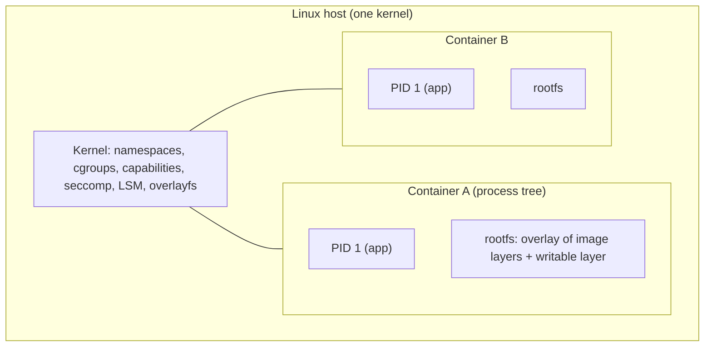
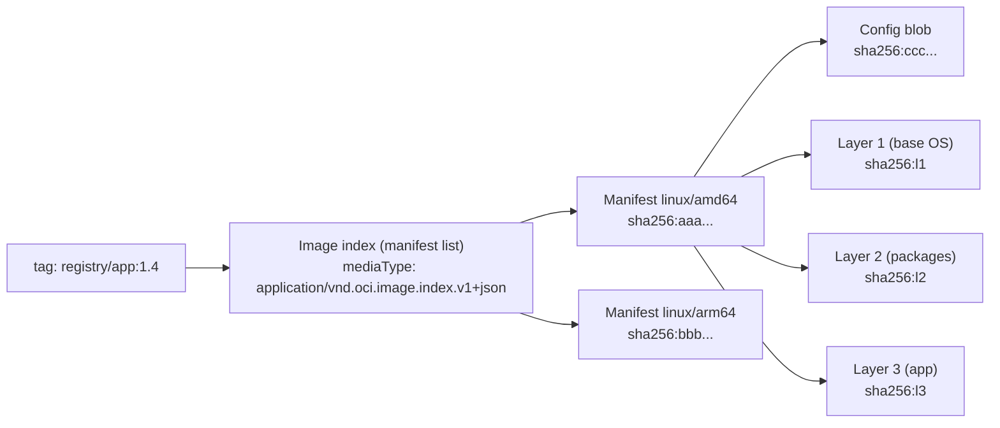
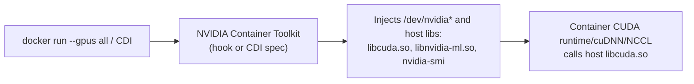

# 5.1 Containers from first principles: images, layers, registries

| | |
|---|---|
| Level | Beginner to intermediate |
| Priority tier | 0 |
| Lab venue | Docker Engine or Podman; `skopeo`, `crane`, `dive`, `buildah` optional; an NVIDIA GPU host with the container toolkit for the GPU exercise |
| Part | Part 5: Kubernetes |
| Status | Drafted, labs **untested** |

## Why this matters for AI infrastructure

Every training job, inference server and platform component in this handbook ships as a container image. A PyTorch image is routinely 10 to 30 GB; pulling it onto 500 nodes at once can saturate a registry and delay a job by an hour; a stale CUDA userspace inside an image can break against a newer host driver; a layer ordering mistake rebuilds a 20-minute dependency install on every code change; an image from an unverified registry is a supply-chain risk. Kubernetes (the rest of Part 5) schedules containers, but cannot fix any of that. Understanding what a container actually is, how images are structured and distributed, and how to build small, fast, reproducible, secure images is the foundation for everything after it.

## Prerequisites and outcomes

Needs Linux fundamentals from Part 1, especially namespaces and cgroups (1.19, 1.20), the filesystem chapters, and the process model. After this chapter you can:

- Explain that a container is an ordinary Linux process (or process tree) isolated with namespaces, limited with cgroups, given a different root filesystem, and restricted with capabilities, seccomp and LSM profiles; and that images are just layered tarballs plus metadata.
- Describe the OCI Image Spec (manifests, indexes, config, layers, digests, media types) and OCI Runtime Spec (`config.json`, bundles) and how they relate to Docker, containerd and CRI-O.
- Inspect images and registries with `docker`/`podman`, `skopeo`, `crane`; read manifests and layer digests; understand content addressing and deduplication.
- Write efficient, reproducible Dockerfiles (layer ordering, multi-stage builds, BuildKit cache and secret mounts, multi-architecture builds, non-root users, minimal bases) and know the trade-offs of distroless, scratch, Alpine and Debian/Ubuntu bases.
- Operate registries: pull-through caches, mirrors, authentication, tags vs digests, retention, replication; apply image-pull strategies for large GPU images.
- Apply baseline image security: scanning, SBOMs, signing, rootless operation, dropping capabilities.
- Describe how GPU containers work (NVIDIA Container Toolkit, driver/userspace split, CUDA base images, compatibility rules).

## 1. What a container is

A container is not a lightweight virtual machine and not a kernel feature called "container". It is a **process started with a set of kernel isolation and limit mechanisms applied**, running from a **root filesystem assembled from an image**.



| Mechanism | What it provides | Typical container setting |
|---|---|---|
| **PID namespace** | Own process tree; app is PID 1 | `docker run` default |
| **Mount namespace + `pivot_root`** | Own filesystem view (the image rootfs) | Overlay mount of layers |
| **Network namespace** | Own interfaces, IPs, routes, ports | veth pair to a bridge (5.13) |
| **UTS / IPC namespaces** | Own hostname; own SysV IPC/POSIX queues | default |
| **User namespace** | UID/GID remapping (root inside = unprivileged outside) | rootless Podman, some runtimes |
| **Cgroup namespace** | Virtualised view of the cgroup tree | default on cgroup v2 |
| **cgroups (v2)** | Limits and accounting: CPU, memory, I/O, PIDs, devices | `--cpus`, `--cpu-shares`, `--memory`, `--memory-swap`, `--pids-limit` |
| **Capabilities** | Split root privileges; containers drop most by default | `--cap-drop ALL --cap-add NET_BIND_SERVICE` |
| **seccomp** | Syscall filter (default profile blocks ~40 risky calls) | `--security-opt seccomp=...` |
| **AppArmor / SELinux** | Mandatory access control profiles | distro defaults |
| **overlayfs** | Union of read-only layers + writable upper layer, copy-on-write | storage driver |

Prove it to yourself on any Linux box:

```bash
docker run -d --name demo --memory 256m --cpus 0.5 nginx:1.27
PID=$(docker inspect -f '{{.State.Pid}}' demo)       # PID in the HOST namespace
ps -o pid,ppid,cmd -p $PID                            # an ordinary nginx process on the host
ls -l /proc/$PID/ns                                   # namespace inodes: compare with `ls -l /proc/self/ns`
cat /proc/$PID/cgroup                                 # which cgroup it lives in
cat /sys/fs/cgroup/system.slice/docker-$(docker inspect -f '{{.Id}}' demo).scope/memory.max     # 268435456 (cgroup v2, systemd driver)
sudo nsenter -t $PID -n ip addr                       # enter its network namespace from the host
sudo nsenter -t $PID -m ls /                          # enter its mount namespace: the image rootfs
```

Consequences worth remembering: the container shares the **host kernel** (kernel version, sysctls like `net.core.*`, modules, `dmesg`, GPU kernel driver); container escapes are kernel/runtime vulnerabilities, not "hypervisor escapes"; resource limits are cgroup settings enforced by the kernel (memory limit exceeded means OOM kill of a process inside that cgroup); PID 1 inside a container has special signal and zombie-reaping semantics (use `--init`/`tini` for apps that fork); and "it works in the container" says little about kernel-dependent behaviour such as RDMA, huge pages, or NUMA, which depend on the host.

## 2. Images: layers, content addressing and the OCI formats

An **image** is a bundle of: (1) an ordered list of **filesystem layers** (compressed tar archives of changes), (2) a **config** JSON (environment, entrypoint, cmd, user, working directory, exposed ports, labels, history, the list of layer diff IDs), and (3) a **manifest** that references the config and layers by **digest**. A multi-platform tag points to an **index** (manifest list) that references one manifest per OS/architecture.



- **Content addressing**: every blob is named by the SHA-256 of its bytes (`sha256:...`). Identical layers across images are stored and transferred once; a changed layer changes its digest and the digests of everything referencing it. A **tag** is a mutable pointer; a **digest** (`image@sha256:...`) is immutable. For reproducibility and supply-chain integrity deploy by digest.
- **Layers** correspond to Dockerfile instructions that change the filesystem (`RUN`, `COPY`, `ADD`); `ENV`, `LABEL`, `CMD` change metadata only. Layers are additive: deleting a file in a later layer **hides** it (a whiteout entry) but the bytes remain in the earlier layer, so `RUN rm bigfile` does not shrink the image; cleanup must happen in the same `RUN` that created the files, or use multi-stage builds.
- **Union filesystem**: at run time the runtime mounts layers read-only with an **overlayfs** upper writable layer (copy-on-write). Writes go to the container layer, vanish with the container, and are slow for write-heavy workloads: use volumes for data, checkpoints and scratch.
- **OCI specifications (`PK` Chapter 3 & `KUR` Chapter 2):** In June 2015, Docker, CoreOS, and industry leaders formed the **Open Container Initiative (`OCI`)** under the Linux Foundation (`PK` Chapter 3) to standardize container formats across tools through the *Image Spec* (layout, manifest `application/vnd.oci.image.manifest.v1+json`, index `application/vnd.oci.image.index.v1+json`, config `application/vnd.oci.image.config.v1+json`, layer media types such as `application/vnd.oci.image.layer.v1.tar+gzip`/`+zstd`), the *Runtime Spec* (an unpacked filesystem bundle containing `rootfs/` + `config.json` with `ociVersion`, `process`, `mounts`, `linux.namespaces`, `linux.resources` executed by a runtime like `runc`, `crun` or `kata`), and the *Distribution Spec* (HTTP API for registries). Docker's older formats are compatible. Chapter 5.2 covers how containerd/CRI-O use these.
- **How layer inheritance and ordering work (`KUR` Chapter 2):** As Brendan Burns, Joe Beda, Kelsey Hightower, and Lachlan Evenson explain in *Kubernetes: Up and Running* Chapter 2, container images eliminate traditional shared-library "dependency hell" on a host by packaging an application's exact runtime into a tree of reusable read-only layers (for example, Layer A = Debian base OS -> Layer B = Ruby `v2.1.10` -> Layer D = Rails `v4.2.6` and Layer E = Rails `v3.2.x`, where both D and E share layers A and B on disk and over the network). Crucially, **changing a layer invalidates the build cache for every subsequent layer built on top of it**: in `KUR` Chapter 2's Node.js Express (`package.json` + `server.js`) and `kuard` (`golang:1.17-alpine` build stage -> `alpine` deployment stage) examples, copying `package*.json` and running `npm install --production` *before* `COPY . .` ensures that editing `server.js` only rebuilds the tiny final layer, and using a **multi-stage build** leaves the Go compiler, `nodejs`, `npm`, and `git` behind in Stage 1 while copying only `/go/bin/kuard` into Stage 2 (modeled in `code/part05/oci_image_layers.py`).

Inspect with standard tools:

```bash
docker image inspect nginx:1.27 | jq '.[0] | {Id, RepoDigests, Os, Architecture, Config: .Config.Entrypoint}'
docker history --no-trunc --format '{{.Size}}\t{{.CreatedBy}}' nginx:1.27 | head
skopeo inspect docker://docker.io/library/nginx:1.27                   # remote, no pull
skopeo inspect --raw docker://docker.io/library/nginx:1.27 | jq .      # raw index/manifest
crane manifest nginx:1.27 | jq '.manifests[] | {platform, digest}'      # list platforms (index)
crane config nginx:1.27@sha256:<digest> | jq '.rootfs.diff_ids'         # layer diff IDs
crane export nginx:1.27 - | tar -tvf - | head                            # flattened filesystem listing
dive nginx:1.27                                                          # interactive layer explorer
docker save nginx:1.27 -o nginx.tar && tar -tf nginx.tar                 # see blobs/ index.json manifest.json layout
```

### Layout on disk

An OCI layout directory has `oci-layout`, `index.json`, and `blobs/sha256/<digest>` files; Docker's local store and containerd's content store hold the same blobs under `/var/lib/docker` or `/var/lib/containerd`. Because blobs are immutable and shared, "disk used by images" is the union of unique blobs plus snapshots (unpacked layers) per snapshotter; image garbage collection removes unreferenced blobs.

## 3. Building images well

### Dockerfile mechanics

```dockerfile
# syntax=docker/dockerfile:1.7
FROM python:3.12-slim AS base
ENV PYTHONDONTWRITEBYTECODE=1 PYTHONUNBUFFERED=1 PIP_NO_CACHE_DIR=1
WORKDIR /app

FROM base AS builder
RUN --mount=type=cache,target=/var/cache/apt --mount=type=cache,target=/var/lib/apt \
    apt-get update && apt-get install -y --no-install-recommends build-essential && rm -rf /var/lib/apt/lists/*
COPY requirements.lock .
RUN --mount=type=cache,target=/root/.cache/pip pip wheel --wheel-dir /wheels -r requirements.lock

FROM base AS runtime
RUN useradd --uid 10001 --create-home app
COPY --from=builder /wheels /wheels
RUN pip install --no-index --find-links=/wheels /wheels/*.whl && rm -rf /wheels
COPY --chown=app:app src/ ./src/
USER 10001
EXPOSE 8000
HEALTHCHECK --interval=30s --timeout=3s CMD python -c "import urllib.request; urllib.request.urlopen('http://127.0.0.1:8000/healthz')"
ENTRYPOINT ["python", "-m", "uvicorn", "src.main:app", "--host", "0.0.0.0", "--port", "8000"]
```

Principles:

1. **Order layers from least to most frequently changing.** Base OS, system packages, dependency manifests and installs, then application code last. Copy `requirements.lock` before the source so dependency installation is cached until it changes.
2. **Use multi-stage builds**: compile and build in a fat stage; copy only artefacts into a slim runtime stage (smaller images, fewer CVEs, no compilers or secrets in the final image).
3. **Combine create-and-clean in one `RUN`** (`apt-get update && apt-get install ... && rm -rf /var/lib/apt/lists/*`) or use BuildKit cache mounts so caches never land in layers.
4. **Pin bases and dependencies** (digest for the base image, lockfiles with hashes) for reproducibility; update on a schedule via automation (Renovate/Dependabot).
5. **Run as non-root** (`USER` numeric UID), read-only root filesystem at run time, drop capabilities, no `--privileged`.
6. **Prefer `COPY` to `ADD`** (ADD auto-extracts and fetches URLs; surprising). Use `.dockerignore` to exclude `.git`, datasets, virtualenvs, secrets, and build outputs (a leak of `.env` into a layer is permanent).
7. **Exec-form `ENTRYPOINT`/`CMD`** (JSON arrays) so signals reach your process; shell form wraps in `/bin/sh -c`, and `SIGTERM` may not reach the app, breaking graceful shutdown in Kubernetes.
8. **One main process per container**; use `tini`/`--init` when the process spawns children.
9. **Secrets**: never `ARG`/`ENV` secrets (they persist in history/metadata); use `RUN --mount=type=secret,id=pip_token` (BuildKit) or SSH agent mounts for private repos; they are not stored in layers.
10. **Metadata**: OCI labels (`org.opencontainers.image.source`, `.revision`, `.version`, `.created`) enable traceability; set `HEALTHCHECK` for Docker/Compose (Kubernetes uses probes instead).
11. **Reproducibility**: `SOURCE_DATE_EPOCH`, deterministic ordering, pinned packages (`apt-get install pkg=version`), no `latest`; consider Nix/Bazel/ko/Jib for fully reproducible builds.
12. **Language-specific**: Python (wheels, `uv`/pip with hashes, avoid compiling at runtime); Go (static binary into `scratch`/distroless); Java (Jib); Node (npm ci, production deps only).

### BuildKit, buildx and builders

BuildKit is the modern build engine (default in current Docker): parallel stage execution, cache mounts, secret/SSH mounts, remote cache import/export (`--cache-to type=registry,ref=...`, `type=gha`, `type=s3`), multi-platform builds (`docker buildx build --platform linux/amd64,linux/arm64 --push`), SBOM and provenance attestations (`--sbom=true --provenance=mode=max`). Alternatives: `podman build`/`buildah` (daemonless, rootless), `kaniko` and `buildah` in-cluster, `ko`, `Bazel rules_oci`, `Cloud Native Buildpacks` (`pack`), `img`. CI builds should use remote cache and run in isolated, ephemeral builders (4.2).

### Image size and startup

Large images cost network, registry, disk and time-to-start. Techniques: slim/distroless bases; multi-stage; remove build tools; strip binaries; avoid copying whole datasets into images (mount or download at start); share base layers across images so nodes already hold them; compress with `zstd` (faster decompression than gzip); lazy pulling snapshotters (stargz/eStargz, SOCI, Nydus, OverlayBD) start containers before the whole image is downloaded (important for multi-GB ML images). For GPU images, share one CUDA/PyTorch base layer across all teams' images.

### Choosing a base

| Base | Pros | Cons |
|---|---|---|
| `scratch` | Smallest; only your static binary | No shell, no CA certs/timezones unless copied, hard to debug |
| Distroless (`gcr.io/distroless/*`, Chainguard images) | No shell/package manager; minimal CVE surface; includes certs | Debugging needs ephemeral containers (`kubectl debug`); glibc/musl choices |
| Alpine | Tiny, fast pulls | musl libc: Python wheels, glibc-linked binaries (CUDA!) and DNS behaviour issues; avoid for ML |
| Debian/Ubuntu slim | Compatible with manylinux wheels and NVIDIA binaries | Larger; more packages to patch |
| UBI / RHEL-compatible | Enterprise support, FIPS options | Licensing/registry considerations |
| NVIDIA NGC and CUDA images | CUDA, cuDNN, NCCL, TensorRT, PyTorch pre-integrated and tested | Very large; follow NVIDIA's release cadence and compatibility rules |

## 4. Registries and distribution

A registry implements the OCI Distribution API: `GET /v2/<name>/manifests/<reference>`, `GET /v2/<name>/blobs/<digest>`, chunked/monolithic blob uploads, tag listing, and (optionally) referrers for attached artefacts (signatures, SBOMs). Examples: Docker Hub, GHCR, Quay, GCP Artifact Registry, AWS ECR, Azure ACR, NVIDIA NGC (`nvcr.io`), Harbor (self-hosted with scanning, replication, RBAC, quotas), Artifactory, Nexus, `registry:2`/distribution, Zot.

Pull path (`docker pull ghcr.io/org/app:1.4`): resolve tag → get index → choose platform manifest → get config → download missing layers in parallel (HTTP range-capable, with auth bearer tokens) → verify digests → decompress and unpack into the snapshotter. The tag is resolved at pull time, so **tags can change under you**; digests cannot.

Operational points for GPU clusters:

- **Pull storms**: hundreds of nodes pulling a 20 GB image simultaneously overload the registry and uplink. Mitigate with a **pull-through cache/mirror** inside the cluster network (Harbor proxy cache, registry mirror, containerd `hosts.toml` mirrors), **pre-pulling** with a DaemonSet or image-puller, **P2P distribution** (Dragonfly, Kraken, Spegel), regional replication, lazy-pull snapshotters, and keeping base layers shared. Also set `imagePullPolicy: IfNotPresent` and deploy by digest/immutable tags so cached images are valid.
- **Authentication**: use short-lived credentials (workload identity, IAM roles, `imagePullSecrets` from a secret manager); never bake registry passwords; rotate.
- **Retention and immutability**: enable tag immutability for release tags, retention rules for CI tags, garbage collection schedules; keep the digest of what ran in production for rollback and forensics.
- **Rate limits**: Docker Hub imposes pull limits; mirror critical base images into your own registry and pin to your copy.
- **Replication and availability**: registry outage blocks scale-up and rescheduling; run HA, replicate across regions, and know your degraded-mode plan (nodes with cached images can still start pods that use `IfNotPresent`).
- **Artefacts beyond images**: Helm charts (OCI), SBOMs, signatures (cosign), model weights as OCI artefacts (ORAS, KitOps), WASM modules.

```bash
# configure containerd mirror (hosts.toml) for a pull-through cache
# /etc/containerd/certs.d/docker.io/hosts.toml
server = "https://registry-1.docker.io"
[host."https://registry-cache.internal:5000"]
  capabilities = ["pull", "resolve"]
```

## 5. Rootless containers and security basics

- **Rootless mode** (Podman, rootless Docker, rootless containerd/nerdctl, BuildKit rootless) runs the runtime and containers under an unprivileged user using user namespaces (`/etc/subuid`, `/etc/subgid`), slirp4netns/pasta for networking and fuse-overlayfs or native overlay on modern kernels. Benefit: a runtime or container escape yields an unprivileged user. Limits: privileged ports, some cgroup limits (need cgroup v2 delegation), performance of rootless networking, GPU access requires device and permission setup (CDI helps).
- **Image vulnerability scanning**: Trivy, Grype, Clair, Snyk; scan on build and on a schedule against deployed digests (new CVEs appear after build). Policy: fail builds on critical CVEs with fixes available; track exceptions with expiry.
- **SBOM**: generate (Syft, BuildKit `--sbom`, `docker sbom`) and store with the image; enables fast "are we affected?" queries.
- **Signing and verification**: cosign (Sigstore) keyless or key-based signatures stored in the registry; verify at admission (Kyverno, policy-controller, Ratify) (5.27).
- **Runtime hardening**: read-only rootfs, drop all capabilities then add back, `no-new-privileges`, seccomp RuntimeDefault, AppArmor/SELinux, non-root UID, no host namespaces or privileged mode, resource limits; in Kubernetes Pod Security Standards enforce these (5.21).
- **Supply chain hygiene**: trusted bases, pinned digests, no `curl | sh` in builds, verify checksums/signatures of downloaded artefacts, minimal build contexts, ephemeral builders, provenance attestations (SLSA).
- **Secrets**: not in images or environment dumps; mounted at runtime (5.16).

## 6. GPU containers

A container cannot contain a GPU driver: the **kernel driver** and its device nodes live on the host; the container carries the **userspace libraries** (CUDA runtime, cuDNN, NCCL) it was built with. The glue is the **NVIDIA Container Toolkit**:



- The image provides **CUDA toolkit runtime libraries** (`libcudart`, `cublas`, `cudnn`, `nccl`); the host provides **`libcuda.so` and the kernel module**, mounted in by the toolkit at start. That split is why one host driver serves many CUDA versions.
- **Compatibility rules**: the host driver version must be **at least** the minimum required by the CUDA version in the image (newer drivers support older CUDA runtimes); the CUDA *forward compatibility* packages (`cuda-compat`) allow newer CUDA runtime on older data-centre drivers within limits; features requiring new drivers (new GPU architectures such as Blackwell) need new driver branches. Check NVIDIA's compatibility tables; mismatches show as `CUDA driver version is insufficient for CUDA runtime version` or `no kernel image is available for execution on the device` (compute capability not compiled in).
- **Selecting devices**: `--gpus all`, `--gpus '"device=0,1"'`, `NVIDIA_VISIBLE_DEVICES`, `NVIDIA_DRIVER_CAPABILITIES` (`compute,utility,video`), MIG devices by UUID. The modern, runtime-agnostic mechanism is **CDI (Container Device Interface)**: `nvidia-ctk cdi generate --output=/etc/cdi/nvidia.yaml`, then `--device nvidia.com/gpu=all` (Docker 25+/Podman/containerd/CRI-O). Kubernetes uses the device plugin and, increasingly, CDI/DRA (Part 11).
- **Base images**: `nvidia/cuda:12.x-runtime-ubuntu22.04` (runtime), `-devel` (compilers), `-cudnn-runtime`; NGC containers (`nvcr.io/nvidia/pytorch:24.xx-py3`, `tritonserver`, `nemo`) are curated, tested together and updated monthly; they are huge, so build your own images **on top** of them, with application layers last.
- **Shared memory and IPC**: PyTorch DataLoader and NCCL need large `/dev/shm`; Docker default is 64 MB (`--shm-size`/`--ipc=host`); in Kubernetes mount a memory-backed `emptyDir` at `/dev/shm` (5.7, Part 14). Also `--ulimit memlock=-1` and `--cap-add IPC_LOCK` for RDMA pinned memory; InfiniBand devices (`/dev/infiniband`) and the RDMA stack require specific mounts or the Network Operator in Kubernetes (Part 12).
- **Image design for ML**: separate stable layers (CUDA/PyTorch base), pinned Python deps (lockfile), then code; keep datasets and checkpoints out of images; avoid `pip install` at container start; run as non-root where libraries allow; include health endpoints and a clean SIGTERM handler for checkpoint-on-preempt.

Quick check:

```bash
docker run --rm --gpus all nvcr.io/nvidia/cuda:12.4.1-base-ubuntu22.04 nvidia-smi
docker run --rm --gpus all nvcr.io/nvidia/pytorch:24.05-py3 python -c "import torch; print(torch.cuda.is_available(), torch.cuda.device_count(), torch.version.cuda)"
docker run --rm --device nvidia.com/gpu=all ubuntu:22.04 ls /dev/nvidia*       # CDI style (after `nvidia-ctk cdi generate`)
```

## 7. Container lifecycle commands (cheat sheet)

```bash
docker run -d --name web -p 8080:80 --restart unless-stopped --memory 512m --cpus 1 nginx:1.27
# In the book's (*Kubernetes: Up and Running*, Chapter 2) example: cap memory + swap and set relative CPU weight with --cpu-shares (untested here)
docker run -d --name kuard --publish 8080:8080 --memory 200m --memory-swap 1G --cpu-shares 1024 gcr.io/kuar-demo/kuard-amd64:blue
docker ps -a; docker logs -f --tail 100 web; docker exec -it web sh
docker stats --no-stream; docker top web; docker inspect web | jq '.[0].HostConfig'
docker stop web   # SIGTERM then SIGKILL after grace (default 10s); `--time` to change
docker kill -s HUP web
docker cp web:/etc/nginx/nginx.conf ./; docker diff web                 # writable-layer changes
docker commit web web:debug                                              # snapshot (debugging only; not a build method)
docker volume create data && docker run -v data:/var/lib/app app         # named volume; -v /host/path:/c/path for bind mounts
docker network create appnet && docker run --network appnet --name db postgres:16
docker system df; docker image prune -a --filter "until=168h"            # disk usage and cleanup
docker run --rm --read-only --tmpfs /tmp --cap-drop ALL --security-opt no-new-privileges --user 10001:10001 app:1.4   # hardened run
podman run --rm -it --userns=keep-id alpine id                           # rootless
```

Note the distinction between `--cpus` (a hard CFS quota limit on CPU cores) and `--cpu-shares` (relative CPU weight under contention, where `1024` is the default share weight, corresponding to Kubernetes `resources.requests.cpu`), and between `--memory` (RAM limit, `200m` in the book's example) and `--memory-swap` (combined RAM plus swap limit, `1G` in the book's example).

Podman is CLI-compatible with Docker (`alias docker=podman`), daemonless (fork/exec per container), supports pods (`podman pod`) and generates Kubernetes YAML (`podman generate kube`) and systemd units / Quadlet files.

## 8. Troubleshooting images and containers

| Symptom | Likely cause | Check |
|---|---|---|
| `exec format error` | Wrong architecture (arm64 image on amd64 or vice versa); script without shebang | `docker image inspect --format '{{.Architecture}}'`, `crane manifest` platforms, build with `--platform` |
| `permission denied` writing files | Non-root user vs volume ownership; read-only rootfs | `id`, `ls -ln`, `securityContext.fsGroup` in Kubernetes |
| Container exits immediately | PID 1 finished (CMD ran and ended), crash, missing entrypoint | `docker logs`, `docker inspect .State`, run with `sh` |
| Ignores SIGTERM, slow stop (10 s) | Shell-form CMD, app doesn't handle signals, PID 1 semantics | exec-form, `--init`, handle SIGTERM |
| `OOMKilled: true` | Memory limit exceeded (cgroup) | `docker inspect .State.OOMKilled`, `dmesg`, raise limit/leak fix |
| Pull slow or fails | Registry rate limits, auth, huge layers, DNS/proxy | `docker pull -v`, `skopeo`, mirror, retry, check TLS/certs |
| Image huge | Layers with build tools/caches; deleting files later | `dive`, multi-stage, same-layer cleanup |
| Build cache never hits | Layer order, changing `COPY . .` early, timestamps | Reorder, `.dockerignore`, check BuildKit cache |
| `CUDA driver version is insufficient` | Host driver older than image CUDA needs | `nvidia-smi` on host vs image CUDA, upgrade driver or use compat |
| `no kernel image is available` | Binary built without your GPU's compute capability | Rebuild with `-arch`/TORCH_CUDA_ARCH_LIST, use newer framework build |
| `bash: nvidia-smi: not found` in container | Toolkit/runtime not configured, `NVIDIA_DRIVER_CAPABILITIES` lacks `utility` | `nvidia-ctk runtime configure`, CDI generate |
| DNS inside container fails | Host resolv.conf with 127.0.0.53, network namespace DNS config | `docker run --dns`, inspect `/etc/resolv.conf` |

## 9. Lab

First, run the self-checking Python lab (`code/part05/oci_image_layers_lab.py`) locally. It verifies the OCI additive layer and `.wh.` whiteout size calculator (`simulate_oci_layer_sizes`, demonstrating why `RUN rm` in a later layer hides a 500 MB file in `overlayfs` while still shipping all 500 MB in the image tarball, `KUR` Ch. 2), the Dockerfile layer cache-invalidation simulator (`simulate_dockerfile_cache_hits`), and the NVIDIA host driver vs container CUDA runtime compatibility checker (`check_cuda_driver_compatibility`).

```bash
python3 code/part05/oci_image_layers_lab.py
```

Next, on a Linux host with Docker or Podman (all interactive shell steps below are `untested here`), work through these exercises:

1. **Container is a process**: run a container, find its host PID, list `/proc/<pid>/ns`, `cgroup`, `status` (CapEff, NoNewPrivs, Seccomp); `nsenter` into net and mount namespaces; show that `kill -STOP` on the host PID freezes the container; set a memory limit and trigger an OOM kill (a small Python allocator) and read `OOMKilled`.
2. **Build a container by hand**: create a rootfs with `debootstrap` or from `docker export`, use `unshare --mount --pid --net --uts --ipc --fork`, `chroot`/`pivot_root`, mount `/proc`, and run a shell; add a cgroup v2 directory with `memory.max` and `pids.max` and move the process in; compare with `runc spec` + `runc run` on the same rootfs.
3. **Image anatomy**: `docker save` an image; extract `manifest.json`, config and layers; recompute layer sha256; list layer contents; show the whiteout entry created by `RUN rm`; compare sizes with and without same-layer cleanup.
4. **Registry inspection**: with `crane`/`skopeo`, list tags, read index and manifests for a multi-arch image, copy an image between registries by digest (`skopeo copy`), and run a local `registry:2`, push, and pull with and without TLS/auth.
5. **Dockerfile optimisation**: take a naive Dockerfile (one big `RUN`, `COPY . .` first, `latest` tags, root user) for a small FastAPI app; measure build time and image size; refactor with layer ordering, multi-stage, BuildKit cache mounts, non-root user and `.dockerignore`; rebuild after a code-only change and verify cache hits.
6. **Secrets in builds**: demonstrate a leaked token via `ARG` in `docker history`; fix with `RUN --mount=type=secret`; scan layers for the secret with `dive`/`trufflehog`.
7. **Multi-arch**: `docker buildx build --platform linux/amd64,linux/arm64 --push`; inspect the index with `crane manifest`; run the arm64 image under `qemu-user-static`.
8. **Security**: run Trivy/Grype on the image; generate an SBOM; sign with cosign (keyless or a local key) and verify; run the hardened-run flags and show which operations then fail.
9. **Rootless**: install Podman, run rootless; compare `/proc/self/uid_map`; try binding port 80; inspect storage under `~/.local/share/containers`; generate a Quadlet unit.
10. **Pull behaviour**: pull a large image on a throttled link; run a local registry mirror/pull-through cache (Harbor/`registry:2` proxy) and measure a second node's pull; configure containerd `hosts.toml` mirror.
11. **GPU container (needs a GPU host)**: install the NVIDIA Container Toolkit; run `nvidia-smi` in a CUDA image; generate a CDI spec and use `--device nvidia.com/gpu=all`; test driver/CUDA mismatch behaviour with an old driver or a deliberately new CUDA image; set `--shm-size` and show a PyTorch DataLoader failing with the default 64 MB.
12. **Clean up**: `docker system prune -a`, remove volumes and test registries.

## 10. Common mistakes

- Treating containers as VMs: expecting kernel isolation, ignoring that the kernel is shared; running everything as root or privileged.
- Using mutable tags (`latest`) in production; no digest pinning; unreviewed bases.
- Ordering Dockerfile instructions so every code change busts the dependency cache.
- Deleting files in later layers and expecting a smaller image; leaving build tools and caches in the runtime image.
- Secrets in `ENV`/`ARG`/layers or in the build context.
- Shell-form `CMD`/`ENTRYPOINT`; apps that ignore SIGTERM; zombie processes.
- Writing important data into the container layer instead of volumes.
- No registry strategy: Docker Hub rate limits, pull storms, single registry region.
- Alpine for CUDA/PyTorch workloads; mixing CUDA versions between image and host driver without checking compatibility.
- Baking datasets or checkpoints into images.
- Ignoring `/dev/shm`, `memlock` and IPC settings for ML workloads.
- Scanning only at build time.

## 11. Interview angles

- "What is a container, really? Which kernel features does it use?"
- "What is in an image? What is a layer, a manifest, an index, a digest? Why are digests safer than tags?"
- "Why doesn't `RUN rm` shrink an image? How would you shrink one?"
- "How would you speed up builds in CI? How do BuildKit cache mounts work?"
- "How do GPUs work inside a container? What must match between host and image?"
- "How do you avoid pull storms when 500 nodes need a 20 GB image?"
- "Rootless vs rootful containers; what are the trade-offs?"
- "What happens on `docker run` step by step?" (client → daemon → containerd → shim → runc; pull, unpack, create namespaces and cgroups, exec.)
- "How would you debug a container that exits immediately or is OOM-killed?"

## Exercises

1. **Linux Kernel Primitives Behind a Container (Namespaces, Cgroups v2, Capabilities, Seccomp, LSMs, `overlayfs`, `KUR` Ch. 2 & `PK` Ch. 3):** Trace what happens on the host kernel when `docker run -d --name demo --memory 256m --cpus 0.5 nginx:1.27` (or `--memory 200m --memory-swap 1G --cpu-shares 1024` in `KUR` Chapter 2) executes: list all 7 namespaces, contrast `--cpus` (hard CFS quota) with `--cpu-shares` (`1024` relative weight), and explain how `nsenter -t $PID -n/-m` inspects a container from the host.
2. **OCI Image Specification (`Image Index`, `Manifest`, `Config`, `Layers`), Content Addressing, and the Whiteout Trap (`KUR` Ch. 2 & `PK` Ch. 3):** Using `simulate_oci_layer_sizes()` in `code/part05/oci_image_layers.py`, explain the JSON hierarchy from an OCI Image Index (`application/vnd.oci.image.index.v1+json`) down to layer blobs (`sha256:...`), why tags are mutable while digests (`@sha256:...`) are immutable, and why deleting a 500 MB file in a later `RUN rm` layer hides the file in `overlayfs` without reducing the image download size.
3. **Writing Fast, Small, Secure Dockerfiles: Layer Ordering, Multi-Stage Builds (`kuard` & Python Wheels), and BuildKit Mounts (`KUR` Chapter 2):** Using `simulate_dockerfile_cache_hits()` in `code/part05/oci_image_layers.py`, trace why copying `requirements.lock` (or `package*.json`) before `src/` preserves build-cache hits on code edits, how `KUR` Chapter 2's `kuard` multi-stage build and Section 3's Python wheel builder shrink production images, and how `RUN --mount=type=cache` and `RUN --mount=type=secret` work.
4. **Choosing Base Images (`scratch`, `distroless`, `Alpine`, `Debian/Ubuntu`, `NVIDIA NGC`) and Exec-Form Signal Handling (`PID 1`):** Explain why `Alpine` (`musl` libc) breaks `glibc`-compiled Python wheels and NVIDIA CUDA binaries, why shell-form `ENTRYPOINT "python app.py"` swallows `SIGTERM` during Kubernetes pod termination (causing a 30-second hang followed by `SIGKILL`), and when to use `--init` / `tini`.
5. **Operating Registries at GPU Cluster Scale: Pull Storms, Pull-Through Caches (`hosts.toml`), P2P Distribution, and Lazy Pulling:** Design a registry architecture for a 500-node GPU cluster pulling a 25 GB PyTorch training image simultaneously—combining `containerd` `hosts.toml` pull-through mirrors (Harbor), P2P distribution (`Spegel` / `Dragonfly`), `zstd` compression, lazy-pulling snapshotters (`eStargz` / `SOCI` / `Nydus`), and shared base layers.
6. **GPU Containers Under the Hood: `libcuda.so` vs. `libcudart.so`, NVIDIA Container Toolkit, CDI (`nvidia-ctk cdi generate`), and `/dev/shm`:** Using `check_cuda_driver_compatibility()` in `code/part05/oci_image_layers.py`, explain the boundary between the host kernel driver (`nvidia.ko` + `libcuda.so`) and the container user-space libraries (`libcudart.so`, `libnccl.so`), state the forward/backward version compatibility rules, show how CDI (`--device nvidia.com/gpu=all`) works, and explain why PyTorch DataLoaders and NCCL fail with Docker's default 64 MB `/dev/shm`.

## Checkpoint questions (20)

<details>
<summary>1. What is a Linux container at the kernel level, and why is \"a container is a lightweight VM\" a dangerous misconception?</summary>

A container is **an ordinary Linux process (or process tree) running directly on the host kernel**, isolated from other processes by **Linux namespaces** (`pid`, `mnt`, `net`, `uts`, `ipc`, `user`, `cgroup`), resource-bounded by **cgroups (v2)**, rooted in an **`overlayfs` union mount** (`pivot_root`), and restricted by **Linux capabilities, seccomp syscall filters, and AppArmor/SELinux**. Unlike a VM (which boots its own guest kernel on virtualized hardware via a hypervisor), all containers on a node **share the single host kernel**—so kernel panics, non-namespaced sysctls, kernel module versions (`nvidia.ko`, `mlx5_core.ko`), and `dmesg` are shared across the entire host.
</details>

<details>
<summary>2. In *Kubernetes: Up and Running* Chapter 2, how do Docker's `--cpus`, `--cpu-shares`, `--memory`, and `--memory-swap` flags map to Linux cgroups?</summary>

- **`--cpus 0.5`** (cgroup v2 `cpu.max`): enforces a **hard CPU bandwidth ceiling** (throttling the container via the Completely Fair Scheduler `CFS` even if host CPUs are idle; maps to Kubernetes `resources.limits.cpu`).
- **`--cpu-shares 1024`** (cgroup v2 `cpu.weight`): sets a **relative proportional weight** that takes effect *only when host CPUs are contended* (`1024` is the default weight; maps to Kubernetes `resources.requests.cpu`).
- **`--memory 200m`** (cgroup v2 `memory.max`): sets the hard physical RAM ceiling (`200 MiB`); exceeding it triggers the kernel **OOM killer (`OOMKilled: true`)** inside the container's cgroup.
- **`--memory-swap 1G`**: sets the combined ceiling of physical RAM plus swap (`200 MiB` RAM + `824 MiB` swap).
</details>

<details>
<summary>3. Trace the four JSON/blob objects in the OCI Image Specification (`PK` Chapter 3): Image Index, Image Manifest, Image Config, and Layers.</summary>

1. **Image Index (`application/vnd.oci.image.index.v1+json`):** Optional top-level multi-architecture manifest list mapping each `(os, architecture)` platform (`linux/amd64`, `linux/arm64`, `linux/ppc64le`) to the SHA-256 digest of its platform-specific manifest.
2. **Image Manifest (`application/vnd.oci.image.manifest.v1+json`):** Lists the SHA-256 digest and size of the single **Config** blob plus the ordered array of **Layer** archive blobs for one platform.
3. **Image Config (`application/vnd.oci.image.config.v1+json`):** Stores runtime defaults (`Env`, `Entrypoint`, `Cmd`, `User`, `WorkingDir`, `ExposedPorts`, `Labels`), build `history`, and the uncompressed layer `rootfs.diff_ids`.
4. **Filesystem Layers (`application/vnd.oci.image.layer.v1.tar+gzip` or `+zstd`):** Content-addressed tar archives of filesystem additions/modifications/whiteouts.
</details>

<details>
<summary>4. Why doesn't `RUN rm /tmp/huge_file.tar` in a separate Dockerfile instruction shrink the final image size (`KUR` Chapter 2)?</summary>

Every `RUN`, `COPY`, and `ADD` instruction creates a **new, immutable read-only layer**. If Layer 2 creates `/tmp/huge_file.tar` (500 MB) and Layer 3 runs `RUN rm /tmp/huge_file.tar`, Layer 3 merely writes a 0-byte **`.wh.huge_file.tar` whiteout marker** into the upper `overlayfs` layer to hide the file from the merged directory view—**all 500 MB of bytes remain permanently inside Layer 2's tarball** and are still downloaded on every `docker pull`. Always download, unpack, install, and `rm -rf` temporary files within the **same single `RUN` instruction** (or use a BuildKit `--mount=type=cache` or multi-stage build).
</details>

<details>
<summary>5. Why is deploying by image digest (`app@sha256:669e01...`) safer than deploying by tag (`app:1.4` or `app:latest`)?</summary>

An image **tag** (`:1.4` or `:latest`) is a **mutable pointer** in the registry: anyone with push permission (or a compromised CI pipeline) can overwrite `:1.4` to point to a completely different manifest, causing nodes scaling up tomorrow to run different code than nodes booted today. An image **digest** (`@sha256:...`) is the **cryptographic SHA-256 hash of the manifest bytes itself**: it is mathematically immutable, verified by the runtime on pull, and guarantees every node in a 500-node job runs the exact same bits.
</details>

<details>
<summary>6. How does Dockerfile instruction ordering affect CI build speed (`KUR` Chapter 2)?</summary>

BuildKit/Docker caches each layer based on the instruction string and the checksum of files copied by `COPY`/`ADD`. **As soon as one layer's cache is invalidated, every subsequent layer in that stage must be rebuilt from scratch.** If you write `COPY . .` *before* `RUN pip install -r requirements.lock` (or `npm install`), editing a single line of Python/JS code invalidates `COPY . .` and forces a 10-minute dependency reinstall on every commit. Copying **only `requirements.lock` first**, running `pip install`, and placing `COPY src/ ./src/` last ensures code edits rebuild in 1 second.
</details>

<details>
<summary>7. How do Multi-Stage Builds (`FROM ... AS builder` -> `FROM ... AS runtime` with `COPY --from=builder`, `KUR` Chapter 2) improve both image size and security?</summary>

Compiling C++/CUDA extensions, Go binaries (`kuard` in `KUR` Chapter 2), or Python wheels requires heavy compilers (`gcc`, `g++`, `nvcc`, `build-essential`, `-dev` headers, `git`). In a multi-stage Dockerfile, the `builder` stage installs those compilers and builds `/wheels` (or `/go/bin/kuard`), and the final `runtime` stage starts from a clean slim/distroless base image and copies **only the compiled wheels/binaries** (`COPY --from=builder /wheels /wheels`). None of the compilers, build caches, or intermediate layers from `builder` are shipped in the final image—slashing image size and removing hundreds of potential compiler/library CVEs.
</details>

<details>
<summary>8. Why does passing a secret via `ARG PIP_TOKEN` or `ENV PIP_TOKEN` in a Dockerfile leak the secret, and how does `RUN --mount=type=secret` fix it?</summary>

Values passed to `ARG` or `ENV` are recorded in the **OCI Image Config JSON (`history` and `Config.Env`)**, so anyone who pulls the image and runs `docker history --no-trunc <image>` or `docker inspect <image>` can read the plaintext secret. Using BuildKit's **`RUN --mount=type=secret,id=pip_token`** (`docker build --secret id=pip_token,src=.pip_token .`) mounts the secret as an in-memory `tmpfs` file at `/run/secrets/pip_token` **only for the duration of that single `RUN` command**, leaving zero trace in any image layer or `docker history`.
</details>

<details>
<summary>9. Why must `ENTRYPOINT` and `CMD` use Exec Form (`["python", "-m", "uvicorn", ...]`) instead of Shell Form (`python -m uvicorn ...`)?</summary>

- **Shell form (`ENTRYPOINT python app.py`):** Docker wraps the command as `/bin/sh -c "python app.py"`, making **`/bin/sh` PID 1** inside the container. Most `/bin/sh` implementations (`dash`, `ash`, `bash`) **do not forward `SIGTERM` signals to child processes**. When Kubernetes terminates the pod (`kubectl delete pod`), `SIGTERM` goes to `/bin/sh`, your Python app never hears it, the pod hangs for the entire 30-second `terminationGracePeriodSeconds`, and Kubernetes finally kills it abruptly with `SIGKILL`—corrupting in-flight requests or checkpoints.
- **Exec form (`ENTRYPOINT ["python", "app.py"]`):** Executes `python` directly as **PID 1** without a shell wrapper so `SIGTERM` is delivered straight to your application (or pair with `tini` / `--init` if your app forks subprocesses and doesn't reap zombies).
</details>

<details>
<summary>10. Why should you NEVER use `Alpine Linux` (`musl` libc) as the base image for Python ML, PyTorch, or CUDA containers?</summary>

Alpine Linux uses **`musl` libc** instead of standard GNU **`glibc`**. Pre-compiled Python `manylinux` wheels (`torch`, `numpy`, `scipy`, `triton`) and **all NVIDIA CUDA user-space libraries (`libcudart.so`, `libnccl.so`, `libcuda.so` injected from the host)** are linked against **`glibc`**. On Alpine, `pip` either fails to find `musllinux` wheels (falling back to a multi-hour source compile that fails) or crashes with dynamic linker errors (`Error loading shared library ld-linux-x86-64.so.2`), and `musl`'s memory allocator is significantly slower under multi-threaded Python contention. Always use `ubuntu` or `debian-slim` (or `ubi`) bases for GPU/ML containers.
</details>

<details>
<summary>11. How do GPU containers work: what lives on the Host versus what lives inside the Container Image?</summary>

A container shares the host's Linux kernel, so **a container image cannot load its own kernel driver**:
- **On the Host OS:** The NVIDIA kernel module (`nvidia.ko`, `nvidia-uvm.ko`, `nvidia-peermem.ko`), device nodes (`/dev/nvidia0..7`, `/dev/nvidiactl`, `/dev/nvidia-uvm`), and the user-space **CUDA Driver API library (`libcuda.so`, `libnvidia-ml.so`, `nvidia-smi`)** tightly coupled to that exact kernel module version.
- **Inside the Container Image:** The **CUDA Runtime library (`libcudart.so`)**, math/collective libraries (`cuBLAS`, `cuDNN`, `NCCL`), and ML frameworks (`PyTorch`, `TensorRT`, `vLLM`).
At container start, the **NVIDIA Container Toolkit** bind-mounts `/dev/nvidia*` and `libcuda.so` / `nvidia-smi` from the host into the container's mount namespace.
</details>

<details>
<summary>12. What are the compatibility rules between the Host NVIDIA Driver (`libcuda.so`) and the Container Image's CUDA Runtime (`libcudart.so`)?</summary>

1. **Backward compatibility (standard rule):** The host driver (`libcuda.so`) is **backward-compatible** with older CUDA runtimes—for example, a host running Driver `550.x` (CUDA 12.4) can run containers built with CUDA `12.4`, `12.1`, `11.8`, or `11.0`.
2. **Insufficient driver error:** If the container image was built with a **newer** CUDA runtime (`12.6`) than the host driver supports (`525.x`), CUDA initialization fails with **`CUDA driver version is insufficient for CUDA runtime version`**.
3. **Forward compatibility (`cuda-compat`):** On NVIDIA Data Center GPUs, installing the matching `cuda-compat-12-x` package inside the container allows designated older LTS host driver branches (e.g., `535.x`) to support newer CUDA 12.x user-space runtimes.
4. **Architecture / SASS compatibility (`no kernel image is available`):** The container's binaries/PTX must be compiled with SM targets (`TORCH_CUDA_ARCH_LIST`: `sm_80` for A100, `sm_90` for H100, `sm_100` for B200) matching the physical GPU.
</details>

<details>
<summary>13. What is `CDI` (Container Device Interface), and how does `nvidia-ctk cdi generate` simplify GPU access across container runtimes?</summary>

Historically, exposing GPUs required runtime-specific wrapper hooks (`nvidia-container-runtime` patching `runc`). **CDI (Container Device Interface)** is an open OCI standard supported natively by `containerd` 1.7+, `CRI-O`, `Podman`, and `Docker` 25+. Running **`nvidia-ctk cdi generate --output=/etc/cdi/nvidia.yaml`** inspects the host's GPUs and driver files and writes a declarative JSON/YAML specification listing the exact device nodes, bind mounts (`libcuda.so`), and hooks for `nvidia.com/gpu=0`, `nvidia.com/gpu=all`, or MIG instances—so any CDI-aware runtime can attach GPUs via `--device nvidia.com/gpu=all` without custom runtime wrappers.
</details>

<details>
<summary>14. Why do PyTorch `DataLoader` workers and multi-GPU `NCCL` jobs crash inside Docker with `Bus error (core dumped)` or `NCCL WARN Call to posix_fallocate failed`, and how do you fix it?</summary>

By default, Docker mounts `/dev/shm` (POSIX shared memory `tmpfs`) inside a container with a tiny **64 MiB** size limit (`--shm-size=64m`). PyTorch multi-process `DataLoader` (`num_workers > 0`) and intra-node NCCL shared-memory communication allocate multi-gigabyte tensors in `/dev/shm`; as soon as allocation exceeds 64 MiB, `mmap` access raises `SIGBUS` (`Bus error`). Fix it by passing **`--shm-size=16g`** (or `--ipc=host`) in Docker, and mounting a memory-backed `emptyDir` (`emptyDir: { medium: Memory, sizeLimit: 64Gi }`) at `/dev/shm` in Kubernetes Pods.
</details>

<details>
<summary>15. When 500 GPU nodes simultaneously pull a 25 GB container image at job start, what happens, and what five techniques prevent a \"Pull Storm\"?</summary>

500 nodes $\times 25\text{ GB} = 12.5\text{ TB}$ of concurrent egress, which saturates the central registry's NICs/storage and stalls job startup for 30–60 minutes. Five mitigations:
1. **Local Pull-Through Registry Cache (`Harbor` proxy cache + containerd `hosts.toml` mirror)** inside the cluster fabric.
2. **Peer-to-Peer (`P2P`) Image Distribution (`Spegel`, `Dragonfly`, `Kraken`):** Nodes fetch blocks from neighboring cluster nodes over the 100G/400G intra-cluster network instead of pulling 500 times from the registry.
3. **Shared Base Layers:** Standardize all teams on the same pinned `nvcr.io/nvidia/pytorch:24.06-py3` base layer + `imagePullPolicy: IfNotPresent` so only the small 50 MB application layer is pulled per job.
4. **Pre-pulling DaemonSets** (warming the base image onto nodes during idle windows).
5. **Lazy-Pulling Snapshotters (`SOCI`, `eStargz`, `Nydus`):** Start the container immediately and fetch file chunks on demand.
</details>

<details>
<summary>16. How do you inspect a remote container image's manifest, platforms, and layers without pulling 20 GB onto your laptop?</summary>

Use **`skopeo`** or **`crane`**, which query the registry's HTTP `/v2/<name>/manifests/<ref>` endpoint directly without downloading layer blobs:
- `skopeo inspect docker://nvcr.io/nvidia/pytorch:24.06-py3`
- `crane manifest nvcr.io/nvidia/pytorch:24.06-py3 | jq .`
- `crane config nvcr.io/nvidia/pytorch:24.06-py3@sha256:... | jq .`
</details>

<details>
<summary>17. How do Rootless Containers (`Podman`, rootless `Docker`/`containerd`) work, and what are their limitations?</summary>

Rootless runtimes use **Linux user namespaces (`CLONE_NEWUSER`)** assisted by `/etc/subuid` and `/etc/subgid` (`newuidmap`/`newgidmap`) so UID `0` (`root`) inside the container maps to an unprivileged subordinate UID (such as `100000`) on the host—meaning a container escape only grants unprivileged user permissions on the host. Limitations: cannot bind host ports `< 1024` without `net.ipv4.ip_unprivileged_port_start`, user-space network slirp4netns/pasta has higher overhead than rootful kernel veth/eBPF, and cgroup v2 resource delegation requires systemd user session support.
</details>

<details>
<summary>18. What is the difference between `OOMKilled: true` (exit code `137`) and exit code `139` or `1` when a container exits?</summary>

- **Exit code `137` (`128 + 9 = SIGKILL`) with `State.OOMKilled == true`:** The Linux kernel cgroup memory controller killed the process because the container's memory usage hit `memory.max` (`--memory` / Kubernetes `resources.limits.memory`).
- **Exit code `143` (`128 + 15 = SIGTERM`):** Graceful termination signal.
- **Exit code `139` (`128 + 11 = SIGSEGV`) or `135` (`128 + 7 = SIGBUS`):** Segmentation fault or `/dev/shm` shared-memory bus error.
- **Exit code `1` / `2`:** Application-level exception or syntax error (`docker logs <container>`).
</details>

<details>
<summary>19. What causes `exec user process caused: exec format error` when starting a container?</summary>

Two classic causes:
1. **CPU architecture mismatch:** Trying to run an `arm64` (Apple Silicon / AWS Graviton / NVIDIA Grace) ELF binary on an `x86_64` (`amd64`) host (or vice versa) without a multi-arch Image Index (`docker buildx build --platform linux/amd64,linux/arm64`).
2. **Missing `#!` shebang line:** An `ENTRYPOINT ["/app/start.sh"]` script is marked executable (`chmod +x`) but its first line does not start with `#!/usr/bin/env bash` or `#!/bin/sh` (or has Windows `CRLF` `\r\n` line endings).
</details>

<details>
<summary>20. What baseline security flags should every production container run with (`hardened run`)?</summary>

1. **Non-root user:** `USER 10001:10001` (`--user 10001:10001`, Kubernetes `runAsNonRoot: true`).
2. **Read-only root filesystem:** `--read-only --tmpfs /tmp` (Kubernetes `readOnlyRootFilesystem: true`).
3. **Privilege escalation blocked:** `--security-opt no-new-privileges` (Kubernetes `allowPrivilegeEscalation: false`).
4. **All Linux capabilities dropped:** `--cap-drop ALL` (Kubernetes `capabilities: { drop: ["ALL"] }`).
5. **Seccomp profile active:** `RuntimeDefault` seccomp filter enabled.
6. **Signed and scanned:** Verified by `cosign` and scanned by `Trivy`/`Grype` with an attached SBOM.
</details>

## Sources and review notes

- **Sources read in full:**
  - `kubernetes-up-and-running-3rd-edition` — Brendan Burns, Joe Beda, Kelsey Hightower & Lachlan Evenson, *Kubernetes: Up and Running*, 3rd ed., **Chapter 2: Creating and Running Containers** (read in full: container images vs shared-library dependency hell, the Docker image format and OCI standardization, layer inheritance trees and why layer ordering governs build cache hits, building an Express Node.js app and the multi-stage `kuard` Go/Alpine image, why deleting files in later layers leaves bytes in earlier layers, storing images in registries, running containers with Docker/CRI, and limiting resource usage with `--memory 200m --memory-swap 1G --cpu-shares 1024`).
  - `production-kubernetes` — Josh Rosso, Rich Lander, Alexander Brand & John Harris, *Production Kubernetes*, **Chapter 3: Container Runtime** (read in full: history of containers, the Open Container Initiative `OCI` Image Specification and Runtime Specification `config.json`, `containerd`, `CRI-O`, `runc`, and VM-based runtimes like `Kata Containers`).
- **Run here:** `python3 code/part05/oci_image_layers_lab.py` (3 passed, 0 failed).
- **Explicitly labelled inferences:** The `simulate_oci_layer_sizes`, `simulate_dockerfile_cache_hits`, and `check_cuda_driver_compatibility` models in `code/part05/oci_image_layers.py`, the multi-stage FastAPI + BuildKit `Dockerfile`, and the `hosts.toml` pull-through mirror config are the author's constructions applying `KUR` Chapter 2 and `PK` Chapter 3 to AI infrastructure containers (plus original study items 21, 22, 23, 24, 25, 26, 27, 28, 29, 30, 31, 32, 33, 34, 35, 36, 37, 38, 39, and 40).
- **Not verified on live hardware:** Live `docker`, `podman`, `skopeo`, `crane`, `dive`, `nsenter`, and `nvidia-ctk cdi generate` commands (`10 to 30 GB`, `500` nodes, `256m`, `268435456`, `1.27`, `3.12-slim`, `10001`, `8000`, `12.4.1`, `24.05-py3`, `64 MB`, `200m`, `1G`, `1024`, `168h`) are marked (`untested here`) where not executed by `oci_image_layers_lab.py`.
