# 5.1 Containers from first principles: images, layers, registries

| | |
|---|---|
| Level | Beginner to intermediate |
| Priority tier | 0 |
| Lab venue | Docker Engine or Podman; `skopeo`, `crane`, `dive`, `buildah` optional; an NVIDIA GPU host with the container toolkit for the GPU exercise |
| Part | Part 5: Kubernetes |
| Status | Drafted, labs **untested** |

## Why this matters for AI infrastructure

Imagine a training job that sits for an hour while its image downloads. Nothing is broken in the code. The job simply waits, the GPUs sit idle and the cost keeps running. Every training job, inference server and platform component in this handbook ships as a container image, so any of them can hit this kind of delay. A PyTorch image is routinely 10 to 30 GB. If you pull it onto 500 nodes at once, you can saturate the registry and delay the job for that whole hour. A stale CUDA userspace inside an image can break against a newer host driver. A careless layer order can force a 20-minute dependency install on every code change. An image from an unverified registry is a supply-chain risk, which means you cannot be sure that the bytes you run are the bytes someone meant to publish.

Kubernetes, the subject of the rest of Part 5, schedules containers. It decides which node runs which container, restarts them when they fail and rolls out new versions. It cannot fix any of the problems above on its own, because each of them starts inside the image or in the registry that serves it. You need to know what a container actually is, how an image is structured and distributed, and how to build images that are small, fast, reproducible and secure. Everything after this chapter rests on that foundation, so it is worth taking the time now.

## Prerequisites and outcomes

You should already know the Linux fundamentals from Part 1. That means namespaces and cgroups (1.19, 1.20), the filesystem chapters, and the process model. This chapter builds directly on them, and if a term like "namespace" feels fuzzy, the matching Part 1 chapter is the place to refresh it.

The list below is a self-check, not a test you have to pass in order. Each line names one ability that a working platform engineer uses every week. If a line feels unfamiliar when you reach the end of the chapter, go back to the section that covers it and read again slowly, ideally with a container running on your own machine.

- Explain that a container is an ordinary Linux process, or process tree. It is isolated with namespaces, limited with cgroups, given a different root filesystem, and restricted with capabilities, seccomp and LSM profiles.
- Explain that an image is just layered tarballs plus metadata.
- Describe the OCI Image Spec (manifests, indexes, config, layers, digests, media types) and the OCI Runtime Spec (`config.json`, bundles). Also explain how they relate to Docker, containerd and CRI-O.
- Inspect images and registries with `docker`/`podman`, `skopeo` and `crane`. Read manifests and layer digests, and explain content addressing and deduplication.
- Write efficient, reproducible Dockerfiles. That covers layer ordering, multi-stage builds, BuildKit cache and secret mounts, multi-architecture builds, non-root users and minimal bases. You should also know the trade-offs of distroless, scratch, Alpine and Debian/Ubuntu bases.
- Operate registries, including pull-through caches, mirrors, authentication, tags versus digests, retention and replication. Apply image-pull strategies for large GPU images.
- Apply baseline image security: scanning, SBOMs, signing, rootless operation and dropping capabilities.
- Describe how GPU containers work. That means the NVIDIA Container Toolkit, the driver and userspace split, CUDA base images and compatibility rules.

## 1. What a container is

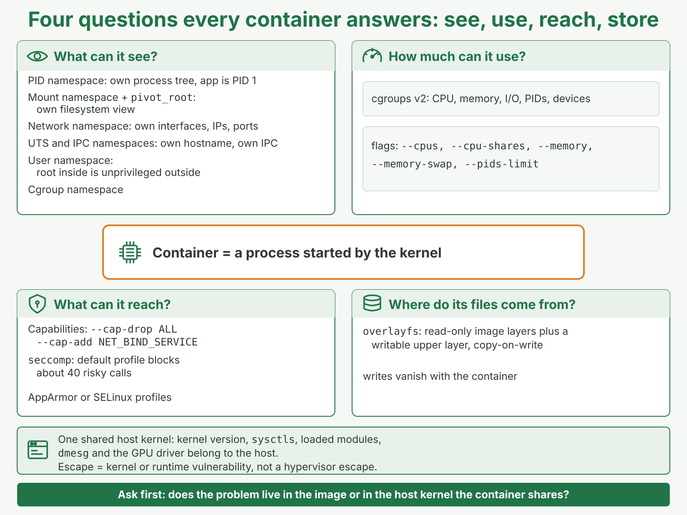

*Figure 5.1.1. Every container has all four answers, even when you never typed a flag for them.*

Picture a colleague who says, "A container is basically a tiny virtual machine, so it is safe to run it as root." Both halves of that sentence rest on a wrong picture, and the wrong picture leads to real mistakes. A container is not a lightweight VM, and it is not a kernel feature called "container." A container is a **process** that the kernel starts with a set of isolation and limit mechanisms applied. That process runs from a **root filesystem** assembled from an image. Once you see it that way, the security and resource questions answer themselves.

A helpful picture is an apartment building. A virtual machine is a separate house, with its own foundation, wiring and plumbing. A container is an apartment in a shared building. Each tenant has a locked door, a private mailbox and a meter that caps how much power they can draw. But the walls, the water main and the electrical panel belong to the building. If the wiring in the building is faulty, every apartment feels it. In this picture, the building is the Linux kernel, and every container on the host lives inside it.

The diagram below shows two containers on one host. Both run on the same kernel. Each one gets its own process tree and its own root filesystem, and the kernel keeps them apart. Follow the arrows from the kernel box to each container, and notice that nothing in the diagram adds a second kernel.

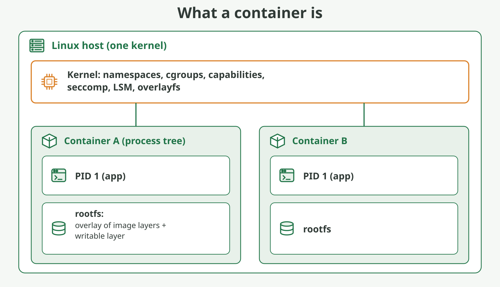

*Figure 5.1.2. What a container is, as a diagram.*

Each isolation or limit mechanism covers one part of the process. The table lists them, with the setting you will usually meet in practice. Some rows are defaults, such as the PID namespace that `docker run` creates for you, so you get them without asking.

| Mechanism | What it provides | Typical container setting |
|---|---|---|
| **PID namespace** | Own process tree; app is PID 1 | `docker run` default |
| **Mount namespace + `pivot_root`** | Own filesystem view (the image rootfs) | Overlay mount of layers |
| **Network namespace** | Own interfaces, IPs, routes, ports | veth pair to a bridge (5.13) |
| **UTS / IPC namespaces** | Own hostname; own SysV IPC/POSIX queues | default |
| **User namespace** | UID/GID remapping (root inside = unprivileged outside) | rootless Podman, some runtimes |
| **Cgroup namespace** | Virtualised view of the cgroup tree | default on cgroup v2 |
| **cgroups (v2)** | Limits and accounting: CPU, memory, I/O, PIDs, devices | `--cpus`, `--cpu-shares`, `--memory`, `--memory-swap`, `--pids-limit` |
| **Capabilities** | Split root privileges; containers drop most by default | `--cap-drop ALL --cap-add NET_BIND_SERVICE` |
| **seccomp** | Syscall filter (default profile blocks ~40 risky calls) | `--security-opt seccomp=...` |
| **AppArmor / SELinux** | Mandatory access control profiles | distro defaults |
| **overlayfs** | Union of read-only layers + writable upper layer, copy-on-write | storage driver |

The table is easier to hold in your head if you group the rows by the question they answer. Namespaces answer "what can this process see?" Cgroups answer "how much can this process use?" Capabilities, seccomp and the mandatory access control rows answer "which system calls and privileges can it reach, even when it can see them?" The overlay row answers "where do its files come from, and where do its writes go?" Every container you run has all four answers, even when you never typed a flag for them.

You can prove this to yourself on any Linux machine. The commands below start an nginx container with a memory and CPU limit, then look at it from the host. Run them one at a time, and watch what changes in each output.

```bash
docker run -d --name demo --memory 256m --cpus 0.5 nginx:1.27
PID=$(docker inspect -f '{{.State.Pid}}' demo)       # PID in the HOST namespace
ps -o pid,ppid,cmd -p $PID                            # an ordinary nginx process on the host
ls -l /proc/$PID/ns                                   # namespace inodes: compare with `ls -l /proc/self/ns`
cat /proc/$PID/cgroup                                 # which cgroup it lives in
cat /sys/fs/cgroup/system.slice/docker-$(docker inspect -f '{{.Id}}' demo).scope/memory.max     # 268435456 (cgroup v2, systemd driver)
sudo nsenter -t $PID -n ip addr                       # enter its network namespace from the host
sudo nsenter -t $PID -m ls /                          # enter its mount namespace: the image rootfs
```

Read the output in order. The first `docker inspect` line asks Docker for the process ID that the kernel gave the container's main process, as seen from the host. That is an ordinary number on the host, not a special container number. The `ps` line then shows that process in the host's process list, running as nginx, with nothing special about it. The `ls -l /proc/$PID/ns` line lists the namespace links for that process. If you run the same command on your own shell, the inode numbers for the namespaces the container has its own copy of will differ, and that difference is the isolation you are looking at. The `memory.max` line should show the 256 MiB limit you asked for, written in bytes. The two `nsenter` lines finish the picture. The first looks at the container's network from the host, and the second looks at its root filesystem, which is the image.

Because the container shares the host kernel, several things follow. The kernel version, sysctls such as `net.core.*`, loaded modules, `dmesg` and the GPU kernel driver all belong to the host. A container escape is therefore a kernel or runtime vulnerability, not a hypervisor escape. A hypervisor escape means breaking out of a separate guest kernel, which is much harder. In a container, the question is how well the kernel and the runtime keep the walls up. Resource limits are cgroup settings that the kernel enforces. When a container exceeds its memory limit, the kernel OOM-kills (out-of-memory kills, the kernel's last resort when memory runs out) a process inside that cgroup, and the rest of the host carries on.

PID 1 inside a container has special rules for signals and for reaping zombie processes. A zombie is a process that has finished but still has an entry in the process table, because its parent has not yet collected its exit status. Inside a container, the app is PID 1, which is the first process in its own process tree. On a normal Linux system, PID 1 is the init system, and it cleans up after orphaned children. Your app is not built to do that job. If your app forks child processes, run it with `--init` or `tini`, a tiny init program that forwards signals and reaps children on the app's behalf. Finally, "it works in the container" says little about behaviour that depends on the kernel, such as RDMA, huge pages or NUMA (the way memory is split between CPU sockets). Those depend on the host, not the image, so an image cannot promise them.

### The dependency problem containers solve

Picture a program that runs fine on a developer's laptop and then fails on the production server. Often the cause is a shared library, such as `libc` or `libssl`, that is missing or has a different version on that server. Sometimes the cause is simpler. The developer forgot to include a dependent asset file in the package that went to production. Both problems come from a program that relies on things outside its own package. The program is not wrong. It was never given a way to carry what it needs.

Running several programs on one machine the traditional way makes this worse. All of those programs must share the same versions of the shared libraries. If different teams build those programs, the shared dependencies tie the teams together. One team cannot upgrade a library without asking every other team. Deployment often relies on imperative scripts, which have many failure cases, because each script assumes the machine is in exactly the state the author expected. Rolling out a new version of part of a distributed system then becomes slow, manual work.

A container image removes this coupling. The image carries the program, its libraries and its files as one package. The program then runs on any host that can run the image, and it does not depend on what else is installed there. Keep that idea in mind as you read the rest of this chapter, because each image-building rule below serves it.

### Why containers took off

Cgroups and namespaces are the two main ingredients for building a container. Cgroups limit how many resources a process can use, such as CPU and memory. Namespaces control what a process can see, such as mounts, processes and network interfaces. Both have been in the Linux kernel since 2008, and namespaces are even older. So why did containers only become popular years later?

The answer lies in the world around the software. Application developers moved to service-oriented architectures and started to embrace microservices. These brought maintainability, scalability and productivity. They also caused an explosion in the number of components in one application. A meaningful application could easily involve a dozen services, sometimes written in several languages. Developing and shipping that was complex, and it still is.

Software had also become a business differentiator. The faster a team could ship new features, the more competitive its offerings. Reliable deployment became key to the business. Then the public cloud arrived as a hosting environment. Teams had to make sure an application behaved the same from a developer's laptop to a production server in someone else's datacenter.

A useful analogy is the standard shipping container. Before standard boxes existed, every port had to handle crates, barrels and sacks, each in its own way, and loading a ship was slow and error-prone. Once everyone agreed on one box shape, cranes, trucks and ships could all handle the same thing, whatever was inside. A container image plays the same role for software. The image is the box, and the runtime, the registry and the cluster are the cranes, trucks and ships that all agree on its shape.

The environment was ripe for innovation. Docker made containers accessible to the masses. It built an abstraction with an easy-to-use command line, so developers no longer had to know the low-level kernel constructs. All they had to do was type `docker run` in their terminal.

Containers improved many stages of the software life cycle. They let developers codify the application's environment, so missing or mismatched dependencies became rarer. They gave testing reproducible environments, and they made deployment easier. As long as a Docker Engine ran in production, an application could be deployed with minimum friction. Overall, containers helped teams ship software from zero to production in a more repeatable and efficient way.

The new popularity also gave birth to an ecosystem full of tools, container runtimes and container image registries. That ecosystem was well received, but it raised a new question: how do you make sure all these container solutions are compatible with each other? Encapsulation and portability are among the main benefits of containers, so they must hold across tools. The industry answered by working together, under the Linux Foundation, on an open standard: the Open Container Initiative. Keep that question in mind, because the rest of this chapter is largely the answer to it.

When you debug a container, start by asking whether the problem lives in the image or in the host kernel that the container shares. That one question splits most investigations in half. An image problem usually shows up the same way on every host. A kernel problem usually depends on which host the container landed on.

## 2. Images: layers, content addressing and the OCI formats

Suppose you open a registry page to find out why a pull is slow. You see a tag, a list of layers and a row of long hexadecimal strings. Those strings are not decoration. They are how the image is named, stored and checked, and once you can read them, the slow pull stops being a mystery.

An image is a bundle of three things. The first is an ordered list of filesystem layers, each one a compressed tar archive of changes. The second is a config JSON, which holds the environment, entrypoint, command, user, working directory, exposed ports, labels, history and the list of layer diff IDs. The third is a manifest that refers to the config and the layers by digest. A multi-platform tag points to an index, also called a manifest list, which refers to one manifest per operating system and architecture.

Think of an image as a set of numbered transparent sheets, one on top of another, plus a card that says how to use the stack. Each sheet holds some files. Laid on top of each other, they produce the final filesystem. The card holds the start command and the settings. The manifest is the packing slip that lists which sheets and which card belong to this stack.

The diagram shows how one tag leads down to the layers. Follow the arrows from the tag to the index, then to a manifest for each platform, and finally to the blobs. A blob is just a stored file, such as a layer or a config, named by its hash.

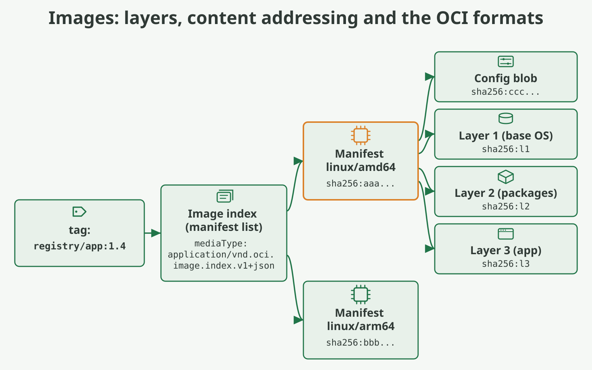

*Figure 5.1.3. Images: layers, content addressing and the OCI formats, as a diagram.*

Every blob in an image is named by the SHA-256 hash of its bytes, written as `sha256:...`. This is called content addressing. The name is derived from the content, not chosen by a person. Identical layers across images are therefore stored and transferred only once, because two copies with the same bytes have the same name. If one layer changes, its digest changes, and so does the digest of everything that refers to it. A tag is a mutable pointer, a bit like a sticky note on a shelf that someone can move. A digest, written as `image@sha256:...`, never changes, because it is the fingerprint of the bytes themselves. For reproducibility and supply-chain integrity, deploy by digest.

Here is a walkthrough of what happens when you change one line of application code and rebuild. The build tool hashes each layer's inputs, in order. The base layers have not changed, so their digests match the cache and the tool reuses them without doing any work. The dependency layer also matches, because the lockfile did not change. The code layer does not match, because its input bytes are different. So that layer is rebuilt, and it gets a new digest. Only the layers at and after the change are new. The tag then points to a new manifest that refers to the old base and dependency layers plus the new code layer, and a node that already holds the base layers downloads only the small new one.

Layers match the Dockerfile instructions that change the filesystem, which are `RUN`, `COPY` and `ADD`. Instructions such as `ENV`, `LABEL` and `CMD` change only the metadata. Layers are additive, and that has a surprising consequence. Deleting a file in a later layer hides it with a whiteout entry, a marker that tells the merged view to skip the file. But the bytes stay in the earlier layer, which is still in the image. So `RUN rm bigfile` does not shrink the image. You must clean up in the same `RUN` that created the files, or use a multi-stage build, where the big files never reach the final stack at all.

At run time, the runtime mounts the layers read-only and adds an **overlayfs** upper layer that is writable. The writes use copy-on-write. That means a file from a lower layer is copied up into the writable layer only when the container changes it, and the original layer is never touched. Anything the container writes goes to that top layer, and it disappears with the container. Write-heavy workloads are slow on this layer, so put data, checkpoints and scratch space on volumes instead.

In June 2015, Docker, CoreOS and other industry leaders formed the Open Container Initiative (`OCI`) under the Linux Foundation. Its job was to standardize container formats across tools, so that a build from one tool would run in another. The *Production Kubernetes* book tells the same story. The OCI has three specifications. The Image Spec defines the layout, the manifest, the index, the config and the layer media types. Its manifest media type is `application/vnd.oci.image.manifest.v1+json`, its index media type is `application/vnd.oci.image.index.v1+json`, and its config media type is `application/vnd.oci.image.config.v1+json`. Layers come in types such as `application/vnd.oci.image.layer.v1.tar+gzip` and `+zstd`. The Runtime Spec describes an unpacked bundle, which contains a `rootfs/` directory and a `config.json` file. That file holds `ociVersion`, `process`, `mounts`, `linux.namespaces` and `linux.resources`, and a runtime such as `runc`, `crun` or `kata` executes it. The Distribution Spec defines the HTTP API that registries use. Docker's older formats remain compatible. Chapter 5.2 covers how containerd and CRI-O use these specs.

The layers also show why build order matters. Think of a stack of read-only layers. In one example, Layer A is a Debian base OS, Layer B is Ruby `v2.1.10`, and Layers D and E are Rails `v4.2.6` and Rails `v3.2.x`. Both Rails layers sit on the same A and B layers, so they share those layers on disk and over the network. This is a tree, not a line. Two branches can grow from the same trunk, and the trunk is stored only once.

The catch is that changing one layer invalidates the build cache for every layer built on top of it. In the Node.js Express example, you copy `package*.json` and run `npm install --production` before `COPY . .`. Then editing `server.js` rebuilds only the small final layer. The `kuard` example uses a `golang:1.17-alpine` build stage and an `alpine` deployment stage. The first stage keeps the Go compiler, `nodejs`, `npm` and `git`, and only `/go/bin/kuard` is copied into the second stage (modeled in `code/part05/oci_image_layers.py`).

Standard tools let you inspect all of this without pulling the image onto your laptop. Each command answers a different question, so read them as a set of questions you can ask a registry.

```bash
docker image inspect nginx:1.27 | jq '.[0] | {Id, RepoDigests, Os, Architecture, Config: .Config.Entrypoint}'
docker history --no-trunc --format '{{.Size}}\t{{.CreatedBy}}' nginx:1.27 | head
skopeo inspect docker://docker.io/library/nginx:1.27                   # remote, no pull
skopeo inspect --raw docker://docker.io/library/nginx:1.27 | jq .      # raw index/manifest
crane manifest nginx:1.27 | jq '.manifests[] | {platform, digest}'      # list platforms (index)
crane config nginx:1.27@sha256:<digest> | jq '.rootfs.diff_ids'         # layer diff IDs
crane export nginx:1.27 - | tar -tvf - | head                            # flattened filesystem listing
dive nginx:1.27                                                          # interactive layer explorer
docker save nginx:1.27 -o nginx.tar && tar -tf nginx.tar                 # see blobs/ index.json manifest.json layout
```

The `docker image inspect` line shows the image's identity and its entrypoint, which is the program the image starts. The `crane` and `skopeo` lines query the registry directly, so you see the index and the manifests without a download. That matters when an image is 10 to 30 GB, because you can check the platforms and the layer list in seconds. The `docker save` line writes the image to a tar file, and the last `tar` command lists the blobs, the index and the manifest inside it. Opening that tar file is the closest you can get to seeing the OCI layout with your own eyes.

### Overlay filesystems: how layers stack

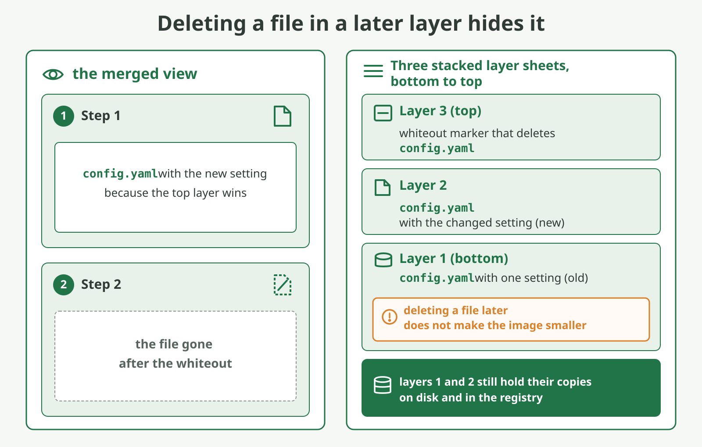

*Figure 5.1.4. Each layer is additive, so a later delete only hides a file and the earlier bytes stay in the image.*

The most popular container image format is the Docker image format. The Docker open source project developed it for packaging, distributing and running containers with the `docker` command. Later, Docker, Inc., and others began standardizing it through the Open Container Initiative (OCI). The OCI standard reached a 1.0 release in mid-2017, but adoption is moving slowly. The Docker image format remains the de facto standard, and it is made of a series of filesystem layers.

Each layer adds, removes or modifies files from the layer before it. This stacking is an example of an overlay filesystem. The same overlay system is used when the image is packaged and again when the image runs. At run time, several concrete implementations exist, including `aufs`, `overlay` and `overlay2`. The implementations differ, but the idea is the same. Read-only layers sit underneath, and one writable layer sits on top.

Here is a worked walkthrough. Layer 1 holds a file called `config.yaml` with one setting. Layer 2 changes that setting. When the container runs, the merged view shows the Layer 2 version, because the top layer wins. Layer 1 still holds the old version on disk, and the registry still stores it. Now suppose Layer 3 deletes `config.yaml`. The merged view no longer shows the file, but Layers 1 and 2 still hold their copies. This is exactly why deleting a file later does not make the image smaller, a point that the Dockerfile section returns to.

The word "image" can mislead. An image is not one file. It is a specification for a manifest file, and the manifest points to other files. Users often treat the manifest and those files as one unit. That extra level of indirection makes storage and transfer more efficient, because the same file can be named once and used many times. The format also comes with an API for uploading and downloading images to a registry.

### Manifests, indexes and configs

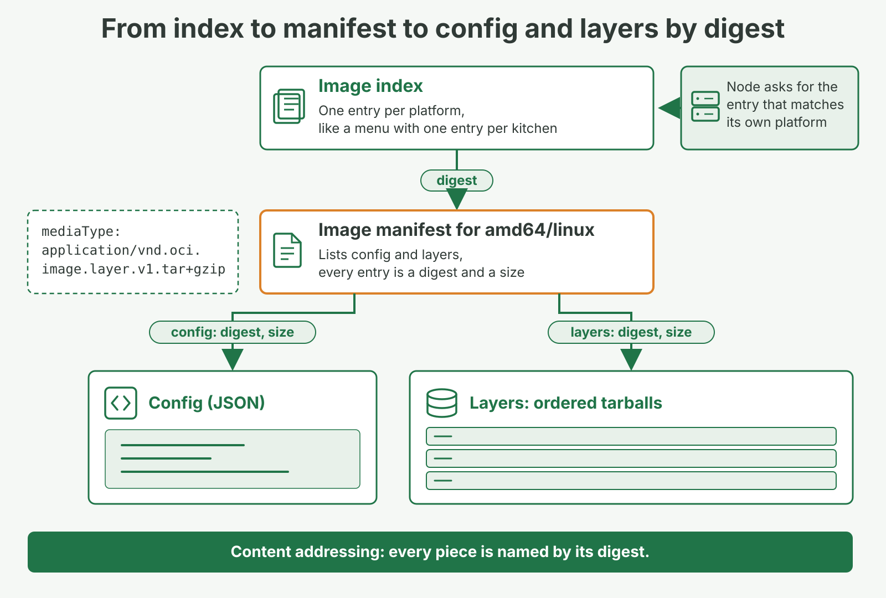

*Figure 5.1.5. An image index points to a per-platform manifest, which lists the config and the layers by digest and size.*

An image manifest is the document that describes an image. It points to the image configuration and lists the image layers. It can also carry an optional map of annotations, which are free-form labels that tools can read. Here is an example manifest from the OCI image specification. Notice that every entry is a digest and a size, not a file name:

```
{
"schemaVersion": 2,
"config": {
"mediaType": "application/vnd.oci.image.config.v1+json",
"size": 7023,
"digest": "sha256:b5b2b2c507a0944348e0303114d8d93aaaa081732b86451d9bce1f4..."
},
"layers": [
{
"mediaType": "application/vnd.oci.image.layer.v1.tar+gzip",
"size": 32654,
"digest": "sha256:9834876dcfb05cb167a5c24953eba58c4ac89b1adf57f28f2f9d0..."
},
{
"mediaType": "application/vnd.oci.image.layer.v1.tar+gzip",
"size": 16724,
"digest": "sha256:3c3a4604a545cdc127456d94e421cd355bca5b528f4a9c1905b15..."
},
{
"mediaType": "application/vnd.oci.image.layer.v1.tar+gzip",
"size": 73109,
"digest": "sha256:ec4b8955958665577945c89419d1af06b5f7636b4ac3da7f12184..."
}
],
"annotations": {
"com.example.key1": "value1",
"com.example.key2": "value2"
}
}
```

The image index is the top-level manifest that makes a multi-platform image possible. It holds a pointer to each platform-specific manifest. Think of it as a menu with one entry per kitchen. Your node asks for the entry that matches its own platform, and the runtime follows that entry. The example below points to two manifests, one for `ppc64le/linux` and one for `amd64/linux`.

```
{
"schemaVersion": 2,
"manifests": [
{
"mediaType": "application/vnd.oci.image.manifest.v1+json",
"size": 7143,
"digest": "sha256:e692418e4cbaf90ca69d05a66403747baa33ee08806650b51fab...",
"platform": {
"architecture": "ppc64le",
"os": "linux"
}
},
{
"mediaType": "application/vnd.oci.image.manifest.v1+json",
"size": 7682,
"digest": "sha256:5b0bcabd1ed22e9fb1310cf6c2dec7cdef19f0ad69efa1f392e9...",
"platform": {
"architecture": "amd64",
"os": "linux"
}
}
],
"annotations": {
"com.example.key1": "value1",
"com.example.key2": "value2"
}
}
```

Each OCI image manifest refers to a container image configuration. The configuration records how the app starts. It holds the entry point, the command, the working directory and the environment variables, among other things. The container runtime reads this file when it creates a container from the image, so a setting you put in the Dockerfile ends up here. The snippet below shows a configuration with some fields removed for brevity:

```
{
"architecture": "amd64",
"config": {
...
"ExposedPorts": {
"53/tcp": {},
"53/udp": {}
},
"Tty": false,
"OpenStdin": false,
"StdinOnce": false,
"Env": [
"PATH=/usr/local/sbin:/usr/local/bin:/usr/sbin:/usr/bin:/sbin:/bin"
],
"Cmd": null,
"Image": "sha256:7ccecf40b555e5ef2d8d3514257b69c2f4018c767e7a20dbaf4733...",
"Volumes": null,
"WorkingDir": "",
"Entrypoint": [
"/coredns"
],
"OnBuild": null,
"Labels": null
},
"created": "2020-01-28T19:16:47.907002703Z",
...
```

The spec also describes how layers are created and managed. A layer is essentially a TAR archive that holds files and directories. The spec gives each flavor its own media type: plain, gzipped and nondistributable. Every layer gets a digest, usually the SHA256 sum of its contents. The manifest refers to layers by these digests. The final filesystem is the result of applying each layer in the order the manifest lists them, so the order in the list is part of the image's meaning.

The OCI image specification matters because it keeps images portable across tools and platforms. It enables image build tools such as kaniko and Buildah for userspace builds, Jib for Java-based containers, and Cloud Native Buildpacks for streamlined, automated builds. Different tools produce the same kind of object, and different runtimes can read it. In short, the specification means Kubernetes can run a container image no matter which tool built it.

### Layout on disk

An OCI layout directory has `oci-layout`, `index.json` and `blobs/sha256/<digest>` files. Docker's local store and containerd's content store hold the same blobs under `/var/lib/docker` or `/var/lib/containerd`. Because blobs are immutable and shared, the disk used by images is the union of unique blobs plus the snapshots, which are unpacked layers, for each snapshotter. A snapshotter is the piece of the runtime that turns layers into a usable filesystem. Image garbage collection removes blobs that nothing refers to any more, which is the cleanup step that stops old images from quietly filling the disk.

When you inspect an image, read the digest rather than the tag. The digest is the only reference that cannot change under you.

## 3. Building images well

A Dockerfile is a recipe, and every line changes the image you get. Suppose you write a Python service. A careless Dockerfile copies the whole source tree first and installs dependencies afterwards. Every code edit then forces a full reinstall, because the copy step changed and everything after it has to run again. The Dockerfile below avoids that problem, uses a multi-stage build and runs as a non-root user.

### Dockerfile mechanics

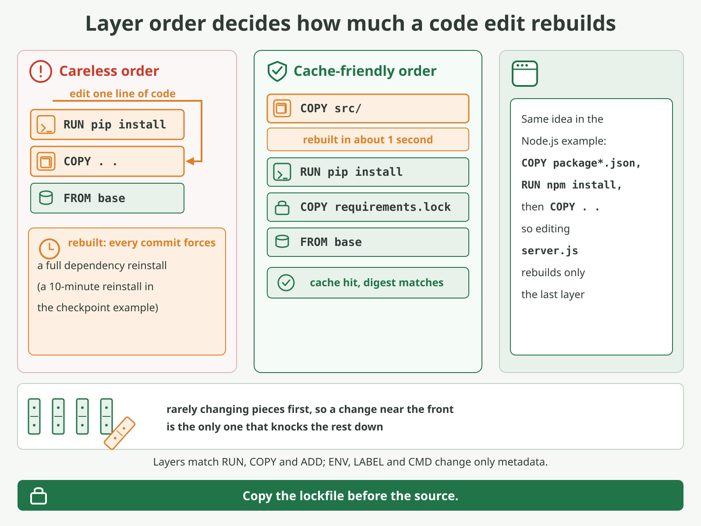

*Figure 5.1.6. Order layers from least to most frequently changing, because a change invalidates the cache for every layer built on top of it.*

```dockerfile
# syntax=docker/dockerfile:1.7
FROM python:3.12-slim AS base
ENV PYTHONDONTWRITEBYTECODE=1 PYTHONUNBUFFERED=1 PIP_NO_CACHE_DIR=1
WORKDIR /app

FROM base AS builder
RUN --mount=type=cache,target=/var/cache/apt --mount=type=cache,target=/var/lib/apt \
    apt-get update && apt-get install -y --no-install-recommends build-essential && rm -rf /var/lib/apt/lists/*
COPY requirements.lock .
RUN --mount=type=cache,target=/root/.cache/pip pip wheel --wheel-dir /wheels -r requirements.lock

FROM base AS runtime
RUN useradd --uid 10001 --create-home app
COPY --from=builder /wheels /wheels
RUN pip install --no-index --find-links=/wheels /wheels/*.whl && rm -rf /wheels
COPY --chown=app:app src/ ./src/
USER 10001
EXPOSE 8000
HEALTHCHECK --interval=30s --timeout=3s CMD python -c "import urllib.request; urllib.request.urlopen('http://127.0.0.1:8000/healthz')"
ENTRYPOINT ["python", "-m", "uvicorn", "src.main:app", "--host", "0.0.0.0", "--port", "8000"]
```

Read the file from top to bottom as three short stories. The `base` stage sets the common settings. The `builder` stage does the heavy work, namely installing the compiler and turning the locked requirements into wheels, which are prebuilt Python packages. The `runtime` stage starts fresh from `base`, creates a regular user and copies in only the finished wheels and the source code. The compiler from the builder stage never reaches the runtime stage. That is the whole trick of a multi-stage build.

The principles behind a good Dockerfile are numbered below, so you can match each one to the file above.

1. Order layers from the least to the most frequently changing. Put the base OS first, then system packages, then dependency manifests and installs, and application code last. Copy `requirements.lock` before the source, so the dependency installation stays cached until the lockfile changes. Think of the cache as a row of dominoes. A change near the front knocks down everything behind it, so put the rarely changing pieces at the front.
2. Use multi-stage builds. Compile in a fat stage, then copy only the artefacts into a slim runtime stage. The final image is smaller, has fewer CVEs (known security vulnerabilities), and holds no compilers or secrets.
3. Combine create and clean steps in one `RUN`, such as `apt-get update && apt-get install ... && rm -rf /var/lib/apt/lists/*`. You can also use BuildKit cache mounts, so the caches never land in a layer.
4. Pin the base image by digest, and pin dependencies with lockfiles that include hashes. Update them on a schedule through automation such as Renovate or Dependabot, so updates arrive as reviewed pull requests instead of surprises.
5. Run as non-root by setting `USER` to a numeric UID. At run time, use a read-only root filesystem, drop capabilities, and never use `--privileged`.
6. Prefer `COPY` to `ADD`, because `ADD` extracts archives and fetches URLs, which is surprising. Use a `.dockerignore` file to exclude `.git`, datasets, virtualenvs, secrets and build outputs. A `.env` file that leaks into a layer stays there permanently, even if a later line deletes it.
7. Use the exec form of `ENTRYPOINT` and `CMD`, written as JSON arrays, so that signals reach your process. The shell form wraps the command in `/bin/sh -c`, and `SIGTERM` may never reach your app. Graceful shutdown in Kubernetes then breaks.
8. Keep one main process per container. Add `tini` or `--init` when the process spawns children.
9. Never pass secrets through `ARG` or `ENV`, because they persist in the history and metadata. Use `RUN --mount=type=secret,id=pip_token` with BuildKit, or an SSH agent mount for private repositories. Those mounts keep the secret out of the layers.
10. Add OCI labels such as `org.opencontainers.image.source`, `.revision`, `.version` and `.created`, so you can trace where an image came from. Set `HEALTHCHECK` for Docker and Compose, because Kubernetes uses probes instead.
11. For reproducibility, set `SOURCE_DATE_EPOCH`, keep the ordering deterministic, and pin packages with `apt-get install pkg=version`. Avoid `latest`. Nix, Bazel, ko and Jib are options for fully reproducible builds.
12. Follow the habits of your language. For Python, use wheels, `uv` or pip with hashes, and avoid compiling at runtime. For Go, build a static binary and place it in `scratch` or distroless. For Java, consider Jib. For Node, run `npm ci` and install only production dependencies.

### A Docker build, step by step

A small example shows how a build works, and it is worth doing once by hand. Create a directory with a Dockerfile that starts from the lightweight Alpine distribution, adds the bash shell, and sets bash as the default command:

```
FROM alpine:latest
RUN apk add bash
CMD ["/bin/bash"]
```

Adding bash is not required. It makes the image unique, so you can see the build process at work. Run `docker build -t hlw_test .` in that directory. The command reads the Dockerfile there and tags the result as `hlw_test`. You may need to add your user to the `docker` group first.

The build output has one step per Dockerfile line. The `FROM` step pulls the Alpine image. The `RUN` step starts a temporary container from the intermediate Alpine image, runs `apk add bash` inside it, and saves the changes as another intermediate image. Docker then removes that temporary container. Intermediate images stay after a build, while intermediate containers do not. That difference is why a build can leave a surprising amount of disk in use, and why `docker image prune` exists.

`RUN` happens during the build, not when you start a container. The `CMD` line only tells the runtime what to run at startup. Afterward, `docker images` lists both `hlw_test` and the Alpine image. The output is different when you use Podman, but the steps are the same. You can use `podman` in place of `docker` in these examples. As you read the build output, you will probably recognize the lines that come from `apk add bash`.

### A Node.js example, line by line

Dynamic languages such as Node.js, Python and Ruby follow the same pattern. Take a simple Express app with two files, `package.json` and `server.js`. Put them in one directory and run `npm install express --save` to add the Express dependency and install it. The `package.json` file is the list of what the app needs, and `server.js` is the app itself.

```
{
"name": "simple-node",
"version": "1.0.0",
"description": "A sample simple application for Kubernetes Up & Running",
"main": "server.js",
"scripts": {
"start": "node server.js"
},
"author": ""
}
```

```
var express = require('express');
var app = express();
app.get('/', function (req, res) {
res.send('Hello World!');
});
app.listen(3000, function () {
console.log('Listening on port 3000!');
console.log(' http://localhost:3000');
});
```

Two more files turn this app into an image. The `Dockerfile` is the recipe for building the image. The `.dockerignore` file lists the files to leave out when copying into the image. In this example, it excludes `node_modules`, because the packages should be installed inside the image, not copied from your laptop, where they may have been built for a different system.

```
# Start from a Node.js 16 (LTS) image
FROM node:16
# Specify the directory inside the image in which all commands will run
WORKDIR /usr/src/app
# Copy package files and install dependencies
COPY package*.json ./
RUN npm install
RUN npm install express
# Copy all of the app files into the image
COPY . .
# The default command to run when starting the container
CMD [ "npm", "start" ]
```

Every Dockerfile builds on other container images. The `FROM node:16` line starts from a preconfigured Node.js 16 image on Docker Hub. The `WORKDIR` line sets the directory where all following commands run, so later relative paths resolve from there.

The next three lines prepare the dependencies. The package files are copied in first, so the install step can run on its own. If you edit `server.js` later, the `package*.json` copy does not change, and Docker reuses the cached install. The `RUN` lines then install the packages inside the container. The `COPY . .` line comes last and copies the rest of the program. Because of `.dockerignore`, `node_modules` stays out of the copy. The final `CMD` line sets the command that runs when a container starts.

Build the image with the `docker build` command, then run it and map port 3000:

```
$ docker build -t simple-node .
$ docker run --rm -p 3000:3000 simple-node
```

Open `http://localhost:3000` in a browser to reach the program running in the container. The `simple-node` image now lives in the local Docker registry of one machine. Its real power comes when you share images across many machines and the wider Docker community. The next section covers how to share images through a registry.

### BuildKit, buildx and builders

BuildKit is the modern build engine and the default in current Docker. It runs stages in parallel, supports cache mounts, and handles secret and SSH mounts. A cache mount is a directory that persists between builds but is never written into a layer, so a package cache can survive while the image stays clean. BuildKit also imports and exports remote caches (`--cache-to type=registry,ref=...`, `type=gha`, `type=s3`), which lets a fresh CI runner reuse work that another runner did. It builds for several platforms at once (`docker buildx build --platform linux/amd64,linux/arm64 --push`), and it can attach SBOM and provenance attestations (`--sbom=true --provenance=mode=max`). An SBOM is a list of the software inside an image, and provenance records how the image was built. Other options include `podman build` and buildah, which are daemonless and rootless, plus kaniko and buildah in the cluster, ko, Bazel `rules_oci`, Cloud Native Buildpacks (`pack`) and img. CI builds should use a remote cache and run in isolated, ephemeral builders (4.2).

### Image size and startup

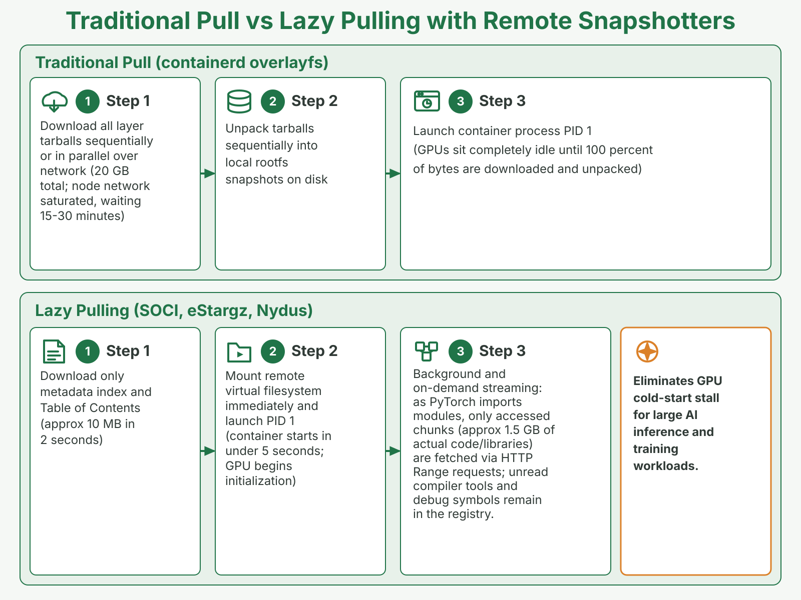

*Figure 5.0.0. Lazy-pulling snapshotters fetch index metadata first so the container starts immediately, downloading remaining layer data only as the application reads it.*

Large images cost you network, registry space, disk and time to start. Think of an image as a box that every node must receive before the job can begin. A heavier box takes longer to carry, and it fills more shelves. Several techniques reduce that cost. Use slim or distroless bases, and use multi-stage builds. Remove build tools, strip binaries, and avoid copying whole datasets into an image. Mount or download datasets when the container starts. Share base layers across images so that nodes already hold them. Compress with `zstd`, which decompresses faster than gzip.

Lazy-pulling snapshotters go a step further. These are stargz or eStargz, SOCI, Nydus and OverlayBD. They let a container start before the whole image has downloaded, which matters for multi-GB ML images. The runtime fetches the parts of the image that the process actually reads, and it fetches the rest in the background or on demand. For GPU images, share one CUDA or PyTorch base layer across every team's images, so the heavy part is downloaded once per node instead of once per team.

### Choosing a base

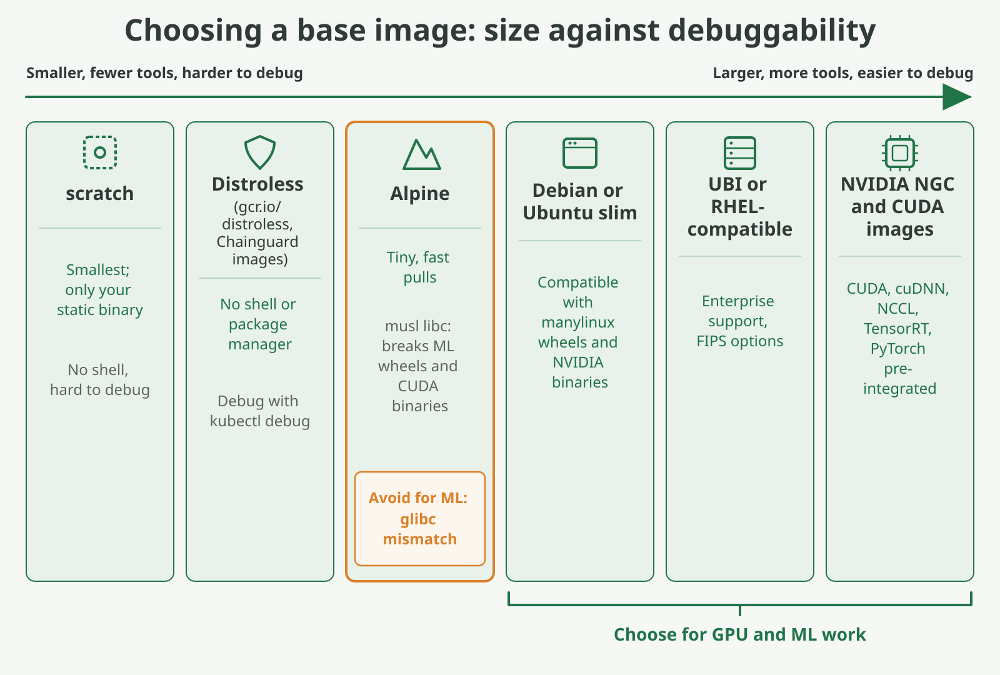

*Figure 5.1.7. Base images trade size against debuggability, and for GPU and ML work Debian, Ubuntu or NVIDIA images beat Alpine.*

The base image decides how big your image is, how easy it is to debug, and whether CUDA and Python wheels will run. The table compares the common choices, with the pros and cons of each. Read it as a trade-off table. Smaller bases give you less to patch, but they also give you fewer tools when something goes wrong in the middle of the night.

| Base | Pros | Cons |
|---|---|---|
| `scratch` | Smallest; only your static binary | No shell, no CA certs/timezones unless copied, hard to debug |
| Distroless (`gcr.io/distroless/*`, Chainguard images) | No shell/package manager; minimal CVE surface; includes certs | Debugging needs ephemeral containers (`kubectl debug`); glibc/musl choices |
| Alpine | Tiny, fast pulls | musl libc: Python wheels, glibc-linked binaries (CUDA) and DNS behaviour issues; avoid for ML |
| Debian/Ubuntu slim | Compatible with manylinux wheels and NVIDIA binaries | Larger; more packages to patch |
| UBI / RHEL-compatible | Enterprise support, FIPS options | Licensing/registry considerations |
| NVIDIA NGC and CUDA images | CUDA, cuDNN, NCCL, TensorRT, PyTorch pre-integrated and tested | Very large; follow NVIDIA's release cadence and compatibility rules |

For GPU and ML work, the table points you to Debian or Ubuntu bases, or to NVIDIA's own images, rather than Alpine. The reason is that most ML wheels and CUDA libraries are built for the standard glibc C library, and Alpine uses a different one. The next section explains why a mismatch like that becomes a runtime failure rather than a build error.

### Build image versus runtime image

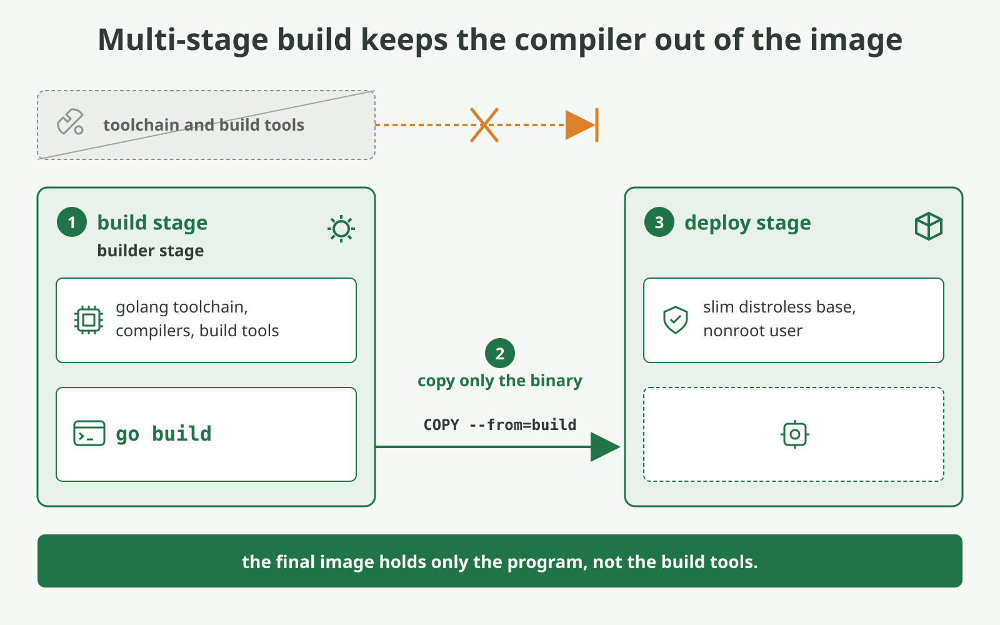

*Figure 5.1.8. A multi-stage build compiles in a large stage and copies only the finished binary into a slim runtime stage.*

Building an app needs compilers, SDKs and test tools. Running the app needs none of them. If you ship the build tools too, the image grows, takes longer to pull, and gives an attacker more to use. Imagine moving into a house and keeping the construction crew's tool chest in the hallway. The house works, but every visitor now has a set of saws. The fix is a multistage Dockerfile. One stage builds the program, and a second, slim stage runs it.

The Go example below follows that pattern. The first stage uses the `golang` image, which holds the whole Go toolchain. The second stage starts from `gcr.io/distroless/base` and copies in only the compiled binary.

```
# Build stage
FROM golang:1.12.7 as build
WORKDIR /my-app
COPY go.mod .
RUN go mod download
COPY main.go .
ENV CGO_ENABLED=0
RUN go build -o my-app
# Deploy stage
FROM gcr.io/distroless/base
USER nonroot:nonroot
COPY --from=build --chown=nonroot:nonroot /my-app/my-app /my-app
CMD ["/my-app"]
```

Each part of this file has a clear job:

- The `golang` image holds build tools that the running program never uses.
- `go.mod` is copied and downloaded first. Docker can then reuse that cached step when only the code changes.
- The distroless base keeps the runtime small, with no extra dependencies.
- The app runs as `nonroot`, not as root.
- Only the compiled `my-app` file moves from the build stage to the deploy stage.

A container runs a single process and usually has no init system. That process must handle signals correctly, and it must reap orphaned child processes. Minimal init programs exist for this job, and you can use one as the bootstrap for your app. If you do not, a child process that exits can stay behind as a zombie for as long as the container runs.

### Runtime user and pinned packages

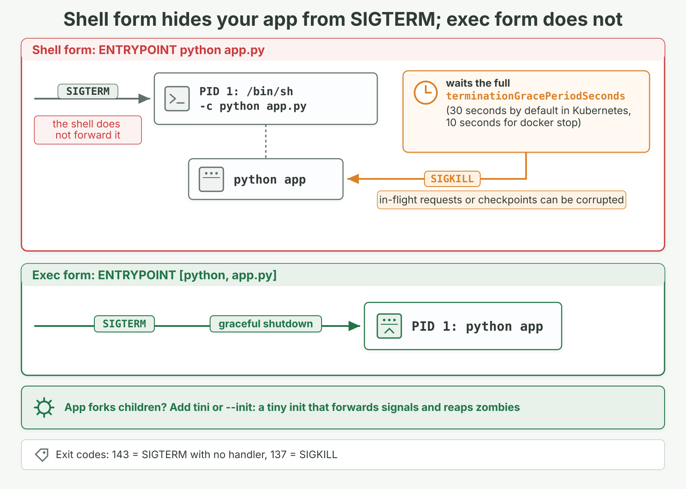

*Figure 5.1.9. Use the exec form of ENTRYPOINT and CMD so signals reach your process, and add tini or --init when the app forks children.*

When you do not set a runtime user, the container's process usually runs as root. Containers share the host's Linux kernel, so the user matters. If an attacker escapes a root container, they can gain root on the host. Decide the user while you build the image, and set it with the `USER` directive. This example runs `my-app` as the `nonroot` user and group, which distroless images create by default:

```
FROM gcr.io/distroless/base
USER nonroot:nonroot
COPY ./my-app /my-app
CMD ["./my-app", "serve"]
```

Setting the user in the image also helps developers. Their local and development environments then use the same user and group IDs, so a file that works on a laptop is not suddenly unreadable in the cluster. The same habit applies to packages. Pin the version of every OS package you install, because an unpinned package can move under you between two builds that look identical in the Dockerfile. The following example pins `imagemagick` to the version the application needs:

```
FROM alpine:3.12
RUN ["apk", "add", "imagemagick=7.0.10.25-r0"]
```

Unpinned packages can change between builds and break the app. Pinned versions keep your builds repeatable and the package set compatible. A build that worked last month should produce the same packages this month, and when it does not, the change is visible in the diff rather than hidden in a mirror update.

### Choosing a build backend

Every image build has two parts. The frontend is how you describe the build, such as a Dockerfile or a buildpack. The backend is the engine that runs the steps and writes the filesystem layers. Docker usually handles both, through its daemon. That daemon is not always a good fit, especially inside Kubernetes. A build there needs either Docker-in-Docker or the host's Docker socket mounted into the build container. Both approaches have drawbacks, and the socket approach exposes security risks, because whoever controls the build can control the host's Docker daemon.

Kaniko is one alternative. It reads the same Dockerfile but builds the image with different techniques, which makes it a good fit for a Kubernetes Pod. Before you choose a tool, answer these questions:

- Can the builder run as root?
- Are we willing to mount the Docker socket?
- Do we need to run a daemon?
- Should builds run in containers?
- Should builds run as workloads in Kubernetes?
- How much will we rely on layer caching?
- How will the tool affect distributing builds?
- Which frontends and image definitions must we support?

### Pitfalls of containers

Containers can waste storage. Each image must carry the Linux support files its application needs, such as shared libraries, so it can grow large. Shared base layers help when several containers use the same image. Runtime data written in the upper layers still grows, so watch disk use.

Containers also share the host's CPU, memory and kernel. Limits keep one container from taking everything, but an overloaded machine still slows every container on it. Think of a shared kitchen. Each cook has a marked counter, but when the stove is overloaded, every cook's food is slower. Plan capacity on the host, not only inside each container.

Data needs a home outside the container. Changes in the writable layer disappear when the container stops. Put user data in a database and send logs to a separate log service.

Most tools and examples target web servers. Kubernetes has many safety features for runaway server code, which helps with poorly written web apps. Other kinds of services can feel awkward to run this way, such as a long batch job that holds a lot of state, or a process that expects to be started and stopped by hand.

Careless builds cause bloat, configuration problems and failures. A container may spare you some of the intricacies of systemd, but many other things can still go wrong. Isolation does not protect you from your own mistakes. Adding packages at random until a problem disappears leaves a mess, so understand each change you make.

The `latest` tag moves. A build based on it can change when the base image updates, which may break your application. Pin a specific version of the base image.

Trust is also a concern. Images from a public registry are built by someone else, and you trust that they have not been altered and will stay available. That trust is why the earlier sections kept returning to digests, signatures and mirrors. Containers also do not solve every problem. An application that starts slowly on a normal system will start slowly in a container too.

## 4. Registries and distribution

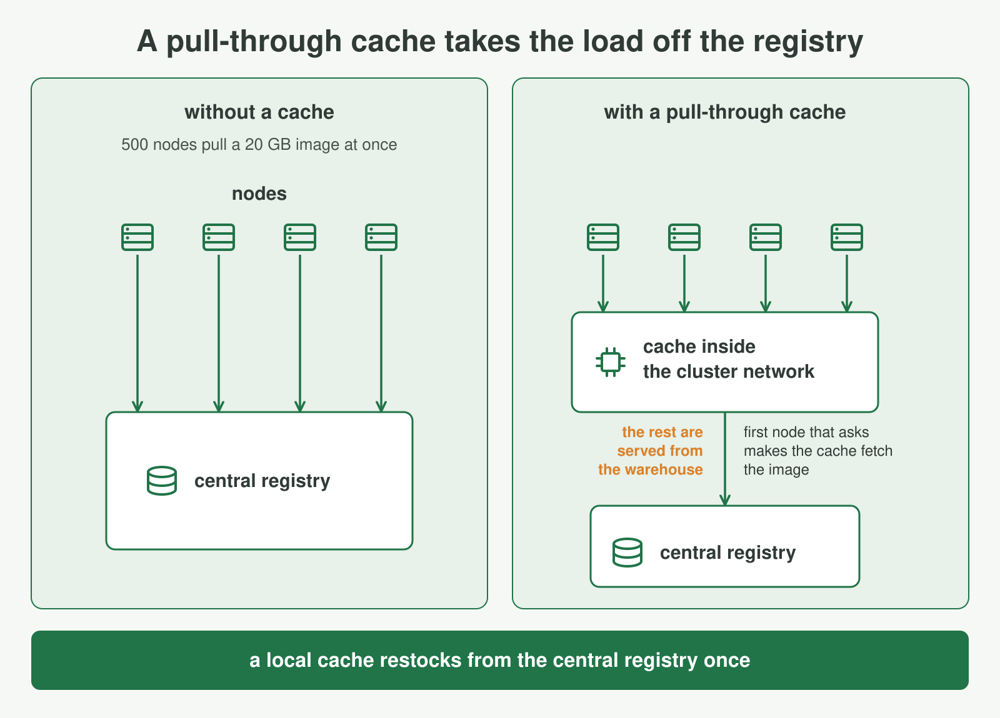

*Figure 5.1.10. A pull-through cache inside the cluster fetches each image once, so the central registry is not overloaded by every node.*

Your cluster has a few hundred nodes, and a new job starts on all of them at once. Every node asks the same registry for the same image, at the same moment. The registry becomes the bottleneck, and the job waits. The answer to that problem depends on how registries store and hand out images, so this section starts there.

A registry stores your images and hands them out to nodes. It implements the OCI Distribution API. Its core calls are `GET /v2/<name>/manifests/<reference>` and `GET /v2/<name>/blobs/<digest>`, plus chunked or monolithic blob uploads and tag listing. Common choices include Docker Hub, GHCR, Quay, GCP Artifact Registry, AWS ECR, Azure ACR and NVIDIA NGC (`nvcr.io`). Self-hosted options include Harbor, which adds scanning, replication, RBAC and quotas, along with Artifactory, Nexus, `registry:2`, and Zot.

A pull follows a fixed path. Take `docker pull ghcr.io/org/app:1.4` as an example. The runtime resolves the tag, fetches the index, and chooses the manifest for its platform. It then downloads the missing layers in parallel and verifies each digest before unpacking them. Verification is the step that matters most for trust. If a single byte of a layer differs from the digest the manifest promised, the pull fails. The tag is resolved at pull time, so **tags can change under you**. A digest cannot change.

GPU clusters put the most strain on a registry. When hundreds of nodes pull a 20 GB image at once, the registry and its uplink can overload. A pull-through cache or mirror inside the cluster network takes that load. Think of it as a local warehouse that restocks from the central one. The first node that asks makes the cache fetch the image from the central registry, and the rest are served from the warehouse. Harbor's proxy cache and containerd `hosts.toml` mirrors both do this. You can also pre-pull the image with a DaemonSet, use P2P distribution such as Dragonfly, Kraken or Spegel, or use lazy-pull snapshotters. Set `imagePullPolicy: IfNotPresent` and deploy by digest or immutable tags, so cached images stay valid.

Keep credentials short-lived, through workload identity, IAM roles or `imagePullSecrets` from a secret manager. Never bake registry passwords into an image. Enable tag immutability for release tags, and keep the digest of whatever ran in production, so you can roll back and investigate later. Docker Hub imposes pull limits, so mirror critical base images into your own registry and pin to your copy. Run the registry in HA mode, because an outage blocks scale-up and rescheduling. Nodes that already hold an image can still start pods that use `IfNotPresent`, so a registry outage hurts new nodes most.

Registries also hold more than images. They can store Helm charts (OCI), SBOMs, cosign signatures, model weights as OCI artefacts (ORAS, KitOps) and WASM modules. The same content-addressed storage works for all of them, which is why a registry can serve as a general artifact store.

The containerd mirror is configured in a `hosts.toml` file. The example below points pulls from Docker Hub at a pull-through cache inside your network.

```bash
# configure containerd mirror (hosts.toml) for a pull-through cache
# /etc/containerd/certs.d/docker.io/hosts.toml
server = "https://registry-1.docker.io"
[host."https://registry-cache.internal:5000"]
  capabilities = ["pull", "resolve"]
```

Each `hosts.toml` file belongs to one registry. The `server` line names the real registry, and the `[host]` block names the cache and the capabilities that the cache allows, here `pull` and `resolve`. When the node asks for a Docker Hub image, containerd tries the cache first, and the cache answers for images it already holds.

### Registry anatomy and placement

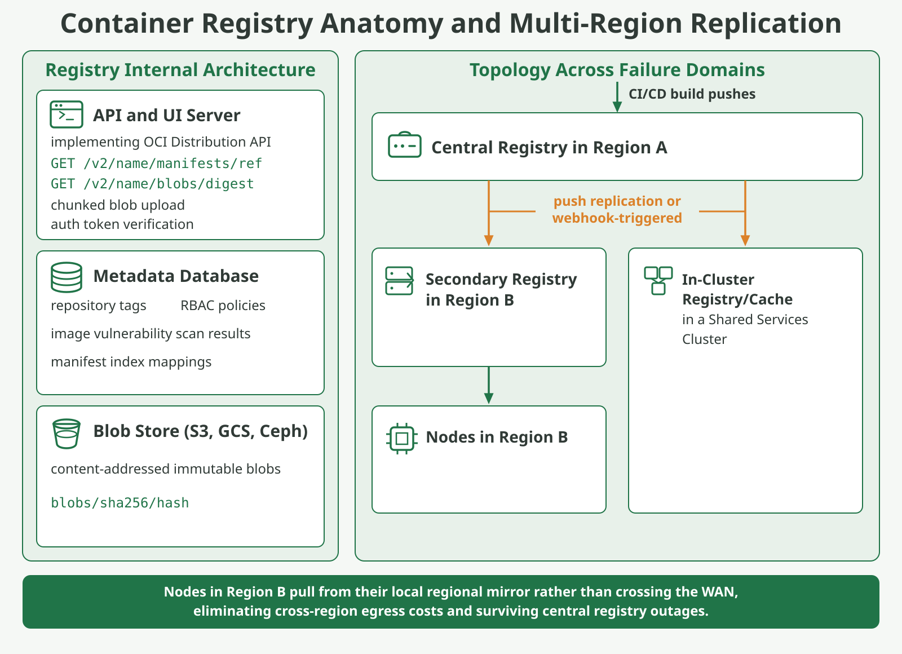

*Figure 5.0.0. A container registry splits metadata from content-addressed blob storage and replicates across regions to keep pull traffic local and fault-tolerant.*

A registry has three main parts. A server handles the user interface and the API. A blob store holds the image data. A database holds user and image metadata. The OCI standardizes registry operations, so different products interoperate. Storage backends are often configurable, and that choice shapes the registry's design.

You can host images in an artifact store such as Artifactory or Nexus. If most of your environment runs in one cloud, a cloud registry such as ECR, GCR or ACR may save money, because the traffic stays inside that cloud's network. Placement matters for availability. Many teams put a registry in each failure domain, which is a group of machines that can fail together, such as a data centre or a region. You then choose between one central blob store and a blob store per region, with replication between them. Replication pushes an image to one registry and copies it to the others. If your product lacks replication, a pipeline tool and webhooks on each push can do a basic version.

Throughput is the other factor. Thousands of developers who build on every commit create many concurrent pulls and pushes. The registry then sits on the critical path for production and for development. Monitor it like any other critical service, with the same alerts and dashboards you would give a database.

Running a registry inside the cluster is convenient, because Kubernetes keeps it running and discoverable. The catch is that the cluster then depends on a service inside itself to start new services. If the cluster loses the registry, it cannot start the replacement registry, because that also needs an image. Many teams run registries on a shared services cluster, with failover to a backup cluster. Others run the registry outside Kubernetes as a bootstrap component that every cluster needs. Cloud registries bring their own availability limits and possible extra latency.

## 5. Rootless containers and security basics

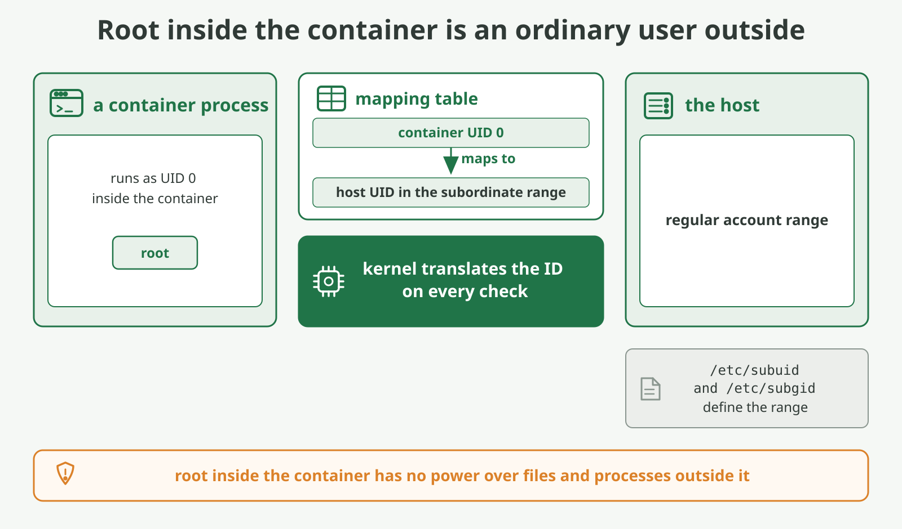

*Figure 5.1.11. In rootless mode, the kernel maps root inside the container to an unprivileged user on the host.*

Suppose a runtime or container escape happens on a shared node. An attacker who breaks out of a container running as root now has root on the host, and every other workload on that node is exposed. Rootless mode limits the damage. Podman, rootless Docker, rootless containerd and nerdctl, and BuildKit in rootless mode run the runtime and its containers under an unprivileged user, using user namespaces configured in `/etc/subuid` and `/etc/subgid`. An escape then gives the attacker only an unprivileged user. Rootless networking uses slirp4netns or pasta, and storage uses fuse-overlayfs or native overlay on modern kernels. Rootless mode cannot bind privileged ports, and some cgroup limits need cgroup v2 delegation. Its networking performance is a limit too. GPU access needs device and permission setup, and CDI helps with that.

The user-namespace idea is easiest to hold with a mapping table. Inside the container, the process believes it is root, with user ID 0. On the host, that same process is an ordinary unprivileged user, and its ID maps to a range that belongs to a regular account. The kernel does the translation on every check, so "root" inside the container has no power over files and processes outside it.

Scanning is the next layer. Trivy, Grype, Clair and Snyk look for known vulnerabilities. Scan at build time, and also on a schedule against the digests you have deployed, because new CVEs appear after an image is built. A common policy fails builds on critical CVEs that have fixes, and tracks each exception with an expiry date. An SBOM lists what is inside an image. Generate one with Syft, BuildKit's `--sbom` option or `docker sbom`, and store it with the image, so you can answer "are we affected?" quickly when the next advisory lands.

Cosign from Sigstore produces keyless or key-based signatures and stores them in the registry. You can verify them at admission time with Kyverno, policy-controller or Ratify (5.27). Admission time is the moment the cluster decides whether to accept a workload, so a signature check there blocks an unsigned image before it starts. Runtime hardening limits what a compromised process can do. Use a read-only root filesystem, drop all capabilities and add back only what you need, and set `no-new-privileges`. Apply the seccomp RuntimeDefault profile, run as a non-root UID, and avoid host namespaces and privileged mode. Pod Security Standards can enforce these settings in Kubernetes (5.21).

Supply-chain hygiene starts with trusted base images and pinned digests. Never run `curl | sh` inside a build, because you cannot later prove what that script returned. Verify the checksums or signatures of anything you download, and publish provenance attestations under the SLSA framework. Secrets stay out of images and environment dumps, and you mount them at run time instead (5.16).

## 6. GPU containers

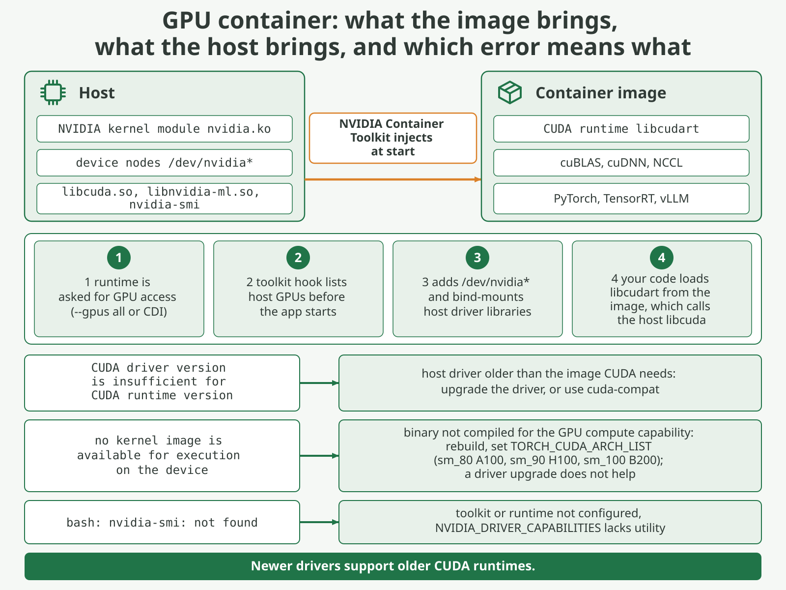

*Figure 5.1.12. The image brings the tools and the host brings the engine; the error message tells you which side to fix.*

Your first GPU container fails with `CUDA driver version is insufficient for CUDA runtime version`, and the image looked correct. The cause is not inside the image alone. It sits in the split between what the image carries and what the host provides, so the section begins by drawing that line.

A container cannot carry a GPU driver. The kernel driver and its device nodes live on the host. The container carries only the userspace libraries it was built with, such as the CUDA runtime, cuDNN and NCCL. The glue between the two is the NVIDIA Container Toolkit. The diagram shows the path a GPU request takes, from the command you type down to the library call that reaches the GPU.

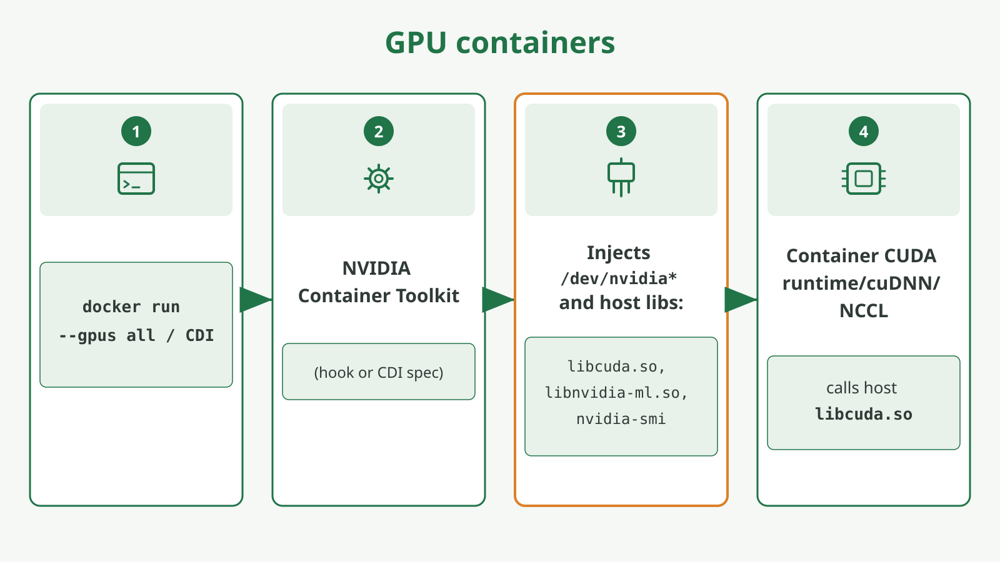

*Figure 5.1.13. GPU containers, as a diagram.*

The split between image and host is the key idea. Here is the walkthrough for a `--gpus all` request. The runtime is asked to start a container with GPU access. The toolkit's hook runs before the container's main process starts, and it reads the list of GPUs on the host. For each device it adds the matching device node, such as `/dev/nvidia*`, to the container's view. It also bind-mounts the host's driver libraries into the container. Only then does your process start. When your code calls CUDA, it loads the library from the image, and that library calls into the driver library that the toolkit mounted from the host. If a step in that chain is missing, the failure shows up as a CUDA error from inside your program, which is why the checks at the end of this section go in order.

The image provides the CUDA toolkit runtime libraries, such as `libcudart`, `cublas`, `cudnn` and `nccl`. The host provides `libcuda.so` and the kernel module, and the toolkit mounts them into the container at start. Because the driver stays on the host, one host driver can serve many CUDA versions. A useful way to remember it is that the image brings the tools, and the host brings the engine.

Compatibility is where most GPU container failures come from. The host driver must be at least the minimum that the image's CUDA version requires. Newer drivers support older CUDA runtimes. The CUDA forward-compatibility package, `cuda-compat`, lets a newer CUDA runtime run on an older data-centre driver, within limits. Some features need a newer driver branch altogether, such as support for new GPU architectures like Blackwell. Check NVIDIA's compatibility tables before you upgrade either side. A mismatch usually shows up as `CUDA driver version is insufficient for CUDA runtime version`. A different error, `no kernel image is available for execution on the device`, means the binary was not compiled for your GPU's compute capability. That is a different problem, and the fix is a rebuild, not a driver upgrade.

Next, decide which GPUs a container can see. The `--gpus all` option exposes every GPU, and `--gpus '"device=0,1"'` selects specific ones. The environment variables `NVIDIA_VISIBLE_DEVICES` and `NVIDIA_DRIVER_CAPABILITIES` (set to `compute,utility,video`) do the same job, and MIG devices can be selected by UUID. MIG (Multi-Instance GPU) splits one physical GPU into smaller isolated pieces. The runtime-neutral method is CDI, the Container Device Interface. You generate a spec with `nvidia-ctk cdi generate --output=/etc/cdi/nvidia.yaml`, then request devices with `--device nvidia.com/gpu=all`. Docker 25 and later, Podman, containerd and CRI-O all support this. Kubernetes uses the device plugin and, more and more, CDI and DRA (Part 11).

Base images come in several flavours. `nvidia/cuda:12.x-runtime-ubuntu22.04` is the runtime image, `-devel` adds the compilers, and `-cudnn-runtime` includes cuDNN. Pick the smallest flavour that does your job. A runtime image is enough to run a finished model, but you need the devel flavour to compile a custom kernel. NGC containers, such as `nvcr.io/nvidia/pytorch:24.xx-py3`, `tritonserver` and `nemo`, are curated and tested together, and NVIDIA updates them monthly. They are very large, so build your own images on top of them and put your application layers last.

Shared memory is a common trap for ML workloads. PyTorch `DataLoader` workers and NCCL both need a large `/dev/shm`. Docker gives a container only 64 MB by default, so you raise it with `--shm-size` or `--ipc=host`. In Kubernetes, mount a memory-backed `emptyDir` at `/dev/shm` (5.7, Part 14). RDMA pinned memory needs `--ulimit memlock=-1` and `--cap-add IPC_LOCK`. InfiniBand devices under `/dev/infiniband` and the RDMA stack need their own mounts. In Kubernetes, the Network Operator handles them (Part 12). The trap is quiet at first. A small test runs fine, and the job only fails once the data loader starts sending large batches.

Design the image itself with the same care. Keep the stable layers, such as the CUDA or PyTorch base, at the bottom. Put pinned Python dependencies in a lockfile above them, and place your code last. Keep datasets and checkpoints out of the image. Avoid `pip install` when the container starts, because it makes every start slow and makes the result depend on the day you started it. Run as non-root wherever the libraries allow it. Add health endpoints, and a clean SIGTERM handler, so that a training job can checkpoint when it is preempted.

A short set of commands confirms that the GPU path works. The first runs `nvidia-smi` inside a CUDA image. The second checks that PyTorch can see the GPUs. The third uses the CDI style. If the first one works but the second one does not, the problem is in the Python environment inside the image, not in the GPU path.

```bash
docker run --rm --gpus all nvcr.io/nvidia/cuda:12.4.1-base-ubuntu22.04 nvidia-smi
docker run --rm --gpus all nvcr.io/nvidia/pytorch:24.05-py3 python -c "import torch; print(torch.cuda.is_available(), torch.cuda.device_count(), torch.version.cuda)"
docker run --rm --device nvidia.com/gpu=all ubuntu:22.04 ls /dev/nvidia*       # CDI style (after `nvidia-ctk cdi generate`)
```

## 7. Container lifecycle commands (cheat sheet)

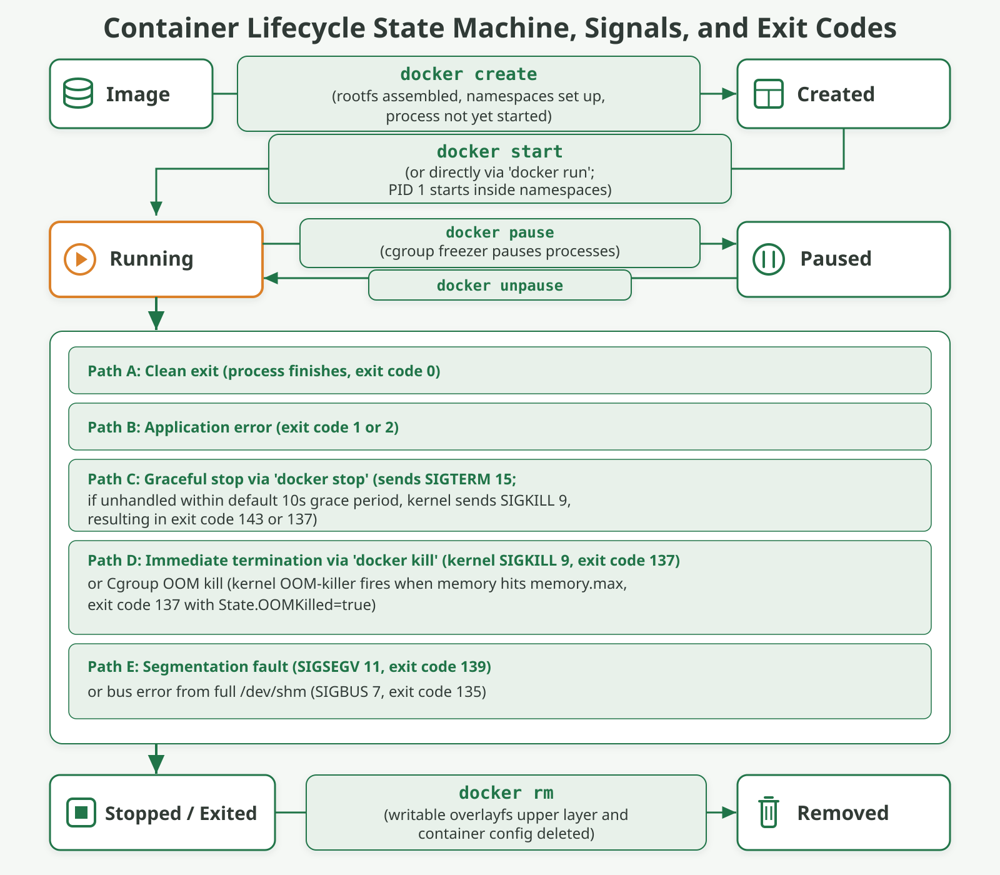

*Figure 5.0.0. The container lifecycle moves through distinct kernel states driven by CLI commands, signal propagation, and cgroup resource enforcement.*

Most of your day with containers is spent starting them, watching them, stopping them and cleaning up. The block below collects those commands in the order you are likely to use them. Read it as a sequence: start, look, change, stop, clean. Each line is a small question you ask the container.

```bash
docker run -d --name web -p 8080:80 --restart unless-stopped --memory 512m --cpus 1 nginx:1.27
# Example from Kubernetes: Up and Running, Chapter 2: cap memory and swap, and set a relative CPU weight with --cpu-shares
docker run -d --name kuard --publish 8080:8080 --memory 200m --memory-swap 1G --cpu-shares 1024 gcr.io/kuar-demo/kuard-amd64:blue
docker ps -a; docker logs -f --tail 100 web; docker exec -it web sh
docker stats --no-stream; docker top web; docker inspect web | jq '.[0].HostConfig'
docker stop web   # SIGTERM then SIGKILL after grace (default 10s); `--time` to change
docker kill -s HUP web
docker cp web:/etc/nginx/nginx.conf ./; docker diff web                 # writable-layer changes
docker commit web web:debug                                              # snapshot (debugging only; not a build method)
docker volume create data && docker run -v data:/var/lib/app app         # named volume; -v /host/path:/c/path for bind mounts
docker network create appnet && docker run --network appnet --name db postgres:16
docker system df; docker image prune -a --filter "until=168h"            # disk usage and cleanup
docker run --rm --read-only --tmpfs /tmp --cap-drop ALL --security-opt no-new-privileges --user 10001:10001 app:1.4   # hardened run
podman run --rm -it --userns=keep-id alpine id                           # rootless
```

The first run command starts a web container in the background, with a restart policy and memory and CPU limits. The restart policy tells Docker to bring the container back after a crash or a reboot, unless you stopped it yourself. The second command is a variant from the Kubernetes: Up and Running example. It caps memory and swap, and it sets a relative CPU weight with `--cpu-shares`. Treat it as a variant to try on your own host. Notice that `docker stop` sends SIGTERM first, then SIGKILL after the grace period, which is 10 seconds by default. Use `--time` to change that wait.

Two pairs of flags are easy to confuse. `--cpus` sets a hard CFS quota on CPU cores, so the container is throttled even when the host is idle. CFS (the Completely Fair Scheduler) is the kernel's CPU scheduler that enforces the quota, and a quota is a budget of CPU time per period. `--cpu-shares` sets a relative CPU weight, which matters only when the CPU is contended. The default share weight is `1024`, and it corresponds to Kubernetes `resources.requests.cpu`. The memory pair works the same way. `--memory` is the RAM limit, which is `200m` in the Kubernetes example. `--memory-swap` is the combined limit for RAM plus swap, which is `1G` in the same example.

Podman is CLI-compatible with Docker, so you can alias one as the other with `alias docker=podman`. It is daemonless and starts a process for each container. It supports pods (`podman pod`), it can generate Kubernetes YAML (`podman generate kube`), and it can generate systemd units and Quadlet files. The daemonless part matters when you want rootless operation, because there is no privileged daemon sitting between you and the kernel.

### Running a container and mapping its port

In Kubernetes, a daemon on each node called the kubelet usually launches containers. To get started, the Docker command-line tool is easier. This command starts the `kuard` container from its image:

```bash
$ docker run -d --name kuard \
--publish 8080:8080 \
gcr.io/kuar-demo/kuard-amd64:blue
```

The `-d` option runs the container in the background, as a daemon. The `--name kuard` option gives it a friendly name. The `--publish` option maps port 8080 on your machine to port 8080 in the container, and `-p` is the short form. The mapping is needed because each container has its own IP address. An app listening on localhost inside the container does not listen on your machine. Without the mapping, your machine cannot reach it. Think of the mapping as a hotel front desk that forwards calls to a room. The guest is inside, but the caller needs the desk to connect them.

The Kubernetes example points you to `http://localhost:3000` in a browser, but this command publishes port 8080. Use `http://localhost:8080`, or check it from the command line with `curl http://localhost:8080`. The `kuard` app also has more features, which later chapters use.

### Cleaning up images

When you finish building an image, you can delete it with `docker rmi`. Name the image by its tag, such as `gcr.io/kuar-demo/kuard-amd64:blue`, or by its image ID:

```
docker rmi <tag-name>
docker rmi <image-id>
```

An image ID can be shortened as long as it stays unique. Usually three or four characters are enough. Be aware that an image lives on your system forever unless you delete it. Building a new image with the same name only moves the tag to the new image, and the old image stays. Use `docker images` to list what is on your machine, then remove the tags you no longer need.

For general cleanup, `docker system prune` removes all stopped containers, all untagged images and all unused image layers left by the build process. Use it carefully, because it removes things you may still want to inspect. For a steady approach, run `docker system prune` as a recurring `cron` job. A daily or hourly schedule fits you best if you create many images.

## 8. Troubleshooting images and containers

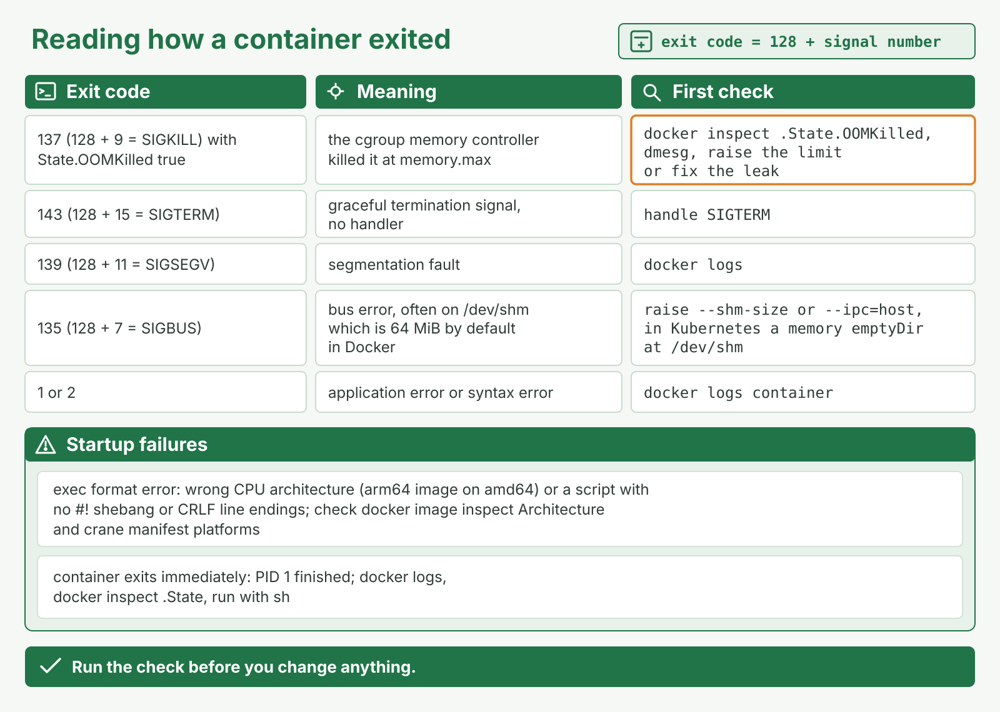

*Figure 5.1.14. An exit code of 128 plus N means the process died of signal N, and State.OOMKilled separates a memory kill from other SIGKILLs.*

Your container exits, and the only clue is one line in the logs. The table below is how experienced engineers turn that one line into a short list of causes. Most container failures show a symptom that points to a small set of causes. The table matches each symptom to its likely cause and the check that confirms it.

| Symptom | Likely cause | Check |
|---|---|---|
| `exec format error` | Wrong architecture (arm64 image on amd64 or vice versa); script without shebang | `docker image inspect --format '{{.Architecture}}'`, `crane manifest` platforms, build with `--platform` |
| `permission denied` writing files | Non-root user vs volume ownership; read-only rootfs | `id`, `ls -ln`, `securityContext.fsGroup` in Kubernetes |
| Container exits immediately | PID 1 finished (CMD ran and ended), crash, missing entrypoint | `docker logs`, `docker inspect .State`, run with `sh` |
| Ignores SIGTERM, slow stop (10 s) | Shell-form CMD, app doesn't handle signals, PID 1 semantics | exec-form, `--init`, handle SIGTERM |
| `OOMKilled: true` | Memory limit exceeded (cgroup) | `docker inspect .State.OOMKilled`, `dmesg`, raise limit/leak fix |
| Pull slow or fails | Registry rate limits, auth, huge layers, DNS/proxy | `docker pull -v`, `skopeo`, mirror, retry, check TLS/certs |
| Image huge | Layers with build tools/caches; deleting files later | `dive`, multi-stage, same-layer cleanup |
| Build cache never hits | Layer order, changing `COPY . .` early, timestamps | Reorder, `.dockerignore`, check BuildKit cache |
| `CUDA driver version is insufficient` | Host driver older than image CUDA needs | `nvidia-smi` on host vs image CUDA, upgrade driver or use compat |
| `no kernel image is available` | Binary built without your GPU's compute capability | Rebuild with `-arch`/TORCH_CUDA_ARCH_LIST, use newer framework build |
| `bash: nvidia-smi: not found` in container | Toolkit/runtime not configured, `NVIDIA_DRIVER_CAPABILITIES` lacks `utility` | `nvidia-ctk runtime configure`, CDI generate |
| DNS inside container fails | Host resolv.conf with 127.0.0.53, network namespace DNS config | `docker run --dns`, inspect `/etc/resolv.conf` |

Read each row from left to right. The symptom you see tells you where to look, and the check column gives the command to run first. Start with the symptom that matches your log line, then run the check before you change anything. Changing settings at random is how a small failure becomes a long afternoon. A useful habit is to write down which check you ran and what it showed, so the next person who meets the problem does not repeat your work.

## 9. Lab

Before you touch a real host, start with the self-checking Python lab, which runs locally with no container engine. It checks three things. The first is the OCI additive layer and `.wh.` whiteout size calculator, `simulate_oci_layer_sizes`. It shows why a `RUN rm` in a later layer hides a 500 MB file in `overlayfs`, while the image tarball still ships all 500 MB, as the *Kubernetes: Up and Running* book describes. The second is the Dockerfile cache-invalidation simulator, `simulate_dockerfile_cache_hits`. The third is the compatibility checker for the NVIDIA host driver and the container's CUDA runtime, `check_cuda_driver_compatibility`. Each one turns a rule from this chapter into a small function you can read.

```bash
python3 code/part05/oci_image_layers_lab.py
```

After the Python lab, you move to a Linux host with Docker or Podman. The shell steps below have not been run against live hardware, so run them and check the results yourself. Twelve exercises follow, and you will use the commands in each one. Work through them in order, because each exercise builds on the one before. The first one is about the process, the middle ones are about images and registries, and the last ones are about the GPU and cleanup.

1. Start with the idea that a container is a process. Run a container, then find its host PID. List `/proc/<pid>/ns`, `cgroup` and `status`, and check CapEff, NoNewPrivs and Seccomp. Use `nsenter` to enter the net and mount namespaces. Then show that `kill -STOP` on the host PID freezes the container. Finally, set a memory limit, trigger an OOM kill with a small Python allocator, and read `OOMKilled`.
2. Build a container by hand. Create a rootfs with `debootstrap`, or from `docker export`. Use `unshare --mount --pid --net --uts --ipc --fork`, then `chroot` or `pivot_root`, mount `/proc`, and run a shell. Add a cgroup v2 directory with `memory.max` and `pids.max`, and move the process into it. Compare your result with `runc spec` and `runc run` on the same rootfs.
3. Look inside an image. Run `docker save` on an image, then extract `manifest.json`, the config and the layers. Recompute each layer's sha256 and list the layer contents. Find the whiteout entry that `RUN rm` creates, and compare the sizes with and without same-layer cleanup.
4. Inspect a registry with `crane` or `skopeo`. List the tags, read the index and manifests of a multi-arch image, and copy an image between registries by digest with `skopeo copy`. Then run a local `registry:2`, and push and pull an image with and without TLS and authentication.
5. Optimize a Dockerfile. Start with a naive version for a small FastAPI app. It has one big `RUN`, `COPY . .` at the top, `latest` tags and the root user. Measure its build time and image size. Then refactor it with better layer ordering, a multi-stage build, BuildKit cache mounts, a non-root user and a `.dockerignore` file. Rebuild after a code-only change, and verify that the cache hits.
6. Look at secrets in builds. Show a leaked token by passing it through `ARG`, and find it in `docker history`. Fix the leak with `RUN --mount=type=secret`. Then scan the layers for the secret with `dive` or `trufflehog`.
7. Try multi-arch builds. Run `docker buildx build --platform linux/amd64,linux/arm64 --push`, inspect the index with `crane manifest`, and run the arm64 image under `qemu-user-static`.
8. Check security. Run Trivy or Grype on the image, and generate an SBOM. Sign the image with cosign, using keyless signing or a local key, and then verify it. Run the hardened flags from earlier, and note which operations now fail.
9. Try rootless mode. Install Podman and run it rootless. Compare `/proc/self/uid_map`, and try to bind port 80. Look at the storage under `~/.local/share/containers`, and generate a Quadlet unit.
10. Watch pull behaviour. Pull a large image over a throttled link. Run a local registry mirror or pull-through cache, using Harbor or a `registry:2` proxy. Then measure how long a second node takes to pull the same image. Finally, configure the containerd `hosts.toml` mirror.
11. Run a GPU container, which needs a GPU host. Install the NVIDIA Container Toolkit, then run `nvidia-smi` inside a CUDA image. Generate a CDI spec and use `--device nvidia.com/gpu=all`. Test how a driver and CUDA mismatch behaves, using an old driver or a deliberately new CUDA image. Set `--shm-size`, and show a PyTorch DataLoader failing with the default 64 MB.
12. Clean up at the end. Run `docker system prune -a`, and remove the volumes and test registries you created.

## 10. Common mistakes

The mistakes below come up again and again. Each one is easy to make, and each one has a fix that appears earlier in this chapter. Read the list as a set of warning signs. When you catch yourself doing one of these, go back to the matching section before you go on.

- Treating a container as a VM. You expect kernel isolation, forget that the kernel is shared, and run everything as root or privileged.
- Using mutable tags such as `latest` in production, without pinning digests and without reviewing the base image.
- Ordering Dockerfile instructions so that every code change busts the dependency cache.
- Deleting files in a later layer and expecting a smaller image. Build tools and caches also stay in the runtime image when you forget to remove them.
- Putting secrets into `ENV`, `ARG`, layers or the build context.
- Using shell-form `CMD` or `ENTRYPOINT`, or running apps that ignore SIGTERM and leave zombie processes behind.
- Writing important data into the container layer instead of a volume.
- Having no registry strategy. Docker Hub rate limits, pull storms and a single registry region can all stall your jobs.
- Using Alpine for CUDA or PyTorch workloads, or mixing CUDA versions between the image and the host driver without checking compatibility.
- Baking datasets or checkpoints into images.
- Ignoring `/dev/shm`, `memlock` and IPC settings for ML workloads.
- Scanning only at build time, and never scanning the deployed digests again.

## 11. Interview angles

These questions are the kind an interviewer might ask. Each one touches a main idea of this chapter. A good answer does not just name a term. It explains what the term protects you from, using an example from your own experience if you have one.

- "What is a container, really? Which kernel features does it use?"
- "What is in an image? What is a layer, a manifest, an index, a digest? Why are digests safer than tags?"
- "Why doesn't `RUN rm` shrink an image? How would you shrink one?"
- "How would you speed up builds in CI? How do BuildKit cache mounts work?"
- "How do GPUs work inside a container? What must match between host and image?"
- "How do you avoid pull storms when 500 nodes need a 20 GB image?"
- "Rootless vs rootful containers; what are the trade-offs?"
- "What happens on `docker run` step by step?" (client → daemon → containerd → shim → runc; pull, unpack, create namespaces and cgroups, exec.)
- "How would you debug a container that exits immediately or is OOM-killed?"

## Exercises

Each exercise asks you to watch a real host or one of the chapter's helper functions. Do them in order. Keep a notebook open while you work, and write down what each command shows you, because the explanations in this chapter are easier to remember once you have seen their output.

1. Start a container with `docker run -d --name demo --memory 256m --cpus 0.5 nginx:1.27`. Ask what the host kernel did to start it. List the namespaces it created and the cgroup limits it set. The memory and swap flags in *Kubernetes: Up and Running*, Chapter 2, give a second variant to try.
2. Explain the difference between `--cpus` and `--cpu-shares`. One is a hard quota and the other is a relative weight that only matters under contention. Then use `nsenter -t $PID -n` and `nsenter -t $PID -m` to look at the container from the host.
3. Run `simulate_oci_layer_sizes()` in `code/part05/oci_image_layers.py`. Follow the JSON from the image index down to the layer blobs. Say why a tag can move but a digest cannot.
4. Suppose a later `RUN rm` deletes a 500 MB file. Explain why the file disappears from the container but the image download does not shrink. The background is in *Production Kubernetes*, Chapter 3.
5. Run `simulate_dockerfile_cache_hits()` in the same file. Say why copying `requirements.lock` before `src/` keeps the build cache valid when you edit code. Then describe what `RUN --mount=type=cache` and `RUN --mount=type=secret` each do.
6. Pick a base image for a Python service from `scratch`, distroless, Alpine and Debian. Explain why Alpine's `musl` libc breaks many `glibc` Python wheels and CUDA binaries. Explain also why a shell-form `ENTRYPOINT "python app.py"` ignores SIGTERM and costs a 30-second wait before SIGKILL.
7. Design a registry path for 500 nodes pulling a 25 GB training image at once. Choose between a pull-through mirror, peer-to-peer distribution, compression and lazy pulling, and say which two you would try first.
8. Run `check_cuda_driver_compatibility()` and say which half of CUDA lives on the host and which half lives in the image. Then explain why NCCL and PyTorch DataLoaders fail with Docker's default 64 MB `/dev/shm`.

## Checkpoint questions (20)

<details>
<summary>1. What is a Linux container at the kernel level, and why is \"a container is a lightweight VM\" a dangerous misconception?</summary>

A container is an ordinary Linux process, or process tree, that runs directly on the host kernel. **Linux namespaces** isolate it from other processes (`pid`, `mnt`, `net`, `uts`, `ipc`, `user`, `cgroup`). **cgroups (v2)** bound its resources, and an **`overlayfs` union mount** (`pivot_root`) gives it its root filesystem. **Linux capabilities, seccomp syscall filters, and AppArmor/SELinux** restrict it further.

A VM is different. It boots its own guest kernel on virtualized hardware through a hypervisor. All containers on a node share the single host kernel, so kernel panics, non-namespaced sysctls, kernel module versions (`nvidia.ko`, `mlx5_core.ko`) and `dmesg` are shared across the whole host. That is why calling a container a lightweight VM is dangerous.
</details>

<details>
<summary>2. In *Kubernetes: Up and Running* Chapter 2, how do Docker's `--cpus`, `--cpu-shares`, `--memory`, and `--memory-swap` flags map to Linux cgroups?</summary>

- **`--cpus 0.5`** (cgroup v2 `cpu.max`) sets a hard CPU bandwidth ceiling. The Completely Fair Scheduler (`CFS`) throttles the container even when host CPUs are idle. This maps to Kubernetes `resources.limits.cpu`.
- **`--cpu-shares 1024`** (cgroup v2 `cpu.weight`) sets a relative weight that takes effect only when host CPUs are contended. The default weight is `1024`, and it maps to Kubernetes `resources.requests.cpu`.
- **`--memory 200m`** (cgroup v2 `memory.max`) sets the hard RAM ceiling of `200 MiB`. Exceeding it triggers the kernel OOM killer, and the container reports `OOMKilled: true`.
- **`--memory-swap 1G`** sets the combined ceiling for RAM plus swap. That is `200 MiB` of RAM and `824 MiB` of swap.
</details>

<details>
<summary>3. Trace the four JSON/blob objects in the OCI Image Specification (*Production Kubernetes*, Chapter 3): Image Index, Image Manifest, Image Config, and Layers.</summary>

1. **Image Index** (`application/vnd.oci.image.index.v1+json`) is an optional top-level multi-architecture manifest list. It maps each platform (`linux/amd64`, `linux/arm64`, `linux/ppc64le`) to the SHA-256 digest of that platform's manifest.
2. **Image Manifest** (`application/vnd.oci.image.manifest.v1+json`) lists the digest and size of the single **Config** blob, plus the ordered array of **Layer** archive blobs for one platform.
3. **Image Config** (`application/vnd.oci.image.config.v1+json`) stores the runtime defaults (`Env`, `Entrypoint`, `Cmd`, `User`, `WorkingDir`, `ExposedPorts`, `Labels`), the build `history`, and the uncompressed layer `rootfs.diff_ids`.
4. **Filesystem Layers** (`application/vnd.oci.image.layer.v1.tar+gzip` or `+zstd`) are content-addressed tar archives of filesystem additions, modifications and whiteouts.
</details>

<details>
<summary>4. Why doesn't `RUN rm /tmp/huge_file.tar` in a separate Dockerfile instruction shrink the final image size (*Kubernetes: Up and Running*, Chapter 2)?</summary>

Every `RUN`, `COPY` and `ADD` instruction creates a new, immutable, read-only layer. Suppose Layer 2 creates `/tmp/huge_file.tar`, which is 500 MB, and Layer 3 runs `RUN rm /tmp/huge_file.tar`. Layer 3 writes only a 0-byte `.wh.huge_file.tar` whiteout marker into the upper `overlayfs` layer, which hides the file from the merged view. All 500 MB of bytes stay permanently inside Layer 2's tarball, and every `docker pull` still downloads them. Always download, unpack, install and `rm -rf` temporary files within the same single `RUN` instruction. You can also use a BuildKit `--mount=type=cache` or a multi-stage build.
</details>

<details>
<summary>5. Why is deploying by image digest (`app@sha256:669e01...`) safer than deploying by tag (`app:1.4` or `app:latest`)?</summary>

An image tag, such as `:1.4` or `:latest`, is a mutable pointer in the registry. Anyone with push permission, or a compromised CI pipeline, can overwrite `:1.4` so that it points to a completely different manifest. Nodes that scale up tomorrow could then run different code from the nodes that booted today.

An image digest, `@sha256:...`, is the cryptographic SHA-256 hash of the manifest bytes themselves. It cannot be changed, and the runtime verifies it on every pull. That guarantees every node in a 500-node job runs exactly the same bits.
</details>

<details>
<summary>6. How does Dockerfile instruction ordering affect CI build speed (*Kubernetes: Up and Running*, Chapter 2)?</summary>

BuildKit and Docker cache each layer based on the instruction string and the checksum of the files that `COPY` or `ADD` brings in. Once one layer's cache is invalidated, every later layer in that stage must be rebuilt from scratch. Suppose you write `COPY . .` before `RUN pip install -r requirements.lock` (or `npm install`). Then editing one line of Python or JavaScript invalidates the copy, and every commit forces a 10-minute dependency reinstall.

If you copy only `requirements.lock` first, run `pip install`, and place `COPY src/ ./src/` last, code edits rebuild in 1 second.
</details>

<details>
<summary>7. How do Multi-Stage Builds (`FROM ... AS builder` -> `FROM ... AS runtime` with `COPY --from=builder`, *Kubernetes: Up and Running*, Chapter 2) improve both image size and security?</summary>

Compiling C++ or CUDA extensions, building Go binaries such as `kuard`, or building Python wheels all need heavy tools. Those include `gcc`, `g++`, `nvcc`, `build-essential`, `-dev` headers and `git`. A multi-stage Dockerfile separates that work. The `builder` stage installs the compilers and builds `/wheels` or `/go/bin/kuard`. The final `runtime` stage starts from a clean slim or distroless base, and it copies only the finished artifacts with `COPY --from=builder /wheels /wheels`.

None of the compilers, build caches or intermediate layers from `builder` reach the final image. The image gets smaller, and hundreds of potential compiler and library CVEs disappear with the tools.
</details>

<details>
<summary>8. Why does passing a secret via `ARG PIP_TOKEN` or `ENV PIP_TOKEN` in a Dockerfile leak the secret, and how does `RUN --mount=type=secret` fix it?</summary>

Values passed through `ARG` or `ENV` are recorded in the OCI image config JSON, in `history` and `Config.Env`. Anyone who pulls the image can run `docker history --no-trunc <image>` or `docker inspect <image>` and read the plain-text secret.

BuildKit's `RUN --mount=type=secret,id=pip_token` avoids this. You pass the secret with `docker build --secret id=pip_token,src=.pip_token .`. BuildKit mounts it as an in-memory `tmpfs` file at `/run/secrets/pip_token`, and only for the duration of that single `RUN` command. No trace is left in any image layer or in `docker history`.
</details>

<details>
<summary>9. Why must `ENTRYPOINT` and `CMD` use Exec Form (`["python", "-m", "uvicorn", ...]`) instead of Shell Form (`python -m uvicorn ...`)?</summary>

- **Shell form** (`ENTRYPOINT python app.py`): Docker wraps the command as `/bin/sh -c "python app.py"`, which makes `/bin/sh` PID 1. Most shells (`dash`, `ash`, `bash`) do not forward `SIGTERM` to child processes. When Kubernetes terminates the pod with `kubectl delete pod`, the signal reaches the shell but never reaches your Python app. The pod then hangs for the full 30-second `terminationGracePeriodSeconds`, and Kubernetes finally kills it with `SIGKILL`. In-flight requests or checkpoints can be corrupted as a result.
- **Exec form** (`ENTRYPOINT ["python", "app.py"]`) runs `python` directly as PID 1, with no shell wrapper, so `SIGTERM` goes straight to your application. If your app forks subprocesses and does not reap zombies, pair it with `tini` or `--init`.
</details>

<details>
<summary>10. Why should you NEVER use `Alpine Linux` (`musl` libc) as the base image for Python ML, PyTorch, or CUDA containers?</summary>

Alpine Linux uses `musl` libc instead of the standard GNU `glibc`. Pre-compiled Python `manylinux` wheels (`torch`, `numpy`, `scipy`, `triton`) and all NVIDIA CUDA user-space libraries (`libcudart.so`, `libnccl.so`, and `libcuda.so` injected from the host) are linked against `glibc`. On Alpine, `pip` either fails to find `musllinux` wheels and falls back to a multi-hour source compile that fails, or it crashes with dynamic linker errors such as `Error loading shared library ld-linux-x86-64.so.2`. The `musl` memory allocator is also significantly slower under multi-threaded Python contention. Use `ubuntu`, `debian-slim` or `ubi` bases for GPU and ML containers.
</details>

<details>
<summary>11. How do GPU containers work: what lives on the Host versus what lives inside the Container Image?</summary>

A container shares the host's Linux kernel, so a container image cannot load its own kernel driver. The host OS holds the NVIDIA kernel module (`nvidia.ko`, `nvidia-uvm.ko`, `nvidia-peermem.ko`), the device nodes (`/dev/nvidia0..7`, `/dev/nvidiactl`, `/dev/nvidia-uvm`), and the user-space CUDA Driver API library (`libcuda.so`, `libnvidia-ml.so`, `nvidia-smi`). That library is tightly coupled to that exact kernel module version.

The container image holds the CUDA Runtime library (`libcudart.so`), the math and collective libraries (cuBLAS, cuDNN, NCCL), and the ML frameworks (PyTorch, TensorRT, vLLM). At container start, the NVIDIA Container Toolkit bind-mounts `/dev/nvidia*`, `libcuda.so` and `nvidia-smi` from the host into the container's mount namespace.
</details>

<details>
<summary>12. What are the compatibility rules between the Host NVIDIA Driver (`libcuda.so`) and the Container Image's CUDA Runtime (`libcudart.so`)?</summary>

1. **Backward compatibility (the standard rule):** The host driver (`libcuda.so`) works with older CUDA runtimes. For example, a host running Driver `550.x` (CUDA 12.4) can run containers built with CUDA `12.4`, `12.1`, `11.8` or `11.0`.
2. **Insufficient driver error:** If the image was built with a newer CUDA runtime (`12.6`) than the host driver supports (`525.x`), CUDA initialization fails with `CUDA driver version is insufficient for CUDA runtime version`.
3. **Forward compatibility (`cuda-compat`):** On NVIDIA Data Center GPUs, installing the matching `cuda-compat-12-x` package inside the container lets designated older LTS host driver branches, such as `535.x`, support newer CUDA 12.x user-space runtimes.
4. **Architecture and SASS compatibility (`no kernel image is available`):** The binaries or PTX must be compiled for the SM targets that match the physical GPU. Set `TORCH_CUDA_ARCH_LIST` to `sm_80` for A100, `sm_90` for H100, or `sm_100` for B200.
</details>

<details>
<summary>13. What is `CDI` (Container Device Interface), and how does `nvidia-ctk cdi generate` simplify GPU access across container runtimes?</summary>

Before CDI, exposing GPUs required runtime-specific wrapper hooks, such as `nvidia-container-runtime` patching `runc`. CDI, the Container Device Interface, is an open OCI standard. containerd 1.7 and later, `CRI-O`, Podman and Docker 25 and later support it natively.

Running `nvidia-ctk cdi generate --output=/etc/cdi/nvidia.yaml` inspects the host's GPUs and driver files. It writes a declarative JSON or YAML specification. That spec lists the exact device nodes, the bind mounts (such as `libcuda.so`) and the hooks for `nvidia.com/gpu=0`, `nvidia.com/gpu=all` or MIG instances. Any CDI-aware runtime can then attach GPUs with `--device nvidia.com/gpu=all`, with no custom runtime wrapper.
</details>

<details>
<summary>14. Why do PyTorch `DataLoader` workers and multi-GPU `NCCL` jobs crash inside Docker with `Bus error (core dumped)` or `NCCL WARN Call to posix_fallocate failed`, and how do you fix it?</summary>

By default, Docker mounts `/dev/shm`, the POSIX shared-memory `tmpfs`, inside a container with a small 64 MiB limit (`--shm-size=64m`). PyTorch multi-process `DataLoader` workers (`num_workers > 0`) and intra-node NCCL shared-memory communication allocate multi-gigabyte tensors in `/dev/shm`. Once an allocation exceeds 64 MiB, `mmap` access raises `SIGBUS` (`Bus error`).

To fix it, pass `--shm-size=16g` (or `--ipc=host`) in Docker. In Kubernetes Pods, mount a memory-backed `emptyDir` (`emptyDir: { medium: Memory, sizeLimit: 64Gi }`) at `/dev/shm`.
</details>

<details>
<summary>15. When 500 GPU nodes simultaneously pull a 25 GB container image at job start, what happens, and what five techniques prevent a \"Pull Storm\"?</summary>

Five hundred nodes each pulling a 25 GB image at the same moment means `500 * 25 GB = 12.5 TB` of concurrent egress. That saturates the central registry's network cards and storage, and it stalls job startup for 30 to 60 minutes. Five mitigations help.

1. **Local pull-through registry cache.** Run a Harbor proxy cache inside the cluster fabric, and point containerd `hosts.toml` at it as a mirror.
2. **Peer-to-peer (`P2P`) image distribution** with `Spegel`, `Dragonfly` or `Kraken`. Nodes fetch blocks from neighbouring cluster nodes over the 100G or 400G intra-cluster network, instead of pulling 500 times from the registry.
3. **Shared base layers.** Standardize every team on the same pinned `nvcr.io/nvidia/pytorch:24.06-py3` base layer and set `imagePullPolicy: IfNotPresent`. Then each job pulls only the small 50 MB application layer.
4. **Pre-pulling with DaemonSets**, which warms the base image onto the nodes during idle windows.
5. **Lazy-pulling snapshotters** (`SOCI`, `eStargz`, `Nydus`). The container starts immediately, and file chunks are fetched on demand.
</details>

<details>
<summary>16. How do you inspect a remote container image's manifest, platforms, and layers without pulling 20 GB onto your laptop?</summary>

Use `skopeo` or `crane`. Both query the registry's HTTP `/v2/<name>/manifests/<ref>` endpoint directly, so they never download the layer blobs.

- `skopeo inspect docker://nvcr.io/nvidia/pytorch:24.06-py3`
- `crane manifest nvcr.io/nvidia/pytorch:24.06-py3 | jq .`
- `crane config nvcr.io/nvidia/pytorch:24.06-py3@sha256:... | jq .`
</details>

<details>
<summary>17. How do Rootless Containers (`Podman`, rootless `Docker`/`containerd`) work, and what are their limitations?</summary>

Rootless runtimes use Linux user namespaces (`CLONE_NEWUSER`), helped by `/etc/subuid` and `/etc/subgid` with `newuidmap` and `newgidmap`. UID `0`, which is root inside the container, maps to an unprivileged subordinate UID, such as `100000`, on the host. A container escape therefore grants only unprivileged user permissions on the host.

Rootless mode has limits. You cannot bind host ports below 1024 without changing `net.ipv4.ip_unprivileged_port_start`. The user-space networking of slirp4netns or pasta has more overhead than rootful kernel veth or eBPF networking. Finally, cgroup v2 resource delegation requires systemd user session support.
</details>

<details>
<summary>18. What is the difference between `OOMKilled: true` (exit code `137`) and exit code `139` or `1` when a container exits?</summary>

- **Exit code `137` (`128 + 9 = SIGKILL`) with `State.OOMKilled == true`:** The kernel's cgroup memory controller killed the process, because the container's memory usage hit `memory.max` (`--memory`, or Kubernetes `resources.limits.memory`).
- **Exit code `143` (`128 + 15 = SIGTERM`):** A graceful termination signal.
- **Exit code `139` (`128 + 11 = SIGSEGV`) or `135` (`128 + 7 = SIGBUS`):** A segmentation fault, or a bus error on the `/dev/shm` shared memory.
- **Exit code `1` or `2`:** An application-level exception or a syntax error. Check `docker logs <container>`.
</details>

<details>
<summary>19. What causes `exec user process caused: exec format error` when starting a container?</summary>

There are two common causes.

1. **CPU architecture mismatch.** You try to run an `arm64` ELF binary (on Apple Silicon, AWS Graviton or NVIDIA Grace) on an `x86_64` (`amd64`) host, or the reverse. This happens when there is no multi-arch image index. Build one with `docker buildx build --platform linux/amd64,linux/arm64`.
2. **Missing `#!` shebang line.** An `ENTRYPOINT ["/app/start.sh"]` script is marked executable with `chmod +x`, but its first line does not start with `#!/usr/bin/env bash` or `#!/bin/sh`. Or the file has Windows `CRLF` (`\r\n`) line endings.
</details>

<details>
<summary>20. What baseline security flags should every production container run with (`hardened run`)?</summary>

1. **Non-root user:** `USER 10001:10001` in the image, or `--user 10001:10001` at run time. In Kubernetes, use `runAsNonRoot: true`.
2. **Read-only root filesystem:** `--read-only --tmpfs /tmp`. In Kubernetes, use `readOnlyRootFilesystem: true`.
3. **Privilege escalation blocked:** `--security-opt no-new-privileges`. In Kubernetes, use `allowPrivilegeEscalation: false`.
4. **All Linux capabilities dropped:** `--cap-drop ALL`. In Kubernetes, use `capabilities: { drop: ["ALL"] }`.
5. **Seccomp profile active:** the `RuntimeDefault` seccomp filter is enabled.
6. **Signed and scanned:** the image is verified by `cosign` and scanned by `Trivy` or `Grype`, with an attached SBOM.
</details>

## Sources and review notes

- **Sources read in full:**
  - `kubernetes-up-and-running-3rd-edition` — Brendan Burns, Joe Beda, Kelsey Hightower & Lachlan Evenson, *Kubernetes: Up and Running*, 3rd ed., **Chapter 2: Creating and Running Containers** (read in full: container images vs shared-library dependency hell, the Docker image format and OCI standardization, layer inheritance trees and why layer ordering governs build cache hits, building an Express Node.js app and the multi-stage `kuard` Go/Alpine image, why deleting files in later layers leaves bytes in earlier layers, storing images in registries, running containers with Docker/CRI, and limiting resource usage with `--memory 200m --memory-swap 1G --cpu-shares 1024`).
  - `production-kubernetes` — Josh Rosso, Rich Lander, Alexander Brand & John Harris, *Production Kubernetes*, **Chapter 15: Software Supply Chain** (read in full: build frontends and backends, Docker-in-Docker and socket mounts, Kaniko, the build-image and runtime-image split, the runtime user, pinned packages, the registry's server/blob store/database parts, registry placement and replication, and in-cluster registry trade-offs).
  - `production-kubernetes` — Josh Rosso, Rich Lander, Alexander Brand & John Harris, *Production Kubernetes*, **Chapter 3: Container Runtime** (read in full: history of containers, the Open Container Initiative `OCI` Image Specification and Runtime Specification `config.json`, `containerd`, `CRI-O`, `runc`, and VM-based runtimes like `Kata Containers`).
  - `how-linux-works-3rd-edition` — Brian Ward, *How Linux Works*, 3rd ed., **Chapter 17: Virtualization** (sections 17.2 to 17.2.5: containers and their kernel features, Docker and Podman, the Alpine `hlw_test` build, the overlay mount, and container pitfalls).
- **Run here:** `python3 code/part05/oci_image_layers_lab.py` (3 passed, 0 failed).
- **Explicitly labelled inferences:** The `simulate_oci_layer_sizes`, `simulate_dockerfile_cache_hits`, and `check_cuda_driver_compatibility` models in `code/part05/oci_image_layers.py`, the multi-stage FastAPI + BuildKit `Dockerfile`, and the `hosts.toml` pull-through mirror config are the author's constructions applying *Kubernetes: Up and Running* Chapter 2 and *Production Kubernetes* Chapter 3 to AI infrastructure containers (plus original study items 21, 22, 23, 24, 25, 26, 27, 28, 29, 30, 31, 32, 33, 34, 35, 36, 37, 38, 39, and 40).
- **Not verified on live hardware:** Live `docker`, `podman`, `skopeo`, `crane`, `dive`, `nsenter`, and `nvidia-ctk cdi generate` commands (`10 to 30 GB`, `500` nodes, `256m`, `268435456`, `1.27`, `3.12-slim`, `10001`, `8000`, `12.4.1`, `24.05-py3`, `64 MB`, `200m`, `1G`, `1024`, `168h`) are marked (not run against live hardware here) where not executed by `oci_image_layers_lab.py`.
