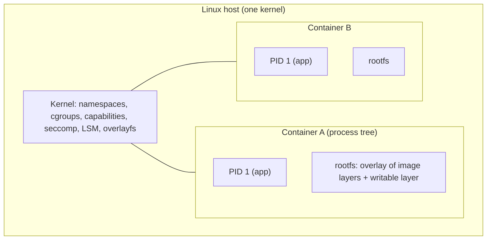
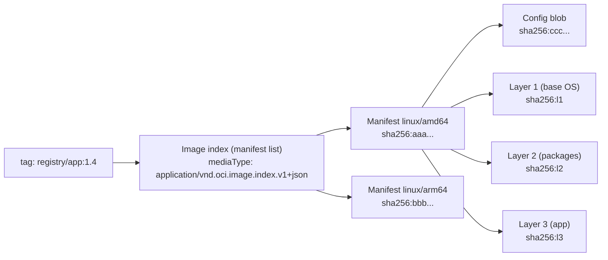
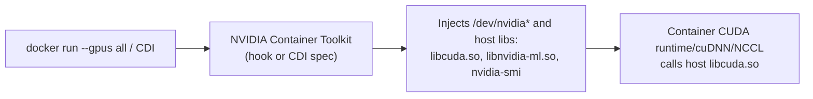

# 5.1 Containers from first principles: images, layers, registries

| | |
|---|---|
| Level | Beginner to intermediate |
| Priority tier | 0 |
| Lab venue | Docker Engine or Podman; `skopeo`, `crane`, `dive`, `buildah` optional; an NVIDIA GPU host with the container toolkit for the GPU exercise |
| Part | Part 5: Kubernetes |
| Status | Drafted, labs **untested** |

## Why this matters for AI infrastructure

Imagine a training job that sits for an hour while its image downloads. Every training job, inference server and platform component in this handbook ships as a container image, so any of them can hit this kind of delay. A PyTorch image is routinely 10 to 30 GB. Pulling it onto 500 nodes at once can saturate a registry and delay a job by an hour. A stale CUDA userspace inside an image can break against a newer host driver. A layer ordering mistake can rebuild a 20-minute dependency install on every code change, and an image from an unverified registry is a supply-chain risk.

Kubernetes, the subject of the rest of Part 5, schedules containers. It cannot fix any of these problems on its own. You need to know what a container actually is, how images are structured and distributed, and how to build small, fast, reproducible, and secure images. Everything after this chapter rests on that foundation.

## Prerequisites and outcomes

You should already know the Linux fundamentals from Part 1. That means namespaces and cgroups (1.19, 1.20), the filesystem chapters, and the process model. This chapter builds directly on them. When you finish, you should be able to do the following:

- Explain that a container is an ordinary Linux process, or process tree. It is isolated with namespaces, limited with cgroups, given a different root filesystem, and restricted with capabilities, seccomp and LSM profiles.
- Explain that an image is just layered tarballs plus metadata.
- Describe the OCI Image Spec (manifests, indexes, config, layers, digests, media types) and the OCI Runtime Spec (`config.json`, bundles). Also explain how they relate to Docker, containerd and CRI-O.
- Inspect images and registries with `docker`/`podman`, `skopeo` and `crane`. Read manifests and layer digests, and explain content addressing and deduplication.
- Write efficient, reproducible Dockerfiles. That covers layer ordering, multi-stage builds, BuildKit cache and secret mounts, multi-architecture builds, non-root users and minimal bases. You should also know the trade-offs of distroless, scratch, Alpine and Debian/Ubuntu bases.
- Operate registries, including pull-through caches, mirrors, authentication, tags versus digests, retention and replication. Apply image-pull strategies for large GPU images.
- Apply baseline image security: scanning, SBOMs, signing, rootless operation and dropping capabilities.
- Describe how GPU containers work. That means the NVIDIA Container Toolkit, the driver and userspace split, CUDA base images and compatibility rules.

## 1. What a container is

It is easy to think of a container as a lightweight virtual machine, but that picture leads to wrong assumptions about security and resource use. A container is not a lightweight VM, and it is not a kernel feature called "container." A container is a **process** started with a set of kernel isolation and limit mechanisms applied, running from a **root filesystem** assembled from an image.

The diagram below shows two containers on one host. Both run on the same kernel. Each one gets its own process tree and its own root filesystem, and the kernel keeps them apart.



Each isolation or limit mechanism covers one part of the process. The table lists them, with the setting you will usually meet in practice. Some rows are defaults, such as the PID namespace that `docker run` creates for you.

| Mechanism | What it provides | Typical container setting |
|---|---|---|
| **PID namespace** | Own process tree; app is PID 1 | `docker run` default |
| **Mount namespace + `pivot_root`** | Own filesystem view (the image rootfs) | Overlay mount of layers |
| **Network namespace** | Own interfaces, IPs, routes, ports | veth pair to a bridge (5.13) |
| **UTS / IPC namespaces** | Own hostname; own SysV IPC/POSIX queues | default |
| **User namespace** | UID/GID remapping (root inside = unprivileged outside) | rootless Podman, some runtimes |
| **Cgroup namespace** | Virtualised view of the cgroup tree | default on cgroup v2 |
| **cgroups (v2)** | Limits and accounting: CPU, memory, I/O, PIDs, devices | `--cpus`, `--cpu-shares`, `--memory`, `--memory-swap`, `--pids-limit` |
| **Capabilities** | Split root privileges; containers drop most by default | `--cap-drop ALL --cap-add NET_BIND_SERVICE` |
| **seccomp** | Syscall filter (default profile blocks ~40 risky calls) | `--security-opt seccomp=...` |
| **AppArmor / SELinux** | Mandatory access control profiles | distro defaults |
| **overlayfs** | Union of read-only layers + writable upper layer, copy-on-write | storage driver |

You can prove this to yourself on any Linux machine. The commands below start an nginx container with a memory and CPU limit, then look at it from the host.

```bash
docker run -d --name demo --memory 256m --cpus 0.5 nginx:1.27
PID=$(docker inspect -f '{{.State.Pid}}' demo)       # PID in the HOST namespace
ps -o pid,ppid,cmd -p $PID                            # an ordinary nginx process on the host
ls -l /proc/$PID/ns                                   # namespace inodes: compare with `ls -l /proc/self/ns`
cat /proc/$PID/cgroup                                 # which cgroup it lives in
cat /sys/fs/cgroup/system.slice/docker-$(docker inspect -f '{{.Id}}' demo).scope/memory.max     # 268435456 (cgroup v2, systemd driver)
sudo nsenter -t $PID -n ip addr                       # enter its network namespace from the host
sudo nsenter -t $PID -m ls /                          # enter its mount namespace: the image rootfs
```

The first `ps` line shows the container's process running on the host, as an ordinary nginx process. The `nsenter` commands at the end step into that process's network and mount namespaces, so you can see the container's network and its image root filesystem from the host.

Because the container shares the host kernel, several things follow. The kernel version, sysctls such as `net.core.*`, loaded modules, `dmesg` and the GPU kernel driver all belong to the host. A container escape is therefore a kernel or runtime vulnerability, not a hypervisor escape. Resource limits are cgroup settings that the kernel enforces. When a container exceeds its memory limit, the kernel OOM-kills a process inside that cgroup.

PID 1 inside a container has special rules for signals and for reaping zombie processes. If your app forks child processes, run it with `--init` or `tini`. Finally, "it works in the container" says little about behaviour that depends on the kernel, such as RDMA, huge pages or NUMA. Those depend on the host, not the image.

### Why containers took off

Cgroups and namespaces are the two main ingredients for building a container. Cgroups limit how many resources a process can use, such as CPU and memory. Namespaces control what a process can see, such as mounts, processes and network interfaces. Both have been in the Linux kernel since 2008, and namespaces are even older. So why did containers only become popular years later?

The answer lies in the world around the software. Application developers moved to service-oriented architectures and started to embrace microservices. These brought maintainability, scalability and productivity. They also caused an explosion in the number of components in one application. A meaningful application could easily involve a dozen services, sometimes written in several languages. Developing and shipping that was complex, and it still is.

Software had also become a business differentiator. The faster a team could ship new features, the more competitive its offerings. Reliable deployment became key to the business. Then the public cloud arrived as a hosting environment. Teams had to make sure an application behaved the same from a developer's laptop to a production server in someone else's datacenter.

The environment was ripe for innovation. Docker made containers accessible to the masses. It built an abstraction with an easy-to-use CLI, so developers no longer had to know the low-level kernel constructs. All they had to do was type `docker run` in their terminal.

Containers improved many stages of the software life cycle. They let developers codify the application's environment, so missing or mismatched dependencies became rarer. They gave testing reproducible environments, and they made deployment easier. As long as a Docker Engine ran in production, an application could be deployed with minimum friction. Overall, containers helped teams ship software from zero to production in a more repeatable and efficient way.

The new popularity also gave birth to an ecosystem full of tools, container runtimes and container image registries. That ecosystem was well received, but it raised a new question: how do you make sure all these container solutions are compatible with each other? Encapsulation and portability are among the main benefits of containers, so they must hold across tools. The industry answered by working together, under the Linux Foundation, on an open standard: the Open Container Initiative. Keep that question in mind, because the rest of this chapter is largely the answer to it.

When you debug a container, start by asking whether the problem lives in the image or in the host kernel that the container shares.

## 2. Images: layers, content addressing and the OCI formats

An image is a bundle of three things. The first is an ordered list of filesystem layers, each one a compressed tar archive of changes. The second is a config JSON, which holds the environment, entrypoint, command, user, working directory, exposed ports, labels, history and the list of layer diff IDs. The third is a manifest that refers to the config and the layers by digest. A multi-platform tag points to an index, also called a manifest list, which refers to one manifest per operating system and architecture.

The diagram shows how one tag leads down to the layers. Follow the arrows from the tag to the index, then to a manifest for each platform, and finally to the blobs.



Every blob in an image is named by the SHA-256 hash of its bytes, written as `sha256:...`. Identical layers across images are stored and transferred only once. If one layer changes, its digest changes, and so does the digest of everything that refers to it. A tag is a mutable pointer, but a digest, written as `image@sha256:...`, never changes. For reproducibility and supply-chain integrity, deploy by digest.

Layers match the Dockerfile instructions that change the filesystem, which are `RUN`, `COPY` and `ADD`. Instructions such as `ENV`, `LABEL` and `CMD` change only the metadata. Layers are additive, and that has a surprising consequence. Deleting a file in a later layer hides it with a whiteout entry, but the bytes stay in the earlier layer. So `RUN rm bigfile` does not shrink the image. You must clean up in the same `RUN` that created the files, or use a multi-stage build.

At run time, the runtime mounts the layers read-only and adds an **overlayfs** upper layer that is writable. The writes use copy-on-write. Anything the container writes goes to that top layer, and it disappears with the container. Write-heavy workloads are slow on this layer, so put data, checkpoints and scratch space on volumes instead.

In June 2015, Docker, CoreOS and other industry leaders formed the Open Container Initiative (`OCI`) under the Linux Foundation. Its job was to standardize container formats across tools (*Production Kubernetes*, Chapter 3). The OCI has three specifications. The Image Spec defines the layout, the manifest, the index, the config and the layer media types. Its manifest media type is `application/vnd.oci.image.manifest.v1+json`, its index media type is `application/vnd.oci.image.index.v1+json`, and its config media type is `application/vnd.oci.image.config.v1+json`. Layers come in types such as `application/vnd.oci.image.layer.v1.tar+gzip` and `+zstd`. The Runtime Spec describes an unpacked bundle, which contains a `rootfs/` directory and a `config.json` file. That file holds `ociVersion`, `process`, `mounts`, `linux.namespaces` and `linux.resources`, and a runtime such as `runc`, `crun` or `kata` executes it. The Distribution Spec defines the HTTP API that registries use. Docker's older formats remain compatible. Chapter 5.2 covers how containerd and CRI-O use these specs.

The layers also show why build order matters. Think of a stack of read-only layers. In one example, Layer A is a Debian base OS, Layer B is Ruby `v2.1.10`, and Layers D and E are Rails `v4.2.6` and Rails `v3.2.x`. Both Rails layers sit on the same A and B layers, so they share those layers on disk and over the network (*Kubernetes: Up and Running*, Chapter 2).

The catch is that changing one layer invalidates the build cache for every layer built on top of it. In the Node.js Express example, you copy `package*.json` and run `npm install --production` before `COPY . .`. Then editing `server.js` rebuilds only the small final layer. The `kuard` example uses a `golang:1.17-alpine` build stage and an `alpine` deployment stage. The first stage keeps the Go compiler, `nodejs`, `npm` and `git`, and only `/go/bin/kuard` is copied into the second stage (*Kubernetes: Up and Running*, Chapter 2; modeled in `code/part05/oci_image_layers.py`).

Standard tools let you inspect all of this without pulling the image onto your laptop.

```bash
docker image inspect nginx:1.27 | jq '.[0] | {Id, RepoDigests, Os, Architecture, Config: .Config.Entrypoint}'
docker history --no-trunc --format '{{.Size}}\t{{.CreatedBy}}' nginx:1.27 | head
skopeo inspect docker://docker.io/library/nginx:1.27                   # remote, no pull
skopeo inspect --raw docker://docker.io/library/nginx:1.27 | jq .      # raw index/manifest
crane manifest nginx:1.27 | jq '.manifests[] | {platform, digest}'      # list platforms (index)
crane config nginx:1.27@sha256:<digest> | jq '.rootfs.diff_ids'         # layer diff IDs
crane export nginx:1.27 - | tar -tvf - | head                            # flattened filesystem listing
dive nginx:1.27                                                          # interactive layer explorer
docker save nginx:1.27 -o nginx.tar && tar -tf nginx.tar                 # see blobs/ index.json manifest.json layout
```

Each command answers a different question. The `docker image inspect` line shows the image's identity and its entrypoint. The `crane` and `skopeo` lines query the registry directly, so you see the index and the manifests without a download. The `docker save` line writes the image to a tar file, and the last `tar` command lists the blobs, the index and the manifest inside it.

### Manifests, indexes and configs

An image manifest is the document that describes an image. It points to the image configuration and lists the image layers. It can also carry an optional map of annotations. Here is an example manifest from the OCI image specification:

```
{
"schemaVersion": 2,
"config": {
"mediaType": "application/vnd.oci.image.config.v1+json",
"size": 7023,
"digest": "sha256:b5b2b2c507a0944348e0303114d8d93aaaa081732b86451d9bce1f4..."
},
"layers": [
{
"mediaType": "application/vnd.oci.image.layer.v1.tar+gzip",
"size": 32654,
"digest": "sha256:9834876dcfb05cb167a5c24953eba58c4ac89b1adf57f28f2f9d0..."
},
{
"mediaType": "application/vnd.oci.image.layer.v1.tar+gzip",
"size": 16724,
"digest": "sha256:3c3a4604a545cdc127456d94e421cd355bca5b528f4a9c1905b15..."
},
{
"mediaType": "application/vnd.oci.image.layer.v1.tar+gzip",
"size": 73109,
"digest": "sha256:ec4b8955958665577945c89419d1af06b5f7636b4ac3da7f12184..."
}
],
"annotations": {
"com.example.key1": "value1",
"com.example.key2": "value2"
}
}
```

The image index is the top-level manifest that makes a multi-platform image possible. It holds a pointer to each platform-specific manifest. The example below points to two manifests, one for `ppc64le/linux` and one for `amd64/linux`.

```
{
"schemaVersion": 2,
"manifests": [
{
"mediaType": "application/vnd.oci.image.manifest.v1+json",
"size": 7143,
"digest": "sha256:e692418e4cbaf90ca69d05a66403747baa33ee08806650b51fab...",
"platform": {
"architecture": "ppc64le",
"os": "linux"
}
},
{
"mediaType": "application/vnd.oci.image.manifest.v1+json",
"size": 7682,
"digest": "sha256:5b0bcabd1ed22e9fb1310cf6c2dec7cdef19f0ad69efa1f392e9...",
"platform": {
"architecture": "amd64",
"os": "linux"
}
}
],
"annotations": {
"com.example.key1": "value1",
"com.example.key2": "value2"
}
}
```

Each OCI image manifest refers to a container image configuration. The configuration records how the app starts. It holds the entry point, the command, the working directory and the environment variables, among other things. The container runtime reads this file when it creates a container from the image. The snippet below shows a configuration with some fields removed for brevity:

```
{
"architecture": "amd64",
"config": {
...
"ExposedPorts": {
"53/tcp": {},
"53/udp": {}
},
"Tty": false,
"OpenStdin": false,
"StdinOnce": false,
"Env": [
"PATH=/usr/local/sbin:/usr/local/bin:/usr/sbin:/usr/bin:/sbin:/bin"
],
"Cmd": null,
"Image": "sha256:7ccecf40b555e5ef2d8d3514257b69c2f4018c767e7a20dbaf4733...",
"Volumes": null,
"WorkingDir": "",
"Entrypoint": [
"/coredns"
],
"OnBuild": null,
"Labels": null
},
"created": "2020-01-28T19:16:47.907002703Z",
...
```

The spec also describes how layers are created and managed. A layer is essentially a TAR archive that holds files and directories. The spec gives each flavor its own media type: plain, gzipped and nondistributable. Every layer gets a digest, usually the SHA256 sum of its contents. The manifest refers to layers by these digests. The final filesystem is the result of applying each layer in the order the manifest lists them.

The OCI image specification matters because it keeps images portable across tools and platforms. It enables image build tools such as kaniko and Buildah for userspace builds, Jib for Java-based containers, and Cloud Native Buildpacks for streamlined, automated builds. In short, the specification means Kubernetes can run a container image no matter which tool built it.

### Layout on disk

An OCI layout directory has `oci-layout`, `index.json` and `blobs/sha256/<digest>` files. Docker's local store and containerd's content store hold the same blobs under `/var/lib/docker` or `/var/lib/containerd`. Because blobs are immutable and shared, the disk used by images is the union of unique blobs plus the snapshots, which are unpacked layers, for each snapshotter. Image garbage collection removes blobs that nothing refers to any more.

When you inspect an image, read the digest rather than the tag. The digest is the only reference that cannot change under you.

## 3. Building images well

A Dockerfile is a recipe, and every line changes the image you get. Suppose you write a Python service. A careless Dockerfile copies the whole source tree first and installs dependencies afterwards. Every code edit then forces a full reinstall. The Dockerfile below avoids that problem, uses a multi-stage build and runs as a non-root user.

### Dockerfile mechanics

```dockerfile
# syntax=docker/dockerfile:1.7
FROM python:3.12-slim AS base
ENV PYTHONDONTWRITEBYTECODE=1 PYTHONUNBUFFERED=1 PIP_NO_CACHE_DIR=1
WORKDIR /app

FROM base AS builder
RUN --mount=type=cache,target=/var/cache/apt --mount=type=cache,target=/var/lib/apt \
    apt-get update && apt-get install -y --no-install-recommends build-essential && rm -rf /var/lib/apt/lists/*
COPY requirements.lock .
RUN --mount=type=cache,target=/root/.cache/pip pip wheel --wheel-dir /wheels -r requirements.lock

FROM base AS runtime
RUN useradd --uid 10001 --create-home app
COPY --from=builder /wheels /wheels
RUN pip install --no-index --find-links=/wheels /wheels/*.whl && rm -rf /wheels
COPY --chown=app:app src/ ./src/
USER 10001
EXPOSE 8000
HEALTHCHECK --interval=30s --timeout=3s CMD python -c "import urllib.request; urllib.request.urlopen('http://127.0.0.1:8000/healthz')"
ENTRYPOINT ["python", "-m", "uvicorn", "src.main:app", "--host", "0.0.0.0", "--port", "8000"]
```

The principles behind a good Dockerfile are numbered below, so you can match each one to the file above.

1. Order layers from the least to the most frequently changing. Put the base OS first, then system packages, then dependency manifests and installs, and application code last. Copy `requirements.lock` before the source, so the dependency installation stays cached until the lockfile changes.
2. Use multi-stage builds. Compile in a fat stage, then copy only the artefacts into a slim runtime stage. The final image is smaller, has fewer CVEs, and holds no compilers or secrets.
3. Combine create and clean steps in one `RUN`, such as `apt-get update && apt-get install ... && rm -rf /var/lib/apt/lists/*`. You can also use BuildKit cache mounts, so the caches never land in a layer.
4. Pin the base image by digest, and pin dependencies with lockfiles that include hashes. Update them on a schedule through automation such as Renovate or Dependabot.
5. Run as non-root by setting `USER` to a numeric UID. At run time, use a read-only root filesystem, drop capabilities, and never use `--privileged`.
6. Prefer `COPY` to `ADD`, because `ADD` extracts archives and fetches URLs, which is surprising. Use a `.dockerignore` file to exclude `.git`, datasets, virtualenvs, secrets and build outputs. A `.env` file that leaks into a layer stays there permanently.
7. Use the exec form of `ENTRYPOINT` and `CMD`, written as JSON arrays, so that signals reach your process. The shell form wraps the command in `/bin/sh -c`, and `SIGTERM` may never reach your app. Graceful shutdown in Kubernetes then breaks.
8. Keep one main process per container. Add `tini` or `--init` when the process spawns children.
9. Never pass secrets through `ARG` or `ENV`, because they persist in the history and metadata. Use `RUN --mount=type=secret,id=pip_token` with BuildKit, or an SSH agent mount for private repositories. Those mounts keep the secret out of the layers.
10. Add OCI labels such as `org.opencontainers.image.source`, `.revision`, `.version` and `.created`, so you can trace where an image came from. Set `HEALTHCHECK` for Docker and Compose, because Kubernetes uses probes instead.
11. For reproducibility, set `SOURCE_DATE_EPOCH`, keep the ordering deterministic, and pin packages with `apt-get install pkg=version`. Avoid `latest`. Nix, Bazel, ko and Jib are options for fully reproducible builds.
12. Follow the habits of your language. For Python, use wheels, `uv` or pip with hashes, and avoid compiling at runtime. For Go, build a static binary and place it in `scratch` or distroless. For Java, consider Jib. For Node, run `npm ci` and install only production dependencies.

### BuildKit, buildx and builders

BuildKit is the modern build engine and the default in current Docker. It runs stages in parallel, supports cache mounts, and handles secret and SSH mounts. It also imports and exports remote caches (`--cache-to type=registry,ref=...`, `type=gha`, `type=s3`). It builds for several platforms at once (`docker buildx build --platform linux/amd64,linux/arm64 --push`), and it can attach SBOM and provenance attestations (`--sbom=true --provenance=mode=max`). Other options include `podman build` and buildah, which are daemonless and rootless, plus kaniko and buildah in the cluster, ko, Bazel `rules_oci`, Cloud Native Buildpacks (`pack`) and img. CI builds should use a remote cache and run in isolated, ephemeral builders (4.2).

### Image size and startup

Large images cost you network, registry space, disk and time to start. Several techniques reduce that cost. Use slim or distroless bases, and use multi-stage builds. Remove build tools, strip binaries, and avoid copying whole datasets into an image. Mount or download datasets when the container starts. Share base layers across images so that nodes already hold them. Compress with `zstd`, which decompresses faster than gzip.

Lazy-pulling snapshotters go a step further. These are stargz or eStargz, SOCI, Nydus and OverlayBD. They let a container start before the whole image has downloaded, which matters for multi-GB ML images. For GPU images, share one CUDA or PyTorch base layer across every team's images.

### Choosing a base

The base image decides how big your image is, how easy it is to debug, and whether CUDA and Python wheels will run. The table compares the common choices, with the pros and cons of each.

| Base | Pros | Cons |
|---|---|---|
| `scratch` | Smallest; only your static binary | No shell, no CA certs/timezones unless copied, hard to debug |
| Distroless (`gcr.io/distroless/*`, Chainguard images) | No shell/package manager; minimal CVE surface; includes certs | Debugging needs ephemeral containers (`kubectl debug`); glibc/musl choices |
| Alpine | Tiny, fast pulls | musl libc: Python wheels, glibc-linked binaries (CUDA!) and DNS behaviour issues; avoid for ML |
| Debian/Ubuntu slim | Compatible with manylinux wheels and NVIDIA binaries | Larger; more packages to patch |
| UBI / RHEL-compatible | Enterprise support, FIPS options | Licensing/registry considerations |
| NVIDIA NGC and CUDA images | CUDA, cuDNN, NCCL, TensorRT, PyTorch pre-integrated and tested | Very large; follow NVIDIA's release cadence and compatibility rules |

For GPU and ML work, the table points you to Debian or Ubuntu bases, or to NVIDIA's own images, rather than Alpine.

## 4. Registries and distribution

A registry stores your images and hands them out to nodes. It implements the OCI Distribution API. Its core calls are `GET /v2/<name>/manifests/<reference>` and `GET /v2/<name>/blobs/<digest>`, plus chunked or monolithic blob uploads and tag listing. Common choices include Docker Hub, GHCR, Quay, GCP Artifact Registry, AWS ECR, Azure ACR and NVIDIA NGC (`nvcr.io`). Self-hosted options include Harbor, which adds scanning, replication, RBAC and quotas, along with Artifactory, Nexus, `registry:2`, and Zot.

A pull follows a fixed path. Take `docker pull ghcr.io/org/app:1.4` as an example. The runtime resolves the tag, fetches the index, and chooses the manifest for its platform. It then downloads the missing layers in parallel and verifies each digest before unpacking them. The tag is resolved at pull time, so **tags can change under you**. A digest cannot change.

GPU clusters put the most strain on a registry. When hundreds of nodes pull a 20 GB image at once, the registry and its uplink can overload. A pull-through cache or mirror inside the cluster network takes that load. Harbor's proxy cache and containerd `hosts.toml` mirrors both do this. You can also pre-pull the image with a DaemonSet, use P2P distribution such as Dragonfly, Kraken or Spegel, or use lazy-pull snapshotters. Set `imagePullPolicy: IfNotPresent` and deploy by digest or immutable tags, so cached images stay valid.

Keep credentials short-lived, through workload identity, IAM roles or `imagePullSecrets` from a secret manager. Never bake registry passwords into an image. Enable tag immutability for release tags, and keep the digest of whatever ran in production, so you can roll back and investigate later. Docker Hub imposes pull limits, so mirror critical base images into your own registry and pin to your copy. Run the registry in HA mode, because an outage blocks scale-up and rescheduling. Nodes that already hold an image can still start pods that use `IfNotPresent`.

Registries also hold more than images. They can store Helm charts (OCI), SBOMs, cosign signatures, model weights as OCI artefacts (ORAS, KitOps) and WASM modules.

The containerd mirror is configured in a `hosts.toml` file. The example below points pulls from Docker Hub at a pull-through cache inside your network.

```bash
# configure containerd mirror (hosts.toml) for a pull-through cache
# /etc/containerd/certs.d/docker.io/hosts.toml
server = "https://registry-1.docker.io"
[host."https://registry-cache.internal:5000"]
  capabilities = ["pull", "resolve"]
```

Each `hosts.toml` file belongs to one registry. Its `[host]` block names the cache and the capabilities that the cache allows, here `pull` and `resolve`.

## 5. Rootless containers and security basics

Suppose a runtime or container escape happens on a shared node. Rootless mode limits the damage. Podman, rootless Docker, rootless containerd and nerdctl, and BuildKit in rootless mode run the runtime and its containers under an unprivileged user, using user namespaces configured in `/etc/subuid` and `/etc/subgid`. An escape then gives the attacker only an unprivileged user. Rootless networking uses slirp4netns or pasta, and storage uses fuse-overlayfs or native overlay on modern kernels. Rootless mode cannot bind privileged ports, and some cgroup limits need cgroup v2 delegation. Its networking performance is a limit too. GPU access needs device and permission setup, and CDI helps with that.

Scanning is the next layer. Trivy, Grype, Clair and Snyk look for known vulnerabilities. Scan at build time, and also on a schedule against the digests you have deployed, because new CVEs appear after an image is built. A common policy fails builds on critical CVEs that have fixes, and tracks each exception with an expiry date. An SBOM lists what is inside an image. Generate one with Syft, BuildKit's `--sbom` option or `docker sbom`, and store it with the image, so you can answer "are we affected?" quickly.

Cosign from Sigstore produces keyless or key-based signatures and stores them in the registry. You can verify them at admission time with Kyverno, policy-controller or Ratify (5.27). Runtime hardening limits what a compromised process can do. Use a read-only root filesystem, drop all capabilities and add back only what you need, and set `no-new-privileges`. Apply the seccomp RuntimeDefault profile, run as a non-root UID, and avoid host namespaces and privileged mode. Pod Security Standards can enforce these settings in Kubernetes (5.21).

Supply-chain hygiene starts with trusted base images and pinned digests. Never run `curl | sh` inside a build. Verify the checksums or signatures of anything you download, and publish provenance attestations under the SLSA framework. Secrets stay out of images and environment dumps, and you mount them at run time instead (5.16).

## 6. GPU containers

A container cannot carry a GPU driver. The kernel driver and its device nodes live on the host. The container carries only the userspace libraries it was built with, such as the CUDA runtime, cuDNN and NCCL. The glue between the two is the NVIDIA Container Toolkit. The diagram shows the path a GPU request takes.



The split between image and host is the key idea. The image provides the CUDA toolkit runtime libraries, such as `libcudart`, `cublas`, `cudnn` and `nccl`. The host provides `libcuda.so` and the kernel module, and the toolkit mounts them into the container at start. Because the driver stays on the host, one host driver can serve many CUDA versions.

Compatibility is where most GPU container failures come from. The host driver must be at least the minimum that the image's CUDA version requires. Newer drivers support older CUDA runtimes. The CUDA forward-compatibility package, `cuda-compat`, lets a newer CUDA runtime run on an older data-centre driver, within limits. Some features need a newer driver branch altogether, such as support for new GPU architectures like Blackwell. Check NVIDIA's compatibility tables before you upgrade either side. A mismatch usually shows up as `CUDA driver version is insufficient for CUDA runtime version`. A different error, `no kernel image is available for execution on the device`, means the binary was not compiled for your GPU's compute capability.

Next, decide which GPUs a container can see. The `--gpus all` option exposes every GPU, and `--gpus '"device=0,1"'` selects specific ones. The environment variables `NVIDIA_VISIBLE_DEVICES` and `NVIDIA_DRIVER_CAPABILITIES` (set to `compute,utility,video`) do the same job, and MIG devices can be selected by UUID. The runtime-neutral method is CDI, the Container Device Interface. You generate a spec with `nvidia-ctk cdi generate --output=/etc/cdi/nvidia.yaml`, then request devices with `--device nvidia.com/gpu=all`. Docker 25 and later, Podman, containerd and CRI-O all support this. Kubernetes uses the device plugin and, more and more, CDI and DRA (Part 11).

Base images come in several flavours. `nvidia/cuda:12.x-runtime-ubuntu22.04` is the runtime image, `-devel` adds the compilers, and `-cudnn-runtime` includes cuDNN. NGC containers, such as `nvcr.io/nvidia/pytorch:24.xx-py3`, `tritonserver` and `nemo`, are curated and tested together, and NVIDIA updates them monthly. They are very large, so build your own images on top of them and put your application layers last.

Shared memory is a common trap for ML workloads. PyTorch `DataLoader` workers and NCCL both need a large `/dev/shm`. Docker gives a container only 64 MB by default, so you raise it with `--shm-size` or `--ipc=host`. In Kubernetes, mount a memory-backed `emptyDir` at `/dev/shm` (5.7, Part 14). RDMA pinned memory needs `--ulimit memlock=-1` and `--cap-add IPC_LOCK`. InfiniBand devices under `/dev/infiniband` and the RDMA stack need their own mounts. In Kubernetes, the Network Operator handles them (Part 12).

Design the image itself with the same care. Keep the stable layers, such as the CUDA or PyTorch base, at the bottom. Put pinned Python dependencies in a lockfile above them, and place your code last. Keep datasets and checkpoints out of the image. Avoid `pip install` when the container starts. Run as non-root wherever the libraries allow it. Add health endpoints, and a clean SIGTERM handler, so that a training job can checkpoint when it is preempted.

A short set of commands confirms that the GPU path works. The first runs `nvidia-smi` inside a CUDA image. The second checks that PyTorch can see the GPUs. The third uses the CDI style.

```bash
docker run --rm --gpus all nvcr.io/nvidia/cuda:12.4.1-base-ubuntu22.04 nvidia-smi
docker run --rm --gpus all nvcr.io/nvidia/pytorch:24.05-py3 python -c "import torch; print(torch.cuda.is_available(), torch.cuda.device_count(), torch.version.cuda)"
docker run --rm --device nvidia.com/gpu=all ubuntu:22.04 ls /dev/nvidia*       # CDI style (after `nvidia-ctk cdi generate`)
```

## 7. Container lifecycle commands (cheat sheet)

Most of your day with containers is spent starting them, watching them, stopping them and cleaning up. The block below collects those commands in the order you are likely to use them.

```bash
docker run -d --name web -p 8080:80 --restart unless-stopped --memory 512m --cpus 1 nginx:1.27
# In the book's (*Kubernetes: Up and Running*, Chapter 2) example: cap memory + swap and set relative CPU weight with --cpu-shares (untested here)
docker run -d --name kuard --publish 8080:8080 --memory 200m --memory-swap 1G --cpu-shares 1024 gcr.io/kuar-demo/kuard-amd64:blue
docker ps -a; docker logs -f --tail 100 web; docker exec -it web sh
docker stats --no-stream; docker top web; docker inspect web | jq '.[0].HostConfig'
docker stop web   # SIGTERM then SIGKILL after grace (default 10s); `--time` to change
docker kill -s HUP web
docker cp web:/etc/nginx/nginx.conf ./; docker diff web                 # writable-layer changes
docker commit web web:debug                                              # snapshot (debugging only; not a build method)
docker volume create data && docker run -v data:/var/lib/app app         # named volume; -v /host/path:/c/path for bind mounts
docker network create appnet && docker run --network appnet --name db postgres:16
docker system df; docker image prune -a --filter "until=168h"            # disk usage and cleanup
docker run --rm --read-only --tmpfs /tmp --cap-drop ALL --security-opt no-new-privileges --user 10001:10001 app:1.4   # hardened run
podman run --rm -it --userns=keep-id alpine id                           # rootless
```

The first run command starts a web container in the background, with a restart policy and memory and CPU limits. The second one comes from *Kubernetes: Up and Running*, Chapter 2. It caps memory and swap, and it sets a relative CPU weight with `--cpu-shares`. That second example has not been tested here. Notice that `docker stop` sends SIGTERM first, then SIGKILL after the grace period, which is 10 seconds by default. Use `--time` to change that wait.

Two pairs of flags are easy to confuse. `--cpus` sets a hard CFS quota on CPU cores, so the container is throttled even when the host is idle. `--cpu-shares` sets a relative CPU weight, which matters only when the CPU is contended. The default share weight is `1024`, and it corresponds to Kubernetes `resources.requests.cpu`. The memory pair works the same way. `--memory` is the RAM limit, which is `200m` in the book's example. `--memory-swap` is the combined limit for RAM plus swap, which is `1G` in the same example.

Podman is CLI-compatible with Docker, so you can alias one as the other with `alias docker=podman`. It is daemonless and starts a process for each container. It supports pods (`podman pod`), it can generate Kubernetes YAML (`podman generate kube`), and it can generate systemd units and Quadlet files.

## 8. Troubleshooting images and containers

Most container failures show a symptom that points to a short list of causes. The table matches each symptom to its likely cause and the check that confirms it.

| Symptom | Likely cause | Check |
|---|---|---|
| `exec format error` | Wrong architecture (arm64 image on amd64 or vice versa); script without shebang | `docker image inspect --format '{{.Architecture}}'`, `crane manifest` platforms, build with `--platform` |
| `permission denied` writing files | Non-root user vs volume ownership; read-only rootfs | `id`, `ls -ln`, `securityContext.fsGroup` in Kubernetes |
| Container exits immediately | PID 1 finished (CMD ran and ended), crash, missing entrypoint | `docker logs`, `docker inspect .State`, run with `sh` |
| Ignores SIGTERM, slow stop (10 s) | Shell-form CMD, app doesn't handle signals, PID 1 semantics | exec-form, `--init`, handle SIGTERM |
| `OOMKilled: true` | Memory limit exceeded (cgroup) | `docker inspect .State.OOMKilled`, `dmesg`, raise limit/leak fix |
| Pull slow or fails | Registry rate limits, auth, huge layers, DNS/proxy | `docker pull -v`, `skopeo`, mirror, retry, check TLS/certs |
| Image huge | Layers with build tools/caches; deleting files later | `dive`, multi-stage, same-layer cleanup |
| Build cache never hits | Layer order, changing `COPY . .` early, timestamps | Reorder, `.dockerignore`, check BuildKit cache |
| `CUDA driver version is insufficient` | Host driver older than image CUDA needs | `nvidia-smi` on host vs image CUDA, upgrade driver or use compat |
| `no kernel image is available` | Binary built without your GPU's compute capability | Rebuild with `-arch`/TORCH_CUDA_ARCH_LIST, use newer framework build |
| `bash: nvidia-smi: not found` in container | Toolkit/runtime not configured, `NVIDIA_DRIVER_CAPABILITIES` lacks `utility` | `nvidia-ctk runtime configure`, CDI generate |
| DNS inside container fails | Host resolv.conf with 127.0.0.53, network namespace DNS config | `docker run --dns`, inspect `/etc/resolv.conf` |

Read each row from left to right. The symptom you see tells you where to look, and the check column gives the command to run first.

## 9. Lab

Start with the self-checking Python lab, and run it locally. It checks three things. The first is the OCI additive layer and `.wh.` whiteout size calculator, `simulate_oci_layer_sizes`. It shows why a `RUN rm` in a later layer hides a 500 MB file in `overlayfs`, while the image tarball still ships all 500 MB (*Kubernetes: Up and Running*, Chapter 2). The second is the Dockerfile cache-invalidation simulator, `simulate_dockerfile_cache_hits`. The third is the compatibility checker for the NVIDIA host driver and the container's CUDA runtime, `check_cuda_driver_compatibility`.

```bash
python3 code/part05/oci_image_layers_lab.py
```

After the Python lab, you move to a Linux host with Docker or Podman. The shell steps below are untested here, so you should run them and check the results yourself. The twelve exercises follow, and you will use the commands in each one.

1. Start with the idea that a container is a process. Run a container, then find its host PID. List `/proc/<pid>/ns`, `cgroup` and `status`, and check CapEff, NoNewPrivs and Seccomp. Use `nsenter` to enter the net and mount namespaces. Then show that `kill -STOP` on the host PID freezes the container. Finally, set a memory limit, trigger an OOM kill with a small Python allocator, and read `OOMKilled`.
2. Build a container by hand. Create a rootfs with `debootstrap`, or from `docker export`. Use `unshare --mount --pid --net --uts --ipc --fork`, then `chroot` or `pivot_root`, mount `/proc`, and run a shell. Add a cgroup v2 directory with `memory.max` and `pids.max`, and move the process into it. Compare your result with `runc spec` and `runc run` on the same rootfs.
3. Look inside an image. Run `docker save` on an image, then extract `manifest.json`, the config and the layers. Recompute each layer's sha256 and list the layer contents. Find the whiteout entry that `RUN rm` creates, and compare the sizes with and without same-layer cleanup.
4. Inspect a registry with `crane` or `skopeo`. List the tags, read the index and manifests of a multi-arch image, and copy an image between registries by digest with `skopeo copy`. Then run a local `registry:2`, and push and pull an image with and without TLS and authentication.
5. Optimize a Dockerfile. Start with a naive version for a small FastAPI app. It has one big `RUN`, `COPY . .` at the top, `latest` tags and the root user. Measure its build time and image size. Then refactor it with better layer ordering, a multi-stage build, BuildKit cache mounts, a non-root user and a `.dockerignore` file. Rebuild after a code-only change, and verify that the cache hits.
6. Look at secrets in builds. Show a leaked token by passing it through `ARG`, and find it in `docker history`. Fix the leak with `RUN --mount=type=secret`. Then scan the layers for the secret with `dive` or `trufflehog`.
7. Try multi-arch builds. Run `docker buildx build --platform linux/amd64,linux/arm64 --push`, inspect the index with `crane manifest`, and run the arm64 image under `qemu-user-static`.
8. Check security. Run Trivy or Grype on the image, and generate an SBOM. Sign the image with cosign, using keyless signing or a local key, and then verify it. Run the hardened flags from earlier, and note which operations now fail.
9. Try rootless mode. Install Podman and run it rootless. Compare `/proc/self/uid_map`, and try to bind port 80. Look at the storage under `~/.local/share/containers`, and generate a Quadlet unit.
10. Watch pull behaviour. Pull a large image over a throttled link. Run a local registry mirror or pull-through cache, using Harbor or a `registry:2` proxy. Then measure how long a second node takes to pull the same image. Finally, configure the containerd `hosts.toml` mirror.
11. Run a GPU container, which needs a GPU host. Install the NVIDIA Container Toolkit, then run `nvidia-smi` inside a CUDA image. Generate a CDI spec and use `--device nvidia.com/gpu=all`. Test how a driver and CUDA mismatch behaves, using an old driver or a deliberately new CUDA image. Set `--shm-size`, and show a PyTorch DataLoader failing with the default 64 MB.
12. Clean up at the end. Run `docker system prune -a`, and remove the volumes and test registries you created.

## 10. Common mistakes

The mistakes below come up again and again. Each one is easy to make, and each one has a fix that appears earlier in this chapter.

- Treating a container as a VM. You expect kernel isolation, forget that the kernel is shared, and run everything as root or privileged.
- Using mutable tags such as `latest` in production, without pinning digests and without reviewing the base image.
- Ordering Dockerfile instructions so that every code change busts the dependency cache.
- Deleting files in a later layer and expecting a smaller image. Build tools and caches also stay in the runtime image when you forget to remove them.
- Putting secrets into `ENV`, `ARG`, layers or the build context.
- Using shell-form `CMD` or `ENTRYPOINT`, or running apps that ignore SIGTERM and leave zombie processes behind.
- Writing important data into the container layer instead of a volume.
- Having no registry strategy. Docker Hub rate limits, pull storms and a single registry region can all stall your jobs.
- Using Alpine for CUDA or PyTorch workloads, or mixing CUDA versions between the image and the host driver without checking compatibility.
- Baking datasets or checkpoints into images.
- Ignoring `/dev/shm`, `memlock` and IPC settings for ML workloads.
- Scanning only at build time, and never scanning the deployed digests again.

## 11. Interview angles

These questions are the kind an interviewer might ask. Each one touches a main idea of this chapter.

- "What is a container, really? Which kernel features does it use?"
- "What is in an image? What is a layer, a manifest, an index, a digest? Why are digests safer than tags?"
- "Why doesn't `RUN rm` shrink an image? How would you shrink one?"
- "How would you speed up builds in CI? How do BuildKit cache mounts work?"
- "How do GPUs work inside a container? What must match between host and image?"
- "How do you avoid pull storms when 500 nodes need a 20 GB image?"
- "Rootless vs rootful containers; what are the trade-offs?"
- "What happens on `docker run` step by step?" (client → daemon → containerd → shim → runc; pull, unpack, create namespaces and cgroups, exec.)
- "How would you debug a container that exits immediately or is OOM-killed?"

## Exercises

These exercises connect the chapter's ideas to what happens on a real host. Each one names the code file or function to use, or the commands to trace.

1. Start with the kernel. Trace what the host kernel does when `docker run -d --name demo --memory 256m --cpus 0.5 nginx:1.27` runs. You can also use `--memory 200m --memory-swap 1G --cpu-shares 1024`, from *Kubernetes: Up and Running*, Chapter 2. List all 7 namespaces. Explain how `--cpus` (a hard CFS quota) differs from `--cpu-shares` (a `1024` relative weight). Then explain how `nsenter -t $PID -n` and `nsenter -t $PID -m` let you inspect the container from the host. The mechanisms to cover are namespaces, cgroups v2, capabilities, seccomp, LSMs and `overlayfs`.
2. Work through the image format. Use `simulate_oci_layer_sizes()` in `code/part05/oci_image_layers.py`. Explain the JSON hierarchy, from an OCI Image Index (`application/vnd.oci.image.index.v1+json`) down to the layer blobs (`sha256:...`). Explain why a tag is mutable while a digest (`@sha256:...`) is not. Then explain why deleting a 500 MB file in a later `RUN rm` layer hides the file in `overlayfs`, without reducing the image download size. The background is in *Production Kubernetes*, Chapter 3, and *Kubernetes: Up and Running*, Chapter 2.
3. Write a fast, small, secure Dockerfile. Use `simulate_dockerfile_cache_hits()` in `code/part05/oci_image_layers.py`. Trace why copying `requirements.lock` (or `package*.json`) before `src/` keeps the build cache valid when you edit code. Then show how the multi-stage build for `kuard` in *Kubernetes: Up and Running*, Chapter 2, and the Python wheel builder in Section 3 shrink the production image. Finally, explain how `RUN --mount=type=cache` and `RUN --mount=type=secret` work.
4. Choose a base image from `scratch`, distroless, Alpine, Debian/Ubuntu or NVIDIA NGC. Explain why Alpine, which uses `musl` libc, breaks `glibc`-compiled Python wheels and NVIDIA CUDA binaries. Explain why a shell-form `ENTRYPOINT "python app.py"` swallows SIGTERM during Kubernetes pod termination, which causes a 30-second hang followed by SIGKILL. Then say when to use `--init` or `tini`.
5. Design a registry for a 500-node GPU cluster that pulls a 25 GB PyTorch training image at the same time. Combine a containerd `hosts.toml` pull-through mirror backed by Harbor, P2P distribution with Spegel or Dragonfly, `zstd` compression, a lazy-pulling snapshotter (eStargz, SOCI or Nydus), and shared base layers.
6. Look under the hood of GPU containers. Use `check_cuda_driver_compatibility()` in `code/part05/oci_image_layers.py`. Explain the boundary between the host kernel driver (`nvidia.ko` and `libcuda.so`) and the container's userspace libraries (`libcudart.so` and `libnccl.so`). State the forward and backward compatibility rules. Show how CDI, with `--device nvidia.com/gpu=all`, attaches a GPU. Then explain why PyTorch DataLoaders and NCCL fail with Docker's default 64 MB `/dev/shm`.

## Checkpoint questions (20)

<details>
<summary>1. What is a Linux container at the kernel level, and why is \"a container is a lightweight VM\" a dangerous misconception?</summary>

A container is an ordinary Linux process, or process tree, that runs directly on the host kernel. **Linux namespaces** isolate it from other processes (`pid`, `mnt`, `net`, `uts`, `ipc`, `user`, `cgroup`). **cgroups (v2)** bound its resources, and an **`overlayfs` union mount** (`pivot_root`) gives it its root filesystem. **Linux capabilities, seccomp syscall filters, and AppArmor/SELinux** restrict it further.

A VM is different. It boots its own guest kernel on virtualized hardware through a hypervisor. All containers on a node share the single host kernel, so kernel panics, non-namespaced sysctls, kernel module versions (`nvidia.ko`, `mlx5_core.ko`) and `dmesg` are shared across the whole host. That is why calling a container a lightweight VM is dangerous.
</details>

<details>
<summary>2. In *Kubernetes: Up and Running* Chapter 2, how do Docker's `--cpus`, `--cpu-shares`, `--memory`, and `--memory-swap` flags map to Linux cgroups?</summary>

- **`--cpus 0.5`** (cgroup v2 `cpu.max`) sets a hard CPU bandwidth ceiling. The Completely Fair Scheduler (`CFS`) throttles the container even when host CPUs are idle. This maps to Kubernetes `resources.limits.cpu`.
- **`--cpu-shares 1024`** (cgroup v2 `cpu.weight`) sets a relative weight that takes effect only when host CPUs are contended. The default weight is `1024`, and it maps to Kubernetes `resources.requests.cpu`.
- **`--memory 200m`** (cgroup v2 `memory.max`) sets the hard RAM ceiling of `200 MiB`. Exceeding it triggers the kernel OOM killer, and the container reports `OOMKilled: true`.
- **`--memory-swap 1G`** sets the combined ceiling for RAM plus swap. That is `200 MiB` of RAM and `824 MiB` of swap.
</details>

<details>
<summary>3. Trace the four JSON/blob objects in the OCI Image Specification (*Production Kubernetes*, Chapter 3): Image Index, Image Manifest, Image Config, and Layers.</summary>

1. **Image Index** (`application/vnd.oci.image.index.v1+json`) is an optional top-level multi-architecture manifest list. It maps each platform (`linux/amd64`, `linux/arm64`, `linux/ppc64le`) to the SHA-256 digest of that platform's manifest.
2. **Image Manifest** (`application/vnd.oci.image.manifest.v1+json`) lists the digest and size of the single **Config** blob, plus the ordered array of **Layer** archive blobs for one platform.
3. **Image Config** (`application/vnd.oci.image.config.v1+json`) stores the runtime defaults (`Env`, `Entrypoint`, `Cmd`, `User`, `WorkingDir`, `ExposedPorts`, `Labels`), the build `history`, and the uncompressed layer `rootfs.diff_ids`.
4. **Filesystem Layers** (`application/vnd.oci.image.layer.v1.tar+gzip` or `+zstd`) are content-addressed tar archives of filesystem additions, modifications and whiteouts.
</details>

<details>
<summary>4. Why doesn't `RUN rm /tmp/huge_file.tar` in a separate Dockerfile instruction shrink the final image size (*Kubernetes: Up and Running*, Chapter 2)?</summary>

Every `RUN`, `COPY` and `ADD` instruction creates a new, immutable, read-only layer. Suppose Layer 2 creates `/tmp/huge_file.tar`, which is 500 MB, and Layer 3 runs `RUN rm /tmp/huge_file.tar`. Layer 3 writes only a 0-byte `.wh.huge_file.tar` whiteout marker into the upper `overlayfs` layer, which hides the file from the merged view. All 500 MB of bytes stay permanently inside Layer 2's tarball, and every `docker pull` still downloads them. Always download, unpack, install and `rm -rf` temporary files within the same single `RUN` instruction. You can also use a BuildKit `--mount=type=cache` or a multi-stage build.
</details>

<details>
<summary>5. Why is deploying by image digest (`app@sha256:669e01...`) safer than deploying by tag (`app:1.4` or `app:latest`)?</summary>

An image tag, such as `:1.4` or `:latest`, is a mutable pointer in the registry. Anyone with push permission, or a compromised CI pipeline, can overwrite `:1.4` so that it points to a completely different manifest. Nodes that scale up tomorrow could then run different code from the nodes that booted today.

An image digest, `@sha256:...`, is the cryptographic SHA-256 hash of the manifest bytes themselves. It cannot be changed, and the runtime verifies it on every pull. That guarantees every node in a 500-node job runs exactly the same bits.
</details>

<details>
<summary>6. How does Dockerfile instruction ordering affect CI build speed (*Kubernetes: Up and Running*, Chapter 2)?</summary>

BuildKit and Docker cache each layer based on the instruction string and the checksum of the files that `COPY` or `ADD` brings in. Once one layer's cache is invalidated, every later layer in that stage must be rebuilt from scratch. Suppose you write `COPY . .` before `RUN pip install -r requirements.lock` (or `npm install`). Then editing one line of Python or JavaScript invalidates the copy, and every commit forces a 10-minute dependency reinstall.

If you copy only `requirements.lock` first, run `pip install`, and place `COPY src/ ./src/` last, code edits rebuild in 1 second.
</details>

<details>
<summary>7. How do Multi-Stage Builds (`FROM ... AS builder` -> `FROM ... AS runtime` with `COPY --from=builder`, *Kubernetes: Up and Running*, Chapter 2) improve both image size and security?</summary>

Compiling C++ or CUDA extensions, building Go binaries such as `kuard`, or building Python wheels all need heavy tools. Those include `gcc`, `g++`, `nvcc`, `build-essential`, `-dev` headers and `git`. A multi-stage Dockerfile separates that work. The `builder` stage installs the compilers and builds `/wheels` or `/go/bin/kuard`. The final `runtime` stage starts from a clean slim or distroless base, and it copies only the finished artifacts with `COPY --from=builder /wheels /wheels`.

None of the compilers, build caches or intermediate layers from `builder` reach the final image. The image gets smaller, and hundreds of potential compiler and library CVEs disappear with the tools.
</details>

<details>
<summary>8. Why does passing a secret via `ARG PIP_TOKEN` or `ENV PIP_TOKEN` in a Dockerfile leak the secret, and how does `RUN --mount=type=secret` fix it?</summary>

Values passed through `ARG` or `ENV` are recorded in the OCI image config JSON, in `history` and `Config.Env`. Anyone who pulls the image can run `docker history --no-trunc <image>` or `docker inspect <image>` and read the plain-text secret.

BuildKit's `RUN --mount=type=secret,id=pip_token` avoids this. You pass the secret with `docker build --secret id=pip_token,src=.pip_token .`. BuildKit mounts it as an in-memory `tmpfs` file at `/run/secrets/pip_token`, and only for the duration of that single `RUN` command. No trace is left in any image layer or in `docker history`.
</details>

<details>
<summary>9. Why must `ENTRYPOINT` and `CMD` use Exec Form (`["python", "-m", "uvicorn", ...]`) instead of Shell Form (`python -m uvicorn ...`)?</summary>

- **Shell form** (`ENTRYPOINT python app.py`): Docker wraps the command as `/bin/sh -c "python app.py"`, which makes `/bin/sh` PID 1. Most shells (`dash`, `ash`, `bash`) do not forward `SIGTERM` to child processes. When Kubernetes terminates the pod with `kubectl delete pod`, the signal reaches the shell but never reaches your Python app. The pod then hangs for the full 30-second `terminationGracePeriodSeconds`, and Kubernetes finally kills it with `SIGKILL`. In-flight requests or checkpoints can be corrupted as a result.
- **Exec form** (`ENTRYPOINT ["python", "app.py"]`) runs `python` directly as PID 1, with no shell wrapper, so `SIGTERM` goes straight to your application. If your app forks subprocesses and does not reap zombies, pair it with `tini` or `--init`.
</details>

<details>
<summary>10. Why should you NEVER use `Alpine Linux` (`musl` libc) as the base image for Python ML, PyTorch, or CUDA containers?</summary>

Alpine Linux uses `musl` libc instead of the standard GNU `glibc`. Pre-compiled Python `manylinux` wheels (`torch`, `numpy`, `scipy`, `triton`) and all NVIDIA CUDA user-space libraries (`libcudart.so`, `libnccl.so`, and `libcuda.so` injected from the host) are linked against `glibc`. On Alpine, `pip` either fails to find `musllinux` wheels and falls back to a multi-hour source compile that fails, or it crashes with dynamic linker errors such as `Error loading shared library ld-linux-x86-64.so.2`. The `musl` memory allocator is also significantly slower under multi-threaded Python contention. Use `ubuntu`, `debian-slim` or `ubi` bases for GPU and ML containers.
</details>

<details>
<summary>11. How do GPU containers work: what lives on the Host versus what lives inside the Container Image?</summary>

A container shares the host's Linux kernel, so a container image cannot load its own kernel driver. The host OS holds the NVIDIA kernel module (`nvidia.ko`, `nvidia-uvm.ko`, `nvidia-peermem.ko`), the device nodes (`/dev/nvidia0..7`, `/dev/nvidiactl`, `/dev/nvidia-uvm`), and the user-space CUDA Driver API library (`libcuda.so`, `libnvidia-ml.so`, `nvidia-smi`). That library is tightly coupled to that exact kernel module version.

The container image holds the CUDA Runtime library (`libcudart.so`), the math and collective libraries (cuBLAS, cuDNN, NCCL), and the ML frameworks (PyTorch, TensorRT, vLLM). At container start, the NVIDIA Container Toolkit bind-mounts `/dev/nvidia*`, `libcuda.so` and `nvidia-smi` from the host into the container's mount namespace.
</details>

<details>
<summary>12. What are the compatibility rules between the Host NVIDIA Driver (`libcuda.so`) and the Container Image's CUDA Runtime (`libcudart.so`)?</summary>

1. **Backward compatibility (the standard rule):** The host driver (`libcuda.so`) works with older CUDA runtimes. For example, a host running Driver `550.x` (CUDA 12.4) can run containers built with CUDA `12.4`, `12.1`, `11.8` or `11.0`.
2. **Insufficient driver error:** If the image was built with a newer CUDA runtime (`12.6`) than the host driver supports (`525.x`), CUDA initialization fails with `CUDA driver version is insufficient for CUDA runtime version`.
3. **Forward compatibility (`cuda-compat`):** On NVIDIA Data Center GPUs, installing the matching `cuda-compat-12-x` package inside the container lets designated older LTS host driver branches, such as `535.x`, support newer CUDA 12.x user-space runtimes.
4. **Architecture and SASS compatibility (`no kernel image is available`):** The binaries or PTX must be compiled for the SM targets that match the physical GPU. Set `TORCH_CUDA_ARCH_LIST` to `sm_80` for A100, `sm_90` for H100, or `sm_100` for B200.
</details>

<details>
<summary>13. What is `CDI` (Container Device Interface), and how does `nvidia-ctk cdi generate` simplify GPU access across container runtimes?</summary>

Before CDI, exposing GPUs required runtime-specific wrapper hooks, such as `nvidia-container-runtime` patching `runc`. CDI, the Container Device Interface, is an open OCI standard. containerd 1.7 and later, `CRI-O`, Podman and Docker 25 and later support it natively.

Running `nvidia-ctk cdi generate --output=/etc/cdi/nvidia.yaml` inspects the host's GPUs and driver files. It writes a declarative JSON or YAML specification. That spec lists the exact device nodes, the bind mounts (such as `libcuda.so`) and the hooks for `nvidia.com/gpu=0`, `nvidia.com/gpu=all` or MIG instances. Any CDI-aware runtime can then attach GPUs with `--device nvidia.com/gpu=all`, with no custom runtime wrapper.
</details>

<details>
<summary>14. Why do PyTorch `DataLoader` workers and multi-GPU `NCCL` jobs crash inside Docker with `Bus error (core dumped)` or `NCCL WARN Call to posix_fallocate failed`, and how do you fix it?</summary>

By default, Docker mounts `/dev/shm`, the POSIX shared-memory `tmpfs`, inside a container with a small 64 MiB limit (`--shm-size=64m`). PyTorch multi-process `DataLoader` workers (`num_workers > 0`) and intra-node NCCL shared-memory communication allocate multi-gigabyte tensors in `/dev/shm`. Once an allocation exceeds 64 MiB, `mmap` access raises `SIGBUS` (`Bus error`).

To fix it, pass `--shm-size=16g` (or `--ipc=host`) in Docker. In Kubernetes Pods, mount a memory-backed `emptyDir` (`emptyDir: { medium: Memory, sizeLimit: 64Gi }`) at `/dev/shm`.
</details>

<details>
<summary>15. When 500 GPU nodes simultaneously pull a 25 GB container image at job start, what happens, and what five techniques prevent a \"Pull Storm\"?</summary>

Five hundred nodes each pulling a 25 GB image at the same moment means `500 * 25 GB = 12.5 TB` of concurrent egress. That saturates the central registry's network cards and storage, and it stalls job startup for 30 to 60 minutes. Five mitigations help.

1. **Local pull-through registry cache.** Run a Harbor proxy cache inside the cluster fabric, and point containerd `hosts.toml` at it as a mirror.
2. **Peer-to-peer (`P2P`) image distribution** with `Spegel`, `Dragonfly` or `Kraken`. Nodes fetch blocks from neighbouring cluster nodes over the 100G or 400G intra-cluster network, instead of pulling 500 times from the registry.
3. **Shared base layers.** Standardize every team on the same pinned `nvcr.io/nvidia/pytorch:24.06-py3` base layer and set `imagePullPolicy: IfNotPresent`. Then each job pulls only the small 50 MB application layer.
4. **Pre-pulling with DaemonSets**, which warms the base image onto the nodes during idle windows.
5. **Lazy-pulling snapshotters** (`SOCI`, `eStargz`, `Nydus`). The container starts immediately, and file chunks are fetched on demand.
</details>

<details>
<summary>16. How do you inspect a remote container image's manifest, platforms, and layers without pulling 20 GB onto your laptop?</summary>

Use `skopeo` or `crane`. Both query the registry's HTTP `/v2/<name>/manifests/<ref>` endpoint directly, so they never download the layer blobs.

- `skopeo inspect docker://nvcr.io/nvidia/pytorch:24.06-py3`
- `crane manifest nvcr.io/nvidia/pytorch:24.06-py3 | jq .`
- `crane config nvcr.io/nvidia/pytorch:24.06-py3@sha256:... | jq .`
</details>

<details>
<summary>17. How do Rootless Containers (`Podman`, rootless `Docker`/`containerd`) work, and what are their limitations?</summary>

Rootless runtimes use Linux user namespaces (`CLONE_NEWUSER`), helped by `/etc/subuid` and `/etc/subgid` with `newuidmap` and `newgidmap`. UID `0`, which is root inside the container, maps to an unprivileged subordinate UID, such as `100000`, on the host. A container escape therefore grants only unprivileged user permissions on the host.

Rootless mode has limits. You cannot bind host ports below 1024 without changing `net.ipv4.ip_unprivileged_port_start`. The user-space networking of slirp4netns or pasta has more overhead than rootful kernel veth or eBPF networking. Finally, cgroup v2 resource delegation requires systemd user session support.
</details>

<details>
<summary>18. What is the difference between `OOMKilled: true` (exit code `137`) and exit code `139` or `1` when a container exits?</summary>

- **Exit code `137` (`128 + 9 = SIGKILL`) with `State.OOMKilled == true`:** The kernel's cgroup memory controller killed the process, because the container's memory usage hit `memory.max` (`--memory`, or Kubernetes `resources.limits.memory`).
- **Exit code `143` (`128 + 15 = SIGTERM`):** A graceful termination signal.
- **Exit code `139` (`128 + 11 = SIGSEGV`) or `135` (`128 + 7 = SIGBUS`):** A segmentation fault, or a bus error on the `/dev/shm` shared memory.
- **Exit code `1` or `2`:** An application-level exception or a syntax error. Check `docker logs <container>`.
</details>

<details>
<summary>19. What causes `exec user process caused: exec format error` when starting a container?</summary>

There are two classic causes.

1. **CPU architecture mismatch.** You try to run an `arm64` ELF binary (on Apple Silicon, AWS Graviton or NVIDIA Grace) on an `x86_64` (`amd64`) host, or the reverse. This happens when there is no multi-arch image index. Build one with `docker buildx build --platform linux/amd64,linux/arm64`.
2. **Missing `#!` shebang line.** An `ENTRYPOINT ["/app/start.sh"]` script is marked executable with `chmod +x`, but its first line does not start with `#!/usr/bin/env bash` or `#!/bin/sh`. Or the file has Windows `CRLF` (`\r\n`) line endings.
</details>

<details>
<summary>20. What baseline security flags should every production container run with (`hardened run`)?</summary>

1. **Non-root user:** `USER 10001:10001` in the image, or `--user 10001:10001` at run time. In Kubernetes, use `runAsNonRoot: true`.
2. **Read-only root filesystem:** `--read-only --tmpfs /tmp`. In Kubernetes, use `readOnlyRootFilesystem: true`.
3. **Privilege escalation blocked:** `--security-opt no-new-privileges`. In Kubernetes, use `allowPrivilegeEscalation: false`.
4. **All Linux capabilities dropped:** `--cap-drop ALL`. In Kubernetes, use `capabilities: { drop: ["ALL"] }`.
5. **Seccomp profile active:** the `RuntimeDefault` seccomp filter is enabled.
6. **Signed and scanned:** the image is verified by `cosign` and scanned by `Trivy` or `Grype`, with an attached SBOM.
</details>

## Sources and review notes

- **Sources read in full:**
  - `kubernetes-up-and-running-3rd-edition` — Brendan Burns, Joe Beda, Kelsey Hightower & Lachlan Evenson, *Kubernetes: Up and Running*, 3rd ed., **Chapter 2: Creating and Running Containers** (read in full: container images vs shared-library dependency hell, the Docker image format and OCI standardization, layer inheritance trees and why layer ordering governs build cache hits, building an Express Node.js app and the multi-stage `kuard` Go/Alpine image, why deleting files in later layers leaves bytes in earlier layers, storing images in registries, running containers with Docker/CRI, and limiting resource usage with `--memory 200m --memory-swap 1G --cpu-shares 1024`).
  - `production-kubernetes` — Josh Rosso, Rich Lander, Alexander Brand & John Harris, *Production Kubernetes*, **Chapter 3: Container Runtime** (read in full: history of containers, the Open Container Initiative `OCI` Image Specification and Runtime Specification `config.json`, `containerd`, `CRI-O`, `runc`, and VM-based runtimes like `Kata Containers`).
- **Run here:** `python3 code/part05/oci_image_layers_lab.py` (3 passed, 0 failed).
- **Explicitly labelled inferences:** The `simulate_oci_layer_sizes`, `simulate_dockerfile_cache_hits`, and `check_cuda_driver_compatibility` models in `code/part05/oci_image_layers.py`, the multi-stage FastAPI + BuildKit `Dockerfile`, and the `hosts.toml` pull-through mirror config are the author's constructions applying `KUR` Chapter 2 and `PK` Chapter 3 to AI infrastructure containers (plus original study items 21, 22, 23, 24, 25, 26, 27, 28, 29, 30, 31, 32, 33, 34, 35, 36, 37, 38, 39, and 40).
- **Not verified on live hardware:** Live `docker`, `podman`, `skopeo`, `crane`, `dive`, `nsenter`, and `nvidia-ctk cdi generate` commands (`10 to 30 GB`, `500` nodes, `256m`, `268435456`, `1.27`, `3.12-slim`, `10001`, `8000`, `12.4.1`, `24.05-py3`, `64 MB`, `200m`, `1G`, `1024`, `168h`) are marked (`untested here`) where not executed by `oci_image_layers_lab.py`.
