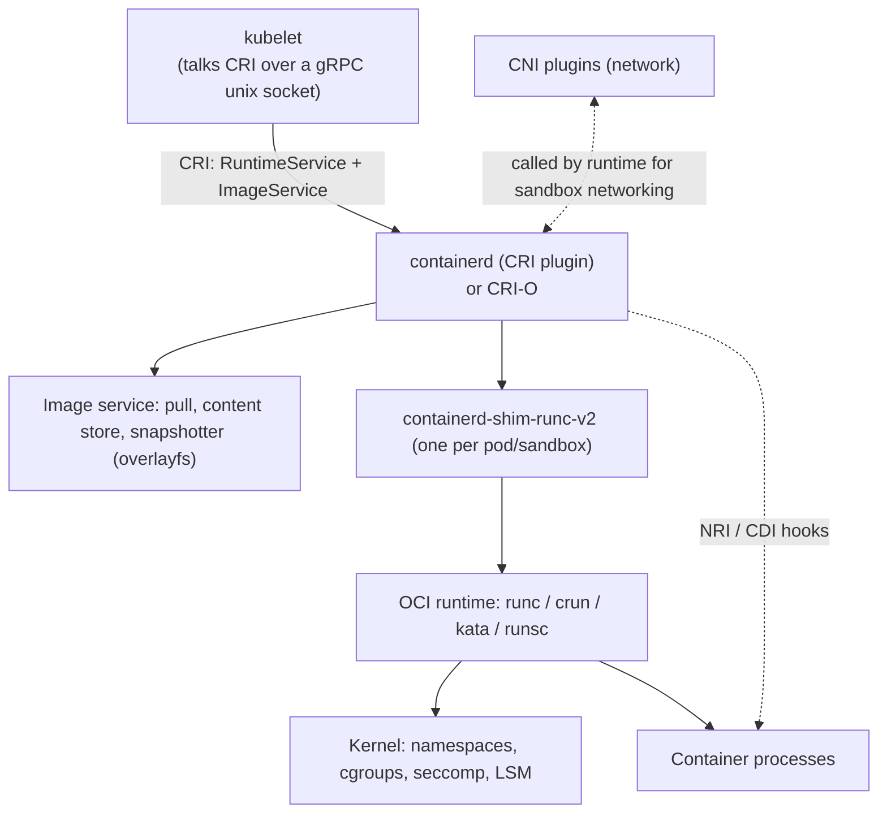

# 5.2 Container runtimes: containerd, runc, CRI and OCI

| | |
|---|---|
| Level | Intermediate |
| Priority tier | 0 |
| Lab venue | Linux VM with containerd 1.7/2.x, runc, crictl, nerdctl; kind or kubeadm for node-level views |
| Part | Part 5: Kubernetes |
| Status | Drafted, labs **untested** |

## Why this matters for AI infrastructure

When a training pod will not start, the cause is often below Kubernetes: an image pull that stalls, a runtime misconfigured for the NVIDIA toolkit, a wrong cgroup driver, a snapshotter running out of space, a shim that leaked, a runtime upgrade that restarted every container. The kubelet does not run containers; it asks a **container runtime** through the Container Runtime Interface, which in turn uses an **OCI runtime** to create the namespaces and cgroups. Knowing the layers (and the tools that talk to each of them) is what lets you debug on a node when `kubectl describe` is not enough, configure GPU runtimes correctly, and choose between runtimes such as runc, crun, Kata and gVisor.

## Prerequisites and outcomes

Needs 5.1. After this chapter you can:

- Draw the stack kubelet → CRI → containerd/CRI-O → shim → OCI runtime → container, and say what each layer owns.
- Explain the CRI services (RuntimeService, ImageService), sandbox vs container, and how a pod maps to a sandbox (pause) container plus app containers.
- Configure containerd (`config.toml`: CRI plugin, runtimes, snapshotters, registry mirrors, cgroup driver, sandbox image) and CRI-O basics.
- Compare OCI runtimes (runc, crun, youki, Kata, gVisor, Firecracker-based) and use `RuntimeClass`.
- Use `crictl`, `ctr`, `nerdctl` for node-level inspection and debugging; understand namespaces in containerd (`k8s.io`).
- Configure the NVIDIA container runtime/CDI for Kubernetes nodes; handle upgrades, restarts and garbage collection.

## 1. The stack



| Layer | Responsibility | Examples |
|---|---|---|
| **Kubelet** | Node agent: watches the API server for pods assigned to the node; calls the runtime via CRI; runs probes, manages volumes, reports status (5.9) | `kubelet` |
| **CRI** | gRPC API (`runtime.v1`): `RunPodSandbox`, `CreateContainer`, `StartContainer`, `StopContainer`, `ListContainers`, `ExecSync`, `Exec/Attach/PortForward` streaming, `PullImage`, `ListImages`, `ImageFsInfo`, `Status` | Protobuf API in `k8s.io/cri-api` |
| **High-level runtime** | Image distribution, storage and unpacking, container metadata, lifecycle, CRI implementation, shim management, networking via CNI | **containerd** (CNCF graduated; default in most distros), **CRI-O** (Kubernetes-focused, OpenShift default) |
| **Shim** | Per-pod process that outlives the runtime daemon, holds the container's stdio, reaps exit status, lets containerd restart without killing containers | `containerd-shim-runc-v2`, `crio-conmon` (conmon) |
| **Low-level (OCI) runtime** | Creates the container from a bundle (`config.json` + rootfs): sets up namespaces, cgroups, mounts, capabilities, seccomp; then `exec`s the process | **runc** (Go), **crun** (C, faster/lower memory), youki (Rust), Kata Containers (lightweight VM), gVisor `runsc` (user-space kernel), Firecracker (via kata-fc or firecracker-containerd) |
| **Kernel** | The actual isolation | namespaces, cgroups v2, overlayfs, seccomp, LSM |

Docker Engine is itself built on containerd and runc. Kubernetes removed the built-in **dockershim** in 1.24; to use Docker Engine as a CRI runtime you need `cri-dockerd`, but most clusters use containerd or CRI-O directly.

### The pod sandbox

A Kubernetes pod is a group of containers sharing network (and optionally PID/IPC) namespaces. The runtime creates a **sandbox**: a pause container (tiny `pause` process, image `registry.k8s.io/pause:3.x`) that holds the pod's network namespace, IP and cgroup parent; containers then join those namespaces. Sequence for `RunPodSandbox`: pull the pause image, create the pod cgroup, create the network namespace, invoke **CNI** plugins to attach interfaces and assign an IP (5.13), start the pause container. Then for each container: `PullImage` (if needed), `CreateContainer` (prepare snapshot, generate OCI `config.json` from the CRI config: env, mounts, devices, resources, security context), `StartContainer` (shim + runc create/start). `StopPodSandbox` and `RemovePodSandbox` tear down. If the CNI plugin fails, the sandbox fails and the pod sits in `ContainerCreating` with events such as "failed to set up sandbox container network".

## 2. containerd in depth

containerd is a daemon (`containerd`) exposing a gRPC API on `/run/containerd/containerd.sock`. Subsystems are **plugins**: content store, snapshotters, metadata (bolt DB), image service, tasks (runtime v2 shims), events, CRI, NRI, CDI, and more. Everything is namespaced: Kubernetes uses the containerd namespace **`k8s.io`**, Docker uses `moby`, `nerdctl` uses `default`. Tools in the wrong namespace see nothing (`ctr -n k8s.io containers ls`).

### Configuration

`/etc/containerd/config.toml` (version 2 or 3 schema; generate defaults with `containerd config default`):

```toml
version = 2

[plugins."io.containerd.grpc.v1.cri"]
  sandbox_image = "registry.k8s.io/pause:3.9"
  [plugins."io.containerd.grpc.v1.cri".containerd]
    default_runtime_name = "runc"
    snapshotter = "overlayfs"
    discard_unpacked_layers = false
    [plugins."io.containerd.grpc.v1.cri".containerd.runtimes.runc]
      runtime_type = "io.containerd.runc.v2"
      [plugins."io.containerd.grpc.v1.cri".containerd.runtimes.runc.options]
        SystemdCgroup = true                      # MUST match the kubelet's cgroup driver (systemd)
    [plugins."io.containerd.grpc.v1.cri".containerd.runtimes.nvidia]
      runtime_type = "io.containerd.runc.v2"
      [plugins."io.containerd.grpc.v1.cri".containerd.runtimes.nvidia.options]
        BinaryName = "/usr/bin/nvidia-container-runtime"
        SystemdCgroup = true
    [plugins."io.containerd.grpc.v1.cri".containerd.runtimes.kata]
      runtime_type = "io.containerd.kata.v2"
  [plugins."io.containerd.grpc.v1.cri".registry]
    config_path = "/etc/containerd/certs.d"       # per-registry hosts.toml (mirrors, TLS, auth)
  [plugins."io.containerd.grpc.v1.cri".image_decryption]
    key_model = "node"

[plugins."io.containerd.nri.v1.nri"]
  disable = false
[plugins."io.containerd.grpc.v1.cri".cdi]            # in newer versions: enable_cdi = true, cdi_spec_dirs = ["/etc/cdi", "/var/run/cdi"]
```

Key settings:

- **`SystemdCgroup = true`** when using the systemd cgroup driver (the default for kubeadm clusters on systemd hosts with cgroup v2). A mismatch between kubelet (`cgroupDriver: systemd`) and containerd is a classic cause of nodes flapping or pods failing with cgroup errors. Both must use the same driver.
- **`sandbox_image`**: the pause image; in air-gapped clusters point it to your registry; kubelet's `--pod-infra-container-image` is deprecated in favour of runtime config.
- **Runtimes map** (`runtimes.<name>`) defines named OCI runtimes selectable by `RuntimeClass.handler` (section 4).
- **Registry config**: `config_path` with `certs.d/<registry>/hosts.toml` for mirrors, custom CAs, and credentials (5.1). Avoid the deprecated inline `registry.mirrors`.
- **Snapshotter**: `overlayfs` default; alternatives `native`, `btrfs`, `zfs`, `devmapper`, and remote/lazy snapshotters (`stargz`, `soci`, `nydus`, `overlaybd`) registered as proxy plugins for fast starts of large images.
- **Garbage collection and disk**: content blobs and snapshots under `/var/lib/containerd`; kubelet image GC thresholds (`imageGCHighThresholdPercent`, `imageGCLowThresholdPercent`) trigger `RemoveImage`; keep this on a separate large fast disk for GPU nodes (images of tens of GB × many versions).
- **Restart behaviour**: restarting containerd does not kill running containers (shims keep them); shims are re-attached. Upgrading runc affects only new containers.

Reload: `systemctl restart containerd` (and often kubelet). Verify with `containerd config dump`, `crictl info`.

### containerd data model

Images → content blobs (by digest) → snapshots (layered, keyed by chain ID) → containers (metadata referencing a snapshot and an OCI spec) → tasks (running processes via shims). Leases protect objects from GC while in use. CRI sandboxes and containers are labelled with Kubernetes metadata (`io.kubernetes.pod.name`, namespace, uid) visible in `ctr`/`crictl` output.

## 3. CRI-O and alternatives

**CRI-O** implements only what Kubernetes needs: pull (via `containers/image`), store (`containers/storage` overlay), run via `conmon` + OCI runtime, CNI. Configuration under `/etc/crio/crio.conf` and drop-ins in `/etc/crio/crio.conf.d/`, runtimes defined in `[crio.runtime.runtimes.<name>]`, registries from `/etc/containers/registries.conf`. Used by OpenShift and some distributions; Kubernetes minor versions are matched one-to-one with CRI-O versions. Behaviour is equivalent for most users; differences appear in debug tooling (`crictl` works for both; `ctr` is containerd-only), configuration format, and image/storage libraries shared with Podman/Buildah.

**Docker Engine / cri-dockerd**: possible but adds layers; used when teams need Docker-specific features on nodes. **Podman** is not a CRI runtime but shares libraries with CRI-O and can run pods locally (`podman kube play`).

## 4. OCI runtimes and RuntimeClass

The OCI Runtime Spec defines a **bundle** (directory with `config.json` and a `rootfs/`) and a CLI contract: `create`, `start`, `state`, `kill`, `delete`. A runtime reads the bundle and creates the isolated process.

| Runtime | Isolation model | Notes |
|---|---|---|
| **runc** | Namespaces/cgroups on the host kernel | Reference implementation, default everywhere; security patches matter (CVE history: container breakouts via `/proc` handling) |
| **crun** | Same, written in C | Faster start, lower memory; default in some distros; cgroup v2 first |
| **youki** | Same, Rust | Less common |
| **gVisor (runsc)** | User-space kernel intercepts syscalls (sentry/gofer) | Stronger isolation for untrusted code; syscall overhead; limited GPU support (via `nvproxy` for some workloads, verify); no complete Linux compatibility |
| **Kata Containers** | Each pod in a lightweight VM (QEMU, Cloud Hypervisor, Firecracker) with its own guest kernel | Strong isolation, pod-per-VM overhead; GPU passthrough (VFIO) and confidential computing variants for multi-tenant GPU clouds |
| **Firecracker (firecracker-containerd)** | microVMs | Serverless-style isolation |
| **Confidential containers (CoCo)** | Kata + TEEs (SEV-SNP, TDX), plus NVIDIA confidential computing on H100 | Emerging for sensitive model/data processing (Part 18) |

`RuntimeClass` lets pods choose a runtime handler:

```yaml
apiVersion: node.k8s.io/v1
kind: RuntimeClass
metadata: { name: nvidia }
handler: nvidia                       # must match a runtimes.<name> in containerd (or a CRI-O runtime)
overhead:
  podFixed: { cpu: 100m, memory: 64Mi }      # scheduler adds this to pod requests (VM-based runtimes)
scheduling:
  nodeSelector: { nvidia.com/gpu.present: "true" }
---
apiVersion: v1
kind: Pod
metadata: { name: gpu-test }
spec:
  runtimeClassName: nvidia
  containers:
    - name: cuda
      image: nvcr.io/nvidia/cuda:12.4.1-base-ubuntu22.04
      command: ["nvidia-smi"]
```

Choosing: runc/crun for performance and compatibility in trusted environments; Kata/gVisor for multi-tenant isolation of untrusted workloads (notebooks, arbitrary code execution, customer-supplied containers), accepting overhead and GPU limitations. Most GPU training clusters use runc/crun with strong pod security policy rather than sandboxed runtimes.

## 5. GPU runtimes: NVIDIA Container Toolkit with containerd

Two integration styles:

1. **`nvidia-container-runtime` wrapper**: a runtime shim that adds a prestart hook (`nvidia-container-runtime-hook`) to the OCI spec so `libnvidia-container` mounts the devices and driver libraries. Configured with `nvidia-ctk runtime configure --runtime=containerd --set-as-default` (edits `config.toml` to add the `nvidia` runtime), then restart containerd. With the GPU Operator, the toolkit DaemonSet does this automatically and writes a drop-in config.
2. **CDI (Container Device Interface)**: the toolkit generates a spec (`nvidia-ctk cdi generate --output=/var/run/cdi/nvidia.yaml`) describing devices (`nvidia.com/gpu=0`, `=all`, MIG devices) with their device nodes, mounts and env; runtimes read specs from `/etc/cdi` and `/var/run/cdi` and apply edits to the OCI spec. No wrapper binary or hook is needed; this is the direction of travel and underpins Kubernetes Dynamic Resource Allocation (Part 11).

Notes: GPU pods are requested through the **device plugin** (`resources.limits: nvidia.com/gpu: 1`), which tells the kubelet which devices to hand to the runtime (via `NVIDIA_VISIBLE_DEVICES` env, CDI names or annotations); the runtime then wires them in. The default runtime setting (`default_runtime_name = "nvidia"`) makes all containers use the wrapper (convenient but affects non-GPU pods); `RuntimeClass` limits it to GPU pods (the GPU Operator can create a `nvidia` RuntimeClass).

Verify on a node:

```bash
nvidia-ctk runtime configure --runtime=containerd --set-as-default=false
systemctl restart containerd
grep -A4 'runtimes.nvidia' /etc/containerd/config.toml
ctr -n k8s.io run --rm --runtime io.containerd.runc.v2 --gpus 0 nvcr.io/nvidia/cuda:12.4.1-base-ubuntu22.04 t nvidia-smi
nvidia-ctk cdi list                                     # devices known to CDI
crictl info | jq '.config.containerd.runtimes'          # runtimes the CRI plugin sees
```

## 6. Node-level tools

| Tool | Talks to | Use |
|---|---|---|
| **`crictl`** | CRI socket (containerd or CRI-O) | Kubernetes-aware debugging: pods (sandboxes), containers, images, logs, exec, stats, runtime info. Install `cri-tools`; configure `/etc/crictl.yaml` (`runtime-endpoint: unix:///run/containerd/containerd.sock`) |
| **`ctr`** | containerd API directly | Low-level: namespaces, images, content, snapshots, containers, tasks, leases. Not for production workflows (no image UX) but great for inspection |
| **`nerdctl`** | containerd | Docker-compatible CLI (build with BuildKit, compose, rootless, lazy pulling); `nerdctl --namespace k8s.io ps` |
| **`runc`** | OCI runtime | `runc list` (root `/run/containerd/runc/k8s.io`), `runc state`, `runc exec`, `runc events` |
| **`crun`**, `kata-runtime` | runtime-specific | `kata-runtime check`, `kata-collect-data.sh` |
| **`nsenter`, `lsns`, `systemd-cgls`, `systemd-cgtop`** | kernel/host | Enter namespaces, inspect cgroup tree and usage |
| **`journalctl -u containerd -u kubelet`** | logs | The first place to look |

Cheat sheet:

```bash
cat /etc/crictl.yaml
crictl pods --namespace default                        # sandboxes
crictl ps -a                                           # all containers (including exited)
crictl inspectp <pod-id> | jq '.status.network, .info.runtimeSpec.linux.namespaces'
crictl inspect <ctr-id> | jq '.info.runtimeSpec.linux.resources, .status.exitCode, .status.reason'
crictl logs --tail 100 <ctr-id>
crictl exec -it <ctr-id> sh
crictl stats                                           # CPU/memory per container
crictl images; crictl rmi <image>; crictl pull --creds user:pass registry/img:tag
crictl imagefsinfo                                     # disk usage of image store
crictl info                                            # runtime config: cgroup driver, runtimes, CNI status
crictl runp pod.json; crictl create ...; crictl start ...   # create by hand (debugging CNI/runtime without kubelet)

ctr namespaces ls
ctr -n k8s.io containers ls
ctr -n k8s.io images ls | head
ctr -n k8s.io snapshots ls | head
ctr -n k8s.io tasks ls                                  # running tasks (PIDs)
ctr -n k8s.io content ls | head
ctr plugins ls                                          # plugin status; errored plugins explain failures
```

## 7. Cgroup drivers and cgroup v2

The kubelet and runtime must agree on how cgroups are managed:

- **systemd driver** (recommended on systemd distros): the runtime asks systemd to create slices/scopes (`kubepods.slice/kubepods-burstable.slice/kubepods-burstable-pod<uid>.slice/cri-containerd-<id>.scope`). One cgroup manager (systemd) owns the hierarchy.
- **cgroupfs driver**: the runtime writes the cgroup filesystem directly; two managers (systemd and the runtime) competing causes instability on systemd hosts. Use only on non-systemd hosts.
- Kubernetes defaults to `cgroupDriver: systemd` for kubeadm on systemd hosts since 1.22+. Set it consistently in the kubelet config (`KubeletConfiguration.cgroupDriver`) and containerd (`SystemdCgroup = true`).
- **cgroup v2** (unified hierarchy) is the default on modern distros and supported in Kubernetes; it offers better memory accounting (`memory.high`, MemoryQoS), PSI, and is required for some features (swap support, user namespaces). Check: `stat -fc %T /sys/fs/cgroup` → `cgroup2fs`. Old runtimes and tools expecting v1 break; ensure runc ≥ 1.0 and recent containerd.

The pod QoS hierarchy (Guaranteed, Burstable, BestEffort) maps to cgroup parents (5.9). Memory `limits` map to `memory.max`; CPU `limits` to `cpu.max` (CFS quota); requests to `cpu.weight`/`memory.min` (with some features).

## 8. Operations: upgrades, GC, logs, security

- **Upgrades**: drain the node (5.20), upgrade containerd/runc/crictl packages, restart containerd and kubelet, uncordon. A containerd restart keeps containers running (shims independent), but a runtime upgrade with config schema changes can leave the CRI plugin failing; test on a canary node. Pin versions and track CVEs for runc, containerd, and the NVIDIA toolkit (container escape CVEs have affected the toolkit).
- **Logs**: container stdout/stderr are written by the runtime to `/var/log/pods/<ns>_<pod>_<uid>/<container>/<n>.log` (CRI log format) with symlinks in `/var/log/containers/`; the kubelet rotates them (`containerLogMaxSize`, `containerLogMaxFiles`); log shippers (Fluent Bit, Vector) tail these files (5.24).
- **Image GC**: kubelet removes unused images when disk usage crosses `imageGCHighThresholdPercent` (default 85%); aggressive GC of multi-GB GPU images causes repeated slow pulls; give GPU nodes ample dedicated image storage and consider pre-pulling and `imageMinimumGCAge`.
- **Disk pressure**: containerd's `/var/lib/containerd` and kubelet's `/var/lib/kubelet` on the root disk fill up; evictions follow (5.9). Use separate fast NVMe volumes for container storage on GPU nodes (and local NVMe for scratch).
- **Resource limits for system daemons**: reserve CPU/memory for containerd/kubelet (`kubeReserved`, `systemReserved`) so a runaway container cannot starve them.
- **Security**: runtime socket access equals root; do not mount `/run/containerd/containerd.sock` into pods except in tightly controlled cases (CI builders); seccomp default profile (`seccompDefault: true` in kubelet), user namespaces for pods (`hostUsers: false`, GA path in recent Kubernetes), AppArmor/SELinux, restricting `privileged`, read-only rootfs, signed images (5.27).
- **NRI (Node Resource Interface)**: plugin mechanism letting node-level plugins adjust containers at creation (topology-aware resource allocation, device injection); some GPU/CPU managers use it.
- **Monitoring**: kubelet cAdvisor metrics, `containerd` metrics endpoint (Prometheus), `runc` events, shim counts; alert on shim leaks (`ps aux | grep containerd-shim | wc -l` vs running pods), `ContainerCreating` durations, image pull errors.

## 9. Failure modes and diagnostics

| Symptom | Layer | Check |
|---|---|---|
| Pod `ContainerCreating` for long | CNI / sandbox / image pull | `kubectl describe pod`; `journalctl -u kubelet`; `crictl pods`; CNI logs; `crictl pull` manually |
| `failed to create containerd task: OCI runtime create failed` | runc/cgroup/seccomp/mount | Message includes runc error; check cgroup driver, mounts, devices, `/proc` hidepid, SELinux |
| `failed to get sandbox image` / pause pull fails | Registry/mirror | Set `sandbox_image` to reachable registry; air-gap |
| Containers restart after containerd upgrade | Shim/runtime mismatch | Review upgrade notes; drain before upgrading |
| `cgroup is not populated` / `no space left on device` on cgroup | cgroup limits, PID/inotify limits, memory cgroup leak | `systemd-cgls`, `dmesg`, raise `fs.inotify.max_user_watches`, `kernel.pid_max`, check kmem leaks |
| GPU not visible in container | Runtime not configured, device plugin, toolkit, CDI spec missing | `crictl info`, `nvidia-ctk cdi list`, pod events, toolkit logs |
| `Failed to pull image ... 429 Too Many Requests` | Registry rate limits | Mirror/pull-through cache (5.1) |
| Node `NotReady` with runtime errors | `PLEG is not healthy`, runtime socket unresponsive | `crictl ps` hangs? check containerd CPU/IO, disk full, thousands of containers; restart containerd carefully |
| Slow container start | Large image unpack, slow disk, no lazy pull | Pre-pull, faster disk, lazy snapshotter, smaller images |
| Zombie shims | Containers deleted abnormally | Reconcile with `crictl pods`/`ctr tasks`; restart node if needed |

## 10. Lab (untested)

1. **Layers on a node**: on a kind or kubeadm node, run `crictl pods`, `crictl ps`, `ctr -n k8s.io containers ls`, `ctr -n k8s.io snapshots ls`; map a Kubernetes pod to its sandbox and containers by labels; find the pause container and the pod's network namespace (`crictl inspectp`, `nsenter`).
2. **Run an OCI bundle with runc**: create a rootfs (`docker export`), generate `config.json` (`runc spec`), adjust `process.args` and namespaces, run with `runc run`; then add a cgroup memory limit and observe an OOM kill; compare with containerd `ctr run` of the same image.
3. **Walk a CRI flow**: with `crictl`, write pod and container JSON, run `crictl runp`, `create`, `start`; watch `ctr`/`runc` state and the CNI result; remove them; understand what the kubelet does for you.
4. **Config exercises**: dump the effective config; toggle `SystemdCgroup`; deliberately mismatch the kubelet cgroup driver in a lab and read the errors; restore.
5. **Registry mirror**: configure `hosts.toml` for a mirror/pull-through cache; prove a pull uses it (registry logs); test fallback when the mirror is down.
6. **RuntimeClass**: define a second runtime (e.g. `crun` or a second runc entry with different options), create a RuntimeClass, run a pod with `runtimeClassName`, and verify via `crictl inspect` which runtime ran. Optionally install gVisor (`runsc`) and compare syscall behaviour (`dmesg` inside container) and performance of a simple benchmark.
7. **Kata (optional)**: install Kata on a node with virtualization, run a pod with the Kata RuntimeClass, compare `uname -r` inside versus host, and measure overhead.
8. **GPU runtime**: install the NVIDIA toolkit, configure containerd (`nvidia-ctk runtime configure`), restart, run a pod with `runtimeClassName: nvidia`, then switch to CDI (`nvidia-ctk cdi generate`) and compare the OCI spec edits (`crictl inspect` runtimeSpec mounts/devices).
9. **Disk and GC**: pull many large images on a small disk; observe kubelet image GC and eviction messages; tune thresholds; relocate containerd root to a dedicated volume.
10. **Failure drills**: kill the shim of a running container and see what happens; restart containerd with workloads running and verify containers survive; fill the root disk until DiskPressure and recover.
11. **Observability**: scrape containerd metrics; chart pull durations and running containers; alert on `ContainerCreating` for more than N minutes (5.24).
12. **Clean up**.

Mark tested only after execution.

## 11. Common mistakes

- Different cgroup drivers in kubelet and containerd.
- Editing containerd config and forgetting to restart (or editing the wrong schema version).
- Using `ctr` in the default namespace and concluding "no containers".
- Mounting the container runtime socket into workloads casually.
- Setting `nvidia` as the default runtime on mixed clusters without understanding impact; manual toolkit config fighting the GPU Operator.
- No dedicated disk for container storage; images and logs filling the root volume.
- Aggressive image GC thresholds that evict large ML images, causing repeated multi-minute pulls.
- Treating a runtime upgrade as harmless (no drain/canary).
- Assuming sandboxed runtimes (gVisor/Kata) support GPUs and RDMA the same as runc.
- Ignoring the pause image in air-gapped clusters.

## 12. Interview angles

- "Walk through what happens when the kubelet starts a pod: CRI calls, sandbox, CNI, image pull, runc." 
- "containerd vs CRI-O vs Docker; what was dockershim?" 
- "What is the role of the shim? What happens to containers if containerd restarts?" 
- "runc vs crun vs gVisor vs Kata: when each?" 
- "How do you debug a node when `kubectl` shows ContainerCreating?" (`crictl`, kubelet/containerd logs, CNI, image pull.)
- "How does Kubernetes expose GPUs to containers? Wrapper runtime vs CDI?" 
- "What breaks if the kubelet and containerd cgroup drivers differ?" 
- "How would you handle image storage and GC for 30 GB ML images?" 

## 13. Checkpoint questions (35)

1. What does CRI stand for and what is it? **A:** Container Runtime Interface: gRPC API between kubelet and runtime.
2. Two CRI services? **A:** RuntimeService and ImageService.
3. High-level vs low-level runtime? **A:** containerd/CRI-O vs runc/crun/kata.
4. What is the shim for? **A:** Keeps containers alive/handles stdio and exit independent of the daemon.
5. What is the pause container? **A:** Holds the pod's namespaces.
6. When is CNI invoked? **A:** During `RunPodSandbox`.
7. Containerd namespace for Kubernetes? **A:** `k8s.io`.
8. Config file path? **A:** `/etc/containerd/config.toml`.
9. Setting for systemd cgroups? **A:** `SystemdCgroup = true`.
10. What dockershim removal release? **A:** Kubernetes 1.24.
11. Bundle contents? **A:** `config.json` + rootfs.
12. runc vs crun? **A:** Go vs C implementations; crun lighter/faster.
13. gVisor mechanism? **A:** User-space kernel intercepting syscalls.
14. Kata mechanism? **A:** Pod inside a lightweight VM with guest kernel.
15. What is RuntimeClass? **A:** Selects the runtime handler for a pod.
16. What is `overhead` in RuntimeClass? **A:** Fixed resources added for the runtime (e.g. VM).
17. Tool for CRI debugging? **A:** `crictl`.
18. Tool for containerd internals? **A:** `ctr`.
19. Docker-like CLI for containerd? **A:** `nerdctl`.
20. `crictl` config file? **A:** `/etc/crictl.yaml`.
21. Where are pod logs on the node? **A:** `/var/log/pods/...` and `/var/log/containers/`.
22. What does restarting containerd do to containers? **A:** They keep running (shims).
23. Snapshotter default? **A:** overlayfs.
24. Lazy-pull snapshotters? **A:** stargz, SOCI, Nydus, overlaybd.
25. NVIDIA runtime config command? **A:** `nvidia-ctk runtime configure`.
26. What is CDI? **A:** Standard device description consumed by runtimes.
27. Command to list CDI devices? **A:** `nvidia-ctk cdi list`.
28. How does the device plugin relate to the runtime? **A:** Plugin allocates devices; runtime injects them.
29. cgroup v2 check? **A:** `stat -fc %T /sys/fs/cgroup` → `cgroup2fs`.
30. Why systemd driver? **A:** Single cgroup manager on systemd hosts.
31. What is NRI? **A:** Node Resource Interface plugins adjusting containers.
32. Image GC trigger? **A:** Disk usage above `imageGCHighThresholdPercent`.
33. What's dangerous about mounting the runtime socket? **A:** Root-equivalent control of the node.
34. `PLEG is not healthy` indicates? **A:** Kubelet can't list container state quickly (runtime/node stress).
35. Why reserve resources for system daemons? **A:** Protect kubelet/containerd from starvation.

## 14. Sources and review notes

**Written in original words.** Principal sources:

- Josh Rosso, Rich Lander, Alex Brand and John Harris, *Production Kubernetes* (chapter 3 on container runtime: runtimes, CRI, OCI, container runtime considerations).
- Brendan Burns et al., *Kubernetes: Up and Running* (container and kubelet background).
- containerd, CRI-O, runc, crun, gVisor, Kata Containers, NVIDIA Container Toolkit and CDI documentation; Kubernetes CRI and RuntimeClass documentation.
- Examples are the author's constructions.

**Flagged for verification before publishing:** containerd config schema version and plugin key names for your release (v1.7 vs v2.x differ), CDI enablement keys, pause image tags, default thresholds, `crictl` JSON paths, user-namespace feature status, and every command listing; all labs are **untested**.
