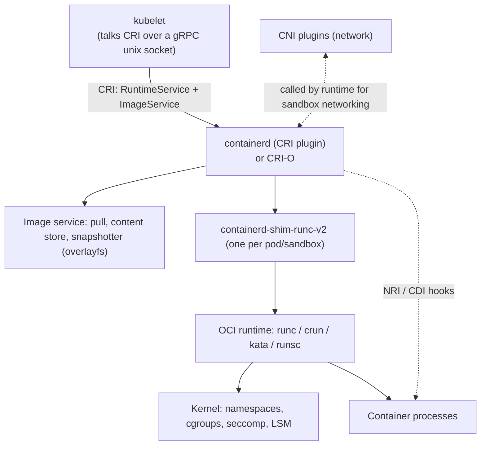

# 5.2 Container runtimes: containerd, runc, CRI and OCI

| | |
|---|---|
| Level | Intermediate |
| Priority tier | 0 |
| Lab venue | Linux VM with containerd 1.7/2.x, runc, crictl, nerdctl; kind or kubeadm for node-level views |
| Part | Part 5: Kubernetes |
| Status | Drafted, labs **untested** |

## Why this matters for AI infrastructure

When a training pod will not start, the cause is often below Kubernetes: an image pull that stalls, a runtime misconfigured for the NVIDIA toolkit, a wrong cgroup driver, a snapshotter running out of space, a shim that leaked, a runtime upgrade that restarted every container. The kubelet does not run containers; it asks a **container runtime** through the Container Runtime Interface, which in turn uses an **OCI runtime** to create the namespaces and cgroups. Knowing the layers (and the tools that talk to each of them) is what lets you debug on a node when `kubectl describe` is not enough, configure GPU runtimes correctly, and choose between runtimes such as runc, crun, Kata and gVisor.

## Prerequisites and outcomes

Needs 5.1. After this chapter you can:

- Draw the stack kubelet → CRI → containerd/CRI-O → shim → OCI runtime → container, and say what each layer owns.
- Explain the CRI services (RuntimeService, ImageService), sandbox vs container, and how a pod maps to a sandbox (pause) container plus app containers.
- Configure containerd (`config.toml`: CRI plugin, runtimes, snapshotters, registry mirrors, cgroup driver, sandbox image) and CRI-O basics.
- Compare OCI runtimes (runc, crun, youki, Kata, gVisor, Firecracker-based) and use `RuntimeClass`.
- Use `crictl`, `ctr`, `nerdctl` for node-level inspection and debugging; understand namespaces in containerd (`k8s.io`).
- Configure the NVIDIA container runtime/CDI for Kubernetes nodes; handle upgrades, restarts and garbage collection.

## 1. The stack



| Layer | Responsibility | Examples |
|---|---|---|
| **Kubelet** | Node agent: watches the API server for pods assigned to the node; calls the runtime via CRI; runs probes, manages volumes, reports status (5.9) | `kubelet` |
| **CRI** | gRPC API (`runtime.v1`): `RunPodSandbox`, `CreateContainer`, `StartContainer`, `StopContainer`, `ListContainers`, `ExecSync`, `Exec/Attach/PortForward` streaming, `PullImage`, `ListImages`, `ImageFsInfo`, `Status` | Protobuf API in `k8s.io/cri-api` |
| **High-level runtime** | Image distribution, storage and unpacking, container metadata, lifecycle, CRI implementation, shim management, networking via CNI | **containerd** (CNCF graduated; default in most distros), **CRI-O** (Kubernetes-focused, OpenShift default) |
| **Shim** | Per-pod process that outlives the runtime daemon, holds the container's stdio, reaps exit status, lets containerd restart without killing containers | `containerd-shim-runc-v2`, `crio-conmon` (conmon) |
| **Low-level (OCI) runtime** | Creates the container from a bundle (`config.json` + rootfs): sets up namespaces, cgroups, mounts, capabilities, seccomp; then `exec`s the process | **runc** (Go), **crun** (C, faster/lower memory), youki (Rust), Kata Containers (lightweight VM), gVisor `runsc` (user-space kernel), Firecracker (via kata-fc or firecracker-containerd) |
| **Kernel** | The actual isolation | namespaces, cgroups v2, overlayfs, seccomp, LSM |

Docker Engine is itself built on containerd and runc. As Josh Rosso, Rich Lander, Alexander Brand, and John Harris explain in *Production Kubernetes* Chapter 3 (*Container Runtime*), prior to the **Container Runtime Interface (`CRI`)** in Kubernetes 1.5, support for Docker (`dockershim`) and CoreOS `rkt` (`rktnetes`) was compiled directly into the `kubelet` source code—meaning adding a new runtime or fixing a runtime integration bug required a full Kubernetes release and deep knowledge of `kubelet` internals. CRI replaced that tight coupling with a standard **gRPC client-server interface over a local Unix socket** (`/run/containerd/containerd.sock` for `containerd`, or `/var/run/crio/crio.sock` for `CRI-O`) exposing two gRPC services:
1. **`ImageService`**: `ListImages`, `ImageStatus`, `PullImage`, `RemoveImage`, and `ImageFsInfo`.
2. **`RuntimeService`**: Pod-sandbox lifecycle (`RunPodSandbox`, `StopPodSandbox`, `RemovePodSandbox`, `PodSandboxStatus`, `ListPodSandbox`) and container lifecycle (`CreateContainer`, `StartContainer`, `StopContainer`, `RemoveContainer`, `ListContainers`, `ContainerStatus`, `UpdateContainerResources`, `ReopenContainerLog`, `ExecSync`, `Exec`, `Attach`, `PortForward`).
Kubernetes removed the built-in **dockershim** in 1.24 (cutting out the redundant `kubelet -> dockershim -> dockerd -> containerd` hop so `kubelet` talks directly to `containerd`'s built-in CRI plugin); to use Docker Engine as a CRI runtime today you need external `cri-dockerd`, while nearly all production clusters use `containerd` or `CRI-O` directly.

### Why the CRI exists

Before the CRI, adding support for a new container runtime required a new Kubernetes release. It also required intimate knowledge of the Kubernetes code base. Once the CRI was established, runtime developers could simply adhere to the interface to stay compatible with Kubernetes.

The point of the CRI was to keep runtime internals away from Kubernetes, and most of all away from the kubelet. This is a classic example of the dependency inversion principle. Over time, the kubelet shed the runtime-specific code and if-statements that had been scattered through it. Now it relies on the interface. That made the kubelet simpler, more extensible and easier to test. These are the qualities of well-designed software.

### The pod sandbox

A Kubernetes pod is a group of containers sharing network (and optionally PID/IPC) namespaces. The runtime creates a **sandbox**: a pause container (tiny `pause` process, image `registry.k8s.io/pause:3.x`) that holds the pod's network namespace, IP and cgroup parent; containers then join those namespaces. Sequence for `RunPodSandbox`: pull the pause image, create the pod cgroup, create the network namespace, invoke **CNI** plugins to attach interfaces and assign an IP (5.13), start the pause container. Then for each container: `PullImage` (if needed), `CreateContainer` (prepare snapshot, generate OCI `config.json` from the CRI config: env, mounts, devices, resources, security context), `StartContainer` (shim + runc create/start). `StopPodSandbox` and `RemovePodSandbox` tear down. If the CNI plugin fails, the sandbox fails and the pod sits in `ContainerCreating` with events such as "failed to set up sandbox container network".

### Starting a Pod through the CRI

The most important operation in Kubernetes is starting a Pod on a node. Once the Pod is scheduled onto a node, the kubelet works with the container runtime to start it. The containerd CRI plugin starts a gRPC server that listens on a Unix socket. By default, that socket is `/run/containerd/containerd.sock`. The kubelet finds it through two flags:

```
/usr/bin/kubelet
--container-runtime=remote
--container-runtime-endpoint=/run/containerd/containerd.sock
... other flags here ...
```

The book's walkthrough is based on Kubernetes v1.18.2 and containerd v1.3.4. Those versions use the `v1alpha2` version of the CRI.

The kubelet starts by creating a Pod sandbox with the `RunPodSandbox` method of the RuntimeService. A Pod is made of one or more containers, so the sandbox must come first. The sandbox establishes the Linux network namespace, among other things, for all the containers to share. The kubelet sends the Pod's name, unique ID, Kubernetes Namespace and DNS configuration. The runtime replies with a Pod sandbox ID that the kubelet uses to create containers.

Next, the kubelet checks whether the container image is on the node. It calls the `ImageStatus` method of the ImageService. If the image is not present, the method returns null, and the kubelet calls the `PullImage` method. Once the runtime pulls the image, it replies with the image SHA256 digest. The kubelet uses that digest to create the container.

The kubelet then calls the `CreateContainer` method of the RuntimeService. It passes the sandbox ID and the container configuration. That configuration includes the image digest, the command and arguments, environment variables and volume mounts. The runtime generates a container ID and returns it. That ID is the one you see in the Pod's status under container statuses:

```
containerStatuses:
- containerID: containerd://0018556b01e1662c5e7e2dcddb2bb09d0edff6cf6933...
image: docker.io/library/nginx:latest
```

Finally, the kubelet calls the `StartContainer` method with that container ID. Besides the Pod and container management methods, the CRI also defines `Exec` and `ExecSync` to run a command inside a container. It also defines `Attach` to attach to a container and `PortForward` to forward a container port. Knowing these calls by name makes a stuck Pod start much easier to read.

## 2. containerd in depth

containerd is a daemon (`containerd`) exposing a gRPC API on `/run/containerd/containerd.sock`. Subsystems are **plugins**: content store, snapshotters, metadata (bolt DB), image service, tasks (runtime v2 shims), events, CRI, NRI, CDI, and more. Everything is namespaced: Kubernetes uses the containerd namespace **`k8s.io`**, Docker uses `moby`, `nerdctl` uses `default`. Tools in the wrong namespace see nothing (`ctr -n k8s.io containers ls`).

### Configuration

`/etc/containerd/config.toml` (version 2 or 3 schema; generate defaults with `containerd config default`):

```toml
version = 2

[plugins."io.containerd.grpc.v1.cri"]
  sandbox_image = "registry.k8s.io/pause:3.9"
  [plugins."io.containerd.grpc.v1.cri".containerd]
    default_runtime_name = "runc"
    snapshotter = "overlayfs"
    discard_unpacked_layers = false
    [plugins."io.containerd.grpc.v1.cri".containerd.runtimes.runc]
      runtime_type = "io.containerd.runc.v2"
      [plugins."io.containerd.grpc.v1.cri".containerd.runtimes.runc.options]
        SystemdCgroup = true                      # MUST match the kubelet's cgroup driver (systemd)
    [plugins."io.containerd.grpc.v1.cri".containerd.runtimes.nvidia]
      runtime_type = "io.containerd.runc.v2"
      [plugins."io.containerd.grpc.v1.cri".containerd.runtimes.nvidia.options]
        BinaryName = "/usr/bin/nvidia-container-runtime"
        SystemdCgroup = true
    [plugins."io.containerd.grpc.v1.cri".containerd.runtimes.kata]
      runtime_type = "io.containerd.kata.v2"
  [plugins."io.containerd.grpc.v1.cri".registry]
    config_path = "/etc/containerd/certs.d"       # per-registry hosts.toml (mirrors, TLS, auth)
  [plugins."io.containerd.grpc.v1.cri".image_decryption]
    key_model = "node"

[plugins."io.containerd.nri.v1.nri"]
  disable = false
[plugins."io.containerd.grpc.v1.cri".cdi]            # in newer versions: enable_cdi = true, cdi_spec_dirs = ["/etc/cdi", "/var/run/cdi"]
```

Key settings:

- **`SystemdCgroup = true`** when using the systemd cgroup driver (the default for kubeadm clusters on systemd hosts with cgroup v2). A mismatch between kubelet (`cgroupDriver: systemd`) and containerd is a classic cause of nodes flapping or pods failing with cgroup errors. Both must use the same driver.
- **`sandbox_image`**: the pause image; in air-gapped clusters point it to your registry; kubelet's `--pod-infra-container-image` is deprecated in favour of runtime config.
- **Runtimes map** (`runtimes.<name>`) defines named OCI runtimes selectable by `RuntimeClass.handler` (section 4).
- **Registry config**: `config_path` with `certs.d/<registry>/hosts.toml` for mirrors, custom CAs, and credentials (5.1). Avoid the deprecated inline `registry.mirrors`.
- **Snapshotter**: `overlayfs` default; alternatives `native`, `btrfs`, `zfs`, `devmapper`, and remote/lazy snapshotters (`stargz`, `soci`, `nydus`, `overlaybd`) registered as proxy plugins for fast starts of large images.
- **Garbage collection and disk**: content blobs and snapshots under `/var/lib/containerd`; kubelet image GC thresholds (`imageGCHighThresholdPercent`, `imageGCLowThresholdPercent`) trigger `RemoveImage`; keep this on a separate large fast disk for GPU nodes (images of tens of GB × many versions).
- **Restart behaviour**: restarting containerd does not kill running containers (shims keep them); shims are re-attached. Upgrading runc affects only new containers.

Reload: `systemctl restart containerd` (and often kubelet). Verify with `containerd config dump`, `crictl info`.

### containerd data model

Images → content blobs (by digest) → snapshots (layered, keyed by chain ID) → containers (metadata referencing a snapshot and an OCI spec) → tasks (running processes via shims). Leases protect objects from GC while in use. CRI sandboxes and containers are labelled with Kubernetes metadata (`io.kubernetes.pod.name`, namespace, uid) visible in `ctr`/`crictl` output.

### The containerd CRI plugin on a node

The containerd CRI plugin is a native containerd plugin. It has been available since containerd v1.1 and is enabled by default. The containerd runtime is perhaps the most common one the book's authors encounter when building Kubernetes-based platforms. It is the default in Cluster API-based node images, and it is available across managed offerings such as AKS, EKS and GKE. containerd serves its gRPC APIs through a Unix socket, `/run/containerd/containerd.sock`, and the kubelet connects to it to run Pods.

The process tree of spawned containers looks the same as with the Docker Engine. That is expected, because the Docker Engine uses containerd to manage containers:

```
systemd
└─containerd
└─containerd-shim -namespace k8s.io -workdir ...
└─nginx
└─nginx
```

To inspect containers on a node, use `ctr`, the containerd CLI. Unlike Docker, the containers that Kubernetes manages live in a containerd namespace called `k8s.io`, not `moby`:

```
$ ctr --namespace k8s.io containers ls | grep nginx
c85e47fa... docker.io/library/nginx:latest io.containerd.runtime.v1.linux
```

You can also use `crictl` with the containerd Unix socket:

```
$ crictl --runtime-endpoint unix:///run/containerd/containerd.sock ps
--name nginx
CONTAINER ID IMAGE CREATED STATE NAME POD ID
c85e47faf3616 4bb46517cac39 39 seconds ago Running nginx 73caea404b92a
```

## 3. CRI-O and alternatives

### Choosing a runtime

Because the CRI exists, platform teams can pick the container runtime that suits them. Over the last couple of years, though, the container runtime has become an implementation detail. If you use a Kubernetes distribution or a managed Kubernetes service, the runtime is most likely chosen for you. That holds even for Cluster API, which provides prebaked node images that include a container runtime.

If you do have the option to choose, or you need a specialized runtime such as a VM-based one, weigh four things. The first is experience. Organizations with a long history in containers usually use Docker and know its toolchain. Kubernetes supports Docker, but the book's authors discourage its use. The fully fledged Docker daemon has extra capabilities that Kubernetes does not need, such as building images and creating container networks. The good news is that Docker uses containerd under the covers. The downside is that operators then have to learn the containerd CLI.

The second is support. Kubernetes distributions such as VMware's Tanzu Kubernetes Grid and RedHat's OpenShift usually ship a specific container runtime. Stick to that choice unless you have an extremely compelling reason not to. If you do switch, make sure you understand the support implications.

The third is conformance testing. The Node Special Interest Group (sig-node) in the Kubernetes project defines CRI validation tests and node conformance tests. These run in every Kubernetes release, and some runtimes have more coverage than others. More test coverage is better, because issues are caught during the release process. The community publishes all tests and results on the Kubernetes Test Grid. Look at a runtime's conformance tests and its relationship with the overall Kubernetes project.

The fourth is isolation. Some workloads need stronger guarantees than Linux containers provide. VM-level isolation is less common, but it matters for executing untrusted code or for applications that need strong multitenancy. In those cases, specialized runtimes such as Kata Containers are an option.

Now let us review the most prevalent runtimes: Docker, containerd and CRI-O. Kata Containers shows how to run Pods in VMs instead of Linux containers. Virtual Kubelet is not a container runtime, but it offers another way to run workloads on Kubernetes.

### CRI-O and the other runtimes

**CRI-O** implements only what Kubernetes needs: pull (via `containers/image`), store (`containers/storage` overlay), run via `conmon` + OCI runtime, CNI. Configuration under `/etc/crio/crio.conf` and drop-ins in `/etc/crio/crio.conf.d/`, runtimes defined in `[crio.runtime.runtimes.<name>]`, registries from `/etc/containers/registries.conf`. Used by OpenShift and some distributions; Kubernetes minor versions are matched one-to-one with CRI-O versions. Behaviour is equivalent for most users; differences appear in debug tooling (`crictl` works for both; `ctr` is containerd-only), configuration format, and image/storage libraries shared with Podman/Buildah.

### CRI-O in practice

Like containerd, CRI-O exposes the CRI over a Unix socket. The kubelet uses that socket, typically `/var/run/crio/crio.sock`, to talk to CRI-O directly. When CRI-O spawns containers, it instantiates a process called `conmon`, a container monitor. `conmon` is the parent of the container process. It exposes a way to attach to the container, stores the container's STDOUT and STDERR streams in log files, and handles container termination:

```
systemd
└─conmon -s -c ed779... -n k8s_nginx_nginx_default_e9115... -u8cdf0c...
└─nginx
└─nginx
```

Because CRI-O was designed as a low-level component for Kubernetes, the project provides no CLI. You can still use `crictl` with CRI-O, as with any runtime that implements the CRI:

```
$ crictl --runtime-endpoint unix:///var/run/crio/crio.sock ps --name nginx
CONTAINER IMAGE CREATED STATE NAME POD ID
8cdf0c... nginx@sha256:179... 2 minutes ago Running nginx eabf15237...
```

### Docker Engine and the dockershim

**Docker Engine / cri-dockerd**: possible but adds layers; used when teams need Docker-specific features on nodes. The book also walks through the Docker path in detail, as it worked in the Kubernetes versions it describes. Kubernetes supported the Docker Engine through a CRI shim called the dockershim. The shim is built into the kubelet. It is a gRPC server that implements the CRI services. It is needed because the Docker Engine does not implement the CRI itself. Rather than special-casing every kubelet code path for both the CRI and the Docker Engine, the dockershim acts as a facade. It translates CRI calls into Docker Engine API calls.

Docker uses containerd under the hood, so calls from the kubelet are relayed to containerd, which starts the containers. The spawned container ends up under containerd, not under the Docker daemon:

```
systemd
└─containerd
└─containerd-shim -namespace moby -workdir ...
└─nginx
└─nginx
```

From a troubleshooting point of view, you can use the Docker CLI to list and inspect containers on a node. Docker has no concept of Pods, so the dockershim encodes the Kubernetes Namespace, Pod name and Pod ID into container names. Here, a filter keeps only the containers of one Pod called `nginx` in the `default` namespace. The pause container, which holds the Pod's infrastructure, carries the `k8s_POD_` prefix:

```
$ docker ps --format='{{.ID}}\t{{.Names}}' | grep nginx_default
3c8c01f47424 k8s_nginx_nginx_default_6470b3d3-87a3-499c-8562-d59ba27bced5_3
c34ad8d80c4d k8s_POD_nginx_default_6470b3d3-87a3-499c-8562-d59ba27bced5_3
```

You can also use the containerd CLI, `ctr`, to inspect containers. The output is less friendly than the Docker CLI output. The Docker Engine uses a containerd namespace called `moby`:

```
$ ctr --namespace moby containers list
CONTAINER IMAGE RUNTIME
07ba23a409f31bec7f163a... - io.containerd.runtime.v1.linux
0bfc5a735c213b9b296dad... - io.containerd.runtime.v1.linux
2d1c9cb39c674f75caf595... - io.containerd.runtime.v1.linux
...
```

Finally, you can use `crictl` if it is available on the node. It is a command-line tool developed by the Kubernetes community that talks to container runtimes over the CRI. Docker does not implement the CRI, but `crictl` can still use the dockershim Unix socket:

```
$ crictl --runtime-endpoint unix:///var/run/dockershim.sock ps --name nginx
CONTAINER ID IMAGE CREATED STATE NAME POD ID
07ba23a409f31 nginx@sha256:b0a... 3 seconds ago Running nginx ea179944...
```

**Podman** is not a CRI runtime but shares libraries with CRI-O and can run pods locally (`podman kube play`).

### Virtual Kubelet

Virtual Kubelet is an open source project. It acts like a kubelet, but its backend is a pluggable API. Strictly speaking, it is not a container runtime. Its job is to bring alternative runtimes to Kubernetes Pods. Those runtimes can be any system that can run an application, such as serverless or edge frameworks. On a cloud service, for example, it can start Pods on Azure Container Instances or AWS Fargate.

Providers come from the Virtual Kubelet community, and they include AWS Fargate, Azure Container Instances, HashiCorp Nomad and others. If you need a custom backend, you can write your own provider. A provider is a Go program that uses the Virtual Kubelet libraries. It handles node registration, running Pods, and exporting the APIs that Kubernetes expects. The book's authors have not yet needed Virtual Kubelet in the field. It is still useful to know that it exists.

## 4. OCI runtimes and RuntimeClass

The OCI Runtime Spec defines a **bundle** (directory with `config.json` and a `rootfs/`) and a CLI contract: `create`, `start`, `state`, `kill`, `delete`. A runtime reads the bundle and creates the isolated process.

| Runtime | Isolation model | Notes |
|---|---|---|
| **runc** | Namespaces/cgroups on the host kernel | Reference implementation, default everywhere; security patches matter (CVE history: container breakouts via `/proc` handling) |
| **crun** | Same, written in C | Faster start, lower memory; default in some distros; cgroup v2 first |
| **youki** | Same, Rust | Less common |
| **gVisor (runsc)** | User-space kernel intercepts syscalls (sentry/gofer) | Stronger isolation for untrusted code; syscall overhead; limited GPU support (via `nvproxy` for some workloads, verify); no complete Linux compatibility |
| **Kata Containers** | Each pod in a lightweight VM (QEMU, Cloud Hypervisor, Firecracker) with its own guest kernel | Strong isolation, pod-per-VM overhead; GPU passthrough (VFIO) and confidential computing variants for multi-tenant GPU clouds |
| **Firecracker (firecracker-containerd)** | microVMs | Serverless-style isolation |
| **Confidential containers (CoCo)** | Kata + TEEs (SEV-SNP, TDX), plus NVIDIA confidential computing on H100 | Emerging for sensitive model/data processing (Part 18) |

### The OCI project and runc

The OCI includes three specifications: the runtime specification, the image specification and the distribution specification. These specs enable development and innovation around containers and platforms such as Kubernetes. The OCI also aims to let end users use containers in a portable, interoperable way, so they can move between products more easily. This section covers the runtime and image specs. The distribution spec is mainly about container image registries.

runc is a low-level runtime that implements the OCI runtime spec, and it lives in the OCI project. Docker, containerd and CRI-O all use runc to spawn containers according to the OCI spec. Leaning on runc lets those runtimes focus on higher-level work, such as pulling images, configuring networking and handling storage. The OCI was founded in 2015 to collaborate on container specifications. Docker donated runc to it, and CoreOS pushed the needle on container runtimes with rkt.

### The OCI runtime configuration

The OCI runtime specification describes how to instantiate and run containers in an OCI-compatible way. First, it defines the schema of a container's configuration. The schema covers the root filesystem, the command to run, environment variables, the user and group, resource limits and more. Here is a shortened container configuration from the spec:

```
{
"ociVersion": "1.0.1",
"process": {
"terminal": true,
"user": {
"uid": 1,
"gid": 1,
"additionalGids": [
5,
6
]
},
"args": [
"sh"
],
"env": [
"PATH=/usr/local/sbin:/usr/local/bin:/usr/sbin:/usr/bin:/sbin:/bin",
"TERM=xterm"
],
"cwd": "/",
...
},
...
"mounts": [
{
"destination": "/proc",
"type": "proc",
"source": "proc"
},
...
},
...
}
```

The runtime spec also defines the operations a runtime must support. These are `create`, `start`, `kill`, `delete` and `state`, where `state` reports information about the container's state. The spec also describes the container life cycle and the stages a container moves through:

- `creating`: the container runtime is creating the container.
- `created`: the runtime has completed the `create` operation.
- `running`: the container process has started and is running.
- `stopped`: the container process has finished.

`RuntimeClass` lets pods choose a runtime handler:

```yaml
apiVersion: node.k8s.io/v1
kind: RuntimeClass
metadata: { name: nvidia }
handler: nvidia                       # must match a runtimes.<name> in containerd (or a CRI-O runtime)
overhead:
  podFixed: { cpu: 100m, memory: 64Mi }      # scheduler adds this to pod requests (VM-based runtimes)
scheduling:
  nodeSelector: { nvidia.com/gpu.present: "true" }
---
apiVersion: v1
kind: Pod
metadata: { name: gpu-test }
spec:
  runtimeClassName: nvidia
  containers:
    - name: cuda
      image: nvcr.io/nvidia/cuda:12.4.1-base-ubuntu22.04
      command: ["nvidia-smi"]
```

Choosing: runc/crun for performance and compatibility in trusted environments; Kata/gVisor for multi-tenant isolation of untrusted workloads (notebooks, arbitrary code execution, customer-supplied containers), accepting overhead and GPU limitations. Most GPU training clusters use runc/crun with strong pod security policy rather than sandboxed runtimes.

### Kata Containers in more detail

Kata Containers is an open source, specialized runtime. It uses lightweight VMs instead of plain containers to run workloads. The project merged two earlier VM-based runtimes, Clear Containers from Intel and RunV from Hyper.sh.

Because Kata uses VMs, it provides stronger isolation than Linux containers. If workloads cannot share a Linux kernel, or cgroup isolation cannot meet your resource guarantees, Kata can be a good fit. A common case is a multitenant Kubernetes cluster that runs untrusted code. Baidu Cloud and Huawei Cloud run Kata Containers in their infrastructure.

Kata does not implement the CRI. Kubernetes still needs a pluggable runtime between the kubelet and Kata, and containerd fills that role. Kata plugs into containerd by implementing its runtime API, namely the v2 containerd-shim API. Because containerd is available on the nodes anyway, Linux container Pods and VM-based Pods can run on the same node.

Kubernetes configures multiple container runtimes with `RuntimeClass`. The RuntimeClass API lets you offer different runtimes on the same platform, so developers can pick the one that fits their needs. This is an example RuntimeClass for Kata Containers:

```
apiVersion: node.k8s.io/v1beta1
kind: RuntimeClass
metadata:
name: kata-containers
handler: kata
```

To run a Pod under the `kata-containers` runtime, the developer names the runtime class in the Pod's specification:

```
apiVersion: v1
kind: Pod
metadata:
name: kata-example
spec:
containers:
- image: nginx
name: nginx
runtimeClassName: kata-containers
```

Kata Containers supports several hypervisors, including QEMU, NEMU and AWS Firecracker. With QEMU, a QEMU process appears after you launch a Pod that uses the `kata-containers` runtime class:

```
$ ps -ef | grep qemu
root 38290 1 0 16:02 ? 00:00:17
/snap/kata-containers/690/usr/bin/qemu-system-x86_64
-name sandbox-c136a9addde4f26457901ccef9de49f02556cc8c5135b091f6d36cfc97...
-uuid aaae32b3-9916-4d13-b385-dd8390d0daf4
-machine pc,accel=kvm,kernel_irqchip
-cpu host
-m 2048M,slots=10,maxmem=65005M
...
```

The book calls Kata Containers a niche, and its authors have not seen it used in the field. Still, if you need VM-level isolation guarantees in your Kubernetes cluster, it is worth looking into.

## 5. GPU runtimes: NVIDIA Container Toolkit with containerd

Two integration styles:

1. **`nvidia-container-runtime` wrapper**: a runtime shim that adds a prestart hook (`nvidia-container-runtime-hook`) to the OCI spec so `libnvidia-container` mounts the devices and driver libraries. Configured with `nvidia-ctk runtime configure --runtime=containerd --set-as-default` (edits `config.toml` to add the `nvidia` runtime), then restart containerd. With the GPU Operator, the toolkit DaemonSet does this automatically and writes a drop-in config.
2. **CDI (Container Device Interface)**: the toolkit generates a spec (`nvidia-ctk cdi generate --output=/var/run/cdi/nvidia.yaml`) describing devices (`nvidia.com/gpu=0`, `=all`, MIG devices) with their device nodes, mounts and env; runtimes read specs from `/etc/cdi` and `/var/run/cdi` and apply edits to the OCI spec. No wrapper binary or hook is needed; this is the direction of travel and underpins Kubernetes Dynamic Resource Allocation (Part 11).

Notes: GPU pods are requested through the **device plugin** (`resources.limits: nvidia.com/gpu: 1`), which tells the kubelet which devices to hand to the runtime (via `NVIDIA_VISIBLE_DEVICES` env, CDI names or annotations); the runtime then wires them in. The default runtime setting (`default_runtime_name = "nvidia"`) makes all containers use the wrapper (convenient but affects non-GPU pods); `RuntimeClass` limits it to GPU pods (the GPU Operator can create a `nvidia` RuntimeClass).

Verify on a node:

```bash
nvidia-ctk runtime configure --runtime=containerd --set-as-default=false
systemctl restart containerd
grep -A4 'runtimes.nvidia' /etc/containerd/config.toml
ctr -n k8s.io run --rm --runtime io.containerd.runc.v2 --gpus 0 nvcr.io/nvidia/cuda:12.4.1-base-ubuntu22.04 t nvidia-smi
nvidia-ctk cdi list                                     # devices known to CDI
crictl info | jq '.config.containerd.runtimes'          # runtimes the CRI plugin sees
```

## 6. Node-level tools

| Tool | Talks to | Use |
|---|---|---|
| **`crictl`** | CRI socket (containerd or CRI-O) | Kubernetes-aware debugging: pods (sandboxes), containers, images, logs, exec, stats, runtime info. Install `cri-tools`; configure `/etc/crictl.yaml` (`runtime-endpoint: unix:///run/containerd/containerd.sock`) |
| **`ctr`** | containerd API directly | Low-level: namespaces, images, content, snapshots, containers, tasks, leases. Not for production workflows (no image UX) but great for inspection |
| **`nerdctl`** | containerd | Docker-compatible CLI (build with BuildKit, compose, rootless, lazy pulling); `nerdctl --namespace k8s.io ps` |
| **`runc`** | OCI runtime | `runc list` (root `/run/containerd/runc/k8s.io`), `runc state`, `runc exec`, `runc events` |
| **`crun`**, `kata-runtime` | runtime-specific | `kata-runtime check`, `kata-collect-data.sh` |
| **`nsenter`, `lsns`, `systemd-cgls`, `systemd-cgtop`** | kernel/host | Enter namespaces, inspect cgroup tree and usage |
| **`journalctl -u containerd -u kubelet`** | logs | The first place to look |

Cheat sheet:

```bash
cat /etc/crictl.yaml
crictl pods --namespace default                        # sandboxes
crictl ps -a                                           # all containers (including exited)
crictl inspectp <pod-id> | jq '.status.network, .info.runtimeSpec.linux.namespaces'
crictl inspect <ctr-id> | jq '.info.runtimeSpec.linux.resources, .status.exitCode, .status.reason'
crictl logs --tail 100 <ctr-id>
crictl exec -it <ctr-id> sh
crictl stats                                           # CPU/memory per container
crictl images; crictl rmi <image>; crictl pull --creds user:pass registry/img:tag
crictl imagefsinfo                                     # disk usage of image store
crictl info                                            # runtime config: cgroup driver, runtimes, CNI status
crictl runp pod.json; crictl create ...; crictl start ...   # create by hand (debugging CNI/runtime without kubelet)

ctr namespaces ls
ctr -n k8s.io containers ls
ctr -n k8s.io images ls | head
ctr -n k8s.io snapshots ls | head
ctr -n k8s.io tasks ls                                  # running tasks (PIDs)
ctr -n k8s.io content ls | head
ctr plugins ls                                          # plugin status; errored plugins explain failures
```

## 7. Cgroup drivers and cgroup v2

The kubelet and runtime must agree on how cgroups are managed:

- **systemd driver** (recommended on systemd distros): the runtime asks systemd to create slices/scopes (`kubepods.slice/kubepods-burstable.slice/kubepods-burstable-pod<uid>.slice/cri-containerd-<id>.scope`). One cgroup manager (systemd) owns the hierarchy.
- **cgroupfs driver**: the runtime writes the cgroup filesystem directly; two managers (systemd and the runtime) competing causes instability on systemd hosts. Use only on non-systemd hosts.
- Kubernetes defaults to `cgroupDriver: systemd` for kubeadm on systemd hosts since 1.22+. Set it consistently in the kubelet config (`KubeletConfiguration.cgroupDriver`) and containerd (`SystemdCgroup = true`).
- **cgroup v2** (unified hierarchy) is the default on modern distros and supported in Kubernetes; it offers better memory accounting (`memory.high`, MemoryQoS), PSI, and is required for some features (swap support, user namespaces). Check: `stat -fc %T /sys/fs/cgroup` → `cgroup2fs`. Old runtimes and tools expecting v1 break; ensure runc ≥ 1.0 and recent containerd.

The pod QoS hierarchy (Guaranteed, Burstable, BestEffort) maps to cgroup parents (5.9). Memory `limits` map to `memory.max`; CPU `limits` to `cpu.max` (CFS quota); requests to `cpu.weight`/`memory.min` (with some features).

## 8. Operations: upgrades, GC, logs, security

- **Upgrades**: drain the node (5.20), upgrade containerd/runc/crictl packages, restart containerd and kubelet, uncordon. A containerd restart keeps containers running (shims independent), but a runtime upgrade with config schema changes can leave the CRI plugin failing; test on a canary node. Pin versions and track CVEs for runc, containerd, and the NVIDIA toolkit (container escape CVEs have affected the toolkit).
- **Logs**: container stdout/stderr are written by the runtime to `/var/log/pods/<ns>_<pod>_<uid>/<container>/<n>.log` (CRI log format) with symlinks in `/var/log/containers/`; the kubelet rotates them (`containerLogMaxSize`, `containerLogMaxFiles`); log shippers (Fluent Bit, Vector) tail these files (5.24).
- **Image GC**: kubelet removes unused images when disk usage crosses `imageGCHighThresholdPercent` (default 85%); aggressive GC of multi-GB GPU images causes repeated slow pulls; give GPU nodes ample dedicated image storage and consider pre-pulling and `imageMinimumGCAge`.
- **Disk pressure**: containerd's `/var/lib/containerd` and kubelet's `/var/lib/kubelet` on the root disk fill up; evictions follow (5.9). Use separate fast NVMe volumes for container storage on GPU nodes (and local NVMe for scratch).
- **Resource limits for system daemons**: reserve CPU/memory for containerd/kubelet (`kubeReserved`, `systemReserved`) so a runaway container cannot starve them.
- **Security**: runtime socket access equals root; do not mount `/run/containerd/containerd.sock` into pods except in tightly controlled cases (CI builders); seccomp default profile (`seccompDefault: true` in kubelet), user namespaces for pods (`hostUsers: false`, GA path in recent Kubernetes), AppArmor/SELinux, restricting `privileged`, read-only rootfs, signed images (5.27).
- **NRI (Node Resource Interface)**: plugin mechanism letting node-level plugins adjust containers at creation (topology-aware resource allocation, device injection); some GPU/CPU managers use it.
- **Monitoring**: kubelet cAdvisor metrics, `containerd` metrics endpoint (Prometheus), `runc` events, shim counts; alert on shim leaks (`ps aux | grep containerd-shim | wc -l` vs running pods), `ContainerCreating` durations, image pull errors.

## 9. Failure modes and diagnostics

| Symptom | Layer | Check |
|---|---|---|
| Pod `ContainerCreating` for long | CNI / sandbox / image pull | `kubectl describe pod`; `journalctl -u kubelet`; `crictl pods`; CNI logs; `crictl pull` manually |
| `failed to create containerd task: OCI runtime create failed` | runc/cgroup/seccomp/mount | Message includes runc error; check cgroup driver, mounts, devices, `/proc` hidepid, SELinux |
| `failed to get sandbox image` / pause pull fails | Registry/mirror | Set `sandbox_image` to reachable registry; air-gap |
| Containers restart after containerd upgrade | Shim/runtime mismatch | Review upgrade notes; drain before upgrading |
| `cgroup is not populated` / `no space left on device` on cgroup | cgroup limits, PID/inotify limits, memory cgroup leak | `systemd-cgls`, `dmesg`, raise `fs.inotify.max_user_watches`, `kernel.pid_max`, check kmem leaks |
| GPU not visible in container | Runtime not configured, device plugin, toolkit, CDI spec missing | `crictl info`, `nvidia-ctk cdi list`, pod events, toolkit logs |
| `Failed to pull image ... 429 Too Many Requests` | Registry rate limits | Mirror/pull-through cache (5.1) |
| Node `NotReady` with runtime errors | `PLEG is not healthy`, runtime socket unresponsive | `crictl ps` hangs? check containerd CPU/IO, disk full, thousands of containers; restart containerd carefully |
| Slow container start | Large image unpack, slow disk, no lazy pull | Pre-pull, faster disk, lazy snapshotter, smaller images |
| Zombie shims | Containers deleted abnormally | Reconcile with `crictl pods`/`ctr tasks`; restart node if needed |

## 10. Lab

First, run the self-checking Python lab (`code/part05/cri_runtime_simulator_lab.py`) locally. It verifies the CRI `RunPodSandbox -> CreateContainer -> StartContainer` lifecycle and `containerd-shim-runc-v2` survival across `containerd` daemon restarts (`CRIRuntimeSimulator`, `PK` Ch. 3) and validates `kubelet` vs `containerd` `SystemdCgroup` matching and `RuntimeClass` `overhead.podFixed` resource accounting (`validate_cgroup_and_runtime_class`).

```bash
python3 code/part05/cri_runtime_simulator_lab.py
```

Next, on a Linux node with `containerd`, `runc`, and `crictl` (all interactive shell steps below are `untested here`), work through these exercises:

1. **Layers on a node**: on a kind or kubeadm node, run `crictl pods`, `crictl ps`, `ctr -n k8s.io containers ls`, `ctr -n k8s.io snapshots ls`; map a Kubernetes pod to its sandbox and containers by labels; find the pause container and the pod's network namespace (`crictl inspectp`, `nsenter`).
2. **Run an OCI bundle with runc**: create a rootfs (`docker export`), generate `config.json` (`runc spec`), adjust `process.args` and namespaces, run with `runc run`; then add a cgroup memory limit and observe an OOM kill; compare with containerd `ctr run` of the same image.
3. **Walk a CRI flow**: with `crictl`, write pod and container JSON, run `crictl runp`, `create`, `start`; watch `ctr`/`runc` state and the CNI result; remove them; understand what the kubelet does for you.
4. **Config exercises**: dump the effective config; toggle `SystemdCgroup`; deliberately mismatch the kubelet cgroup driver in a lab and read the errors; restore.
5. **Registry mirror**: configure `hosts.toml` for a mirror/pull-through cache; prove a pull uses it (registry logs); test fallback when the mirror is down.
6. **RuntimeClass**: define a second runtime (e.g. `crun` or a second runc entry with different options), create a RuntimeClass, run a pod with `runtimeClassName`, and verify via `crictl inspect` which runtime ran. Optionally install gVisor (`runsc`) and compare syscall behaviour (`dmesg` inside container) and performance of a simple benchmark.
7. **Kata (optional)**: install Kata on a node with virtualization, run a pod with the Kata RuntimeClass, compare `uname -r` inside versus host, and measure overhead.
8. **GPU runtime**: install the NVIDIA toolkit, configure containerd (`nvidia-ctk runtime configure`), restart, run a pod with `runtimeClassName: nvidia`, then switch to CDI (`nvidia-ctk cdi generate`) and compare the OCI spec edits (`crictl inspect` runtimeSpec mounts/devices).
9. **Disk and GC**: pull many large images on a small disk; observe kubelet image GC and eviction messages; tune thresholds; relocate containerd root to a dedicated volume.
10. **Failure drills**: kill the shim of a running container and see what happens; restart containerd with workloads running and verify containers survive; fill the root disk until DiskPressure and recover.
11. **Observability**: scrape containerd metrics; chart pull durations and running containers; alert on `ContainerCreating` for more than N minutes (5.24).
12. **Clean up**.

## 11. Common mistakes

- Different cgroup drivers in kubelet and containerd.
- Editing containerd config and forgetting to restart (or editing the wrong schema version).
- Using `ctr` in the default namespace and concluding "no containers".
- Mounting the container runtime socket into workloads casually.
- Setting `nvidia` as the default runtime on mixed clusters without understanding impact; manual toolkit config fighting the GPU Operator.
- No dedicated disk for container storage; images and logs filling the root volume.
- Aggressive image GC thresholds that evict large ML images, causing repeated multi-minute pulls.
- Treating a runtime upgrade as harmless (no drain/canary).
- Assuming sandboxed runtimes (gVisor/Kata) support GPUs and RDMA the same as runc.
- Ignoring the pause image in air-gapped clusters.

## 12. Interview angles

- "Walk through what happens when the kubelet starts a pod: CRI calls, sandbox, CNI, image pull, runc."
- "containerd vs CRI-O vs Docker; what was dockershim?"
- "What is the role of the shim? What happens to containers if containerd restarts?"
- "runc vs crun vs gVisor vs Kata: when each?"
- "How do you debug a node when `kubectl` shows ContainerCreating?" (`crictl`, kubelet/containerd logs, CNI, image pull.)
- "How does Kubernetes expose GPUs to containers? Wrapper runtime vs CDI?"
- "What breaks if the kubelet and containerd cgroup drivers differ?"
- "How would you handle image storage and GC for 30 GB ML images?"

## Exercises

1. **The Kubernetes Runtime Stack (`kubelet` -> `CRI` -> `containerd`/`CRI-O` -> `shim` -> `OCI runtime` -> Kernel, `PK` Chapter 3):** Using `CRIRuntimeSimulator` in `code/part05/cri_runtime_simulator.py`, trace the exact gRPC sequence when `kubelet` starts a Pod (`RunPodSandbox` -> `pause` container + CNI attachment -> `PullImage` -> `CreateContainer` -> `StartContainer`), and explain why `dockershim` was removed in Kubernetes 1.24 and why `systemctl restart containerd` does not kill running containers.
2. **Configuring `containerd` (`/etc/containerd/config.toml`), `SystemdCgroup = true`, and `CRI-O`:** Using `validate_cgroup_and_runtime_class()` in `code/part05/cri_runtime_simulator.py`, explain the critical sections of `/etc/containerd/config.toml` (`sandbox_image`, `default_runtime_name`, `snapshotter`, `runtimes.runc.options.SystemdCgroup = true`, `runtimes.nvidia`, `config_path = "/etc/containerd/certs.d"`), what breaks if `kubelet` uses `systemd` while `containerd` uses `cgroupfs`, and how `containerd` namespaces (`k8s.io` vs `moby` vs `default`) work.
3. **Comparing OCI Runtimes (`runc`, `crun`, `gVisor` `runsc`, `Kata Containers`, Confidential Containers) and `RuntimeClass` (`PK` Chapter 3):** Compare the isolation architecture and GPU/performance trade-offs of `runc`/`crun`, `gVisor` (`runsc` user-space kernel), and `Kata Containers` (`qemu-system-x86_64 -machine pc,accel=kvm` VM-per-pod), and explain how `RuntimeClass` (`handler` and `overhead.podFixed`) routes Pods to a specific runtime and accounts for VM memory/CPU overhead in `kube-scheduler`.
4. **Integrating the NVIDIA Container Toolkit with `containerd` (Wrapper Runtime vs. `CDI`):** Contrast the two GPU runtime integration models on a Kubernetes node: (a) the `nvidia-container-runtime` wrapper (`BinaryName = "/usr/bin/nvidia-container-runtime"` invoked via `RuntimeClass: nvidia`) and (b) native **Container Device Interface (`CDI`)** (`enable_cdi = true`, `/etc/cdi/nvidia.yaml`, `/var/run/cdi`).
5. **Node-Level Debugging with `crictl`, `ctr -n k8s.io`, `nerdctl`, and `runc`:** Given a Pod stuck in `ContainerCreating` or `CrashLoopBackOff` on `gpu-node-04`, write the exact `crictl` and `ctr -n k8s.io` commands to inspect the Pod Sandbox network/CNI status, list exited containers, view container exit codes and OCI `runtimeSpec.linux.resources`, and check for errored containerd plugins.
6. **Day-2 Runtime Operations on GPU Nodes: Image Garbage Collection, Dedicated NVMe Storage, and `PLEG is not healthy`:** Explain why default kubelet image GC (`imageGCHighThresholdPercent: 85`) and shared root disks cause thrashing and `DiskPressure` evictions with 25 GB ML images, how to partition `/var/lib/containerd` and `/var/log/pods` on dedicated NVMe storage, and how to diagnose `PLEG is not healthy`.

## Checkpoint questions (20)

<details>
<summary>1. Why did Kubernetes introduce the Container Runtime Interface (`CRI`), and why was `dockershim` removed in Kubernetes 1.24 (`PK` Chapter 3)?</summary>

- **Why CRI was introduced:** In early Kubernetes, Docker (`dockershim`) and `rkt` (`rktnetes`) were compiled directly into the `kubelet` binary. Introducing **CRI** defined a clean gRPC protobuf contract (`ImageService` and `RuntimeService` over a Unix socket) so any runtime (`containerd`, `CRI-O`) can plug into `kubelet` without modifying Kubernetes source code.
- **Why `dockershim` was removed in 1.24:** Docker Engine (`dockerd`) did not implement CRI natively and already used `containerd` under the hood. Maintaining `kubelet -> dockershim -> dockerd -> containerd -> runc` added an unnecessary daemon hop and maintenance burden in `kubelet`. Talking directly from `kubelet -> containerd` (via containerd's built-in CRI plugin) removes `dockershim` and `dockerd` from the path while running the exact same OCI images.
</details>

<details>
<summary>2. What are the two gRPC services in the CRI specification, and what are their primary RPC methods (`PK` Chapter 3)?</summary>

1. **`ImageService`:** Manages container images in the node's local store: `ListImages`, `ImageStatus`, `PullImage`, `RemoveImage`, and `ImageFsInfo` (used by kubelet Image Garbage Collection).
2. **`RuntimeService`:** Manages the lifecycle of Pod Sandboxes (`RunPodSandbox`, `StopPodSandbox`, `RemovePodSandbox`, `PodSandboxStatus`, `ListPodSandbox`) and individual containers (`CreateContainer`, `StartContainer`, `StopContainer`, `RemoveContainer`, `ListContainers`, `ContainerStatus`, `UpdateContainerResources`, `ReopenContainerLog`, `ExecSync`, `Exec`, `Attach`, `PortForward`).
</details>

<details>
<summary>3. What is the \"Pod Sandbox\" (`pause` container), and what happens step-by-step during `RunPodSandbox`?</summary>

In Kubernetes, all containers in a Pod share a single Network, IPC, and UTS namespace. When `kubelet` calls **`RunPodSandbox`**, the high-level runtime (`containerd` or `CRI-O`):
1. Pulls `sandbox_image` (`registry.k8s.io/pause:3.9`) if not already cached.
2. Creates the Pod-level cgroup slice (`kubepods-pod<uid>.slice`).
3. Creates and starts the tiny **`pause` container** (which simply sleeps forever and reaps zombies), establishing the Pod's **network, IPC, and UTS namespaces**.
4. Invokes the configured **CNI plugin binary** (e.g., Cilium, Calico) inside that network namespace to attach `eth0`, assign the Pod IP, and program routes.
Subsequently, when `CreateContainer` and `StartContainer` run for each application/init container in the Pod, their OCI `config.json` joins the `pause` container's network/IPC/UTS namespaces.
</details>

<details>
<summary>4. What is the role of `containerd-shim-runc-v2` (or CRI-O's `conmon`), and why do running containers survive `systemctl restart containerd`?</summary>

An OCI runtime like `runc` is a **short-lived CLI binary**: once `runc` sets up the container's namespaces and cgroups and `exec`s the container process, **`runc` exits**. The per-pod **`containerd-shim-runc-v2`** process (or `conmon` in CRI-O) becomes the parent of the container processes:
1. It keeps the container's `stdin`/`stdout`/`stderr` file descriptors open and writes logs to `/var/log/pods/...` even if `containerd` or `kubelet` is down.
2. It acts as the subreaper that waits for the container PID to exit and reports the exit code back to `containerd`.
3. Because the shim is reparented to `systemd` (PID 1) rather than being killed when `containerd` stops, restarting `containerd` leaves all running containers untouched and `containerd` simply re-attaches to the existing shim Unix sockets on startup.
</details>

<details>
<summary>5. Why does running `ctr containers ls` on a Kubernetes node return an empty list even when 50 Pods are running?</summary>

`containerd` partitions all images, snapshots, containers, and tasks into isolated **containerd namespaces** (unrelated to Linux kernel namespaces or Kubernetes namespaces):
- `ctr` defaults to the **`default`** namespace (`nerdctl` also uses `default` by default).
- Docker Engine uses the **`moby`** namespace.
- Kubernetes (`CRI` plugin) stores everything in the **`k8s.io`** namespace.
Always pass **`ctr -n k8s.io containers ls`** (or `ctr -n k8s.io images ls`, `ctr -n k8s.io tasks ls`)—or use **`crictl ps`**, which talks to the CRI plugin directly in `k8s.io`.
</details>

<details>
<summary>6. What happens if `kubelet` is configured with `cgroupDriver: systemd` while `/etc/containerd/config.toml` has `SystemdCgroup = false`?</summary>

When `kubelet` uses `systemd` (`kubepods.slice/...`) and `containerd` uses `cgroupfs` (`/sys/fs/cgroup/k8s.io/...`), the node has **two competing cgroup managers** placing kubelet resource accounting and actual container processes into different cgroup hierarchies. This causes `kubelet` to misreport node allocatable/used memory, fail to start pods under load, or flap between `Ready` and `NotReady`. Both `KubeletConfiguration.cgroupDriver` and `/etc/containerd/config.toml` (`[plugins."io.containerd.grpc.v1.cri".containerd.runtimes.runc.options] SystemdCgroup = true`) **must match**.
</details>

<details>
<summary>7. Trace the 5 objects in `containerd`'s internal data model from Image pull to running Process.</summary>

1. **Image:** Metadata pointer mapping an image reference (`nvcr.io/nvidia/pytorch:24.06-py3`) to its manifest digest.
2. **Content Store (`/var/lib/containerd/io.containerd.content.v1.content`):** Immutable compressed blobs (index, manifests, config JSON, compressed `.tar.gz`/`.tar.zst` layers) addressed by SHA-256.
3. **Snapshotter (`/var/lib/containerd/io.containerd.snapshotter.v1.overlayfs`):** Unpacked filesystem layers mounted via `overlayfs` into a rootfs view for each container.
4. **Container:** Metadata object binding a rootfs snapshot and an OCI `config.json` specification.
5. **Task:** The live running process tree managed by `containerd-shim-runc-v2`.
</details>

<details>
<summary>8. Compare `containerd` and `CRI-O` (`PK` Chapter 3).</summary>

- **`containerd`:** Graduated CNCF project originally extracted from Docker; general-purpose container daemon with a plugin architecture supporting Kubernetes (via its built-in CRI plugin), Docker (`moby`), BuildKit, and standalone `nerdctl`/`ctr` workflows. Default in GKE, EKS, AKS, Cluster API, and upstream `kubeadm`.
- **`CRI-O`:** Purpose-built solely to implement the Kubernetes CRI (`/var/run/crio/crio.sock`), sharing `containers/image` and `containers/storage` libraries with Podman/Buildah/Skopeo and using `conmon` as its per-container monitor. Default in Red Hat OpenShift, with CRI-O versions locked 1:1 to Kubernetes minor releases (`v1.30 <-> v1.30`).
</details>

<details>
<summary>9. Compare the four main OCI runtime families: `runc` / `crun`, `gVisor` (`runsc`), `Kata Containers`, and `Confidential Containers` (`CoCo`).</summary>

1. **`runc` (Go) & `crun` (C):** Standard Linux namespace + cgroup isolation sharing the host kernel (`crun` starts faster with a smaller memory footprint). Zero syscall/virtualization overhead; standard for trusted high-performance GPU training.
2. **`gVisor` (`runsc`):** User-space application kernel (`Sentry` + `Gofer` file proxy) written in Go that intercepts and emulates guest application syscalls in user space without passing them directly to the host Linux kernel. Strong multi-tenant isolation, but adds syscall/I/O overhead and supports only specific GPU workloads via `nvproxy`.
3. **`Kata Containers` (`PK` Chapter 3):** Runs each Pod Sandbox inside a dedicated lightweight **hardware-virtualized VM (`qemu-system-x86_64 -machine pc,accel=kvm`, Cloud Hypervisor, or Firecracker)** with its own isolated guest Linux kernel; supports PCIe/VFIO GPU passthrough.
4. **`Confidential Containers` (`CoCo`):** Combines Kata VMs with CPU/GPU hardware **Trusted Execution Environments (`TEEs`)** (AMD SEV-SNP, Intel TDX, and NVIDIA Hopper/Blackwell Confidential Computing) so model weights and tenant data remain encrypted in RAM even from the host OS/hypervisor.
</details>

<details>
<summary>10. How does a Kubernetes `RuntimeClass` object route a Pod to a specific OCI runtime, and what does `overhead.podFixed` do?</summary>

A `RuntimeClass` (e.g., `name: nvidia` or `name: kata`) specifies:
- **`handler: kata`**: matches the exact runtime key configured in `/etc/containerd/config.toml` (`[plugins."io.containerd.grpc.v1.cri".containerd.runtimes.kata]`).
- **`scheduling.nodeSelector`**: automatically constrains pods using this `RuntimeClass` to nodes that have that runtime/hardware installed.
- **`overhead.podFixed: { cpu: 250m, memory: 160Mi }`**: tells `kube-scheduler` and `kubelet` to **add the VM/hypervisor's own fixed CPU and RAM footprint** to the Pod's container resource requests/limits for scheduling and cgroup sizing.
</details>

<details>
<summary>11. Compare the two ways the NVIDIA Container Toolkit integrates with `containerd` on a Kubernetes GPU node.</summary>

1. **Runtime Wrapper (`nvidia-container-runtime`):** Configured under `runtimes.nvidia` with `BinaryName = "/usr/bin/nvidia-container-runtime"`. When a Pod with `runtimeClassName: nvidia` starts, the wrapper intercepts the OCI `config.json`, injects the `nvidia-container-runtime-hook` prestart hook (which calls `libnvidia-container` to mount `/dev/nvidia*` and `libcuda.so` based on `NVIDIA_VISIBLE_DEVICES`), and then delegates to `runc`.
2. **CDI (`Container Device Interface`):** `nvidia-ctk cdi generate` writes device specifications to `/var/run/cdi/nvidia.yaml` (`enable_cdi = true` in `containerd`). The Kubernetes device plugin / DRA passes CDI device IDs (`nvidia.com/gpu=0`) to `containerd`, which natively injects the mounts, device nodes, and hooks from the CDI spec into standard `runc`/`crun` without needing a separate wrapper binary.
</details>

<details>
<summary>12. Why should you use `runtimeClassName: nvidia` for GPU Pods instead of setting `default_runtime_name = "nvidia"` globally on mixed nodes?</summary>

When `default_runtime_name = "nvidia"` is set globally, **every single container on the node**—including `coredns`, `kube-proxy`, CNI agents, log shippers, and CPU-only jobs—is launched through the `nvidia-container-runtime` wrapper. Using `default_runtime_name = "runc"` (or `crun`) and assigning **`runtimeClassName: nvidia`** (automatically injected by the NVIDIA GPU Operator's mutating webhook on pods requesting `nvidia.com/gpu`) restricts the NVIDIA runtime hook strictly to GPU workloads.
</details>

<details>
<summary>13. Compare the three node-level CLI tools on a `containerd` Kubernetes node: `crictl`, `ctr`, and `nerdctl`.</summary>

- **`crictl` (`cri-tools`):** Talks to the **CRI gRPC socket** (works on both `containerd` and `CRI-O`). Understands Kubernetes **Pod Sandboxes (`crictl pods`, `crictl inspectp`)** and containers (`crictl ps -a`, `crictl logs`, `crictl exec`, `crictl stats`, `crictl info`). **First choice for Kubernetes node debugging.**
- **`ctr`:** Shipped with `containerd`; talks directly to containerd's internal gRPC API (`ctr -n k8s.io`). Low-level inspection of content blobs, overlayfs snapshots, tasks, leases, and plugins (`ctr plugins ls`).
- **`nerdctl`:** Docker-compatible CLI for `containerd` (`nerdctl --namespace k8s.io ps`), supporting `nerdctl build` (with BuildKit), rootless mode, and lazy-pulling snapshotters.
</details>

<details>
<summary>14. Why do Pods get stuck in `ContainerCreating` with `failed to get sandbox image "registry.k8s.io/pause:3.9"` in air-gapped GPU clusters, and how do you fix it?</summary>

Before any container in a Pod can start, `RunPodSandbox` must pull the `pause` container image configured in `sandbox_image` in `/etc/containerd/config.toml`. In an air-gapped cluster without internet access to `registry.k8s.io`, sandbox creation fails. Fix it either by mirroring `pause:3.9` into your private registry and updating `sandbox_image = "registry.internal/k8s/pause:3.9"` in `config.toml`, or by configuring a registry mirror in `/etc/containerd/certs.d/registry.k8s.io/hosts.toml`.
</details>

<details>
<summary>15. Where does the container runtime write Pod container stdout/stderr logs on the node's filesystem, and how are they rotated?</summary>

`containerd` / `CRI-O` writes every container's `stdout` and `stderr` stream (prefixed with an RFC 3339 timestamp and `stdout`/`stderr` stream tag in CRI log format) to:
**`/var/log/pods/<namespace>_<pod_name>_<pod_uid>/<container_name>/<restart_count>.log`**
(with symlinks in `/var/log/containers/*.log`). The **`kubelet`** automatically rotates and compresses these log files based on `containerLogMaxSize` (e.g., `100Mi`) and `containerLogMaxFiles` (e.g., `5`).
</details>

<details>
<summary>16. How does Kubelet Image Garbage Collection (`imageGCHighThresholdPercent`) work, and why must it be tuned carefully on GPU nodes?</summary>

`kubelet` polls disk usage of the image filesystem via CRI `ImageFsInfo`:
- When disk usage exceeds **`imageGCHighThresholdPercent` (default `85%`)**, `kubelet` starts deleting unused images (oldest-last-used first, respecting `imageMinimumGCAge`) until disk usage drops below **`imageGCLowThresholdPercent` (default `80%`)**.
On GPU nodes where each PyTorch/NGC image is 15–30 GB, a small 100 GB root disk will cross 85% after just 2–3 images—causing `kubelet` to constantly delete cached base images right before the next job needs them. Always mount `/var/lib/containerd` on a dedicated 500 GB–2 TB NVMe volume.
</details>

<details>
<summary>17. What does the kubelet error `PLEG is not healthy: pleg was last seen active 3m4s ago` mean, and what causes it?</summary>

**PLEG (`Pod Lifecycle Event Generator`)** is the internal `kubelet` loop that periodically calls CRI `ListPodSandbox` and `ListContainers` (relying on `containerd`) to detect container state changes. If PLEG takes longer than **3 minutes** to complete a relist, `kubelet` marks the node **`NotReady` (`PLEG is not healthy`)**. Common causes:
1. Disk I/O saturation on `/var/lib/containerd` or `/var/log` (e.g., unpacking a massive 30 GB image on a slow disk or a kernel hung on a dead NFS/Lustre mount).
2. `containerd` daemon deadlocked, OOM-killed, or starved of CPU (`systemReserved` not configured).
3. Thousands of exited/zombie containers or leaked `containerd-shim` processes accumulated on the node.
</details>

<details>
<summary>18. Why is mounting `/run/containerd/containerd.sock` (or `/var/run/docker.sock`) inside a Pod equivalent to granting root on the host node?</summary>

Anyone who can speak to `/run/containerd/containerd.sock` has unauthenticated access to containerd's gRPC API across all namespaces (`k8s.io`, `default`)—allowing them to launch a new privileged container mounting the host's `/` filesystem at `/host` with `hostPID: true`, read secrets from every other Pod on the node, or overwrite `/etc/shadow` and `/etc/sudoers`. Never mount the runtime socket into tenant or CI pods; use rootless `buildkitd` or `kaniko`/`buildah` for in-cluster image builds.
</details>

<details>
<summary>19. What is `NRI` (Node Resource Interface) in `containerd` and `CRI-O`?</summary>

**NRI (`Node Resource Interface`)** is a common plugin framework built into both `containerd` and `CRI-O` that allows node-level resource managers (such as fine-grained NUMA/CPU/memory topology policies, custom LLC cache allocation, or device injectors) to hook into container lifecycle events (`CreateContainer`, `UpdateContainer`, `StopContainer`) and adjust OCI Linux resource specs (`cgroups`, CPU sets, mounts) without modifying `kubelet` or the CRI API.
</details>

<details>
<summary>20. Walk through the safe procedure for upgrading `containerd` and `runc` on a production GPU Kubernetes node.</summary>

1. **Cordon and drain the node:** `kubectl cordon <node> && kubectl drain <node> --ignore-daemonsets --delete-emptydir-data`.
2. **Stop `kubelet` first** (`systemctl stop kubelet`) so it does not try to schedule or restart pods during the upgrade.
3. **Upgrade packages** (`apt-get install --only-upgrade containerd.io` / `runc`, pinned to your tested version) and validate `/etc/containerd/config.toml` (`containerd config dump > /dev/null`).
4. **Restart `containerd` and `kubelet`** (`systemctl restart containerd && systemctl start kubelet`), verify `crictl info` and `nvidia-ctk cdi list`, run a quick GPU validation pod, and **`kubectl uncordon <node>`**.
</details>

## Sources and review notes

- **Sources read in full:**
  - `production-kubernetes` — Josh Rosso, Rich Lander, Alexander Brand & John Harris, *Production Kubernetes*, **Chapter 3: Container Runtime** (read in full: history of `dockershim`/`rktnetes` and the Container Runtime Interface `CRI` `ImageService` and `RuntimeService`, the Open Container Initiative `OCI` Image and Runtime Specifications, `containerd` `/run/containerd/containerd.sock` and `ctr --namespace k8s.io`, `CRI-O` `/var/run/crio/crio.sock`, low-level vs VM-based runtimes `runc`, `Kata Containers` `qemu-system-x86_64`, `Firecracker`, and `gVisor`, and `RuntimeClass`).
  - `kubernetes-up-and-running-3rd-edition` — Brendan Burns, Joe Beda, Kelsey Hightower & Lachlan Evenson, *Kubernetes: Up and Running*, 3rd ed. (container and node runtime context).
- **Run here:** `python3 code/part05/cri_runtime_simulator_lab.py` (2 passed, 0 failed).
- **Explicitly labelled inferences:** The `CRIRuntimeSimulator` and `validate_cgroup_and_runtime_class` models in `code/part05/cri_runtime_simulator.py` and the `/etc/containerd/config.toml` and `RuntimeClass` `nvidia` configurations are the author's constructions applying *Production Kubernetes* Chapter 3 to GPU Kubernetes nodes (plus original study items 21, 22, 23, 24, 25, 26, 27, 28, 29, 30, 31, 32, 33, 34, and 35).
- **Not verified on live hardware:** Live `crictl`, `ctr -n k8s.io`, `nerdctl`, `runc`, `kata-runtime`, and `nvidia-ctk` executions (`1.7/2.x`, `1.24`, `pause:3.9`, `cpu: 100m, memory: 64Mi`, `12.4.1`, `1.22+`, `1.0`, `85%`, `30 GB`) are marked (`untested here`) where not executed by `cri_runtime_simulator_lab.py`.
