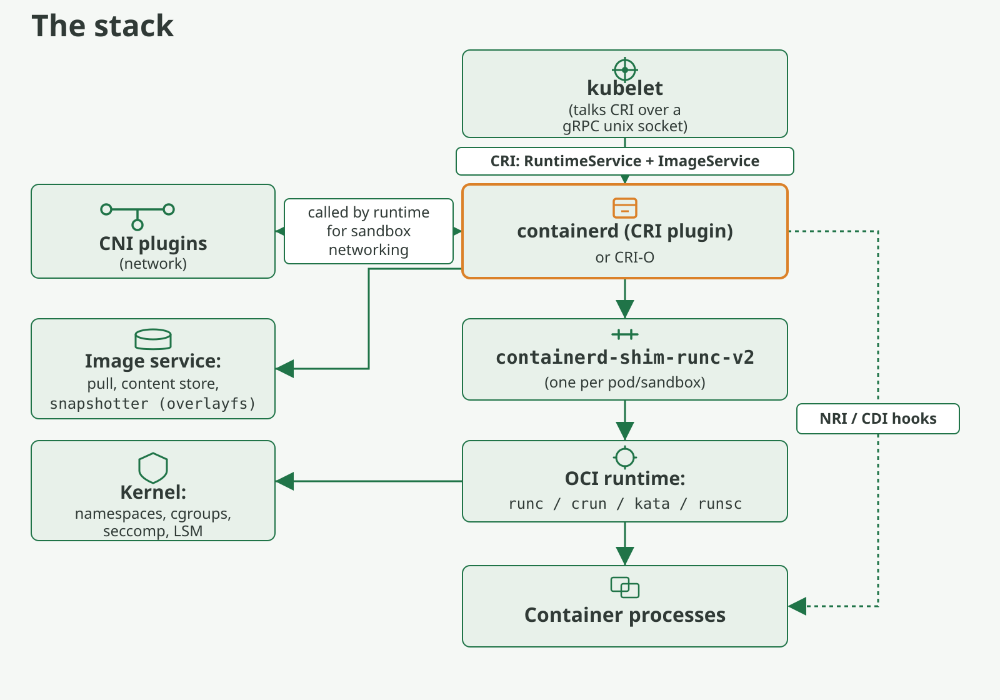
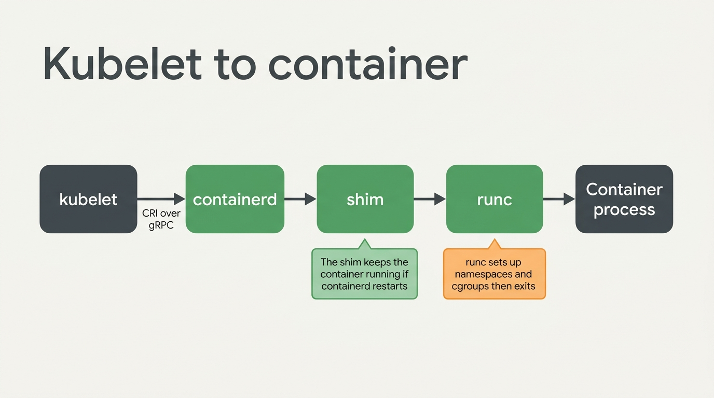
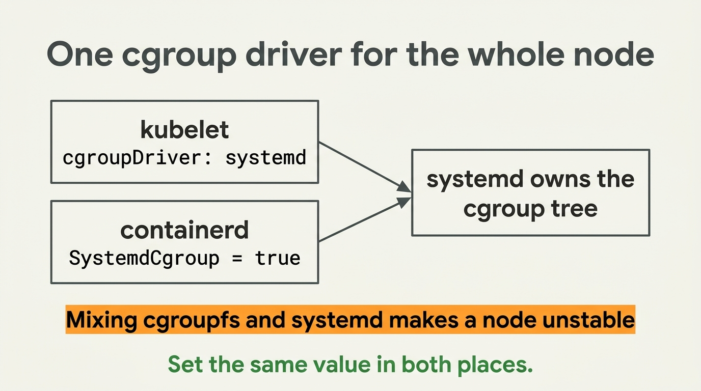

# 5.2 Container runtimes: containerd, runc, CRI and OCI

| | |
|---|---|
| Level | Intermediate |
| Priority tier | 0 |
| Lab venue | Linux VM with containerd 1.7/2.x, runc, crictl, nerdctl; kind or kubeadm for node-level views |
| Part | Part 5: Kubernetes |
| Status | Drafted, labs **untested** |

## Why this matters for AI infrastructure

Picture a training pod that will not start. Its status says `ContainerCreating`, and it has been that way for a long time. Kubernetes can tell you that the pod is waiting, but it cannot tell you why, because the cause is often below Kubernetes itself. An image pull may stall, a runtime may be misconfigured for the NVIDIA toolkit, or the cgroup driver may be wrong. A snapshotter might run out of space, a shim might leak, or a runtime upgrade might restart every container on the node. Each of those problems lives in a layer that `kubectl describe` does not show you directly.

Here is the short version of the stack. The kubelet does not run containers. It asks a **container runtime** to do that, through the Container Runtime Interface, which is usually shortened to CRI. The container runtime then relies on an **OCI runtime** to create the namespaces and cgroups that make a process into a container. Knowing these layers, and the tools that talk to each one, lets you debug a node when `kubectl describe` is not enough.

The same knowledge helps you configure GPU runtimes correctly. It also helps you choose between runtimes such as runc, crun, Kata and gVisor. Read the rest of this chapter with one question in mind: which layer is failing?

## Prerequisites and outcomes

You should read 5.1 before this chapter. Chapter 5.1 explains what a container is and how images are built and stored, and this chapter explains who starts those containers and how. Once you finish, you should be able to do the following. Use the list as a self-check, and return to the matching section for any line that still feels unclear.

- Draw the stack kubelet → CRI → containerd/CRI-O → shim → OCI runtime → container, and say what each layer owns.
- Explain the two CRI services, RuntimeService and ImageService. Explain the difference between a sandbox and a container, and how a pod maps to a sandbox made of a pause container plus app containers.
- Configure containerd through `config.toml`, covering the CRI plugin, runtimes, snapshotters, registry mirrors, cgroup driver and sandbox image. Know the basics of CRI-O.
- Compare OCI runtimes such as runc, crun, youki, Kata, gVisor and Firecracker-based runtimes, and use `RuntimeClass`.
- Use crictl, ctr and nerdctl for node-level inspection and debugging. Understand the containerd namespace `k8s.io`.
- Configure the NVIDIA container runtime and CDI for Kubernetes nodes, and handle upgrades, restarts and garbage collection.

The next section draws the full stack, so keep it in view as you read the rest of the chapter.

## 1. The stack

Suppose a pod sits in `ContainerCreating` while the other pods on its node run fine. The node is healthy, so the problem is specific to this pod. The diagram below shows every layer that could be holding it up. Think of it as a chain of workers, where each one hands the job to the next. A break anywhere in the chain looks like the same symptom from the outside, so you need the chain in your head before you start checking.



*Figure 5.2.1. The stack, as a diagram.*

Read the diagram from top to bottom. Solid arrows are calls from one layer into the next. Dotted lines show hooks and plugins that reach the container processes or the network. A simple way to remember it is to picture a restaurant. The kubelet is the head waiter who takes the order from the kitchen manager. The containerd or CRI-O daemon is the kitchen manager, who handles ingredients and stock. The shim is a cook who stays with each dish until it leaves the kitchen. The OCI runtime is the tool that actually heats the pan. The kernel is the building's gas line, which every pan depends on.

The table gives each layer a job and a few examples you will see on a node.

| Layer | Responsibility | Examples |
|---|---|---|
| **Kubelet** | Node agent: watches the API server for pods assigned to the node; calls the runtime via CRI; runs probes, manages volumes, reports status (5.9) | `kubelet` |
| **CRI** | gRPC API (`runtime.v1`): `RunPodSandbox`, `CreateContainer`, `StartContainer`, `StopContainer`, `ListContainers`, `ExecSync`, `Exec/Attach/PortForward` streaming, `PullImage`, `ListImages`, `ImageFsInfo`, `Status` | Protobuf API in `k8s.io/cri-api` |
| **High-level runtime** | Image distribution, storage and unpacking, container metadata, lifecycle, CRI implementation, shim management, networking via CNI | **containerd** (CNCF graduated; default in most distros), **CRI-O** (Kubernetes-focused, OpenShift default) |
| **Shim** | Per-pod process that outlives the runtime daemon, holds the container's stdio, reaps exit status, lets containerd restart without killing containers | `containerd-shim-runc-v2`, `crio-conmon` (conmon) |
| **Low-level (OCI) runtime** | Creates the container from a bundle (`config.json` + rootfs): sets up namespaces, cgroups, mounts, capabilities, seccomp; then `exec`s the process | **runc** (Go), **crun** (C, faster/lower memory), youki (Rust), Kata Containers (lightweight VM), gVisor `runsc` (user-space kernel), Firecracker (via kata-fc or firecracker-containerd) |
| **Kernel** | The actual isolation | namespaces, cgroups v2, overlayfs, seccomp, LSM |

Notice that only the kernel row is labelled as the actual isolation. That is where the namespaces, cgroups and seccomp rules live. Every row above it is management. The runtimes decide what to ask the kernel for, but the kernel is the one that enforces it. This is why a bug in containerd cannot, by itself, make a process escape its limits, while a bug in the kernel can.

Docker Engine is itself built on containerd and runc. The *Production Kubernetes* book explains the history. Kubernetes once compiled support for Docker and CoreOS rkt straight into the kubelet source code. Docker support came through `dockershim`, and rkt support came through `rktnetes`. That meant a new runtime, or a fix to a runtime integration bug, needed a full Kubernetes release and deep knowledge of kubelet internals. Every runtime was a special case inside the kubelet.

The Container Runtime Interface (`CRI`) arrived in Kubernetes 1.5 and replaced that tight coupling with a standard **gRPC client-server interface over a local Unix socket**. gRPC is a way for two programs to call each other's functions over the network or a local socket, using a fixed contract. A Unix socket is a file on disk that two programs on the same machine use to talk. Each runtime listens on its own socket: `/run/containerd/containerd.sock` for containerd, or `/var/run/crio/crio.sock` for CRI-O. The interface exposes two gRPC services:

1. **`ImageService`** handles images, with `ListImages`, `ImageStatus`, `PullImage`, `RemoveImage`, and `ImageFsInfo`.
2. **`RuntimeService`** handles two things. It manages the pod sandbox with `RunPodSandbox`, `StopPodSandbox`, `RemovePodSandbox`, `PodSandboxStatus` and `ListPodSandbox`. It also manages each container with `CreateContainer`, `StartContainer`, `StopContainer`, `RemoveContainer`, `ListContainers`, `ContainerStatus`, `UpdateContainerResources`, `ReopenContainerLog`, `ExecSync`, `Exec`, `Attach` and `PortForward`.

Kubernetes removed the built-in **dockershim** in 1.24. That cut out one redundant hop, `kubelet -> dockershim -> dockerd -> containerd`. The kubelet now talks straight to containerd's built-in CRI plugin. If you want Docker Engine as a CRI runtime today, you need the external `cri-dockerd`. Nearly all production clusters use containerd or CRI-O directly.

### Why the CRI exists

Imagine you maintain a new container runtime. Before the CRI, supporting Kubernetes meant waiting for a new Kubernetes release. It also meant learning the Kubernetes code base in depth, and then hoping your fix survived the next kubelet refactor. Once the CRI was in place, you only had to follow the interface to stay compatible. You could ship your runtime on your own schedule.

The point of the CRI was to keep runtime internals away from Kubernetes, and most of all away from the kubelet. This is a classic example of the dependency inversion principle, which says that a high-level component should depend on a stable contract instead of on the details of its helpers. Over time, the kubelet shed the runtime-specific code and the if-statements that had been scattered through it. Now it relies on the interface alone. That made the kubelet simpler, more extensible and easier to test, which are the qualities of well-designed software.

### The pod sandbox

A Kubernetes pod is a group of containers that share network namespaces, and optionally PID and IPC namespaces. The runtime creates a **sandbox** for that group. The sandbox is the shared room that the containers live in. It holds a pause container, which is a tiny `pause` process with the image `registry.k8s.io/pause:3.x`. The pause container holds the pod's network namespace, IP and cgroup parent. Application containers then join those namespaces, so every container in the pod sees the same network interface and the same IP address.

Why a tiny do-nothing process? Because the pause process needs to live as long as the pod does. If an application container crashes and restarts, the network namespace must survive, or the pod would lose its IP on every restart. The pause container is the stable anchor. It sleeps, and it reaps any orphaned children that land in the pod.

The sequence for `RunPodSandbox` runs in a fixed order. The runtime pulls the pause image, creates the pod cgroup, and creates the network namespace. It then invokes **CNI** plugins to attach interfaces and assign an IP, a step covered in 5.13. CNI (Container Network Interface) is a plugin standard that lets a runtime ask a separate program to wire a container into the network. Finally, it starts the pause container.

For each container after that, the runtime calls `PullImage` if the image is needed. `CreateContainer` prepares a snapshot and generates an OCI `config.json` from the CRI config. That config covers the environment, mounts, devices, resources and security context. `StartContainer` then starts the shim, and runc creates and starts the process. `StopPodSandbox` and `RemovePodSandbox` tear the pod down. If the CNI plugin fails, the sandbox fails too. The pod then sits in `ContainerCreating`, with events such as "failed to set up sandbox container network".

### Starting a Pod through the CRI

The most important operation in Kubernetes is starting a Pod on a node. Once the Pod is scheduled onto a node, the kubelet works with the container runtime to start it. The containerd CRI plugin starts a gRPC server that listens on a Unix socket. By default, that socket is `/run/containerd/containerd.sock`. The kubelet finds it through two flags:

```
/usr/bin/kubelet
--container-runtime=remote
--container-runtime-endpoint=/run/containerd/containerd.sock
... other flags here ...
```

The walkthrough here is based on Kubernetes v1.18.2 and containerd v1.3.4. Those versions use the `v1alpha2` version of the CRI. Newer releases use the newer API version, but the order of calls is the same, and that order is what this walkthrough is about.

The kubelet starts by creating a Pod sandbox with the `RunPodSandbox` method of the RuntimeService. A Pod is made of one or more containers, so the sandbox must come first. The sandbox sets up the Linux network namespace, among other things, for all the containers to share. The kubelet sends the Pod's name, unique ID, Kubernetes Namespace and DNS configuration. The runtime replies with a Pod sandbox ID, and the kubelet uses that ID to create containers. Think of the sandbox ID as a room key. Every later call names the room it belongs to.

Next, the kubelet checks whether the container image is on the node. It calls the `ImageStatus` method of the ImageService. If the image is missing, the method returns null, and the kubelet calls `PullImage`. Once the runtime pulls the image, it replies with the image SHA256 digest. The kubelet uses that digest to create the container. Notice that the kubelet works with the digest here, not the tag, so the container starts from exactly the bytes that were pulled.

The kubelet then calls the `CreateContainer` method of the RuntimeService. It passes the sandbox ID and the container configuration. That configuration includes the image digest, the command and arguments, environment variables and volume mounts. The runtime generates a container ID and returns it. That ID appears in the Pod's status under container statuses:

```
containerStatuses:
- containerID: containerd://0018556b01e1662c5e7e2dcddb2bb09d0edff6cf6933...
image: docker.io/library/nginx:latest
```

Finally, the kubelet calls the `StartContainer` method with that container ID. The CRI also defines `Exec` and `ExecSync` to run a command inside a container, `Attach` to attach to one, and `PortForward` to forward a container port. Knowing these method names makes a stuck Pod start much easier to read. When a pod stalls, the step it reached in this sequence tells you where to look. If it never got a sandbox ID, the problem is in the sandbox or the network. If it got an ID but never a container ID, the problem is in the image or the create call.

## 2. containerd in depth

Suppose you open the containerd configuration on a new GPU node. The file is long, and most of its blocks look unfamiliar. You want to know what each block controls before you change anything, because one wrong line can stop every pod on the node from starting.



*Figure 5.2.2. kubelet speaks CRI to containerd. containerd uses a shim and runc to start the container.*

containerd is a daemon that exposes a gRPC API on `/run/containerd/containerd.sock`. A daemon is a background program that runs all the time and waits for requests. Its subsystems are plugins. They include the content store, snapshotters, metadata kept in a bolt DB, the image service, tasks that run through runtime v2 shims, events, CRI, NRI, CDI and more. A bolt DB is a small embedded database file that containerd uses for its own metadata. Everything is namespaced. Kubernetes uses the containerd namespace `k8s.io`, Docker uses `moby`, and nerdctl uses `default`. A tool that looks in the wrong namespace sees nothing, so use `ctr -n k8s.io containers ls` for Kubernetes containers. This is the single most common reason people think a node is empty when it is not.

### Configuration

The settings live in `/etc/containerd/config.toml`, which uses the version 2 or 3 schema. A schema is the agreed layout of the file, so a different version number means the keys may be named differently. You can print the defaults with `containerd config default`. Printing the defaults is a good habit, because it shows you every key the daemon understands, and the keys you do not set keep their default values.

```toml
version = 2

[plugins."io.containerd.grpc.v1.cri"]
  sandbox_image = "registry.k8s.io/pause:3.9"
  [plugins."io.containerd.grpc.v1.cri".containerd]
    default_runtime_name = "runc"
    snapshotter = "overlayfs"
    discard_unpacked_layers = false
    [plugins."io.containerd.grpc.v1.cri".containerd.runtimes.runc]
      runtime_type = "io.containerd.runc.v2"
      [plugins."io.containerd.grpc.v1.cri".containerd.runtimes.runc.options]
        SystemdCgroup = true                      # MUST match the kubelet's cgroup driver (systemd)
    [plugins."io.containerd.grpc.v1.cri".containerd.runtimes.nvidia]
      runtime_type = "io.containerd.runc.v2"
      [plugins."io.containerd.grpc.v1.cri".containerd.runtimes.nvidia.options]
        BinaryName = "/usr/bin/nvidia-container-runtime"
        SystemdCgroup = true
    [plugins."io.containerd.grpc.v1.cri".containerd.runtimes.kata]
      runtime_type = "io.containerd.kata.v2"
  [plugins."io.containerd.grpc.v1.cri".registry]
    config_path = "/etc/containerd/certs.d"       # per-registry hosts.toml (mirrors, TLS, auth)
  [plugins."io.containerd.grpc.v1.cri".image_decryption]
    key_model = "node"

[plugins."io.containerd.nri.v1.nri"]
  disable = false
[plugins."io.containerd.grpc.v1.cri".cdi]            # in newer versions: enable_cdi = true, cdi_spec_dirs = ["/etc/cdi", "/var/run/cdi"]
```

Read the file as a set of nested boxes. The long names look intimidating, but each level of the name is just a section of the same tree. The outer box is the CRI plugin. Inside it, the `containerd` block chooses the default runtime and the snapshotter. Inside that, each `runtimes.<name>` block defines one named runtime that a pod can ask for. The `registry` and `cdi` blocks sit beside them and control image sources and GPU devices.

The first setting to get right is `SystemdCgroup = true`. Use it when you run the systemd cgroup driver, which is the default for kubeadm clusters on systemd hosts with cgroup v2. A mismatch between the kubelet, set to `cgroupDriver: systemd`, and containerd is a classic cause of nodes flapping or pods failing with cgroup errors. Both must use the same driver. The setting is easy to forget because it is a single boolean, but it decides who owns the cgroup tree, and two owners fight.

The `sandbox_image` setting names the pause image. In air-gapped clusters, point it to your own registry, because a node with no route to the public internet cannot pull the default. The kubelet's `--pod-infra-container-image` flag is deprecated in favour of runtime config, so the containerd setting is the place to make the change.

The runtimes map, `runtimes.<name>`, defines named OCI runtimes. A `RuntimeClass` selects one of them through `RuntimeClass.handler`, as section 4 explains. Registry settings use `config_path` with `certs.d/<registry>/hosts.toml` for mirrors, custom CAs and credentials, covered in 5.1. Avoid the deprecated inline `registry.mirrors` setting, because the per-registry files are easier to manage and to roll out with configuration management.

The snapshotter defaults to `overlayfs`. A snapshotter is the piece that turns image layers into a rootfs a container can use, as 5.1 described. Alternatives include `native`, `btrfs`, `zfs` and `devmapper`. Remote and lazy snapshotters, such as `stargz`, `soci`, `nydus` and `overlaybd`, register as proxy plugins. A proxy plugin is a separate program that containerd calls for the storage work, so it can fetch file chunks on demand. They speed up starts for large images.

Garbage collection and disk usage matter too. Content blobs and snapshots live under `/var/lib/containerd`. The kubelet's image GC thresholds, `imageGCHighThresholdPercent` and `imageGCLowThresholdPercent`, trigger `RemoveImage`. On GPU nodes, keep this directory on a separate large, fast disk, because images of tens of GB pile up across many versions. Garbage collection is the cleanup that removes images nobody uses, and on a shared root disk it can run at the worst moment, in the middle of a job's start.

Restarting containerd does not kill running containers, since the shims keep them alive and containerd re-attaches to them. Upgrading runc affects only new containers, because a running container already has its process and cgroup in place. Reload the config with `systemctl restart containerd`, and often the kubelet as well. Verify the result with `containerd config dump` and `crictl info`. The first shows the config containerd actually loaded, and the second shows what the CRI plugin reports to the kubelet. If the two disagree, the file on disk is not the file the daemon is using.

### containerd data model

Images lead to content blobs, which you find by digest. Blobs become layered snapshots keyed by chain ID. A chain ID is a name for a stack of layers, built from the layers beneath it, so the same stack always gets the same name. Containers hold metadata that points to a snapshot and an OCI spec. Tasks are the running processes, managed through shims. Leases protect objects from garbage collection while they are in use. A lease is like a sticky note that says "do not throw this away, a job still needs it." CRI sandboxes and containers carry Kubernetes metadata, such as `io.kubernetes.pod.name` and the namespace and uid, and you can see it in `ctr` and `crictl` output. That metadata is the bridge between the pod you see in `kubectl` and the container you see on the node.

### The containerd CRI plugin on a node

The containerd CRI plugin is a native containerd plugin. It has been available since containerd v1.1 and is enabled by default. Of the runtimes used when building Kubernetes-based platforms, containerd is perhaps the most common. It is the default in Cluster API node images, and it is available across managed offerings such as AKS, EKS and GKE. containerd serves its gRPC APIs through the Unix socket `/run/containerd/containerd.sock`, and the kubelet connects there to run Pods.

Containers started this way show the same process tree you would see with Docker Engine. That is expected, because Docker Engine uses containerd to manage containers. Read the tree from the top down. systemd starts containerd, containerd starts a shim for the container, and the shim is the parent of the nginx processes. The shim is the piece that stays alive even when containerd is restarted, which the next sections come back to.

```
systemd
└─containerd
└─containerd-shim -namespace k8s.io -workdir ...
└─nginx
└─nginx
```

To inspect containers on a node, use `ctr`, the containerd CLI. Unlike Docker, the containers that Kubernetes manages live in the containerd namespace `k8s.io`, not `moby`:

```
$ ctr --namespace k8s.io containers ls | grep nginx
c85e47fa... docker.io/library/nginx:latest io.containerd.runtime.v1.linux
```

You can also use `crictl` with the containerd socket. The output looks similar, but `crictl` speaks CRI, so it shows you pods and containers the way the kubelet sees them:

```
$ crictl --runtime-endpoint unix:///run/containerd/containerd.sock ps
--name nginx
CONTAINER ID IMAGE CREATED STATE NAME POD ID
c85e47faf3616 4bb46517cac39 39 seconds ago Running nginx 73caea404b92a
```

If `ctr` shows nothing on a Kubernetes node, check the namespace you passed first. Only after that should you suspect the node itself.

## 3. CRI-O and alternatives

Which runtime should your platform team pick? The answer depends on a few trade-offs, and the CRI is what makes the choice possible. Because every runtime speaks the same interface, the kubelet does not care which one answers. The choice is about operations, support and isolation, not about compatibility with Kubernetes.

### Choosing a runtime

Because the CRI exists, platform teams can pick the container runtime that suits them. Over the last couple of years, though, the container runtime has become an implementation detail. If you use a Kubernetes distribution or a managed service, the runtime is most likely chosen for you. That holds even for Cluster API, which ships prebaked node images with a container runtime included. Picking a runtime yourself makes sense only when the vendor leaves the choice open, or when you have a specific requirement that the default cannot meet.

If you do have the choice, or you need a specialized runtime such as a VM-based one, weigh four things. The first is experience. Organizations with a long history in containers usually use Docker and know its toolchain. Kubernetes once supported Docker directly, and that support is gone from the project itself. Docker Engine can still run through cri-dockerd, outside the project. The full Docker daemon has extra capabilities that Kubernetes does not need, such as building images and creating container networks. The good news is that Docker uses containerd under the covers. The downside is that operators then have to learn the containerd CLI for the parts that Docker does not show.

The second is support. Kubernetes distributions such as VMware's Tanzu Kubernetes Grid and RedHat's OpenShift usually ship a specific container runtime. Stick to that choice unless you have an extremely compelling reason not to. Support contracts usually cover the runtime the vendor ships, so a switch means you test and support more of the stack yourself. If you do switch, make sure you understand the support implications.

The third is conformance testing. The Node Special Interest Group, sig-node, in the Kubernetes project defines CRI validation tests and node conformance tests. These run in every Kubernetes release, and some runtimes have more coverage than others. More coverage is better, because issues get caught during the release process rather than on your cluster. The community publishes all tests and results on the Kubernetes Test Grid, a public dashboard. Look at a runtime's conformance tests and how it relates to the wider Kubernetes project.

The fourth is isolation. Some workloads need stronger guarantees than Linux containers provide. VM-level isolation is less common, but it matters for running untrusted code or for applications that need strong multitenancy. Multitenancy means several customers or teams share one cluster and must not see each other's data. In those cases, specialized runtimes such as Kata Containers are an option.

Next, the most common runtimes are Docker, containerd and CRI-O. Kata Containers shows how to run pods in VMs instead of Linux containers. Virtual Kubelet is not a container runtime, but it offers another way to run workloads on Kubernetes.

### CRI-O and the other runtimes

CRI-O implements only what Kubernetes needs. It pulls images with `containers/image`, stores them with the `containers/storage` overlay, and runs containers through `conmon` and an OCI runtime. It sets up networking with CNI. Its configuration lives in `/etc/crio/crio.conf`, with drop-ins in `/etc/crio/crio.conf.d/`. A drop-in is a small file that overrides part of the main config, so you can change one setting without editing the whole file. You define runtimes under `[crio.runtime.runtimes.<name>]`, and registries come from `/etc/containers/registries.conf`.

OpenShift and some distributions use CRI-O, and Kubernetes minor versions are matched one-to-one with CRI-O versions. For most users the behaviour is equivalent. The differences show up in debug tooling, in the configuration format, and in the image and storage libraries that CRI-O shares with Podman and Buildah. crictl works with both runtimes, but ctr works only with containerd. If your team's habits are built on ctr, that is a real reason to prefer containerd.

### CRI-O in practice

Like containerd, CRI-O exposes the CRI over a Unix socket. The kubelet uses that socket, typically `/var/run/crio/crio.sock`, to talk to CRI-O directly. When CRI-O spawns a container, it starts a process called `conmon`, a container monitor. `conmon` is the parent of the container process. It plays the same role that the shim plays in containerd. It provides a way to attach to the container, writes the container's STDOUT and STDERR streams to log files, and handles termination. The process tree looks like this:

```
systemd
└─conmon -s -c ed779... -n k8s_nginx_nginx_default_e9115... -u8cdf0c...
└─nginx
└─nginx
```

Because CRI-O was built as a low-level component for Kubernetes, the project ships no CLI. You can still use crictl with CRI-O, as with any runtime that implements the CRI. The output below shows the same kind of answer as the containerd example, but the socket path is different:

```
$ crictl --runtime-endpoint unix:///var/run/crio/crio.sock ps --name nginx
CONTAINER IMAGE CREATED STATE NAME POD ID
8cdf0c... nginx@sha256:179... 2 minutes ago Running nginx eabf15237...
```

### Docker Engine and the dockershim

Docker Engine can still run through cri-dockerd. That path adds layers, so teams use it mainly when they need Docker-specific features on nodes. The Docker path worked this way in the Kubernetes versions described here. Kubernetes supported Docker Engine through a CRI shim called the dockershim. Docker Engine does not implement the CRI itself, so the shim had to. The shim is built into the kubelet and is a gRPC server that implements the CRI services. Put simply, the dockershim was a translator sitting between two languages that did not speak the same dialect.

Rather than special-casing every kubelet code path for both the CRI and Docker Engine, the dockershim acts as a facade. A facade is a simple front that hides a more complicated system behind it. It translates CRI calls into Docker Engine API calls. Docker uses containerd under the hood, so calls from the kubelet are relayed to containerd, which starts the containers. The spawned container ends up under containerd, not under the Docker daemon. The tree below shows that, with the namespace named `moby` this time:

```
systemd
└─containerd
└─containerd-shim -namespace moby -workdir ...
└─nginx
└─nginx
```

From a troubleshooting point of view, you can use the Docker CLI to list and inspect containers on a node. Docker has no concept of pods, so the dockershim encodes the Kubernetes Namespace, pod name and pod ID into container names. The filter below keeps only the containers of one pod called `nginx` in the `default` namespace. The pause container, which holds the pod's infrastructure, carries the `k8s_POD_` prefix. Once you can read the name format, you can tell at a glance which container is the app and which is the pod's anchor.

```
$ docker ps --format='{{.ID}}\t{{.Names}}' | grep nginx_default
3c8c01f47424 k8s_nginx_nginx_default_6470b3d3-87a3-499c-8562-d59ba27bced5_3
c34ad8d80c4d k8s_POD_nginx_default_6470b3d3-87a3-499c-8562-d59ba27bced5_3
```

You can also use the containerd CLI, `ctr`, to inspect containers. The output is less friendly than the Docker CLI output. Docker Engine uses a containerd namespace called `moby`:

```
$ ctr --namespace moby containers list
CONTAINER IMAGE RUNTIME
07ba23a409f31bec7f163a... - io.containerd.runtime.v1.linux
0bfc5a735c213b9b296dad... - io.containerd.runtime.v1.linux
2d1c9cb39c674f75caf595... - io.containerd.runtime.v1.linux
...
```

Finally, you can use crictl if it is available on the node. It is a command-line tool developed by the Kubernetes community that talks to container runtimes over the CRI. Docker does not implement the CRI, but crictl can still use the dockershim Unix socket. This is the setup that older clusters relied on, so you may still meet it on a legacy node:

```
$ crictl --runtime-endpoint unix:///var/run/dockershim.sock ps --name nginx
CONTAINER ID IMAGE CREATED STATE NAME POD ID
07ba23a409f31 nginx@sha256:b0a... 3 seconds ago Running nginx ea179944...
```

Podman is not a CRI runtime. It shares libraries with CRI-O, though, and it can run pods locally with `podman kube play`. That makes it a useful test bench for a pod spec before you ship it to a cluster.

### Virtual Kubelet

Virtual Kubelet is an open source project. It acts like a kubelet, but its backend is a pluggable API. Strictly speaking, it is not a container runtime. Its job is to bring alternative runtimes to Kubernetes pods. Those runtimes can be any system that can run an application, such as serverless or edge frameworks. On a cloud service, for example, it can start pods on Azure Container Instances or AWS Fargate. From the cluster's point of view, the pod is still a pod. What happens underneath belongs to someone else's infrastructure.

Providers come from the Virtual Kubelet community, and they include AWS Fargate, Azure Container Instances, HashiCorp Nomad and others. If you need a custom backend, you can write your own provider. A provider is a Go program that uses the Virtual Kubelet libraries. It handles node registration, running pods, and exporting the APIs that Kubernetes expects. Virtual Kubelet is not yet common in the field, but it is still useful to know that it exists, because it answers the question "what if I want my pods to run somewhere that is not a node I manage?"

If your distribution ships a runtime, stick with it unless you have an extremely compelling reason to switch.

## 4. OCI runtimes and RuntimeClass

Suppose notebooks from many users run on the same cluster as your training jobs. A user's notebook can run arbitrary code, so it should not be able to reach the training data of another team. Before you pick a runtime, you need to know how much isolation each one gives, and what each one costs.

The OCI Runtime Spec defines a **bundle**, which is a directory holding `config.json` and a `rootfs/`. It also defines a CLI contract with `create`, `start`, `state`, `kill` and `delete`. A runtime reads the bundle and creates the isolated process. Because the contract is the same for every runtime, the layer above does not need to know which one is underneath. That is the same idea as the CRI, applied one level lower.

| Runtime | Isolation model | Notes |
|---|---|---|
| **runc** | Namespaces/cgroups on the host kernel | Reference implementation, default everywhere; security patches matter (CVE history: container breakouts via `/proc` handling) |
| **crun** | Same, written in C | Faster start, lower memory; default in some distros; cgroup v2 first |
| **youki** | Same, Rust | Less common |
| **gVisor (runsc)** | User-space kernel intercepts syscalls (sentry/gofer) | Stronger isolation for untrusted code; syscall overhead; limited GPU support (via `nvproxy` for some workloads, verify); no complete Linux compatibility |
| **Kata Containers** | Each pod in a lightweight VM (QEMU, Cloud Hypervisor, Firecracker) with its own guest kernel | Strong isolation, pod-per-VM overhead; GPU passthrough (VFIO) and confidential computing variants for multi-tenant GPU clouds |
| **Firecracker (firecracker-containerd)** | microVMs | Serverless-style isolation |
| **Confidential containers (CoCo)** | Kata + TEEs (SEV-SNP, TDX), plus NVIDIA confidential computing on H100 | Emerging for sensitive model/data processing (Part 18) |

Read the notes column for the caveats. Runc, for example, has a CVE history of container breakouts through `/proc` handling, so its security patches matter. The pattern across the table is simple. The more of the kernel a runtime shields, the more it costs in speed and in GPU support. runc shares the whole kernel and is fast. gVisor and Kata put a wall between the workload and the host, and they pay for it in overhead.

### The OCI project and runc

The OCI has three specifications: the runtime spec, the image spec and the distribution spec. Together they let development around containers and platforms such as Kubernetes move forward. They also help users move between products in a portable, interoperable way. This section covers the runtime and image specs. The distribution spec mainly concerns container image registries.

runc implements the OCI runtime spec, and it lives in the OCI project. Docker, containerd and CRI-O all use runc to spawn containers according to the spec. Leaning on runc lets those runtimes focus on higher-level work, such as pulling images, configuring networking and handling storage. The OCI was founded in 2015 to collaborate on container specifications. Docker donated runc to it, and CoreOS pushed container runtimes forward with rkt.

### The OCI runtime configuration

The OCI runtime specification describes how to start and run containers in a compatible way. It begins by defining the schema of a container's configuration. That schema covers the root filesystem, the command to run, environment variables, the user and group, resource limits and more. Here is a shortened container configuration from the spec. Notice that it is only a list of settings, with no logic. The runtime reads it once and turns it into kernel calls.

```
{
"ociVersion": "1.0.1",
"process": {
"terminal": true,
"user": {
"uid": 1,
"gid": 1,
"additionalGids": [
5,
6
]
},
"args": [
"sh"
],
"env": [
"PATH=/usr/local/sbin:/usr/local/bin:/usr/sbin:/usr/bin:/sbin:/bin",
"TERM=xterm"
],
"cwd": "/",
...
},
...
"mounts": [
{
"destination": "/proc",
"type": "proc",
"source": "proc"
},
...
},
...
}
```

The spec also defines the operations a runtime must support: `create`, `start`, `kill`, `delete` and `state`. The `state` operation reports information about the container's state. The spec describes four stages in a container's life cycle:

- `creating`: the container runtime is creating the container.
- `created`: the runtime has completed the `create` operation.
- `running`: the container process has started and is running.
- `stopped`: the container process has finished.

Those four stages are the vocabulary you will see in runtime logs. When a container is stuck, the stage tells you how far it got. A container stuck in `creating` has a problem during setup, such as a mount or a cgroup. A container stuck in `created` never got its start call.

A pod picks its runtime through a `RuntimeClass`. A RuntimeClass is a cluster-level name that maps to a runtime handler on the node. The handler must match a runtime name in containerd or a CRI-O runtime. The overhead field makes the scheduler add a fixed amount to the pod's requests, which matters for VM-based runtimes, because the VM itself uses CPU and memory before your app does. The pod then names the class in `runtimeClassName`:

```yaml
apiVersion: node.k8s.io/v1
kind: RuntimeClass
metadata: { name: nvidia }
handler: nvidia                       # must match a runtimes.<name> in containerd (or a CRI-O runtime)
overhead:
  podFixed: { cpu: 100m, memory: 64Mi }      # scheduler adds this to pod requests (VM-based runtimes)
scheduling:
  nodeSelector: { nvidia.com/gpu.present: "true" }
---
apiVersion: v1
kind: Pod
metadata: { name: gpu-test }
spec:
  runtimeClassName: nvidia
  containers:
    - name: cuda
      image: nvcr.io/nvidia/cuda:12.4.1-base-ubuntu22.04
      command: ["nvidia-smi"]
```

For performance and compatibility in a trusted environment, use runc or crun. For multi-tenant isolation of untrusted workloads, such as notebooks, arbitrary code execution or customer-supplied containers, choose Kata or gVisor. You accept their overhead and GPU limitations in return. Most GPU training clusters use runc or crun with Pod Security Standards enforced (5.21) instead of sandboxed runtimes. Training code that the cluster team controls rarely needs an extra wall, and GPU speed matters more to the job.

### Kata Containers in more detail

Kata Containers is an open source, specialized runtime. It uses lightweight VMs instead of plain containers to run workloads. The project merged two earlier VM-based runtimes, Clear Containers from Intel and RunV from Hyper.sh.

Because Kata uses VMs, it gives stronger isolation than Linux containers. If workloads cannot share a Linux kernel, or cgroup isolation cannot meet your resource guarantees, Kata can be a good fit. A common case is a multitenant Kubernetes cluster that runs untrusted code. Baidu Cloud and Huawei Cloud run Kata Containers in their infrastructure.

Kata does not implement the CRI. Kubernetes still needs a pluggable runtime between the kubelet and Kata, and containerd fills that role. Kata plugs into containerd by implementing its runtime API, the v2 containerd-shim API. Because containerd is available on the nodes anyway, Linux container pods and VM-based pods can run on the same node. The kubelet sees both as pods, and containerd decides which path each one takes, based on the RuntimeClass.

Kubernetes configures multiple container runtimes with `RuntimeClass`. The RuntimeClass API lets you offer different runtimes on the same platform, so developers can pick the one that fits their needs. This is an example RuntimeClass for Kata Containers:

```
apiVersion: node.k8s.io/v1beta1
kind: RuntimeClass
metadata:
name: kata-containers
handler: kata
```

To run a pod under the `kata-containers` runtime, the developer names the runtime class in the pod's specification. The developer does not change anything else about the pod, which is the point. The same image and the same spec run either way, and only the isolation changes:

```
apiVersion: v1
kind: Pod
metadata:
name: kata-example
spec:
containers:
- image: nginx
name: nginx
runtimeClassName: kata-containers
```

Kata Containers supports several hypervisors, including QEMU, NEMU and AWS Firecracker. A hypervisor is the small program that runs the virtual machine. With QEMU, a QEMU process appears after you launch a pod that uses the `kata-containers` runtime class. Seeing that process is a quick way to confirm that the pod is really inside a VM:

```
$ ps -ef | grep qemu
root 38290 1 0 16:02 ? 00:00:17
/snap/kata-containers/690/usr/bin/qemu-system-x86_64
-name sandbox-c136a9addde4f26457901ccef9de49f02556cc8c5135b091f6d36cfc97...
-uuid aaae32b3-9916-4d13-b385-dd8390d0daf4
-machine pc,accel=kvm,kernel_irqchip
-cpu host
-m 2048M,slots=10,maxmem=65005M
...
```

Kata Containers is a niche choice and is rarely seen in the field. Still, if you need VM-level isolation guarantees in your Kubernetes cluster, it is worth a look. For untrusted workloads, weigh Kata and gVisor against their overhead and GPU limits before you choose.

## 5. GPU runtimes: NVIDIA Container Toolkit with containerd

A GPU pod starts, but the GPU is not visible inside it. The runtime configuration is one place to look, and this section shows how the toolkit hooks into containerd. The question to ask is whether the container's OCI spec received the device mounts. If it did not, the problem is in the runtime. If it did, the problem is in the driver or the image.

There are two ways to connect the NVIDIA Container Toolkit to containerd.

1. **The `nvidia-container-runtime` wrapper** is a runtime shim. It adds a prestart hook, `nvidia-container-runtime-hook`, to the OCI spec, so `libnvidia-container` mounts the devices and driver libraries. A prestart hook is a program that runs after the container's spec is prepared but before the process starts, so it can add the mounts in time. You configure it with `nvidia-ctk runtime configure --runtime=containerd --set-as-default`, which edits `config.toml` to add the `nvidia` runtime. Then restart containerd. With the GPU Operator, the toolkit DaemonSet does this for you and writes a drop-in config.
2. **CDI (Container Device Interface)** uses a spec that the toolkit generates with `nvidia-ctk cdi generate --output=/var/run/cdi/nvidia.yaml`. The spec describes devices such as `nvidia.com/gpu=0`, `=all` and MIG devices, along with their device nodes, mounts and environment. Runtimes read specs from `/etc/cdi` and `/var/run/cdi` and apply the edits to the OCI spec. No wrapper binary or hook is needed. This is the direction things are heading, and it underpins Kubernetes Dynamic Resource Allocation in Part 11.

GPU pods request devices through the device plugin, with `resources.limits: nvidia.com/gpu: 1`. The device plugin tells the kubelet which devices to hand to the runtime. It does this through the `NVIDIA_VISIBLE_DEVICES` environment variable, CDI names or annotations. The runtime then wires those devices in. Setting `default_runtime_name = "nvidia"` makes every container use the wrapper. That is convenient, but it also affects non-GPU pods, because every container on the node now goes through the wrapper. A `RuntimeClass` limits the NVIDIA runtime to GPU pods, and the GPU Operator can create an `nvidia` RuntimeClass for you.

To check a node, run these commands. Each line checks one part of the chain, from the config file to the CDI devices and the runtimes the CRI plugin sees. Run them in order, and stop at the first line that does not show what you expect.

```bash
nvidia-ctk runtime configure --runtime=containerd --set-as-default=false
systemctl restart containerd
grep -A4 'runtimes.nvidia' /etc/containerd/config.toml
ctr -n k8s.io run --rm --runtime io.containerd.runc.v2 --gpus 0 nvcr.io/nvidia/cuda:12.4.1-base-ubuntu22.04 t nvidia-smi
nvidia-ctk cdi list                                     # devices known to CDI
crictl info | jq '.config.containerd.runtimes'          # runtimes the CRI plugin sees
```

Pick the default runtime deliberately. On mixed nodes, keep it as runc and let GPU pods opt in through a `RuntimeClass`. That way the CPU-only pods on the same node never touch the GPU wrapper, and a bug in the wrapper cannot take them down.

## 6. Node-level tools

When an on-call page lands on a node, you need the right tool for the layer that is failing. Each tool talks to a different part of the stack, and the table shows which one to reach for. Start at the top of the table and move down only when the tool above it cannot answer your question.

| Tool | Talks to | Use |
|---|---|---|
| **`crictl`** | CRI socket (containerd or CRI-O) | Kubernetes-aware debugging: pods (sandboxes), containers, images, logs, exec, stats, runtime info. Install `cri-tools`; configure `/etc/crictl.yaml` (`runtime-endpoint: unix:///run/containerd/containerd.sock`) |
| **`ctr`** | containerd API directly | Low-level: namespaces, images, content, snapshots, containers, tasks, leases. Not for production workflows (no image UX) but great for inspection |
| **`nerdctl`** | containerd | Docker-compatible CLI (build with BuildKit, compose, rootless, lazy pulling); `nerdctl --namespace k8s.io ps` |
| **`runc`** | OCI runtime | `runc list` (root `/run/containerd/runc/k8s.io`), `runc state`, `runc exec`, `runc events` |
| **`crun`**, `kata-runtime` | runtime-specific | `kata-runtime check`, `kata-collect-data.sh` |
| **`nsenter`, `lsns`, `systemd-cgls`, `systemd-cgtop`** | kernel/host | Enter namespaces, inspect cgroup tree and usage |
| **`journalctl -u containerd -u kubelet`** | logs | The first place to look |

Start with the logs. The table lists `journalctl -u containerd -u kubelet` as the first place to look. The logs tell you what the daemons were doing when the failure happened, and they are often enough to name the layer. The cheat sheet below collects the commands you are most likely to need, grouped by the tool you would reach for first.

```bash
cat /etc/crictl.yaml
crictl pods --namespace default                        # sandboxes
crictl ps -a                                           # all containers (including exited)
crictl inspectp <pod-id> | jq '.status.network, .info.runtimeSpec.linux.namespaces'
crictl inspect <ctr-id> | jq '.info.runtimeSpec.linux.resources, .status.exitCode, .status.reason'
crictl logs --tail 100 <ctr-id>
crictl exec -it <ctr-id> sh
crictl stats                                           # CPU/memory per container
crictl images; crictl rmi <image>; crictl pull --creds user:pass registry/img:tag
crictl imagefsinfo                                     # disk usage of image store
crictl info                                            # runtime config: cgroup driver, runtimes, CNI status
crictl runp pod.json; crictl create ...; crictl start ...   # create by hand (debugging CNI/runtime without kubelet)

ctr namespaces ls
ctr -n k8s.io containers ls
ctr -n k8s.io images ls | head
ctr -n k8s.io snapshots ls | head
ctr -n k8s.io tasks ls                                  # running tasks (PIDs)
ctr -n k8s.io content ls | head
ctr plugins ls                                          # plugin status; errored plugins explain failures
```

Begin with the pod and container views from `crictl`, and drop down to `ctr` only when you need the low-level details. The `crictl` view matches what the kubelet asked for, so it is the easiest way to compare intent with reality. The `ctr` view shows what containerd actually built, which is useful once you already know which container is the problem.

## 7. Cgroup drivers and cgroup v2

Two parts of the node both touch cgroups, so the kubelet and the runtime must agree on who manages them. A cgroup, as 5.1 explained, is the kernel's way of grouping processes so that limits and counters apply to the whole group. A cgroup driver is the component that creates and manages those groups. If two components both try to be the driver, they overwrite each other's work.



*Figure 5.2.3. Set the same cgroup driver in the kubelet and in containerd, or the node becomes unstable.*

The systemd driver is recommended on systemd distributions. The runtime asks systemd to create slices and scopes, such as `kubepods.slice/kubepods-burstable.slice/kubepods-burstable-pod<uid>.slice/cri-containerd-<id>.scope`. A slice is a systemd grouping, and a scope is a group for processes that systemd did not start itself. One cgroup manager, systemd, owns the hierarchy, and every tool sees the same tree.

The cgroupfs driver works differently. The runtime writes to the cgroup filesystem directly. Two managers then compete, systemd and the runtime, and that causes instability on systemd hosts. Use cgroupfs only on non-systemd hosts. A useful way to think about it is two people trying to paint the same wall. Each one is careful, but the wall ends up with two colours in patches.

Kubernetes has defaulted to `cgroupDriver: systemd` for kubeadm on systemd hosts since 1.22 and later. Set the same value in the kubelet config, as `KubeletConfiguration.cgroupDriver`, and in containerd, as `SystemdCgroup = true`. The two settings live in different files, so they drift apart easily. Check both whenever you build a node.

cgroup v2, the unified hierarchy, is the default on modern distributions, and Kubernetes supports it. It offers better memory accounting, through `memory.high` and MemoryQoS, and PSI. PSI (Pressure Stall Information) is a kernel counter that reports how long processes wait for CPU, memory or I/O. Some features, such as swap support and user namespaces, require it. To check which version you run, use `stat -fc %T /sys/fs/cgroup`. It prints `cgroup2fs` on v2. Old runtimes and tools that expect v1 break, so make sure runc is 1.0 or newer and containerd is recent.

Pod QoS classes, Guaranteed, Burstable and BestEffort, map to cgroup parents, covered in 5.9. Memory limits map to `memory.max`, and CPU limits map to `cpu.max`, which is the CFS quota. Requests map to `cpu.weight` and `memory.min`, though only with some features enabled. The mapping is worth memorising, because it answers the question "why was this pod throttled?" The answer is almost always a CPU limit, which turns into a quota, or a memory limit, which turns into `memory.max`.

Pick systemd on systemd hosts, and set the same value in both the kubelet and containerd. If you mix the two drivers, expect the failures described in section 2.

## 8. Operations: upgrades, GC, logs, security

Suppose you must upgrade containerd on a busy GPU node. The upgrade itself is only part of the work. The day-to-day care of images, logs and security matters just as much. In practice, many node problems come from those areas, so do not treat the upgrade command as the whole job.

Upgrades start with a drain of the node, covered in 5.20. Draining means moving the running pods to other nodes before you touch this one. Then upgrade the containerd, runc and crictl packages, restart containerd and the kubelet, and uncordon the node. Uncordon means marking the node schedulable again. A containerd restart keeps containers running, because the shims are independent. A runtime upgrade with config schema changes can leave the CRI plugin failing, though, so test it on a canary node first. A canary is one machine that receives the change before the rest of the fleet, so a bad change hurts one node instead of all of them. Pin versions, and track CVEs for runc, containerd and the NVIDIA toolkit, since container escape CVEs have affected the toolkit.

Container stdout and stderr are written by the runtime to `/var/log/pods/<ns>_<pod>_<uid>/<container>/<n>.log`, in CRI log format. Symlinks in `/var/log/containers/` point to those files, so tools that expect the older layout still find the logs. The kubelet rotates them according to `containerLogMaxSize` and `containerLogMaxFiles`. Rotation keeps a chatty training job from filling the disk with one enormous file. Log shippers such as Fluent Bit and Vector tail these files, covered in 5.24.

The kubelet removes unused images when disk usage crosses `imageGCHighThresholdPercent`, which defaults to 85%. Aggressive GC of multi-GB GPU images causes repeated slow pulls, because the image that was just deleted is needed again by the next job. Give GPU nodes ample dedicated image storage. Consider pre-pulling images, and look at `imageMinimumGCAge`, which protects recently used images from deletion for a while.

The containerd directory, `/var/lib/containerd`, and the kubelet directory, `/var/lib/kubelet`, can fill the root disk. When that happens, evictions follow, covered in 5.9. An eviction is the kubelet stopping pods on a node because the node is short of a resource. Put container storage on separate fast NVMe volumes, and use local NVMe for scratch space on GPU nodes.

Reserve CPU and memory for containerd and the kubelet through `kubeReserved` and `systemReserved`. That way a runaway container cannot starve them. A starved runtime is one of the worst failures on a node, because it makes every pod on the node look broken at once.

Runtime socket access equals root. Anyone who can talk to the containerd socket can ask it to start a privileged container, which means they can control the host. Do not mount `/run/containerd/containerd.sock` into pods, except in tightly controlled cases such as CI builders. Other controls include the seccomp default profile, set with `seccompDefault: true` in the kubelet, and user namespaces for pods, set with `hostUsers: false` on the GA path in recent Kubernetes. Also use AppArmor or SELinux, restrict `privileged`, use a read-only rootfs and sign your images, covered in 5.27.

NRI, the Node Resource Interface, is a plugin mechanism. It lets node-level plugins adjust containers at creation, for example for topology-aware resource allocation or device injection. Topology-aware allocation means placing a container's CPUs and memory close to the GPU and network card it uses, which matters on large GPU servers. Some GPU and CPU managers use it.

Watch the kubelet cAdvisor metrics, the containerd metrics endpoint for Prometheus, runc events and shim counts. cAdvisor is the kubelet's built-in exporter for container resource metrics. Alert on shim leaks by comparing `ps aux | grep containerd-shim | wc -l` with the number of running pods. A shim leak looks like a steady climb in shim processes that never falls back, even when pods are deleted. Also alert on `ContainerCreating` durations and image pull errors, because those are the earliest signs that a layer is struggling.

Treat every containerd upgrade as a change to test on a canary node first.

## 9. Failure modes and diagnostics

When a pod has sat in `ContainerCreating` for a long time, the table below tells you which layer to check first. Each row pairs a symptom with the layer behind it and the check that proves it. Use the table as a map. You do not need to memorise it, but you should know where to look when a particular message appears.

| Symptom | Layer | Check |
|---|---|---|
| Pod `ContainerCreating` for long | CNI / sandbox / image pull | `kubectl describe pod`; `journalctl -u kubelet`; `crictl pods`; CNI logs; `crictl pull` manually |
| `failed to create containerd task: OCI runtime create failed` | runc/cgroup/seccomp/mount | Message includes runc error; check cgroup driver, mounts, devices, `/proc` hidepid, SELinux |
| `failed to get sandbox image` / pause pull fails | Registry/mirror | Set `sandbox_image` to reachable registry; air-gap |
| Containers restart after containerd upgrade | Shim/runtime mismatch | Review upgrade notes; drain before upgrading |
| `cgroup is not populated` / `no space left on device` on cgroup | cgroup limits, PID/inotify limits, memory cgroup leak | `systemd-cgls`, `dmesg`, raise `fs.inotify.max_user_watches`, `kernel.pid_max`, check kmem leaks |
| GPU not visible in container | Runtime not configured, device plugin, toolkit, CDI spec missing | `crictl info`, `nvidia-ctk cdi list`, pod events, toolkit logs |
| `Failed to pull image ... 429 Too Many Requests` | Registry rate limits | Mirror/pull-through cache (5.1) |
| Node `NotReady` with runtime errors | `PLEG is not healthy`, runtime socket unresponsive | `crictl ps` hangs? check containerd CPU/IO, disk full, thousands of containers; restart containerd carefully |
| Slow container start | Large image unpack, slow disk, no lazy pull | Pre-pull, faster disk, lazy snapshotter, smaller images |
| Zombie shims | Containers deleted abnormally | Reconcile with `crictl pods`/`ctr tasks`; restart node if needed |

Match the symptom column to what you see, then run the check beside it. If you find a node `NotReady` with runtime errors, start with containerd's CPU and I/O use, then check the disk. Those two checks rule out most of the cases where the runtime is slow rather than broken. Only after that should you restart anything, and restart carefully, because a restart is a change that you cannot undo.

## 10. Lab

You can work through the lab in two parts. Run the self-checking Python lab on your own machine first. Then move to a Linux node for the shell exercises.

Run the self-checking Python lab (`code/part05/cri_runtime_simulator_lab.py`) locally. It verifies the CRI `RunPodSandbox -> CreateContainer -> StartContainer` lifecycle, and it checks that `containerd-shim-runc-v2` survives restarts of the containerd daemon. It uses `CRIRuntimeSimulator`, which follows the Production Kubernetes runtime chapter. The lab also checks that the kubelet and containerd `SystemdCgroup` settings match, and it verifies `RuntimeClass` `overhead.podFixed` resource accounting through `validate_cgroup_and_runtime_class`.

```bash
python3 code/part05/cri_runtime_simulator_lab.py
```

Next, work through the exercises on a Linux node with containerd, runc and crictl. The interactive shell steps below were not run on live hardware, so treat each result as something you must confirm yourself.

1. Start with the layers on a node. On a kind or kubeadm node, run `crictl pods`, `crictl ps`, `ctr -n k8s.io containers ls` and `ctr -n k8s.io snapshots ls`. Map one Kubernetes pod to its sandbox and containers using labels. Then find the pause container and the pod's network namespace with `crictl inspectp` and `nsenter`.
2. Run an OCI bundle with runc. Create a rootfs with `docker export`, and generate `config.json` with `runc spec`. Adjust `process.args` and the namespaces, then run it with `runc run`. Add a cgroup memory limit and watch for an OOM kill. Compare the result with a containerd `ctr run` of the same image.
3. Walk through a CRI flow by hand. With `crictl`, write pod and container JSON files, then run `crictl runp`, `create` and `start`. Watch the `ctr` and `runc` state and the CNI result. Remove everything afterwards, and think about what the kubelet normally does for you.
4. Work with the config. Dump the effective config, toggle `SystemdCgroup`, and deliberately mismatch the kubelet cgroup driver in a lab. Read the errors, then restore the original settings.
5. Set up a registry mirror. Configure `hosts.toml` for a mirror or pull-through cache. Prove that a pull uses it by checking the registry logs. Then test the fallback when the mirror is down.
6. Define a second runtime, such as crun or a second runc entry with different options. Create a RuntimeClass and run a pod with `runtimeClassName`. Verify with `crictl inspect` which runtime ran. Optionally, install gVisor, which runs as `runsc`, and compare syscall behaviour with `dmesg` inside a container. Run a simple benchmark to compare performance.
7. Try Kata, optionally, on a node with virtualization. Install Kata, run a pod with the Kata RuntimeClass, compare `uname -r` inside the pod with the host, and measure the overhead.
8. Test the GPU runtime. Install the NVIDIA toolkit and configure containerd with `nvidia-ctk runtime configure`. Restart, then run a pod with `runtimeClassName: nvidia`. Next switch to CDI with `nvidia-ctk cdi generate`, and compare the OCI spec edits, the runtimeSpec mounts and devices, in `crictl inspect`.
9. Work on disk and garbage collection. Pull many large images onto a small disk. Observe the kubelet image GC and eviction messages. Tune the thresholds, then move the containerd root to a dedicated volume.
10. Run failure drills. Kill the shim of a running container and see what happens. Restart containerd while workloads run, and check that the containers survive. Fill the root disk until `DiskPressure` appears, then recover.
11. Add observability. Scrape the containerd metrics, chart pull durations and running containers, and alert on `ContainerCreating` for more than N minutes, as covered in 5.24.
12. Clean up when you finish.

Run the Python lab first, then work through the node exercises in order, since the later ones build on the earlier layers.

## 11. Common mistakes

Watch for these mistakes when you review a node or a cluster configuration. Each one comes up earlier in the chapter, so when you spot one, go back to that section and read it again before you change anything.

- Running different cgroup drivers in the kubelet and containerd.
- Editing the containerd config and forgetting to restart, or editing the wrong schema version.
- Using `ctr` in the default namespace and concluding there are no containers.
- Mounting the container runtime socket into workloads casually.
- Setting `nvidia` as the default runtime on mixed clusters without understanding the impact, or running manual toolkit config that fights the GPU Operator.
- Having no dedicated disk for container storage, so images and logs fill the root volume.
- Setting aggressive image GC thresholds that evict large ML images and cause repeated multi-minute pulls.
- Treating a runtime upgrade as harmless, with no drain or canary.
- Assuming sandboxed runtimes such as gVisor and Kata support GPUs and RDMA the same way runc does.
- Ignoring the pause image in air-gapped clusters.

Check the cgroup drivers and the sandbox image on every node you build, since two of these mistakes depend on them.

## 12. Interview angles

An interviewer may open with one of these questions. Each one is answered somewhere in this chapter. A strong answer starts with the layer the question touches, then moves to the detail, because that order shows you understand where the problem lives.

- "Walk through what happens when the kubelet starts a pod: CRI calls, sandbox, CNI, image pull, runc."
- "containerd vs CRI-O vs Docker; what was dockershim?"
- "What is the role of the shim? What happens to containers if containerd restarts?"
- "runc vs crun vs gVisor vs Kata: when each?"
- "How do you debug a node when `kubectl` shows ContainerCreating? Mention `crictl`, the kubelet and containerd logs, CNI and image pull."
- "How does Kubernetes expose GPUs to containers? Wrapper runtime vs CDI?"
- "What breaks if the kubelet and containerd cgroup drivers differ?"
- "How would you handle image storage and GC for 30 GB ML images?"

Answer each question by naming the layer it touches first, then give the detail.

## Exercises

Each exercise below ties one part of the runtime stack to a task you can carry out. Work through them in order, and note where you get stuck. Stuck points are useful, because they show you which layer you do not yet have a picture of.

1. Begin with the runtime stack, from kubelet through CRI, containerd or CRI-O, the shim and the OCI runtime, down to the kernel. Production Kubernetes, Chapter 3, covers it. Use `CRIRuntimeSimulator` in `code/part05/cri_runtime_simulator.py` to trace the gRPC sequence when the kubelet starts a pod. The sequence runs `RunPodSandbox`, then the pause container with CNI attachment, then `PullImage`, `CreateContainer` and `StartContainer`. Then explain why dockershim was removed in Kubernetes 1.24, and why `systemctl restart containerd` does not kill running containers.
2. Configure containerd through `/etc/containerd/config.toml`, with `SystemdCgroup = true` and CRI-O. Use `validate_cgroup_and_runtime_class()` in `code/part05/cri_runtime_simulator.py`. Explain the critical sections of the config file: `sandbox_image`, `default_runtime_name`, `snapshotter`, `runtimes.runc.options.SystemdCgroup = true`, `runtimes.nvidia`, and `config_path = "/etc/containerd/certs.d"`. Then explain what breaks if the kubelet uses systemd while containerd uses cgroupfs, and how containerd namespaces (`k8s.io` vs `moby` vs `default`) work.
3. Compare the OCI runtimes: runc, crun, gVisor with its `runsc` user-space kernel, Kata Containers, and Confidential Containers. Compare their isolation architecture and their GPU and performance trade-offs. Include Kata's VM-per-pod model, `qemu-system-x86_64 -machine pc,accel=kvm`. Then explain how RuntimeClass, through `handler` and `overhead.podFixed`, routes pods to a specific runtime and accounts for VM memory and CPU overhead in `kube-scheduler`. Use Production Kubernetes, Chapter 3, as background.
4. Contrast the two GPU runtime integration models on a Kubernetes node. The first is the `nvidia-container-runtime` wrapper, with `BinaryName = "/usr/bin/nvidia-container-runtime"` invoked through `RuntimeClass: nvidia`. The second is native Container Device Interface (CDI), with `enable_cdi = true`, `/etc/cdi/nvidia.yaml` and `/var/run/cdi`.
5. Suppose you must debug a pod stuck in `ContainerCreating` or `CrashLoopBackOff` on `gpu-node-04`. Write the exact `crictl` and `ctr -n k8s.io` commands that inspect the pod sandbox network and CNI status, list exited containers, show container exit codes and the OCI `runtimeSpec.linux.resources`, and check for errored containerd plugins.
6. Work through day-two runtime operations on GPU nodes. Explain why the default kubelet image GC (`imageGCHighThresholdPercent: 85`) and shared root disks cause thrashing and `DiskPressure` evictions with 25 GB ML images. Then explain how to partition `/var/lib/containerd` and `/var/log/pods` on dedicated NVMe storage, and how to diagnose `PLEG is not healthy`.

Start with exercise 1 if the stack is new to you, and move on once you can draw the path from kubelet to the kernel.

## Checkpoint questions (20)

Suppose a colleague asks you these twenty questions. Click each one to see an answer you could give. Your answers should keep the chapter's numbers and terms.

<details>
<summary>1. Why did Kubernetes introduce the Container Runtime Interface (`CRI`), and why was `dockershim` removed in Kubernetes 1.24 (Production Kubernetes, Chapter 3)?</summary>

- **Why CRI was introduced:** Early Kubernetes compiled Docker (`dockershim`) and `rkt` (`rktnetes`) straight into the `kubelet` binary. CRI gave every runtime a clean gRPC contract, with `ImageService` and `RuntimeService` over a Unix socket. Now any runtime, such as `containerd` or `CRI-O`, can plug into the `kubelet` without changing Kubernetes source code.
- **Why `dockershim` was removed in 1.24:** Docker Engine (`dockerd`) did not implement CRI natively, and it already used `containerd` under the hood. Keeping `kubelet -> dockershim -> dockerd -> containerd -> runc` added an extra daemon hop and maintenance work in the `kubelet`. Going straight from `kubelet` to `containerd`, through its built-in CRI plugin, removes `dockershim` and `dockerd` from the path and runs the same OCI images.
</details>

<details>
<summary>2. What are the two gRPC services in the CRI specification, and what are their primary RPC methods (Production Kubernetes, Chapter 3)?</summary>

1. **`ImageService`** manages images in the node's local store. Its methods are `ListImages`, `ImageStatus`, `PullImage`, `RemoveImage`, and `ImageFsInfo`. The kubelet's image garbage collection uses `ImageFsInfo`.
2. **`RuntimeService`** manages pod sandboxes with `RunPodSandbox`, `StopPodSandbox`, `RemovePodSandbox`, `PodSandboxStatus`, and `ListPodSandbox`. It manages containers with `CreateContainer`, `StartContainer`, `StopContainer`, `RemoveContainer`, `ListContainers`, `ContainerStatus`, `UpdateContainerResources`, `ReopenContainerLog`, `ExecSync`, `Exec`, `Attach`, and `PortForward`.
</details>

<details>
<summary>3. What is the \"Pod Sandbox\" (`pause` container), and what happens step-by-step during `RunPodSandbox`?</summary>

All containers in a pod share one network, IPC and UTS namespace. When the kubelet calls **`RunPodSandbox`**, containerd or CRI-O does four things:
1. It pulls `sandbox_image` (`registry.k8s.io/pause:3.9`) if the image is not cached.
2. It creates the pod-level cgroup slice (`kubepods-pod<uid>.slice`).
3. It creates and starts the tiny **`pause` container**. That process sleeps forever and reaps zombies. It sets up the pod's **network, IPC and UTS namespaces**.
4. It calls the CNI plugin binary, such as Cilium or Calico, inside that network namespace. The plugin attaches `eth0`, assigns the pod IP and programs routes.

After that, each application or init container starts with `CreateContainer` and `StartContainer`. Its OCI `config.json` joins the `pause` container's network, IPC and UTS namespaces.
</details>

<details>
<summary>4. What is the role of `containerd-shim-runc-v2` (or CRI-O's `conmon`), and why do running containers survive `systemctl restart containerd`?</summary>

`runc` is a short-lived CLI. Once it sets up the container's namespaces and cgroups and calls `exec` on the container process, `runc` exits. The per-pod **`containerd-shim-runc-v2`** process, or `conmon` in CRI-O, then becomes the parent of the container processes. It does three things:
1. It keeps the container's stdin, stdout and stderr file descriptors open. It writes logs to `/var/log/pods/...`, even if containerd or the kubelet is down.
2. It acts as the subreaper. It waits for the container PID to exit and reports the exit code back to containerd.
3. The shim is reparented to systemd (PID 1) instead of being killed when containerd stops. So restarting containerd leaves the containers untouched, and containerd re-attaches to the existing shim Unix sockets when it starts.
</details>

<details>
<summary>5. Why does running `ctr containers ls` on a Kubernetes node return an empty list even when 50 Pods are running?</summary>

containerd splits images, snapshots, containers and tasks into separate **containerd namespaces**. These have nothing to do with Linux kernel namespaces or Kubernetes namespaces.
- `ctr` defaults to the **`default`** namespace, and `nerdctl` also uses `default`.
- Docker Engine uses the **`moby`** namespace.
- Kubernetes, through the CRI plugin, stores everything in the **`k8s.io`** namespace.

So an empty list is expected unless you pass `ctr -n k8s.io containers ls`, `ctr -n k8s.io images ls` or `ctr -n k8s.io tasks ls`. You can also use `crictl ps`, which talks to the CRI plugin directly and reads `k8s.io`.
</details>

<details>
<summary>6. What happens if `kubelet` is configured with `cgroupDriver: systemd` while `/etc/containerd/config.toml` has `SystemdCgroup = false`?</summary>

The kubelet puts pods under systemd (`kubepods.slice/...`), while containerd uses cgroupfs (`/sys/fs/cgroup/k8s.io/...`). That leaves two competing cgroup managers. The kubelet's resource accounting and the container processes land in different cgroup hierarchies. The node may misreport allocatable and used memory, pods may fail to start under load, or the node may flap between `Ready` and `NotReady`. Both `KubeletConfiguration.cgroupDriver` and the `SystemdCgroup` setting, `[plugins."io.containerd.grpc.v1.cri".containerd.runtimes.runc.options] SystemdCgroup = true` in `/etc/containerd/config.toml`, must match.
</details>

<details>
<summary>7. Trace the 5 objects in `containerd`'s internal data model from Image pull to running Process.</summary>

1. **Image:** A metadata pointer that maps an image reference, such as `nvcr.io/nvidia/pytorch:24.06-py3`, to its manifest digest.
2. **Content store** at `/var/lib/containerd/io.containerd.content.v1.content`: immutable compressed blobs, such as the index, manifests, config JSON and `.tar.gz` or `.tar.zst` layers. They are addressed by SHA-256.
3. **Snapshotter** at `/var/lib/containerd/io.containerd.snapshotter.v1.overlayfs`: unpacked file layers, mounted with `overlayfs` into a rootfs view for each container.
4. **Container:** metadata that binds a rootfs snapshot to an OCI `config.json` spec.
5. **Task:** the live process tree, managed by `containerd-shim-runc-v2`.
</details>

<details>
<summary>8. Compare `containerd` and `CRI-O` (Production Kubernetes, Chapter 3).</summary>

- **`containerd`:** a graduated CNCF project, originally extracted from Docker. It is a general-purpose daemon with a plugin design. It serves Kubernetes through its built-in CRI plugin, and it also serves Docker (`moby`), BuildKit, and standalone `nerdctl` or `ctr` workflows. It is the default in GKE, EKS, AKS, Cluster API and upstream `kubeadm`.
- **`CRI-O`:** built only to implement the Kubernetes CRI, at `/var/run/crio/crio.sock`. It shares the `containers/image` and `containers/storage` libraries with Podman, Buildah and Skopeo, and it uses `conmon` as its per-container monitor. It is the default in Red Hat OpenShift. Its versions lock one-to-one with Kubernetes minor releases, such as `v1.30` with `v1.30`.
</details>

<details>
<summary>9. Compare the four main OCI runtime families: `runc` / `crun`, `gVisor` (`runsc`), `Kata Containers`, and `Confidential Containers` (`CoCo`).</summary>

1. **`runc` (Go) and `crun` (C):** standard Linux namespace and cgroup isolation on the host kernel. `crun` starts faster and uses less memory. Neither adds syscall or virtualization overhead, so they are the standard choice for trusted, high-performance GPU training.
2. **`gVisor` (`runsc`):** a user-space application kernel written in Go. It has a Sentry and a Gofer file proxy. It intercepts guest application syscalls and emulates them in user space, instead of passing them straight to the host Linux kernel. It gives strong multi-tenant isolation, but it adds syscall and I/O overhead. It supports only certain GPU workloads, through `nvproxy`.
3. **`Kata Containers`:** runs each pod sandbox inside its own lightweight, hardware-virtualized VM. The VM runs on QEMU, Cloud Hypervisor or Firecracker. A QEMU launch looks like `qemu-system-x86_64 -machine pc,accel=kvm`. Each VM has its own guest Linux kernel and supports PCIe and VFIO GPU passthrough.
4. **`Confidential Containers` (`CoCo`):** combines Kata VMs with CPU and GPU hardware Trusted Execution Environments, or TEEs. Those include AMD SEV-SNP, Intel TDX, and NVIDIA Hopper and Blackwell Confidential Computing. Model weights and tenant data stay encrypted in RAM, even from the host OS and hypervisor.
</details>

<details>
<summary>10. How does a Kubernetes `RuntimeClass` object route a Pod to a specific OCI runtime, and what does `overhead.podFixed` do?</summary>

A `RuntimeClass`, such as `name: nvidia` or `name: kata`, sets three things:
- **`handler: kata`** must match the exact runtime key in `/etc/containerd/config.toml`, such as `[plugins."io.containerd.grpc.v1.cri".containerd.runtimes.kata]`.
- **`scheduling.nodeSelector`** limits pods that use the class to nodes that have that runtime or hardware installed.
- **`overhead.podFixed: { cpu: 250m, memory: 160Mi }`** tells the `kube-scheduler` and the `kubelet` to add the VM or hypervisor's own fixed CPU and RAM to the pod's requests and limits. The sum is used for scheduling and cgroup sizing.
</details>

<details>
<summary>11. Compare the two ways the NVIDIA Container Toolkit integrates with `containerd` on a Kubernetes GPU node.</summary>

1. **Runtime wrapper (`nvidia-container-runtime`):** configured under `runtimes.nvidia` with `BinaryName = "/usr/bin/nvidia-container-runtime"`. When a pod with `runtimeClassName: nvidia` starts, the wrapper edits the OCI `config.json` and injects the `nvidia-container-runtime-hook` prestart hook. That hook calls `libnvidia-container` to mount `/dev/nvidia*` and `libcuda.so`, based on `NVIDIA_VISIBLE_DEVICES`. Then the wrapper hands off to `runc`.
2. **CDI (`Container Device Interface`):** `nvidia-ctk cdi generate` writes device specs to `/var/run/cdi/nvidia.yaml`, and `enable_cdi = true` is set in containerd. The device plugin or DRA passes CDI device IDs, such as `nvidia.com/gpu=0`, to containerd. containerd injects the mounts, device nodes and hooks from the CDI spec into standard `runc` or `crun`. No separate wrapper binary is needed.
</details>

<details>
<summary>12. Why should you use `runtimeClassName: nvidia` for GPU Pods instead of setting `default_runtime_name = "nvidia"` globally on mixed nodes?</summary>

If `default_runtime_name = "nvidia"` is set, every container on the node goes through the wrapper. That includes CoreDNS, kube-proxy, CNI agents, log shippers and CPU-only jobs. If you keep `default_runtime_name = "runc"` (or `crun`) instead, set `runtimeClassName: nvidia` on GPU pods. The NVIDIA GPU Operator's mutating webhook adds that class automatically to pods that request `nvidia.com/gpu`. That keeps the NVIDIA runtime hook limited to GPU workloads.
</details>

<details>
<summary>13. Compare the three node-level CLI tools on a `containerd` Kubernetes node: `crictl`, `ctr`, and `nerdctl`.</summary>

- **`crictl` (`cri-tools`):** talks to the CRI gRPC socket, so it works with both containerd and CRI-O. You reach for it first when you debug Kubernetes nodes. It understands pod sandboxes, through `crictl pods` and `crictl inspectp`, and containers, through `crictl ps -a`, `crictl logs`, `crictl exec`, `crictl stats` and `crictl info`. It is the first choice for Kubernetes node debugging, so you will use it most.
- **`ctr`:** ships with containerd and talks to its internal gRPC API, as in `ctr -n k8s.io`. It is low-level. Use it to inspect content blobs, overlayfs snapshots, tasks, leases and plugins, including with `ctr plugins ls`.
- **`nerdctl`:** a Docker-compatible CLI for containerd, as in `nerdctl --namespace k8s.io ps`. It supports `nerdctl build` with BuildKit, rootless mode and lazy-pulling snapshotters.
</details>

<details>
<summary>14. Why do Pods get stuck in `ContainerCreating` with `failed to get sandbox image "registry.k8s.io/pause:3.9"` in air-gapped GPU clusters, and how do you fix it?</summary>

Before any container in a pod can start, `RunPodSandbox` must pull the pause image named by `sandbox_image` in `/etc/containerd/config.toml`. An air-gapped cluster cannot reach `registry.k8s.io`, so sandbox creation fails. There are two fixes. Either mirror `pause:3.9` into your private registry and set `sandbox_image = "registry.internal/k8s/pause:3.9"` in `config.toml`, or configure a registry mirror in `/etc/containerd/certs.d/registry.k8s.io/hosts.toml`.
</details>

<details>
<summary>15. Where does the container runtime write Pod container stdout/stderr logs on the node's filesystem, and how are they rotated?</summary>

containerd and CRI-O write each container's stdout and stderr stream to `/var/log/pods/<namespace>_<pod_name>_<pod_uid>/<container_name>/<restart_count>.log`, in CRI log format. Each line carries an RFC 3339 timestamp and a `stdout` or `stderr` tag. Symlinks in `/var/log/containers/*.log` point to these files. The kubelet rotates and compresses them, based on `containerLogMaxSize`, such as `100Mi`, and `containerLogMaxFiles`, such as `5`.
</details>

<details>
<summary>16. How does Kubelet Image Garbage Collection (`imageGCHighThresholdPercent`) work, and why must it be tuned carefully on GPU nodes?</summary>

The kubelet polls the image filesystem's disk usage through the CRI `ImageFsInfo` call. When usage goes above `imageGCHighThresholdPercent`, which defaults to 85%, the kubelet deletes unused images, oldest last used first, and respects `imageMinimumGCAge`. It keeps going until usage falls below `imageGCLowThresholdPercent`, which defaults to 80%. For example, each PyTorch or NGC image is 15 to 30 GB, so a 100 GB root disk crosses 85% after two or three images. The kubelet then keeps deleting cached base images just before the next job needs them. You should mount `/var/lib/containerd` on a dedicated 500 GB to 2 TB NVMe volume.
</details>

<details>
<summary>17. What does the kubelet error `PLEG is not healthy: pleg was last seen active 3m4s ago` mean, and what causes it?</summary>

PLEG, the Pod Lifecycle Event Generator, is an internal kubelet loop. It periodically calls the CRI `ListPodSandbox` and `ListContainers` methods, which rely on containerd, to detect container state changes. If a relist takes longer than 3 minutes, the kubelet marks the node `NotReady` with `PLEG is not healthy`. Common causes are:
1. Disk I/O saturation on `/var/lib/containerd` or `/var/log`, such as unpacking a 30 GB image on a slow disk, or a kernel hung on a dead NFS or Lustre mount.
2. The containerd daemon is deadlocked, OOM-killed or starved of CPU, especially when `systemReserved` is not configured.
3. Thousands of exited or zombie containers, or leaked `containerd-shim` processes, have built up on the node.
</details>

<details>
<summary>18. Why is mounting `/run/containerd/containerd.sock` (or `/var/run/docker.sock`) inside a Pod equivalent to granting root on the host node?</summary>

Anyone who can talk to `/run/containerd/containerd.sock` has unauthenticated access to containerd's gRPC API across all namespaces, including `k8s.io` and `default`. That access lets them start a privileged container that mounts the host's `/` at `/host` with `hostPID: true`. They can read secrets from every other pod on the node, or overwrite `/etc/shadow` and `/etc/sudoers`. Never mount the runtime socket into tenant or CI pods, as you would hand out root. For in-cluster image builds, use rootless `buildkitd`, `kaniko` or `buildah` instead.
</details>

<details>
<summary>19. What is `NRI` (Node Resource Interface) in `containerd` and `CRI-O`?</summary>

NRI, the Node Resource Interface, is a plugin framework built into both containerd and CRI-O. Node-level resource managers use it. Examples are fine-grained NUMA, CPU or memory topology policies, custom last-level cache allocation, and device injectors. These plugins hook into container lifecycle events, including `CreateContainer`, `UpdateContainer` and `StopContainer`. They adjust the OCI Linux resource spec, covering cgroups, CPU sets and mounts, without changing the kubelet or the CRI API.
</details>

<details>
<summary>20. Walk through the safe procedure for upgrading `containerd` and `runc` on a production GPU Kubernetes node.</summary>

1. **Cordon and drain the node:** `kubectl cordon <node> && kubectl drain <node> --ignore-daemonsets --delete-emptydir-data`.
2. **Stop the kubelet first** with `systemctl stop kubelet`, so it does not schedule or restart pods during the upgrade.
3. **Upgrade the packages** with `apt-get install --only-upgrade containerd.io` and `runc`, pinned to your tested version. Then validate the config with `containerd config dump > /dev/null`.
4. **Restart containerd and the kubelet** with `systemctl restart containerd && systemctl start kubelet`. Verify with `crictl info` and `nvidia-ctk cdi list`, run a quick GPU validation pod, and then run `kubectl uncordon <node>`.
</details>

## Sources and review notes

- **Sources read in full:**
  - `production-kubernetes` — Josh Rosso, Rich Lander, Alexander Brand & John Harris, *Production Kubernetes*, **Chapter 3: Container Runtime** (read in full: history of `dockershim`/`rktnetes` and the Container Runtime Interface `CRI` `ImageService` and `RuntimeService`, the Open Container Initiative `OCI` Image and Runtime Specifications, `containerd` `/run/containerd/containerd.sock` and `ctr --namespace k8s.io`, `CRI-O` `/var/run/crio/crio.sock`, low-level vs VM-based runtimes `runc`, `Kata Containers` `qemu-system-x86_64`, `Firecracker`, and `gVisor`, and `RuntimeClass`).
  - `kubernetes-up-and-running-3rd-edition` — Brendan Burns, Joe Beda, Kelsey Hightower & Lachlan Evenson, *Kubernetes: Up and Running*, 3rd ed. (container and node runtime context).
- **Run here:** `python3 code/part05/cri_runtime_simulator_lab.py` (2 passed, 0 failed).
- **Explicitly labelled inferences:** The `CRIRuntimeSimulator` and `validate_cgroup_and_runtime_class` models in `code/part05/cri_runtime_simulator.py` and the `/etc/containerd/config.toml` and `RuntimeClass` `nvidia` configurations are the author's constructions applying *Production Kubernetes* Chapter 3 to GPU Kubernetes nodes (plus original study items 21, 22, 23, 24, 25, 26, 27, 28, 29, 30, 31, 32, 33, 34, and 35).
- **Not verified on live hardware:** Live `crictl`, `ctr -n k8s.io`, `nerdctl`, `runc`, `kata-runtime`, and `nvidia-ctk` executions (`1.7/2.x`, `1.24`, `pause:3.9`, `cpu: 100m, memory: 64Mi`, `12.4.1`, `1.22+`, `1.0`, `85%`, `30 GB`) are marked (`untested here`) where not executed by `cri_runtime_simulator_lab.py`.
