# 5.3 Kubernetes architecture overview: components and what talks to what

| | |
|---|---|
| Level | Beginner to intermediate |
| Priority tier | 0 |
| Lab venue | kind (Docker) or a kubeadm VM cluster; kubectl; `etcdctl` for the etcd exercises |
| Part | Part 5: Kubernetes |
| Status | Drafted, labs **untested** |

## Why this matters for AI infrastructure

Imagine a large training job starting on a busy cluster. An MPI or PyTorch job can create hundreds or thousands of pods at once. At the same time, thousands of nodes publish their status, and controllers and schedulers reconcile state without pause. Batch systems such as Kueue and Volcano add their own load on top. When this goes wrong, jobs sit Pending, deployments stall, and `kubectl` times out. Each symptom looks like a different problem, but they often share one cause, which is pressure on a shared control plane.

The control plane is a shared, stateful system, and it takes that pressure directly. To reason about these failures, you need to know each component, what it reads and writes, which links are synchronous, and which are eventually consistent watches. This chapter builds that map first. Then it shows where GPUs, device plugins, schedulers and operators plug in. Once you have the map, a confusing outage becomes a question you can ask in order: which component was supposed to act, and what did it see?

## Prerequisites and outcomes

This chapter assumes 5.1 and 5.2, plus the networking and Linux basics from Parts 1 and 2. Use the list below as a self-check. If a line feels unfamiliar when you finish, go back to the matching section and read it again, ideally with a `kind` cluster open beside you.

- Name every control-plane and node component, and state its function, its ports and its inputs and outputs. You should be able to draw "what talks to what."
- Explain the declarative model: objects with `spec` and `status`, controllers that reconcile, watches instead of polling, level-triggered versus edge-triggered behavior, and eventual consistency.
- Describe how an object travels from `kubectl apply` to a running container, with a preview of sections 5.5 to 5.9.
- Explain high-availability topologies, including stacked versus external etcd, load-balanced API servers and leader election, and the failure behavior of each component.
- Identify add-ons and extension points: CNI, CSI, CRI, device plugins, admission webhooks, CRDs and operators, scheduler plugins, and DRA.
- Sketch the architecture of a GPU/AI cluster and the typical bottlenecks.

## 1. The big picture

Suppose a colleague says, "kubectl is timing out, so the cluster is down." That sentence hides several possible failures. The API server might be overloaded, etcd might be slow, or the network path might be broken. Only a map of the whole cluster lets you split that sentence into separate questions. Start with the diagram below. It shows every major part of a cluster and every link between them. Use it as your map while you read the rest of this chapter.

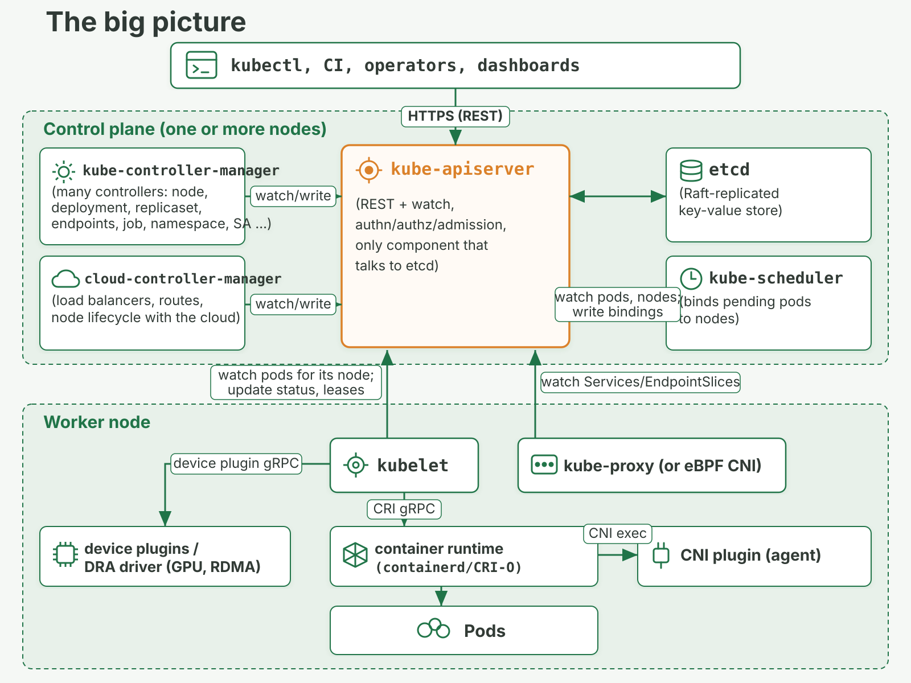

*Figure 5.3.1. The big picture, as a diagram.*

Two rules explain most of the architecture. Keep them in mind as you read the component sections, because almost every failure you meet will break one of them.

1. **The API server is the only component that reads and writes etcd.** Every other part talks to the API server instead: the scheduler, the controllers, the kubelets, kube-proxy, operators and `kubectl`. That gives you one place for authentication, authorization, admission, validation, defaulting, versioning and auditing. Think of the API server as the single front door of a bank. Every customer comes through it, and the vault behind it is never opened directly.
2. **Components do not call each other to say "do X".** They write desired state to the API as objects, then **watch** for the changes that matter to them and act to make reality match. Take the scheduler. It does not tell the kubelet to run a pod. It writes `spec.nodeName` into the Pod object. The kubelet watches for pods bound to its node, sees the change, and starts the containers. This decoupling is why Kubernetes tolerates component restarts and why it is extensible. A new component can join the system by watching the objects it cares about, without anyone editing the old components.

### What "Kubernetes" covers in this book

People often use Kubernetes as an umbrella term, and that can blur what they mean. At the time of writing, the `kubernetes` GitHub organization held 69 repositories. The `kubernetes-sigs` organization held around 107 projects. Hundreds more Cloud Native Computing Foundation (CNCF) projects sit in the same landscape. A CNCF project is one that the CNCF, the foundation that hosts cloud-native software, has accepted and supports.

In this part, "Kubernetes" means only the core project. The core lives in the `kubernetes/kubernetes` repository, and it holds the key components found in most clusters. When those components run, the core project gives you these abilities:

- Scheduling workloads across many hosts
- Exposing a declarative, extensible API for interacting with the system
- Providing the `kubectl` CLI so people can talk to the API server
- Reconciling the current state of objects toward the desired state
- Providing a basic service abstraction that routes requests to and from workloads
- Exposing multiple interfaces for pluggable networking, storage, and more

Taken together, these make Kubernetes a production-grade container orchestrator. Put simply, it runs and schedules containerized workloads across many hosts. Keep that job in mind, because the rest of this part builds on it. Anything outside that job, such as the AI platform on top, is built from the same pieces but is not part of the core.

### Getting the core binaries

How you get the core binaries depends on how your team runs clusters. Google Kubernetes Engine (GKE) and other managed services usually have each component on the hosts already. Other teams download binaries from a repository or receive signed versions from a vendor. Anyone can download a release from the `kubernetes/kubernetes` repository. Once you unpack it, `cluster/get-kube-binaries.sh` detects your target architecture and downloads the server and client parts:

```
$ ./cluster/get-kube-binaries.sh
Kubernetes release: v1.18.6
Server: linux/amd64 (to override, set KUBERNETES_SERVER_ARCH)
Client: linux/amd64 (autodetected)
Will download kubernetes-server-linux-amd64.tar.gz from https://dl.k8s.io/v1.18.6
Will download and extract kubernetes-client-linux-amd64.tar.gz
Is this ok? [Y]/n
```

Notice the `Is this ok?` prompt at the end. The script asks you to confirm before it continues, so you can check the version and architecture first. The server components usually land in `server/kubernetes-server-${ARCH}.tar.gz`, and inside that archive you find the key items that make up a cluster:

- **API server**: The main point of contact for every component and user. You read, add, delete and change objects here. The API server hands state storage to a backend, most often etcd.
- **kubelet**: The agent on each host. It reports the node's status to the API server and learns which workloads belong on its node. It talks to the host's container runtime, such as containerd or CRI-O, so those workloads start and stay healthy.
- **Controller manager**: One binary that holds many controllers, each reconciling core objects. If you declare three replicas in a Deployment, a controller inside creates the Pods to match.
- **Scheduler**: Decides where workloads run by picking what it judges to be the best node. It filters out nodes that cannot run the workload, then scores the rest.
- **kube-proxy**: Implements Services. It gives workloads virtual IPs that route to backend Pods, using packet filtering on the host, such as `iptables` or `ipvs`.

Many clusters run kube-apiserver, kube-scheduler, and kube-controller-manager as containers. In that case, the control plane may also run a container runtime, a kubelet, and kube-proxy. Deployment choices like these come up later in this part.

### Why Kubernetes Exists: Borg/Omega Heritage and Five Core Benefits (*Kubernetes: Up and Running* Chapter 1)

The *Kubernetes: Up and Running* book traces Kubernetes back to Google's internal **Borg** and **Omega** cluster managers. Google open-sourced these managers in June 2014. In July 2015 they were donated as the seed technology of the Cloud Native Computing Foundation (CNCF). Five core benefits organize the platform's value. Each one answers a pain that a team running many services would recognize.

1. **Velocity.** Velocity here is measured not by how fast you deploy, but by **mean time to recovery (MTTR)** when things go wrong. Three ideas make it possible. **Immutability** means you build a new container image rather than change a server in place. **Declarative configuration** means you state *what* the cluster should look like, not an imperative list of instructions, so rollbacks are trivial. **Online self-healing systems** means controllers keep reconciling drift. Drift is any gap that opens between the state you declared and the state that is actually running.
2. **Scaling your software and your teams.** Services, which are load-balanced APIs, decouple one service from another. Namespaces and horizontal pod and cluster autoscaling help too. Together they let small "two-pizza teams," a term from Jeff Bezos, own and scale several microservices independently.
3. **Abstracting your infrastructure.** Teams move from managing virtual machines host by host to an application-oriented container API. That API covers Pods, Deployments, Jobs and PersistentVolumeClaims. The same objects are portable across AWS, Azure, GCP, and bare-metal on-premises GPU datacenters.
4. **Efficiency.** Bin-packing lets you run batch training and preprocessing jobs alongside latency-sensitive serving workloads on the same hardware fleet. Bin-packing means fitting many workloads into the free space on each machine, like packing boxes tightly into a truck. This drives up server and power utilization. Cgroups and QoS classes keep the workloads isolated from each other.
5. **Cloud Native Ecosystem.** Kubernetes integrates seamlessly with CNCF projects for telemetry (Prometheus, Grafana, OpenTelemetry), service mesh, GitOps (Argo CD, Flux), and AI or batch scheduling (Kueue, Volcano, Ray, Kubeflow).

The five benefits are the reason for the design choices in the rest of this chapter. Keep the two rules above in mind, because they explain how these benefits are delivered. Immutability and declarative configuration rely on the API server being the one source of truth. Self-healing relies on components watching that truth and acting on the gap.

## 2. Control plane components

The control plane holds the cluster's state and makes its decisions. Each part has a narrow job, and this section covers them one at a time. Suppose `kubectl apply` hangs. Read this section as a list of suspects, and ask which one would make the hang look exactly like that.

### kube-apiserver

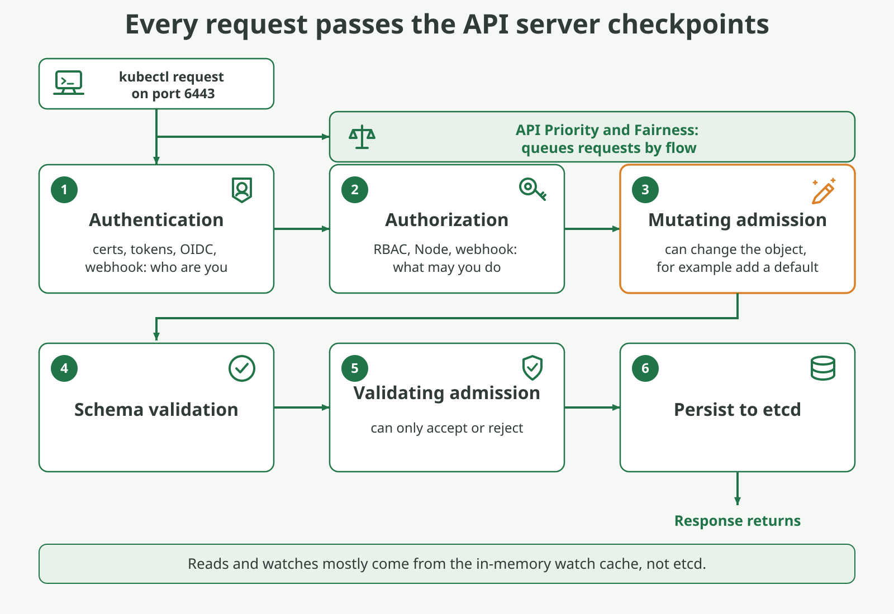

*Figure 5.3.2. Each API server request passes authentication, authorization, admission and persistence to etcd in that order before the response returns.*

Every request to the cluster goes through kube-apiserver. It is a horizontally scalable, stateless HTTPS server that listens on port 6443 by default. Stateless here means the server keeps no private data of its own, so you can run several copies behind a load balancer. It exposes the Kubernetes API as REST resources, grouped by API group and version, such as `/api/v1/pods` and `/apis/apps/v1/deployments`. Clients can also use `watch`, which streams change events over long-lived HTTP connections, or over WebSocket/HTTP2.

The server also runs streaming proxies for `exec`, `attach` and `portforward` to the kubelets. It serves aggregated APIs, such as metrics-server and custom API servers, plus discovery endpoints and OpenAPI. OpenAPI is the schema format that describes every field of every object, and tools use it to check your YAML.

Each request then passes through a pipeline. Think of it as a series of checkpoints at a border. Authentication (certs, tokens, OIDC, webhook) checks who you are. Authorization (RBAC, Node, webhook) checks what you may do. Admission runs next, with mutating, schema validation and validating steps, built-in plugins and webhooks included. Mutating admission can change the object, for example by adding a default. Validating admission can only accept or reject it. The object is then persisted to etcd and the response returns. **API Priority and Fairness (APF)** queues requests by flow, which protects the server from overload. A flow is a group of similar requests, such as all the writes from one controller. APF keeps one noisy client from crowding out everyone else.

kube-apiserver keeps objects in an in-memory watch cache. It serves most reads and watches from that cache rather than from etcd, which keeps the database from taking every read. Section 5.5 covers the details.

### etcd

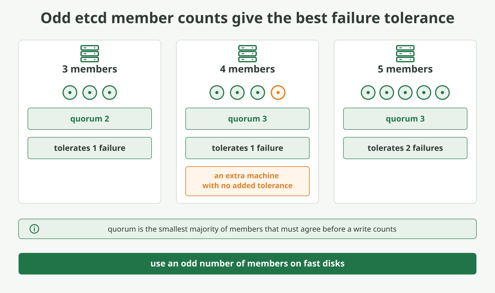

*Figure 5.3.3. An etcd cluster needs a majority to write, so a fourth member adds a machine without adding failure tolerance.*

etcd is a distributed, consistent key-value store that uses Raft. Raft is a consensus algorithm, which is a method for several machines to agree on one sequence of writes even when some of them fail. Clients connect on port 2379, and peers connect on port 2380. It holds **all cluster state**. Objects are serialized as protobuf under keys shaped like `/registry/<group>/<resource>/<namespace>/<name>`, and leases and events live there too.

Quorum decides how many members can fail. A quorum is the smallest majority of members that must agree before a write counts. Take a 3-member cluster. Its quorum is 2 members, so one member can fail and the cluster still has a majority. A 5-member cluster tolerates 2 failures. Adding a fourth member raises quorum to 3, so a 4-member cluster still tolerates only 1 failure. That is why odd member counts are the standard. The extra member in a 4-member cluster costs you a machine and gives you no extra failure tolerance.

Performance depends most on three things: disk fsync latency, network latency between members, and database size. An fsync is the moment the disk confirms that data has reached durable storage, and etcd waits for that confirmation before it answers a write. A slow disk therefore slows every write in the cluster. Use SSD or NVMe disks. The default quota is 2 GiB, and the suggested maximum is 8 GiB. etcd is the single most critical stateful component in the cluster, so backups and restore drills are mandatory. Section 5.20 covers them.

Pick an odd number of members on fast disks, and treat backups and restore drills as required, not optional.

### kube-scheduler

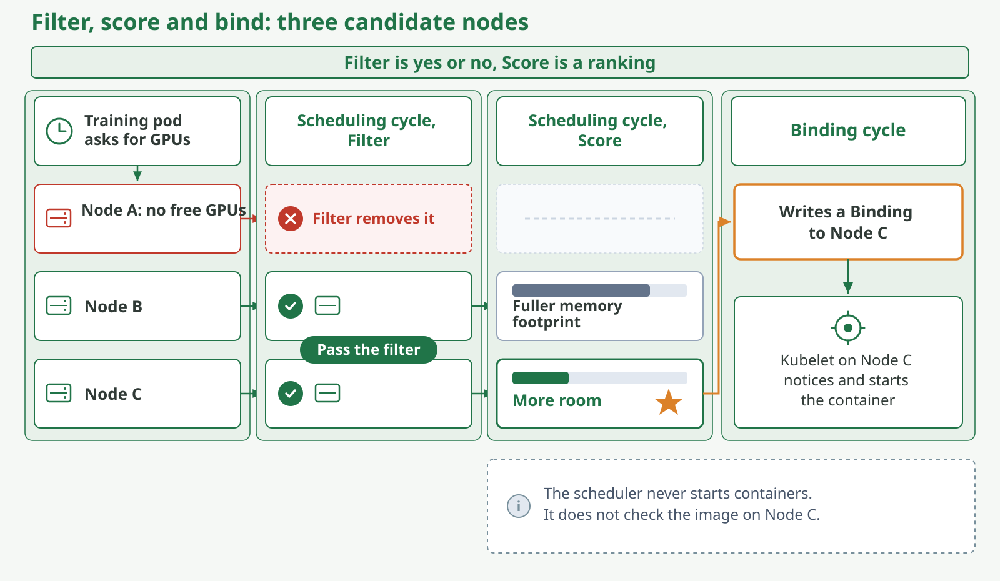

*Figure 5.3.4. The scheduler filters out the node with no free GPUs, scores the rest, and writes the binding to node C while the kubelet starts the container.*

The scheduler watches for Pods that have no `spec.nodeName`. For each one, it runs two cycles. The **scheduling cycle** filters out nodes that cannot run the Pod, scores the survivors, and selects one. The **binding cycle** then writes a `Binding` to the API. Filtering is a yes-or-no test, such as "does this node have enough free GPUs?" Scoring is a ranking, such as "which of the remaining nodes is least full?"

The scheduler is plugin-based, built on the Scheduling Framework. Its extension points are `PreFilter`, `Filter`, `PostFilter`, which handles preemption, `Score`, `Reserve`, `Permit`, and `Bind`. Preemption means removing lower-priority pods to make room for a higher-priority one. An extension point is a place in the cycle where a plugin can run its own logic. It does not start containers. It also does not look at node runtime state beyond what the API provides: allocatable resources, labels, taints, volumes topology, and existing pods.

Here is a small worked example of the two cycles. Suppose a training pod asks for GPUs, and three candidate nodes exist. Node A has no free GPUs, so the Filter step removes it. Node B and node C both pass the filter. The Score step then ranks them. If node B has a fuller memory footprint and node C has more room, the scheduler prefers C. It then writes the binding for C, and nothing else happens until the kubelet on node C notices. Notice that the scheduler never checks whether the container image is already on node C. Image locality can be a scoring input, but the scheduler does not guarantee that the image is there.

Multiple schedulers can run side by side through `spec.schedulerName`. Volcano and a custom GPU-topology scheduler are two examples. A pod that names a scheduler is ignored by the others. Section 5.18 has the details.

Remember that the scheduler only decides and writes the binding. The kubelet does the starting. That split is the reason a scheduler outage leaves running pods alone, and it is also the reason a Pending pod with no events usually points at the scheduler.

### kube-controller-manager

kube-controller-manager is one binary that runs many **controllers**. Each controller is a control loop for one kind of object. A control loop reads the current state, compares it with the desired state, and makes a small change. Examples include node lifecycle, which marks nodes NotReady and evicts pods, ReplicaSet, Deployment, StatefulSet, DaemonSet, Job, CronJob, EndpointSlice, Namespace, and ServiceAccount. It also covers PV/PVC binding and attach/detach, HPA, the garbage collector, which follows ownerReferences, TTL, and certificate signing, among others.

Controllers use **informers**, which list and watch resources and keep a local cache and work queues. A work queue holds the objects that need attention, so a controller handles each one in turn. Leader election makes sure only one instance is active at a time among the replicas. Section 5.6 covers the details.

Each controller runs its own loop, so find the one that owns the object you are debugging. A Deployment that never creates pods points at the Deployment or ReplicaSet controller. A Service without endpoints points at the EndpointSlice controller. Matching the symptom to the owning loop saves a lot of guessing.

### cloud-controller-manager

The cloud-controller-manager separates out the cloud-provider logic. Its node controller reads cloud metadata and deletes nodes whose VM is gone. Its route controller handles routes, and its service controller creates cloud load balancers for `Service type=LoadBalancer`. It also handles volume integrations. Keeping this logic out of the core means the core does not need to know every cloud's API.

On bare metal or GPU clouds, this component may be absent. Tools such as MetalLB, kube-vip or a provider-specific controller may replace it. If you run on bare metal, check whether this component exists before you plan load balancing, because a `Service type=LoadBalancer` will otherwise stay pending forever.

### Aggregated and extension API servers

The metrics-server provides the resource metrics API. Custom-metrics adapters, such as Prometheus Adapter and KEDA, serve custom metrics. Service catalog successors and your own API servers register through `APIService` objects. Once registered, they appear under the main API surface, so `kubectl` can use them just like built-in resources. For most extensions, CRDs are the lighter mechanism, and section 5.29 covers them. A CRD, or custom resource definition, adds a new object type without writing a new server.

### Checking the control plane with `componentstatuses`

Before you trust a new cluster, ask whether its core parts are healthy. The command below gives a quick answer:

```
$ kubectl get componentstatuses
```

In the example output, the `scheduler`, the `controller-manager`, and `etcd-0` all report `Healthy`. Each row is one part of the control plane. The `controller-manager` runs the controllers that keep behavior right, such as making sure all replicas of a service are available and healthy. The `scheduler` places Pods onto nodes. The etcd server stores all of the API objects.

Your output may differ as Kubernetes changes over time. That is normal, so do not worry if your lines do not match this output exactly. Use the three rows as a first health check before you go deeper.

## 3. Node components

Suppose a node flips to `NotReady` in the middle of the night. The node is the place where pods actually run, so the components on it are the first suspects. Every worker node runs a small set of components next to the containers. Each one has a clear job, and together they keep the node working as part of the cluster.

- **kubelet**: The node agent. It registers the node and sends heartbeats as Lease objects in `kube-node-lease`, roughly every ~10 s, along with node status updates. A heartbeat is a small "I am still here" message, and the Lease object is a cheap way to deliver it without rewriting the whole Node. It watches pods bound to its node and its static pod manifests directory. It drives the runtime through CRI and mounts volumes with CSI node plugins. It also runs probes, manages cgroups and QoS, enforces eviction under pressure, and reports pod and node status. The kubelet serves an authenticated API on port 10250 for `exec`, `logs`, and metrics at `/metrics/cadvisor`. The kubelet is the component that is usually not a pod itself. It runs as a systemd service, because it must start pods.
- **Container runtime** (section 5.2): containerd or CRI-O, plus an OCI runtime.
- **kube-proxy** (or a replacement): programs Service virtual IPs on each node with iptables, IPVS or nftables rules (section 5.10). An eBPF CNI such as Cilium can replace it. eBPF is a way to run small verified programs inside the kernel, and Cilium uses it to do the Service routing that kube-proxy would otherwise do.
- **CNI plugin**: attaches pod network namespaces to the cluster network. It provides pod-to-pod connectivity and, optionally, NetworkPolicy (sections 5.13 to 5.15). It usually runs as a DaemonSet agent, with binaries under `/opt/cni/bin` and config in `/etc/cni/net.d`.
- **Node-level agents** are common in AI clusters. They include the NVIDIA device plugin or DRA driver, which advertises GPUs, and GPU Feature Discovery and NFD, which add labels. The DCGM exporter provides metrics. Others are node-problem-detector, log shippers, CSI node drivers, RDMA and SR-IOV device plugins, Multus for multiple network interfaces, and kata or sandbox runtime installers.

### Inspecting Nodes (`Capacity` vs. `Allocatable` and `Conditions`) and `kube-system` (*Kubernetes: Up and Running* Chapter 3)

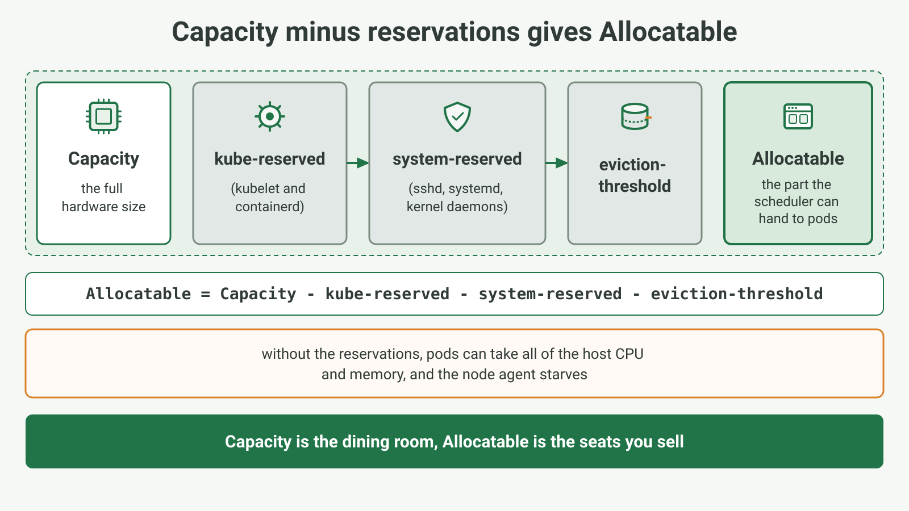

*Figure 5.3.5. A node's Allocatable is its Capacity minus the reservations kept back for the node agent and the system.*

The *Kubernetes: Up and Running* book walks through the first commands every cluster operator runs after connecting `kubectl`. They are simple, and they answer the questions you will ask on the first day of any new cluster.

1. **`kubectl version` and the Version Skew Policy:** This command shows the client version (`kubectl`) and the control-plane version (kube-apiserver). Kubernetes publishes a version skew policy, and its numbers matter. Skew means the difference between component versions. `kubectl` may be within one minor version of kube-apiserver, in either direction. In an HA cluster, kube-apiserver instances may differ by at most one minor version during upgrades. kube-controller-manager, kube-scheduler, and cloud-controller-manager must not be newer than kube-apiserver, and they may be up to one minor version older. The kubelet may be up to 2 to 3 minor versions older than kube-apiserver, but never newer.
2. **`kubectl get nodes` and `kubectl describe nodes <node>` (`Capacity` vs. `Allocatable`):**
   - **`Capacity`**: The raw hardware the node OS reports, whether physical or virtual. That includes `cpu`, `memory`, `ephemeral-storage`, `pods`, and `nvidia.com/gpu`.
   - **`Allocatable`**: The part of those resources that is actually available for scheduling Pods. The formula is `Allocatable = Capacity - kube-reserved - system-reserved - eviction-threshold`, which the function `compute_node_allocatable()` in `code/part05/k8s_architecture_flow.py` models. Reserving CPU and memory keeps noisy user Pods from starving the node agent. `kube-reserved` covers the kubelet and containerd, and `system-reserved` covers `sshd`, `systemd`, and kernel daemons. Without these reservations, the node agent can starve and trigger a `NotReady` outage. Think of Capacity as the size of the dining room and Allocatable as the seats you are willing to sell, with a few kept back for the staff.
   - **Node `Conditions`**: `Ready` shows `True` when the node is healthy. It moves to `Unknown` after ~40s of missed heartbeats. The other conditions are `MemoryPressure`, `DiskPressure`, `PIDPressure`, and `NetworkUnavailable`.
3. **Core `kube-system` components** (`kubectl get pods --namespace=kube-system`): These include the control-plane static pods, such as `kube-apiserver-<node>`, `etcd-<node>`, `kube-controller-manager-<node>`, and `kube-scheduler-<node>`. Cluster DNS runs as a `coredns` or `kube-dns` Deployment behind a `kube-dns` Service. That Service resolves names in the form `<svc>.<ns>.svc.cluster.local`. Last, the `kube-proxy` DaemonSet runs one pod per node.

### Reading one node with `kubectl describe nodes`

A node can look fine in a simple list and still behave oddly. The `describe` command shows what one node is doing. Reading it is a skill, so it is worth walking through each block. The example here is a node named `kube1`:

```
$ kubectl describe nodes kube1
```

Read the output from top to bottom. The labels come first and give you the basics. In this example, `kube1` runs Linux on an ARM processor. Labels are what `nodeSelector` and affinity rules match against when a pod asks for a particular kind of hardware.

The `Conditions` block answers one question: is this node healthy? Every pressure check reads `False`, and `Ready` reads `True`. That means a node with enough disk and memory that reports healthy to the Kubernetes master. The network reason, `FlannelIsUp`, names the network plugin the node uses. A pressure condition set to `True` is a warning that the kubelet is short of that resource and may start evicting pods, so it is worth checking first when pods vanish.

The `Capacity` block shows what the machine offers. The example node reports `cpu: 4`, `memory: 882636Ki`, and `pods: 110`. Its `Allocatable` block matches the same values, and the `alpha.kubernetes.io/nvidia-gpu` count is `0`. When the two blocks match exactly, nothing has been reserved for the host, which is the situation the reservation settings in the earlier section are meant to prevent.

The system section lists the software on the node. It covers the container runtime, the kubelet, kube-proxy, the Linux kernel, and the Pod address range. The example node runs `containerd://1.4.12`, with `Kubelet Version` and `Kube-Proxy Version` both at `v1.22.4`. A quick glance at these lines tells you whether the node is running the versions you intended, which matters after any upgrade.

The last section lists the Pods running on the node. The example shows three, including `kube-dns`, which asks for `260m` of CPU and `140Mi` of memory. Each Pod gets two numbers for each resource: a request and a limit. A request is guaranteed to be present on the node. A limit is the most the Pod can consume. When the limit is higher than the request, the extra is supplied on a best-effort basis and is not guaranteed.

Read the `Allocated resources` totals the same way. They can go over 100 percent, which means the node is overcommitted. The scheduler checks requests when it places pods, while limits can add up to more than the node has. That gap is overcommitment. It works only while the pods do not all burst at the same moment, which is why a node can look fine until a busy hour arrives. Compare those totals with the `Allocatable` values so you know how much room the node really has.

### kube-proxy and DNS in practice

Two cluster components make Services usable. The first is the Kubernetes proxy, which routes traffic to load-balanced Services. It has to run on every node. Many clusters run it as a DaemonSet, which a later chapter covers. A DaemonSet is a controller that makes sure one copy of a pod runs on every node. Check it with:

```
$ kubectl get daemonSets --namespace=kube-system kube-proxy
```

A DaemonSet is a little different from a Deployment. You do not pick a replica count. The controller decides how many pods to run from the number of nodes that match, so a new node gets a kube-proxy pod automatically. That is why DESIRED moves up when you add a worker.

In the example output, the DESIRED, CURRENT, READY, UP-TO-DATE, and AVAILABLE columns all read `5`. Read those columns as a quick count. DESIRED is how many copies should run, and AVAILABLE is how many are actually serving. When they match, the proxy is healthy everywhere. Your cluster may name the DaemonSet differently, or skip it entirely. Either way, the kube-proxy container should run on every node.

The DNS server gives names and discovery to the Services in the cluster. It runs as a replicated service, so a large cluster can run more than one copy. A Deployment manages those copies, and its name may be `coredns` or another variant:

```
$ kubectl get deployments --namespace=kube-system core-dns
```

The example output shows one copy desired and one available. A Service load-balances across the DNS copies, so any pod that asks for a name is spread across them:

```
$ kubectl get services --namespace=kube-system core-dns
```

The example DNS Service has the cluster address `10.96.0.10`. Any container in the cluster has that address written into its `/etc/resolv.conf` file. If you open a shell in a running container, you can check that file yourself. It is the quickest way to confirm which DNS address a container uses. When an app says "host not found" but the Service exists, this file is the first thing to read.

## 4. Ports and trust

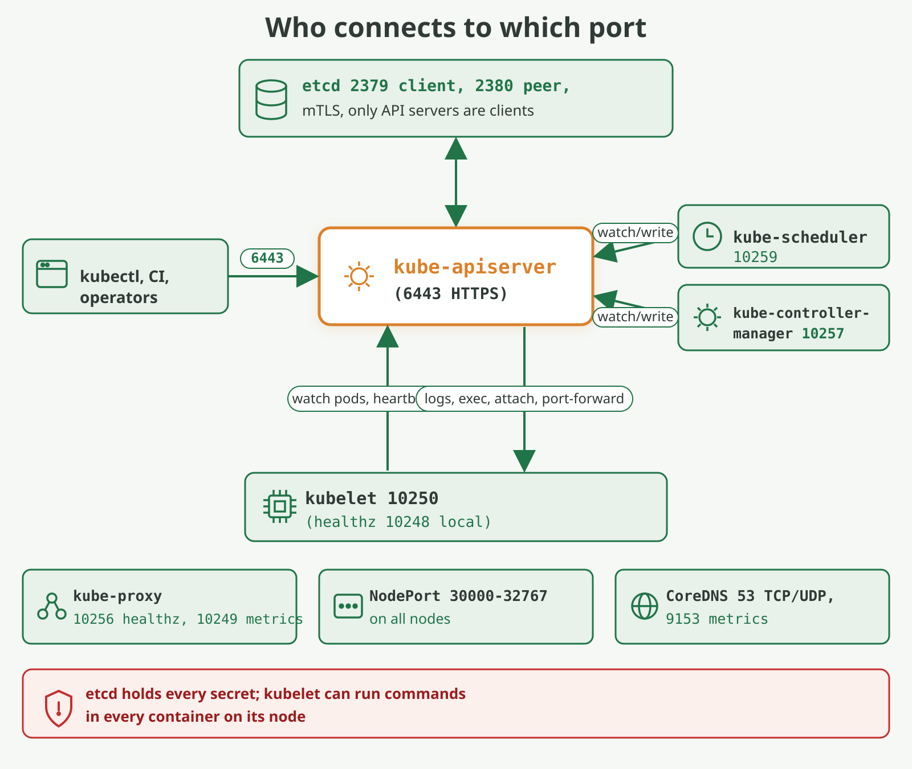

*Figure 5.3.6. Every component connects to the API server on 6443, and the API server in turn reaches etcd and the kubelets.*

Suppose a firewall team asks which ports to open between the control plane and the workers. Opening everything is the wrong answer, and so is opening nothing. This table lists the ports each component listens on and how it checks identity. Read it before you open anything in a firewall, because each row tells you who should be allowed to connect.

| Component | Port(s) | Authn/z | Notes |
|---|---|---|---|
| kube-apiserver | 6443 (HTTPS) | Client certs, tokens, OIDC | Front with a load balancer for HA; API access control is the cluster's security boundary |
| etcd | 2379 client, 2380 peer | mTLS | Only API servers should be clients; restrict network access; encrypt secrets at rest in etcd via API server `EncryptionConfiguration` |
| kubelet | 10250 (HTTPS), 10248 healthz (local), read-only 10255 (disabled by default) | Webhook authn/z against the API server | Disable anonymous auth; the API server → kubelet connection must be mutually authenticated |
| kube-scheduler | 10259 (HTTPS metrics/health) | Delegated authn | |
| kube-controller-manager | 10257 (HTTPS) | Delegated authn | |
| kube-proxy | 10256 (healthz), 10249 (metrics) | | |
| NodePort Services | 30000-32767 on all nodes | | Firewall appropriately |
| CoreDNS | 53 TCP/UDP, 9153 metrics | | |

Everything inside the control plane talks over TLS. TLS is the encryption that also proves each side's identity with a certificate. Certificates come from kubeadm or your installer, which section 5.21 covers. The API server is also a client of two other components: it connects to kubelets for logs and exec, and it connects to etcd. Start with the etcd and kubelet rows, since their notes ask for the tightest access. etcd holds every secret in the cluster, and the kubelet can run commands inside every container on its node, so a reachable port on either one is a serious exposure.

## 5. The declarative object model

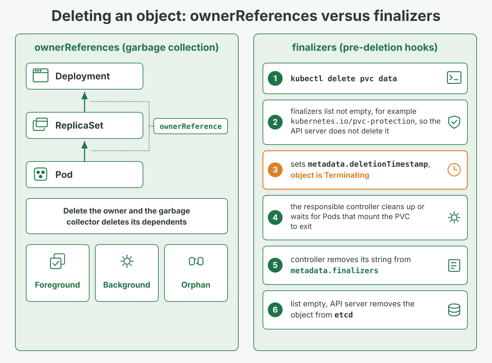

*Figure 5.3.7. ownerReferences drive cascading deletion, and finalizers hold an object in Terminating until a controller finishes cleanup.*

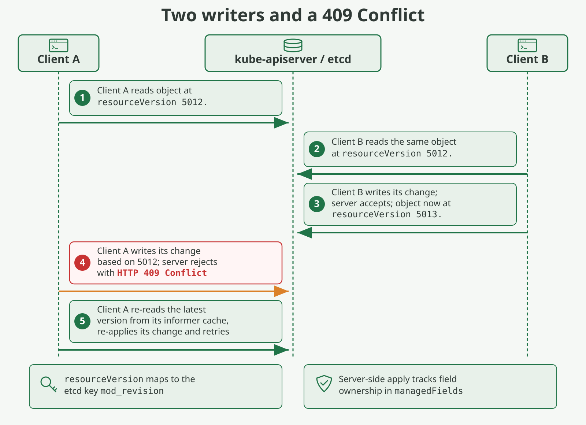

*Figure 5.3.8. Optimistic concurrency means the second writer is refused and retries, so neither overwrites the other unknowingly.*

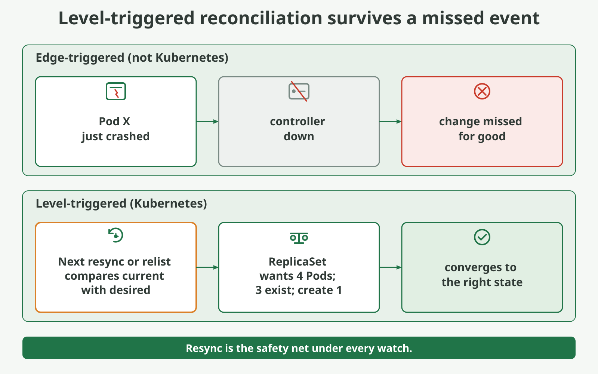

*Figure 5.3.9. Kubernetes controllers compare current state with desired state, so a dropped event is repaired on the next resync.*

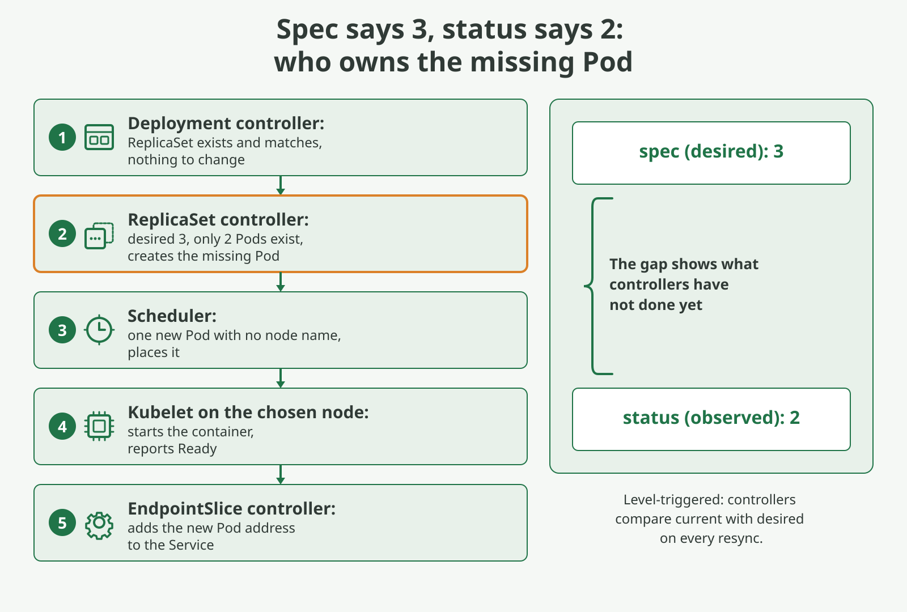

*Figure 5.3.10. A Deployment with a desired count of three and two ready Pods is fixed by five controllers acting in turn, starting with the ReplicaSet controller.*

Every API object follows the same outline. It carries `apiVersion` and `kind`, plus `metadata` with a name, namespace, uid, labels, annotations, ownerReferences, finalizers, resourceVersion and generation. The `spec` holds the desired state, which users and controllers write. The `status` holds the observed state, which controllers and the kubelet write. Several properties make this model work.

Suppose a Deployment shows 3 desired and 2 ready. Nothing is broken in the YAML, but something is not catching up. The model below explains where to look.

- **Level-triggered reconciliation**: Controllers compare the *current* state with the *desired* state and act on the difference. They do not react to individual events. If a controller misses an event, the next resync still finds the difference. That is why Kubernetes self-heals after a controller restarts. Resync is a periodic full comparison, and it is the safety net under every watch.
- **Watches**: A client lists resources once, then streams changes from a `resourceVersion`. A resourceVersion is a number that marks a point in the history of the object. Informers keep local caches, so controllers rarely call the API server directly.
- **Optimistic concurrency**: Each update carries a `resourceVersion`. If the object has changed since you read it, the server rejects your write with a 409 Conflict, and the controller retries. Think of it as two people editing a shared document. The second save is refused, so neither person overwrites the other without knowing. **Server-side apply** tracks field ownership in managedFields, so actors avoid conflicts with each other.
- **Ownership and garbage collection**: `ownerReferences` link each dependent to its owner, such as a Pod to its ReplicaSet and a ReplicaSet to its Deployment. Deleting an owner deletes its dependents, using the foreground, background or orphan policy. **Finalizers** hold up deletion until a controller cleans up external resources.
- **Labels and selectors** loosely couple objects. Services select Pods, ReplicaSets select Pods, and NetworkPolicies select Pods. Scheduling uses node labels too. Because the link is a label rather than a stored reference, you can move a Service to new Pods just by changing labels.
- **Namespaces** split names, RBAC and quotas into separate parts. Some resources have no namespace and are cluster-scoped: Nodes, PersistentVolumes, StorageClasses, CRDs and ClusterRoles.
- **Events** are best-effort, short-lived records. They expire after a default TTL of 1 h, and they help with troubleshooting. Read them with `kubectl describe` or `kubectl get events --sort-by=.lastTimestamp`. Because they expire, read them soon after an incident, not the next morning.

Here is how the Deployment example plays out, one controller at a time. The Deployment controller sees that the ReplicaSet exists and matches the Deployment's template, so it has nothing to change. The ReplicaSet controller sees that the desired count is 3 and that only 2 Pods exist, so it creates the missing Pod and waits. The scheduler sees one new Pod with no node name and places it. The kubelet on the chosen node starts the container, then reports Ready. Only after that does the EndpointSlice controller add the new Pod's address to the Service. Each step is correct on its own. The one that is still "behind" is the one whose status has not caught up with its spec, and that is the step to inspect.

When an object misbehaves, compare its `spec` with its `status`. The gap between them shows what the controllers have not done yet. In the Deployment example, the spec says 3 and the status says 2, so the question becomes which controller owns the missing pod, and what it reported.

## 6. From `kubectl apply` to a running container

A teammate runs `kubectl apply` and asks, "Where does my pod actually come from?" The honest answer is a relay of several components, and none of them calls the others directly. The diagram follows one Deployment from your terminal to a running container. Read it as a relay. Each component picks up work from the API server and writes its result back.

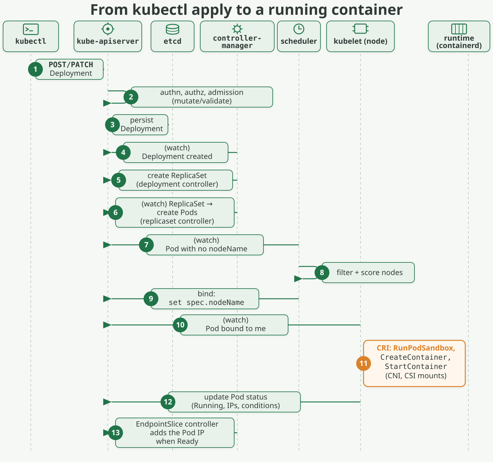

*Figure 5.3.11. From kubectl apply to a running container, as a diagram.*

Follow the arrows in order, and notice that the arrows always point at the API server, never between two workers. The kubelet does not hear from the scheduler. It hears from the API server that a pod now has its node name. That one detail is what lets you debug a stuck pod by looking at the object's state, not by guessing which component to call.

You can watch this flow live. Run `kubectl get events -w` and `kubectl get pods -w -o wide` to see the events and the Pod states change. To see the individual REST calls, add verbosity with `kubectl apply -f x.yaml -v=8`. You can also count API requests with `kubectl get --raw /metrics | grep apiserver_request_total`. Use the `-v=8` output to match each REST call to a step in the diagram. Once you can match them, a stuck pod tells you its own story: the last step that happened is the step before the one that is stuck.

## 7. High availability and failure behaviour

Suppose the on-call phone rings at night and says that one API server is down. Is that an outage? The answer depends on the layout and on which part failed. This section covers the layouts first, then what happens when each part fails.

### Topologies

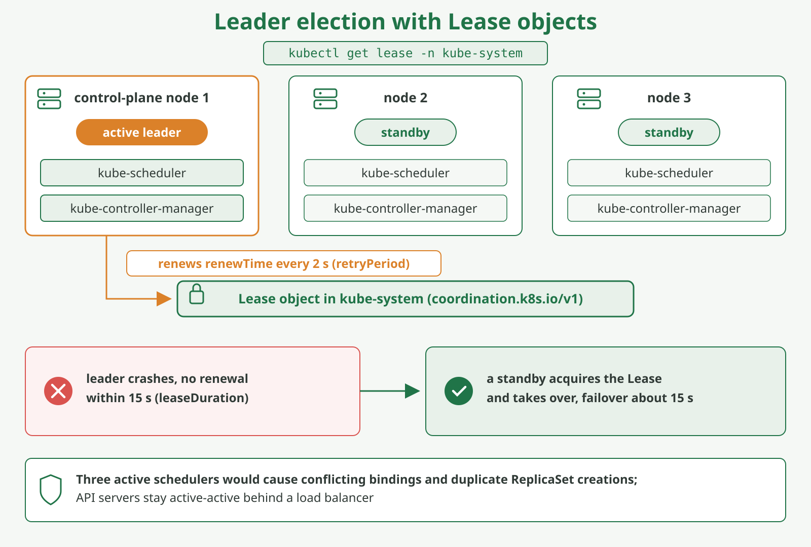

*Figure 5.3.12. Scheduler and controller-manager run active-standby, and a missed Lease renewal hands leadership to a standby in about 15 seconds.*

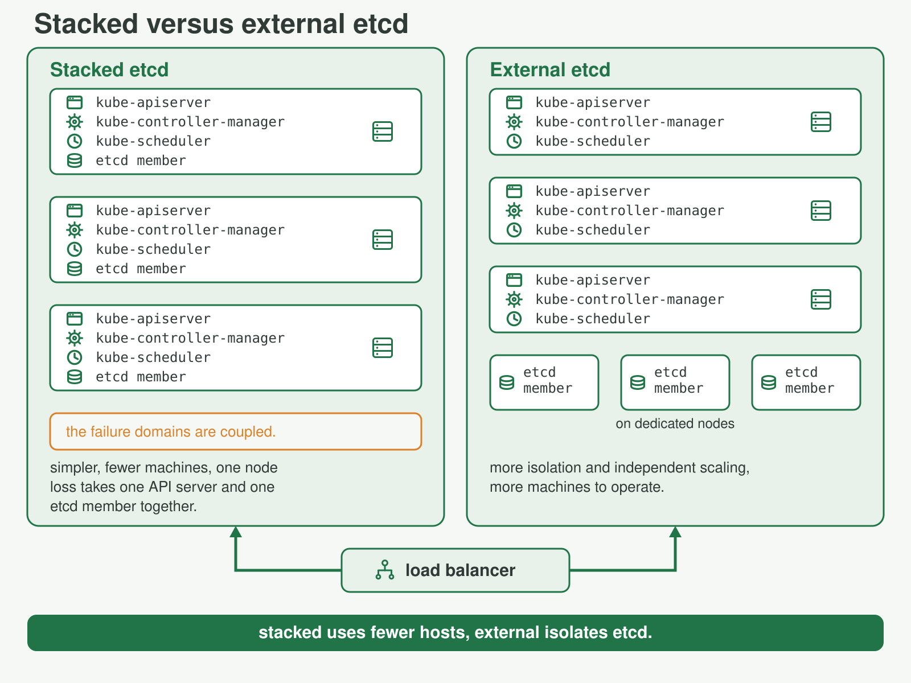

*Figure 5.3.13. Stacked etcd uses fewer machines but couples failures, while external etcd isolates the database on its own nodes.*

- **Stacked etcd**: etcd runs as static pods on the same control-plane nodes. kubeadm uses this layout by default, with 3 nodes. It is simpler, but losing a node loses one API server and one etcd member together.
- **External etcd**: etcd runs on dedicated nodes. That gives you more isolation and independent scaling, but you have more machines to operate.
- **API endpoint**: A load balancer sits in front of N API servers. It can be a cloud LB, HAProxy with keepalived, kube-vip, or DNS round-robin with health checks. This is the address that `controlPlaneEndpoint` refers to. Nodes and users connect to the LB address, so they never need to know which API server is alive.
- **Scheduler and controller-manager**: Both run on each control-plane node. Leader election, which uses Lease objects in `kube-system`, keeps one instance active and the others on standby. Failover takes about 15 s.
- **Managed control planes** come from providers such as GKE, EKS, AKS, and CoreWeave or Nebius managed Kubernetes. The provider operates the API server and etcd. You run the nodes and add-ons.

### What fails and what happens

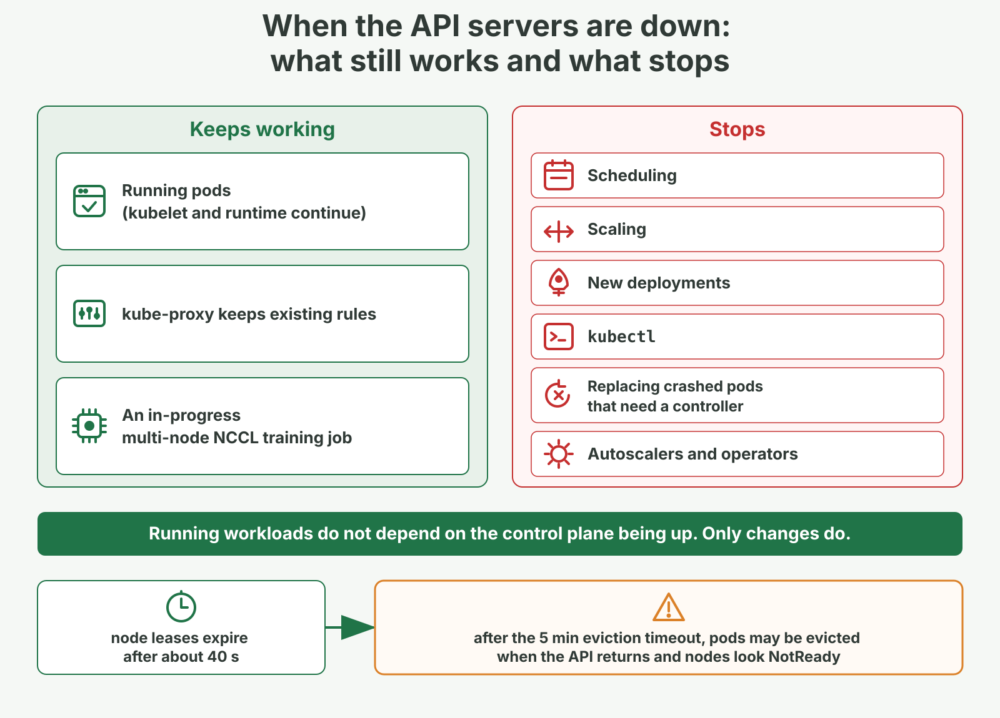

*Figure 5.3.14. With the API servers down, running pods carry on while every change to the cluster stops.*

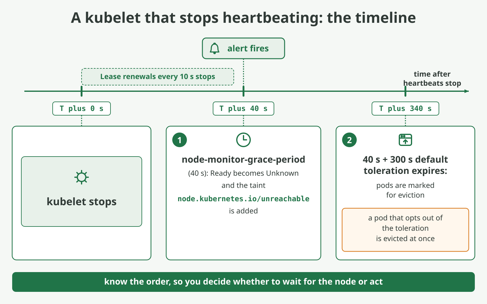

*Figure 5.3.15. A kubelet that stops heartbeating makes its node Unknown after 40 seconds and marks pods for eviction after 340 seconds.*

Use this table to see what each failure costs and what you would notice first. Read each row as a question: if this part stopped, what would still work, and what would the first alarm look like?

| Failure | Effect | Detection |
|---|---|---|
| One API server down | LB removes it; clients retry; no outage if ≥2 | LB health checks; `apiserver_up` |
| All API servers down | Existing pods keep running (kubelet and runtime continue); no scheduling, scaling, deployments, no `kubectl`; kube-proxy keeps existing rules; node leases expire after ~40 s and, after the eviction timeout (5 min default via taints), pods may be evicted when the API returns and nodes look NotReady | Alerts on API availability |
| etcd loses quorum | API becomes read-only/unavailable (writes fail); cluster state frozen; recovery from backup or member replacement | `etcd_server_has_leader`, `etcd_server_leader_changes_seen_total` |
| etcd slow disk | API latency spikes, leader elections, controller timeouts, `apply` slow | `etcd_disk_wal_fsync_duration_seconds` |
| Scheduler down | Pending pods stay Pending; existing pods unaffected | Pending count, scheduler leader metric |
| Controller-manager down | No new ReplicaSet pods, no node failure handling, no endpoint updates | `workqueue` metrics; leader lease |
| Kubelet down on a node | Node goes NotReady after `node-monitor-grace-period` (40 s); pods stay running on the node but are marked for eviction after tolerations expire (300 s) | Node conditions |
| CoreDNS down | In-cluster name resolution fails (many apps appear down) | CoreDNS metrics, probe |
| CNI agent down | New pods cannot get networking; existing pod networking may continue | Pod events |

Work the kubelet row with numbers. The node goes NotReady after 40 s. Its pods are then marked for eviction once the 300 s toleration runs out, which is 40 s + 300 s = 340 s after the heartbeats stop. A toleration is the permission a pod carries to stay on a node despite a taint, and the 300 s is the default permission window. The arithmetic matters during an incident, because it tells you when the evictions will start, not just that they will.

Here is what an on-call engineer typically sees when a single worker's kubelet stops. First, the node's heartbeats stop arriving, and nothing alarms yet, because the controller waits out the grace period. Then the Ready condition flips to Unknown and the node takes the unreachable taint, which is when the first alert usually fires. Pods that tolerate that taint keep running for the toleration window. By default, most pods get that toleration added for them, so they wait. A pod that explicitly opts out of the toleration is evicted at once. Finally, when the window closes, the remaining pods are marked for eviction and their replacements are created on healthy nodes. A training job that uses gang scheduling will see one worker disappear, and the whole job is affected even though only one machine failed. Knowing this order lets you decide quickly whether to wait for the node or to act.

The main lesson is this. Running workloads do not depend on the control plane being up. Only changes do. That is why a control plane outage during a multi-day training run is often survivable, while a node-level or network-level failure is not. When you plan maintenance, treat control plane outages and node failures as different risks, with different runbooks and different alarms.

## 8. Extension points

Suppose a vendor asks you to install a GPU driver plugin. Before you do, you need to know where the cluster lets plugins plug in, and which of them the core project already defines. The table lists each extension point, the mechanism behind it, and examples.

| Point | Mechanism | Examples |
|---|---|---|
| **Runtime** | CRI | containerd, CRI-O |
| **Network** | CNI | Calico, Cilium, Flannel, Multus, SR-IOV |
| **Storage** | CSI | Cloud disk drivers, Ceph-CSI, Lustre/Weka/VAST CSI, local-path |
| **Devices** | Device plugin API, Dynamic Resource Allocation (DRA) | NVIDIA device plugin, RDMA/SR-IOV device plugin, DRA drivers for GPUs/NICs |
| **Admission** | Mutating/Validating webhooks, ValidatingAdmissionPolicy (CEL) | Kyverno, OPA Gatekeeper, Istio injector |
| **API** | CRDs, aggregated API servers | Kueue, Volcano, KubeRay, Argo, cert-manager |
| **Controllers** | Operators (client-go, controller-runtime) | GPU Operator, Network Operator, Prometheus Operator |
| **Scheduling** | Scheduler plugins/profiles, extenders, secondary schedulers, gang scheduling | Volcano, Kueue admission, coscheduling plugin |
| **Auth** | Webhook authn/authz, OIDC | Dex, Keycloak, cloud IAM |
| **Observability** | Metrics endpoints, Events, audit webhooks, OpenTelemetry | Prometheus, Loki |
| **Node** | NRI, node feature discovery, kubelet plugins | Topology manager, CPU manager |

### Why some APIs are only a contract

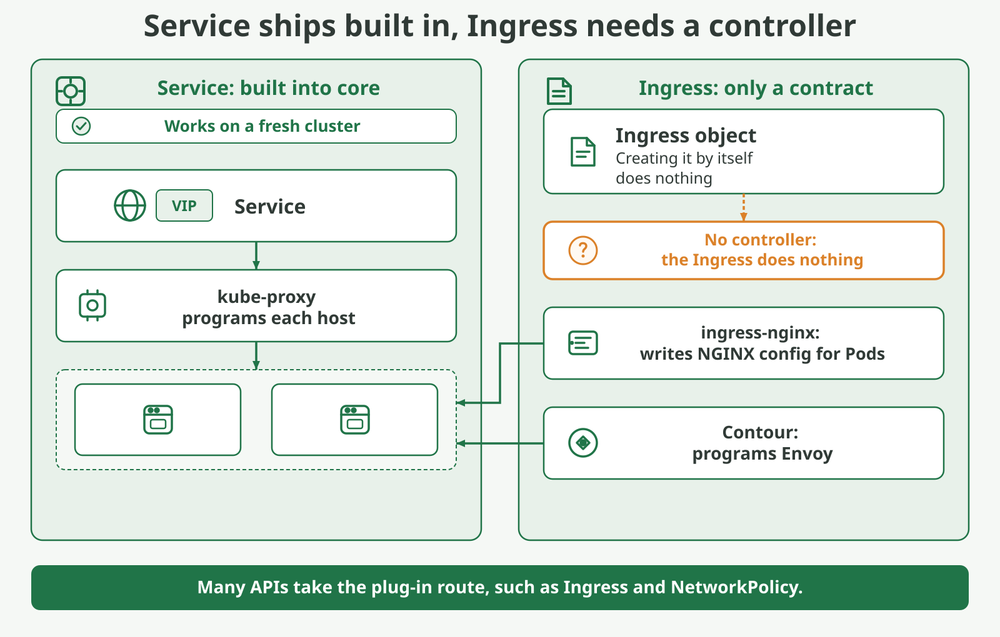

*Figure 5.3.16. A Service works out of the box through kube-proxy, while an Ingress object does nothing until a controller such as ingress-nginx or Contour implements it.*

Kube-proxy programs each host so that workloads get a virtual IP (VIP). That virtual IP routes to one or many underlying Pods, which goes well beyond scheduling. The project could have defined only a Service API and required a plug-in to implement it. You would then have to choose among many plug-ins. Instead, the Service abstraction ships as core functionality, so a Service works on a fresh cluster.

Many other APIs take the plug-in route. Ingress and NetworkPolicy are examples. Creating an Ingress object by itself does nothing. The API exists, but the work is not core behavior, so you must choose a technology that implements it. Many teams run ingress-nginx in the cluster for this. It reads Ingress objects and writes NGINX configuration for instances that point at Pods. Project Contour implements the same Ingress API, but it programs Envoy, the proxy under Contour. The plug-in model gives teams a range of choices, and it also means an Ingress that "does nothing" usually has no controller installed.

### Interfaces: how plug-ins fit in

An interface is a contract that says how something can be used. In software, a class or struct can implement an interface. In Kubernetes, you install plug-ins that satisfy these contracts. Networking is one example.

The Container Runtime Interface (CRI) shows the idea well. Early Kubernetes was built around one runtime, Docker. Today most clusters run containerd or CRI-O, and the kubelet does not need to know which one is underneath. The kubelet sends commands such as `CreateContainer` and expects the runtime to carry them out and reply.

Many interface calls are remote procedure calls (RPCs). You send a request such as `CreateContainerRequest`, and the caller expects a response such as `CreateContainerResponse`. For CRI, these calls go over gRPC. CRI-O was built from the ground up as an implementation of CRI, so the kubelet talks to it directly. containerd supports a plug-in that acts as a shim between the kubelet and its own interfaces. Either way, the runtime starts the container. The kubelet does not need to know how each possible runtime does that. That is what makes interfaces so useful when you build clusters.

Over time, some features moved out of the core. These were "in-tree," inside the `kubernetes/kubernetes` code base. Cloud-provider integrations (CPIs) are an example. Most were built into kube-controller-manager and the kubelet. They handled tasks such as provisioning load balancers or exposing cloud metadata. Before the Container Storage Interface (CSI) existed, some also provisioned block storage for workloads. That is a lot to carry, and each provider had to rebuild it. Support moved into its own interface model, `kubernetes/cloud-provider`, which vendors can implement. This keeps the core code base smaller. It also lets providers handle upgrades and vulnerability patches outside the core cluster, so a cloud fix does not need a Kubernetes release.

Several interfaces enable customization today. These are the main ones:

- **Container Networking Interface (CNI)**: Networking providers define how their networks work, from IP address management to packet routing.
- **Container Storage Interface (CSI)**: Storage providers satisfy storage requests inside the cluster. Technologies such as Ceph, vSAN and EBS are common here.
- **Container Runtime Interface (CRI)**: Lets runtimes such as containerd and CRI-O plug in. It also allows less common runtimes, such as Firecracker, which uses KVM to provision a minimal VM.
- **Service Mesh Interface (SMI)**: One of the newer interfaces. It aims for consistency in how you define traffic policy, telemetry and management.
- **Cloud Provider Interface (CPI)**: Lets providers such as VMware, AWS and Azure write integration points for their cloud services.
- **Open Container Initiative (OCI) Runtime Spec**: Standardizes image formats, so a compliant image runs in any OCI-compliant runtime. It is not tied to Kubernetes, but it helped drive the push for pluggable runtimes.

### Kubernetes is one piece of the puzzle

Kubernetes is a container orchestrator with a few extra features, and plug-ins can extend it. For many organizations, it is a solid foundation for running applications. Still, step back and ask a question. If you replaced your current application systems with Kubernetes, would that be enough? For many teams, the answer is no. The application platform has many more parts, including how code gets built, tested, approved and observed.

Some organizations adopt a "Kubernetes strategy" and expect it to force modernization. That often causes pain. Kubernetes is a strong technology, but it should not be the focal point of your infrastructure or software plans. Many problems sit in application delivery, software development, or in people and organization. Treat Kubernetes as one piece of the puzzle, the piece that lets you deliver platforms for your applications. Section 5.22 covers the application platform.

## 9. Add-ons required for a functioning cluster

You build a fresh cluster, the control plane looks healthy, and the nodes stay NotReady. The cause is usually a missing add-on, not a broken core component. A bare control plane with kubelets is not enough. Your cluster needs these add-ons:

1. **CNI**: Without it, nodes remain NotReady.
2. **CoreDNS**, which provides cluster DNS (section 5.11).
3. **kube-proxy**, or an eBPF replacement, which handles Services.
4. **CSI drivers and StorageClasses**, which handle persistent volumes.
5. **Metrics-server**, which powers `kubectl top` and the HPA.
6. **An Ingress or Gateway controller and a load balancer implementation** (section 5.12). You can use MetalLB or a cloud load balancer.
7. **Monitoring and logging stacks**, covered in section 5.24.
8. **cert-manager, a policy engine and backup tooling**, as your cluster needs them.
9. **For AI clusters**, the list grows. It includes the NVIDIA GPU Operator, which provides drivers, the container toolkit, the device plugin, the DCGM exporter and the MIG manager, or the equivalent from your provider. The Network Operator covers RDMA, Multus, SR-IOV and secondary networks. Kueue, Volcano and JobSet handle batch scheduling. KubeRay, the Kubeflow Training Operator and the MPI Operator run distributed jobs. You also need storage clients for parallel file systems, topology-aware scheduling, and observability for GPUs. Parts 11 to 17 cover these topics.

Start with the CNI, since nodes stay NotReady without it. The other items can wait a little, but a node with no network plugin cannot run any pod at all, so it is the first thing to fix.

## 10. Architecture of a GPU/AI cluster

Think of an AI cluster as three layers: a management plane, GPU node pools, and several networks. A useful way to hold the picture is a factory floor. The management plane is the office that schedules the shifts and keeps the records. The GPU pools are the production lines, which are expensive and must never sit idle. The networks are the conveyor belts, and each belt carries a different kind of material. Ordinary traffic and control messages use one belt, while the heavy gradient traffic between GPUs needs its own, faster belt so that it does not jam the others. The management plane is the part that keeps the cluster running. The GPU pools are where the expensive work happens. The networks carry the traffic between them, and each one has a different job. The diagram shows how they connect. Read it before you size any of the parts.

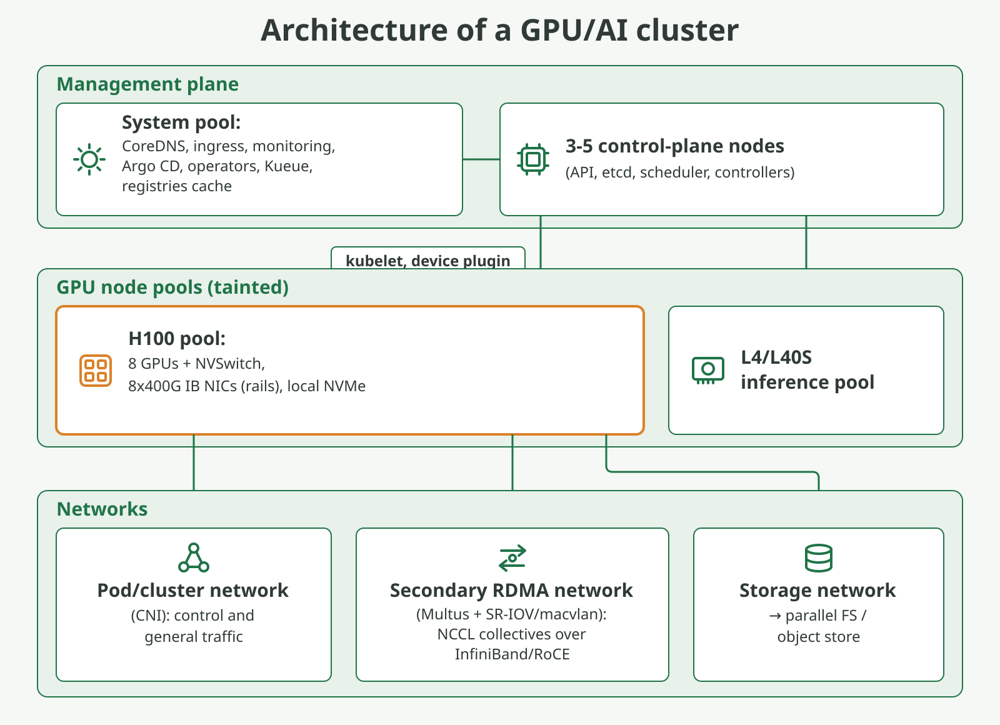

*Figure 5.3.17. Architecture of a GPU/AI cluster, as a diagram.*

GPU nodes are tainted with `nvidia.com/gpu`, so only GPU workloads land there. A taint is a mark on a node that repels pods unless they carry a matching toleration. Secondary networks carry NCCL and RDMA traffic outside the CNI path. NCCL is the library that moves data between GPUs during training, and it needs a fast path that the ordinary pod network does not provide.

Topology matters to scheduling. NUMA, PCIe, NVLink, rail alignment and rack layout all affect where a job should run. NUMA (non-uniform memory access) means that a CPU reaches nearby memory faster than distant memory, so a job should stay on one NUMA node. NVLink is a fast link between GPUs inside one server, and rail alignment means that each GPU talks to the network card on its own rail. Section 5.18 and Part 12 cover this.

Jobs need two things from the scheduler. **Gang scheduling** means all pods start or none do. That matters because a training job with 7 of 8 workers running is just waiting, and it still holds the GPUs it has. **Fair-share quotas** divide capacity across teams. Kueue and Volcano handle these, and section 5.18 and Part 14 cover them.

Node health is checked before workloads land. GPU diagnostics gate each node first, and Part 17 covers that process. The control plane must also absorb **bursts**, such as thousands of pods per job, without APF starving other clients. A burst that starves the node heartbeats is the worst case, because it can make healthy nodes look dead.

Several bottlenecks show up first. Watch API server latency through `apiserver_request_duration_seconds` and the APF queue metrics. Check etcd fsync time and database size. Track scheduler throughput through `scheduler_schedule_attempts_total` and pending pods, and watch the depth of the controller work queue. Kubelet pod start latency depends on image pulls and on CNI or CSI. DNS needs a look too, through CoreDNS CPU and conntrack. Conntrack is the kernel table that tracks each network connection, and a full table drops new connections. Registry bandwidth matters as well, as 5.1 explained.

At 5,000 nodes, the defaults need tuning. The list includes watch cache sizes, `--max-requests-inflight`, etcd on dedicated NVMe, a separate etcd for events, a larger controller QPS, and the scheduler's `percentageOfNodesToScore`. QPS is the number of requests per second a client may send, and the scheduler's percentage setting limits how many nodes it scores before it picks one. Match each metric to its component before you change a setting, because a tuning knob on the wrong component changes nothing useful.

## 11. Official limits (SIG-Scalability thresholds, approximate)

Kubernetes is tested for up to about 5,000 nodes, 150,000 pods, 300,000 containers, and 110 pods per node. The 110 is the default, and you can configure it. Consider a cluster that has reached 5,000 nodes. It has used the full node envelope, so further growth means a second cluster, not more nodes in the first. An envelope is the tested range of a system, and running outside it means you are on your own. Section 5.35 covers splitting clusters across sites. Plan that cluster count before you reach these limits.

These limits describe control-plane capacity. They do not describe a node's ability to run GPUs. A cluster can hold 5,000 nodes and still fail to train a model if the GPU fabric is slow, so check the GPU and network limits separately.

## 12. Hands-on tour

Run these commands against a live cluster. Each one shows a part of the architecture you just read. Go in the order given. The first commands show the whole cluster, and the later ones look inside the control plane itself.

```bash
kubectl cluster-info
kubectl get nodes -o wide
kubectl get pods -A -o wide                                  # control-plane pods are static pods in kube-system
kubectl get --raw='/readyz?verbose' | head -30               # API server readiness checks incl. etcd
kubectl get --raw=/metrics | grep -E '^apiserver_request_total' | head
kubectl api-resources -o wide | head -40                     # kinds, scope, verbs
kubectl api-versions
kubectl explain pod.spec.containers.resources --recursive | head -40
kubectl get lease -A                                         # leader election + node heartbeats
kubectl get componentstatuses 2>/dev/null                    # deprecated; use /readyz
kubectl get events -A --sort-by=.lastTimestamp | tail -20
# on a control-plane node (kubeadm)
ls /etc/kubernetes/manifests/                                # static pod manifests: etcd, kube-apiserver, kube-controller-manager, kube-scheduler
ls /etc/kubernetes/pki/                                      # CA, apiserver, kubelet client, etcd certs
sudo crictl ps | grep -E 'kube-apiserver|etcd|scheduler|controller'
sudo ETCDCTL_API=3 etcdctl --endpoints=https://127.0.0.1:2379 \
  --cacert=/etc/kubernetes/pki/etcd/ca.crt --cert=/etc/kubernetes/pki/etcd/server.crt --key=/etc/kubernetes/pki/etcd/server.key \
  endpoint status -w table
sudo ETCDCTL_API=3 etcdctl ... get /registry/namespaces/default                  # raw (protobuf) object
```

Notice that several commands mention the same components from different angles. The `/readyz` check covers etcd, and the Lease objects show leader election and node heartbeats. Each command is a different camera on the same machine, and comparing their answers is how you find out where the picture does not agree.

### Seeing the cluster in a UI

A command line is not the only way to look at a cluster. Most cloud providers add a visual view of the cluster to their console, so check there first. If your provider does not offer one, or you want a GUI inside the cluster, a community-supported dashboard exists. Install it by following that project's documentation. Editor extensions, such as those for Visual Studio Code, can also show the state of your cluster at a glance. A UI is handy for a quick look, but the commands above remain the tools you will use during an incident, because they can be scripted and recorded.

## 13. Lab

Start with the self-checking Python lab. Run it locally with `python3 code/part05/k8s_architecture_flow_lab.py`. It checks the hub-and-spoke communication rules that `validate_k8s_communication_edges` enforces. A hub-and-spoke layout has one central point that everything else connects through, and here that point is the API server. The lab makes sure only `kube-apiserver` talks to `etcd`, and that components coordinate through watches and writes instead of direct RPCs. It also tests the etcd Raft quorum and fault-tolerance calculator, `compute_etcd_raft_quorum`, for 3-, 4-, and 5-node clusters. Last, it checks the Node `Capacity` versus `Allocatable` calculator, `compute_node_allocatable`, which covers chapter 3 of *Kubernetes: Up and Running*.

```bash
python3 code/part05/k8s_architecture_flow_lab.py
```

Next, work through the exercises below on a `kind` or `kubeadm` cluster. The interactive shell steps below were not run on live hardware.

1. Build a map of the system pods. On a kind cluster, list every system pod. For each one, write down which component it is, where it runs, and what it connects to. Confirm your list with `kubectl get pods -n kube-system -o wide` and `crictl`.
2. Watch the flow. Run `kubectl get events -w` and `kubectl get pods -w`, then apply a Deployment. Annotate the timeline (Scheduled, Pulling, Created, Started) with the component responsible for each event. Events show `reportingComponent`, which tells you who wrote them.
3. Read the REST calls. Run `kubectl apply -f deploy.yaml -v=8 2>&1 | grep -E 'GET|POST|PATCH'`, and map each call to a stage of the pipeline. Then run `kubectl get pods --watch -v=6`.
4. Test reconciliation. Delete a pod owned by a ReplicaSet. Kill the replica set controller's leader, which is a control-plane static pod, and see that nothing happens until the controller returns. Scale the Deployment while the controller manager is stopped by moving its static pod manifest away, and see the spec change without any effect. Restore the manifest and watch the cluster converge.
5. Break the scheduler. Stop kube-scheduler by moving its manifest. Create a pod and observe that it stays Pending, with no events. Then restore the scheduler.
6. Watch a node fail. Stop the kubelet on a worker with `systemctl stop kubelet`. Watch the node condition timeline with `kubectl get node -w`, and look for the taints that get added and for the pod eviction after the tolerations run out. Then compare that result with stopping only the container runtime.
7. Take the API down. Stop the API server static pod. Confirm that workloads still run, for example by curling a Service from a pod and running `crictl ps`. Try `kubectl get pods` and read the error. Restore the API server.
8. Inspect etcd. Take a snapshot with `etcdctl snapshot save`, then check it with `snapshot status`. List the `/registry` key prefixes and count the keys for each resource type. Note how large the events volume is.
9. Find the leader. Find the Leases for the scheduler and the controller manager. Read the `holderIdentity` in each one. Kill the leader and time the failover.
10. Add an extension point. Install a trivial CRD and a custom resource. Run a mutating webhook example, such as a small one that adds a label, or a ValidatingAdmissionPolicy. Observe the result in the API server audit log or logs, and list the API groups.
11. Sketch your own GPU cluster. For a cluster you plan to build, draw the equivalent of section 10, with node pools, taints, secondary networks and storage. List the controllers you will need.
12. Clean up.

## 14. Common mistakes

These mistakes come up often, so check your design against them. Most of them come from one wrong picture of the cluster, so when you catch one, ask which of the two rules from section 1 it breaks.

- Thinking components call each other directly. You then debug by hunting for a command, when you should look at object state, events and watches.
- Assuming a control plane failure kills workloads, or assuming workloads keep running forever when nodes lose connectivity. Taint evictions will catch them in the second case.
- Running a single control-plane node, or two etcd members. Neither gives you a quorum benefit.
- Putting etcd on slow disks, or sharing control-plane nodes with heavy workloads.
- Exposing kubelet or etcd ports broadly, or leaving anonymous auth on.
- Treating the Kubernetes API as a database for high-churn data, such as huge Events, thousands of tiny objects, or giant ConfigMaps.
- Forgetting the cluster add-on requirements (CNI, DNS, metrics) in a "minimal" design.
- Not planning for burst load from large batch jobs, which hits APF and scheduler throughput.

## 15. Interview angles

Interviewers often ask questions like these. Each one asks you to trace the system, not just name its parts. A good answer walks the path in order and names the component at each step, because the order is what shows you understand the design.

- "Walk through what happens when you create a Deployment." Cover the API, etcd, the controllers, the scheduler, the kubelet, the runtime and CNI.
- "Which components talk to etcd? Why only the API server?"
- "What happens to running pods if the control plane goes down?"
- "How does leader election work for the scheduler and controller manager?"
- "Explain level-triggered reconciliation and why informers/watches are used."
- "How do you make the control plane highly available? Stacked vs external etcd?"
- "What are the extension points of Kubernetes? Give GPU-specific examples."
- "How would you scale the control plane for 5,000 GPU nodes and bursts of thousands of pods?"

## Exercises

1. Summarize the five core benefits of Kubernetes from chapter 1 of *Kubernetes: Up and Running*. Those are Velocity via Immutability / Declarative State / Self-Healing, Scaling Software & Teams, Abstracting Infrastructure, Efficiency, and Cloud Native Ecosystem. Then use `validate_k8s_communication_edges()` in `code/part05/k8s_architecture_flow.py` to explain the two architectural rules from section 1. The first rule is that only `kube-apiserver` talks to `etcd`. The second is that components coordinate by writing desired state and watching `kube-apiserver`, rather than calling each other directly.
2. Trace the path from `kubectl apply` to a running pod. Follow every step in section 6, starting from `kubectl apply -f deploy.yaml`, which sends `POST /apis/apps/v1/namespaces/.../deployments` to port `6443`. Name each stage in order: authentication, authorization, mutating and validating admission, `etcd` (`2379`), the `Deployment` controller (`10257`), the `ReplicaSet` controller, `kube-scheduler` (`10259`), `kubelet` (`10250`), the `containerd` CRI, and finally the `EndpointSlice` controller.
3. Explain the node numbers. Use `compute_node_allocatable()` in `code/part05/k8s_architecture_flow.py` to explain how a node's `Capacity` differs from its `Allocatable`, which is `Capacity - kube-reserved - system-reserved - eviction-threshold`. Explain why `nvidia.com/gpu` has 0 daemon deduction. Then describe the five Node `Conditions`: `Ready`, `MemoryPressure`, `DiskPressure`, `PIDPressure` and `NetworkUnavailable`. Finish with what the version skew policy requires across `kubectl`, `kube-apiserver`, the controllers and `kubelet`.
4. Explain the object model, including `spec` versus `status`, level-triggered reconciliation, informer list and watch caches, `resourceVersion`, `ownerReferences`, and `finalizers`. Explain why level-triggered reconciliation with informer list and watch caches, backed by `resourceVersion` optimistic concurrency, recovers cleanly from missed events or controller restarts. Then contrast `ownerReferences`, which drive cascading garbage collection from `Deployment -> ReplicaSet -> Pod`, with `finalizers`, which are pre-deletion cleanup hooks.
5. Work through high availability and the failure timelines. Use `compute_etcd_raft_quorum()` in `code/part05/k8s_architecture_flow.py` to explain why a 4-node `etcd` cluster has worse availability than a 3-node cluster. Compare stacked and external `etcd` topologies. Explain how `kube-scheduler` and `kube-controller-manager` use `Lease` objects for leader election, with about a 15s failover. Explain why running Pods survive a full control-plane outage. Then describe what happens at `T+10s`, at `T+40s` (`node-monitor-grace-period`), and at `T+340s` (the `300s` `node.kubernetes.io/unreachable` taint toleration) when a `kubelet` stops heartbeating.
6. Scale the design to a 5,000-node GPU/AI cluster. Map the Kubernetes extension points (CRI, CNI + Multus/SR-IOV, CSI, Device Plugins / DRA, Mutating/Validating Webhooks & CEL, CRDs/Operators, Scheduling Framework & Kueue/Volcano) onto that cluster. Then list the control-plane tuning knobs you need to handle 2,000-pod distributed training bursts.

## Checkpoint questions (20)

<details>
<summary>1. In *Kubernetes: Up and Running* Chapter 1, what three properties of Kubernetes drive high engineering velocity (and low MTTR)?</summary>

1. **Immutability:** You do not change live servers in place with ad-hoc scripts, because that causes undocumented configuration drift. You build changes into immutable container images instead. Rolling back then means redeploying the previous image tag or digest.
2. **Declarative configuration:** You declare the desired end state, such as `replicas: 3` and `image: vllm:v2`, rather than a sequence of steps. If an upgrade fails, reverting the declarative YAML in Git restores the previous state automatically.
3. **Online self-healing systems:** Controllers watch live state all the time. They replace crashed pods, reschedule workloads off failed nodes, and keep replica counts at the desired level without a person stepping in.
</details>

<details>
<summary>2. What are the two foundational communication rules of the Kubernetes architecture?</summary>

1. **Only `kube-apiserver` reads and writes `etcd`:** Every other part, including kube-scheduler, kube-controller-manager, kubelet, kube-proxy, operators and `kubectl`, talks only to kube-apiserver. Nothing talks to etcd directly. That gives you one checkpoint for authentication, RBAC authorization, admission control, schema validation, optimistic concurrency and audit logging.
2. **Coordination through API state and watches, with no direct imperative calls:** The scheduler does not connect to the kubelet to say "start this pod." It writes `spec.nodeName` to the Pod object in kube-apiserver. The target kubelet finds that binding through its watch stream.
</details>

<details>
<summary>3. Walk through the request pipeline inside `kube-apiserver` when a client sends `POST /api/v1/namespaces/default/pods`.</summary>

1. **API Priority and Fairness (APF):** Sorts the request into a flow, using `FlowSchema` and `PriorityLevelConfiguration`. That stops noisy clients from starving critical system traffic and node heartbeats.
2. **Authentication (AuthN):** Checks who the caller is. The caller might present an X.509 client certificate, a ServiceAccount JWT token, an OIDC token, or a webhook.
3. **Authorization (AuthZ):** Checks whether that identity may perform `create` on `pods` in `default`. RBAC, the Node authorizer, or a webhook can make that decision.
4. **Mutating admission:** Runs built-in mutating plugins, such as `DefaultStorageClass` and ServiceAccount token injection. Then it runs external `MutatingAdmissionWebhook`s, which can inject sidecars, add defaults, or set `runtimeClassName: nvidia`.
5. **Object schema validation:** Checks the mutated object against the OpenAPI v3 schema.
6. **Validating admission:** Runs `ValidatingAdmissionPolicy` (CEL expressions) and external `ValidatingAdmissionWebhook`s.
7. **Persistence and watch fan-out:** Serializes the object to etcd, using Protobuf for built-in types and JSON for CRDs. The server then updates the in-memory watch cache and returns `201 Created` to the client.
</details>

<details>
<summary>4. How does `etcd` store Kubernetes objects, and why is a 4-member `etcd` cluster worse than a 3-member cluster?</summary>

- **Storage format:** etcd stores each object under a key in the form `/registry/<resource_type>/<namespace>/<name>`, such as `/registry/pods/default/train-0`. It uses the Raft consensus algorithm. Every write must be committed to the Write-Ahead Log (`WAL`) on a strict majority of members. That majority is the quorum, which equals $\lfloor N/2 \rfloor + 1$.
- **3 vs. 4 vs. 5 members:**
  - **3 members:** Quorum is 2, so the cluster tolerates **1** member failure.
  - **4 members:** Quorum is 3. The cluster still tolerates only **1** member failure, while it adds write replication overhead and a higher probability that 2 members fail (4 nodes instead of 3).
  - **5 members:** Quorum is 3, so the cluster tolerates **2** member failures.
Always run an **odd number** of etcd members, 3 or 5, on dedicated low-latency NVMe disks.
</details>

<details>
<summary>5. Trace the exact chain of controllers and components from `kubectl apply -f deployment.yaml` to a running container on a worker node.</summary>

1. **`kubectl` to kube-apiserver to etcd:** The request persists the Deployment object with `spec.replicas = 3`.
2. **Deployment controller** (inside kube-controller-manager, watching Deployments): It notices the new Deployment and creates a **ReplicaSet** object on kube-apiserver.
3. **ReplicaSet controller** (watching ReplicaSets and Pods): It sees 0 existing Pods against 3 desired, so it creates **3 Pod objects** (`phase: Pending`, `spec.nodeName: ""`) on kube-apiserver.
4. **kube-scheduler** (watching unbound Pods where `spec.nodeName == ""`): It runs the Filter and Score plugins across candidate nodes, then writes a **Binding** (`spec.nodeName = "gpu-node-01"`) to kube-apiserver.
5. **kubelet on gpu-node-01** (watching Pods with `spec.nodeName == "gpu-node-01"`): It calls containerd through CRI. The calls run in this order: `RunPodSandbox`, CNI network setup, `PullImage`, `CreateContainer`, and `StartContainer`. The kubelet then runs probes and patches the Pod status (`phase: Running`, `Ready: True`, `podIP`) back to kube-apiserver.
6. **EndpointSlice controller:** It sees that the Pod is Ready and adds its `podIP` to the matching Service EndpointSlices.
</details>

<details>
<summary>6. Why is `kubelet` run as a host `systemd` service rather than a Pod, and how do Control-Plane Static Pods work in `kubeadm`?</summary>

- **Why the kubelet is a systemd service:** The kubelet is the agent that starts Pods on the node. If it ran as a normal scheduled Pod, you would hit a chicken-and-egg bootstrap deadlock.
- **How static pods work:** Even before kube-apiserver or etcd exists, the kubelet watches a local directory on the host, **`/etc/kubernetes/manifests/`**. Any Pod YAML placed there, such as `etcd.yaml`, `kube-apiserver.yaml`, `kube-controller-manager.yaml` or `kube-scheduler.yaml`, is started directly by the local kubelet through CRI. That is how kubeadm bootstraps the control plane itself. Once kube-apiserver is up, the kubelet creates read-only **mirror Pods**, such as `kube-apiserver-<node>`, in `kube-system`, so they appear in `kubectl get pods`.
</details>

<details>
<summary>7. In *Kubernetes: Up and Running* Chapter 3, what is the difference between a Node's `Capacity` and `Allocatable` in `kubectl describe node`, and why does it matter?</summary>

- **`Capacity`:** The total hardware resources detected on the machine, such as `64` CPU cores, `512Gi` RAM, and `8` `nvidia.com/gpu`.
- **`Allocatable`:** The resources the scheduler may hand out to Pods. `Allocatable = Capacity - kube-reserved - system-reserved - eviction-threshold`
If you leave `kube-reserved` (for the kubelet and containerd) and `system-reserved` (for `sshd`, `systemd` and the kernel) unset, Pods can take all of the host CPU and RAM. The kubelet then misses heartbeats, and the node flips to NotReady. GPUs (`nvidia.com/gpu`) are not consumed by host daemons, so GPU Allocatable equals GPU Capacity (8) whenever the NVIDIA device plugin is healthy.
</details>

<details>
<summary>8. What are the default ports for `kube-apiserver`, `etcd`, `kubelet`, `kube-scheduler`, `kube-controller-manager`, and `NodePort` Services?</summary>

- **kube-apiserver:** TCP **6443** (HTTPS)
- **etcd:** TCP **2379** (client API) and **2380** (peer-to-peer Raft replication)
- **kubelet:** TCP **10250** (authenticated HTTPS API for logs, exec, and metrics) and **10248** (localhost `/healthz`)
- **kube-scheduler:** TCP **10259** (HTTPS metrics and health)
- **kube-controller-manager:** TCP **10257** (HTTPS metrics and health)
- **NodePort Services:** TCP and UDP **30000–32767** on all nodes.
</details>

<details>
<summary>9. In which cases does `kube-apiserver` initiate an outbound connection TO a worker node's `kubelet` (`:10250`)?</summary>

Normally, the kubelet connects outbound to `kube-apiserver:6443`. The direction reverses when a user runs `kubectl logs <pod>`, `kubectl exec -it <pod> -- ...`, `kubectl attach`, or `kubectl port-forward`. It also reverses when a user runs `kubectl proxy` to reach a node or pod endpoint. In each case, kube-apiserver acts as a client and connects to the target node's kubelet on port `10250`. In some setups, the path runs through `konnectivity-agent` tunnels, which apply when the control plane and workers are separated by NAT or firewalls.
</details>

<details>
<summary>10. What is the difference between `spec` and `status` on a Kubernetes object, and why is `/status` a separate API subresource?</summary>

- **`spec`:** The desired state, set by the user or a higher-level controller. Updating `spec` increments **`metadata.generation`**.
- **`status`:** The observed state, reported by the controller or kubelet that reconciles the object. `status.observedGeneration` records which `metadata.generation` the controller has processed.

`/status` is a separate REST subresource, at `PUT /api/v1/namespaces/.../pods/<name>/status`. That split lets RBAC grant the kubelet or an operator permission to update `status` without letting it change `spec`. It also stops a `kubectl apply` on `spec` from overwriting `status`.
</details>

<details>
<summary>11. Explain Level-Triggered vs. Edge-Triggered reconciliation and how SharedInformers work inside controllers.</summary>

- **Edge-triggered:** Reacts only to a discrete transition event, such as "Pod X just crashed." If the controller was restarting when that event fired, the change is missed for good.
- **Level-triggered (the Kubernetes model):** Compares the entire current state with the desired state, such as "the ReplicaSet wants 4 Pods; 3 exist; create 1." If an event is dropped during a network blip or a restart, the next periodic relist or reconcile still converges to the right state.
- **SharedInformer architecture:** A `Reflector` runs LIST at `resourceVersion` and streams WATCH. Events pass through a `DeltaFIFO` into a thread-safe local in-memory **`Indexer`/`Store` cache**. Resource event handlers enqueue only the `namespace/name` key onto a rate-limiting **`WorkQueue`**, which worker goroutines process.
</details>

<details>
<summary>12. How does Optimistic Concurrency Control (`metadata.resourceVersion` and HTTP `409 Conflict`) work in Kubernetes?</summary>

Every object stored in etcd carries a monotonically increasing **`metadata.resourceVersion`**, which maps to the etcd key's `mod_revision`. Say a client reads an object at `resourceVersion: "5012"`, changes it, and sends a `PUT`. kube-apiserver checks whether the object in etcd still has `resourceVersion == "5012"`. If another actor changed it in the meantime, so that it now reads `"5013"`, kube-apiserver rejects the stale write with **HTTP `409 Conflict`**. The controller then re-reads the latest version from its informer cache, re-applies its change, and retries.
</details>

<details>
<summary>13. Compare `ownerReferences` and `finalizers` during object deletion.</summary>

- **`metadata.ownerReferences` (garbage collection):** Points from a child object, such as a Pod, to its parent owner, such as a ReplicaSet. When the parent is deleted, the garbage collector controller deletes all children, following the deletion propagation policy: `Background`, `Foreground`, or `Orphan`.
- **`metadata.finalizers` (pre-deletion hooks):** Suppose you run `kubectl delete pvc data` on an object whose finalizers list is not empty, such as `["kubernetes.io/pvc-protection"]`. kube-apiserver does not delete the object from etcd. It sets **`metadata.deletionTimestamp`** and puts the object into a terminating state. The responsible controller sees the timestamp, cleans up external resources or waits for Pods that mount the PVC to exit, and removes its string from `metadata.finalizers`. When the list is empty, kube-apiserver removes the object from etcd.
</details>

<details>
<summary>14. What happens to already-running GPU training Pods if all `kube-apiserver` instances (or `etcd`) go down?</summary>

**Already-running Pods keep executing.** The container processes are managed locally by `containerd-shim-runc-v2` and the kubelet. The existing iptables, IPVS or eBPF networking rules stay programmed in the node kernels. So an in-progress multi-node NCCL training job keeps running. While the API server is down, though, no new Pods can be scheduled. Crashed Pods that need a controller to replace them are not recreated. kubectl commands fail, and autoscalers and operators cannot act.
</details>

<details>
<summary>15. Trace the exact timeline when a worker node's `kubelet` stops heartbeating (or the node loses network connectivity to the control plane).</summary>

1. **`T + 0s` to `10s`:** Normally, the kubelet renews its Lease object in the `kube-node-lease` namespace every **`10s`** (`node-status-update-frequency`).
2. **`T + 40s` (`node-monitor-grace-period`, default `40s`):** The Node Lifecycle Controller inside kube-controller-manager sees no Lease renewal for 40 seconds. It sets the Node's `Ready` condition to **`Unknown`**. The taint `node.kubernetes.io/unreachable:NoExecute` is added, along with `NoSchedule`.
3. **`T + 340s` (`40s + 300s` default `tolerationSeconds`):** By default, Kubernetes adds a 300-second (5-minute) toleration for `node.kubernetes.io/unreachable:NoExecute` and `not-ready:NoExecute` to every Pod. Five minutes after the node went `Unknown`, that toleration expires, and the controller marks the Pods for eviction or deletion. If the node is unreachable, though, Pods stay in `Terminating` until the node returns or `cloud-controller-manager` deletes it.
</details>

<details>
<summary>16. How does Leader Election work for `kube-scheduler` and `kube-controller-manager` in a 3-node HA control plane?</summary>

While all 3 kube-apiserver instances run active-active behind a load balancer, running 3 active kube-scheduler or kube-controller-manager instances at once would cause conflicting scheduling bindings and duplicate ReplicaSet creations. So these two run in active-standby mode. They use leader election over `coordination.k8s.io/v1` `Lease` objects in `kube-system` (`kubectl get lease -n kube-system`). The active leader updates `spec.renewTime` every `2s` (`retryPeriod`). If the leader crashes and does not renew within **`15s` (`leaseDuration`)**, a standby instance acquires the Lease and takes over.
</details>

<details>
<summary>17. Compare `Stacked etcd` vs. `External etcd` high-availability control-plane topologies.</summary>

- **Stacked etcd (default in kubeadm, 3 control-plane nodes):** Each control-plane node runs kube-apiserver, kube-controller-manager, kube-scheduler, *and* a local etcd member, all as static pods. It needs fewer hosts, 3 machines instead of 6. But it couples failure domains. Losing 1 control-plane host means losing both an API server and an etcd member. Noisy API server CPU or memory use can also affect etcd.
- **External etcd (3 control-plane nodes + 3 dedicated etcd nodes):** This isolates etcd on dedicated hosts with dedicated NVMe I/O and a separate blast radius. It is recommended for large production clusters (>1,000 nodes).
</details>

<details>
<summary>18. What is the Kubernetes Version Skew Policy (*Kubernetes: Up and Running* Chapter 3), and in what order must you upgrade a cluster?</summary>

- **Version Skew Policy:**
  - kube-apiserver instances in HA must be within **1 minor version** of each other, such as `1.30` and `1.31`.
  - kube-controller-manager, kube-scheduler, and cloud-controller-manager must not be newer than kube-apiserver. They may be up to **1 minor version** older.
  - kubelet and kube-proxy must not be newer than kube-apiserver. They may be up to **2–3 minor versions** older.
  - kubectl may be **1 minor version** newer or older than kube-apiserver.
- **Mandatory upgrade order:** Always upgrade **1 minor version at a time**, and never skip one. The order is etcd or the first kube-apiserver, then the remaining kube-apiservers, then kube-controller-manager and kube-scheduler, then CoreDNS, kube-proxy and add-ons, and finally the worker kubelets, drained in rolling batches.
</details>

<details>
<summary>19. How do the Kubernetes Device Plugin API (`nvidia.com/gpu`) and Dynamic Resource Allocation (`DRA`, `resource.k8s.io`) differ for GPU workloads?</summary>

- **Device Plugin API (`/var/lib/kubelet/device-plugins/`):** Exposes hardware as a **simple integer count**, such as `nvidia.com/gpu: 8`. It cannot express complex device parameters directly. It also cannot handle cross-node NVLink or IMEX domain sharing, or dynamic MIG slicing at pod scheduling time, without fixed MIG resource profiles pre-created.
- **Dynamic Resource Allocation (DRA, `ResourceClaim`, `DeviceClass`, `ResourceSlice`):** A flexible, CRD-like allocation API. Drivers publish rich hardware topology and attributes in `ResourceSlice` objects. Pods request structured `ResourceClaim`s, for example to share one GPU across containers, request a dynamic MIG profile, or co-allocate an H100 GPU and its PCIe-peer ConnectX-7 RDMA NIC.
</details>

<details>
<summary>20. What are the official SIG-Scalability limits of a single Kubernetes cluster, and what are the top 5 bottlenecks when launching 2,000-Pod distributed training jobs?</summary>

- **Official SIG-Scalability reference envelopes:** Up to **5,000 nodes**, **150,000 total Pods**, **300,000 total containers**, and **110 Pods per node**.
- **Top 5 AI burst bottlenecks and fixes:**
  1. **etcd WAL fsync and DB size:** Put etcd on dedicated local NVMe, where `wal_fsync_duration_seconds` p99 stays under 10ms. Split high-volume `/registry/events` data into a separate etcd instance.
  2. **API server overload and APF queueing:** Tune `--max-requests-inflight` and `--max-mutating-requests-inflight`, and tune the APF `FlowSchema`s, so that bursts of job submissions do not starve kubelet Lease heartbeats.
  3. **Scheduler and gang-scheduling throughput:** Use **Kueue** with **JobSet**, or **Volcano**, so that 2,000 pods are admitted only when quota exists. That avoids 2,000 unschedulable pods churning the scheduler queue.
  4. **Controller client-go QPS throttling:** Raise `--kube-api-qps` and `--kube-api-burst` on kube-controller-manager and operators. The low defaults are `20` and `30`.
  5. **Image pull storms on worker nodes:** Use pull-through registry caches and P2P distribution, such as Spegel or Dragonfly, covered in Chapter 5.1.
</details>

## Sources and review notes

- **Sources read in full:**
  - `kubernetes-up-and-running-3rd-edition` — Brendan Burns, Joe Beda, Kelsey Hightower & Lachlan Evenson, *Kubernetes: Up and Running*, 3rd ed., **Chapter 1: Introduction** (read in full: Borg/Omega lineage, Velocity via Immutability, Declarative Configuration, and Self-Healing Systems, Scaling software and teams, Abstracting infrastructure, Efficiency, and the Cloud Native Ecosystem) and **Chapter 3: Deploying a Kubernetes Cluster** (read in full: `kubectl version` and version skew, `kubectl get nodes`, `kubectl describe nodes` `Capacity` vs `Allocatable` and Node `Conditions`, and `kube-system` components `coredns`/`kube-dns` and `kube-proxy` DaemonSet).
  - `production-kubernetes` — Josh Rosso, Rich Lander, Alexander Brand & John Harris, *Production Kubernetes* (control plane and deployment models).
  - `nvidia-devops` (`volume-03/01-k8s-control-plane-scheduling-masterclass.md`, `volume-03/02-k8s-node-storage-masterclass.md`, and `volume-03/03-k8s-networking-security-ops-masterclass.md`): control plane, API machinery, etcd, node/storage, and networking/security at AI-factory scale (`150k` / `150`k pods).
- **Run here:** `python3 code/part05/k8s_architecture_flow_lab.py` (3 passed, 0 failed).
- **Explicitly labelled inferences:** The `validate_k8s_communication_edges`, `compute_etcd_raft_quorum`, and `compute_node_allocatable` models in `code/part05/k8s_architecture_flow.py` and the GPU/AI cluster topology diagram (Section 10) are the author's constructions synthesizing *Kubernetes: Up and Running* Chapters 1 & 3 and `volume-03` (plus original study items 21, 22, 23, 24, 25, 26, 27, 28, 29, 30, 31, 32, 33, 34, 35, 36, 37, 38, 39, and 40).
- **Not verified on live hardware:** Live `kubectl`, `crictl`, and `etcdctl` commands (`6443`, `2379`, `2380`, `10250`, `10248`, `10255`, `10259`, `10257`, `10256`, `10249`, `30000-32767`, `53`, `9153`, `2 GiB`/`8 GiB`, `10 s`, `15 s`, `40 s`, `300 s` / `5 min`, `409 Conflict`, `8x400G`, `5,000` nodes, `150,000` pods, `300,000` containers, `110` pods/node, `-v=8`, `-v=6`) are marked (`untested here`) where not executed by `k8s_architecture_flow_lab.py`.
