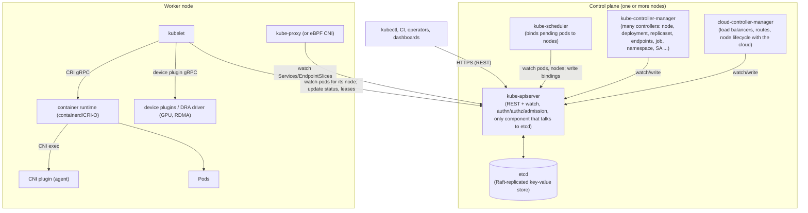
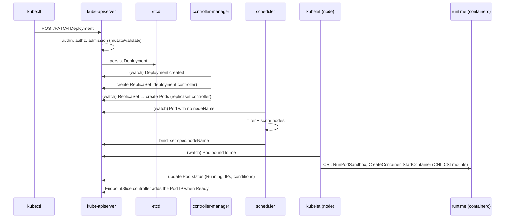
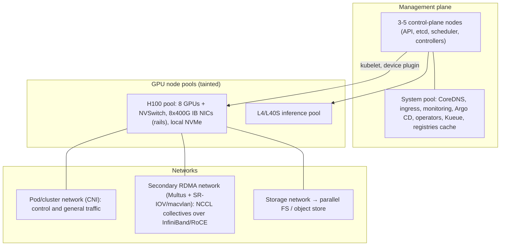

# 5.3 Kubernetes architecture overview: components and what talks to what

| | |
|---|---|
| Level | Beginner to intermediate |
| Priority tier | 0 |
| Lab venue | kind (Docker) or a kubeadm VM cluster; kubectl; `etcdctl` for the etcd exercises |
| Part | Part 5: Kubernetes |
| Status | Drafted, labs **untested** |

## Why this matters for AI infrastructure

At AI scale the Kubernetes control plane is a shared, stateful system under unusual pressure: a large MPI or PyTorch job creates hundreds or thousands of pods at once, thousands of nodes publish status, controllers and schedulers reconcile continuously, and batch systems (Kueue, Volcano) add their own load. When this goes wrong, jobs sit Pending, deployments stall, and `kubectl` times out. To reason about those failures you must know the components, what each reads and writes, which links are synchronous, and which are eventually consistent watches. This chapter builds that map and then shows where GPUs, device plugins, schedulers and operators plug in.

## Prerequisites and outcomes

Needs 5.1 and 5.2 and the networking and Linux fundamentals from Parts 1 and 2. After this chapter you can:

- Name every control-plane and node component, its function, its ports and its inputs/outputs; draw "what talks to what".
- Explain Kubernetes' declarative model: objects with `spec` and `status`, controllers reconciling, watches over polling, level-triggered vs edge-triggered, and eventual consistency.
- Describe how an object travels from `kubectl apply` to a running container (preview of 5.5 to 5.9).
- Explain high-availability topologies (stacked vs external etcd, load-balanced API servers, leader election) and failure behaviour of each component.
- Identify add-ons and extension points (CNI, CSI, CRI, device plugins, admission webhooks, CRDs/operators, scheduler plugins, DRA).
- Sketch the architecture of a GPU/AI cluster and the typical bottlenecks.

## 1. The big picture



Two rules explain most of the architecture:

1. **The API server is the only component that reads and writes etcd.** Every other component (scheduler, controllers, kubelets, kube-proxy, operators, kubectl) talks to the API server. This gives one place for authentication, authorisation, admission, validation, defaulting, versioning and auditing.
2. **Components do not call each other to say "do X".** They write desired state to the API (objects) and **watch** for changes relevant to them, then act to make reality match. The scheduler does not tell the kubelet to run a pod; it writes `spec.nodeName` into the Pod object; the kubelet, watching pods bound to its node, sees it and starts the containers. This decoupling is why Kubernetes tolerates component restarts and is extensible.

### What "Kubernetes" covers in this book

The word Kubernetes often works as an umbrella term, and that can blur what people mean. At the time of writing, the `kubernetes` GitHub organization held 69 repositories. The `kubernetes-sigs` organization held around 107 projects. Hundreds more Cloud Native Computing Foundation (CNCF) projects sit in the same landscape.

In this part, "Kubernetes" means only the core project. The core lives in the `kubernetes/kubernetes` repository. It holds the key components found in most clusters. When those components run, the core project gives you these abilities:

- Scheduling workloads across many hosts
- Exposing a declarative, extensible API for interacting with the system
- Providing the `kubectl` CLI so people can talk to the API server
- Reconciling the current state of objects toward the desired state
- Providing a basic service abstraction that routes requests to and from workloads
- Exposing multiple interfaces for pluggable networking, storage, and more

Together, these make Kubernetes a production-grade container orchestrator. Put simply, it runs and schedules containerized workloads on many hosts. Keep that main job in mind. The rest of this part builds on it.

### Getting the core binaries

Many teams consume the core components in different ways. Managed services such as Google Kubernetes Engine (GKE) usually have each component on the hosts already. Others download binaries from a repository or get signed versions from a vendor. Anyone can download a release from the `kubernetes/kubernetes` repository. After unpacking it, `cluster/get-kube-binaries.sh` detects your target architecture and downloads the server and client parts:

```
$ ./cluster/get-kube-binaries.sh
Kubernetes release: v1.18.6
Server: linux/amd64 (to override, set KUBERNETES_SERVER_ARCH)
Client: linux/amd64 (autodetected)
Will download kubernetes-server-linux-amd64.tar.gz from https://dl.k8s.io/v1.18.6
Will download and extract kubernetes-client-linux-amd64.tar.gz
Is this ok? [Y]/n
```

The server components usually land in `server/kubernetes-server-${ARCH}.tar.gz`. Inside, you find the key items that make up a cluster:

- **API server**: The main point of contact for every component and user. Objects are read, added, deleted, and changed here. The API server hands state storage to a backend, most often etcd.
- **kubelet**: The agent on each host. It reports the node's status to the API server and learns which workloads belong on its node. It talks to the host's container runtime, such as Docker, so those workloads start and stay healthy.
- **Controller manager**: One binary that holds many controllers, each reconciling core objects. Declare three replicas in a Deployment, and a controller inside creates the Pods to match.
- **Scheduler**: Decides where workloads run by picking what it judges to be the best node. It filters out nodes that cannot run the workload, then scores the rest.
- **kube-proxy**: Implements Services. It gives workloads virtual IPs that route to backend Pods, using packet filtering on the host, such as `iptables` or `ipvs`.

Many clusters run `kube-apiserver`, `kube-scheduler`, and `kube-controller-manager` as containers. In that case, the control plane may also run a container runtime, a kubelet, and kube-proxy. Deployment choices like these come up later in this part.

### Why Kubernetes Exists: Borg/Omega Heritage and Five Core Benefits (`KUR` Chapter 1)

In *Kubernetes: Up and Running* Chapter 1 (*Introduction*), Brendan Burns, Joe Beda, Kelsey Hightower, and Lachlan Evenson trace Kubernetes's lineage back to Google's internal **Borg** and **Omega** cluster managers (open-sourced by Google in June 2014 and donated as the seed technology of the **Cloud Native Computing Foundation (`CNCF`)** in July 2015) and organize the platform's value around five core benefits:
1. **Velocity** (measured not by raw deploy speed, but by **mean time to recovery (`MTTR`)** when things go wrong): enabled by **immutability** (building a new container image rather than mutating a server in place), **declarative configuration** (stating *what* the cluster should look like rather than an imperative list of instructions, so rollbacks are trivial), and **online self-healing systems** (controllers continuously reconciling drift).
2. **Scaling your software and your teams**: decoupling services via load-balanced APIs (`Services`), Namespaces, and horizontal pod/cluster autoscaling so small "two-pizza teams" (Jeff Bezos) can own and scale multiple microservices independently.
3. **Abstracting your infrastructure**: moving from host-centric VM management to an **application-oriented container API** (`Pods`, `Deployments`, `Jobs`, `PersistentVolumeClaims`) that is portable across AWS, Azure, GCP, and bare-metal on-premises GPU datacenters.
4. **Efficiency**: bin-packing batch training/preprocessing jobs alongside latency-sensitive serving workloads on the same hardware fleet—driving up server and power utilization while isolating workloads via cgroups and QoS classes.
5. **Cloud Native Ecosystem**: integrating seamlessly with CNCF projects across telemetry (Prometheus, Grafana, OpenTelemetry), service mesh, GitOps (Argo CD, Flux), and AI/batch scheduling (Kueue, Volcano, Ray, Kubeflow).

## 2. Control plane components

### kube-apiserver

A horizontally scalable, stateless HTTPS server (default port 6443) exposing the Kubernetes API: REST resources grouped by API group/version (`/api/v1/pods`, `/apis/apps/v1/deployments`), plus `watch` (long-lived HTTP streams or WebSocket/HTTP2 of change events), `exec`/`attach`/`portforward` streaming proxies to kubelets, aggregated APIs (metrics-server, custom API servers), discovery endpoints and OpenAPI. Request pipeline: authentication (certs, tokens, OIDC, webhook) → authorization (RBAC, Node, webhook) → admission (mutating, schema validation, validating; built-in plugins and webhooks) → persistence (etcd) → response, with **API Priority and Fairness (APF)** queueing requests by flow to protect the server from overload. It caches objects in memory (watch cache) and serves most reads/watches from the cache rather than etcd. Details in 5.5.

### etcd

A distributed, consistent key-value store using Raft (clients port 2379, peers 2380). Holds **all cluster state**: objects serialised (protobuf) under `/registry/<group>/<resource>/<namespace>/<name>` keys, plus leases and events. Quorum means a 3-node cluster tolerates 1 failure, 5-node tolerates 2. Performance is dominated by disk fsync latency (use SSD/NVMe), network latency between members, and database size (default 2 GiB quota, 8 GiB suggested max). It is the single most critical stateful component; backups and restore drills are mandatory (5.20).

### kube-scheduler

Watches for Pods without `spec.nodeName`; for each, runs a **scheduling cycle** (filter nodes that cannot run the pod, score the survivors, select one) and a **binding cycle** (write a `Binding` to the API). It is plugin-based (Scheduling Framework): extension points `PreFilter`, `Filter`, `PostFilter` (preemption), `Score`, `Reserve`, `Permit`, `Bind`. It does not start containers or look at node runtime state beyond what the API provides (allocatable resources, labels, taints, volumes topology, existing pods). Multiple schedulers can coexist (`spec.schedulerName`), e.g., Volcano or a custom GPU-topology scheduler. Details in 5.18.

### kube-controller-manager

One binary running many **controllers**, each a control loop for one kind of object: node lifecycle (marks nodes NotReady, evicts pods), ReplicaSet, Deployment, StatefulSet, DaemonSet, Job, CronJob, EndpointSlice, Namespace, ServiceAccount, PV/PVC binding and attach/detach, HPA, garbage collector (ownerReferences), TTL, certificate signing, and more. Controllers use **informers** (list + watch with local cache and work queues). Leader election ensures one active instance among replicas. Details in 5.6.

### cloud-controller-manager

Separates cloud-provider logic: node controller (cloud metadata, deleting nodes whose VM is gone), route controller, service controller (creates cloud load balancers for `Service type=LoadBalancer`), volume integrations. On bare metal or GPU clouds it may be absent or replaced by MetalLB, kube-vip, or provider-specific controllers.

### Aggregated and extension API servers

`metrics-server` (resource metrics API), custom-metrics adapters (Prometheus Adapter, KEDA), service catalog successors, and your own API servers register via `APIService` objects and appear under the main API surface. CRDs are the lighter mechanism for most extensions (5.29).

### Checking the control plane with `componentstatuses`

Before you trust a new cluster, ask whether its core parts are healthy. The `componentstatuses` command gives a quick answer.

```
$ kubectl get componentstatuses
```

In the book's example, the `scheduler`, the `controller-manager`, and `etcd-0` all report `Healthy`. Each row is one part of the control plane. The `controller-manager` runs the controllers that keep behavior right, such as making sure all replicas of a service are available and healthy. The `scheduler` places Pods onto nodes. The `etcd` server stores all of the API objects.

Your output may look a little different as Kubernetes changes over time. That is normal, so don't panic if your lines do not match the book exactly.

## 3. Node components

- **kubelet**: the node agent. Registers the node, sends heartbeats (Lease objects in `kube-node-lease` every ~10 s; node status updates), watches pods bound to its node (and its static pod manifests directory), drives the runtime via CRI, mounts volumes (with CSI node plugins), runs probes, manages cgroups/QoS, enforces eviction under pressure, reports pod and node status, and serves an authenticated API on port 10250 (`exec`, `logs`, metrics `/metrics/cadvisor`). The kubelet is the only component that is usually **not** a pod itself (a systemd service), because it must start pods.
- **Container runtime** (5.2): containerd or CRI-O + OCI runtime.
- **kube-proxy** (or replacement): programs Service virtual IPs on each node using iptables, IPVS or nftables rules (5.10); eBPF CNIs (Cilium) can replace it.
- **CNI plugin**: attaches pod network namespaces to the cluster network and implements pod-to-pod connectivity and (optionally) NetworkPolicy (5.13 to 5.15). Usually a DaemonSet agent plus binaries under `/opt/cni/bin` and config in `/etc/cni/net.d`.
- **Node-level agents** common in AI clusters: **NVIDIA device plugin / DRA driver** (advertise GPUs), **GPU Feature Discovery / NFD** (labels), **DCGM exporter** (metrics), **node-problem-detector**, log shippers, CSI node drivers, RDMA/SR-IOV device plugins and Multus (multiple network interfaces), kata or sandbox runtime installers.

### Inspecting Nodes (`Capacity` vs. `Allocatable` and `Conditions`) and `kube-system` (`KUR` Chapter 3)

In *Kubernetes: Up and Running* Chapter 3 (*Deploying a Kubernetes Cluster*), Burns et al. walk through the first commands every cluster operator runs after connecting `kubectl`:
1. **`kubectl version` and the Version Skew Policy:** Displays both the client (`kubectl`) version and the control-plane (`kube-apiserver`) version. Kubernetes enforces a documented **version skew policy**: `kubectl` may be within **$\pm 1$ minor version** of `kube-apiserver`, `kube-apiserver` instances in an HA cluster may skew by at most $1$ minor version during upgrades, `kube-controller-manager`/`kube-scheduler`/`cloud-controller-manager` must not be newer than `kube-apiserver` (up to $1$ minor version older), and `kubelet` may be up to **$2$–$3$ minor versions older** (never newer) than `kube-apiserver`.
2. **`kubectl get nodes` and `kubectl describe nodes <node>` (`Capacity` vs. `Allocatable`):**
   - **`Capacity`**: The raw physical/virtual hardware reported by the node OS (`cpu`, `memory`, `ephemeral-storage`, `pods`, `nvidia.com/gpu`).
   - **`Allocatable`**: The slice of resources actually available to schedule Pods (`Allocatable = Capacity - kube-reserved - system-reserved - eviction-threshold`, modeled in `compute_node_allocatable()` in `code/part05/k8s_architecture_flow.py`). Reserving CPU and memory for `kube-reserved` (`kubelet`, `containerd`) and `system-reserved` (`sshd`, `systemd`, kernel daemons) prevents noisy user pods from starving the node agent and triggering a `NotReady` outage.
   - **Node `Conditions`**: `Ready` (`True` when healthy; transitions to `Unknown` after ~40s of missed heartbeats), `MemoryPressure`, `DiskPressure`, `PIDPressure`, and `NetworkUnavailable`.
3. **Core `kube-system` components (`kubectl get pods --namespace=kube-system`):** Control-plane static pods (`kube-apiserver-<node>`, `etcd-<node>`, `kube-controller-manager-<node>`, `kube-scheduler-<node>`), cluster DNS (**`coredns`** / `kube-dns` Deployment + `kube-dns` Service resolving `<svc>.<ns>.svc.cluster.local`), and the **`kube-proxy` DaemonSet** (1 pod per node).

### Reading one node with `kubectl describe nodes`

A node can look fine in a simple list and still behave oddly. The `describe` command shows what one node is doing. The book uses a node named `kube1` as its example:

```
$ kubectl describe nodes kube1
```

Read the output from top to bottom. The labels come first and give the basics. In the book's example, `kube1` runs Linux on an ARM processor.

Next is the `Conditions` block, which answers one question: is this node healthy? Every pressure check reads `False`, and `Ready` reads `True`. The book reads that as a node with enough disk and memory, reporting healthy to the Kubernetes master. The network reason, `FlannelIsUp`, names the network plugin the node is using.

Then the `Capacity` block shows what the machine offers. The book's node reports `cpu: 4`, `memory: 882636Ki`, and `pods: 110`. Its `Allocatable` block matches the same values, and the `alpha.kubernetes.io/nvidia-gpu` count is `0`.

The system section lists the software on the node. It covers the container runtime, the kubelet, kube-proxy, the Linux kernel, and the Pod address range. The book's node runs `containerd://1.4.12`, with `Kubelet Version` and `Kube-Proxy Version` both at `v1.22.4`.

The last section lists the Pods running on the node. The book shows three, including `kube-dns`, which asks for `260m` of CPU and `140Mi` of memory. Each Pod gets two numbers for each resource: a request and a limit. A request is guaranteed to be present on the node. A limit is the most the Pod can consume. When the limit is higher than the request, the extra is supplied on a best-effort basis and is not guaranteed. Chapter 5 of the book covers this in detail.

Read the `Allocated resources` totals the same way. They can go over 100 percent, which the book calls overcommitted.

### kube-proxy and DNS in practice

Two cluster services make Services usable. The Kubernetes proxy routes traffic to load-balanced Services, so it has to run on every node. Many clusters run it as a DaemonSet, which Chapter 11 of the book covers. Check it with:

```
$ kubectl get daemonSets --namespace=kube-system kube-proxy
```

In the book's output, the DESIRED, CURRENT, READY, UP-TO-DATE, and AVAILABLE columns all read `5`. Your cluster may name the DaemonSet differently, or may not use one at all. The `kube-proxy` container should still run on every node.

The DNS server gives names and discovery to the Services in the cluster. It runs as a replicated service, so a large cluster can run more than one copy. A Kubernetes Deployment manages those copies, and the name may be `coredns` or another variant:

```
$ kubectl get deployments --namespace=kube-system core-dns
```

The book's output shows one copy desired and one available. A Service load-balances across the DNS copies:

```
$ kubectl get services --namespace=kube-system core-dns
```

The book's DNS Service has the cluster address `10.96.0.10`. Any container in the cluster has that address written into its `/etc/resolv.conf` file. If you open a shell in a running container, you can check that file yourself.

## 4. Ports and trust

| Component | Port(s) | Authn/z | Notes |
|---|---|---|---|
| kube-apiserver | 6443 (HTTPS) | Client certs, tokens, OIDC | Front with a load balancer for HA; API access control is the cluster's security boundary |
| etcd | 2379 client, 2380 peer | mTLS | Only API servers should be clients; restrict network access; encrypt secrets at rest in etcd via API server `EncryptionConfiguration` |
| kubelet | 10250 (HTTPS), 10248 healthz (local), read-only 10255 (disabled by default) | Webhook authn/z against the API server | Disable anonymous auth; the API server → kubelet connection must be mutually authenticated |
| kube-scheduler | 10259 (HTTPS metrics/health) | Delegated authn | |
| kube-controller-manager | 10257 (HTTPS) | Delegated authn | |
| kube-proxy | 10256 (healthz), 10249 (metrics) | | |
| NodePort Services | 30000-32767 on all nodes | | Firewall appropriately |
| CoreDNS | 53 TCP/UDP, 9153 metrics | | |

Everything inside the control plane communicates over TLS with certificates generated by kubeadm or your installer (5.21); the API server is also a client of kubelets (for logs/exec) and of etcd.

## 5. The declarative object model

Every API object has `apiVersion`, `kind`, `metadata` (name, namespace, uid, labels, annotations, ownerReferences, finalizers, resourceVersion, generation), `spec` (desired state; written by users/controllers) and `status` (observed state; written by controllers/kubelet). Key properties:

- **Level-triggered reconciliation**: controllers compare *current* with *desired* state and act on the difference, not on events. Missing an event does not matter because the next resync finds the difference; this is why Kubernetes self-heals after a controller restart.
- **Watches**: clients list resources once and then stream changes from a `resourceVersion`; informers maintain local caches so controllers rarely hit the API server directly.
- **Optimistic concurrency**: updates carry `resourceVersion`; the server rejects stale writes (409 Conflict); controllers retry. **Server-side apply** tracks field ownership (managedFields) to avoid conflicts among actors.
- **Ownership and garbage collection**: `ownerReferences` link dependents to owners (Pod → ReplicaSet → Deployment); deleting an owner deletes dependents (foreground/background/orphan policies). **Finalizers** block deletion until a controller cleans up external resources.
- **Labels and selectors** are the loose coupling mechanism (Services select Pods; ReplicaSets select Pods; NetworkPolicies select Pods; scheduling uses node labels).
- **Namespaces** partition names, RBAC and quotas; some resources are cluster-scoped (Nodes, PersistentVolumes, StorageClasses, CRDs, ClusterRoles).
- **Events** are best-effort, short-lived records (default 1 h TTL) useful for troubleshooting (`kubectl describe`, `kubectl get events --sort-by=.lastTimestamp`).

## 6. From `kubectl apply` to a running container



Observe this live: `kubectl get events -w`, `kubectl get pods -w -o wide`, `kubectl get --raw /metrics | grep apiserver_request_total`, and with verbosity: `kubectl apply -f x.yaml -v=8` (see REST calls).

## 7. High availability and failure behaviour

### Topologies

- **Stacked etcd**: etcd runs as static pods on the same control-plane nodes (kubeadm default, 3 nodes). Simpler; losing a node loses one API server and one etcd member together.
- **External etcd**: dedicated etcd nodes; more isolation and independent scaling; more machines to operate.
- **API endpoint**: a load balancer (cloud LB, HAProxy/keepalived, kube-vip, DNS round-robin with health checks) in front of N API servers (`controlPlaneEndpoint`). Nodes and users connect to the LB address.
- **Scheduler and controller-manager**: run on each control-plane node with **leader election** via Lease objects (`kube-system`): one active, others standby; failover in ~15 s.
- **Managed control planes** (GKE, EKS, AKS, CoreWeave/Nebius managed Kubernetes): the provider operates API server and etcd; you run nodes and add-ons.

### What fails and what happens

| Failure | Effect | Detection |
|---|---|---|
| One API server down | LB removes it; clients retry; no outage if ≥2 | LB health checks; `apiserver_up` |
| All API servers down | Existing pods keep running (kubelet and runtime continue); no scheduling, scaling, deployments, no `kubectl`; kube-proxy keeps existing rules; node leases expire after ~40 s and, after the eviction timeout (5 min default via taints), pods may be evicted when the API returns and nodes look NotReady | Alerts on API availability |
| etcd loses quorum | API becomes read-only/unavailable (writes fail); cluster state frozen; recovery from backup or member replacement | `etcd_server_has_leader`, `etcd_server_leader_changes_seen_total` |
| etcd slow disk | API latency spikes, leader elections, controller timeouts, `apply` slow | `etcd_disk_wal_fsync_duration_seconds` |
| Scheduler down | Pending pods stay Pending; existing pods unaffected | Pending count, scheduler leader metric |
| Controller-manager down | No new ReplicaSet pods, no node failure handling, no endpoint updates | `workqueue` metrics; leader lease |
| Kubelet down on a node | Node goes NotReady after `node-monitor-grace-period` (40 s); pods stay running on the node but are marked for eviction after tolerations expire (300 s) | Node conditions |
| CoreDNS down | In-cluster name resolution fails (many apps appear down) | CoreDNS metrics, probe |
| CNI agent down | New pods cannot get networking; existing pod networking may continue | Pod events |

Key design consequence: **running workloads do not depend on the control plane being up**; only changes do. That is why a control plane outage during a multi-day training run is often survivable, while a node-level or network-level failure is not.

## 8. Extension points

| Point | Mechanism | Examples |
|---|---|---|
| **Runtime** | CRI | containerd, CRI-O |
| **Network** | CNI | Calico, Cilium, Flannel, Multus, SR-IOV |
| **Storage** | CSI | Cloud disk drivers, Ceph-CSI, Lustre/Weka/VAST CSI, local-path |
| **Devices** | Device plugin API, Dynamic Resource Allocation (DRA) | NVIDIA device plugin, RDMA/SR-IOV device plugin, DRA drivers for GPUs/NICs |
| **Admission** | Mutating/Validating webhooks, ValidatingAdmissionPolicy (CEL) | Kyverno, OPA Gatekeeper, Istio injector |
| **API** | CRDs, aggregated API servers | Kueue, Volcano, KubeRay, Argo, cert-manager |
| **Controllers** | Operators (client-go, controller-runtime) | GPU Operator, Network Operator, Prometheus Operator |
| **Scheduling** | Scheduler plugins/profiles, extenders, secondary schedulers, gang scheduling | Volcano, Kueue admission, coscheduling plugin |
| **Auth** | Webhook authn/authz, OIDC | Dex, Keycloak, cloud IAM |
| **Observability** | Metrics endpoints, Events, audit webhooks, OpenTelemetry | Prometheus, Loki |
| **Node** | NRI, node feature discovery, kubelet plugins | Topology manager, CPU manager |

### Why some APIs are only a contract

Kubernetes does more than run containers. Kube-proxy programs each host so that workloads get a virtual IP (VIP). Internal IP addresses then route to one or many underlying Pods. That goes beyond scheduling. The project could have defined a Service API and required a plug-in to implement it. Users would then have to choose among many plug-ins. Instead, the Service abstraction ships as core functionality.

Many other APIs take the plug-in route. Ingress and NetworkPolicy are examples. Creating an Ingress object does not by itself make anything happen. The API exists, but the work is not core behavior. You must choose a technology that implements it. For Ingress, many teams run `ingress-nginx` in the cluster. It reads Ingress objects and writes NGINX configuration for instances that point at Pods. Project Contour implements the same Ingress API, but it programs Envoy, the proxy under Contour. The plug-in model gives teams a range of choices.

### Interfaces: how plug-ins fit in

An interface is a contract that says how something can be used. In software, a class or struct can implement an interface. In Kubernetes, you install plug-ins that satisfy these contracts. Networking is one example.

The Container Runtime Interface (CRI) shows the idea well. Early Kubernetes supported only one runtime, Docker. Docker still runs in many clusters, but teams now also try containerd and CRI-O. The kubelet sends commands such as `CreateContainer` and expects the runtime to carry them out and reply.

Many interface calls are remote procedure calls (RPCs). A request such as `CreateContainerRequest` is sent, and the caller expects a response such as `CreateContainerResponse`. For CRI, these calls go over gRPC. CRI-O was built from the ground up as an implementation of CRI, so the kubelet talks to it directly. containerd supports a plug-in that acts as a shim between the kubelet and its own interfaces. Either way, the runtime starts the container. The kubelet does not need to know how each possible runtime does that. That is what makes interfaces so useful when you build clusters.

Over time, some features moved out of the core. These were "in-tree," inside the `kubernetes/kubernetes` code base. Cloud-provider integrations (CPIs) are an example. Most were built into kube-controller-manager and the kubelet. They handled tasks such as provisioning load balancers or exposing cloud metadata. Before the Container Storage Interface (CSI) existed, some also provisioned block storage for workloads. That is a lot to carry, and each provider had to rebuild it. Support moved into its own interface model, `kubernetes/cloud-provider`, which vendors can implement. This keeps the core code base smaller. It also lets providers handle upgrades and vulnerability patches outside the core cluster.

Several interfaces enable customization today. These are the main ones:

- **Container Networking Interface (CNI)**: Networking providers define how they work, from IP address management to packet routing.
- **Container Storage Interface (CSI)**: Storage providers satisfy storage requests inside the cluster. It is common for technologies such as Ceph, vSAN, and EBS.
- **Container Runtime Interface (CRI)**: Lets runtimes such as Docker, containerd, and CRI-O plug in. It also allows less common runtimes, such as Firecracker, which uses KVM to provision a minimal VM.
- **Service Mesh Interface (SMI)**: One of the newer interfaces. It aims for consistency when defining traffic policy, telemetry, and management.
- **Cloud Provider Interface (CPI)**: Lets providers such as VMware, AWS, and Azure write integration points for their cloud services.
- **Open Container Initiative (OCI) Runtime Spec**: Standardizes image formats, so a compliant image runs in any OCI-compliant runtime. It is not tied to Kubernetes, but it helped drive the push for pluggable runtimes.

### Kubernetes is one piece of the puzzle

Kubernetes is a container orchestrator with a few extra features. It can be extended and customized through plug-ins to its interfaces. For many organizations, it can be a solid foundation for running applications. Still, take a step back. If you replaced your current application systems with Kubernetes, would that be enough? For many teams, it would not. The application platform has many more parts.

Some organizations adopt a "Kubernetes strategy" and expect it to force modernization. That often causes pain. Kubernetes is a strong technology, but it should not be the focal point of your infrastructure or software plans. Many problems sit in application delivery, software development, or people and organization. Kubernetes is best seen as one piece of the puzzle that lets you deliver platforms for your applications. The application platform is covered in 5.22.

## 9. Add-ons required for a functioning cluster

A bare control plane + kubelets is not enough:

1. **CNI** (nodes remain NotReady without it).
2. **CoreDNS** (cluster DNS) (5.11).
3. **kube-proxy** or an eBPF replacement (Services).
4. **CSI drivers and StorageClasses** (persistent volumes).
5. **Metrics-server** (for `kubectl top`, HPA).
6. **Ingress/Gateway controller and load balancer implementation** (5.12; MetalLB or cloud).
7. **Monitoring/logging stacks** (5.24).
8. **Cert-manager, policy engine, backup tooling** as needed.
9. **For AI clusters**: NVIDIA GPU Operator (drivers, container toolkit, device plugin, DCGM exporter, MIG manager) or provider equivalents, Network Operator (RDMA, Multus, SR-IOV, secondary networks), Kueue/Volcano/JobSet (batch scheduling), KubeRay/Kubeflow Training Operator/MPI Operator (distributed jobs), storage clients for parallel file systems, topology-aware scheduling, and observability for GPUs (Parts 11 to 17).

## 10. Architecture of a GPU/AI cluster



Characteristic features: GPU nodes are **tainted** (`nvidia.com/gpu`) so only GPU workloads land there; **secondary networks** carry NCCL/RDMA traffic outside the CNI path; **topology** (NUMA, PCIe, NVLink, rail alignment, rack) matters to scheduling (5.18, Part 12); jobs need **gang scheduling** (all pods or none) and **fair-share quotas** across teams (Kueue/Volcano, 5.18, Part 14); node health is gated by GPU diagnostics before workloads land (Part 17); and the control plane must absorb **bursts** (thousands of pods per job) without APF starvation of other clients.

Typical bottlenecks and where to look: API server latency (`apiserver_request_duration_seconds`, APF queue metrics), etcd fsync and database size, scheduler throughput (`scheduler_schedule_attempts_total`, pending pods), controller work queue depth, kubelet pod start latency (image pulls and CNI/CSI), DNS (CoreDNS CPU, conntrack), and registry bandwidth. At 5,000 nodes the defaults need tuning (watch cache sizes, `--max-requests-inflight`, etcd on dedicated NVMe, separate etcd for events, larger controller QPS, scheduler percentageOfNodesToScore).

## 11. Official limits (SIG-Scalability thresholds, approximate)

Kubernetes is tested for up to about 5,000 nodes, 150,000 pods, 300,000 containers, and 110 pods per node by default (configurable). Beyond that, shard clusters (multi-cluster, 5.35) rather than stretching one control plane. Limits are about control-plane capacity, not about nodes' ability to run GPUs.

## 12. Hands-on tour

```bash
kubectl cluster-info
kubectl get nodes -o wide
kubectl get pods -A -o wide                                  # control-plane pods are static pods in kube-system
kubectl get --raw='/readyz?verbose' | head -30               # API server readiness checks incl. etcd
kubectl get --raw=/metrics | grep -E '^apiserver_request_total' | head
kubectl api-resources -o wide | head -40                     # kinds, scope, verbs
kubectl api-versions
kubectl explain pod.spec.containers.resources --recursive | head -40
kubectl get lease -A                                         # leader election + node heartbeats
kubectl get componentstatuses 2>/dev/null                    # deprecated; use /readyz
kubectl get events -A --sort-by=.lastTimestamp | tail -20
# on a control-plane node (kubeadm)
ls /etc/kubernetes/manifests/                                # static pod manifests: etcd, kube-apiserver, kube-controller-manager, kube-scheduler
ls /etc/kubernetes/pki/                                      # CA, apiserver, kubelet client, etcd certs
sudo crictl ps | grep -E 'kube-apiserver|etcd|scheduler|controller'
sudo ETCDCTL_API=3 etcdctl --endpoints=https://127.0.0.1:2379 \
  --cacert=/etc/kubernetes/pki/etcd/ca.crt --cert=/etc/kubernetes/pki/etcd/server.crt --key=/etc/kubernetes/pki/etcd/server.key \
  endpoint status -w table
sudo ETCDCTL_API=3 etcdctl ... get /registry/namespaces/default                  # raw (protobuf) object
```

### Seeing the cluster in a UI

A command line is not the only way to look at a cluster. Most cloud providers add a visual view of the cluster to their console, so check there first. If your provider does not offer one, or you want a GUI inside the cluster, the book points to a community-supported dashboard. Install it by following that project's documentation. Editor extensions, such as those for Visual Studio Code, can also show the state of your cluster at a glance.

## 13. Lab

First, run the self-checking Python lab (`code/part05/k8s_architecture_flow_lab.py`) locally. It verifies the hub-and-spoke communication rules (`validate_k8s_communication_edges`, ensuring only `kube-apiserver` talks to `etcd` and components coordinate via watches/writes rather than direct RPCs), the `etcd` Raft quorum and fault-tolerance calculator (`compute_etcd_raft_quorum` for 3-, 4-, and 5-node clusters), and the Node `Capacity` vs. `Allocatable` resource calculator (`compute_node_allocatable`, `KUR` Ch. 3).

```bash
python3 code/part05/k8s_architecture_flow_lab.py
```

Next, on a `kind` or `kubeadm` cluster (all interactive shell steps below are `untested here`), work through these exercises:

1. **Build the map**: on a kind cluster list every system pod and, for each, write which component it is, where it runs, and what it connects to; confirm with `kubectl get pods -n kube-system -o wide` and `crictl`.
2. **Watch the flow**: run `kubectl get events -w` and `kubectl get pods -w`, apply a Deployment, and annotate the timeline (Scheduled, Pulling, Created, Started) with the component responsible for each event (events show `reportingComponent`).
3. **Verbose REST**: run `kubectl apply -f deploy.yaml -v=8 2>&1 | grep -E 'GET|POST|PATCH'`; map each call to the pipeline stage; then `kubectl get pods --watch -v=6`.
4. **Declarative reconcile**: delete a pod owned by a ReplicaSet; kill the replica set controller's leader (control-plane static pod) and see that nothing happens until the controller returns; scale the Deployment while the controller manager is stopped (move the static pod manifest away) and see the spec change without effect; restore and watch convergence.
5. **Break the scheduler**: stop kube-scheduler (move its manifest); create a pod and observe Pending with no events; restore.
6. **Node failure behaviour**: stop the kubelet on a worker (`systemctl stop kubelet`), watch the node condition timeline (`kubectl get node -w`), taints added, pod eviction after tolerations; compare with stopping only the container runtime.
7. **API outage**: stop the API server static pod; confirm workloads still run (curl a Service from a pod, `crictl ps`); try `kubectl get pods` and read the error; restore.
8. **etcd inspection**: take a snapshot with `etcdctl snapshot save`, check `snapshot status`; list `/registry` key prefixes; count keys per resource type; note events volume.
9. **Leader election**: find the Leases for scheduler and controller-manager; read `holderIdentity`; kill the leader and watch failover time.
10. **Extension points**: install a trivial CRD and a custom resource; run a mutating webhook example (e.g., a small one that adds a label) or a ValidatingAdmissionPolicy; observe in API server audit/log; list API groups.
11. **GPU architecture sketch**: for your own planned cluster (nodes, networks, operators), draw the equivalent of section 10 with node pools, taints, secondary networks and storage, and list the controllers you will need.
12. **Clean up**.

## 14. Common mistakes

- Thinking components call each other directly; debugging by looking for a "command" instead of looking at object state, events and watches.
- Assuming control plane failure kills workloads; or assuming workloads continue forever when nodes lose connectivity (taint evictions).
- Running a single control-plane node or two etcd members (no quorum benefit).
- Putting etcd on slow disks; sharing control-plane nodes with heavy workloads.
- Exposing kubelet or etcd ports broadly; leaving anonymous auth on.
- Treating the Kubernetes API as a database for high-churn data (huge Events, thousands of tiny objects, giant ConfigMaps).
- Forgetting cluster-add-on requirements (CNI, DNS, metrics) in "minimal" designs.
- Not planning for burst load from large batch jobs (APF, scheduler throughput).

## 15. Interview angles

- "Walk through what happens when you create a Deployment." (API, etcd, controllers, scheduler, kubelet, runtime, CNI.)
- "Which components talk to etcd? Why only the API server?"
- "What happens to running pods if the control plane goes down?"
- "How does leader election work for the scheduler and controller manager?"
- "Explain level-triggered reconciliation and why informers/watches are used."
- "How do you make the control plane highly available? Stacked vs external etcd?"
- "What are the extension points of Kubernetes? Give GPU-specific examples."
- "How would you scale the control plane for 5,000 GPU nodes and bursts of thousands of pods?"

## Exercises

1. **Why Kubernetes Exists (`KUR` Chapter 1) and the Two Architectural Invariants:** Summarize the five core benefits of Kubernetes in `KUR` Chapter 1 (Velocity via Immutability / Declarative State / Self-Healing, Scaling Software & Teams, Abstracting Infrastructure, Efficiency, and Cloud Native Ecosystem), and use `validate_k8s_communication_edges()` in `code/part05/k8s_architecture_flow.py` to explain the two architectural rules of Section 1: (1) only `kube-apiserver` talks to `etcd`, and (2) components coordinate by writing desired state and watching `kube-apiserver` rather than calling each other directly.
2. **Control-Plane Components, Ports, and the `kubectl apply` -> Running Pod Sequence:** Trace every step in Section 6 from `kubectl apply -f deploy.yaml` (`POST /apis/apps/v1/namespaces/.../deployments` on port `6443`) through Authentication -> Authorization -> Mutating/Validating Admission -> `etcd` (`2379`) -> `Deployment` controller (`10257`) -> `ReplicaSet` controller -> `kube-scheduler` (`10259`) -> `kubelet` (`10250`) -> `containerd` CRI -> `EndpointSlice` controller.
3. **Node Components, `Capacity` vs. `Allocatable`, and Version Skew (`KUR` Chapter 3):** Using `compute_node_allocatable()` in `code/part05/k8s_architecture_flow.py`, explain the difference between a Node's `Capacity` and `Allocatable` (`Capacity - kube-reserved - system-reserved - eviction-threshold`), why `nvidia.com/gpu` has 0 daemon deduction, what the 5 Node `Conditions` (`Ready`, `MemoryPressure`, `DiskPressure`, `PIDPressure`, `NetworkUnavailable`) mean, and what Kubernetes's version skew policy requires across `kubectl`, `kube-apiserver`, controllers, and `kubelet`.
4. **The Declarative Object Model (`spec` vs. `status`, Level-Triggered Reconciliation, Informers, `resourceVersion`, `ownerReferences`, and `finalizers`):** Explain why level-triggered reconciliation with Informer list+watch caches (`resourceVersion` optimistic concurrency) recovers cleanly from missed events or controller restarts, and contrast `ownerReferences` (cascading garbage collection from `Deployment -> ReplicaSet -> Pod`) with `finalizers` (pre-deletion cleanup hooks).
5. **High Availability (`Stacked` vs. `External` `etcd`, Raft Quorum, Leader Election) and Control-Plane vs. Node Failure Timelines:** Using `compute_etcd_raft_quorum()` in `code/part05/k8s_architecture_flow.py`, explain why a 4-node `etcd` cluster has worse availability than a 3-node cluster, how `kube-scheduler` and `kube-controller-manager` use `Lease` objects for leader election (~15s failover), why running Pods survive a complete control-plane outage, and what happens at `T+10s`, `T+40s` (`node-monitor-grace-period`), and `T+340s` (`300s` `node.kubernetes.io/unreachable` taint toleration) when a `kubelet` stops heartbeating.
6. **Extension Points and Scaling a 5,000-Node GPU/AI Cluster:** Map the Kubernetes extension points (CRI, CNI + Multus/SR-IOV, CSI, Device Plugins / DRA, Mutating/Validating Webhooks & CEL, CRDs/Operators, Scheduling Framework & Kueue/Volcano) onto a 5,000-node GPU cluster, and list the control-plane tuning knobs needed to handle 2,000-pod distributed training bursts.

## Checkpoint questions (20)

<details>
<summary>1. In *Kubernetes: Up and Running* Chapter 1, what three properties of Kubernetes drive high engineering velocity (and low MTTR)?</summary>

1. **Immutability:** Instead of mutating live servers in place with ad-hoc scripts (which causes undocumented configuration drift), changes are built into immutable container images so rolling back is simply redeploying the previous image tag/digest.
2. **Declarative Configuration:** You declare the desired end state (`replicas: 3`, `image: vllm:v2`) rather than an imperative sequence of steps; if an upgrade fails, reverting the declarative YAML in Git restores the previous state automatically.
3. **Online Self-Healing Systems:** Controllers continuously monitor live state and automatically replace crashed pods, reschedule workloads off failed nodes, and maintain desired replica counts without human intervention.
</details>

<details>
<summary>2. What are the two foundational communication rules of the Kubernetes architecture?</summary>

1. **Only `kube-apiserver` reads and writes `etcd`:** Every other component (`kube-scheduler`, `kube-controller-manager`, `kubelet`, `kube-proxy`, operators, `kubectl`) communicates strictly with `kube-apiserver`, never directly with `etcd`. This enforces a single choke point for authentication, RBAC authorization, admission control, schema validation, optimistic concurrency, and audit logging.
2. **Choreography via API state and watches (no direct imperative RPCs between controllers/scheduler/kubelet):** `kube-scheduler` does not connect to `kubelet` to say "start this pod"; it writes `spec.nodeName` to the Pod object on `kube-apiserver`, and the target `kubelet` discovers that binding via its watch stream.
</details>

<details>
<summary>3. Walk through the request pipeline inside `kube-apiserver` when a client sends `POST /api/v1/namespaces/default/pods`.</summary>

1. **API Priority and Fairness (`APF`):** Classifies the request by `FlowSchema` and `PriorityLevelConfiguration` so noisy clients cannot starve critical system/node heartbeats.
2. **Authentication (`AuthN`):** Verifies *who* the caller is (X.509 client certificate, ServiceAccount JWT token, OIDC token, or webhook).
3. **Authorization (`AuthZ`):** Checks whether that authenticated identity is allowed to perform `create` on `pods` in `default` (via RBAC, Node authorizer, or webhook).
4. **Mutating Admission:** Runs built-in mutating plugins (`DefaultStorageClass`, `ServiceAccount` token injection) and external `MutatingAdmissionWebhook`s (which may inject sidecars, defaults, or `runtimeClassName: nvidia`).
5. **Object Schema Validation:** Validates the mutated object against the OpenAPI v3 schema.
6. **Validating Admission:** Runs `ValidatingAdmissionPolicy` (CEL expressions) and external `ValidatingAdmissionWebhook`s.
7. **Persistence & Watch Fan-Out:** Serializes the object (Protobuf for built-in types, JSON for CRDs) to **`etcd`**, updates the in-memory watch cache, and returns `201 Created` to the client.
</details>

<details>
<summary>4. How does `etcd` store Kubernetes objects, and why is a 4-member `etcd` cluster worse than a 3-member cluster?</summary>

- **Storage format:** `etcd` stores every Kubernetes object under `/registry/<resource_type>/<namespace>/<name>` (for example, `/registry/pods/default/train-0`), using the **Raft consensus algorithm** where every write must be committed to the Write-Ahead Log (`WAL`) on a strict majority (**quorum = $\lfloor N/2 \rfloor + 1$**) of members.
- **3 vs. 4 vs. 5 members:**
  - **3 members:** Quorum = 2; tolerates **1** member failure.
  - **4 members:** Quorum = 3; still tolerates only **1** member failure, while increasing write replication overhead and the probability that 2 members fail (4 nodes instead of 3).
  - **5 members:** Quorum = 3; tolerates **2** member failures.
Always run an **odd number** (3 or 5) of `etcd` members on dedicated low-latency NVMe disks.
</details>

<details>
<summary>5. Trace the exact chain of controllers and components from `kubectl apply -f deployment.yaml` to a running container on a worker node.</summary>

1. **`kubectl` -> `kube-apiserver` -> `etcd`:** Persists the `Deployment` object (`spec.replicas = 3`).
2. **`Deployment` controller** (inside `kube-controller-manager`, watching `Deployment`s): Notices the new `Deployment` and creates a **`ReplicaSet`** object on `kube-apiserver`.
3. **`ReplicaSet` controller** (watching `ReplicaSet`s and `Pod`s): Sees `0` existing Pods vs `3` desired and creates **3 `Pod` objects** (`phase: Pending`, `spec.nodeName: ""`) on `kube-apiserver`.
4. **`kube-scheduler`** (watching unbound `Pod`s where `spec.nodeName == ""`): Runs `Filter` and `Score` plugins across candidate nodes and writes a **`Binding`** (`spec.nodeName = "gpu-node-01"`) to `kube-apiserver`.
5. **`kubelet` on `gpu-node-01`** (watching `Pod`s with `spec.nodeName == "gpu-node-01"`): Calls `containerd` via CRI (`RunPodSandbox` -> CNI network setup -> `PullImage` -> `CreateContainer` -> `StartContainer`), runs probes, and patches Pod `status` (`phase: Running`, `Ready: True`, `podIP`) back to `kube-apiserver`.
6. **`EndpointSlice` controller**: Sees the Pod is `Ready` and adds its `podIP` to matching Service `EndpointSlice`s.
</details>

<details>
<summary>6. Why is `kubelet` run as a host `systemd` service rather than a Pod, and how do Control-Plane Static Pods work in `kubeadm`?</summary>

- **Why `kubelet` is a `systemd` service:** `kubelet` is the agent that starts Pods on the node; if `kubelet` itself were a normal scheduled Pod, you would have a chicken-and-egg bootstrap deadlock.
- **How Static Pods work:** Even before `kube-apiserver` or `etcd` exists, `kubelet` watches a local directory on the host (**`/etc/kubernetes/manifests/`**). Any Pod YAML placed in `/etc/kubernetes/manifests/` (`etcd.yaml`, `kube-apiserver.yaml`, `kube-controller-manager.yaml`, `kube-scheduler.yaml`) is started directly by the local `kubelet` via CRI—which is how `kubeadm` bootstraps the control plane itself. Once `kube-apiserver` comes up, `kubelet` creates read-only **mirror Pods** (`kube-apiserver-<node>`) in `kube-system` so they are visible in `kubectl get pods`.
</details>

<details>
<summary>7. In `KUR` Chapter 3, what is the difference between a Node's `Capacity` and `Allocatable` in `kubectl describe node`, and why does it matter?</summary>

- **`Capacity`:** The total hardware resources detected on the machine (e.g., `64` CPU cores, `512Gi` RAM, `8` `nvidia.com/gpu`).
- **`Allocatable`:** The resources `kube-scheduler` is allowed to hand out to Pods:
  `Allocatable = Capacity - kube-reserved - system-reserved - eviction-threshold`
If you do not configure `kube-reserved` (for `kubelet`, `containerd`) and `system-reserved` (for `sshd`, `systemd`, kernel), Pods can consume 100% of host CPU and RAM, starving `kubelet` so it misses heartbeats and the node flips to `NotReady`. Note that GPUs (`nvidia.com/gpu`) are not consumed by host daemons, so GPU `Allocatable` equals GPU `Capacity` (8) whenever the NVIDIA device plugin is healthy.
</details>

<details>
<summary>8. What are the default ports for `kube-apiserver`, `etcd`, `kubelet`, `kube-scheduler`, `kube-controller-manager`, and `NodePort` Services?</summary>

- **`kube-apiserver`:** TCP **`6443`** (HTTPS)
- **`etcd`:** TCP **`2379`** (client API) and **`2380`** (peer-to-peer Raft replication)
- **`kubelet`:** TCP **`10250`** (authenticated HTTPS API for `logs`/`exec`/metrics) and **`10248`** (localhost `/healthz`)
- **`kube-scheduler`:** TCP **`10259`** (HTTPS metrics/health)
- **`kube-controller-manager`:** TCP **`10257`** (HTTPS metrics/health)
- **`NodePort` Services:** TCP/UDP **`30000–32767`** on all nodes.
</details>

<details>
<summary>9. In which cases does `kube-apiserver` initiate an outbound connection TO a worker node's `kubelet` (`:10250`)?</summary>

Normally, `kubelet` connects outbound to `kube-apiserver:6443`. However, when a user runs **`kubectl logs <pod>`**, **`kubectl exec -it <pod> -- ...`**, **`kubectl attach`**, or **`kubectl port-forward`** (or uses `kubectl proxy` to reach a node/pod endpoint), **`kube-apiserver` acts as a client connecting to the target node's `kubelet` on port `10250`** (or via `konnectivity-agent` tunnels when control plane and workers are separated by NAT/firewalls).
</details>

<details>
<summary>10. What is the difference between `spec` and `status` on a Kubernetes object, and why is `/status` a separate API subresource?</summary>

- **`spec`:** The **desired state** specified by the user or a higher-level controller. Updating `spec` increments **`metadata.generation`**.
- **`status`:** The **observed state** reported by the controller or `kubelet` reconciling the object (`status.observedGeneration` records which `metadata.generation` the controller has processed).
Exposing `/status` as a separate REST subresource (`PUT /api/v1/namespaces/.../pods/<name>/status`) allows RBAC to grant `kubelet` or an operator permission to update `status` without allowing it to tamper with `spec` (and stops a `kubectl apply` on `spec` from overwriting `status`).
</details>

<details>
<summary>11. Explain Level-Triggered vs. Edge-Triggered reconciliation and how SharedInformers work inside controllers.</summary>

- **Edge-triggered:** Reacts only to a discrete transition event ("Pod X just crashed"). If the controller was restarting when that event fired, the state change is missed forever.
- **Level-triggered (Kubernetes model):** Compares the **entire current state against the desired state** ("ReplicaSet wants 4 Pods; 3 exist; create 1"). Even if an event is dropped during a network blip or restart, the next periodic relist/reconcile converges to the right state.
- **SharedInformer architecture:** Uses a `Reflector` (`LIST` at `resourceVersion` + streaming `WATCH`) -> `DeltaFIFO` -> thread-safe local in-memory **`Indexer`/`Store` cache** -> resource event handlers that enqueue only the `namespace/name` key onto a rate-limiting **`WorkQueue`** processed by worker goroutines.
</details>

<details>
<summary>12. How does Optimistic Concurrency Control (`metadata.resourceVersion` and HTTP `409 Conflict`) work in Kubernetes?</summary>

Every object stored in `etcd` carries a monotonically increasing **`metadata.resourceVersion`** (mapped to the `etcd` key's `mod_revision`). When a client or controller reads an object (`resourceVersion: "5012"`), modifies it, and sends a `PUT` update, `kube-apiserver` checks whether the object in `etcd` still has `resourceVersion == "5012"`. If another actor modified the object in the meantime (`"5013"`), `kube-apiserver` rejects the stale write with **HTTP `409 Conflict`**, prompting the controller to re-read the latest version from its informer cache, re-apply its change, and retry.
</details>

<details>
<summary>13. Compare `ownerReferences` and `finalizers` during object deletion.</summary>

- **`metadata.ownerReferences` (Garbage Collection):** Points from a child object (`Pod`) to its parent owner (`ReplicaSet`). When the parent is deleted, the Kubernetes Garbage Collector controller automatically deletes all child objects according to the deletion propagation policy (`Background`, `Foreground`, or `Orphan`).
- **`metadata.finalizers` (Pre-Deletion Hooks):** When a user runs `kubectl delete pvc data` on an object whose `metadata.finalizers` list is non-empty (e.g., `["kubernetes.io/pvc-protection"]`), `kube-apiserver` **does not delete the object from `etcd`**; instead, it sets **`metadata.deletionTimestamp`** and puts the object into terminating state. The responsible controller sees `deletionTimestamp`, cleans up external resources (or waits for Pods mounting the PVC to exit), and removes its string from `metadata.finalizers`. Once the `finalizers` list becomes empty, `kube-apiserver` removes the object from `etcd`.
</details>

<details>
<summary>14. What happens to already-running GPU training Pods if all `kube-apiserver` instances (or `etcd`) go down?</summary>

**Already-running Pods continue executing normally.** Because the container processes are managed locally by `containerd-shim-runc-v2` and `kubelet`, and existing `iptables`/`IPVS`/`eBPF` networking rules remain programmed in the node kernels, an in-progress multi-node NCCL training job keeps running. However, while the API server is down, no new Pods can be scheduled, crashed Pods that need controller replacement are not recreated, `kubectl` commands fail, and autoscalers/operators cannot act.
</details>

<details>
<summary>15. Trace the exact timeline when a worker node's `kubelet` stops heartbeating (or the node loses network connectivity to the control plane).</summary>

1. **`T + 0s` to `10s`:** Normally, `kubelet` renews its `Lease` object in the `kube-node-lease` namespace every **`10s`** (`node-status-update-frequency`).
2. **`T + 40s` (`node-monitor-grace-period`, default `40s`):** The Node Lifecycle Controller inside `kube-controller-manager` sees no Lease renewal for 40 seconds, sets the Node's `Ready` condition to **`Unknown`**, and adds the taint **`node.kubernetes.io/unreachable:NoExecute`** (and `NoSchedule`).
3. **`T + 340s` (`40s + 300s` default `tolerationSeconds`):** By default, Kubernetes automatically adds a **300-second (5-minute) toleration** for `node.kubernetes.io/unreachable:NoExecute` and `not-ready:NoExecute` to every Pod. Five minutes after the node went `Unknown`, that toleration expires and the controller marks the Pods for eviction/deletion (though if the node is unreachable, Pods remain in `Terminating` until the node returns or is deleted by `cloud-controller-manager`).
</details>

<details>
<summary>16. How does Leader Election work for `kube-scheduler` and `kube-controller-manager` in a 3-node HA control plane?</summary>

While all 3 `kube-apiserver` instances are **active-active** behind a load balancer, running 3 active `kube-scheduler`s or 3 active `kube-controller-manager`s simultaneously would cause conflicting scheduling bindings and duplicate ReplicaSet creations. Therefore, `kube-scheduler` and `kube-controller-manager` run in **active-standby** mode using **Leader Election over `coordination.k8s.io/v1` `Lease` objects** in `kube-system` (`kubectl get lease -n kube-system`): the active leader updates `spec.renewTime` every `2s` (`retryPeriod`), and if the leader crashes and fails to renew within **`15s` (`leaseDuration`)**, one of the standby instances acquires the Lease and takes over.
</details>

<details>
<summary>17. Compare `Stacked etcd` vs. `External etcd` high-availability control-plane topologies.</summary>

- **Stacked `etcd` (default in `kubeadm`, 3 control-plane nodes):** Each control-plane node runs `kube-apiserver`, `kube-controller-manager`, `kube-scheduler`, *and* a local `etcd` member as static pods. Requires fewer hosts (3 machines instead of 6), but couples failure domains (losing 1 control-plane host loses both an API server and an `etcd` member, and noisy API server CPU/memory can impact `etcd`).
- **External `etcd` (3 control-plane nodes + 3 dedicated `etcd` nodes):** Isolates `etcd` onto dedicated hosts with dedicated NVMe I/O and separate blast radius; recommended for large production clusters (>1,000 nodes).
</details>

<details>
<summary>18. What is the Kubernetes Version Skew Policy (`KUR` Chapter 3), and in what order must you upgrade a cluster?</summary>

- **Version Skew Policy:**
  - `kube-apiserver` instances in HA must be within **1 minor version** of each other (e.g., `1.30` and `1.31`).
  - `kube-controller-manager`, `kube-scheduler`, and `cloud-controller-manager` must not be newer than `kube-apiserver` (may be up to **1 minor version older**).
  - `kubelet` and `kube-proxy` must not be newer than `kube-apiserver` (may be up to **2–3 minor versions older**).
  - `kubectl` may be **1 minor version newer or older** than `kube-apiserver`.
- **Mandatory upgrade order:** Always upgrade **1 minor version at a time** (never skip a minor version): `etcd` / first `kube-apiserver` -> remaining `kube-apiserver`s -> `kube-controller-manager` & `kube-scheduler` -> `coredns`/`kube-proxy`/add-ons -> worker node `kubelet`s (drained in rolling batches).
</details>

<details>
<summary>19. How do the Kubernetes Device Plugin API (`nvidia.com/gpu`) and Dynamic Resource Allocation (`DRA`, `resource.k8s.io`) differ for GPU workloads?</summary>

- **Device Plugin API (`/var/lib/kubelet/device-plugins/`):** Exposes hardware as a **simple integer count** (`nvidia.com/gpu: 8`). It cannot natively express complex device parameters, cross-node NVLink/IMEX domain sharing, or dynamic MIG slicing at pod scheduling time without pre-creating fixed MIG resource profiles.
- **Dynamic Resource Allocation (`DRA`, `ResourceClaim`, `DeviceClass`, `ResourceSlice`):** A flexible CRD-like resource allocation API where drivers publish rich hardware topology/attributes (`ResourceSlice`) and Pods request structured `ResourceClaim`s (such as sharing a specific GPU across containers, requesting dynamic MIG profiles, or co-allocating an H100 GPU and its PCIe-peer ConnectX-7 RDMA NIC).
</details>

<details>
<summary>20. What are the official SIG-Scalability limits of a single Kubernetes cluster, and what are the top 5 bottlenecks when launching 2,000-Pod distributed training jobs?</summary>

- **Official SIG-Scalability reference envelopes:** Up to **5,000 nodes**, **150,000 total Pods**, **300,000 total containers**, and **110 Pods per node**.
- **Top 5 AI burst bottlenecks and fixes:**
  1. **`etcd` WAL fsync & DB size:** Put `etcd` on dedicated local NVMe (`wal_fsync_duration_seconds` p99 < 10ms) and split high-volume `/registry/events` into a separate `etcd` instance.
  2. **API server overload / APF queueing:** Tune `--max-requests-inflight` / `--max-mutating-requests-inflight` and APF `FlowSchema`s so batch job submission bursts don't starve `kubelet` Lease heartbeats.
  3. **Scheduler & Gang-Scheduling throughput:** Use **Kueue** + **JobSet** / **Volcano** so 2,000 pods are admitted only when quota exists (avoiding 2,000 unschedulable pods churning the scheduler queue).
  4. **Controller client-go QPS throttling:** Raise `--kube-api-qps` and `--kube-api-burst` on `kube-controller-manager` and operators from the low defaults (`20`/`30`).
  5. **Image pull storms on worker nodes:** Use pull-through registry caches and P2P distribution (`Spegel` / `Dragonfly`, Chapter 5.1).
</details>

## Sources and review notes

- **Sources read in full:**
  - `kubernetes-up-and-running-3rd-edition` — Brendan Burns, Joe Beda, Kelsey Hightower & Lachlan Evenson, *Kubernetes: Up and Running*, 3rd ed., **Chapter 1: Introduction** (read in full: Borg/Omega lineage, Velocity via Immutability, Declarative Configuration, and Self-Healing Systems, Scaling software and teams, Abstracting infrastructure, Efficiency, and the Cloud Native Ecosystem) and **Chapter 3: Deploying a Kubernetes Cluster** (read in full: `kubectl version` and version skew, `kubectl get nodes`, `kubectl describe nodes` `Capacity` vs `Allocatable` and Node `Conditions`, and `kube-system` components `coredns`/`kube-dns` and `kube-proxy` DaemonSet).
  - `production-kubernetes` — Josh Rosso, Rich Lander, Alexander Brand & John Harris, *Production Kubernetes* (control plane and deployment models).
  - `nvidia-devops` (`volume-03/01-k8s-control-plane-scheduling-masterclass.md`, `volume-03/02-k8s-node-storage-masterclass.md`, and `volume-03/03-k8s-networking-security-ops-masterclass.md`): control plane, API machinery, etcd, node/storage, and networking/security at AI-factory scale (`150k` / `150`k pods).
- **Run here:** `python3 code/part05/k8s_architecture_flow_lab.py` (3 passed, 0 failed).
- **Explicitly labelled inferences:** The `validate_k8s_communication_edges`, `compute_etcd_raft_quorum`, and `compute_node_allocatable` models in `code/part05/k8s_architecture_flow.py` and the GPU/AI cluster topology diagram (Section 10) are the author's constructions synthesizing `KUR` Chapters 1 & 3 and `volume-03` (plus original study items 21, 22, 23, 24, 25, 26, 27, 28, 29, 30, 31, 32, 33, 34, 35, 36, 37, 38, 39, and 40).
- **Not verified on live hardware:** Live `kubectl`, `crictl`, and `etcdctl` commands (`6443`, `2379`, `2380`, `10250`, `10248`, `10255`, `10259`, `10257`, `10256`, `10249`, `30000-32767`, `53`, `9153`, `2 GiB`/`8 GiB`, `10 s`, `15 s`, `40 s`, `300 s` / `5 min`, `409 Conflict`, `8x400G`, `5,000` nodes, `150,000` pods, `300,000` containers, `110` pods/node, `-v=8`, `-v=6`) are marked (`untested here`) where not executed by `k8s_architecture_flow_lab.py`.
