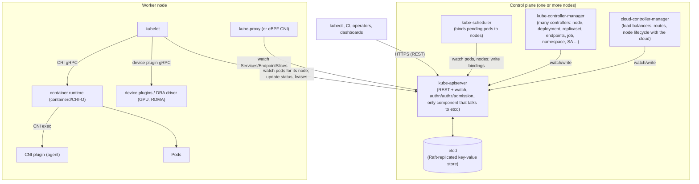
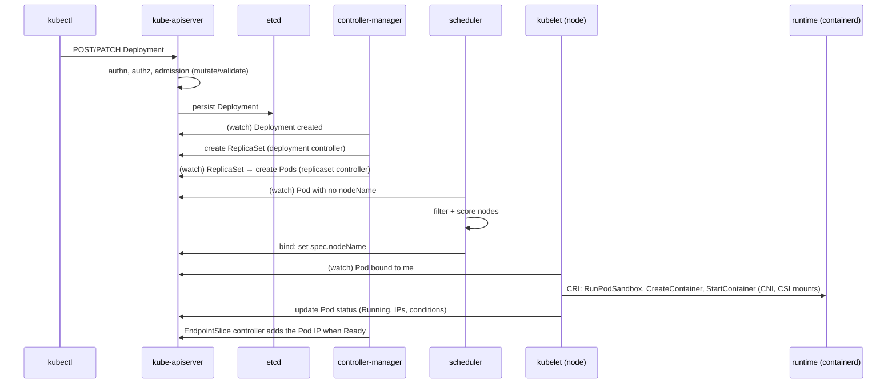
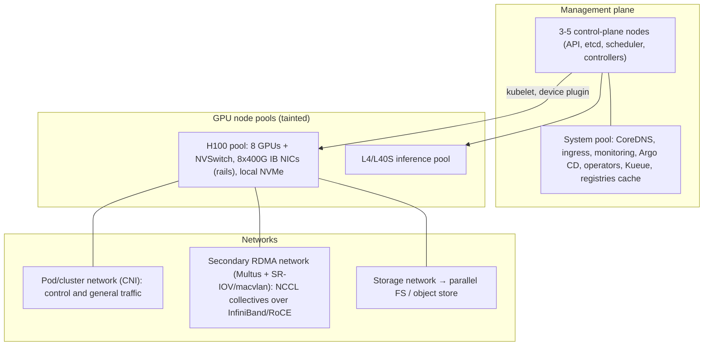

# 5.3 Kubernetes architecture overview: components and what talks to what

| | |
|---|---|
| Level | Beginner to intermediate |
| Priority tier | 0 |
| Lab venue | kind (Docker) or a kubeadm VM cluster; kubectl; `etcdctl` for the etcd exercises |
| Part | Part 5: Kubernetes |
| Status | Drafted, labs **untested** |

## Why this matters for AI infrastructure

At AI scale the Kubernetes control plane is a shared, stateful system under unusual pressure: a large MPI or PyTorch job creates hundreds or thousands of pods at once, thousands of nodes publish status, controllers and schedulers reconcile continuously, and batch systems (Kueue, Volcano) add their own load. When this goes wrong, jobs sit Pending, deployments stall, and `kubectl` times out. To reason about those failures you must know the components, what each reads and writes, which links are synchronous, and which are eventually consistent watches. This chapter builds that map and then shows where GPUs, device plugins, schedulers and operators plug in.

## Prerequisites and outcomes

Needs 5.1 and 5.2 and the networking and Linux fundamentals from Parts 1 and 2. After this chapter you can:

- Name every control-plane and node component, its function, its ports and its inputs/outputs; draw "what talks to what".
- Explain Kubernetes' declarative model: objects with `spec` and `status`, controllers reconciling, watches over polling, level-triggered vs edge-triggered, and eventual consistency.
- Describe how an object travels from `kubectl apply` to a running container (preview of 5.5 to 5.9).
- Explain high-availability topologies (stacked vs external etcd, load-balanced API servers, leader election) and failure behaviour of each component.
- Identify add-ons and extension points (CNI, CSI, CRI, device plugins, admission webhooks, CRDs/operators, scheduler plugins, DRA).
- Sketch the architecture of a GPU/AI cluster and the typical bottlenecks.

## 1. The big picture



Two rules explain most of the architecture:

1. **The API server is the only component that reads and writes etcd.** Every other component (scheduler, controllers, kubelets, kube-proxy, operators, kubectl) talks to the API server. This gives one place for authentication, authorisation, admission, validation, defaulting, versioning and auditing.
2. **Components do not call each other to say "do X".** They write desired state to the API (objects) and **watch** for changes relevant to them, then act to make reality match. The scheduler does not tell the kubelet to run a pod; it writes `spec.nodeName` into the Pod object; the kubelet, watching pods bound to its node, sees it and starts the containers. This decoupling is why Kubernetes tolerates component restarts and is extensible.

## 2. Control plane components

### kube-apiserver

A horizontally scalable, stateless HTTPS server (default port 6443) exposing the Kubernetes API: REST resources grouped by API group/version (`/api/v1/pods`, `/apis/apps/v1/deployments`), plus `watch` (long-lived HTTP streams or WebSocket/HTTP2 of change events), `exec`/`attach`/`portforward` streaming proxies to kubelets, aggregated APIs (metrics-server, custom API servers), discovery endpoints and OpenAPI. Request pipeline: authentication (certs, tokens, OIDC, webhook) → authorization (RBAC, Node, webhook) → admission (mutating, schema validation, validating; built-in plugins and webhooks) → persistence (etcd) → response, with **API Priority and Fairness (APF)** queueing requests by flow to protect the server from overload. It caches objects in memory (watch cache) and serves most reads/watches from the cache rather than etcd. Details in 5.5.

### etcd

A distributed, consistent key-value store using Raft (clients port 2379, peers 2380). Holds **all cluster state**: objects serialised (protobuf) under `/registry/<group>/<resource>/<namespace>/<name>` keys, plus leases and events. Quorum means a 3-node cluster tolerates 1 failure, 5-node tolerates 2. Performance is dominated by disk fsync latency (use SSD/NVMe), network latency between members, and database size (default 2 GiB quota, 8 GiB suggested max). It is the single most critical stateful component; backups and restore drills are mandatory (5.20).

### kube-scheduler

Watches for Pods without `spec.nodeName`; for each, runs a **scheduling cycle** (filter nodes that cannot run the pod, score the survivors, select one) and a **binding cycle** (write a `Binding` to the API). It is plugin-based (Scheduling Framework): extension points `PreFilter`, `Filter`, `PostFilter` (preemption), `Score`, `Reserve`, `Permit`, `Bind`. It does not start containers or look at node runtime state beyond what the API provides (allocatable resources, labels, taints, volumes topology, existing pods). Multiple schedulers can coexist (`spec.schedulerName`), e.g., Volcano or a custom GPU-topology scheduler. Details in 5.18.

### kube-controller-manager

One binary running many **controllers**, each a control loop for one kind of object: node lifecycle (marks nodes NotReady, evicts pods), ReplicaSet, Deployment, StatefulSet, DaemonSet, Job, CronJob, EndpointSlice, Namespace, ServiceAccount, PV/PVC binding and attach/detach, HPA, garbage collector (ownerReferences), TTL, certificate signing, and more. Controllers use **informers** (list + watch with local cache and work queues). Leader election ensures one active instance among replicas. Details in 5.6.

### cloud-controller-manager

Separates cloud-provider logic: node controller (cloud metadata, deleting nodes whose VM is gone), route controller, service controller (creates cloud load balancers for `Service type=LoadBalancer`), volume integrations. On bare metal or GPU clouds it may be absent or replaced by MetalLB, kube-vip, or provider-specific controllers.

### Aggregated and extension API servers

`metrics-server` (resource metrics API), custom-metrics adapters (Prometheus Adapter, KEDA), service catalog successors, and your own API servers register via `APIService` objects and appear under the main API surface. CRDs are the lighter mechanism for most extensions (5.29).

## 3. Node components

- **kubelet**: the node agent. Registers the node, sends heartbeats (Lease objects in `kube-node-lease` every ~10 s; node status updates), watches pods bound to its node (and its static pod manifests directory), drives the runtime via CRI, mounts volumes (with CSI node plugins), runs probes, manages cgroups/QoS, enforces eviction under pressure, reports pod and node status, and serves an authenticated API on port 10250 (`exec`, `logs`, metrics `/metrics/cadvisor`). The kubelet is the only component that is usually **not** a pod itself (a systemd service), because it must start pods.
- **Container runtime** (5.2): containerd or CRI-O + OCI runtime.
- **kube-proxy** (or replacement): programs Service virtual IPs on each node using iptables, IPVS or nftables rules (5.10); eBPF CNIs (Cilium) can replace it.
- **CNI plugin**: attaches pod network namespaces to the cluster network and implements pod-to-pod connectivity and (optionally) NetworkPolicy (5.13 to 5.15). Usually a DaemonSet agent plus binaries under `/opt/cni/bin` and config in `/etc/cni/net.d`.
- **Node-level agents** common in AI clusters: **NVIDIA device plugin / DRA driver** (advertise GPUs), **GPU Feature Discovery / NFD** (labels), **DCGM exporter** (metrics), **node-problem-detector**, log shippers, CSI node drivers, RDMA/SR-IOV device plugins and Multus (multiple network interfaces), kata or sandbox runtime installers.

## 4. Ports and trust

| Component | Port(s) | Authn/z | Notes |
|---|---|---|---|
| kube-apiserver | 6443 (HTTPS) | Client certs, tokens, OIDC | Front with a load balancer for HA; API access control is the cluster's security boundary |
| etcd | 2379 client, 2380 peer | mTLS | Only API servers should be clients; restrict network access; encrypt secrets at rest in etcd via API server `EncryptionConfiguration` |
| kubelet | 10250 (HTTPS), 10248 healthz (local), read-only 10255 (disabled by default) | Webhook authn/z against the API server | Disable anonymous auth; the API server → kubelet connection must be mutually authenticated |
| kube-scheduler | 10259 (HTTPS metrics/health) | Delegated authn | |
| kube-controller-manager | 10257 (HTTPS) | Delegated authn | |
| kube-proxy | 10256 (healthz), 10249 (metrics) | | |
| NodePort Services | 30000-32767 on all nodes | | Firewall appropriately |
| CoreDNS | 53 TCP/UDP, 9153 metrics | | |

Everything inside the control plane communicates over TLS with certificates generated by kubeadm or your installer (5.21); the API server is also a client of kubelets (for logs/exec) and of etcd.

## 5. The declarative object model

Every API object has `apiVersion`, `kind`, `metadata` (name, namespace, uid, labels, annotations, ownerReferences, finalizers, resourceVersion, generation), `spec` (desired state; written by users/controllers) and `status` (observed state; written by controllers/kubelet). Key properties:

- **Level-triggered reconciliation**: controllers compare *current* with *desired* state and act on the difference, not on events. Missing an event does not matter because the next resync finds the difference; this is why Kubernetes self-heals after a controller restart.
- **Watches**: clients list resources once and then stream changes from a `resourceVersion`; informers maintain local caches so controllers rarely hit the API server directly.
- **Optimistic concurrency**: updates carry `resourceVersion`; the server rejects stale writes (409 Conflict); controllers retry. **Server-side apply** tracks field ownership (managedFields) to avoid conflicts among actors.
- **Ownership and garbage collection**: `ownerReferences` link dependents to owners (Pod → ReplicaSet → Deployment); deleting an owner deletes dependents (foreground/background/orphan policies). **Finalizers** block deletion until a controller cleans up external resources.
- **Labels and selectors** are the loose coupling mechanism (Services select Pods; ReplicaSets select Pods; NetworkPolicies select Pods; scheduling uses node labels).
- **Namespaces** partition names, RBAC and quotas; some resources are cluster-scoped (Nodes, PersistentVolumes, StorageClasses, CRDs, ClusterRoles).
- **Events** are best-effort, short-lived records (default 1 h TTL) useful for troubleshooting (`kubectl describe`, `kubectl get events --sort-by=.lastTimestamp`).

## 6. From `kubectl apply` to a running container



Observe this live: `kubectl get events -w`, `kubectl get pods -w -o wide`, `kubectl get --raw /metrics | grep apiserver_request_total`, and with verbosity: `kubectl apply -f x.yaml -v=8` (see REST calls).

## 7. High availability and failure behaviour

### Topologies

- **Stacked etcd**: etcd runs as static pods on the same control-plane nodes (kubeadm default, 3 nodes). Simpler; losing a node loses one API server and one etcd member together.
- **External etcd**: dedicated etcd nodes; more isolation and independent scaling; more machines to operate.
- **API endpoint**: a load balancer (cloud LB, HAProxy/keepalived, kube-vip, DNS round-robin with health checks) in front of N API servers (`controlPlaneEndpoint`). Nodes and users connect to the LB address.
- **Scheduler and controller-manager**: run on each control-plane node with **leader election** via Lease objects (`kube-system`): one active, others standby; failover in ~15 s.
- **Managed control planes** (GKE, EKS, AKS, CoreWeave/Nebius managed Kubernetes): the provider operates API server and etcd; you run nodes and add-ons.

### What fails and what happens

| Failure | Effect | Detection |
|---|---|---|
| One API server down | LB removes it; clients retry; no outage if ≥2 | LB health checks; `apiserver_up` |
| All API servers down | Existing pods keep running (kubelet and runtime continue); no scheduling, scaling, deployments, no `kubectl`; kube-proxy keeps existing rules; node leases expire after ~40 s and, after the eviction timeout (5 min default via taints), pods may be evicted when the API returns and nodes look NotReady | Alerts on API availability |
| etcd loses quorum | API becomes read-only/unavailable (writes fail); cluster state frozen; recovery from backup or member replacement | `etcd_server_has_leader`, `etcd_server_leader_changes_seen_total` |
| etcd slow disk | API latency spikes, leader elections, controller timeouts, `apply` slow | `etcd_disk_wal_fsync_duration_seconds` |
| Scheduler down | Pending pods stay Pending; existing pods unaffected | Pending count, scheduler leader metric |
| Controller-manager down | No new ReplicaSet pods, no node failure handling, no endpoint updates | `workqueue` metrics; leader lease |
| Kubelet down on a node | Node goes NotReady after `node-monitor-grace-period` (40 s); pods stay running on the node but are marked for eviction after tolerations expire (300 s) | Node conditions |
| CoreDNS down | In-cluster name resolution fails (many apps appear down) | CoreDNS metrics, probe |
| CNI agent down | New pods cannot get networking; existing pod networking may continue | Pod events |

Key design consequence: **running workloads do not depend on the control plane being up**; only changes do. That is why a control plane outage during a multi-day training run is often survivable, while a node-level or network-level failure is not.

## 8. Extension points

| Point | Mechanism | Examples |
|---|---|---|
| **Runtime** | CRI | containerd, CRI-O |
| **Network** | CNI | Calico, Cilium, Flannel, Multus, SR-IOV |
| **Storage** | CSI | Cloud disk drivers, Ceph-CSI, Lustre/Weka/VAST CSI, local-path |
| **Devices** | Device plugin API, Dynamic Resource Allocation (DRA) | NVIDIA device plugin, RDMA/SR-IOV device plugin, DRA drivers for GPUs/NICs |
| **Admission** | Mutating/Validating webhooks, ValidatingAdmissionPolicy (CEL) | Kyverno, OPA Gatekeeper, Istio injector |
| **API** | CRDs, aggregated API servers | Kueue, Volcano, KubeRay, Argo, cert-manager |
| **Controllers** | Operators (client-go, controller-runtime) | GPU Operator, Network Operator, Prometheus Operator |
| **Scheduling** | Scheduler plugins/profiles, extenders, secondary schedulers, gang scheduling | Volcano, Kueue admission, coscheduling plugin |
| **Auth** | Webhook authn/authz, OIDC | Dex, Keycloak, cloud IAM |
| **Observability** | Metrics endpoints, Events, audit webhooks, OpenTelemetry | Prometheus, Loki |
| **Node** | NRI, node feature discovery, kubelet plugins | Topology manager, CPU manager |

## 9. Add-ons required for a functioning cluster

A bare control plane + kubelets is not enough:

1. **CNI** (nodes remain NotReady without it).
2. **CoreDNS** (cluster DNS) (5.11).
3. **kube-proxy** or an eBPF replacement (Services).
4. **CSI drivers and StorageClasses** (persistent volumes).
5. **Metrics-server** (for `kubectl top`, HPA).
6. **Ingress/Gateway controller and load balancer implementation** (5.12; MetalLB or cloud).
7. **Monitoring/logging stacks** (5.24).
8. **Cert-manager, policy engine, backup tooling** as needed.
9. **For AI clusters**: NVIDIA GPU Operator (drivers, container toolkit, device plugin, DCGM exporter, MIG manager) or provider equivalents, Network Operator (RDMA, Multus, SR-IOV, secondary networks), Kueue/Volcano/JobSet (batch scheduling), KubeRay/Kubeflow Training Operator/MPI Operator (distributed jobs), storage clients for parallel file systems, topology-aware scheduling, and observability for GPUs (Parts 11 to 17).

## 10. Architecture of a GPU/AI cluster



Characteristic features: GPU nodes are **tainted** (`nvidia.com/gpu`) so only GPU workloads land there; **secondary networks** carry NCCL/RDMA traffic outside the CNI path; **topology** (NUMA, PCIe, NVLink, rail alignment, rack) matters to scheduling (5.18, Part 12); jobs need **gang scheduling** (all pods or none) and **fair-share quotas** across teams (Kueue/Volcano, 5.18, Part 14); node health is gated by GPU diagnostics before workloads land (Part 17); and the control plane must absorb **bursts** (thousands of pods per job) without APF starvation of other clients.

Typical bottlenecks and where to look: API server latency (`apiserver_request_duration_seconds`, APF queue metrics), etcd fsync and database size, scheduler throughput (`scheduler_schedule_attempts_total`, pending pods), controller work queue depth, kubelet pod start latency (image pulls and CNI/CSI), DNS (CoreDNS CPU, conntrack), and registry bandwidth. At 5,000 nodes the defaults need tuning (watch cache sizes, `--max-requests-inflight`, etcd on dedicated NVMe, separate etcd for events, larger controller QPS, scheduler percentageOfNodesToScore).

## 11. Official limits (SIG-Scalability thresholds, approximate)

Kubernetes is tested for up to about 5,000 nodes, 150,000 pods, 300,000 containers, and 110 pods per node by default (configurable). Beyond that, shard clusters (multi-cluster, 5.35) rather than stretching one control plane. Limits are about control-plane capacity, not about nodes' ability to run GPUs.

## 12. Hands-on tour

```bash
kubectl cluster-info
kubectl get nodes -o wide
kubectl get pods -A -o wide                                  # control-plane pods are static pods in kube-system
kubectl get --raw='/readyz?verbose' | head -30               # API server readiness checks incl. etcd
kubectl get --raw=/metrics | grep -E '^apiserver_request_total' | head
kubectl api-resources -o wide | head -40                     # kinds, scope, verbs
kubectl api-versions
kubectl explain pod.spec.containers.resources --recursive | head -40
kubectl get lease -A                                         # leader election + node heartbeats
kubectl get componentstatuses 2>/dev/null                    # deprecated; use /readyz
kubectl get events -A --sort-by=.lastTimestamp | tail -20
# on a control-plane node (kubeadm)
ls /etc/kubernetes/manifests/                                # static pod manifests: etcd, kube-apiserver, kube-controller-manager, kube-scheduler
ls /etc/kubernetes/pki/                                      # CA, apiserver, kubelet client, etcd certs
sudo crictl ps | grep -E 'kube-apiserver|etcd|scheduler|controller'
sudo ETCDCTL_API=3 etcdctl --endpoints=https://127.0.0.1:2379 \
  --cacert=/etc/kubernetes/pki/etcd/ca.crt --cert=/etc/kubernetes/pki/etcd/server.crt --key=/etc/kubernetes/pki/etcd/server.key \
  endpoint status -w table
sudo ETCDCTL_API=3 etcdctl ... get /registry/namespaces/default                  # raw (protobuf) object
```

## 13. Lab (untested)

1. **Build the map**: on a kind cluster list every system pod and, for each, write which component it is, where it runs, and what it connects to; confirm with `kubectl get pods -n kube-system -o wide` and `crictl`.
2. **Watch the flow**: run `kubectl get events -w` and `kubectl get pods -w`, apply a Deployment, and annotate the timeline (Scheduled, Pulling, Created, Started) with the component responsible for each event (events show `reportingComponent`).
3. **Verbose REST**: run `kubectl apply -f deploy.yaml -v=8 2>&1 | grep -E 'GET|POST|PATCH'`; map each call to the pipeline stage; then `kubectl get pods --watch -v=6`.
4. **Declarative reconcile**: delete a pod owned by a ReplicaSet; kill the replica set controller's leader (control-plane static pod) and see that nothing happens until the controller returns; scale the Deployment while the controller manager is stopped (move the static pod manifest away) and see the spec change without effect; restore and watch convergence.
5. **Break the scheduler**: stop kube-scheduler (move its manifest); create a pod and observe Pending with no events; restore.
6. **Node failure behaviour**: stop the kubelet on a worker (`systemctl stop kubelet`), watch the node condition timeline (`kubectl get node -w`), taints added, pod eviction after tolerations; compare with stopping only the container runtime.
7. **API outage**: stop the API server static pod; confirm workloads still run (curl a Service from a pod, `crictl ps`); try `kubectl get pods` and read the error; restore.
8. **etcd inspection**: take a snapshot with `etcdctl snapshot save`, check `snapshot status`; list `/registry` key prefixes; count keys per resource type; note events volume.
9. **Leader election**: find the Leases for scheduler and controller-manager; read `holderIdentity`; kill the leader and watch failover time.
10. **Extension points**: install a trivial CRD and a custom resource; run a mutating webhook example (e.g., a small one that adds a label) or a ValidatingAdmissionPolicy; observe in API server audit/log; list API groups.
11. **GPU architecture sketch**: for your own planned cluster (nodes, networks, operators), draw the equivalent of section 10 with node pools, taints, secondary networks and storage, and list the controllers you will need.
12. **Clean up**.

Mark tested only after execution.

## 14. Common mistakes

- Thinking components call each other directly; debugging by looking for a "command" instead of looking at object state, events and watches.
- Assuming control plane failure kills workloads; or assuming workloads continue forever when nodes lose connectivity (taint evictions).
- Running a single control-plane node or two etcd members (no quorum benefit).
- Putting etcd on slow disks; sharing control-plane nodes with heavy workloads.
- Exposing kubelet or etcd ports broadly; leaving anonymous auth on.
- Treating the Kubernetes API as a database for high-churn data (huge Events, thousands of tiny objects, giant ConfigMaps).
- Forgetting cluster-add-on requirements (CNI, DNS, metrics) in "minimal" designs.
- Not planning for burst load from large batch jobs (APF, scheduler throughput).

## 15. Interview angles

- "Walk through what happens when you create a Deployment." (API, etcd, controllers, scheduler, kubelet, runtime, CNI.)
- "Which components talk to etcd? Why only the API server?" 
- "What happens to running pods if the control plane goes down?" 
- "How does leader election work for the scheduler and controller manager?" 
- "Explain level-triggered reconciliation and why informers/watches are used."
- "How do you make the control plane highly available? Stacked vs external etcd?" 
- "What are the extension points of Kubernetes? Give GPU-specific examples." 
- "How would you scale the control plane for 5,000 GPU nodes and bursts of thousands of pods?" 

## 16. Checkpoint questions (40)

1. Which component stores state? **A:** etcd.
2. Who talks to etcd? **A:** Only kube-apiserver.
3. What does the scheduler write? **A:** Binding (`spec.nodeName`).
4. What starts containers? **A:** kubelet via CRI.
5. What is a controller? **A:** Control loop reconciling current to desired state.
6. What is an informer? **A:** Cached list/watch client with work queue.
7. Default API server port? **A:** 6443.
8. etcd ports? **A:** 2379 client, 2380 peer.
9. Kubelet port? **A:** 10250.
10. What is `resourceVersion`? **A:** Optimistic concurrency/watch bookmark.
11. Spec vs status? **A:** Desired vs observed.
12. Level- vs edge-triggered? **A:** Reconcile state differences, not events.
13. What are finalizers? **A:** Block deletion until cleanup done.
14. What are ownerReferences? **A:** Link dependents to owners for GC.
15. Node heartbeat object? **A:** Lease in `kube-node-lease`.
16. Node NotReady timing? **A:** ~40 s grace; eviction after 5 min tolerations.
17. etcd quorum for 3 members? **A:** 2.
18. Failure tolerance of 5-member etcd? **A:** 2.
19. What do running pods do if API is down? **A:** Keep running.
20. What fails with scheduler down? **A:** New pods stay Pending.
21. What fails with controller manager down? **A:** No reconciliation (replacements, endpoints, node handling).
22. What implements Services on nodes? **A:** kube-proxy or eBPF CNI.
23. What does cloud-controller-manager do? **A:** Cloud integrations (LB, routes, nodes).
24. Stacked etcd means? **A:** etcd co-located with control-plane nodes.
25. How are control-plane components deployed by kubeadm? **A:** Static pods.
26. Where are static pod manifests? **A:** `/etc/kubernetes/manifests`.
27. What is APF? **A:** API Priority and Fairness request queuing.
28. What is the Scheduling Framework? **A:** Plugin extension points for scheduling.
29. What is a CRD? **A:** Custom resource definition extending the API.
30. What is an aggregated API server? **A:** Extra API server registered via APIService.
31. Admission order? **A:** Mutating, schema validation, validating.
32. What are the three runtime-facing interfaces? **A:** CRI, CNI, CSI.
33. What is the device plugin API for? **A:** Advertising devices like GPUs to kubelet.
34. What is DRA? **A:** Dynamic Resource Allocation for flexible device claims.
35. Why taint GPU nodes? **A:** Keep non-GPU workloads off.
36. Why secondary network for NCCL? **A:** RDMA traffic bypasses CNI overlay for performance.
37. Typical scale limit per cluster? **A:** ~5,000 nodes / 150k pods.
38. Which metric shows API latency? **A:** `apiserver_request_duration_seconds`.
39. Which etcd metric signals slow disk? **A:** WAL fsync duration.
40. What is server-side apply? **A:** Field-ownership-based apply on the server.

## 17. Sources and review notes

**Written in original words.** Principal sources:

- Brendan Burns, Joe Beda, Kelsey Hightower and Lachlan Evenson, *Kubernetes: Up and Running* (3rd edition; chapter 1 introduction and chapter 3 on deploying a cluster, architecture sections).
- Josh Rosso, Rich Lander, Alex Brand and John Harris, *Production Kubernetes* (architecture, deployment models).
- The author's `nvidia-devops` repository, volume 03 (control plane, API machinery, etcd, scheduling for AI-factory scale).
- Kubernetes documentation (components, API concepts, controller pattern, leader election, scalability thresholds).
- Examples are the author's constructions.

**Flagged for verification before publishing:** default timings (node grace period, lease interval, toleration seconds), ports, scalability thresholds for your Kubernetes version, ValidatingAdmissionPolicy and DRA status by release, and every command listing; all labs are **untested**.
