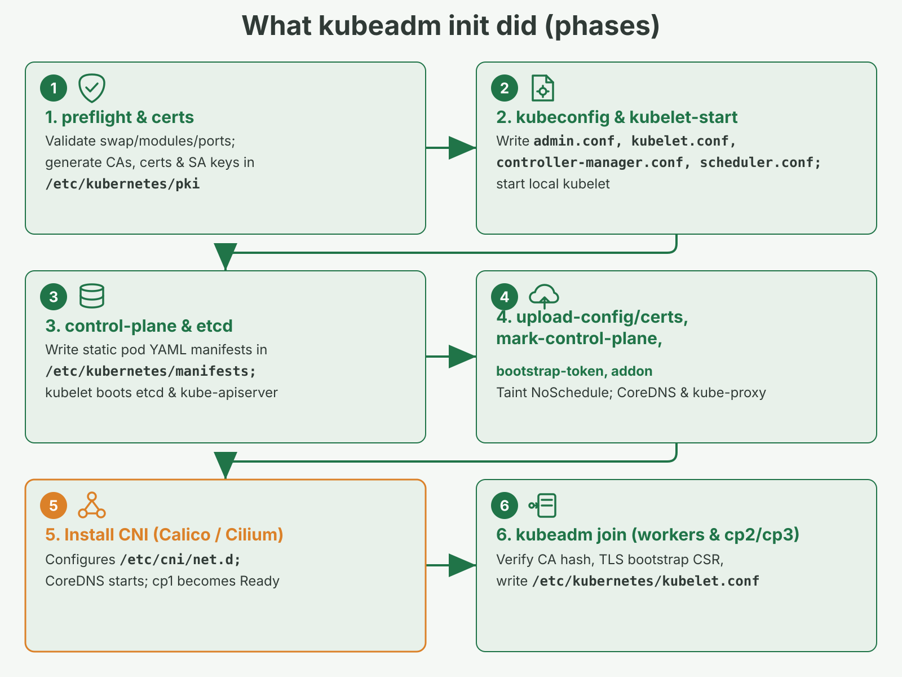
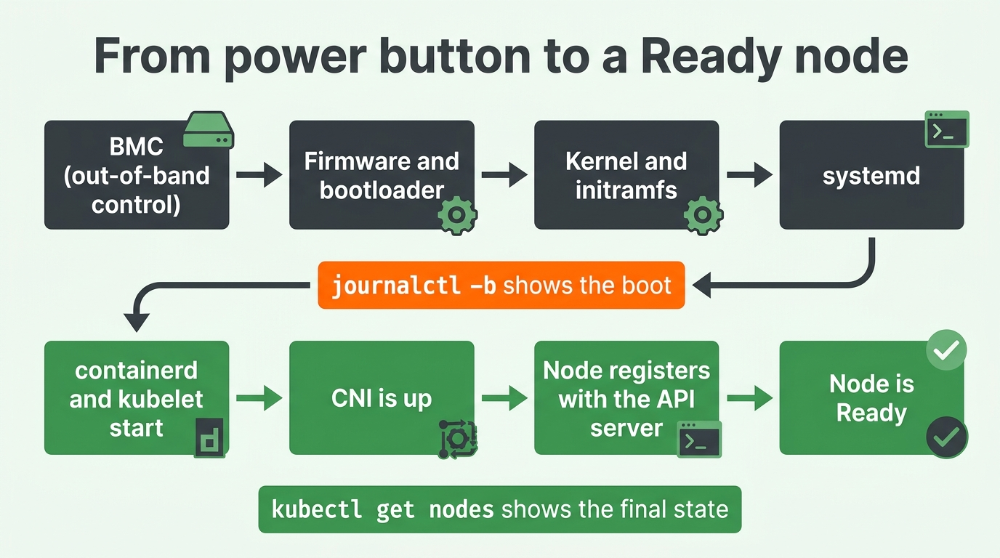

# 5.4 Bare-metal Kubernetes from scratch with kubeadm (lab)

| | |
|---|---|
| Level | Intermediate |
| Priority tier | 0 |
| Lab venue | 3 VMs minimum (1 control plane, 2 workers) with 2 vCPU/4 GB each; 5 VMs for the HA variant; internet access or a mirror; optional GPU node |
| Part | Part 5: Kubernetes |
| Status | Drafted, labs **untested** |

## Why this matters for AI infrastructure

Suppose you inherit a GPU cluster and nobody left a runbook. Nobody can tell you which settings were chosen on purpose and which were left at their defaults. A node is misbehaving, and you have no picture of what healthy looks like. Before you can say what is wrong with one node, you need a clear picture of a good one. Many GPU clusters leave you in exactly this spot. On-premises DGX and HGX systems, colocation sites and some GPU clouds do not give you a managed Kubernetes control plane. You install and run Kubernetes yourself, often with kubeadm, Kubespray, Base Command Manager or a vendor distribution.

Even if you later move to a managed service, building a cluster by hand once teaches you what each component does. You learn what must be true of a node before Kubernetes can run on it. Those things are the kernel modules, the sysctls, swap, the container runtime and cgroups. You also learn how certificates and kubeconfig files fit together. You will meet the same pieces again on the day a worker refuses to join, or the day the CNI plugin will not start. This lab is the foundation for the chapters that follow, on the API, controllers, the kubelet, networking, storage and upgrades. It also prepares you for adding GPUs in Part 11.

## Prerequisites and outcomes

This lab builds on chapters 5.1 to 5.3, on Linux administration from Part 1 and on networking from Part 2. Those skills let you read the output of each step, instead of copying commands you do not understand. The list below works as a self-check. Each line names one ability you should have by the end of the lab. If a line feels unfamiliar when you reach it, go back to that step and read it again slowly, ideally on a VM you can break and rebuild.

- Prepare each node with its OS settings, kernel modules, sysctls, swap, time, hostname, firewall and container runtime, and explain why each step is needed.
- Install `kubeadm`, `kubelet` and `kubectl` at matching versions and run `kubeadm init` with a config file. Explain every phase and artefact it produces: certificates, kubeconfigs, static pod manifests, bootstrap tokens, and the CoreDNS and kube-proxy add-ons.
- Install a CNI, join workers, label and taint nodes, deploy a test application and Service, and verify cluster health.
- Build a highly available control plane with 3 API servers behind a virtual IP or load balancer, using stacked etcd, and add or remove control-plane nodes.
- Add a GPU node and verify GPU scheduling, which previews Part 11.
- Troubleshoot the common failure modes of kubeadm clusters.

## 1. Plan the cluster

Imagine the cluster is up and running, and a team asks for a bigger pod network. You look at the plan and find that the address range was too small from the start, and changing it means rebuilding. That is why planning comes first. Some settings are hard to change once the cluster exists, so the plan has to be right before you install anything. Start with the machines and the role each one plays. The table shows the minimum set for this lab.

| Role | Hostname | Spec (lab) | Notes |
|---|---|---|---|
| Control plane | `cp1` (and `cp2`, `cp3` for HA) | 2 vCPU, 4 GB, 40 GB SSD | etcd stacked; static IPs |
| Workers | `w1`, `w2` | 2 vCPU, 4 GB | CPU workers |
| GPU worker (optional) | `gpu1` | NVIDIA GPU, driver installed, 8+ vCPU | Added in section 9 |
| API VIP (HA) | `k8s-api.lab.local` / `10.0.0.100` | kube-vip or HAProxy+keepalived | `controlPlaneEndpoint` |

The GPU worker is optional, and you add it later in section 9. Everything else is needed from the start. Some of the choices below are hard to change once the cluster exists, so settle them before you run any install command.

**Kubernetes version.** Use one minor version for `kubeadm`, `kubelet` and `kubectl`. Think of them as three parts of one machine. A mismatched part may still turn over, but it does not run the way the designers tested it. The skew policy allows kubelet to be up to 3 minor versions older than the API server in recent releases, and kubectl to be ±1 version away.

**Pod CIDR and Service CIDR.** A CIDR is a block of IP addresses, written as a network address and a prefix length. The pod CIDR (for example `10.244.0.0/16`) gives each pod an address. The Service CIDR (`10.96.0.0/12`) gives each Service a stable virtual address. These two ranges must not overlap with node networks, VPNs or each other. If they do, traffic goes to the wrong place and the bug is hard to see. Size the pod CIDR for the largest cluster you expect. A `/16` gives 256 nodes of `/24` each, so it covers a cluster of 256 nodes.

**CNI choice.** The CNI plugin is the software that gives each pod its network. You pick Calico, Cilium or Flannel, as covered in 5.13 to 5.15. Some CNIs need specific pod CIDRs or kernel features, so check them against the CIDR plan above.

**Runtime.** Use containerd with the systemd cgroup driver, as covered in 5.2. The cgroup driver decides who manages the resource limits for each container. The kubelet and the runtime must agree on that choice, or the node becomes unstable.

**Control plane endpoint.** Set `--control-plane-endpoint` at init if you will ever add control-plane nodes. Every node and every client will use this address to find the API server. Changing it later is painful, because it is written into many files.

**Network.** Every node must reach the others on the ports listed below. Each node also needs a unique hostname, MAC address and `product_uuid` (`/sys/class/dmi/id/product_uuid`), plus DNS or `/etc/hosts` entries. These identifiers are how Kubernetes tells two machines apart. Two machines cloned from one image with the same identifiers look like one machine to the cluster.

The table below lists the ports you need to open. Each row gives a direction, a port and what uses it.

| Direction | Port | Purpose |
|---|---|---|
| Control plane inbound | 6443 | Kubernetes API (all) |
| | 2379-2380 | etcd (control plane nodes only) |
| | 10250 | kubelet API (control plane/self) |
| | 10259, 10257 | scheduler, controller-manager (local) |
| Worker inbound | 10250 | kubelet API |
| | 30000-32767 | NodePort Services |
| All nodes | CNI-specific | VXLAN UDP 4789/8472, BGP TCP 179, Wireguard UDP 51820, etc. |

Notice that only the control plane nodes need the etcd ports. Workers need the kubelet port and the NodePort range, and the CNI row applies to every node. When a node cannot join, this table is the first place to look.

### Bare metal versus virtualized

You may wonder whether a virtual machine layer is needed at all, since containers already do much of the same job. The answer is not necessarily. Kubernetes works well on bare metal and on virtualized hosts. Choose the medium by the problems each technology solves, and by your team's experience with it.

Virtualization changed how infrastructure gets provisioned. Older teams PXE booted hosts, configured servers by hand and attached storage to servers one piece at a time. Modern virtual environments put all of that behind APIs. You can create, change and delete resources without knowing what the hardware looks like.

Virtual machines also let you clone machines and run several operating systems on one server. You can size resources to each application and change settings without disrupting the server. Upgrading one host does not touch the others on the same hardware.

Virtualization has trade-offs. Running further from the metal adds overhead, and the virtualization stack itself adds more. Latency-sensitive applications, such as trading, may prefer bare metal. Telcos running 5G networks at the edge may want to work directly against the hardware.

Kubernetes pushes the point of interaction higher still. An operator sees the machines as a sea of compute. Workloads declare what they need, and the scheduler places them. The underlying computers still matter, though. Clusters integrate with infrastructure at several points. Many use CSI drivers to reach storage providers. Infrastructure management projects can request new hosts and join them to the cluster. Most often, organizations rely on Cloud Provider Integrations, or CPIs. These do extra work, such as provisioning load balancers outside the cluster to route traffic in.

Leaving virtualization behind means losing conveniences that Kubernetes does not solve by itself. Still, projects and integration points for bare metal keep improving. Major cloud providers now offer bare metal options, and bare metal IaaS services are gaining share. Success on bare metal still brings its own challenges:

- Significantly larger nodes: Larger nodes usually run more Pods, and with thousands of Pods per node, operations get harder. Draining a node for an in-place upgrade can trigger 1000+ rescheduling events.
- Dynamic scaling: You need new nodes up quickly as workload or traffic changes.
- Image provisioning: You bake and distribute machine images quickly, so cluster nodes stay as immutable as possible.
- Lack of load balancer API: You must route ingress traffic from outside the cluster to the Pod network inside it.
- Less sophisticated storage integration: Getting network-attached storage to Pods takes more work.
- Multitenant security concerns: With hypervisors, security-sensitive containers can run on dedicated hypervisors. You can slice a physical server any arbitrary way and make scheduling decisions from there.

These challenges can be solved. Load balancer gaps can be handled with projects such as kube-vip or MetalLB, and storage can come from integrating with a Ceph cluster. Still, containers are not a new kind of virtualization. In most implementations, they use Linux kernel primitives to make processes feel isolated from others on the same host.

Choosing among cloud virtual machines, on-premises virtualization and bare metal comes down to two things. The first is what your workloads need. The second is what your team already knows how to run. If you are weighing Kubernetes as a stand-in for a virtualization stack, first pin down what Kubernetes actually fixes for you. Learning to run Kubernetes is already a big effort, and changing the infrastructure underneath it adds engineering effort and risk.

### Compute infrastructure

A Kubernetes cluster needs machines, and managing pools of them is the core job. Early on, you choose the machine types. That means how many cores, how much memory, how much local storage, what grade of network interface, and whether you need specialized devices such as GPUs. The software you plan to run drives these answers. If your workloads fit a general-purpose machine's ratio of compute to memory, and their demand is steady, the job is simple. Diverse software makes it harder. Consider these machine types:

- etcd machines (optional): Only needed if you run a dedicated etcd cluster for your Kubernetes clusters. These machines should prioritize disk read and write performance, so never use old spinning disk hard drives. Give etcd its own storage disk, so it does not compete with the OS or other programs. Consider network proximity too, to reduce latency between etcd machines.
- Control plane nodes (required): These machines run only control plane components. Use general-purpose machines, sized and numbered for the expected cluster size and your failure tolerance. A larger cluster means the API server has more clients and more traffic. You can add compute to each machine or add more machines. The scheduler and controller-manager each have only one active leader at a time, so adding replicas does not raise their capacity. If they starve, scale them vertically with more compute per machine. If you colocate etcd on these machines, the same etcd considerations apply.
- Worker nodes (required): General-purpose machines that host everything that is not control plane.
- Memory-optimized nodes (optional): For workloads whose memory profile does not suit general-purpose nodes. Take AWS general-purpose `M5` instances, with a CPU-to-memory ratio of `1CPU:4GiB`. A workload that consumes `1CPU:8GiB` leaves CPU unused when its resources are reserved at that ratio. `R5` instances, at `1CPU:8GiB`, overcome that inefficiency.
- Compute-optimized nodes (optional): For workloads that fit a compute-optimized shape, such as the `C5` instance type at `1CPU:2GiB`. Adding a node pool with these types improves efficiency.
- Specialized hardware nodes (optional): GPUs are the most common request. If machine learning workloads need specialized hardware, add a node pool and target those nodes for those workloads.

### Networking infrastructure

Networking is easy to brush off as an implementation detail, but it can change your deployment model. Design for these elements.

Routability comes first. You almost never want cluster nodes exposed to the public internet, because the convenience rarely justifies the threat. A well-secured bastion host or jump box that allows SSH is a low-cost way in. The private network raises deeper questions. Storage arrays, internal container registries, CI/CD systems, internal DNS and private NTP servers all need connectivity. Your cluster still usually needs public resources, such as public container registries, even if that path runs through an outbound proxy.

If outbound internet access is out of the question, open source container images and system packages must reach the cluster some other way. Prefer simple, consistent and effective systems. Avoid mindless mandates, and avoid human approval steps for infrastructure that cluster deployments depend on.

Redundancy is the second element. Availability zones (AZs) help keep uptime high. An AZ is a datacenter with its own power source and backup, and its own connection to the public internet. Two subnets in one datacenter sharing a single power supply do not make two AZs. Two distinct datacenters close together, joined by a low-latency, high-bandwidth link, do. Two AZs is good, and three is better. Beyond that, the number depends on how big a disaster you need to prepare for.

Datacenters do go down. Simultaneous outages across a region are possible but rare. Decide where redundancy matters most, for your workloads or for the cluster control plane. Running etcd across AZs is acceptable, but revisit the network considerations if you do. Spreading control plane nodes across AZs gives the cluster a backup for its own management. If your workloads do not lean on the control plane, and they should not, a control plane failure leaves them running. What it blocks is change, because you cannot easily alter software that is already running. Treat it as a serious incident, but understand that it differs from an outage that customers can see.

Load balancing is the third element. You need a load balancer in front of the Kubernetes API servers. If you can provision one programmatically, create and configure it as part of control plane deployment. Think through the access policies for the API and the firewalls the load balancer sits behind. You almost certainly will not expose it to the public internet. Remote access to the control plane is usually done through a VPN into the cluster's local network. Publicly exposed workloads need a separate load balancer connected to the cluster ingress. One ingress load balancer serves most incoming requests, so adding one per workload adds little value. With a dedicated etcd cluster, skip the load balancer between the API servers and etcd, because the API's built-in etcd client manages those connections itself.

Settle the CIDRs, the control plane endpoint and the zone layout before you run `kubeadm init`. These are the choices you cannot easily undo.

## 2. Prepare every node

Every node needs the same base before Kubernetes goes on it. Think of this section as a pre-flight checklist. A pilot does not skip items because the plane looked fine yesterday, and you should not skip them because a node looks fine today. Work through this preparation on each machine, as root or with sudo. The names and versions below are examples, so verify them against current docs.

The lab outputs in this chapter were not verified on live hardware, so treat each result you see as the thing to check against your own machine.

```bash
# 1. Hostnames and name resolution
sudo hostnamectl set-hostname cp1
cat <<EOF | sudo tee -a /etc/hosts
10.0.0.11 cp1
10.0.0.12 cp2
10.0.0.13 cp3
10.0.0.21 w1
10.0.0.22 w2
10.0.0.100 k8s-api.lab.local
EOF

# 2. Time sync (certificates and etcd need accurate clocks)
sudo apt-get update && sudo apt-get install -y chrony && sudo systemctl enable --now chrony

# 3. Disable swap (kubelet refuses to start with swap enabled by default)
sudo swapoff -a
sudo sed -i.bak '/\sswap\s/ s/^/#/' /etc/fstab
# (Swap support exists as a feature gate (NodeSwap); keep it off for GPU/ML nodes unless you have a reason.)

# 4. Kernel modules
cat <<EOF | sudo tee /etc/modules-load.d/k8s.conf
overlay
br_netfilter
EOF
sudo modprobe overlay && sudo modprobe br_netfilter

# 5. Sysctls
cat <<EOF | sudo tee /etc/sysctl.d/99-k8s.conf
net.bridge.bridge-nf-call-iptables  = 1
net.bridge.bridge-nf-call-ip6tables = 1
net.ipv4.ip_forward                 = 1
fs.inotify.max_user_watches         = 524288
fs.inotify.max_user_instances       = 8192
vm.max_map_count                    = 262144
EOF
sudo sysctl --system

# 6. Verify cgroup v2 and unique identifiers
stat -fc %T /sys/fs/cgroup           # cgroup2fs
cat /sys/class/dmi/id/product_uuid
ip link show | grep link/ether       # MACs unique across nodes

# 7. Firewall: either allow the ports above or disable ufw/firewalld in a lab
sudo ufw disable 2>/dev/null || true
```

Each step in that block exists for a reason, and the reasons matter when a node misbehaves. Start with the networking steps. Pod traffic crosses a Linux bridge on its way between containers and the host. By default, the kernel does not send bridged traffic through the iptables rules. The `br_netfilter` module and the bridge sysctls change that. They let iptables see the pod traffic, and Services and NetworkPolicy depend on iptables seeing it. The `ip_forward` sysctl lets the node route pod traffic from one interface to another, so a packet can leave a pod and reach another node.

Swap comes next. Kubernetes schedules by reserving memory for each pod, and it assumes that the memory it promised is real RAM. Swap breaks that assumption. A pod can look healthy while the kernel quietly moves its memory to disk, and then latency spikes with no clear cause. That is why the block turns swap off. The `overlay` module provides the union filesystem that container images are built from. The inotify limits prevent "too many open files" errors for the kubelet and for log shippers on busy nodes. Accurate clocks prevent certificate and Raft problems. A certificate that looks "not yet valid" to one node, because its clock runs behind, will fail every handshake with that node.

### Container runtime (containerd)

The runtime is the piece that actually starts containers. The kubelet does not start containers itself. It asks the runtime through a standard interface called CRI, the Container Runtime Interface. Install the runtime, switch it to the systemd cgroup driver, and point `crictl` at its socket. `crictl` is a debugging tool that talks to the same socket, so you can see what the runtime sees.

```bash
sudo apt-get install -y containerd             # or from Docker's repo for newer versions
sudo mkdir -p /etc/containerd
containerd config default | sudo tee /etc/containerd/config.toml >/dev/null
sudo sed -i 's/SystemdCgroup = false/SystemdCgroup = true/' /etc/containerd/config.toml
# Optionally set sandbox_image to your mirror, e.g. registry.k8s.io/pause:3.9
sudo systemctl enable containerd && sudo systemctl restart containerd
sudo crictl config --set runtime-endpoint=unix:///run/containerd/containerd.sock
```

The `sed` line is the one that matters most. It flips `SystemdCgroup` from `false` to `true`, so containerd hands resource limits to systemd, the same manager the kubelet uses. If the two disagree, you get a node that runs, but whose resource accounting is split between two managers. That split shows up later as strange memory numbers and as restarts that do not match the limits you set.

### Kubernetes packages

Install the three Kubernetes packages from the official repository. Then pin them, so an ordinary system update cannot move the cluster to a new version without you choosing to. Picture a Friday night security patch that quietly upgrades kubelet on one node. On Monday, that node speaks a different version from the rest of the cluster. The hold command stops that from happening.

```bash
sudo apt-get install -y apt-transport-https ca-certificates curl gpg
sudo mkdir -p -m 755 /etc/apt/keyrings
curl -fsSL https://pkgs.k8s.io/core:/stable:/v1.30/deb/Release.key | sudo gpg --dearmor -o /etc/apt/keyrings/kubernetes-apt-keyring.gpg
echo 'deb [signed-by=/etc/apt/keyrings/kubernetes-apt-keyring.gpg] https://pkgs.k8s.io/core:/stable:/v1.30/deb/ /' | sudo tee /etc/apt/sources.list.d/kubernetes.list
sudo apt-get update
sudo apt-get install -y kubelet kubeadm kubectl
sudo apt-mark hold kubelet kubeadm kubectl      # prevent surprise upgrades (upgrades are deliberate, 5.20)
sudo systemctl enable --now kubelet              # it will crash-loop until kubeadm init/join provides config: expected
```

Match the repository minor version to the one you intend to run, because the URL embeds it. The old `apt.kubernetes.io` repositories are deprecated. Notice the last line. The kubelet will crash-loop right after you install it, and that is normal. It is waiting for a configuration file that only `kubeadm init` or `kubeadm join` creates. If you see the restarts before you have run either command, you are seeing the expected state.

### What to install on each machine

Start with the obvious. You need an operating system. Pick a Linux distribution that the community commonly runs Kubernetes on and tests against, because that is the safe choice. RHEL, CentOS and Ubuntu are easy picks. Enterprise support for another distribution, or a strong preference for one, also works, as long as you invest time in testing it. A distribution designed for containers, such as Flatcar Container Linux, earns extra points.

Next, you need a container runtime, such as `docker` or `containerd`. When you run containers, you must have one.

Then comes the `kubelet`, the agent that connects Kubernetes to the containers it orchestrates. You install it on each machine. Kubernetes itself runs in containers, but the `kubelet` runs as a regular binary on the host. Some people have tried running the `kubelet` in a container. That only complicates things, so avoid it. Put the `kubelet` on the host and run everything else in containers. Your mental model stays clear, and the practical steps still hold up.

So far you have a Linux OS, a container runtime and an agent that can talk to that runtime. The `kubelet` can start containers, but without a control plane it does not know which Pods to run. This is where `kubeadm` and static Pods come in. Other tools can bootstrap the control plane too, but `kubeadm` is widely adopted and runs in many enterprise production systems. It is a command-line program that writes, in part, the static Pod manifests needed to bring Kubernetes up. The `kubelet` can watch a directory on the host and run any Pod manifest it finds there. `kubeadm` configures the `kubelet` and deposits the manifests. That bootstraps the core control plane components: etcd, `kube-apiserver`, `kube-scheduler` and `kube-controller-manager`.

After that, the `kubelet` takes further instructions from Pod manifests submitted to the Kubernetes API. `kubeadm` also generates bootstrap tokens, which let you join other nodes to the new cluster securely.

Last, you need a bootstrap utility. The Cluster API project uses custom resources and controllers for this. A command-line program installed on the host also works well. Its main job is to call `kubeadm` and manage runtime configuration.

When the machine boots, arguments tell the utility how to bootstrap Kubernetes. In AWS, for example, you can use user data to run the utility with arguments that set which flags go to the `kubeadm` command or what goes into a `kubeadm` config file. At a minimum, its runtime config must say whether to create a new cluster with `kubeadm init` or join an existing one with `kubeadm join`.

The utility also needs a secure place to store the bootstrap token when initializing, or to fetch it when joining. Those tokens make sure only approved machines join your cluster, so handle them with care. To learn which runtime configs you need, run through a manual install with `kubeadm`, using the official docs. As you go, you will see what your environment requires.

### Containerized control plane components

The static manifests used to start a cluster should include the essential control plane components: etcd, `kube-apiserver`, `kube-scheduler` and `kube-controller-manager`. Custom Pod manifests are allowed, but keep that list short. Include only Pods that must run before the API is up, or before the cluster joins a federated system. Anything that can wait for the API should be installed through it. The reason is that a Pod created from a static manifest can be managed only by editing that manifest on the machine's disk. That is much less accessible and much harder to automate than an object you can change through the API.

With `kubeadm`, which is strongly recommended, the static manifests for the control plane, etcd included, are created when a control plane node is initialized with `kubeadm init`. Pass any flags you need for these components through a `kubeadm` config file. The bootstrap utility can write a templated `kubeadm` config file for you.

Avoid customizing the static Pod manifests directly with your bootstrap utility. If you really need to, you can split manifest creation and cluster initialization into separate `kubeadm` steps, which gives you a chance to inject customization. Do that only when the change matters and cannot be expressed in the `kubeadm` config. A simpler bootstrap of the control plane is more robust, faster, and far less likely to break with Kubernetes version upgrades.

`kubeadm` also generates self-signed TLS assets that secure connections between control plane components. Leave those alone. If your security requirements demand your corporate CA as the source of trust, you can use it, but you must then be able to automate getting the intermediate authority. If your cluster bootstrapping systems are secure, the self-signed CA stays trustworthy. It is valid only for the control plane of a single cluster.

Keep the static manifest list short, and send anything that can wait for the API through the API.

## 3. Initialise the first control-plane node

Put the choices in a configuration file. That makes each one explicit, and you can review the file and store it in Git. A command-line flag disappears once the shell closes. A file stays, and the next person can read it.

```yaml
# kubeadm-config.yaml
apiVersion: kubeadm.k8s.io/v1beta4
kind: InitConfiguration
localAPIEndpoint:
  advertiseAddress: 10.0.0.11
  bindPort: 6443
nodeRegistration:
  criSocket: unix:///run/containerd/containerd.sock
  name: cp1
  kubeletExtraArgs:
    - name: node-ip
      value: 10.0.0.11
---
apiVersion: kubeadm.k8s.io/v1beta4
kind: ClusterConfiguration
kubernetesVersion: v1.30.4
clusterName: lab
controlPlaneEndpoint: "k8s-api.lab.local:6443"     # use cp1:6443 for a single control plane you won't expand
networking:
  podSubnet: 10.244.0.0/16
  serviceSubnet: 10.96.0.0/12
  dnsDomain: cluster.local
apiServer:
  certSANs: ["k8s-api.lab.local", "10.0.0.100", "10.0.0.11"]
  extraArgs:
    - name: audit-log-path
      value: /var/log/kubernetes/audit.log
etcd:
  local:
    dataDir: /var/lib/etcd
---
apiVersion: kubelet.config.k8s.io/v1beta1
kind: KubeletConfiguration
cgroupDriver: systemd
serverTLSBootstrap: true             # kubelet serving certs via CSR (approve them; see 5.21)
```

Read the file from top to bottom. The first document describes this one machine. It names the address the API server listens on and the runtime socket the kubelet should use. The second document describes the whole cluster. It sets the version to install, the name of the cluster, and the endpoint everyone will use to reach the API. It also sets the two address ranges from section 1, and it adds the names and addresses the API certificate must cover. The `certSANs` list matters later. A client that connects by a name the certificate does not list gets a TLS error. The third document configures the kubelet itself, so the systemd cgroup driver and the serving certificate settings match the runtime you prepared in section 2.

Pull the control-plane images first, then run `kubeadm init` against the file and log its output. Pulling first means the init step does not stall on a slow download halfway through. The logged output is worth keeping, because it is the record of what happened if something fails later. The last lines copy the admin kubeconfig into your home directory, so `kubectl` can reach the cluster as your user.

```bash
sudo kubeadm config images pull --config kubeadm-config.yaml        # pre-pull control-plane images
sudo kubeadm init --config kubeadm-config.yaml --upload-certs 2>&1 | tee kubeadm-init.log
mkdir -p $HOME/.kube
sudo cp -i /etc/kubernetes/admin.conf $HOME/.kube/config && sudo chown $(id -u):$(id -g) $HOME/.kube/config
kubectl get nodes         # cp1 NotReady until a CNI is installed
```

On a fresh install, `kubectl get nodes` shows cp1 as NotReady. That is expected until you install a CNI in section 4. The node is running, and the API answers, but the node has no network yet, so it reports itself as not ready. If you see NotReady and nothing else, you are on track. If you see anything about a failed init, go to the troubleshooting table in section 11 before you try again.

### What `kubeadm init` did (phases)

Think of `kubeadm init` as a set of workers building a house in a fixed order. Each phase depends on the one before it. You cannot write the static Pod manifests before the certificates exist, and the certificates are useless until the kubelet can run them. The diagram traces the phases in order. The table after it says what each phase leaves behind.



*Figure 5.4.1. What kubeadm init did (phases), as a diagram.*

| Phase | Result |
|---|---|
| `preflight` | Checks: root, ports free, swap off, runtime reachable, kernel modules, cgroup driver |
| `certs` | Cluster CA, API server serving cert (with SANs), kubelet client, front-proxy CA/cert, etcd CA/server/peer certs, service-account key pair in `/etc/kubernetes/pki` (valid 1 year for leaf certs by default, CA 10 years) |
| `kubeconfig` | `admin.conf`, `super-admin.conf`, `kubelet.conf`, `controller-manager.conf`, `scheduler.conf` in `/etc/kubernetes` |
| `kubelet-start` | Writes `/var/lib/kubelet/config.yaml` and flags, starts the kubelet |
| `control-plane` | Writes **static pod manifests** `kube-apiserver.yaml`, `kube-controller-manager.yaml`, `kube-scheduler.yaml` in `/etc/kubernetes/manifests`; the kubelet runs them |
| `etcd` | Static pod manifest for the local etcd member |
| `upload-config` / `upload-certs` | Stores ClusterConfiguration in a ConfigMap (`kube-system/kubeadm-config`); optionally encrypts control-plane certs in a Secret for joining other control-plane nodes (valid 2 hours) |
| `mark-control-plane` | Labels `node-role.kubernetes.io/control-plane` and taints `NoSchedule` |
| `bootstrap-token` | Creates a bootstrap token Secret for workers to join; RBAC for TLS bootstrapping and CSR auto-approval |
| `addon` | Installs **CoreDNS** (Deployment) and **kube-proxy** (DaemonSet) |

Two numbers in that table are worth remembering. Leaf certificates last 1 year by default, while the CA lasts 10 years. The uploaded control-plane certificates expire after 2 hours. The two lifetimes are different for a reason. The CA is the root of trust, so it changes rarely. Leaf certificates are issued to individual components, so they expire sooner and get renewed more often. The 2-hour window is a security choice. The control-plane keys sit in a Secret only for as long as you need them to join a second control plane node.

Look at what `kubeadm init` produced before you move on. Each command below shows one set of artefacts. Read the output of each one and ask what it tells you about the node. The first command lists the files. The second shows the flags the API server was started with. The third checks certificate expiry, and the last two show the configuration that kubeadm stored in the cluster.

```bash
ls /etc/kubernetes /etc/kubernetes/manifests /etc/kubernetes/pki
sudo cat /etc/kubernetes/manifests/kube-apiserver.yaml | head -60       # flags: authorization-mode, admission plugins, etcd servers, certs
sudo kubeadm certs check-expiration
kubectl -n kube-system get pods -o wide
kubectl -n kube-system get cm kubeadm-config -o yaml | head -40
kubectl -n kube-system get cm kubelet-config -o yaml | head -30
```

Keep `kubeadm-config.yaml` under version control, so you can review the choices later.

## 4. Install a CNI

After init, `cp1` is up but still reports NotReady. The missing piece is the network plugin. Think of it as building roads after the houses are finished. The houses exist, but nothing can move between them yet. Nodes stay NotReady until a CNI configures `/etc/cni/net.d`. This example uses Calico, which is operator-based. Cilium and Flannel are alternatives, covered in 5.13 to 5.14.

```bash
kubectl create -f https://raw.githubusercontent.com/projectcalico/calico/v3.28.0/manifests/tigera-operator.yaml
cat <<EOF | kubectl create -f -
apiVersion: operator.tigera.io/v1
kind: Installation
metadata: { name: default }
spec:
  calicoNetwork:
    ipPools:
      - blockSize: 26
        cidr: 10.244.0.0/16
        encapsulation: VXLANCrossSubnet
        natOutgoing: Enabled
        nodeSelector: all()
EOF
kubectl get pods -A -w          # wait for calico-system, coredns Running
kubectl get nodes               # cp1 Ready
```

The first command installs the Calico operator, which is a controller that manages the rest of Calico for you. The second creates an `Installation` object. That object carries the pod pool, and the pool must match the `podSubnet` you set in section 3. If the two differ, pods receive addresses the routing does not know about. The `-w` flag on the third command keeps the watch open, so you see each system pod reach Running. When the node turns Ready, the network path is working.

If you choose Cilium instead, install it with `cilium install --set ipam.operator.clusterPoolIPv4PodCIDRList=10.244.0.0/16`, and optionally replace kube-proxy at the same time. Then verify the network with `cilium connectivity test`, or by having two pods ping each other across nodes. Verification is not a formality. A CNI can report success and still drop traffic between nodes, so a test that crosses a node boundary is the only real proof.

Wait until `cp1` reports Ready and the system pods are running before you go on.

## 5. Join workers

The control plane is ready, so the next step is to bring workers in. A worker needs two things before it can join. It needs a way to prove it is talking to the real API server, and it needs a credential that lets it ask for its own identity. The join token and the CA hash handle those two jobs. Think of the token as a one-time invitation and the hash as a fingerprint of the building's front door. The worker checks the fingerprint before it hands over the invitation.



*Figure 5.4.2. A node is Ready only after boot, runtime, kubelet and network are all up.*

On `cp1`, create a join command. The token is valid for 24 h by default.

```bash
kubeadm token create --print-join-command
# or build it: token + CA cert hash
openssl x509 -pubkey -in /etc/kubernetes/pki/ca.crt | openssl rsa -pubin -outform der 2>/dev/null | openssl dgst -sha256 -hex | sed 's/^.* //'
```

The first command is the normal route. It prints a complete join command, token and hash included. The second shows how the hash is built, from the public key of the cluster CA. You use it when you need to rebuild the hash by hand, for example when you want to check a join command you were given.

On each worker, run the join after finishing the preparation in section 2.

```bash
sudo kubeadm join k8s-api.lab.local:6443 --token abcdef.0123456789abcdef \
  --discovery-token-ca-cert-hash sha256:<hash> --node-name w1
```

You can also put the same settings in a JoinConfiguration file, which is repeatable. It holds `discovery.bootstrapToken`, `nodeRegistration` and `kubeletExtraArgs`. The `--discovery-token-ca-cert-hash` flag pins the cluster CA. That stops a worker from being tricked into joining a rogue API server. Without the pin, an attacker who sits between the worker and the real endpoint could present a fake API server and collect the token.

Here is what happens next. The kubelet performs **TLS bootstrapping**. In plain words, it uses the invitation to ask the cluster for its own identity. It uses the bootstrap token to submit a CSR for a client certificate. A CSR, or certificate signing request, is a formal request for a signed certificate. The controller manager's CSR approver signs it. Then the kubelet writes `/etc/kubernetes/kubelet.conf` and registers the Node object. From that point on, the node has its own identity and no longer needs the shared invitation.

Serving certificates are different. With `serverTLSBootstrap: true`, kubelet *serving* CSRs need manual approval, using `kubectl get csr` and `kubectl certificate approve <name>`. Without that approval, `kubectl logs/exec` fails certificate verification. This is the piece people forget. The node joins and reports Ready, so everything looks fine until someone tries to read a log.

```bash
kubectl get nodes -o wide
kubectl label node w1 node-role.kubernetes.io/worker=
kubectl get csr
```

The first command confirms that the worker is registered and shows its internal address. The second gives it a worker role label, so `kubectl get nodes` shows the role in a column. The third lists the certificate requests. Any serving request that is still pending needs the approval step from above.

Approve the serving certificate requests and label each worker before you consider the join done.

## 6. Verify the cluster

Before you call the cluster finished, run a set of checks that cover nodes, system pods, DNS and networking. Each check tests a different layer, so a failure in one points you at one part of the stack. The commands below deploy a small test workload and then probe it from several angles.

```bash
kubectl get nodes -o wide
kubectl get pods -A
kubectl get --raw='/readyz?verbose'
kubectl run nginx --image=nginx:1.27 --port=80
kubectl expose pod nginx --port=80 --type=NodePort
kubectl get svc nginx
curl http://<any-node-ip>:<nodeport>
kubectl create deployment web --image=nginx:1.27 --replicas=4
kubectl get pods -o wide                                   # spread across workers
kubectl run -it --rm dns --image=busybox:1.36 --restart=Never -- nslookup kubernetes.default
kubectl run -it --rm net --image=nicolaka/netshoot --restart=Never -- curl -s web.default.svc.cluster.local
kubectl top nodes                                          # needs metrics-server (install it, section 10)
```

Start with the first three lines. They ask whether each node is Ready, whether every system pod runs, and whether the API server reports itself healthy. The next block tests the data path. A pod runs, a Service exposes it on a node port, and you reach it from outside the cluster. The deployment spreads four replicas across the workers, so the wide output shows whether the scheduler used more than one node. The DNS check runs a throwaway pod that asks the cluster to resolve `kubernetes.default`. The netshoot check does the same for a Service name, and it proves that the request leaves one pod and reaches another. The last line depends on metrics-server, which section 10 installs.

Turn these into smoke tests you can rerun: all nodes Ready; all kube-system pods Running; DNS resolves; pod-to-pod across nodes; Service ClusterIP and NodePort reachable; and a PVC binds, after you install a storage provisioner (5.17). A smoke test is a quick check that the basics work. Rerun the set after every change, because a change that breaks DNS will not announce itself.

### Everyday `kubectl` context, `last-applied-configuration`, `attach`, and shell completion

Once `$HOME/.kube/config` is in place, four `kubectl` workflows save time on a new cluster. Each one solves a small daily annoyance. You can skip them, but you will type the long form many times if you do.

- Contexts (`set-context` and `use-context`): Instead of typing `--namespace` on every command, save a context that binds a default namespace in `$HOME/.kube/config`. You can also bind `--users` or `--clusters` to it. Then switch to the context:

```bash
kubectl config set-context my-context --namespace=mystuff
kubectl config use-context my-context
```

- Inspecting and editing `kubectl apply` state (`view-last-applied`, `edit-last-applied`, `set-last-applied`): `kubectl apply` stores the previous declarative configuration in the `kubectl.kubernetes.io/last-applied-configuration` annotation on each object. It uses that record to compute three-way merges on future applies. You can inspect or manipulate the recorded state directly:

```bash
kubectl apply -f myobj.yaml view-last-applied
kubectl apply -f myobj.yaml edit-last-applied
kubectl apply -f myobj.yaml set-last-applied
```

- Attaching to a running container process (`kubectl attach`): A minimal container may have no `/bin/sh` or `bash` for `kubectl exec` to use. In that case, `kubectl attach -it <pod-name>` attaches your terminal directly to PID 1's standard input and output streams. Think of it as `kubectl logs -f` plus `stdin`.
- Bash tab completion (`kubectl completion bash`): Install the `bash-completion` package first, using `apt-get install bash-completion`, `yum install bash-completion` or `brew install bash-completion`. Then enable tab completion for commands and resource names. You can enable it for the current shell or persist it in `${HOME}/.bashrc`:

```bash
source <(kubectl completion bash)
echo "source <(kubectl completion bash)" >> ${HOME}/.bashrc
```

Pick the context you will use for the rest of the lab, and switch to it before you run more commands.

### Deleting objects

Suppose you applied a test manifest last week and now want the cluster clean again. You can remove what it created by pointing `kubectl` at the same file. The object's resource type comes from the file, so you do not repeat it. You can also delete by resource type and name. The commands below show both forms.

```bash
kubectl delete -f obj.yaml
kubectl delete <resource-name> <obj-name>
```

Be careful with this command. `kubectl` will not prompt you to confirm a deletion. Once you issue the command, the object is deleted. There is no undo button. Check the name before you press Enter, and when you are unsure, run `kubectl get` on the same name first to see what you are about to remove.

### Graphical and editor tools

Not everyone wants to work only in a terminal. Plug-ins for several editors connect Kubernetes to the editor you already use. Examples include Visual Studio Code, IntelliJ and Eclipse. Each one lets you look at cluster objects from inside your code environment.

If you use a managed Kubernetes service, many of them also offer a graphical interface in their web console. Managed Kubernetes in the public cloud also works with sophisticated monitoring tools. Those tools help you see how your applications are running. Open source options exist too, including the Rancher Dashboard and the Headlamp project. Keep `kubectl` in your toolkit as well, since it is the command-line tool this chapter teaches. A dashboard shows you the cluster quickly. The command line is the tool you can script, repeat and paste into a runbook.

## 7. High-availability control plane (stacked etcd)

A single control plane node is a single point of failure. If it dies, nobody can change the cluster until it returns. An HA control plane removes that single point, and it needs two things from the start. The first is a stable API endpoint, meaning a VIP or load balancer referenced as `controlPlaneEndpoint`. Clients keep using that one address, even when the machine behind it changes. The second is three control-plane nodes, so etcd can keep a majority when one node fails.

### kube-vip (static pod on control-plane nodes)

kube-vip is a small program that holds a virtual IP address. It runs as a static pod on each control-plane node, and the nodes elect one owner for the address at a time. The owner answers for the VIP. If the owner fails, another node takes over. The commands below generate the manifest on the first node.

```bash
# On cp1, before kubeadm init (or after, with a fixed IP), generate the manifest:
export VIP=10.0.0.100 INTERFACE=eth0
sudo ctr image pull ghcr.io/kube-vip/kube-vip:v0.8.0
sudo ctr run --rm --net-host ghcr.io/kube-vip/kube-vip:v0.8.0 vip /kube-vip manifest pod \
  --interface $INTERFACE --address $VIP --controlplane --arp --leaderElection | sudo tee /etc/kubernetes/manifests/kube-vip.yaml
```

HAProxy with keepalived is the classic alternative. You can run it on dedicated nodes or on colocated nodes. Cloud-hosted VMs can use a cloud load balancer instead. Note that kube-vip on kubeadm 1.29+ needs the `super-admin.conf` workaround during the first init. Follow the project's current docs for the details.

### Join additional control-plane nodes

Join the other two control-plane nodes with a certificate key from the init, or create a new key. The certificate key is the password that unlocks the shared control-plane secrets. Those secrets include the CA keys that the new node needs in order to mint its own certificates. That is why the key expires. It is valid only for a short window, so a leaked key stops working quickly.

```bash
# From cp1, output of `kubeadm init --upload-certs` included a certificate key; or regenerate:
sudo kubeadm init phase upload-certs --upload-certs        # prints a new certificate key
kubeadm token create --print-join-command                  # base join command

# On cp2 and cp3 (prepared like all nodes):
sudo kubeadm join k8s-api.lab.local:6443 --token <t> --discovery-token-ca-cert-hash sha256:<h> \
  --control-plane --certificate-key <key> --apiserver-advertise-address 10.0.0.12
```

Verify etcd membership and API availability with the commands below. The last comment describes a failover test you can run. The first command shows the nodes. The second lists the etcd pods. The third asks etcd itself who its members are, and it does so with the peer certificate that the cluster uses internally.

```bash
kubectl get nodes
kubectl -n kube-system get pods -l component=etcd -o wide
kubectl -n kube-system exec etcd-cp1 -- etcdctl --endpoints=https://127.0.0.1:2379 \
  --cacert=/etc/kubernetes/pki/etcd/ca.crt --cert=/etc/kubernetes/pki/etcd/peer.crt --key=/etc/kubernetes/pki/etcd/peer.key \
  member list -w table
# failover test: power off cp1 and run `kubectl get nodes` against the VIP; the VIP should move; leader election elects new scheduler/controller leaders (kubectl get lease -n kube-system)
```

Running HA day to day comes down to a few rules. Keep an odd number of control-plane nodes. The reason is quorum, a majority of members that must agree before the cluster can change. With three members, a majority is two, so one failure is survivable. With two members, a majority is still two, so a single failure breaks quorum, and two nodes are worse than one. Spread the nodes across failure domains, and back up etcd, as covered in 5.20.

When an etcd member fails, replace it. Use `etcdctl member remove/add` and `kubeadm join --control-plane`. Alternatively, run `kubeadm reset` and join the node again. Checkpoint 20 at the end of this chapter walks through the order of those steps, because the order matters for quorum.

Control-plane nodes carry a `NoSchedule` taint. That taint keeps ordinary workloads off the control plane, so the control plane has the room it needs. You may remove it only in labs, using `kubectl taint nodes --all node-role.kubernetes.io/control-plane-`. Decide your control-plane count now, and keep it odd.

## 8. Alternatives to kubeadm for bare metal (for context)

Kubeadm is not the only way to build a bare-metal cluster. It is the one that teaches you the most, because it exposes each step. Other tools hide the steps behind a bigger install. Each one trades control for convenience. The table lists the main alternatives and the situation each one suits.

| Tool | Approach | When |
|---|---|---|
| **kubeadm** | Minimal bootstrapper, you assemble everything else | Learning, custom builds, clear control; basis for others |
| **Kubespray** | Ansible-driven kubeadm-based installer with HA, CNI choices, addons | Bare-metal fleets with Ansible expertise (4.3 to 4.17) |
| **RKE2/K3s (Rancher)** | Packaged distributions, simple single-binary installs, secure defaults | Edge/small clusters, quick HA, FIPS (RKE2) |
| **Talos Linux** | Immutable API-managed OS for Kubernetes | Declarative node management, no SSH |
| **OpenShift** | Opinionated platform with operators, registry, auth | Enterprise platforms |
| **Cluster API (CAPI)** | Declarative clusters as Kubernetes objects (with providers: metal3, vSphere, cloud) | Fleet automation (5.35) |
| **NVIDIA Base Command Manager (BCM) / DeepOps** | Cluster management with Kubernetes and Slurm deployment for DGX/HGX | NVIDIA reference environments (Part 8) |
| **Managed services** | GKE/EKS/AKS, provider-managed Kubernetes on GPU clouds | When you do not want to run the control plane (5.34) |

Read the When column first, because it ties each tool to a situation. Ask yourself what your team is willing to operate. A small team with no Ansible habit will struggle with Kubespray. A fleet of identical DGX boxes may suit BCM well.

The authors of *Production Kubernetes* (Josh Rosso, Rich Lander, Alexander Brand and John Harris) frame this choice in their first two chapters, *Path to Production* and *Deployment Models*. They use two architectural analogies. Both help you decide what you are really buying.

- Kubernetes is the foundation, not the finished house. Kubernetes is the engine, the foundation, rather than the finished house, which is "the driveable car". Core `kubernetes/kubernetes` focuses on container orchestration. It exposes plug-in interfaces for the runtime (**CRI**), networking (**CNI**), storage (**CSI**) and cloud integrations (**CPI**, the Cloud Provider Interface, which moves historical "in-tree" cloud integrations out-of-tree). Service routing, observability, secret management, CI/CD and multi-tenancy are left to the surrounding **application platform** that you assemble on top.
- Managed Services vs. Prebuilt Installers vs. Roll Your Own, and Bare Metal vs. Virtualization: The options compare this way:
  1. *Managed Services (GKE, EKS, AKS):* These carry the lowest operational burden for the control plane. The cost is provider-imposed limits on control-plane flags, Kubernetes versions and custom hardware topologies.
  2. *Prebuilt Installers (Kubespray, RKE2, OpenShift, Cluster API) vs. Roll Your Own (`kubeadm` + Packer + Ansible):* Rolling your own, or using bare metal, gives total control over kernel parameters, custom GPUDirect RDMA and InfiniBand fabrics, and control-plane flags. The price is that you must automate what virtualization used to give you for free. That includes PXE booting through **Matchbox**, **MAAS**, **Tinkerbell** or **BCM**; out-of-band IPMI or Redfish power management; BGP or L2 load balancing through **MetalLB** or **kube-vip**; and building immutable node images with **Packer + Ansible**.
  3. *Environment tiers (`Development`, `Testing` with automated `< 1 week` TTL reapers, `Staging`, and `Production`) and Cluster Sizing (`Few Large` vs. `Many Small`, Production Kubernetes Chapter 2):* Fewer large clusters reduce control-plane overhead and improve bin-packing. You can use tainted **node pools** for GPU or high-memory hardware. Many smaller clusters, by contrast, reduce blast radius and control-plane scaling bottlenecks, which Chapter 5.19 details.

### Start on a cloud or a laptop first

Bare metal teaches a lot, but it is slow for a first cluster. Start with a cloud service unless that truly does not fit your situation. Running a cluster is complicated, so for most people it makes sense to hand that job to the cloud. Many clouds offer the management service for free, though cloud resources still cost money and need an active network connection.

GKE, AKS and EKS each give you a working cluster with a few commands. For GKE, you need a Google Cloud Platform account with billing enabled and the `gcloud` tool installed. Set a default zone, then create a three-node cluster and fetch its credentials. The `$` prompts below are part of the shell display, not text you type.

```
$ gcloud config set compute/zone us-west1-a
$ gcloud container clusters create kuar-cluster --num-nodes=3
$ gcloud container clusters get-credentials kuar-cluster
```

For AKS, the Azure Cloud Shell already has the `az` tool set up. You can open it from the shell icon in the upper-right toolbar of the Azure portal. Create a resource group and a cluster, then fetch the credentials:

```
$ az group create --name=kuar --location=westus
$ az aks create --resource-group=kuar --name=kuar-cluster
$ az aks get-credentials --resource-group=kuar --name=kuar-cluster
```

If `kubectl` is missing, `az aks install-cli` installs it. For EKS, the `eksctl` tool creates the cluster with `eksctl create cluster`. Run `eksctl create cluster --help` to see options such as node size. The install already sets up the configuration that `kubectl` needs.

### Local clusters: minikube, Docker Desktop, and kind

Sometimes you need a cluster on your own machine, or you do not want to pay for cloud resources. `minikube` gives you a simple single-node cluster. If you already have Docker Desktop, it bundles a single-machine Kubernetes too. Both are good for learning and experiments. A single VM is not as reliable as a distributed cluster, though, and some features need a cloud provider. A local cluster can teach you the API, but it cannot teach you a node failure.

`minikube` needs a hypervisor first. On Linux and macOS, that is generally VirtualBox. On Windows, Hyper-V is the default choice. Install the hypervisor before you run `minikube`. Then start the cluster, stop its VM when you are done, or delete it entirely:

```
$ minikube start
$ minikube stop
$ minikube delete
```

`minikube start` creates a local VM, provisions Kubernetes, and writes a `kubectl` configuration that points to that cluster. `minikube stop` shuts down the VM. `minikube delete` removes the cluster.

`kind` takes a different route. It stands for Kubernetes IN Docker, and it uses Docker containers to stand in for nodes instead of virtual machines. `kind` is still pre-1.0, but many people use it for fast testing. A related Docker-in-Docker approach can run a multinode cluster on one machine. This project is still in beta, so you may hit unexpected issues.

```
$ kind create cluster --wait 5m
$ export KUBECONFIG="$(kind get kubeconfig-path)"
$ kubectl cluster-info
$ kind delete cluster
```

Install `kind` from the project site for your platform first. A bare-metal option also exists. It builds a cluster from Raspberry Pi boards with `kubeadm`, and the steps can be adapted to other machines.

Pick the option that matches your situation, and keep the rest of this lab on bare metal.

## 9. Adding a GPU worker (preview of Part 11)

A GPU worker is a normal worker with extra software for the accelerator. The node first has to be a healthy worker, and only then can it expose its GPUs to the scheduler. Work in order. Each step assumes the step before it works, and a failure at step one makes every later step look broken.

Prepare the node the same way as any worker, then add the GPU stack. The steps run in this order.

1. Install the NVIDIA driver on the host, covered in 4.17 and Part 10, and verify it with `nvidia-smi`.
2. Install the NVIDIA Container Toolkit. Configure containerd with `nvidia-ctk runtime configure --runtime=containerd`, then restart it, as covered in 5.2. The toolkit lets containerd hand the GPU devices to a container that asks for them.
3. Run `kubeadm join` to add the node as a worker.
4. Install the NVIDIA device plugin. You can use the GPU Operator with `driver.enabled=false` instead. The device plugin is what tells the kubelet that this node has GPUs to offer.

Run the device plugin with Helm. Then check that the node advertises a GPU, and run a smoke test pod that calls `nvidia-smi`. If the smoke pod prints the GPU table, the whole chain works, from the driver up to the scheduler.

```bash
helm repo add nvdp https://nvidia.github.io/k8s-device-plugin && helm repo update
helm upgrade -i nvdp nvdp/nvidia-device-plugin -n nvidia-device-plugin --create-namespace --version 0.16.2 \
  --set gfd.enabled=true
kubectl get nodes -o json | jq '.items[] | {name:.metadata.name, gpu:.status.allocatable["nvidia.com/gpu"]}'
cat <<EOF | kubectl apply -f -
apiVersion: v1
kind: Pod
metadata: { name: gpu-smoke }
spec:
  restartPolicy: Never
  containers:
    - name: cuda
      image: nvcr.io/nvidia/cuda:12.4.1-base-ubuntu22.04
      command: ["nvidia-smi"]
      resources: { limits: { nvidia.com/gpu: 1 } }
EOF
kubectl logs gpu-smoke
```

The Helm line installs the device plugin, and `gfd.enabled=true` turns on GPU feature discovery, which adds labels that describe the GPU model. The `jq` line is the check that matters most. It prints the number of GPUs each node advertises as allocatable. If the GPU node shows an empty value, the scheduler cannot see the GPU, and no pod that requests one will ever land there. The smoke pod asks for one GPU through its resource limit. Its `restartPolicy` is `Never`, so the pod runs once and stops, and its logs stay available for you to read.

Taint the GPU node with `kubectl taint node gpu1 nvidia.com/gpu=present:NoSchedule`. Then add a matching toleration to GPU workloads, so CPU-only pods stay off the node, as covered in 5.18. The taint is a door that only GPU workloads can open. Without it, a CPU web server could land on your expensive GPU node and sit there doing nothing useful. Run the GPU smoke test before you schedule any real work on `gpu1`.

## 10. Day-1 add-ons

A fresh cluster can schedule pods and serve traffic, but it cannot yet show you its own health, store data or accept outside traffic on a real address. Those features come from add-ons. Think of them as furniture delivered after the house is built. The house works without them, and it is much harder to live in without them. The commands below add metrics, a storage provisioner and an ingress path to the lab cluster. Each one is a lab choice, as the comments explain.

```bash
# metrics-server (kubectl top, HPA); on kubeadm labs add --kubelet-insecure-tls only if you did not approve kubelet serving CSRs
kubectl apply -f https://github.com/kubernetes-sigs/metrics-server/releases/latest/download/components.yaml
# a storage provisioner for labs (local-path); production uses CSI (5.17)
kubectl apply -f https://raw.githubusercontent.com/rancher/local-path-provisioner/v0.0.28/deploy/local-path-storage.yaml
kubectl patch storageclass local-path -p '{"metadata":{"annotations":{"storageclass.kubernetes.io/is-default-class":"true"}}}'
# ingress controller + load balancer for bare metal: MetalLB (L2/BGP) + ingress-nginx (5.12)
```

The first command installs metrics-server, which gives `kubectl top` and the autoscaler the numbers they need. The local-path provisioner creates a volume on the node's own disk when a claim asks for one. That is fine for a lab, because the data stays on one machine. Production clusters use CSI drivers instead, as section 5.17 explains. The patch makes that provisioner the default, so claims without an explicit class still bind. The last line is a reminder. A bare-metal cluster has no cloud load balancer to hand out an address, so you need MetalLB or a similar tool.

Commit the manifests and values to Git, and reconcile them with GitOps (4.26), rather than applying them by hand. The reason is the same one that applies to kubeadm config. A manifest in Git can be reviewed, repeated and rebuilt. A command typed once into a terminal cannot.

### How add-ons get installed

Once kubeadm finishes, the cluster is still not a production platform. Add-ons turn a raw Kubernetes cluster into a production-ready, developer-friendly platform. Plan add-ons as part of the deployment model. Installing them is usually the final phase of a cluster deployment. Manage and version them together with the cluster, and treat Kubernetes plus its add-ons as one package that is tested and released together. Components depend on each other's versions and configuration, so the set moves as a unit.

Kubeadm installs the "required" add-ons needed to pass the Kubernetes conformance tests. Those include cluster DNS and kube-proxy, which implements Kubernetes Service resources. Many more critical components must be applied after kubeadm finishes. The most obvious is a container network interface (CNI) plug-in, since a cluster is not much use without a Pod network.

Expect a long list of components, usually DaemonSets, Deployments or StatefulSets, that add the features your platform needs. If the cluster is registered into a federated system, that registration usually comes first, because the installation definitions often live in a management cluster. Installing add-ons is then a series of calls to the cluster's API server that create the resources each component needs. Those calls can come from inside or outside the cluster.

One approach uses a continuous delivery pipeline built on an existing tool such as Jenkins. The "continuous" part matters less here, because the trigger is a new target for installation, not a software update. The pipeline usually has the installation capabilities you need. All you add is a call to run the pipeline when a new cluster is created, along with the variables for a proper installation.

A more Kubernetes-native approach uses an operator. It extends the API with one or more custom resources that define the add-on components and their versions. It also includes controller logic that installs the add-ons from the spec in those resources. This gives you a clear, central source of truth for a cluster's add-ons, and it lets you manage their ongoing life cycle in code. Chapter 5.6 explains how that controller logic keeps running after the install is done.

The drawback is the complexity of building and maintaining that software. Take on that complexity only if you will use it for day-2 upgrades and ongoing management. If you stop at day-1 installation, you pay a large software engineering cost for little ongoing benefit. Operators offer the most value in ongoing operations, because their watch on desired state keeps working after the cluster is built.

The two approaches often work together. You might use a CD pipeline to install the operator and the add-on custom resources, then let the operator take over. The operator may also need to fetch manifests, perhaps from a code repository that holds templated Kubernetes manifests for the add-ons. Using an operator this way reduces external dependencies and improves reliability. You cannot remove external dependencies altogether, though.

Use an operator for add-ons only when your engineers know the operator pattern well and have experience with it. Otherwise, stick with the tools your team knows, and grow the team's experience over time.

## 11. Troubleshooting kubeadm clusters

When a kubeadm cluster misbehaves, start with the symptom, not with the fix you have in mind. Most symptoms point to one layer, and the table below maps each one to its likely cause and to the commands to check first. The most common causes are the kubelet, the CNI, DNS, certificates, time and etcd. Read the table as a set of starting points. You will often need one more check to be sure.

| Symptom | Likely cause | Commands |
|---|---|---|
| `kubeadm init` hangs at "waiting for the kubelet to boot up the control plane" | Kubelet crash-looping: swap on, cgroup driver mismatch, runtime not running, wrong CRI socket, images not pulled | `journalctl -u kubelet -f`, `crictl ps -a`, `systemctl status containerd`, `swapon --show` |
| Control-plane pods CrashLoopBackOff | Wrong `advertiseAddress`, port in use, etcd data dir stale from a previous install | `crictl logs`, `kubeadm reset` + `rm -rf /var/lib/etcd` and re-init |
| `node NotReady`, `network plugin is not ready: cni config uninitialized` | CNI not installed or failing | `ls /etc/cni/net.d`, CNI pod logs, pod CIDR mismatch |
| Worker `join` fails: "couldn't validate the identity of the API server" | CA hash wrong, token expired, endpoint unreachable/DNS | recreate token, check `curl -k https://k8s-api:6443/healthz`, firewall |
| `x509: certificate is valid for ..., not <name>` | API cert SANs missing the address you use | Re-generate with `certSANs`, or use the right name |
| `kubectl logs/exec` fail with TLS errors | Kubelet serving CSRs unapproved (serverTLSBootstrap) | `kubectl get csr`, approve; or install an approver |
| CoreDNS Pending/CrashLoop | No CNI yet; `/etc/resolv.conf` loops (127.0.0.53) | `kubectl -n kube-system logs deploy/coredns`, set kubelet `resolvConf` to `/run/systemd/resolve/resolv.conf` |
| Pods cannot reach Services | `br_netfilter`/sysctl missing, kube-proxy mode, CNI policy | `sysctl net.bridge.bridge-nf-call-iptables`, `iptables-save \| grep KUBE-SVC`, kube-proxy logs |
| Pod-to-pod across nodes fails | Overlay port blocked, MTU mismatch, wrong pod CIDR | `tcpdump`, `ping -M do -s`, CNI status |
| Time skew errors, certificate "not yet valid" | NTP broken | `chronyc tracking` |
| Join of control-plane fails: "certificate key not found" | `--upload-certs` secret expired (2 h) | `kubeadm init phase upload-certs --upload-certs` |
| `etcdserver: request timed out` | Slow disk, CPU starvation, network | etcd metrics, `iostat`, move etcd to SSD |
| Stuck node after `kubeadm reset` | Leftover CNI config, iptables, etcd data, kubelet state | `sudo kubeadm reset -f; rm -rf /etc/cni/net.d ~/.kube; iptables -F; ipvsadm --clear; reboot` |

Read each row as a starting point, not a final answer. Most rows point at one layer: the kubelet, the CNI, DNS, certificates, time or etcd. A useful habit is to work upward through the layers. Confirm that the clock is right, then that the kubelet runs, then that the runtime starts containers, then that the CNI gives pods addresses, and only then that DNS and Services work. A failure at a lower layer always makes the upper layers look broken too.

To start over on a node, run this reset sequence. It removes the cluster state on that machine and clears the network rules the cluster created. Each line removes one kind of leftover, so a clean node can take a fresh install.

```bash
sudo kubeadm reset -f
sudo rm -rf /etc/cni/net.d /var/lib/etcd /var/lib/kubelet/* $HOME/.kube
sudo iptables -F && sudo iptables -t nat -F && sudo iptables -t mangle -F && sudo iptables -X
sudo systemctl restart containerd
```

Run the reset only on a lab node, because it removes the cluster state on that machine. On a production node, the same command would remove a live member and its data.

## 12. Automation and reproducibility

Building a cluster by hand is a good way to learn, and a poor way to repeat the work. The second time you do it, you will forget a sysctl. The tenth time, you will type a version wrong. Automation fixes that. It turns each step into code that runs the same way every time. For repeatable clusters, work through these six steps.

1. Bake the preparation steps into an Ansible role or image, as covered in 4.11 and 4.17.
2. Keep your `kubeadm` config files in Git.
3. Use Terraform to create the VMs (4.20 and 4.27) and output an inventory.
4. Consider Kubespray or Cluster API.
5. Pin versions, and mirror packages and images.
6. Write a validation playbook, covered in 5.25 and 4.17.

The sketch below shows what the node preparation looks like as Ansible tasks. Each task is idempotent, which means running it twice leaves the node in the same state as running it once. That property matters, because you will run the playbook again when a node drifts.

```yaml
# sketch: Ansible tasks for node prep
- name: Kernel modules
  community.general.modprobe: { name: "{{ item }}", state: present, persistent: present }
  loop: [overlay, br_netfilter]
- name: Sysctls
  ansible.posix.sysctl: { name: "{{ item.k }}", value: "{{ item.v }}", sysctl_file: /etc/sysctl.d/99-k8s.conf, reload: true }
  loop:
    - { k: net.bridge.bridge-nf-call-iptables, v: 1 }
    - { k: net.ipv4.ip_forward, v: 1 }
- name: Disable swap
  ansible.builtin.command: swapoff -a
  when: ansible_swaptotal_mb > 0
- ansible.posix.mount: { name: swap, fstype: swap, state: absent }
```

### Machine images versus configuration management

A machine has to come up with an operating system, certain packages and configuration. Something must also determine the variable values, apply them and start the Kubernetes containerized components. Two broad strategies are common: configuration management tools and machine images.

Configuration management tools such as Ansible, Chef, Puppet and Salt became popular when software was installed on virtual machines and run directly on the host. They automate the configuration of many remote machines. You describe how a machine must look, and the tool applies that description. These tools establish machine consistency well, and their recipes or playbooks live in version control, which is a positive solution.

Where they fall short for Kubernetes is the speed and reliability of bringing nodes online. If joining a new worker runs package installs that pull assets over the network, the join takes significantly longer. Configuration can also fail. Temporarily unavailable package repositories, or missing or incorrect variables, can stop a node from joining. On a resource-constrained autoscaled cluster, that can prolong an availability problem. Picture an autoscaler adding a node during a traffic spike. If the node spends ten minutes installing packages, the spike is over before the node can help.

Machine images are the better choice. Install every required package into the image ahead of time, and the software is ready to run as soon as the machine boots. No package install depends on the network or an available package repository. Machine images make the node join more reliable and shorten the time before the node can accept traffic.

You can often still use the configuration tools your team knows to build the images. For example, with Packer from HashiCorp, you can use Ansible to build an Amazon Machine Image that is ready to apply to your instances whenever you need them. An error in an Ansible playbook that builds an image is a small setback, because you see it at build time, before any machine depends on the image. The same error during a worker's join could cause a serious production incident.

You should still keep the build assets in version control. Installs stay declarative and clear to anyone who inspects the repository. When upgrades or security patches arrive, update the assets, commit them, and ideally let a pipeline run the build automatically once the change merges. Some decisions involve hard trade-offs, and some are obvious. For most teams, prebuilt machine images are the obvious choice.

## 13. Lab checklist

Start by running the self-checking Python lab, `code/part05/kubeadm_bootstrap_validator_lab.py`, on your own machine. You do not need a cluster for this step. It tests two things. The first is the node preflight and CIDR non-overlap validator, `validate_node_preflight_and_cidrs`. It checks `swapoff -a`, the `overlay` and `br_netfilter` kernel modules, the bridge and forwarding sysctls, `systemd` cgroup driver alignment, and whether `node_cidr`, `pod_subnet` and `service_subnet` stay non-overlapping and match the CNI pool. The second is the `kubeadm join` credential verifier, `verify_kubeadm_join_credentials`. It checks the `[a-z0-9]{6}.[a-z0-9]{16}` bootstrap token format, the `--discovery-token-ca-cert-hash` pinning, and the 2-hour `--upload-certs` key expiry.

```bash
python3 code/part05/kubeadm_bootstrap_validator_lab.py
```

Work through this checklist on your lab VMs. Each step builds on the one before it, so do them in order. Check each output yourself before you move on.

1. Provision the VMs and prepare them as in section 2. Write down the version matrix and CIDRs, then verify prerequisites with a script.
2. Install containerd with `SystemdCgroup = true`, then verify it with `crictl info`.
3. Install `kubeadm`, `kubelet` and `kubectl` pinned to their versions, and write `kubeadm-config.yaml`. Then run `kubeadm init`. Inspect the `/etc/kubernetes` artefacts, the certificates (`openssl x509 -in apiserver.crt -noout -text | grep -A1 'Subject Alternative'`) and the static pod manifests.
4. Install the CNI and watch the nodes become Ready. Join two workers, and approve CSRs if you use serving-cert bootstrap.
5. Deploy an nginx Deployment, a Service and a NodePort. Test from outside, test DNS and cross-node pod networking, and run a `netshoot` debugging pod.
6. Practice the failure cases. Stop containerd on a worker, stop the kubelet, break the pod CIDR, use the wrong cgroup driver, expire a token and rejoin, and introduce time skew. Read the symptoms and fix each one.
7. Convert to HA. Add kube-vip or HAProxy, join cp2 and cp3, then kill cp1 and verify API continuity and leader election.
8. Take an etcd snapshot and test a restore on a spare VM (5.20).
9. Add a GPU node, or simulate one with a fake extended resource via `kubectl patch node ... --subresource=status`. Install the device plugin and run the smoke pod.
10. Rebuild the whole cluster from your Ansible role and config in under an hour, and record the timings.
11. Tear the cluster down with `kubeadm reset`, and verify that nothing remains.

Keep the timings from step 10, since they are the measure of how fast your rebuild is. A rebuild that takes three hours is a warning sign, because it means your recovery plan depends on memory and luck.

## 14. Common mistakes

Each mistake below can be avoided by reading the earlier sections of this lab. Most of them come from skipping a step that looked optional on the day.

- Skipping `SystemdCgroup`, swap-off or the kernel modules leads you to debug kubelet crash loops.
- Forgetting `controlPlaneEndpoint` before the first init makes the HA conversion painful.
- A pod CIDR that overlaps the node or corporate network is a mistake. So is a CNI pod CIDR that does not match the one kubeadm uses.
- Mixing Kubernetes versions beyond the skew policy is a mistake, and so is leaving packages unheld so they upgrade automatically.
- Joining nodes with expired tokens or the wrong CA hash, then "fixing" it with `--discovery-token-unsafe-skip-ca-verification`, removes the protection the hash gives you.
- Leaving the control plane schedulable in production, or putting workloads on etcd nodes.
- Not approving kubelet serving CSRs, and then using insecure kubelet TLS flags everywhere.
- Treating a single control plane as production, with no etcd backups.
- Pulling images from the Internet on every node with no mirror, which brings rate limits and outages.

Review your build against this list before you call the cluster production-ready. Then review it again after the first upgrade, because some of these mistakes only show up when the version changes.

## 15. Interview angles

You may be asked to explain this chapter out loud, so practise the answers below. Say each answer in your own words first, then check it against the sections above.

- Walk me through bootstrapping a cluster with kubeadm. What do the phases do, and which files and certificates do they create?
- Why must swap be off, and what are the prerequisite sysctls and modules?
- How does a worker join securely, and what are the token and the CA hash for?
- How do you build an HA control plane with kubeadm? Why an odd number of etcd members?
- A node is NotReady with "cni config uninitialized". What do you check?
- How do you rotate certificates, and what expires after a year? (5.21)
- kubeadm vs Kubespray vs managed Kubernetes for a GPU cluster: which would you choose?

Practise until you can explain each answer in your own words.

## Exercises

Each exercise gives you one situation and one question to work out. Use the code and the cluster to check your answers, and write down what you observe.

1. Start with the network plan. This exercise draws on *Kubernetes: Up and Running*, Chapter 3 and Appendix A. Using `validate_node_preflight_and_cidrs()` in `code/part05/kubeadm_bootstrap_validator.py`, explain why `podSubnet` (`10.244.0.0/16`), `serviceSubnet` (`10.96.0.0/12`) and the host network (`10.0.0.0/24`) must never overlap. Then explain why `controlPlaneEndpoint` (`k8s-api.lab.local:6443`) must be set before `kubeadm init`. Finally, explain why each step in Section 2 is required, including `swapoff -a`, the `overlay` and `br_netfilter` modules, `bridge-nf-call-iptables = 1`, `ip_forward = 1`, `SystemdCgroup = true` and `apt-mark hold`.
2. Trace the 11 phases of `kubeadm init`. Follow `KUBEADM_INIT_PHASES` in `code/part05/kubeadm_bootstrap_validator.py` (`preflight -> certs -> kubeconfig -> kubelet-start -> control-plane -> etcd -> upload-config -> upload-certs -> mark-control-plane -> bootstrap-token -> addon`). List the exact files each phase creates in `/etc/kubernetes/pki/`, `/etc/kubernetes/manifests/` and `/etc/kubernetes/*.conf`.
3. Work through the CNI and secure worker TLS bootstrapping. Using `verify_kubeadm_join_credentials()` in `code/part05/kubeadm_bootstrap_validator.py`, explain why `cp1` stays `NotReady` until a CNI is installed. Explain why `coredns` stays `Pending` for the same reason. Then explain how `--token` in the form `[a-z0-9]{6}.[a-z0-9]{16}` and `--discovery-token-ca-cert-hash sha256:<hex>` prevent a rogue API server from taking the token during `kubeadm join`. Finally, explain how `serverTLSBootstrap: true` affects `kubectl logs` and `exec`.
4. Build the highly available control plane with `kube-vip` or `HAProxy`, `--control-plane` and `--upload-certs`. Trace how `kube-vip` provides a floating ARP/BGP virtual IP (`10.0.0.100`) as a static pod on `cp1..cp3`. Explain how `--upload-certs` encrypts control-plane PKI keys into a short-lived (2-hour) Secret. Explain how that Secret is then used by `kubeadm join --control-plane --certificate-key <key>`. Then verify the 3-member `etcd` cluster, and observe the leader failover when `cp1` is powered off.
5. Add the GPU worker and practise the everyday `kubectl` commands. Trace the four-step sequence in Section 9 to join `gpu1`. The steps are `nvidia-smi`, then `nvidia-ctk runtime configure --runtime=containerd`, then `kubeadm join`, then the `nvidia-device-plugin` with the `nvidia.com/gpu=present:NoSchedule` taint. Then write the commands from *Kubernetes: Up and Running*, Chapter 4 for `kubectl config set-context` and `use-context`, `kubectl apply view-last-applied`, `edit-last-applied` and `set-last-applied`, `kubectl attach`, and `kubectl completion bash`.
6. Compare the deployment models. Set Managed Kubernetes, Prebuilt Installers (`Kubespray`, `RKE2`, `Cluster API`, `BCM`) and `kubeadm` + Packer/Ansible against each other. Compare them across control, toil and bare-metal requirements, and use *Production Kubernetes*, Chapters 1 and 2, as your source. Then diagnose three classic failures from Section 11. The first is `kubeadm init` hanging while it waits for `kubelet`. The second is CoreDNS crash-looping on `/etc/resolv.conf` with `127.0.0.53`. The third is dirty state left behind after `kubeadm reset`.

Pick the exercise that covers the part of the cluster you understand least, and start there. Work through it on your own lab VMs, so you can check each answer against real output.

## Checkpoint questions (20)

<details>
<summary>1. Why must `swap` be disabled (`swapoff -a`), and why are the `overlay` and `br_netfilter` kernel modules plus `net.bridge.bridge-nf-call-iptables = 1` required on every node?</summary>

- **`swapoff -a`:** By default, `kubelet` refuses to start if swap is active. Kubernetes QoS classes (`Guaranteed`, `Burstable`) and memory eviction thresholds expect deterministic physical RAM accounting (`memory.max`). Swapping a latency-sensitive GPU training process to disk destroys gang-synchronous step times.
- **`overlay` module:** It provides the `overlayfs` union filesystem that `containerd` or `CRI-O` use for container root filesystems.
- **`br_netfilter`, `net.bridge.bridge-nf-call-iptables = 1` and `net.ipv4.ip_forward = 1`:** These make sure L2 bridged Pod traffic passes through the host's `netfilter` and `iptables` chains. That is required for `kube-proxy` `ClusterIP` Service DNAT and CNI `NetworkPolicy` enforcement. They also let the kernel route packets between Pod and host interfaces.
</details>

<details>
<summary>2. Why does `systemctl enable --now kubelet` crash-loop immediately after installing the `kubelet` package, before `kubeadm init` or `kubeadm join` is run?</summary>

This is completely normal and expected. The `kubelet` systemd unit needs `/var/lib/kubelet/config.yaml` and `/etc/kubernetes/kubelet.conf` (or `--bootstrap-kubeconfig`). Those files **do not exist until `kubeadm init` or `kubeadm join` generates them** during the `kubeconfig` and `kubelet-start` phases.
</details>

<details>
<summary>3. Why should you always set `controlPlaneEndpoint: "k8s-api.lab.local:6443"` and `apiServer.certSANs` in `ClusterConfiguration` even if you start with a single control-plane node?</summary>

`controlPlaneEndpoint` sets the canonical DNS name or VIP address. It is written into `kubeadm-config`, `cluster-info` and every node's `kubelet.conf`. Suppose you initialise `cp1` with its raw node IP (`10.0.0.11:6443`) and leave out `controlPlaneEndpoint`. Converting the cluster to a 3-node HA control plane later means regenerating the API server certificates (`certSANs`) by hand, editing ConfigMaps, and rewriting `/etc/kubernetes/kubelet.conf` on every worker node. If you point `controlPlaneEndpoint` at a DNS name or VIP (`10.0.0.100:6443`) from day 1, adding `cp2` and `cp3` becomes a single `kubeadm join --control-plane` command.
</details>

<details>
<summary>4. Walk through the 11 phases of `kubeadm init` and the directories they populate on `cp1`.</summary>

1. **`preflight`:** Checks root privileges, swap off, free ports (`6443`, `2379–2380`, `10250–10259`), kernel modules and CRI socket reachability.
2. **`certs`:** Generates the cluster CA, etcd CA, front-proxy CA, the ServiceAccount keypair (`sa.key`/`sa.pub`) and leaf TLS certificates in **`/etc/kubernetes/pki/`**.
3. **`kubeconfig`:** Generates `admin.conf`, `super-admin.conf`, `kubelet.conf`, `controller-manager.conf` and `scheduler.conf` in **`/etc/kubernetes/`**.
4. **`kubelet-start`:** Writes `/var/lib/kubelet/config.yaml` and starts `kubelet`.
5. **`control-plane`:** Writes static Pod manifests (`kube-apiserver.yaml`, `kube-controller-manager.yaml`, `kube-scheduler.yaml`) into **`/etc/kubernetes/manifests/`**.
6. **`etcd`:** Writes the static Pod manifest **`/etc/kubernetes/manifests/etcd.yaml`** (`dataDir: /var/lib/etcd`).
7. **`upload-config`:** Uploads `ClusterConfiguration` and `KubeletConfiguration` to `kube-system` ConfigMaps (`kubeadm-config`, `kubelet-config`).
8. **`upload-certs`:** When `--upload-certs` is passed, it encrypts control-plane PKI private keys into the `kube-system/kubeadm-certs` Secret, which has a **2-hour TTL**.
9. **`mark-control-plane`:** Applies the label `node-role.kubernetes.io/control-plane` and the taint `node-role.kubernetes.io/control-plane:NoSchedule`.
10. **`bootstrap-token`:** Creates a 24-hour bootstrap token Secret in `kube-system`, along with RBAC rules for node TLS bootstrapping.
11. **`addon`:** Deploys the **`coredns`** Deployment and Service and the **`kube-proxy`** DaemonSet.
</details>

<details>
<summary>5. What are the default lifetimes of the CA certificates and leaf certificates created by `kubeadm` in `/etc/kubernetes/pki`, and how do you check or renew them?</summary>

- **Root CAs (`ca.crt`, `etcd/ca.crt`, `front-proxy-ca.crt`):** Valid for **10 years**.
- **Leaf certificates (`apiserver.crt`, `apiserver-kubelet-client.crt`, `front-proxy-client.crt`, `etcd/server.crt`, `etcd/peer.crt`):** Valid for **1 year**, and renewed automatically during `kubeadm upgrade apply`.
- **Check expiration:** Run `sudo kubeadm certs check-expiration`.
- **Manual renewal:** Run `sudo kubeadm certs renew all`, then restart the control-plane static pods. You can do that with `crictl stopp`, or by moving the manifests out of `/etc/kubernetes/manifests/` and back in.
</details>

<details>
<summary>6. Why does `cp1` remain `NotReady` and `coredns` remain `Pending` right after `kubeadm init` finishes?</summary>

`kubeadm init` intentionally does **not** install a CNI plugin. Until a CNI plugin (Calico, Cilium or Flannel) writes its configuration into `/etc/cni/net.d/`, the kubelet's network readiness check fails with `network plugin is not ready: cni config uninitialized`. That keeps the node condition at `Ready=False`, with the `node.kubernetes.io/not-ready:NoSchedule` taint. The taint in turn stops the `coredns` Deployment pods from being scheduled. Once the CNI DaemonSet writes `/etc/cni/net.d/` and starts, `cp1` turns `Ready` and `coredns` moves to `Running`.
</details>

<details>
<summary>7. How do `--token` and `--discovery-token-ca-cert-hash` work together during `kubeadm join`?</summary>

When a new worker runs `kubeadm join k8s-api.lab.local:6443 --token <id>.<secret> --discovery-token-ca-cert-hash sha256:<hash>`, three things happen.

1. The worker fetches the public `cluster-info` ConfigMap. It contains the cluster's root `ca.crt`, and it is signed with a JWS signature made with the bootstrap `<secret>`.
2. The worker hashes the public key of `ca.crt` with SHA-256 and checks that it equals `--discovery-token-ca-cert-hash`. This is what prevents a Man-in-the-Middle attacker from spoofing the API server.
3. With the now-trusted `ca.crt` and the bootstrap token, which is valid for **24 hours** by default, the `kubelet` connects over TLS to `kube-apiserver`. It submits a **Certificate Signing Request (`CSR`)** for its own unique `system:node:<hostname>` client certificate. The `csrapproving` controller in `kube-controller-manager` signs it, and the kubelet writes **`/etc/kubernetes/kubelet.conf`**.
</details>

<details>
<summary>8. What does `serverTLSBootstrap: true` in `KubeletConfiguration` do, and what happens if you forget to approve the resulting CSRs?</summary>

By default, the `kubelet` generates a **self-signed** serving certificate for its HTTPS API on port `10250`. That means `kube-apiserver` or `metrics-server` cannot verify the kubelet's serving certificate cryptographically, unless you use `--kubelet-insecure-tls`. Setting **`serverTLSBootstrap: true`** tells each `kubelet` to submit a `CertificateSigningRequest` (`kubernetes.io/kubelet-serving`) that the cluster CA signs. Until you approve those CSRs, by running `kubectl get csr && kubectl certificate approve <csr-name>` or `kubelet-csr-approver`, **`kubectl logs`, `kubectl exec`, `kubectl port-forward` and `metrics-server` fail with TLS certificate verification errors**.
</details>

<details>
<summary>9. In *Kubernetes: Up and Running* Chapter 4, how do you create and switch `kubectl` contexts, and how do you inspect the `last-applied-configuration` annotation?</summary>

- **Create and switch contexts:** Run these two commands.

  ```bash
  kubectl config set-context my-context --namespace=mystuff
  kubectl config use-context my-context
  ```

- **Inspect or edit the client-side `kubectl.kubernetes.io/last-applied-configuration` annotation:** Use one of these three commands.
  - `kubectl apply -f myobj.yaml view-last-applied`
  - `kubectl apply -f myobj.yaml edit-last-applied`
  - `kubectl apply -f myobj.yaml set-last-applied`
</details>

<details>
<summary>10. In *Kubernetes: Up and Running* Chapter 4, what is the difference between `kubectl exec` and `kubectl attach`?</summary>

- **`kubectl exec -it <pod> -- /bin/sh`:** Starts a **brand-new process** inside the running container's namespaces and cgroups. It needs a shell or a binary such as `/bin/sh` in the container image, so it fails on `scratch` or `distroless` images.
- **`kubectl attach -it <pod>`:** Attaches your terminal to the `stdin`, `stdout` and `stderr` streams of the **already-running PID 1 main container process**. It does not start a new binary inside the container.
</details>

<details>
<summary>11. How does `kube-vip` provide a highly available control-plane endpoint on bare metal without an external hardware load balancer?</summary>

`kube-vip` runs as a **Static Pod** (`/etc/kubernetes/manifests/kube-vip.yaml`) next to `kube-apiserver` on all 3 control-plane nodes: `cp1`, `cp2` and `cp3`. It uses Kubernetes Lease leader election in ARP/L2 mode, or BGP peering in L3 mode, to pick one leader. The elected leader binds the virtual IP (`10.0.0.100` / `k8s-api.lab.local`) to its network interface, and it answers ARP requests. On failover it sends a gratuitous ARP. If `cp1` goes down, `cp2` or `cp3` wins the Lease within seconds and claims `10.0.0.100` seamlessly.
</details>

<details>
<summary>12. How does joining a second control-plane node (`cp2`) differ from joining a worker node (`w1`), and what happens if `--upload-certs` was run more than 2 hours ago?</summary>

Joining a control-plane node needs **`--control-plane --certificate-key <64-char-hex-key>`**, on top of `--token` and `--discovery-token-ca-cert-hash`. `kubeadm` uses the certificate key to download and decrypt the cluster CA private key (`ca.key`), the `etcd/ca.key` and the ServiceAccount key (`sa.key`) from the `kube-system/kubeadm-certs` Secret. That lets `cp2` mint its own local static pod certificates and join the stacked `etcd` Raft cluster. For security, `kubeadm` deletes the `kubeadm-certs` Secret automatically after **2 hours**. If it has expired, run **`sudo kubeadm init phase upload-certs --upload-certs`** on `cp1` to generate a fresh 2-hour key.
</details>

<details>
<summary>13. Why does `coredns` enter `CrashLoopBackOff` with `loop ... detected` on Ubuntu nodes running `systemd-resolved`, and how does `kubeadm` / `kubelet` handle it?</summary>

On Ubuntu hosts that run `systemd-resolved`, `/etc/resolv.conf` points to the local stub resolver, **`nameserver 127.0.0.53`**. When `coredns` pods inherit that file from the node to forward external DNS queries, `127.0.0.53` inside the pod's own network namespace points back at the `coredns` pod itself. That creates an endless forwarding loop, which CoreDNS's `loop` plugin catches. The fix is to set `resolvConf: /run/systemd/resolve/resolv.conf` in `KubeletConfiguration`. `kubeadm` detects this automatically when `systemd-resolved` is active at init time.
</details>

<details>
<summary>14. Why must every node in a Kubernetes cluster have a unique hostname, MAC address, and `/sys/class/dmi/id/product_uuid`?</summary>

The `kubelet` and cloud or network plugins use the hostname, the primary interface MAC address and the SMBIOS `product_uuid` to identify each `Node` object. They use these values to allocate per-node Pod CIDR blocks and to track volume attachments. Suppose two VMs are cloned from the same template without regenerating the MAC addresses, `product_uuid` and `/etc/machine-id` (or hostnames). The second node then overwrites the first node's registration in `kube-apiserver`. The result is erratic `Ready`/`NotReady` flapping and broken Pod routing.
</details>

<details>
<summary>15. Why must `apt-mark hold kubelet kubeadm kubectl` be run immediately after installing the Kubernetes packages?</summary>

Without `apt-mark hold`, an unattended `apt-get upgrade` or a security patching job can silently upgrade `kubelet` and `kubeadm` to the latest patch or minor version in the repository. That breaks Kubernetes's version skew policy, which says `kubelet` must never be newer than `kube-apiserver`. It can also restart `kubelet` outside a controlled maintenance drain.
</details>

<details>
<summary>16. What are the exact steps to add a bare-metal GPU worker node (`gpu1`) to a `kubeadm` cluster and protect it from CPU-only pods?</summary>

1. Prepare the OS prerequisites: disable swap, load `overlay` and `br_netfilter`, set the sysctls, install chrony, and configure `containerd` with `SystemdCgroup = true`.
2. Install the host **NVIDIA GPU driver** and confirm that `nvidia-smi` works. Install the **NVIDIA Container Toolkit**, then run `sudo nvidia-ctk runtime configure --runtime=containerd` and restart `containerd`.
3. Run `sudo kubeadm join ...` to join the cluster.
4. Taint the node with **`kubectl taint node gpu1 nvidia.com/gpu=present:NoSchedule`**.
5. Deploy the **NVIDIA Device Plugin**, or the GPU Operator with `driver.enabled=false`. Then verify that `status.allocatable["nvidia.com/gpu"]` reports the expected GPU count.
</details>

<details>
<summary>17. In *Production Kubernetes* Chapters 1 and 2, why is Kubernetes described as an \"engine\" or \"foundation\" rather than a finished PaaS like Heroku or Cloud Foundry?</summary>

Prebuilt PaaS offerings such as `Heroku` and `Cloud Foundry` give developers a "move-in-ready apartment" for 12-factor web apps. They break down once you need custom GPU scheduling, RDMA networking, DaemonSets or stateful distributed operators. Kubernetes instead gives you a modular **foundation**, with standardized plug-in interfaces (**CRI, CNI, CSI, CPI, Device Plugins, Webhooks, CRDs**). Platform engineers can then build a custom application or AI platform that fits their exact hardware and organizational needs.
</details>

<details>
<summary>18. In *Production Kubernetes* Chapter 2, what virtualization conveniences do you lose when running Kubernetes on bare metal, and what tools replace them?</summary>

On bare metal, you lose cloud and hypervisor APIs for instant VM cloning, virtual networks, cloud load balancers (`Service type=LoadBalancer`) and elastic block storage. You replace them with these tools.

- **PXE and image provisioning, with BMC control:** NVIDIA Base Command Manager (`BCM`), Canonical MAAS, Tinkerbell, Matchbox or Metal3 (`Cluster API Provider Metal3`), driving IPMI or Redfish.
- **OS and node consistency:** Immutable golden images built with **Packer + Ansible**, or Talos Linux or Flatcar.
- **Service load balancing:** **MetalLB**, **Cilium BGP or L2 announcements**, or **kube-vip**.
- **Storage:** Local NVMe CSI (`topolvm`, `openebs-localpv`), plus distributed or parallel filesystems (`Ceph-CSI`, `Lustre`, `WEKA`, `VAST`).
</details>

<details>
<summary>19. Why is running `sudo kubeadm reset -f` alone NOT sufficient to completely clean a node before re-initializing or switching CNI plugins?</summary>

`kubeadm reset -f` stops `kubelet`, removes the static Pod containers, and cleans `/etc/kubernetes` and `/var/lib/kubelet`. It does **not** delete `/etc/cni/net.d/*`, the CNI virtual interfaces (`cali*`, `cilium_*`, `flannel.1`, `cni0`), or the `iptables` and IPVS rules. Leftover `/etc/cni/net.d/10-calico.conflist` files or stale `KUBE-SVC-*` iptables chains will break the next install. So always follow `kubeadm reset -f` with `rm -rf /etc/cni/net.d /var/lib/etcd $HOME/.kube`, flush `iptables` and `ipvsadm`, and restart `containerd` or reboot the node.
</details>

<details>
<summary>20. How do you replace a permanently failed control-plane node (`cp2`) in a 3-node stacked-etcd `kubeadm` cluster?</summary>

2 of 3 `etcd` members (`cp1` and `cp3`) are still alive, so the cluster keeps Raft quorum at `2/3`. Replace `cp2` in three steps.

1. Delete the dead Kubernetes Node object with `kubectl delete node cp2`.
2. Connect to `etcd-cp1` and run `etcdctl member list` to find the dead `cp2` member ID. Then remove that member from the Raft cluster with **`etcdctl member remove <cp2-member-id>`**. On older versions, also clean up its entry in the `kubeadm-config` `ClusterStatus`, if one is present.
3. Provision a fresh replacement host. Run `sudo kubeadm init phase upload-certs --upload-certs` on `cp1`, then join the new node with `sudo kubeadm join ... --control-plane --certificate-key <key>`.
</details>

## Sources and review notes

- **Sources read in full:**
  - `kubernetes-up-and-running-3rd-edition` — Brendan Burns, Joe Beda, Kelsey Hightower & Lachlan Evenson, *Kubernetes: Up and Running*, 3rd ed., **Chapter 3: Deploying a Kubernetes Cluster** (cluster setup, `kubectl version`, `get/describe nodes`, `kube-system` components), **Chapter 4: Common kubectl Commands** (read in full: namespaces, contexts `set-context`/`use-context`, `kubectl get/describe`, `kubectl apply` and `view-last-applied`/`edit-last-applied`/`set-last-applied`, `kubectl delete`, labels, `logs`/`exec`/`attach`/`cp`/`port-forward`, `kubectl top`, and `kubectl completion bash`), and **Appendix A: Building a Raspberry Pi Kubernetes Cluster** (bare-metal cluster assembly).
  - `production-kubernetes` — Josh Rosso, Rich Lander, Alexander Brand & John Harris, *Production Kubernetes*, **Chapter 1: Path to Production** and **Chapter 2: Deployment Models** (read in full: Chapter 2 bare-metal versus virtualized infrastructure, compute and networking planning, containerized control plane components, and add-on installation; core Kubernetes components, CRI/CNI/CSI/CPI plug-in interfaces, in-tree vs out-of-tree providers, and building an application platform on Kubernetes) and **Chapter 2: Deployment Models** (read in full: Managed Services vs Prebuilt Installers vs Roll Your Own, bare-metal vs virtualization trade-offs, HA control plane and etcd topologies, Dev/Testing/Staging/Prod cluster tiers, and Packer + Ansible machine image automation).
- **Run here:** `python3 code/part05/kubeadm_bootstrap_validator_lab.py` (2 passed, 0 failed).
- **Explicitly labelled inferences:** The `validate_node_preflight_and_cidrs` (`SystemdCgroup=true`) and `verify_kubeadm_join_credentials` models in `code/part05/kubeadm_bootstrap_validator.py` and the `kubeadm-config.yaml` (`v1beta3` / `v1beta4`), Calico `Installation`, `kube-vip`, and Ansible node-prep snippets are the author's constructions synthesizing *Kubernetes: Up and Running* Chapters 3–4, *Production Kubernetes* Chapters 1–2, and upstream `kubeadm` documentation (plus original study items 21, 22, 23, 24, 25, 26, 27, 28, 29, 30, 31, 32, 33, 34, and 35).
- **Not verified on live hardware:** Live `kubeadm init`, `kubeadm join`, Calico/Cilium, `kube-vip`, and NVIDIA device plugin executions (`v1.30.4`, `10.0.0.11..100`, `10.244.0.0/16`, `10.96.0.0/12`, `524288`, `8192`, `262144`, `v3.28.0`, `blockSize: 26`, `v0.8.0`, `0.16.2`, `v0.0.28`, `127.0.0.53`, `24 h` token, `2 h` upload-certs, `1 year` leaf certs, `10 years` CA) are marked (`untested here`) where not executed by `kubeadm_bootstrap_validator_lab.py`.
